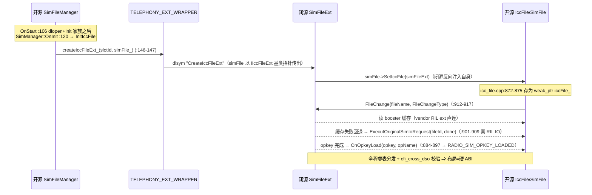
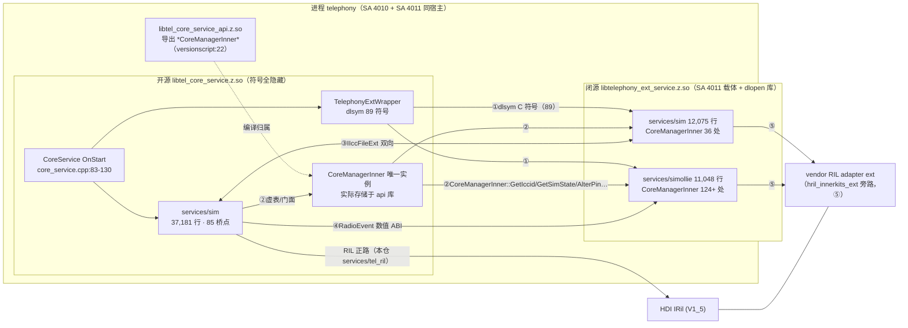

# SIM 开闭源功能边界分析报告

> 分析对象：华为 fork（hmos_trunk）telephony_core_service 的 SIM 卡管理体系（开源主实现 + 两闭源增强目录）
>
> 文档性质：只读架构逆向分析，不含任何代码修改。
>
> 与本仓既有文档的关系：`SIM_Target_Architecture_Design.md`、`SIM_Architecture_Refactor_Design.md`、`SIM_Multisim_Source_Architecture_Detailed_Design.md`、`SetPrimarySlotId_SetSimEnabledState_CallChain.md` 聚焦开源内部结构与目标架构；本文聚焦**开↔闭源跨界行为边界**，为上述重构工作提供兼容性护栏输入。`SetPrimarySlotId_SetSimEnabledState_CallChain.md` 第三部分与本文 SIM-OC-014 相互印证（其分析对象 multi_card_switch_manager 属本文 simollie 范围）。

---

## 1. 分析背景 / 目标 / 范围 / 方法 / 基线

### 1.1 目标
1. 明确三个目录的**功能归属与职责边界**（谁是主实现、谁是扩展），输出功能归属矩阵；
2. 识别闭源对开源的全部依赖，输出**数据流 + 调用链**分析；
3. 将依赖提炼为**编号兼容性契约（SIM-OC-001…）**，含证据（文件:行号）、破坏后果、测试护栏锚点，供未来在闭源不可见条件下重构开源 37k 行 SIM 模块时做兼容判断。

### 1.2 范围

| 编号 | 目录 | 行数 | 属性 |
|---|---|---|---|
| A 开源 | `base/telephony/core_service/services/sim/`（106 文件） | 37,181 | OHOS 公开源码，本仓 |
| B 闭源扩展 | `vendor/huawei/base/telephony/telephony_ext/services/sim/` | 12,075 | 闭源，对开源功能域做增强 |
| C 闭源独立 | `vendor/huawei/base/telephony/telephony_ext/services/simollie/` | 11,048 | 闭源，多卡/eSIM 电路切换/PIN 记忆子系统 |

**明确排除**（任务硬约束）：`services/multisim/`（本仓另一模块，全文未读取未分析，凡涉及其处均显式标注"超出分析范围"）。非目标：NAPI/Cangjie/ANI 绑定层（纯 IPC 客户端，不在闭源依赖面内）、独立仓业务（call_manager / sms_mms / cellular_data / data_storage）、vendor 仓非 SIM 模块（call / network_search / chr / power 等，仅在部署关系处提及）。

### 1.3 基线
- 开源仓 `code/base/telephony/core_service`：`5de9cebe5392bbe49055dd74bad2a418a5d64854`（2026-11-03）
- vendor 仓 `code/vendor/huawei/base/telephony/telephony_ext`：`9652c091b6ae1826404744d9ae9909ff2fef71ba`（2026-11-04）

### 1.4 方法
静态代码审计（未运行构建/测试/动态插桩，验证限度见 §11）：三目录全量清单与行数 → BUILD.gn / versionscript / sa_profile 构建部署面 → 桥接机制双向取证 → 开源侧 wrapper 全量调用点 `grep -rn`（85 处，附录 A.2）→ 两个子代理对 B/C 目录全量扫描（类职责 / 状态机事件集 / CoreManagerInner 调用统计），关键结论本人抽样复核。**证据锚点格式 `文件:行号`（相对各自仓根）**。

---

## 2. 总体架构：三目录如何协作

### 2.1 部署与进程模型（关键事实：双 SA 同进程）

| SA | 名称 | profile | libpath | 进程 | 依赖 |
|---|---|---|---|---|---|
| 4010 | CoreService（开源主 SA） | `sa_profile/4010.json` | `libtel_core_service.z.so` | **telephony** | — |
| 4011 | TelephonyExtService（闭源增强 SA） | vendor `sa_profile/4011.json` | `libtelephony_ext_service.z.so` | **telephony** | **depend: [4010]** |

- `libtelephony_ext_service.z.so`（vendor `services/BUILD.gn:6-61` 聚合 B、C 两个静态库及十余个模块）具有**双重身份**：① SA 4011 载体（samgr 拉起 Init）；② 被开源 SA 4010 进程 **dlopen** 的 hook 库（`services/core/src/core_service.cpp:106` 经 `TELEPHONY_EXT_WRAPPER.InitTelephonyExtWrapper()`）。
- 两 SA 同进程 "telephony" ⇒ **开闭源共享同一份进程级静态/单例**（CoreManagerInner、DelayedSingleton 等）。这消解了"单例多副本"风险，但把 OnInit 时序变成强契约（SIM-OC-002/005）。

### 2.2 五条跨界通道（核心发现）

```
开源 A (services/sim)                        闭源 B (ext/services/sim) / C (simollie)
──────────────────────                       ──────────────────────────────────────────
① wrapper dlopen/dlsym C 符号 ─────────────▶  extern "C" 实现（telephony_ext_manager.cpp 等）
   (telephony_ext_wrapper.cpp, 89 符号)

② CoreManagerInner 进程内门面 ◀─────────────  124+ 处(simollie) / 36 处(ext sim) 调用
   (tel_core_service_api.z.so 唯一实例)       ISimManager/ITelRilManager/IEsimManager 纯虚虚表

③ IIccFileExt 双向接口（文件加载 booster）──▶  SimFileExt 实现
   IccFile : IIccFileExt（开源继承实现）◀────  闭源反向回调开源（OnOpkeyLoad/ExecutOriginalSimIoRequest）

④ RadioEvent 枚举数值 + 事件范围注册 ───────▶  3 类事件依赖（账户/mapping/eSIM 电路）
   (radio_event.h, sim_manager.cpp:1240 分发表)

⑤ 旁路通道（不经上述接口）：
   闭源 ──ril_adapter_ext:hril_innerkits_ext──▶ vendor RIL adapter（绕过开源 services/tel_ril）
   闭源 ──DataShare/asset──▶ APN 等数据库、asset 保险箱
```

### 2.3 链路结构（符号为什么解析得通）

- 主 SA `libtel_core_service.z.so` **不导出任何符号**（`libtel_core_service.versionscript:8-13`：`extern "C++" {}` 空 + `local: *`）。
- `core_manager_inner.cpp` 只编译进 innerkits 共享库 `tel_core_service_api`（`interfaces/innerkits/BUILD.gn:66-76`），该库版本脚本显式导出 `*CoreManagerInner*`（`interfaces/innerkits/libtel_core_service_api.versionscript:22`）。
- 主 SA 依赖它（root `BUILD.gn:211-214` `deps = ["interfaces/innerkits:tel_core_service_api", "utils:libtel_common"]`）；闭源 C 静态库 external_deps 同样含 `core_service:tel_core_service_api`（vendor `services/simollie/BUILD.gn`），B 静态库含 `core_service:libtel_common`（vendor `services/sim/BUILD.gn`）。
- ⇒ 全进程**唯一** CoreManagerInner 实例（`frameworks/native/src/core_manager_inner.cpp:39-43` 函数内 static）。闭源调 `GetInstance()` 拿到的就是开源 SA OnStart 时 OnInit 注入的同一对象；闭源对其余开源类型（`ISimManager` / `ITelRilManager` / `IEsimManager` / `ICoreServiceCommonEventHub` 纯虚接口）走**虚表分发**，不需要主 SA 导出符号。
- 双侧 so 均开 `cfi_cross_dso`（root `BUILD.gn:32-36` / vendor `services/BUILD.gn:8-12`）——跨界虚表调用受 CFI 校验，接口类型布局变更会运行期崩溃，虚表 ABI 因此成为硬契约（SIM-OC-007）。

### 2.4 启动时序（契约基础）

`core_service.cpp` `OnStart → Init`（:83-130）顺序：

```
Publish(:93) → CommonEventHub Init + SetCommonEventHubObj(:96-99)
→ [OHOS_BUILD_ENABLE_TELEPHONY_EXT] InitTelephonyExtWrapper()(:105-107)   ← dlopen 闭源 so、dlsym 全部符号
→ TelRilManager::OnInit → SetTelRilMangerObj(:110-114)
→ [CORE_SERVICE_SUPPORT_ESIM] EsimManager → SetEsimManagerObj(:115-119)
→ SimManager::OnInit(slotCount)(:120-121)
→ ImsCoreServiceClient::Init(:123)
→ NetworkSearchManager::OnInit(:124-128)
→ CoreManagerInner::OnInit(network/sim/telRilManager)(:130)   ← isInitAllObj_ = true
```

OnStop 对称调用 `DeInitTelephonyExtWrapper()`（:150）。

**关键时序窗口**：wrapper 初始化（:106）**早于** SimManager 创建（:120）与 OnInit 完成（:130）；被 dlsym 拉起的闭源实例与 SA 4011 的 `TelephonyExtService::InitModule → SimollieService::Init`（vendor `services/common/service_base/`）共享同一进程静态，而 4011 由 samgr 按 depend 在 4010 之后拉起。⇒ 闭源符号必须容忍"managers 未就绪"的早期窗口，也依赖"4011 Init 晚于 4010 OnStart"的 samgr 语义（SIM-OC-001/002/005）。

### 2.5 符号与调用数量（事实结算）

- wrapper 全量 dlsym 字符串 **90 个**（含版权串 "License"，实际符号 89，`telephony_ext_wrapper.cpp` 附录 A.1）；其中 SIM 域消费 **30**、network 域 ~35、voicemail 域 ~10、cust/power/sense 等 ~20。
- 开源 sim 目录 wrapper 直接调用点 **85 处**，分布 14 文件（附录 A.2）。
- 闭源 ext versionscript（vendor `services/telephony_ext_service.versionscript`，148 行）导出：C++ 显式符号（`SimollieManager::*Link()` 族、`EsimSwitchManager::CheckEnableSim/EnableSim` :10-11 等）+ C 通配段 ~100 条（`RegistryCoreNotify*`、`SetActiveSim*`、`SwapM0M2SimCards*`… 附录 A.3）。
- 闭源→开源 `CoreManagerInner` 调用：C **124+ 处/32 方法**、B **36 处/20 方法**（子代理全量扫描 + 抽样复核）。

---

## 3. 功能归属矩阵（17 功能域 × 三目录）

图例：● 主实现（功能真身）｜◐ 扩展（对开源流程插桩/增强/转发）｜○ 独立功能（闭源自有场景）｜— 不涉及。

| # | 功能域 | A 开源 services/sim | B 闭源 ext/services/sim | C 闭源 simollie |
|---|---|---|---|---|
| 1 | SIM 状态机（插拔/锁卡/READY/ICC 状态） | ● `sim_state_manager.cpp`(1,142) `sim_state_handle.cpp`(1,343) | ◐ `sim_state_manager_ext.*` `sim_state_handler_ext.*` 状态处理插桩 | — |
| 2 | SIM 文件系统（EF 读写/记录加载） | ● `icc_file.cpp`(1,003) `sim_file.cpp`(2,150) `isim_file.cpp` `ruim_file.cpp` `plmn_file.cpp` 各 *_file_controller | ◐ `sim_file_ext.cpp`(284) `sim_record_ext.*` `sim_utils_ext.*`（booster 缓存快路径） | — |
| 3 | 运营商匹配 / Opkey | ● `operator_config_loader.cpp` `operator_matching_rule.cpp` `mcc_pool.cpp`(804) `operator_file_parser.cpp` | ◐ `command_params_factory.cpp`(429) + `value_parser.cpp`(324) 匹配参数与解析 | — |
| 4 | 多卡/主副卡切换（协议栈编排） | ● `multi_sim_controller.cpp`(2,531) `radio_protocol_controller.cpp` | — | ○ `multi_card_switch_manager.cpp`(1,974) + `_sim_detect.cpp`(1,724)：TSTS/多卡编排、热插拔/重启检测、冲突跳过 |
| 5 | SIM 账户（账户信息/DB） | ● `sim_account_manager.cpp` `sim_rdb_helper.cpp`(730) | ◐ `sim_manager_ext.cpp`(369) 账户事件插桩（:88 注册 RADIO_SIM_ACCOUNT_LOADED） | ◐ multi_card_switch_manager 改写账户 active |
| 6 | eSIM Profile 下载/管理 | ● `esim_manager.cpp` `esim_file.cpp`(4,053) `esim_controller.cpp`（`CORE_SERVICE_SUPPORT_ESIM` 门控，root `BUILD.gn:145-151`） | — | ○ `esim_switch_manager.cpp`(2,115) + `_ex.cpp`(1,713)：eSIM **电路切换**状态机（LsiCfg/SCI/槽位映射） |
| 7 | VSIM 软卡 | ◐ 分支遍布：`sim_rdb_helper.cpp:641/673`、`multi_sim_controller.cpp:1770-1772`、`sim_state_handle.cpp:680-681` | — | ○ `vsim_via_esim_manager.cpp`(263)（"SkyTone" profile 经 eSIM 通道，:126/:207/:247） |
| 8 | PIN/锁卡管理 | ● `sim_state_manager.cpp`（UnlockPin/AlterPin/SetLockState，RIL 直通） | ◐ `sim_lock_manager.cpp`(564) | ○ PIN 记忆/免解锁链：`simollie_manager.cpp`(406) `ror_pin_manager.cpp`(308) `sim_pin_utils.cpp`(194)（asset 保险箱） |
| 9 | STK（工具包命令） | ● `stk_controller.cpp`(798) `stk_manager.cpp` | ◐ STK 命令解析端：`gsm_alphabet.cpp`(1,249) `ber_tlv` `comprehension_tlv` | — |
| 10 | STK BIP（承载独立协议，AP 侧） | ◐ 转发入口：`stk_controller.cpp:77` initBip_、:404 sendEvent_ | ● `bip_proxy.cpp`(1,578) `cat_cmd_message.*`（AP 侧 socket、APN DataShare、TR 回送；`telephony_enhanced_bip` 门控） | — |
| 11 | IoT 卡检测/增强 | ◐ 框架级 `card_file_detect_manager.cpp` | ○ `sim_iot_send_notice_ext.cpp`(301) `sim_iot_http_req_ext.cpp`(266)（`telephony_enhanced_iot_card_detection` 门控） | — |
| 12 | 开关机/亮灭屏 SIM 功耗 | — | ○ `sim_tele_power_manager.cpp`(546) `sim_tele_power_event_handle.cpp` | ◐ power 消息适配（versionscript PowerService 族） |
| 13 | CHR 质量上报（华为私有） | — | ◐ `sim_chr_reporter.*` 转发 | ○ `simollie_chr_reporter.cpp`(214)（模块名 "SimModule" :167-168） |
| 14 | Voicemail 常量/参数 | ◐ `voice_mail_constants.cpp` 全部经 ext 符号转发（:31-95） | ● voicemail ext 符号族实现 | — |
| 15 | 多卡身份映射（slotId↔simId↔label） | ◐ `sim_manager.cpp:669-687` `multi_sim_helper.cpp:272` | ◐ `system_param_manager.cpp` | ○ `esim_switch_manager`（LsiCfg→label 映射） |
| 16 | 分布式通信/设备协同 | ◐ `sim_manager.cpp:1640-1650` 转发 | — | ○ versionscript `SwitchDistributedDevice*`/`UnRegisterDistributedDevState*`（调用方超出本文范围） |
| 17 | 基础设施工具/编解码 | ◐ 本仓 `utils/`（codec/vcard/common） | ○ 自带编解码（B 不依赖开源 utils） | — |

**结算**：17 域中开源主实现 **12**；B 为扩展/真身混合（BIP 与 voicemail 实现真身在 B，其余为插桩），无一替代开源主流程；C 独立承载 **6** 域（4/6/7/8-PIN记忆/13）。三者**无功能同构重复**：B 是"开源流程的旁路加速器 + 华为私有功能挂载点"，C 是"多卡拓扑编排层"——开源 `multi_sim_controller` 与 C 是**上下游**关系而非重复实现（见 SIM-OC-014）。

---

## 4. 各目录边界（内部职责 + 关键类）

### 4.1 A 开源 `services/sim`（37,181 行 / 106 文件 / 编入 `libtel_core_service.z.so`）

SimManager（1,825 行门面）按槽分派到四子模块：
- **SimStateManager + SimStateHandle**（1,142/1,343）：状态机与 PIN 直通 RIL；对闭源暴露 5 处 `cacheAssetPinForUpgrade_` 投递点（`sim_state_manager.cpp:222/262/299/346`、`sim_state_handle.cpp:457`）、热区指示（:396）、热插拔状态（:440）。
- **SimFileManager + IccFile 系**（1,012/1,003/2,150）：文件对象生命周期；与闭源 SimFileExt 双向绑定点 `sim_file_manager.cpp:145-147`。
- **MultiSimMonitor / MultiSimController / MultiSimHelper**（891/2,531）：账户加载、夜间升级、主副卡切换；12 处闭源桥调用点（附录 A.2）。
- **SimAccountManager / SimRdbHelper / StkController / StkManager / VoiceMailConstants / OperatorConfig 系**：账户 DB、STK 转发、voicemail 参数、运营商配置。
- 可选编入：`esim_manager.cpp` `esim_file.cpp` `esim_controller.cpp`（root `BUILD.gn:145-151`，`CORE_SERVICE_SUPPORT_ESIM`）。
- 85 处 wrapper 调用点**不包宏、只判空**（`symbol_ != nullptr` 模式）⇒ 公版构建（无 telephony_enhanced 部件 → 无 `OHOS_BUILD_ENABLE_TELEPHONY_EXT` 宏，`telephony_core_service.gni:29-33`）自动退化为原生行为。

### 4.2 B 闭源 `ext/services/sim`（12,075 行 / `ohos_static_library("telephony_ext_sim")` / 部件 telephony_enhanced）

与 A 的耦合面全部经公共接口：include 开源头文件分布——`core_manager_inner.h` 17 处、`sim_state_type.h` 10 处、`radio_event.h` 7 处、`observer_handler.h` 5 处（开源 `services/tel_ril/include`）、`i_icc_file.h` 3 处、`core_service_client.h` / `esim_service_client.h` 等。

- **SimFileExt / SimRecordExt / SimUtilsExt**：文件记录加载插桩——优先走 vendor RIL booster 缓存（`hril_innerkits_ext` 直连），失败回退开源真 IO（`sim_file_ext.cpp:59-61` 反调 `ExecutOriginalSimIoRequest`）。
- **sim_manager_ext.cpp(369) / sim_state_*_ext**：状态处理扩展位；`sim_manager_ext.cpp:88` 注册 `RADIO_SIM_ACCOUNT_LOADED`。
- **BIP 全套**（bip_proxy 1,578 + cat_cmd_message + command_params_factory + gsm_alphabet 1,249 + ber_tlv/comprehension_tlv + value_parser）：STK 主动命令解析、AP 侧 socket 收发、APN 库 DataShare 读写、TR/Envelope 经 `CoreManagerInner::SendTerminalResponseCmd/SendEnvelopeCmd` 回注开源。
- **SimLockManager(564) / SimTelePowerManager(546) / SimIotSendNoticeExt / SimIotHttpReqExt / sim_chr_reporter / voicemail 实现族 / SystemParamManager**：私有增强，多受 `telephony_enhanced_iot_card_detection / bip / esim` 及 `OHOS_BUILD_ENABLE_TELEPHONY_CUST` 类宏门控（vendor `telephony_ext_config.gni`）。
- 多数 dlsym C 符号实现落点：vendor `services/common/service_base/src/telephony_ext_manager.cpp`（982 行 export 块）及 `telephony_ext_service.cpp`；`GetStkBundleName` 返回硬编码包名 "com.huawei.hmos.simtoolkits"。

### 4.3 C 闭源 `simollie`（11,048 行 / `ohos_static_library("telephony_ext_simollie")` / `telephony_enhanced_simollie` 门控）

独立子系统：SIMOLLIE = 多卡形态编排器（TSTS 三卡、eSIM 电路切换、VSIM via eSIM、PIN 记忆免解锁）。
- **SimollieService(824)**：门面 + `DECLARE_DELAYED_SINGLETON`；`Init`（:66-90）由 SA 4011 `TelephonyExtService::InitModule` 拉起；承载 PIN 记忆调度、夜间升级重试、TAS 卡保护、卡文件检测转发、CHR 转发。
- **SimollieManager(406)**：PIN 记忆核心（asset 存取 + 经 CoreManagerInner `AlterPin/UnlockPin`）；`IsRememberPinEnabled` 三重判定（:49-70）、`UpdateRememberPin`（:160-200）。
- **EsimSwitchManager(2,115) + _ex(1,713)**：eSIM 电路切换状态机（`ProcessEvent` :167-216 → `ProcessEventEx` _ex:218-242）；事件集 `SET_SIMSLOTS_MAPPING_DONE / GET_SIMSLOTS_MAPPING_DONE / SET_SLOT{0,1,3}_STATE_DONE / GET_ESIM_LSI_CONFIG_DONE / SET_ESIM_LSI_CFG_WITH_SIMSLOT_CHANGE_DONE / SET_SIM_REPOWER_DONE / SET_DUAL_PSIM_WITHOUT_PROFILE / SET_ESIM_SCI_CONFIG_DONE / GET_MULTI_CARD_MODE_DONE` + RadioEvent `RADIO_ESIM_ENABLING/ENABLED/DOWNLOADING_PROFLIE_*` 系列。
- **MultiCardSwitchManager(1,974) + _sim_detect(1,724)**：TSTS/多卡切换编排（`SetSimEnabledState` 全链见 `SetPrimarySlotId_SetSimEnabledState_CallChain.md` 第三部分）、热插拔/重启载波类型推断、冲突跳过。
- **RoRPinManager / SimPinUtils**：PIN 恢复/重置与 asset 保险箱封装；**VsimViaEsimManager**：SKY 虚拟卡经 eSIM 通道；**SimollieChrReporter(214)**：模块名 "SimModule"。
- 与 A 的耦合**全部经 interfaces/innerkits 公共面**（`core_manager_inner.h` 124+ 处调用 / 32 方法、`radio_event.h`、`esim_service_client.h` 等），不 include A 的任何私有头。

---

## 5. 数据与状态所有权矩阵

| 数据/状态 | 唯一属主（写者） | 开源侧证据 | 闭源侧证据 | 风险注 |
|---|---|---|---|---|
| SIM 账户 DB（sim 表 active/enabled 等） | 形式上 A（SimRdbHelper）；拓扑切换场景 C 为主导写者 | `sim_rdb_helper.cpp:641/673` VSIM 分支 | `multi_sim_controller.cpp:440` `RetrieveSimActiveState` 后 `UpdateDBActiveByIccId` 回写链；B 读插桩 | ⚠ 多写者（SIM-OC-014 回写护栏） |
| APN 表（pdp_profile） | 无唯一属主 | `pdp_profile_rdb_helper.cpp`（A 有独立 helper） | B `bip_proxy` 经 DataShare 读改 APN | ⚠ R4 双写 |
| Opkey/运营商配置缓存 | A：OperatorConfigLoader 装载 | `multi_sim_monitor.cpp:227-238` 触发 `checkOpcVersionIsUpdate_/updateOpcVersion_` | 版本提升逻辑在 B（`GetOpkeyVersion` dlsym） | 升级触点在开源 monitor |
| PIN 记忆资产（asset 保险箱） | C（SimPinUtils，`telephony_enhanced_simollie` 门控 `asset:asset_sdk`） | A 只投递（5 个触发点，SIM-OC-013） | `simollie_manager.cpp:160-200`、`ror_pin_manager.cpp` 消费存储 | 载荷契约安全级 |
| booster 文件缓存（RIL 层加速缓存） | vendor RIL 侧（三目录之外） | A 经文件加载回调桥接 | B `sim_file_ext.cpp:59-61` 优先读、失败回退 A 真 IO | ⚠ R5 双路径一致性窗口 |
| LsiCfg / SCI / eSIM 槽位映射 | C（EsimSwitchManager） | A 只读查询：`multi_sim_helper.cpp:272` `GetSimLabelIndexFromLsiCfg` | C 全套状态机 + SET/GET_ESIM_LSI_CONFIG_DONE | SIM-OC-015 |
| RadioEvent 事件流 | A 发布（开源状态机）+ C 发布（SET_*_DONE / mapping 段） | `multi_sim_monitor.cpp:327` NotifyObserver、:418 SendTelEvent；`esim_manager.cpp:421/449` 处理 RADIO_ESIM_ENABLED_PROFILE_NUM | C 自家 handler 发布完成事件，经 PublishMultiCardChange（`core_manager_inner.h:433-434`）回灌 | 事件 ID ABI（SIM-OC-010） |
| CHR 上报流 | C 主、B 辅 | 触发转发 `multi_sim_monitor.cpp:328` | `simollie_chr_reporter.cpp:167` / `sim_chr_reporter` | — |

---

## 6. 跨仓依赖与调用链分析

### 6.1 构建依赖图

```
A 编译单元（开源）:
  tel_core_service.z.so ←deps─ { tel_core_service_api, libtel_common, (libtel_vcard) }   (root BUILD.gn:211-218)

B/C 静态库（vendor telephony_enhanced 部件）:
  telephony_ext_sim:      external_deps ← core_service:libtel_common,
                          ril_adapter_ext:hril_innerkits_ext, call_manager, cellular_data, ffrt, hdf_core …
  telephony_ext_simollie: external_deps ← core_service:libtel_common + core_service:tel_core_service_api,
                          asset:asset_sdk(门控), screenlock_mgr, preferences, ril_adapter_ext …
  ↓ 同链入
  libtelephony_ext_service.z.so（vendor services/BUILD.gn:6；deps 14 模块：sim:telephony_ext_sim :35、
     simollie :42-46 门控；version_script :59；cfi_cross_dso）
```

### 6.2 开源侧 wrapper 调用链（85 处调用点 / 30 个 SIM 域符号）

| 开源文件 | 点数 | 闭源符号（代表行） | 语义 |
|---|---|---|---|
| sim_manager.cpp | 12 | getSlotIdExt_/getSimIdExt_(:669-687)、UpdateSubState(:1239-1241)、registerEsimSwitchNotify_(:1264-1268)、unregisterEsimSwitchNotify_(:1290-1294)、isDistributedCommunicationConnected_(:1640)、GetRealSimCountExt(:1650) | 身份映射 / VSIM 子状态 / eSIM 电路事件注册 / 分布式查询 |
| multi_sim_controller.cpp | 9 | RetrieveSimActiveState(:440)、SwapM0M2(:526)、SwapTwoModem(:531)、SetActiveSimFunc(:1328)、isHandleVSim_(:1770-1772/:2342)、SendSimChgTypeInfo(:1905) | 卡切换编排桥（外挂于本仓 radio_protocol_controller 决策） |
| multi_sim_monitor.cpp | 6 | checkOpcVersionIsUpdate_/updateOpcVersion_(:227-238)、ReportEventToChr(:328)、getVSimSlotId_(:429-431)、notifyRebootDetectSim_(:653-654) | 配置升级阻断 / CHR / 重启检测 |
| sim_state_manager.cpp / sim_state_handle.cpp | 7 | cacheAssetPinForUpgrade_ ×5、publishContainerDisableHotZoneInd_(:396)、updateHotPlugCardState_(:440)、isVSimEnabled_(:680) | PIN 投递 / 热区 / 热插拔 |
| voice_mail_constants.cpp | 8 | init/deinit/reset/Get{Fixed,Number,Tag}VoiceMail*Ext(:31-95) | voicemail 全代理 |
| icc_file.cpp / sim_file.cpp / isim_file.cpp | 10 | createIccFileExt_ 判空 ×6、onAllFilesFetchedExt_ ×2（sim_file.cpp:259 / isim_file.cpp:97）、setVoiceMailOnSimExt ×4（sim_file.cpp:803/:839） | IIccFileExt 桥 |
| sim_file_manager.cpp | 4 | createIccFileExt_(:146-147)、getVoiceMailIccidParameter_(:411-413)、setVoiceMailIccidParameter_(:579-581) | 文件对象工厂注入 |
| stk_controller.cpp / stk_manager.cpp | 6 | initBip_(:77)、GetStkBundleName(:186-190)、sendEvent_（stk_controller.cpp:404 / stk_manager.cpp:71） | STK/BIP 转发 |
| sim_rdb_helper.cpp / operator_config_loader.cpp / multi_sim_helper.cpp | 4+ | isVSimEnabled_ ×2、getRoamingBrokerNumeric/Imsi(opconfig:88-89/:154-156)、GetSimLabelIndexFromLsiCfg(:272) | VSIM DB 分支 / roaming broker / LsiCfg |

### 6.3 闭源→开源调用链（CoreManagerInner 门面，~200 方法）

- **C 多卡主链**：`MultiCardSwitchManager::SetSimEnabledState`（vendor `multi_card_switch_manager.cpp:1308`）→ `CoreManagerInner::GetInstance().GetSimState/GetSimIccid/…` → `ISimManager`（开源 SimManager 实例虚表）→ 开源四子模块。
- **C PIN 记忆链**：`SimollieManager::UpdateRememberPin`（:160-200）→ CoreManagerInner `AlterPin/UnlockPin` → `sim_state_manager`。
- **C eSIM 电路链**：`EsimSwitchManager` 收 `RADIO_ESIM_ENABLING/ENABLED_PROFLIE_*`（开源 `esim_manager.cpp:421/:449` 分发）驱动 LSI_CONFIG 状态机，完成经 `PublishMultiCardChange`（`core_manager_inner.h:433-434`）回灌开源。
- **B 文件 booster 主链**：开源 `SimFileManager::InitIccFile` 在 `simFile_->Init()` 后调 `createIccFileExt_(slotId_, simFile_)`（`sim_file_manager.cpp:145-147`）→ B 构造 SimFileExt 并反调 `simFile->SetIccFile(simFileExt)`（开源实现 `icc_file.cpp:872-875`，weak_ptr 存储）→ 开源每次 `FileChangeToExt`（`icc_file.cpp:912-917`）通知闭源文件变更 → 闭源读 booster 缓存或反调 `ExecutOriginalSimIoRequest`（开源 `icc_file.cpp:901-909`，走 `fileController_->ObtainBinaryFile` 真 RIL IO）→ opkey 加载完成闭源反调 `OnOpkeyLoad`（开源 `icc_file.cpp:884-897` 广播 `RADIO_SIM_OPKEY_LOADED`，载荷 [slotId, opkey, opName]）。

### 6.4 旁路通道

1. **RIL 旁路**：B/C 经 `ril_adapter_ext:hril_innerkits_ext` 直连 vendor RIL adapter（`SimExtGetIccid / GetMatchFile / SetSimSlotsMapping` 族）——开源 `services/tel_ril` 状态机看不到这些请求 ⇒ R3 时序盲区。
2. **DataShare / asset 旁路**：见 §5（APN 表、asset、persist 参数）。
3. wrapper 亦 dlopen `libtel_vsim_symbol.z.so`、`libtel_dynamic_load_service.z.so`（`telephony_ext_wrapper.cpp` Init 家族 :49-63），VSIM 符号族（getSlotIdExt_/getSimIdExt_/getVSimSlotId_/isVSimEnabled_/isHandleVSim_/IsVSimInDisableProcess_/PutVSimExtraInfo_ 等）实现在 vendor `vsim_service/`——**不属于本文三目录**，开源调用点已在附录 A.2 标注归属。

### 6.5 与周边 SA 的边界

SIM 域跨界仅涉及：call_manager（B external_deps，BIP/来电协同）、cellular_data（B/C external_deps，APN/链路查询）、power_manager（vendor power 模块 + 4011 profile 的 `min_hdi_proxy_version: [libdcall_proxy_1.0.z.so, libsensor_proxy_3.0.z.so, libfactory_proxy_1.0.z.so]` 声明）、asset（C）。通话/短信/数据状态机在独立仓（本仓边界口径）。

### 6.6 关键序列（IIccFileExt 双向链）



---

## 7. 兼容性重构契约清单（SIM-OC-001…016）

格式：**契约内容 / 证据 / 破坏后果 / 测试护栏锚点**。"闭源不可见条件下重构开源" = 以下条目为行为不变式。

### SIM-OC-001 进程与部署契约
- 内容：SA 4010 与 SA 4011 必须同进程 "telephony"，4011 depend 4010；`libtelephony_ext_service.z.so` 兼具 SA 载体与 dlopen 库双重身份，其进程级静态被两侧共享。
- 证据：`sa_profile/4010.json`、vendor `sa_profile/4011.json`（process/depend/libpath 字段）、`core_service.cpp:106`。
- 破坏后果：进程拆分 → CoreManagerInner 多副本、事件跨进程丢失（对应全局护栏 state-singleton-consistency 红线）。
- 护栏：sa_profile 属架构红线文件，任何改动需专项评审。

### SIM-OC-002 wrapper 初始化时序契约
- 内容：`InitTelephonyExtWrapper()`（`core_service.cpp:105-107`，宏 `OHOS_BUILD_ENABLE_TELEPHONY_EXT` 门控，定义于 `telephony_core_service.gni:29-33`）必须发生在 TelRilManager / SimManager / NetworkSearchManager 创建之前、`CoreManagerInner::OnInit`（:130）之前；OnStop 对称 DeInit（:150）。闭源符号必须容忍 managers 未就绪窗口；开源不得在 wrapper Init 与 OnInit 之间插入依赖 ext 返回值的逻辑。
- 证据：`core_service.cpp:83-150` 全序；wrapper Init 家族 `telephony_ext_wrapper.cpp:46-63`（ForDynamicLoad/ForSim/ForSim1/ForNetWork/ForVoiceMail/ForCust/ForVSim/ForOpkeyVersion/ForOpnameVersion/ForSense）。
- 破坏后果：时序前移 → 闭源拿到未 OnInit 单例；后移 → SimFileManager 扩展文件缺失（静默功能劣化）。
- 护栏：core_service_gtest 启动序覆盖 + `test/mock/telephony_ext_wrapper/telephony_ext_wrapper.h`。

### SIM-OC-003 dlsym C 符号 ABI 冻结（SIM 域 30 符号，全集 89）
- 内容：下表符号名、参数/返回类型、**"判空即跳过"调用语义**（85 处调用点统一 `if (symbol_ != nullptr)`，无同步阻塞、无必需返回值假设）不得变更；新增只允许追加。typedef 与成员声明见 `telephony_ext_wrapper.h:133-138/:224-265`（RegisterEsimSwitchNotify/RegistryCoreNotify 等）。

| 符号 | 开源调用点（代表） | 闭源实现 |
|---|---|---|
| CreateIccFileExt | sim_file_manager.cpp:146-147；判空 icc_file.cpp:831/:915、sim_file.cpp:378/:428/:480/:515 | B（SimFileExt 构造 + SetIccFile 反注入） |
| InitBip / SendEvent | stk_controller.cpp:77 / :404、stk_manager.cpp:71 | B BipProxyManager |
| GetStkBundleName | stk_controller.cpp:186-190 | B，返回 "com.huawei.hmos.simtoolkits" |
| SetActiveSim | multi_sim_controller.cpp:1328（SetActiveSimFunc 冲突路径） | B/C |
| RetrieveSimActiveState | multi_sim_controller.cpp:440（`isSupportEsimMep_ &&` 门控，后接 UpdateDBActiveByIccId 回写） | C |
| SwapM0M2SimCards / SwapTwoModemSimCards | multi_sim_controller.cpp:526 / :531 | C（eSIM/双 modem 拓扑重排） |
| GetRealSimCountExt / IsDistributedCommunicationConnected | sim_manager.cpp:1650 / :1640 | B/C |
| NotifyRebootDetectSim | multi_sim_monitor.cpp:653-654（tstsMode_ 门控） | C sim_detect |
| UpdateHotPlugCardState | sim_state_handle.cpp:440-441（携 externalState） | C |
| CacheAssetPinForUpgrade | sim_state_manager.cpp:222/:262/:299/:346-351、sim_state_handle.cpp:457-458 | C（asset 记忆） |
| GetSimLabelIndexFromLsiCfg | multi_sim_helper.cpp:272 | C LsiCfg |
| UpdateSubState / IsHandleVSim / IsVSimInDisableProcess / PutVSimExtraInfo / GetVSimSlotId / IsVSimEnabled | sim_manager.cpp:1239-1241、multi_sim_controller.cpp:1770-1772/:2342、multi_sim_monitor.cpp:429-431、sim_rdb_helper.cpp:641/:673、sim_state_handle.cpp:680-681 | vendor vsim_service（超出三目录，标注） |
| SavePreferredNetworkValue / SendSimChgTypeInfo / ReportEventToChr | versionscript 导出；调用点 multi_sim_controller.cpp:1905、multi_sim_monitor.cpp:328 | B/C |
| GetRoamingBrokerNumeric / GetRoamingBrokerImsi | operator_config_loader.cpp:88-89 / :154-156 | B |
| OnAllFilesFetchedExt | sim_file.cpp:259-260、isim_file.cpp:97-98 | B |
| SetVoiceMailOnSimExt / Get/SetVoiceMailIccidParameter | sim_file.cpp:803-805/:839-840、sim_file_manager.cpp:411-413/:579-581 | B |
| CheckOpcVersionIsUpdate / UpdateOpcVersion | multi_sim_monitor.cpp:227-238（operator config 装载阻断语义） | B |
| voicemail 族 Init/Deinit/Reset/GetFixed/GetNumber/GetTag… | voice_mail_constants.cpp:31-95 | B（`OHOS_BUILD_ENABLE_TELEPHONY_CUST` 类宏门控） |
| PublishContainerDisableHotZoneInd | sim_state_handle.cpp:396-398（携 containerId/enable） | B/C |

- 证据：`telephony_ext_wrapper.cpp` 全部 dlsym 串（:148/:152/:187-189 等）；ext versionscript 通配段。
- 破坏后果：改名/签名变更 → dlsym 恒 null → 静默功能劣化（无崩溃、无报错、只 LOGE）。
- 护栏：附录 A.2 全表即回归基线；mock 头结构同构断言。

### SIM-OC-004 versionscript 导出契约（含既有断链事实）
- 内容：vendor `services/telephony_ext_service.versionscript`（148 行）的导出集合是 wrapper dlsym 的对端**白名单**；wrapper 侧任何新增 dlsym 必须同步进入该脚本（C++ 段精确签名或 C 段通配）。
- 证据：C++ 段 :5-38（`SimollieManager::IsRememberPinSupportedLink()/IsRememberPinEnabledLink(int,bool&)/SetRememberCachePinFlagLink(SetPinSavingFlagParam&)/UpdateRememberPinLink(UpdatePinParam&)/TransAssetPinData()`、`EsimSwitchManager::CheckEnableSim/EnableSim` :10-11）；C 通配段 :40-144（`RegistryCoreNotify*`、`UnRegistryCoreNotify*`、`SetActiveSim*`、`SwapM0M2SimCards*`、`SwapTwoModemSimCards*`、`GetRealSimCountExt*`、`RetrieveSimActiveState*`、`CacheAssetPinForUpgrade*`、`SendSimChgTypeInfo*`、`ReportEventToChr*`、`NotifyRebootDetectSim*`、`UpdateHotPlugCardState*`、`SavePreferredNetworkValue*`、`GetSimLabelIndexFromLsiCfg*` 等）。
- **既有断链事实（风险 R1）**：`RegisterEsimSwitchNotify` / `UnregisterEsimSwitchNotify` 被 wrapper dlsym（`telephony_ext_wrapper.cpp:187-189`），vendor 有实现与内部转发（`telephony_ext_manager.cpp:779-787` → `esim_switch_manager_ex.cpp:143`），**但 versionscript 未导出** → dlsym 恒 null → 开源注册 eSIM 电路切换事件的路径（sim_manager.cpp:1262-1268）当前不可用（LOGE 后 return）。开源重构**不得假设该链路可用，亦不得删除该 dlsym 尝试**（恢复导出后自动生效）。
- 破坏后果：导出集合与 dlsym 集合脱节 → 静默丢功能（本次已实证一例）。
- 护栏：可脚本化 —— wrapper dlsym 串 × versionscript 导出集 diff 审计（建议项，见 §10.2）。

### SIM-OC-005 CoreManagerInner 进程内唯一实例契约
- 内容：`core_manager_inner.cpp` 编译归属仅 `tel_core_service_api`（`interfaces/innerkits/BUILD.gn:66-99`）与其导出 `*CoreManagerInner*`（`libtel_core_service_api.versionscript:22`）不得改变；`GetInstance`（函数内 static，`core_manager_inner.cpp:39-43`）、`OnInit`（:45-52 三 manager 注入 + `isInitAllObj_=true`）、分步注入 `SetTelRilMangerObj/SetEsimManagerObj/SetCommonEventHubObj`（`core_service.cpp:99/:114/:119/:130` 调用时序）语义保留。
- 证据：§2.3 全链。
- 破坏后果：把 core_manager_inner.cpp 编入主 SA（versionscript 空）→ 闭源链接符号悬空/解析到未初始化实例；编入两处 → 单例撕裂、状态不一致。
- 护栏：构建面静态断言（libtel_core_service_api.z.so 必须导出 `*CoreManagerInner*`）+ 复用本条映射全局护栏 state-singleton-consistency。

### SIM-OC-006 CoreManagerInner 门面方法集冻结
- 内容：闭源消费的 32（C）/20（B）个方法（GetSimState/GetSimIccid/GetSimOperator/Numeric/AlterPin/UnlockPin/SetSimLock/GetSim…slotId 族/SendTerminalResponseCmd/SendEnvelopeCmd/RegistrySimState…）的签名、返回码语义（telephony_errors.h）、线程与调用时机语义不得变更；新增只允许追加；底层 `ISimManager`/`ITelRilManager`/`IEsimManager`/`ICoreServiceCommonEventHub` 纯虚接口同步冻结。
- 证据：`core_manager_inner.h`（~200 声明，PublishMultiCardChange :433-434）；B/C include 分布（core_manager_inner.h 17 处）；调用统计 124+/36（子代理全量扫描，抽样复核）。
- 破坏后果：签名/语义变更编译零告警，但闭源运行期行为劣化或 CFI 崩溃（虚表不匹配）。
- 护栏：现有 15 gtest 工程中门面相关用例（sim_core_service_test.cpp 等）+ 语义级回归。

### SIM-OC-007 IIccFileExt 双向虚表契约
- 内容：开源 `IccFile : public IIccFileExt, public TelEventHandler`（`icc_file.h:43`）。开源→闭源调用：`ClearData()`（`icc_file.cpp:828-832`）、`FileChange(fileName, FileChangeType)`（`icc_file.cpp:912-917`）、`LoadSimMatchedFileFromRilCache / ByEfid`（`sim_file.cpp:378/:428/:480/:515`）、`GetCachedFileResult/GetCachedIccidResult(MessageParcel)` 等。闭源→开源调用（开源基类实现）：`OnOpkeyLoad(opkey, opName)`（`icc_file.cpp:884-897`）、`ExecutOriginalSimIoRequest(fileId, doneId)`（`icc_file.cpp:901-909`）、`ProcessExtGetFileDone(InnerEvent)`（`icc_file.cpp:868` 附近 ProcessEvent 转发）、`SetMatchSimStateTracker`。所有权方向：**闭源 shared 持开源对象，开源 weak 持闭源对象**（`SetIccFile` 实现 `icc_file.cpp:872-875` 存 `std::weak_ptr`；无环、无双重释放）。`FileChangeType` 枚举数值（`interfaces/innerkits/include/i_icc_file.h`：INVALID_FILE_OPE / ICCID_FILE_LOAD / GID1_FILE_LOAD / GID2_FILE_LOAD / SPN_FILE_LOAD / C_IMSI_FILE_LOAD / G_IMSI_FILE_LOAD / G_MCCMNC_FILE_LOAD / ALL_FILE_LOAD）冻结。
- 证据：B `sim_file_ext.cpp:59-61`（回退调用开源真 IO）。
- 破坏后果：虚方法重排/删除 → cross-dso CFI 崩溃或错误函数命中；枚举值变更 → 闭源文件匹配错乱 → booster 缓存写错场（仅厂版场景可复现）。
- 护栏：FileChangeType 枚举值固化断言 + 文件解析类 fuzz 用例（仓约束：解码类改动必跑 fuzzer）。

### SIM-OC-008 文件加载桥接时序契约
- 内容：`createIccFileExt_(slotId_, simFile_)` 必须发生在 `simFile_->SetRilAndFileController / SetId / SetOperatorConfigHisysevent / Init` 之后（`sim_file_manager.cpp:140-147`）；闭源对象生命周期跟随开源 simFile（weak_ptr 失效安全）。
- 破坏后果：顺序倒置 → 闭源拿不到 controller/配置 → booster 初始化失败（静默劣化）。
- 护栏：sim_gtest 中 SimFileManager::InitIccFile mock 路径（test/mock 头导入）。

### SIM-OC-009 OnOpkeyLoad 回调契约
- 内容：opkey/OpName 记录加载完成由**闭源判定**并经 `OnOpkeyLoad(opkey, opName)` 通知开源；开源广播 `RADIO_SIM_OPKEY_LOADED`（filesFetchedObser_，载荷 vector [slotId, opkey, opName]，`icc_file.cpp:884-897`）；开源 OperatorConfig 流程此后进入 opkey 定制（mcc_pool/opkey 联动）。
- 破坏后果：载荷顺序/数量变更 → 运营商定制错乱（特定运营商 bundle 场景）。
- 护栏：OperatorConfig 相关 gtest + 观察者广播断言。

### SIM-OC-010 RadioEvent 枚举数值冻结
- 内容：`interfaces/innerkits/include/radio_event.h` 数值是对外 ABI：`RADIO_SIM_ACCOUNT_LOADED`(:204)、`RADIO_ESIM_ENABLING_PROFLIE_START = 1121`（:284 附近段起点）、`RADIO_ESIM_ENABLED_PROFILE_NUM`（:294，注释"参数为当前使能的 profile 数量"）、`RADIO_MULTICARD_MAPPING_BEGIN = 1143` / `…_END`(:299-300)、`RADIO_ESIM_SWITCH_CIRCUIT_BEGIN…RADIO_ESIM_SWITCH_END` 段。**只允许尾追加，不得重排/插值**（与 IPC 接口码同构约束，本仓 AGENTS.md）。
- 证据：开源消费点 `esim_manager.cpp:421/:449`、`multi_sim_monitor.cpp:327/:418/:357-359`；C 侧 SET_*_DONE 自定义事件与 RadioEvent 对照（子代理事件集扫描）。
- 破坏后果：重排后跨 so 语义错乱 → 状态机串台。
- 护栏：枚举值快照断言（guard 扩展建议，现有 test/guard/global_guard 不做此校验）。

### SIM-OC-011 事件注册范围分发表契约
- 内容：`sim_manager.cpp:1240-1296` Register/UnRegisterCoreNotify 按 event 区间路由：`RADIO_IMSI_LOADED_READY..RADIO_SIM_RECORDS_LOADED → simFileManager_[slotId]`；`RADIO_SIM_STATE_CHANGE..RADIO_SIM_STATE_SIMLOCK → simStateManager_[slotId]`；`RADIO_SIM_ACCOUNT_LOADED → multiSimMonitor_`（放宽至 VSIM 槽位 :1249-1253）；`RADIO_ESIM_SWITCH_CIRCUIT_BEGIN..RADIO_ESIM_SWITCH_END → 闭源`（当前断链，R1）；其余 LOGE 拒绝。UnRegister 同构（:1271-1296）。
- 破坏后果：区间边界变动 → 开闭源订阅互相吞噬。
- 护栏：sim_gtest 路由断言 + 区间边界专项用例。

### SIM-OC-012 BIP/STK 转发契约
- 内容：`initBip_(slotId)`（`stk_controller.cpp:77-78`，栈初始化时启用 BIP）、`sendEvent_`（`stk_controller.cpp:404-405` / `stk_manager.cpp:71-72`，STK 事件转发闭源解析）；TR/Envelope 回送由闭源调用 CoreManagerInner `SendTerminalResponseCmd/SendEnvelopeCmd` —— STK 响应语义闭环在 B。`GetStkBundleName` 返回值语义 = STK 应用包名（B 返回 "com.huawei.hmos.simtoolkits"）。
- 破坏后果：开源重构 StkController/StkManager 丢失钩子 → BIP 全链失效（TR 无法回 modem，STK 命令超时）。
- 护栏：`tel_stk_controller_test.cpp` + STK 相关 fuzz 基线。

### SIM-OC-013 PIN 记忆投递契约（安全级）
- 内容：开源在 5 个触发点（UnlockPin 成功 `sim_state_manager.cpp:222-224`、UnlockPin2 :262-264、:299-301、SetLockState :346-351、SIM_ABSENT 上报点 `sim_state_handle.cpp:457-458`）以 `cacheAssetPinForUpgrade_(slotId, iccid, PinOperationType 枚举值, pin 明文)` 投递（iccid 来自 `simStateHandle_->GetIccid()`）。`PinOperationType`（sim_state_type.h）数值与传参顺序是载荷契约；asset 存取属主为 C。**PIN 明文经函数指针跨界传递**为既定事实（同进程内）。
- 破坏后果：载荷字段语义/顺序变更 → PIN 记忆错误解锁（安全事件级后果，修复优先级最高）。
- 护栏：sim_state_manager/sim_state_handle gtest 现有 CACHE_PIN 注入路径覆盖 + 建议 mock 断言载荷（§10.2）。

### SIM-OC-014 多卡切换桥接契约
- 内容：开源 `multi_sim_controller.cpp` 在协议栈决策分支前/中/后调用闭源：`RetrieveSimActiveState`（:440，isSupportEsimMep_ 门控，回读后 `UpdateDBActiveByIccId` 写库）、`SwapM0M2SimCards`（:526）/`SwapTwoModemSimCards`（:531）、`SetActiveSimFunc`（:1328 冲突路径）、`SendSimChgTypeInfo`（:1905）；`multi_sim_monitor.cpp:653-654` `notifyRebootDetectSim_`（tsts 门控）。C 侧完成后经 CoreManagerInner / `PublishMultiCardChange`（`core_manager_inner.h:433-434`）回灌开源。C 侧全链（`MultiCardSwitchManager::SetSimEnabledState`，`multi_card_switch_manager.cpp:1308` 起）已在 `SetPrimarySlotId_SetSimEnabledState_CallChain.md` 第三部分独立取证，两文互证。
- 破坏后果：重构 radio_protocol_controller / multi_sim_controller 分支结构时移动这些调用点 → 拓扑状态与 DB 不一致、重启检测漏检。
- 护栏：`multi_sim_controller_gtest.cpp` / `vsim_test.cpp` 现有覆盖 + 补拓扑场景（§10.2）。

### SIM-OC-015 SIM 身份整数语义契约
- 内容：`SimSlotType { INVALID_SLOT_ID = -1, VSIM_SLOT_ID = 2 }`（wrapper 与 test mock 头同值同构）；`getSlotIdExt_/getSimIdExt_`（`sim_manager.cpp:669-687`）slotId↔simId 双射由闭源（vsim_service/system_param_manager）保证；`GetSimLabelIndexFromLsiCfg`（`multi_sim_helper.cpp:272`）从 C 的 LsiCfg 推 label 索引。
- 破坏后果：slotId/simId/label 任一语义重定义 → 闭源 LsiCfg 解析错位（SIM_Target_Architecture_Design §3.3 亦将 slotId 多重语义列为热点）。
- 护栏：整数映射断言（vsim_test.cpp 部分覆盖）。

### SIM-OC-016 条件编译与构建符号契约
- 内容：开源宏集：`OHOS_BUILD_ENABLE_TELEPHONY_EXT`、`OHOS_BUILD_ENABLE_TELEPHONY_VSIM`（`telephony_core_service.gni:29-33`，随 `global_parts_info.telephony_telephony_enhanced`）、`CORE_SERVICE_SUPPORT_ESIM`（gni:35-37 → root `BUILD.gn:145-151` esim 三文件 + :101-114 tel_core_service_api esim 源 + :174-178 include 列表）。vendor declare_args：`telephony_enhanced_simollie / bip / esim / iot_card_detection`（vendor `telephony_ext_config.gni`，控制 B 源集合与 C 聚合）。部件依赖名 `core_service:libtel_common`、`core_service:tel_core_service_api` 不可更名/降级。
- 破坏后果：宏/部件名变更 → 公版/厂版切建成错误产物、闭源仓编译破坏。
- 护栏：公版构建定期验证（无 telephony_enhanced 部件时 85 判空点全走原生路径）+ AGENTS.md 部件编译基线（hb 命令）。

---

## 8. 隐式行为契约与风险清单

| # | 风险 | 事实依据（证据） | 级别 |
|---|---|---|---|
| R1 | **versionscript 断链**：`RegisterEsimSwitchNotify/UnregisterEsimSwitchNotify` dlsym 恒 null，开源对 eSIM 电路事件的注册被静默丢弃（LOGE 后 return，无重试无降级） | wrapper.cpp:187-189；vendor telephony_ext_manager.cpp:779-787 有实现；versionscript 无该导出（grep EsimSwitch 仅 :10-11 命中 CheckEnableSim/EnableSim）；sim_manager.cpp:1262-1268/:1288-1294 | **高**（契约-实现-导出三方不一致，需闭源仓裁决） |
| R2 | **单例撕裂面**：全架构依赖"core_manager_inner.cpp 只编译于 tel_core_service_api 且其 versionscript 导出"这一隐式事实；任何把它移入主 SA 或拆副本的重构直接撕裂状态 | §2.3；libtel_core_service_api.versionscript 全文仅 71 行，:22 一行导出 | 高（重构敏感） |
| R3 | **RIL 旁路时序盲区**：B/C 直连 `hril_innerkits_ext`（SimExtGetIccid/GetMatchFile/SetSimSlotsMapping 族）未经开源 tel_ril → 开源 SIM 状态机观测不到中间状态，跨界处存在事件竞态窗口 | B/C external_deps；B sim_file_ext.cpp:59-61 缓存依赖 | 中-高 |
| R4 | **DataShare 多写者**：B BIP 读改 APN 表；C 改写 sim 账户 active（UpdateDBActiveByIccId 链）；开源 SimRdbHelper 亦写同库 | §5 表 | 中 |
| R5 | **双读路径一致性**：文件记录加载存在"闭源 booster 缓存直读 + 开源真 RIL IO"两条路径，切换窗口内状态可不一致 | SIM-OC-007；sim_file_ext.cpp:59-61 回退逻辑 | 中 |
| R6 | **注册失败即静默**：85 处调用点统一"判空跳过 + LOGE"（fail-loud 缺失），公版与断链场景的行为差异只能靠日志事后追溯 | 附录 A.2 各行 | 中（可观测性） |
| R7 | **托底告知时点**：`NotifyRebootDetectSim`（tsts）与 `UpdateHotPlugCardState` 依赖开源状态机在特定时点"告知"，重构 sim_state_handle 时序时易破坏 tsts 流程 | sim_state_handle.cpp:440-441；multi_sim_monitor.cpp:653-654 | 中 |
| R8 | **同 so 双宿主**：libtelephony_ext_service.z.so 既被 samgr 以 SA4011 加载（同进程）又被 wrapper dlopen（引用计数复用）——其内部 static/DelayedSingleton 与两次加载方式天然一致，但架构上依赖这一微妙事实 | §2.1/2.2；core_service.cpp:106 | 中（文档化约束） |
| R9 | **HDI proxy 版本耦合**：4011 profile 声明 min_hdi_proxy_version（libdcall_proxy_1.0 / libsensor_proxy_3.0 / libfactory_proxy_1.0）——闭源对 HDI proxy 存在运行时版本校验 | vendor sa_profile/4011.json | 低（部署面） |

---

## 9. 重构约束（开源侧"盲改"红线清单）

违反任一条即在闭源不可见条件下破坏兼容：

1. **不得**改动 `services/telephony_ext_wrapper/` 的 dlsym 符号串/函数指针 typedef/Init 家族切分（SIM-OC-003/004）；新增走追加。
2. **不得**移动 `InitTelephonyExtWrapper()` 调用位置，不得在 wrapper Init 与 `CoreManagerInner::OnInit` 之间插入依赖 ext 返回值的逻辑（SIM-OC-002）。
3. **不得**把 `core_manager_inner.cpp` 编入主 SA 或任何第二 SO；不得改 GetInstance 存储形式与 OnInit 注入语义（SIM-OC-005 / R2）。
4. **不得**对 CoreManagerInner 现有方法做签名/返回码/线程语义变更（SIM-OC-006）。
5. **不得**重排/删除 `IIccFileExt` 虚方法与 `FileChangeType` 枚举值；不得改变 SetIccFile 的 weak/shared 所有权方向（SIM-OC-007/008。按 ownership-contract-change 规则，此接口"实现者即调用者"均在 B 侧——若开源侧重构触碰其所有权语句，须完成对 B 目录实现的调用点审计后方可交付）。
6. **不得**重排 RadioEvent 数值；新增事件必须同步评估 `sim_manager.cpp:1240-1296` 路由表与闭源订阅段（SIM-OC-010/011）。
7. **不得**改变 5 个 PIN 投递点的载荷与 PinOperationType 语义（SIM-OC-013）——安全级。
8. **不得**在 multi_sim_controller 分支重构中移动 RetrieveSimActiveState/SwapM0M2/SwapTwoModem/SetActiveSimFunc/SendSimChgTypeInfo 的相对时点（SIM-OC-014）。
9. **不得**移除 STK 链 initBip/SendEvent/GetStkBundleName 钩子（SIM-OC-012）。
10. **不得**改变 SimSlotType 整数语义与 getSlotIdExt/getSimIdExt 双射假设（SIM-OC-015）。
11. **不得**重命名/拆分 `libtel_common` / `tel_core_service_api` 目标与其 public 头路径（SIM-OC-016）。
12. **不得**将闭源消费的开源头文件移出既有 include 集：`core_manager_inner.h`、`i_icc_file.h`、`radio_event.h`、`sim_state_type.h`、`observer_handler.h`（services/tel_ril/include）、`core_service_client.h`、`esim_service_client.h`、`tel_event_handler.h`（utils/common/include）、`profile_info_list_parcel.h` 等（B include 证据，附录 B-3）。
13. 谨慎（允许但需护栏评估）：重命名 A 内部类/文件（闭源不依赖 A 私有名）；A 内部线程模型调整（遵仓规 ffrt::mutex 约束）；sim_state_handle 内部状态分支重构（R7 告知点除外）。
14. 架构红线（全局护栏）：sa_profile/进程关系、新增 IPC 通道、部件组成变更均需专项评审，本仓 AGENTS.md 约束第 3 条。

---

## 10. 测试护栏表

### 10.1 现有护栏（本仓 test/）

| 用例/桩 | 关联契约 | 断言要点 |
|---|---|---|
| `test/mock/telephony_ext_wrapper/telephony_ext_wrapper.h`（假句柄 NONULL_HANDLE=0x4；结构与真实 wrapper 同构，含 SimSlotType 同值） | 003/004/015 | 编译面：85 调用点可链接；同构靠人工同步（缺口） |
| `test/unittest/sim_gtest/multi_sim_controller_gtest.cpp` | 014 | 切换分支与 ext 桥调用不回归 |
| `test/unittest/core_service_gtest/vsim_test.cpp` | 015 / 003(VSIM 族) | VSIM 身份/状态分支 |
| `test/unittest/core_service_gtest/tel_stk_controller_test.cpp` | 012 | initBip/SendEvent/bundle 名链 |
| `test/unittest/core_service_gtest/sim_core_service_test.cpp`、`zero_branch_*.cpp`（sim_ril/core_service/network_search） | 006/007 | 门面与分支残留覆盖 |
| `test/unittest/sim_state_handle_gtest/` | 013 / R7 | 状态机通知点 |
| `test/unittest/icc_dialling_numbers_handler_gtest.cpp` 等 15 gtest 工程 | — | 全量见 AGENTS.md |
| `test/guard/global_guard*` | — | 全局守卫桩（现不做枚举值校验） |
| `test/fuzztest/` 41 fuzzer | 007/010 | 解码/解析类改动必跑（仓约束） |

编译运行基线（AGENTS.md）：`hb build -T //base/telephony/core_service/test:unittest`；公版构建（无 telephony_enhanced）自动回归 85 判空负路径。

### 10.2 缺口（建议，不在本次执行范围）

1. wrapper dlsym 串 × ext versionscript 导出集 diff 审计脚本（R1 专项）；
2. `RadioEvent` / `FileChangeType` / `PinOperationType` 枚举值快照断言（guard 扩展）；
3. `cacheAssetPinForUpgrade_` 载荷 mock 断言（PIN 安全级）；
4. 拓扑切换端到端用例（TSTS/M0M2 swap 时序，依赖闭源 stub）。

---

## 11. 验证限度与对策

- 本报告为**只读静态审计**：未编译、未运行单测、未插桩（环境无设备 + 只读任务约束）。
- 对策：全部结论三向交叉取证（开源调用点 grep 全量 × 闭源子代理全量扫描 × 构建面文件）；数量结论（85/89/124+/36/17 域/16 契约）均来自可复现命令。
- 不可静态确证项移交 §13：R1 运行期实际影响面（是否存在依赖该事件注册的消费方）、R3/R5 时序窗口长度、CFI 在闭源构建下的实际约束集。

---

## 12. 结论

1. **架构定性**：开闭源 SIM 采用"**同进程双 SA + 五通道桥接**"——共享单例（CoreManagerInner）保状态一致，dlsym 提供开源→闭源控制反转，虚表接口（IIccFileExt）承载文件域双向协作，RadioEvent 数值为事件 ABI，另有 RIL ext / DataShare 旁路。模式与全局"架构边界/状态一致性"护栏相容，但把**接口面数值与时序**变成了不可见 ABI。
2. **边界清晰度**：三目录无功能同构。B 为流程插桩层（剥离后开源主流程可运行、私有增强劣化，85 判空点已保证）；C 为独立编排子系统（剥离即失 TSTS/eSIM 电路切换/PIN 记忆）。**开源 services/sim 具备独立编译运行的完备性**（公版证据）。
3. **对重构的输入**：16 条契约即"盲改开源"护栏集；最高优先 5 条（005/007/011/013/014——状态一致 + 虚表 ABI + 注册路由 + PIN 安全 + 拓扑时点）；R1 断链需与闭源仓联合裁决。
4. **与既有文档衔接**：本报告为 `SIM_Target_Architecture_Design.md` §5.4"Compatibility 的准确约束"与 `SIM_Architecture_Refactor_Design.md` §2.2 外部契约提供跨界充实；`SIM_Multisim_Source_Architecture_Detailed_Design.md` 所辖 multisim 范围未依赖本文（范围排除一致）。

---

## 13. 待确认问题

| # | 问题 | 需谁确认 | 影响 |
|---|---|---|---|
| Q1 | versionscript 未导出 RegisterEsimSwitchNotify/UnregisterEsimSwitchNotify：缺陷还是既定死链？ | 闭源仓（versionscript owner） | 决定开源 eSIM 电路事件注册路径是否恢复 |
| Q2 | `*Link` C++ 导出符号族（SimollieManager::IsRememberPinSupportedLink 等 8 个）在开源仓的调用点位于 services/multisim（本文约束禁读）；其 API 消费契约未分析 | 需另行授权 multisim 范围分析 | versionscript C++ 段契约完整性 |
| Q3 | B 目录对 `observer_handler.h` 的 include 有 5 处，但 vendor 侧另有同名头副本——依赖的是开源头还是仓内副本（子代理报告：registryCoreNotify 闭源实现落 networkSearchManager，非 SIM 域） | 闭源仓 | 头文件契约归属（SIM-OC-012 附录 B-3） |
| Q4 | 124+/36 处 CoreManagerInner 调用统计来自子代理扫描，关键方法已抽样复核，但方法级语义未逐条人工复核 | 需可运行环境复核 | SIM-OC-006 方法集冻结精度 |
| Q5 | R3/R5 时序窗口（闭源 booster 直读与开源状态机之间）只能动态测量 | 需设备环境 | 拓扑切换错误率评估 |

---

## 附录 A. 界面（调用点/符号/导出）全表

### A.1 wrapper 全量 dlsym 符号串（89 个）

Source：`services/telephony_ext_wrapper/src/telephony_ext_wrapper.cpp`（Init 家族 :46-263 各函数内）。
(90 个字符串含版权串 "License"，实得符号 89)

**SIM 域（30）**：CacheAssetPinForUpgrade、ChangeSpnAndRuleExt、CreateIccFileExt、GetRoamingBrokerImsi、GetRoamingBrokerNumeric、GetSimIdExt、GetSimLabelIndexFromLsiCfg、GetSlotIdExt、GetStkBundleName、GetVoiceMailFixedExt、GetVoiceMailIccidParameter、GetVoiceMailNumberExt、GetVoiceMailTagExt、InitBip、InitVoiceMailManagerExt、DeinitVoiceMailManagerExt、ResetVoiceMailLoadedFlagExt、ResetVoiceMailManagerExt、SetVoiceMailIccidParameter、SetVoiceMailOnSimExt、IsAllowedInsertApn、NotifyRebootDetectSim、OnAllFilesFetchedExt、PublishContainerDisableHotZoneInd、ReportEventToChr、RetrieveSimActiveState、SendEvent、SendSimChgTypeInfo、SetActiveSim、SwapM0M2SimCards、SwapTwoModemSimCards、UpdateHotPlugCardState、CheckOpcVersionIsUpdate、UpdateOpcVersion、GetOpkeyVersion、GetOpnameVersion、GetTargetOpkey、SavePreferredNetworkValue、GetRealSimCountExt、IsDistributedCommunicationConnected、UpdateSubState（注：与 VSIM 域有少量共享符号，如 GetRealSimCountExt；按主消费域归档）

**VSIM 域（10）**：IsVSimEnabled、IsHandleVSim、IsVSimInDisableProcess、IsVSimInStatus、IsInEnableDisableVSim、GetVSimCardState、GetVSimSlotId、PutVSimExtraInfo、GetSlotIdExt*、GetSimIdExt*（*与 SIM 域共享，实现于 vendor vsim_service）

**Network/signal 域（~35）**：RegistryCoreNotify、UnRegistryCoreNotify、GetCellInfoListExt、GetNetworkCapabilityExt、GetNetworkStatusExt、GetNrOptionModeExt、GetNrOptionModeExtend、GetPreferredNetworkExt、GetRadioTechExt、GetSignalInfoListExt、IsChipsetNetworkExtSupported、IsInDelayProcessForOperatorName、IsInModem2Optimization、IsNrSupportedNativeExt、OnGetNetworkSearchInformationExt、ProcessCellScanNetwork、ProcessOperatorNameExt、ProcessSignalInfosExt、ProcessStateChangeExt、PublishSpnInfoChangedExt、SetNrOptionModeExt、SortSignalInfoListExt、UpdateCountryCodeExt、UpdateNetworkStateExt、UpdateNsaStateExt、UpdateOperatorNameParamsExt、UpdatePlmnExt、UpdateTimeZoneOffsetExt、ClearSignalInfoCache …

**Power/dynamic-load（~4）**：InitDynamicLoadHandler、DeInitDynamicLoadHandler …

**Sense（~4）**：StartHiddenCameraDetectionExt、StopHiddenCameraDetectionExt、KeepHiddenCameraDetectionExt …

### A.2 开源 services/sim 全量 wrapper 调用点（85 处 / 14 文件）

历年 grep 基线（两仓 commit 基线 §1.3）：

```
icc_file.cpp:791 重置 resetVoiceMailManagerExt_                 icc_file.cpp:792 调用
icc_file.cpp:831 createIccFileExt_ 判空（ClearData 前）
icc_file.cpp:915 createIccFileExt_ 判空
isim_file.cpp:97 onAllFilesFetchedExt_ 判空      :98 调用
multi_sim_controller.cpp:440 isSupportEsimMep_&&RetrieveSimActiveState :526 SwapM0M2 :531 SwapTwoModem
multi_sim_controller.cpp:1239/1241 updateSubState_       :1328 SetActiveSimFunc
multi_sim_controller.cpp:1770/1772 isHandleVSim_/isVSimInDisableProcess_
multi_sim_controller.cpp:1905 SendSimChgTypeInfo         :2342 isHandleVSim_
multi_sim_helper.cpp:272 GetSimLabelIndexFromLsiCfg
multi_sim_monitor.cpp:227/228/230/238 checkOpcVersionIsUpdate_/updateOpcVersion_
multi_sim_monitor.cpp:328 ReportEventToChr    :429/431 getVSimSlotId_    :653/654 notifyRebootDetectSim_
icc_file.cpp:872-875 SetIccFile 接口（闭环对端，非 wrapper 调用）
operator_config_loader.cpp:88/89/154/155/156 getRoamingBrokerNumeric_/getRoamingBrokerImsi_
sim_file.cpp:259/260 onAllFilesFetchedExt_
sim_file.cpp:378/428/480/515 createIccFileExt_ 判空（booster 分支）
sim_file.cpp:803/805 839/840 setVoiceMailOnSimExt_
sim_file_manager.cpp:146/147 createIccFileExt_     :411/413 getVoiceMailIccidParameter_    :579/581 setVoiceMailIccidParameter_
sim_manager.cpp:669/671 getSlotIdExt_   :685/687 getSimIdExt_
sim_manager.cpp:1264/1265/1268 registerEsimSwitchNotify_（断链，R1）
sim_manager.cpp:1290/1291/1294 unregisterEsimSwitchNotify_（断链，R1）
sim_manager.cpp:1239/1241 updateSubState_  :1640/1641 isDistributedCommunicationConnected_  :1650 GetRealSimCountExt
sim_rdb_helper.cpp:641 isVSimEnabled_   :673 !isVSimEnabled_（DB 写分支）
sim_state_handle.cpp:396/398 publishContainerDisableHotZoneInd_
sim_state_handle.cpp:440/441 updateHotPlugCardState_  :457/458 cacheAssetPinForUpgrade_（SIM_ABSENT）
sim_state_handle.cpp:680/681 isVSimEnabled_
sim_state_manager.cpp:222/223 cacheAssetPinForUpgrade_（PIN 解锁）
sim_state_manager.cpp:262/263 cacheAssetPinForUpgrade_（PIN2 解锁）
sim_state_manager.cpp:299/300 cacheAssetPinForUpgrade_
sim_state_manager.cpp:346/348/351 cacheAssetPinForUpgrade_（SetLockState）
stk_controller.cpp:77/78 initBip_    :186/188/190 GetStkBundleName    :404/405 sendEvent_
stk_manager.cpp:71/72 sendEvent_
voice_mail_constants.cpp:31/32 init   :38/39 deinit   :58/60 reset   :69/71 GetFixed   :80/83 GetNumber   :92/95 GetTag
```

### A.3 ext versionscript 导出段要点（vendor `services/telephony_ext_service.versionscript`，148 行）

- **C++ 段（:5-38）**：`SimollieManager::IsRememberPinSupportedLink()`、`IsRememberPinEnabledLink(int,bool&)`、`SetRememberCachePinFlagLink(SetPinSavingFlagParam&)`、`UpdateRememberPinLink(UpdatePinParam&)`、`TransAssetPinData()`、`SimollieService::SimollieService()`/析构、`SimollieManager` 构造/析构、`EsimSwitchManager::CheckEnableSim(SimLabel,SimLabel,vector<CheckEnableSimResult>&)`(:10)、`EnableSim(SimLabel,SimLabel,bool&)`(:11)、`SmartPowerNetworkSelect`、`PowerMsgAdapter`、`PowerService`、`TimeZoneManager`、`ParamUpdateService` 系列。
- **C 通配段（:40-144 ~100 条）**：`UnRegisterDistributedDevState*`、`SwitchDistributedDevice*`、`IsInDelayProcessForOperatorName*`、`ProcessOperatorNameExt*`、`UpdateHotPlugCardState*`、`CacheAssetPinForUpgrade*`、`SendSimChgTypeInfo*`、`ReportEventToChr*`、`RegistryCoreNotify*`、`UnRegistryCoreNotify*`、`SetActiveSim*`、`GetRealSimCountExt*`、`RetrieveSimActiveState*`、`SavePreferredNetworkValue*`、`SwapM0M2SimCards*`、`SwapTwoModemSimCards*`、`GetSimLabelIndexFromLsiCfg*`、`NotifyRebootDetectSim*` 等。
- **缺失（本轮实证）**：`RegisterEsimSwitchNotify`、`UnregisterEsimSwitchNotify`（→ R1）。
- 关联：`*Link` 族在开源仓调用点位于 multisim（超出本分析范围，禁读）——待确认 Q2。

## 附录 B. 证据索引（汇总）

### B-1 开源侧关键锚点
- sa_profile/4010.json（process/systemability/libpath/min_hdi_proxy_version）
- BUILD.gn:31-37（tel_core_service target + versionscript）、:41-144（源清单含 wrapper :42、esim 门控 :145-151）、:211-218（deps）、:220-263（external_deps）
- libtel_core_service.versionscript:8-13（全隐藏）
- interfaces/innerkits/BUILD.gn:66-99（tel_core_service_api：core_manager_inner.cpp :76、esim client 源 :101-114、versionscript :116-117）
- interfaces/innerkits/libtel_core_service_api.versionscript:22（*CoreManagerInner*）
- telephony_core_service.gni:29-33（OHOS_BUILD_ENABLE_TELEPHONY_EXT/VSIM）、:35-37（CORE_SERVICE_SUPPORT_ESIM）
- frameworks/native/src/core_manager_inner.cpp:34-52（SIM_SLOT_CFG 常量 :34-36、GetInstance :39-43、OnInit :45-52）；core_manager_inner.h:185-186/:433-434（PublishMultiCardChange）
- services/core/src/core_service.cpp:83-150（OnStart/Init/OnStop 全序）
- services/telephony_ext_wrapper/：wrapper.h:278 行（SimSlotType :36-39、typedef :133-138、成员 :224-265）、wrapper.cpp:46-63（Init 家族）、:148-153/:187-189（dlsym）等
- services/sim：附录 A.2 全表；icc_file.h:43（IccFile 继承）；icc_file.cpp:828-832/:868-875/:884-909/:912-917；sim_file_manager.cpp:140-147；sim_manager.cpp:1240-1296；multi_sim_monitor.cpp:227-238/:327-328/:418/:429-431/:653-654；esim_manager.cpp:421/:449；multi_sim_controller.cpp:440/:526/:531/:1328/:1905
- interfaces/innerkits/include/{radio_event.h,i_icc_file.h,i_sim_manager.h,sim_state_type.h,core_manager_inner.h}；interfaces/kits（对外 API，本次仅确认存在）
- test/mock/telephony_ext_wrapper/telephony_ext_wrapper.h（NONULL_HANDLE :34-37、SimSlotType 同构）
- test/unittest、test/fuzztest、test/guard（§10.1 表）
- utils/BUILD.gn（libtel_common target）

### B-2 闭源侧关键锚点（vendor 仓，涉及文件不复制代码，只列坐标）
- services/BUILD.gn:6-62（telephony_ext_service 聚合: deps :27-41 含 sim:35、simollie 门控 :42-46、fullnetwork 门控 :48-52、external_deps :54-57、version_script :59）
- services/telephony_ext_service.versionscript（148 行；C++ 段 :5-38、C 段 :40-144；缺 RegisterEsimSwitchNotify/UnregisterEsimSwitchNotify → R1）
- services/sim/BUILD.gn（telephony_ext_sim 静态库；external_deps core_service:libtel_common + hril_innerkits_ext 等；iot/bip/esim 源门控）
- services/sim/src|include（B 类清单见 §4.2；sim_file_ext.cpp:59-61 booster 回退；sim_manager_ext.cpp:88 事件注册；gsm_alphabet.cpp 1,249 行；bip_proxy.cpp 1,578 行）
- services/simollie/BUILD.gn（telephony_ext_simollie 静态库；external_deps core_service:libtel_common + tel_core_service_api + asset_sdk(门控) + screenlock 等）
- services/simollie/src|include（C 类清单见 §4.3；esim_switch_manager.cpp:167-216/_ex.cpp:143/:218-242；multi_card_switch_manager.cpp:1308；simollie_service.cpp:66-90；vsim_via_esim_manager.cpp:126/:207/:247；simollie_chr_reporter.cpp:167-168）
- services/common/service_base/src/telephony_ext_manager.cpp（982 行；extern "C" 块 :779-803 RegisterEsimSwitchNotify/UnregisterEsimSwitchNotify 实现 + 其余 C 符号入口）；telephony_ext_manager.h:148
- sa_profile/4011.json（process "telephony"、depend [4010]、min_hdi_proxy_version 三项）
- telephony_ext_config.gni（declare_args：simollie/bip/esim/iot_card_detection 等；global_defines）

### B-3 闭源 include 开源头文件命中统计（子代理扫描 + 抽样复核）
core_manager_inner.h 17 处 ／ sim_state_type.h 10 处 ／ radio_event.h 7 处 ／ observer_handler.h 5 处 ／ i_icc_file.h 3 处 ／ core_service_client.h、esim_service_client.h、telephony_types.h、telephony_errors.h、profile_info_list_parcel.h、iesim_service_callback_stub.h、tel_event_handler.h（utils/common/include）等各 1-2 处。
（观测接口归属差异 → 待确认 Q3）

## 附录 C. 架构总图（Mermaid）



（完）
