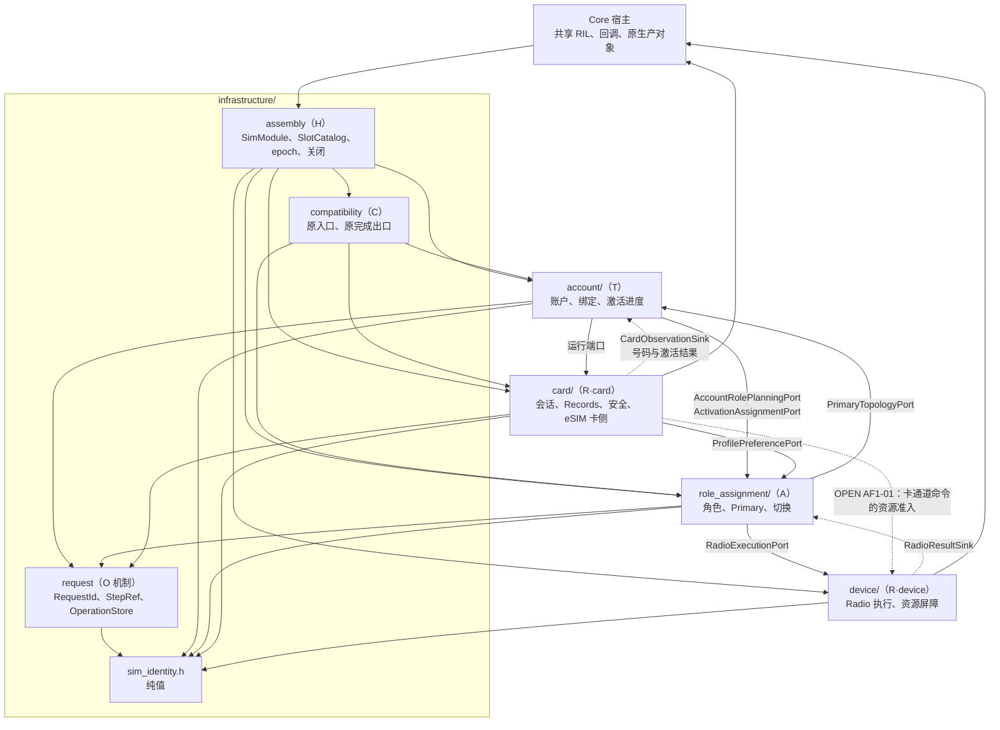

# AF-1 架构设计收敛检查点（2026-11-23）

> 文档状态：Operational / Pending。本文件是 AF-1（Architecture Design Sign-off）三轮工作的唯一进度交接入口。
> 它记录审计事实、对象模型分析和待裁决事项，**不是新的架构决策来源**；决策仍以目标架构 v1.2、源码详细设计、功能与 WU 及其批准记录为准。
> Host 证据不等于产品验收；本文件中的 PASS 仅指"本轮审计步骤完成"。

## 0. 进度总览

| 阶段 | 内容 | 状态 |
| --- | --- | --- |
| P0 | 代码仓基线和工作区保护 | PASS |
| P1 | 权威文档及已有架构决策核对 | PASS（无新增决策冲突） |
| P2 | 核心业务对象和数据所有权收敛 | 分析完成；2 项需架构负责人裁决（AF1-01、AF1-02） |
| P3～P6 | 接口契约、源码差距、文档修订、独立签收 | 不属于第一轮，未开始 |

本轮结论标记：`AF1_ROUND1_PARTIAL`（理由见 §5.1；P0～P2 的分析工作均已完成并持久化）。

## 第一部分：基线审计（P0）

### 1.1 Git 基线（2026-11-23 实测）

| 项 | 实测值 |
| --- | --- |
| Git 根目录 | `/mnt/e/github/multisim`（路径仅作本次记录，不作恢复依据） |
| 当前分支 | `main` |
| 本地 HEAD | `632f6a2a888cfbbc3c9387edc89732364e12a10e` |
| 本地 `origin/main` | `632f6a2a888cfbbc3c9387edc89732364e12a10e` |
| `git ls-remote origin refs/heads/main` | `632f6a2a888cfbbc3c9387edc89732364e12a10e` |
| HEAD 与远端 | 一致，无增量提交 |
| remote | `origin` = `github.com/zjuluowu/multisim`；`upstream` = `github.com/openharmony/telephony_core_service` |

近期提交（`git log --oneline -8`）：

- `632f6a2a8` feat(multisim): add account recovery and reload（T2）
- `06ca400a1` docs(sim): align architecture and migration gates for three sign-off conditions
- `5796fce68` feat(multisim): add account discovery provider loop（T1）
- `be63ae124` fix(multisim): seal core legacy shutdown path
- `50c0f4747` docs(sim): record three architecture sign-off decisions
- `bd4fbe833` docs(sim): independently review the multisim architecture baseline
- `befd76d4e` fix(multisim): linearize primary host shutdown
- `da99dd1a4` feat(multisim): add primary host drain gate

任务提示词中记录的基线 `632f6a2a` 仍然成立，无需增量核对。

### 1.2 工作区状态

- 暂存区：空。已跟踪文件：无修改。
- 未跟踪文件（用户文件，本轮不读写、不删除、不暂存）：`default.profraw`、`opencode.json`（均在仓库根）。
- 本文件创建前不存在 `docs/AF1*`，为全新创建；没有发现正在编辑的设计文档。
- 其他 worktree 存在（历史 G2a/审计分支及若干 `/tmp` prunable 项），本轮不使用、不清理。

### 1.3 AF-1 任务目标与本轮范围

- AF-1 目标：使核心对象、身份、关联、生命周期和唯一事实所有权达到可签收状态，让开发人员不依赖架构理论即可判断对象由谁创建、事实由谁维护、如何关联、用什么身份引用、何时失效销毁、谁有修改权。
- 第一轮范围：仅 P0～P2。P2 完成后停止。
- 本轮保护规则：不修改生产源码、GN、Golden/测试预期、历史报告和历史架构校验摘要；不 `git add`/commit/push；只新增或更新本文件。
  （仓库 AGENTS 的持续发布授权被本轮用户要求明确收窄，以本轮要求为准。）

### 1.4 必须遵循的已有设计决策（入口）

- SC-01 关闭责任、SC-02 Radio 身份和参与者、SC-03 完整写权：原始记录为
  `docs/history/reviews/SIM_Core_Architecture_Signoff_Convergence_20261123.md`，精确表述在第二部分核对。
- 一级目录五组（account / role_assignment / card / device / infrastructure）：`docs/SIM重构代码目录结构设计方案.md`。

### 1.5 当前代码结构事实（HEAD `632f6a2a` 实读）

以下只陈述源码事实。`services/multisim/` 全部 target 为 `testonly = true`（`services/multisim/BUILD.gn`），生产仍由 `services/sim/` 实现；头文件声明不等于实现。

| 责任 | 实际代码 | 本轮核实的事实 |
| --- | --- | --- |
| H | `infrastructure/assembly/`：`SimModule`、`sim_module_factory.*`、`SimHostPorts`、`SlotCatalog`、`ManagerPublicationSequence`、`PrimaryHostLifecycle` | 仅 `SimModule` 私有构造函数有定义；`AttachSimModuleToExisting`、`CreateOwnedSimServices`、两个 Deleter、`SimModule::StopAcceptingAndDrain` 均只有声明。`PrimaryHostLifecycle::StopAcceptingAndDrain` 有实现，但它是 Primary Host 切片的关闭入口，不属于 `SimModule` 成员。提示词中的 `SimModulePublication` 在源码中不存在，对应物为 `ManagerPublicationSequence` 与 `SimServicePublicationPort` |
| T | `account/`：`TopologyService`（持 `AccountRegistry`、`BindingIndex`、`DiscoveryObservationLedger`、`ActivationProgress`、`pendingDiscoveries_`）、`AccountStoreAdapter` | 实现 `CardObservationSink` 与 `PrimaryTopologyPort`；T1/T2 入口（`DiscoverAccount`、`ReconcileDiscovery`、`PrepareAccountReload`、`AcceptAccountReload`）存在 |
| A | `role_assignment/`：`AssignmentService`（持 `AssignmentAggregate`、自有 `RuntimeOperationStore`、`AccountRoleProtocol`、`pendingPrimary_`、`assignmentConflicts_`） | 实现 `RadioResultSink`、`ProfilePreferencePort`、`AccountRolePlanningPort`、`ActivationAssignmentPort`、`ScheduledRetrySink` |
| O | `infrastructure/request/`：`RequestId`、`StepRef`、`EffectKnowledge`、`RequestContext`、`RuntimeOperation`、`RuntimeOperationStore` | 容器按 `(RuntimeEpoch, RequestOwner)` 构造，由各 Owner 自持实例；不发令、不重试。`RetrySchedulerPort`/`ScheduledRetrySink` 声明也在同一头文件 |
| R·card | `card/runtime/CardRuntime`，`card/state/SessionRegistry`，`card/records/LoadSession`，`card/esim/LocalCardRequests` | `CardRuntime` 声明实现四个端口（含 `RadioExecutionPort`），但 `card_runtime.cpp` 只定义构造、`BindResultSinks`、`InvalidateVerifiedCardSession`、`PublishAcceptedCardDiscovery`、`EndLocalProfileWait`；`SwitchPrimaryRadio` 等运行方法无定义 |
| R·device | `device/resource/ResourceBarrier`、`ResourceRadioRuntime` | `ResourceRadioRuntime` 实现 `RadioExecutionPort`，自持 `barrier_`，经 `RadioPlatformPort` 发令；`device/radio/` 目录尚不存在（计划目录） |
| C | `infrastructure/compatibility/{api,events}`：`LegacySimFacade`、`LegacyCompletion`、`LegacyOutputAdapter` | 持入口引用和完成出口，不持业务状态 |
| I | `AccountStoreAdapter`（account）、`AssignmentStoreAdapter`/`AssignmentOutputAdapter`（role_assignment）、`ActivationHookAdapter`（account/activation） | 业务 Adapter 随 Owner，不集中在 infrastructure，与目录方案 §6.1 一致 |

## 第二部分：P1 架构决策核对

### 2.1 权威文档清单（均已核实存在）

| 代号 | 文档 | 唯一维护内容（依 `docs/README.md` 维护职责表） | 状态 |
| --- | --- | --- | --- |
| A | `docs/SIM_Target_Architecture_Design_v1.2.md`（1708 行） | 业务责任、事实写权、异步、资源、实施门禁 | Authoritative，整体仍 `draft/pending`，多数章节标 PROPOSED |
| B | `docs/SIM_Multisim_Source_Architecture_Detailed_Design.md`（824 行） | 当前与稳态路径、类、接口、逻辑 GN DAG | Authoritative |
| C | `docs/SIM重构代码目录结构设计方案.md`（686 行） | 一级物理职责、Infrastructure 内部边界 | Authoritative |
| D | `docs/migration/SIM_Architecture_Refactor_Design.md`（1381 行） | SIM-001～062、WU-01～09、字段台账 | Authoritative |
| — | `docs/SIM_Refactor_Execution_State.md` | 基线、实测证据、阻塞、下一批 | Operational，**不是目标架构** |
| — | `docs/history/reviews/SIM_Core_Architecture_Signoff_Convergence_20261123.md` | SC-01～03 决策记录与四文档矩阵 | Historical 记录；决策正文已落入 A/B/C/D 锚点 |
| — | `docs/history/reviews/SIM_Core_Architecture_Independent_Deep_Review_20261123.md` | 独立评审意见 | Historical；**意见不是决策** |

本轮只定向读取了 A §3、§4.1～4.2、§10、§12.3、§14；B §2、§3.2、§4、§5～11；C §4.2～4.4；签收收敛记录全文；深度评审 §2。未读 D 正文（只用其锚点），未通读执行状态。

### 2.2 设计主题索引

| 设计主题 | 权威位置 | 已收敛决策 | 当前是否存在冲突 |
| --- | --- | --- | --- |
| 业务对象定义（Slot/Subscription/Account/Binding/CardApplication/eUICC/Port/Profile） | A §3.1、§3.2.1；B §5 | 订阅绑定位置、访问卡应用、Radio 栈协议三种关系独立变化；用三个 Target 加受控索引表达，不新建实体表 | 无冲突。`EndpointInstance`/`ObservationSource` 明确为语义角色，源码无对应类型属预期 |
| T/A/O/R/C/I/H 职责 | A §4.1 边界表；B §2 | T、A 是仅有的两个业务上下文；O 是请求机制；R/C/I/H 为实现责任 | 无冲突。A §4.1 写"O 唯一拥有运行期请求状态"，B §8 写"每个进程所有者自己构造容器"，二者相容：O 定义类型和规则，实例由发起 Owner 持有（见 §3.3 表注） |
| Slot 与 Subscription 的关系、绑定基数 | A §3.1 图与注；B §5、§6 | 同一位置至多一个当前绑定，同一订阅至多一个当前位置（现有 `BindingIndex`）；空位置也保留 revision | 无冲突。多位置/多 Port 绑定为既有外部 OPEN（TGT-OPEN-006、G4），非本轮新增 |
| Role/Primary/Data/Voice/SMS 归属 | A §3.1、§4.1；B §7；C §4.3 | 全部归 A。Voice/SMS/Data 关联 `SubscriptionId`，Primary 涉及位置与 Radio 分配，不统一成一种标识 | 无冲突 |
| Request/Step/Session/Protocol/Transport/Resource 身份 | A §10.1（含 SC-02 锚点）、§11；B §8、§9 | 七类身份各有签发者与作用域，互不替代 | 设计内无冲突；**源码与设计不一致**（A 合成 `SessionRef`、成员取自目录），已由 B §9 记为待实现，见 AF1-03 |
| 资源屏障与租约 | A §12.3；B §9、§9.1；C §4.4 | 每个经证实的物理共享域一个准入者，租约由 R 统一管理；不得各建互不相知的屏障 | 设计内无冲突；**实例归属对象未命名**，见 AF1-01 |
| H 装配、生命周期、关闭 | A §14.2～14.3（含 SC-01 锚点）；B §11；C §5.3 | H 建图、封口、汇合收据、匹配销毁；不替任何一方消账 | 设计内无冲突；`SimModule` 与 `PrimaryHostLifecycle` 的关系未写明，见 AF1-02 |
| 写权与同键准入 | A §4.1、§13.2（SC-03 锚点）；B §7；D §5.2.1 | 每个物理键/DB 列一个业务 Owner 管准入 | 设计内无冲突；源码两个偏好入口仍直写，已由 B §7 记为待实现，见 AF1-05 |
| 目录与逻辑 target | C 全文；B §3.2、§4.1 | 五组目录；逻辑 target 与目录、SO 分开 | 无冲突。`ResourceRadioRuntime` 物理位于 `device/resource/`，B §3.2 稳态把 Radio 执行放 `device/radio/`（计划），属已知过渡 |

### 2.3 SC-01～03 状态

原始记录的结论为"三项条件在设计层已收敛，可提交架构负责人签收"。本轮逐项对照 A/B 锚点与当前源码，**没有发现需要推翻的依据，也没有改写其表述**。

| 决策 | 设计层 | 当前源码（`632f6a2a`） | 结论 |
| --- | --- | --- | --- |
| SC-01 关闭责任 | A §14.3 `#sc01-close`、B §11 `#sc01-receipts` 已明确 A/O/Scheduler/R/H 各自收据 | `PrimaryHostLifecycle::StopAcceptingAndDrain` 末段仍以 `AssignmentService::HasPendingDeviceEffects()`（`assignment_service.cpp:126`）作为 A 侧判据，没有 C0 原调用与逐键存储前缀的业务收据 | 设计已关闭，不重开；实现待做，B §11 已标"待实现" |
| SC-02 Radio 身份和参与者 | A §10.1 `#sc02-identity`、B §8/§9 `#sc02-radio` 已明确 | `assignment_service.cpp:199-200、239-240、392-393、600` 以 `bindingRevision` 和字面值 `"USIM"` 合成 `SessionRef`；`:253` 用 `catalog_.Slots()` 生成 C1 成员；`RuntimeOperationStore::RecordSent` 只有需要 `SessionRef` 的形式 | 设计已关闭，不重开；实现待做，B §8/§9 已标"待实现" |
| SC-03 完整写权 | A §13.2 `#sc03-key`、B §7 `#sc03-admission`、D §5.2.1 已明确 | `AcceptEntryPrimaryPreference`（`:659`）、`AcceptLocalProfilePreference`（`:662-664`，未使用来源 `StepRef`）直接调用 `store_.WriteUserPrimaryPreference`，未经 `AssignmentAggregate` 写集准入 | 设计已关闭，不重开；实现待做，B §7 已写明 |

收敛记录自带的 O1～O6 是产品/外仓证据类 OPEN，继续按原表保留，本轮不重复列出。

### 2.4 不需要重新讨论的已关闭事项

1. T、A 两个业务上下文的划分，以及 O 不是业务事实 Owner（A §4.1"O 的重新裁决"）。
2. 激活归 T、Primary/默认角色归 A（A §4.2）。
3. 五组一级目录（C）。
4. SC-01～03 的分责结论。
5. T1 账户发现、T2 恢复与重载的 Host 闭环设计（B §6）。
6. `bindingRevision`（T）与 `bindingGeneration`（R）互不具备签发效力（A §10.1）。
7. Core 拥有共享 RIL，SIM 不 Init/Stop 它（A §14.2）。

## 第三部分：P2 核心对象模型

阅读约定：**Owner** 指有权修改该事实的唯一责任方；"持有"指保存一份值或引用，不带修改权。类型列中"值"表示可自由复制的纯数据，"实体"表示有身份和可变状态，"机制"表示无业务事实的技术对象，"语义角色"表示设计中有此概念但源码无独立类型。

### 3.1 核心对象分类

| 类别 | 对象 | 归属 |
| --- | --- | --- |
| 一、物理与逻辑卡 | Slot、Endpoint、Port、eUICC、Profile、CardApplication、Subscription、AccountRecord、BindingRef、BindingIndex | 静态描述归 H；账户与绑定归 T；卡侧库存与应用归 R·card |
| 二、卡运行 | CardRuntime、SessionRegistry、SessionRef、LoadSession、CardApplicationTarget | R·card |
| 三、角色 | AssignmentAggregate、RoleSelection、Primary 投影、AssignmentTransition、角色写集 | A |
| 四、请求与设备执行 | RequestId、StepRef、RequestContext、RuntimeOperation、RuntimeEpoch、本地协议轮次、原生协议会话、传输 token、传输 serial、ResourceLease、fence、ResourceBarrier | 请求机制为 O（实例随发起 Owner）；设备执行归 R·device；epoch 归 H |
| 五、模块装配 | SimModule、工厂、SimHostPorts、SlotCatalog、ManagerPublicationSequence、PrimaryHostLifecycle | H |

### 3.2 表一：核心对象定义

| 对象 | 类型 | 创建者 | 唯一 Owner | 主要职责 | 生命周期 |
| --- | --- | --- | --- | --- | --- |
| Slot（`SlotId` / `SlotDescriptor`） | 值，只读配置 | H 启动时按产品输入构建 | H（静态目录） | 描述位置、端点种类、允许的 RIL 实例与 Radio 域、可见性 | 随模块实例；运行期不变 |
| Endpoint（`EndpointKind`） | `SlotDescriptor` 的属性；当前实例为语义角色 | 种类由 H；当前实例/可达性由 R 观察 | 种类 H；当前观察 R | 区分实体、eUICC、虚拟、受限、分布式 | 种类随配置；当前实例随来源出现/消失 |
| eUICC / Port / Profile | 语义角色。源码仅有 `legacyPortIndex`、`VerifiedPortRoute` | R·card 从卡侧协议观察 | R·card（库存与协议）；已接纳的账户绑定归 T；偏好归 A | Profile 库存、Port 路由 | 随 eUICC 在位；禁用 Profile 可无会话、无账户 |
| CardApplication（`CardApplicationTarget`） | 值（槽 + 应用键） | 调用入口按意图构造 | R·card 解释 | 定位一次卡应用访问目标 | 单次请求；应用键仅在当前载体内有效 |
| Subscription（`SubscriptionId`） | 值，包装旧 simId | 旧 provider 分配；T 接纳 | T | 本机业务身份 | 长期（持久）；不承诺跨删除/重装稳定 |
| AccountRecord（含 current/historical `AccountProjection`） | 实体 | T（`AccountRegistry::AcceptDiscoveredAccount` / 重载） | T | 账户资料及各字段 revision | 长期；内存投影可由重载重建 |
| BindingRef | 值（订阅 + 槽 + `bindingRevision`） | T（`BindingIndex`） | T | 标识"这次"订阅与位置的绑定 | 至下一次换绑/解绑；可被重新发现重建，但 revision 不回退 |
| BindingIndex（`SlotRuntimeEntry`） | 实体（索引） | `TopologyService` 构造 | T | 位置→当前绑定、空位置 revision、装配事实 | 随模块实例 |
| DiscoveryObservationLedger | 实体 | `TopologyService` | T | 每应用观察序列、发现与失效资格 | 随模块实例 |
| ActivationProgress | 实体 | `TopologyService` | T | 激活进行中标志（跨模块可见的业务进度） | 每次激活一条，完成后清除 |
| CardRuntime | 过渡接缝对象 | H（`SimModule` 成员） | R·card | 借用原生产对象、绑定结果出口、发布发现/失效观察 | 随模块实例；稳态退化为有限绑定接口（B §3.2） |
| SessionRegistry | 实体 | 当前由 `CardRuntime` 构造 | R·card（`card/state`） | 每卡应用当前会话、代次水位、`ExpectedTransition` | 随模块实例；代次只增不减 |
| SessionRef | 值（epoch + 应用 + `bindingGeneration`） | R·card（`SessionRegistry`） | R·card | 标识一次卡应用访问资格 | 至换卡、应用替换、路由失效或模块重建 |
| LoadSession / LoadToken | 实体 / 值 | R·card，每轮加载 | R·card（`card/records`） | 加载成员资格、一次消费、受影响读失效 | 一轮加载或 Refresh |
| AssignmentAggregate | 实体（聚合） | `AssignmentService` 成员 | A | 角色选择、切换事实、参数投影、角色写集登记 | 随模块实例；持久事实在参数/DB，可重载 |
| RoleSelection | 值（角色 + preference + effective） | A | A | 一个默认角色的偏好与生效订阅 | 长期（持久于旧参数/DB） |
| Primary / Data 投影（`lastPrimary_`、`lastData_`） | 聚合内属性，按 `SlotId` | A | A | 主卡位置与联动 Data 的参数投影 | 长期 |
| AssignmentTransition | 实体（每 `RadioDomainId` 至多一条） | A（`AdmitTransition*`） | A | 切换进行中、目标、阶段、业务尝试 | 一次切换 |
| 角色写集（`RoleWriteMember` 位集 + `roleWriteOwners_`） | 聚合内登记 | A | A | 同键写入的准入资格 | 一次请求；结果未知时保留 |
| PendingPrimarySwitch | 实体 | `AssignmentService::StartPrimarySwitch` | A | 一次 Primary 请求的冻结计划、成员、阶段、重试 | 一次请求至终态或核对完成 |
| RequestId / StepRef | 值 | 发起 Owner 的 `RuntimeOperationStore::Begin` | 发起 Owner（T/A/R 短请求） | 业务请求及其步骤/尝试的身份 | 一次请求；仅在本 epoch + Owner 命名空间内有效 |
| RequestContext / RuntimeOperation | 值 / 记录 | 同上 | 发起 Owner（机制由 O 提供） | 原目标、父关联、发送会话、完成路由、效果认知、终态 | 一次请求；证据保留期后 `RetireAfterEvidenceRetention` |
| RuntimeOperationStore | 机制 | 各 Owner 自行构造（A 的 `operations_` 等） | 持有它的 Owner | 步骤门控、一次领取、迟到证据 | 随所属服务 |
| RuntimeEpoch | 值 | H，每次模块实例创建 | H | 区分模块实例，使旧请求/会话/租约整体失效 | 一个模块实例 |
| ResourceBarrier | 实体 | 目前有两处构造（见 §3.7） | R·device | 物理域状态机 Checking/Available/InFlight/Quarantined、fence | 随 R 实例；新实例先 Checking |
| ResourceLease | 值 | `ResourceBarrier::Acquire` | R·device | 一次命令对完整资源集的执行资格 | 至设备结束且可复用的证据；Unknown 时转隔离保留 |
| ResourceRadioRuntime | 执行适配 | Host 测试装配（`SimModule` 未持有） | R·device | 取租约、每次发送签发传输 token、接纳设备证据后转交 A | 随装配图 |
| SlotCatalog | 只读值对象 | H | H | 静态允许接线与旧容量度量 | 随模块实例；以 const 引用/`shared_ptr<const>` 注入 |
| SimModule | 组合根 | 私有工厂（未实现） | H | 按依赖顺序持有 I/C 出口、R、T、A、用例、Facade | 一个模块实例 |
| SimHostPorts | 值（端口集合） | Core 宿主 | Core（H 借用） | 共享 RIL、入口、回调、号码查询端口 | 必须活到 SIM 排空结束 |
| ManagerPublicationSequence | 机制 | `OwnedSimServices` | H | 记录 eSIM→SIM 初始化与发布的阶段和控制块一致性 | 一次创建 |
| PrimaryHostLifecycle | 机制 | Host 装配 | H | Primary 切片的封口、单一关闭者、汇合 A/Scheduler/R 判据 | 一次模块实例的关闭轮 |
| LegacySimFacade / LegacyCompletion | 兼容边界 | H（`SimModule` 成员） | C | 原入口签名、原完成出口交付 | 随模块实例 |

### 3.3 唯一事实所有权矩阵

| 业务事实/对象 | 唯一 Owner | 主要关联对象 | 其他模块允许的操作 | 依据 |
| --- | --- | --- | --- | --- |
| 账户身份及 current/historical 资料 | T | `SubscriptionId` / `AccountRecord` | 查询；经 T 入口申请变更 | A §4.1；B §2、§6 |
| 订阅与位置的当前绑定、空位置 revision | T | `BindingRef` / `BindingIndex` | 查询、用 `StillMatches` 复核；R 只提供观察 | A §4.1；B §5 |
| 槽运行清单（是否已装配） | T（接纳 H/R 给出的装配事实） | `SlotRuntimeEntry` | 查询 | `TopologyService::AcceptSlotAssembly` |
| 激活进行中 | T | `ActivationProgress` | 查询（搜网、运营商配置等经旧出口） | A §4.1、§4.2 |
| 静态槽目录、端点种类、允许 Radio 域 | H | `SlotCatalog` | 只读 | A §3.2.1；`slot_catalog.h` |
| 原始卡/锁状态、Records、电话簿、STK、eUICC 库存 | R·card | 原生产对象（借用） | 观察；T 接纳发现/失效 | A §4.1；B §9 |
| 卡应用会话及代次 | R·card | `SessionRef` / `SessionRegistry` | 使用、复核是否仍当前 | A §10.1；B §9.1 |
| 加载成员资格 | R·card | `LoadSession` | 无 | A §10.2 |
| Voice / SMS / Data 默认角色（偏好与生效） | A | `RoleSelection` | 查询、申请切换 | A §4.1；B §7 |
| Primary 位置、Primary/Data 参数及用户偏好提示 | A | `AssignmentAggregate` 投影、角色写集 | 查询、在原节点经 A 入口提交 | A §4.1；SC-03 |
| Primary 切换进行中、目标、阶段、业务重试 | A | `AssignmentTransition`、`PendingPrimarySwitch` | 查询 | A §4.1 |
| 本轮 Radio 协议参与者（真实成员与路由） | R·device | 协议适配输出 | A 冻结一份本轮副本并只按该副本推进；H 的目录仅作输入 | SC-02；B §9 |
| 原生协议会话、传输关联 | R·device | protocolSession、token、serial | A 只携带本地轮次用于匹配 | A §10.1 |
| 设备资源状态与租约 | R·device（每个物理域一个 `ResourceBarrier`） | `ResourceLease`、fence | 用例步骤申请；不得自行释放 | A §12.3；实例归属见 AF1-01 |
| 请求步骤、效果认知、一次完成领取 | 发起该请求的 Owner（T/A/R 短请求），使用 O 的机制 | `RequestId` / `StepRef` / `RuntimeOperation` | R 提交证据；C 交付 | A §4.1、§4.2；B §8 |
| 外部持久化执行 | I（只执行，不拥有事实） | Store/参数/Provider | 执行已取得资格的 Owner 的写计划 | A §4.1；B §10.1 |
| 原完成出口登记与交付格式 | C（真实回调/等待对象在 Core 宿主） | `CompletionPlan` / `LegacyCompletion` | Owner 封存终态后交付一次 | A §4.1；B §10 |
| 模块实例、epoch、装配图、发布与销毁 | H | `SimModule` / `RuntimeEpoch` | 无 | A §14；B §11 |
| 共享 RIL 实例 | Core（不在 SIM 内） | `ITelRilManager` | SIM 借用引用 | A §14.2 |

表注：提示词初始框架中"请求步骤及完成 = O"一行按权威文档细化为"机制归 O，实例与其中记录归发起 Owner"。这不是新决策，是 A §4.1（O 不拥有任何对外可见业务事实）与 B §8（每个进程所有者自己构造容器）的合并表述。

### 3.4 表二：对象关联关系

| 对象 A | 关系 | 对象 B | 基数 | 关联维护者 |
| --- | --- | --- | --- | --- |
| Slot | 当前绑定到 | Subscription | 1 — 0..1（双向） | T（`BindingIndex`） |
| Subscription | 拥有资料 | AccountRecord | 1 — 1（current、historical 各 0..1 投影） | T（`AccountRegistry`） |
| Slot | 当前可访问 | CardApplication 会话 | 1 — 0..* | R·card（`SessionRegistry`） |
| CardApplication 会话 | 包含 | LoadSession | 1 — 0..*（按 scope） | R·card |
| eUICC | 提供 | Port | 1 — 0..* | R·card 观察（产品基数 OPEN） |
| eUICC | 容纳 | Profile | 1 — 0..* | R·card 观察 |
| 启用的 Profile / 实体卡 | 呈现 | CardApplication | 1 — 1..* | R·card |
| 已发现的卡应用会话 | 被接纳为 | BindingRef | 0..1 — 0..1 | T 接纳 R 的观察（`CardObservationSink`） |
| RoleSelection（Voice/SMS/Data） | 指向 | Subscription | 每角色 1 条 — 0..1；多个角色可指向同一订阅 | A |
| Primary 投影 | 指向 | Slot | 1 — 0..1 | A |
| AssignmentTransition | 属于 | RadioDomain | 0..1 — 1（同域同时至多一个切换） | A |
| Slot | 配置属于 | RadioDomain | * — 0..1 | H（静态） |
| RadioDomain（业务冲突域） | 对应 | 物理资源域 `ResourceKey` | 未在权威文档中给出映射规则 | 见 AF1-04 |
| RequestId | 包含 | StepRef | 1 — 1 当前步（step/attempt 递增） | 发起 Owner |
| 子请求 | 关联父 | 父 StepRef | * — 0..1 | 发起子请求的 Owner |
| 一次 Primary 请求 | 冻结 | 本轮参与者集合 | 1 — 1..* | A 冻结，R 提供并验证 |
| 一个设备步骤 | 持有 | ResourceLease | 1 — 0..1（覆盖完整资源集） | R·device |
| ResourceLease | 覆盖 | 物理资源域 | 1 — 1..* | R·device |
| 一次发送 | 标识为 | 传输 token（及可选 serial） | 1 — 1 | R·device |
| SimModule | 持有 | T/A/R/C 服务与 Adapter | 1 — 各 1 | H |
| SimModule | 借用 | Core 的共享 RIL、原生产对象、HostPorts | 1 — 各 1 | Core 拥有 |

关于"ID 作为属性还是独立关联中心"：权威设计的答案是**关系由 Owner 的受控索引维护，ID 只是引用值**（A §3.1 末、§4.1.1"不引入全局映射服务"）。`BindingIndex` 是 T 内部的索引，不是面向全模块的 ID 映射中心；其他模块拿到的是带版本的 `BindingRef`，用前复核。

### 3.5 表三：身份模型

以下七类身份互不替代。数值相等不代表可互换。

| 身份 | 源码类型 | 签发者 | 持有者 | 有效期 | 失效条件 | 禁止用途 |
| --- | --- | --- | --- | --- | --- | --- |
| 1 业务请求 | `RequestId`（value + epoch + `RequestOwner`） | 发起 Owner 的 `RuntimeOperationStore::Begin` | 发起 Owner；随 `RequestContext` 传给 R/C | 一次请求 | 终态且证据保留期结束；模块重建 | 当作设备取消序号、跨重启追踪 ID；仅按 value 识别 |
| 2 请求步骤 | `StepRef`（request + step + attempt） | 发起 Owner `AdvanceStep` | 发起 Owner；R 在发送关联中保存原值 | 一步的一次尝试 | 步骤推进、重试、终态 | 授予写权（可追溯来源，但不等于资格，B §7） |
| 3 账户绑定 | `BindingRef`（订阅 + 槽 + `bindingRevision`） | T `BindingIndex` | A 的请求计划、T 的号码/激活目标 | 至换绑或解绑 | 换卡、解绑、同槽再绑（revision 递增） | 签发或充当卡应用会话；当作全局拓扑版本 |
| 4 卡应用会话 | `SessionRef`（epoch + 应用 + `bindingGeneration`） | R·card `SessionRegistry` | 访问该应用的请求（PIN、EF、号码写卡、Profile） | 至应用被替换 | 换卡、应用替换、路由失效、模块重建 | 用于纯 Radio 步骤；由 T/A 用 `bindingRevision` 合成 |
| 5a 本地协议轮次 | `RadioSwitchRequest::protocolSession`（uint32，当前由 A 的 `nextProtocolSession_` 递增） | A（本请求内的轮次编号） | A 的 pending；R 的发送关联 | 一轮三阶段交换 | 新一轮（重试）开始 | 当作原生协议会话号；跨请求比较 |
| 5b 原生 Radio 协议会话 | 原 `RadioProtocolController` 的 sessionId（未进入 Target 类型） | 原协议/平台 | R·device 协议适配，映射到 5a | 一次原生交换 | 协议结束或被替换 | 上浮给 A 作业务身份 |
| 6 单次传输 | 传输 token：`uint64_t`，`ResourceRadioRuntime::nextTransportToken_`；RIL serial：`RadioSubmitResult::transportSerial` | token 由 R·device；serial 由平台 RIL | R·device 的 `transmissions_` | 一次发送至其结束证据 | 结果被接纳或被核对 | serial 当作跨重启或跨协议身份（可复用/回绕）；没有 serial 的通知填造 serial |
| 7 设备资源租约 | `ResourceLease`（epoch + 资源集 + holder `StepRef` + fence） | R·device `ResourceBarrier::Acquire` | 提交该命令的 R 执行适配 | 至设备结束且可复用 | 完成证据、确认未发送、恢复证据后推进 fence；模块重建后先 Checking | 由 A/T 持有或释放；用等待超时、调用返回、本地 channel 清零来释放 |
| （辅助）模块实例 | `RuntimeEpoch`（128 位） | H | 嵌入 1、4、7 | 一个模块实例 | 模块重建、进程重启 | 当作业务持久版本；由新 epoch 推断旧命令已结束 |

说明：5a/5b 的区分依据 A §10.1 与 B §9"将原生 protocolSession 映射到本地轮次。当前 Host 计数仅能关联 Host 发送"。源码中这两者及传输 token、fence 都是裸整数，没有独立类型，属于 P3 接口契约要决定是否加类型的事项（AF1-06），不是职责未决。

另有一个容易混淆的名称：`ActivationConflictLease`（`account/activation/activation_assignment_port.h`）是 **A 签发给 T 激活用例的业务冲突资格**，不是设备资源租约；A §4.2 协作规则 3 明确"资格释放不等于设备可用"。

### 3.6 生命周期模型

| 分组 | 对象 | 说明 |
| --- | --- | --- |
| 长期存在（持久事实，重启后由存储恢复） | Subscription、AccountRecord 的资料、角色偏好、Primary/Data 参数 | Owner 为 T 或 A；内存投影可通过重载重建 |
| 随模块实例存在 | SlotCatalog、RuntimeEpoch、SimModule 及其服务、BindingIndex、SessionRegistry、ResourceBarrier、各 RuntimeOperationStore | 模块重建后全部换新；epoch 使旧引用失效 |
| 随卡/载体在位存在 | 当前绑定、SessionRef、LoadSession、eUICC/Port/Profile 观察 | 换卡时：R 先经 `CardObservationSink` 让 T 撤销资格，再发布新会话（`CardRuntime::PublishAcceptedCardDiscovery`）；历史账户保留 |
| 仅一次请求期间 | RequestId/StepRef/RequestContext、PendingPrimarySwitch、AssignmentTransition、角色写集登记、ActivationProgress 条目、ExpectedTransition、ResourceLease、传输 token | 结果未知时不随调用返回而结束，保留至核对完成 |
| 由业务 Owner 管理 | 账户、绑定、激活进度（T）；角色、切换、写集（A） | 只有 Owner 的应用入口可修改 |
| 只是技术引用 | BindingRef、SessionRef、StepRef、token、serial、fence、epoch | 值类型；使用前向签发者复核 |
| Stop 时必须等待排空或移交（SC-01） | A 的已受理请求、未决角色资格、已发未确认的存储前缀；O 的已领取未返回的完成；Scheduler 的已投递/运行中任务；R 向 Owner 的在途投递；R 的在途设备命令（可在有驻留接收者时保持隔离，L3 先于 L4） | T 的在途发现写入（`pendingDiscoveries_`）、激活进度按 SC-01"其他用例由其 Owner"同样需要收据，具体形态见 AF1-07 |
| 可通过重新发现或恢复重建 | 当前绑定（T1/T2）、账户与角色投影（重载）、会话（R 重新观察）、资源状态（Checking 后凭证据恢复） | 不可重建：进程内请求身份、旧 epoch 的租约；这些不跨重启恢复（A §12.2） |

对象销毁与悬空引用：`SimModule` 成员声明顺序即创建顺序（I/C 出口 → R → T → A → 用例 → Facade），反序销毁；`TopologyService::roles_`、`CardRuntime::resultSinks_` 是构造后绑定的借用引用，`ResourceRadioRuntime` 对 sink/dispatch 用 `weak_ptr`、对 platform 用引用。设计要求（B §11）事件桥只保留 weak Owner + epoch + 在途计数；**反序销毁本身不证明异步回调已排空**（`sim_module.h` 注释），因此销毁前必须先得到 `Drained`。

### 3.7 Card 与 Device 的边界审视

先列当前 HEAD 核实到的事实：

1. `CardRuntime` 声明实现 `RadioExecutionPort`，并持成员 `ResourceBarrier resources_`（`card/runtime/card_runtime.h:104`，在 `card_runtime.cpp:26` 以 epoch 构造）。除构造外，`resources_` 在 `card/`、`infrastructure/`、`role_assignment/`、`account/` 中没有任何使用；`CardRuntime::SwitchPrimaryRadio` 等没有定义。
2. `ResourceRadioRuntime` 持自己的 `ResourceBarrier barrier_`，在 `SwitchPrimaryRadio` 中 `barrier_.Acquire(resources_, request.step)`（`resource_radio_runtime.cpp:93`），签发传输 token（`:105`），经 `RadioPlatformPort::SubmitPrimaryRadio` 发令（`:111`）。资源键由构造方传入，Host 测试使用 `"host-primary-radio:conservative-shared"`。
3. `SimModule` 的私有构造把 `runtime_`（`CardRuntime`）作为 `RadioExecutionPort` 传给 `AssignmentService`（`sim_module_factory.cpp`），`SimModule` 不持有 `ResourceRadioRuntime`。该构造没有生产或 Host 调用者。
4. Host B/C1 测试直接组合 `AssignmentService` + `ResourceRadioRuntime` + `PrimaryHostLifecycle`（`test/cases/target/primary/b_async_primary_test.cpp`）。
5. GN 中 `ResourceBarrier`、`ResourceRadioRuntime` 与 `SessionRegistry`、`LoadSession` 同属 `runtime_mechanisms`，`CardRuntime` 属 `runtime_core`。

逐题结论：

| 问题 | 结论 | 状态 |
| --- | --- | --- |
| 1. CardRuntime 管卡应用生命周期，还是也管物理 Radio 资源？ | 设计已裁决：Card 管卡应用会话、Records、安全与卡侧通道语义；真实域 lease/fence/结束资格归 `device/resource`，Radio 协议 session/phase/member 归 `device/radio`（B §9.1；C §4.2、§4.4）。`CardRuntime` 是过渡接缝，稳态退化为有限绑定接口，其 Session/Load/Resource 成员"尚未完成能力拆分"（B §3.2）。源码中它仍兼有 Radio 端口与屏障成员，属**已登记的设计与代码不一致** | 设计 PASS；代码差距入 P4 |
| 2. ResourceRadioRuntime 是否应成为设备资源的唯一执行责任方？ | 需要拆成两句。**唯一准入者**：已裁决，每个经证实的物理共享域只有一个资源准入者（A §12.3）。**唯一执行者**：未裁决。A §12.3 要求激活、Radio 协议、eSIM 开通道查询等冲突集合统一登记到 R；B §9.1 又写"Card 可直接使用注入的窄硬件能力，不强制 CardManager→DeviceManager→RIL"。因此 `ResourceRadioRuntime` 是 Radio 命令族的执行适配，文档没有说它要承接卡通道、激活等其他命令族的执行 | 准入 PASS；执行者范围 OPEN（并入 AF1-01） |
| 3. CardApplication Session 与 Radio ProtocolSession 是否完全独立？ | 已裁决为独立（SC-02；A §10.1；B §3.2"稳态不设 device/session"）。纯 Radio 步骤不得使用 `SessionRef`。源码 A 仍合成 `SessionRef`，待实现 | 设计 PASS；代码差距 AF1-03 |
| 4. ResourceLease 由谁创建、保存、释放？ | 创建：`ResourceBarrier::Acquire`，由用例步骤（`StepRef` 为 holder）或 R 的运行请求申请。保存：提交命令的 R 执行适配（现为 `ResourceRadioRuntime::Group::lease`），A/T 不持有。释放：仅 R 凭设备证据（`Complete`、`CancelConfirmedNotSent`、`AcceptRecoveryEvidence`）；Unknown 转 `Quarantine` 保留。依据 A §12.3、B §9 | PASS（Radio 命令族）；其他命令族的保存者随 AF1-01 |
| 5. 一个真实物理域是否可能存在两套互不知情的 ResourceBarrier？ | 设计禁止（A §12.3"不能按旧锁各建一个互不相知的屏障"）。**当前源码在结构上允许**：`CardRuntime::resources_` 与 `ResourceRadioRuntime::barrier_` 是两个独立实例，互无引用。目前没有任何装配图同时启用二者（前者从未被使用，`SimModule` 也不含后者），所以今天没有运行期双重独占；但没有结构性手段阻止将来同域双屏障。深度评审 §2.2 提出过同一风险，本轮以源码复核属实 | OPEN：AF1-01 |
| 6. SimModule 如何连接 Card、Radio 和 AssignmentService？ | 现状有两张互不包含的图：`SimModule`（全量声明图，A 的 Radio 端口接到无实现的 `CardRuntime`，关闭方法仅声明）和 Host Primary 图（A 接 `ResourceRadioRuntime`，关闭由 `PrimaryHostLifecycle` 实现）。设计方向明确：H 注入 device 的协议适配作为 A 的 `RadioExecutionPort`（B §9 SC-02、C §4.4），H 汇合收据（B §11）。但权威文档没有写明 `SimModule` 是否持有 `ResourceRadioRuntime`、`PrimaryHostLifecycle` 是并入 `SimModule::StopAcceptingAndDrain` 还是其下属部件 | OPEN：AF1-02 |

没有足够文档证据支持唯一答案的两点（AF1-01、AF1-02）不在本轮自行裁决。

### 3.8 核心类图

图中 `RadioExecution` 表示 device 侧实现 `RadioExecutionPort` 的协议适配这一角色；当前实现类为 `ResourceRadioRuntime`。T 的激活、号码用例及其自有 `RuntimeOperationStore` 与 A 对称，为保持图面简洁未画出。

### 3.9 核心组件依赖图

实线为编译依赖（使用方 → 被依赖的契约），虚线为运行期回调（经窄 sink，由 H 绑定）。

说明：

- T 与 A 之间的双向箭头都指向对方的**窄契约**（`*_contracts`），不指向对方的服务或聚合；当前 GN 图无环（B §4.1）。
- `RadioExecutionPort` 的声明在 `role_assignment/primary/`（消费方定义出站契约），由 device 实现。
- `AssignmentService → RadioExecutionPort → device` 是设计方向与 Host 图；`SimModule` 当前把该端口接到 `CardRuntime`（AF1-02）。
- 各 Owner 自带的 Store/输出 Adapter（I）位于各自目录，图中并入所属 Owner。

## 第四部分：遗留问题

类别标记：【决策】已有设计决策；【实现】已有代码实现；【不一致】设计与代码不一致；【缺证】证据不足。

| 编号 | 问题描述 | 证据路径及符号 | 影响范围 | 状态 | 需架构负责人裁决 | 进入第二轮 |
| --- | --- | --- | --- | --- | --- | --- |
| AF1-01 | 同一物理域的唯一 `ResourceBarrier` 实例由哪个对象持有并注入；卡通道（eSIM、ARA-M）、普通激活等命令族是经 device 的执行适配发令，还是 Card 持注入的硬件能力并只向同一屏障申请租约。【缺证】+【不一致】 | 决策侧：A §12.3（一个准入者、冲突集合统一登记）；B §9.1（Card 可直接用窄硬件能力）、B §9（"session/resource 按真实生命周期注入"，未命名持有者）。代码侧：`card/runtime/card_runtime.h:104` `resources_`（未使用）；`device/resource/resource_radio_runtime.h` `barrier_` | Card/Device 边界、所有设备命令的准入接口、关闭时 R 的设备收据形态 | OPEN | 是。需给出：屏障实例的持有对象；非 Radio 命令族的执行归属。eSIM 普通/低优先级 File 与 ARA-M 是否共享物理域属既有外部缺口（B §9.2），不阻塞对象归属裁决 | P3（设备准入端口）；P4（退役 `CardRuntime::resources_`） |
| AF1-02 | `SimModule` 与 Host Primary 图的装配关系：`SimModule` 是否持有 device 的 Radio 执行适配并注入 A；`PrimaryHostLifecycle` 与 `SimModule::StopAcceptingAndDrain` 的关系（合并、下属部件或并存）。【缺证】+【不一致】 | `infrastructure/assembly/sim_module_factory.cpp`（`assignment_(…, runtime_, …)`）；`sim_module.h`（`StopAcceptingAndDrain` 仅声明，返回枚举与 `PrimaryHostLifecycle::DrainResult` 同形）；`primary_host_lifecycle.h`；B §11（把收据契约写在 `PrimaryHostLifecycle` 名下，同时称 assembly 拥有单套生产对象） | H 的对象持有图、关闭入口的唯一性、A 的 Radio 端口接线 | OPEN | 是。倾向性信息：设计方向（B §9、C §4.4）已指向"H 注入 device 适配"，缺的是对装配对象关系的明文 | P3（H 装配与关闭契约） |
| AF1-03 | A 以 `bindingRevision` 和 `"USIM"` 合成 `SessionRef`，成员取自 `catalog_.Slots()`；`RecordSent` 只有卡会话形式。【决策】已定（SC-02），【不一致】 | `role_assignment/assignment_service.cpp:199-200、239-240、392-393、600`（合成会话）、`:253`（成员）；`infrastructure/request/runtime_operation_store.h` `RecordSent` | Primary B/C1 的发送登记与成员集合 | 设计 PASS；代码 OPEN | 否（B §8、§9 已写明待实现契约） | P3（Radio 专用发送登记、参与者规划结果的接口）；P4 |
| AF1-04 | 业务冲突域 `RadioDomainId`（来自 `SlotDescriptor`，A 用于同域至多一个切换）与物理资源域 `ResourceKey`（R 用于租约）之间的对应规则未在已读章节给出；Host 中二者各自取值。【缺证】 | `infrastructure/sim_identity.h` `RadioDomainId`；`device/resource/resource_barrier.h` `ResourceKey`；A §12.3"A 决定分配策略…R 统一管理租约，三者不是重复 arbiter" | A 的准入范围与 R 的独占范围是否一致覆盖；多栈产品 | OPEN | 待定：先在 P3 定向查 A §12.4、§17.1 及 D；若仍无规则再提请裁决 | P3 |
| AF1-05 | 两个偏好入口直写 Store，绕过 `AssignmentAggregate` 写集；`AcceptLocalProfilePreference` 未使用来源 `StepRef`。【决策】已定（SC-03），【不一致】 | `role_assignment/assignment_service.cpp:659、662-664`；B §7 `#sc03-admission` | 偏好键的同键准入 | 设计 PASS；代码 OPEN | 否 | P4 |
| AF1-06 | 本地协议轮次、原生协议会话、传输 token、fence 在源码中均为裸整数，无独立类型；本地轮次由 A 的 `nextProtocolSession_` 产生。【实现】 | `role_assignment/primary/radio_execution_port.h` `RadioSwitchRequest::protocolSession`、`RadioDeviceResult::transportToken`；`assignment_service.h` `nextProtocolSession_`；`resource_barrier.h` `ResourceLease::fence` | 身份误用的编译期防护；职责本身已清楚（§3.5） | OPEN（设计细化） | 否 | P3（决定是否引入强类型及其定义位置） |
| AF1-07 | SC-01 规定"其他用例由其 Owner"出具关闭收据，但 B §11 的收据契约只展开了 A + Scheduler + R(Radio)。T 的在途发现写入（`pendingDiscoveries_`）、激活进度、号码字段预留，以及 R·card 的在途投递，其收据形态未写明。【决策】原则已定，【缺证】契约细节 | A §14.3 `#sc01-close` 表首行；B §11 `#sc01-receipts`；`account/topology_service.h` `pendingDiscoveries_`、`ActivationProgress` | 完整模块关闭（不止 Primary 切片） | OPEN（设计细化） | 否（按 SC-01 原则展开即可；若展开时出现分歧再提请） | P3 |
| AF1-08 | `SessionRegistry`、`LoadSession` 的实例由过渡对象 `CardRuntime` 持有；稳态由 `card/state`、`card/records` 的哪个能力组件持有、如何注入，文档只给方向。【决策】方向已定，【不一致】过渡 | B §3.2 末段、§9、§9.1；`card/runtime/card_runtime.h` | R·card 内部对象持有图 | OPEN（设计细化） | 否 | P3 |
| AF1-09 | `ScheduledRetrySink::AcceptScheduledC1Retry` 这一业务命名的回调声明位于通用请求机制头。深度评审建议收回 `role_assignment` 或声明仅用于 C1；该建议不是决策。【实现】 | `infrastructure/request/runtime_operation_store.h`；深度评审 §2.3 | O 机制的通用性边界 | OPEN | 否（P3 接口落点问题） | P3 |
| AF1-10 | eUICC/Port/Profile 的多绑定基数、动态端点来源身份。【缺证】，既有外部 OPEN | A §3.1 图注、§3.2、§10.4；TGT-OPEN-006 | G4 新能力 | BLOCKED（外部产品证据） | 否（非本轮可裁决；沿用既有 OPEN） | 否 |
| AF1-11 | 提示词所列 `SimModulePublication` 无此类型；对应物为 `ManagerPublicationSequence` + `SimServicePublicationPort`。【实现】 | `infrastructure/assembly/manager_publication.h`、`host_ports.h` | 仅术语 | PASS（已澄清） | 否 | 否 |

## 第五部分：第二轮交接

### 5.1 本轮验收自评

| # | 验收标准 | 结果 |
| --- | --- | --- |
| 1 | Git 基线和工作区状态已记录 | 满足（§1.1、§1.2） |
| 2 | 权威文档及已有架构决策已核对 | 满足（§2.1、§2.2） |
| 3 | SC-01～03 没有被无依据推翻 | 满足（§2.3） |
| 4 | 核心业务对象和技术对象已分类 | 满足（§3.1、§3.2） |
| 5 | 各对象之间的身份关系清晰 | 满足（§3.5） |
| 6 | 核心对象生命周期已明确 | 满足（§3.6）；T 侧关闭收据细节见 AF1-07 |
| 7 | T/A/O/R/Device/C/I/H 职责已形成矩阵 | 满足（§1.5、§3.3） |
| 8 | 每项核心业务事实都有明确的唯一 Owner | 责任方层面满足；设备租约的责任方为 R·device，其具体持有对象未定（AF1-01） |
| 9 | Card 与 Device 的资源所有权已裁决，或明确记录 OPEN 及所需证据 | 以"记录 OPEN"方式满足（§3.7，AF1-01、AF1-02） |
| 10 | 核心 UML 类图和组件依赖图已形成 | 满足（§3.8、§3.9） |
| 11 | 第二轮工作已明确 | 满足（§5.3～5.5） |
| 12 | 成果已持久化到检查点 | 满足（本文件；未暂存、未提交、未推送） |

标记为 `AF1_ROUND1_PARTIAL` 而非 `AF1_ROUND1_P0_P2_COMPLETE` 的原因：任务规定"存在未裁决事项应标记 PARTIAL"，而 AF1-01、AF1-02 需要架构负责人裁决。P0～P2 的分析步骤本身没有遗漏。两项裁决给出后，对象模型基线即可视为稳定。

本轮验证范围：只做了文档与源码的只读核对，没有运行任何构建、测试或架构检查脚本；T1/T2 的 PASS 数字沿用既有 Host 报告，未重跑。

### 5.2 已完成与未解决

- 已完成：P0 基线与保护；P1 文档与决策索引、SC-01～03 核对；P2 对象分类、三张表、所有权矩阵、生命周期、类图、依赖图、Card/Device 六问。
- 未解决：AF1-01、AF1-02（待裁决）；AF1-04（P3 先补证）；AF1-03、05～09（设计细化或代码差距，按列分入 P3/P4）。

### 5.3 P3 需要重点设计的接口

1. **设备准入端口**（依赖 AF1-01 裁决）：命令族向唯一屏障申请/登记发送/提交结束证据的窄接口；租约保存者；`RadioDomainId` 与 `ResourceKey` 的对应（AF1-04）。
2. **Radio 参与者规划与专用发送登记**（SC-02 落地）：`RadioExecutionPort` 的只读规划结果（成员、路由、资源集、观察版本）；不依赖 `SessionRef` 的 `RecordSent` 形式；本地轮次/原生会话/传输 token 的类型（AF1-06）。
3. **H 装配与关闭契约**（依赖 AF1-02 裁决）：`SimModule` 持有图；A、T、R·card、R·device、Scheduler 各自的关闭收据类型（SC-01、AF1-07）。
4. **A 的同键准入入口**（SC-03 落地）：`AcceptEntryPrimaryPreference`、`AcceptLocalProfilePreference` 与写集的契约。
5. **R·card 稳态持有图**：`SessionRegistry`、`LoadSession` 的持有与注入（AF1-08）。
6. `ScheduledRetrySink` 的落点（AF1-09）。

### 5.4 P4 需要核对的源码

- `role_assignment/assignment_service.cpp`：`StartPrimarySwitch`、`AcceptRadioStep`、`AcceptC1RetryDue`/重试路径、`HasPendingDeviceEffects`、`CompleteOnce`、两个偏好入口。
- `device/resource/resource_radio_runtime.cpp`：`SwitchPrimaryRadio`、`AcceptDeviceResult`、`Recover`、`OwnerCallbacksDrained`、`DeviceResourcesDrained`。
- `device/resource/resource_barrier.cpp`：全部状态转移。
- `card/state/session_registry.cpp`、`card/records/load_session.cpp`。
- `account/topology_service.cpp`：`DiscoverAccount`、`ReconcileDiscovery`、`AcceptCardSessionInvalidation` 中与关闭收据相关的 pending 状态（不重审 T1/T2 业务闭环）。
- `infrastructure/assembly/primary_host_lifecycle.cpp`、`sim_module_factory.cpp`。
- `services/multisim/BUILD.gn` 中 `runtime_mechanisms`、`runtime_core`、`assembly_core` 的源与依赖。

### 5.5 下一轮需要读取的精确位置

| 目的 | 文件与位置 |
| --- | --- |
| AF1-04 资源键来源 | A（目标架构）§12.4、§12.5、§17.1；`infrastructure/assembly/slot_catalog.cpp` |
| 回调准入与关联契约 | A §11.1～11.3；`infrastructure/request/runtime_operation_store.cpp` |
| 提交协议与部分效果 | A §9.1～9.2；B §16 |
| 字段台账（SC-03 落地） | D `#sc03-ledger`（§5.2.1）、`#sc-acceptance`（§7.4～7.5） |
| 装配目录约束 | C §5.3 `#sc01-assembly-dir`、§5.4、§7.1 |
| Primary 时序 | B §15；`role_assignment/primary/primary_switch_plan.cpp` |
| A/T 协议头 | `role_assignment/account_role_protocol.h`、`assignment_requests.h`、`account/topology_requests.h`、`account/account_store.h` |
| Host 关闭证据 | `services/multisim/test/docs/Host_Lifecycle_L3_Report_20261120.md` |

### 5.6 下一轮不需要重复读取的内容

- 签收收敛记录全文、A §3、§4.1～4.2、§10、§12.3、§14.2～14.3；B §2、§3.2、§4.1～4.2、§5～11；C §4.2～4.4。其要点已进入本文件 §2、§3。
- 本文件 §1.5 与 §3.2 涉及的全部头文件（`sim_identity.h`、`request_ref.h`、`request_context.h`、`runtime_operation_store.h`、`card_runtime.*`、`session_registry.h`、`load_session.h`、`resource_barrier.h`、`resource_radio_runtime.h`、`radio_execution_port.h`、`assignment_aggregate.h`、`assignment_service.h`、`binding_index.h`、`account_registry.h`、`topology_service.h`、`sim_module*.h/.cpp`、`host_ports.h`、`slot_catalog.h`、`manager_publication.h`、`primary_host_lifecycle.*`）。若 HEAD 变化，只需对这些文件做 `git diff 632f6a2a..HEAD -- <path>`。
- T1/T2 的业务闭环与测试报告；SC-01～03 的决策过程；目录方案的历史评审。

### 5.7 下一轮开始前的检查

1. `git rev-parse HEAD` 与 `git ls-remote origin refs/heads/main`，对比 `632f6a2a`；有增量先看 `git log 632f6a2a..HEAD --stat`。
2. 确认本文件仍存在且未被改动（本轮未提交，文件为未跟踪状态）。
3. 取得 AF1-01、AF1-02 的裁决；未取得时 P3 的第 1、3 项按"待裁决的备选"书写，不自行定案。

**第一轮到此停止，未进入 P3～P6。**
