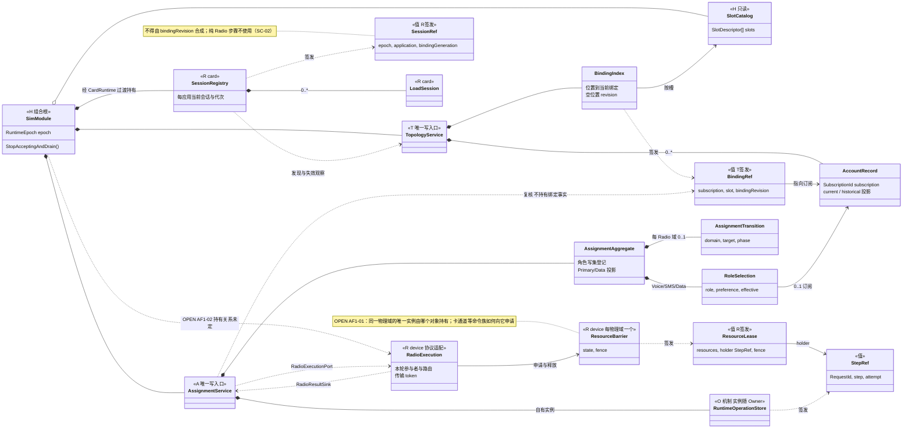
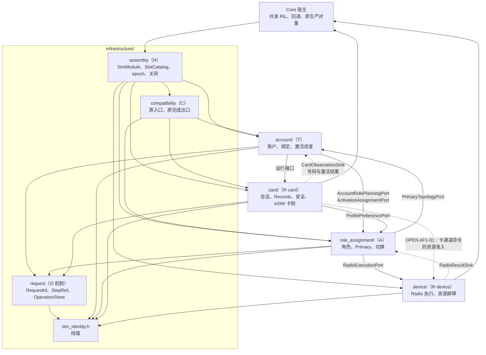
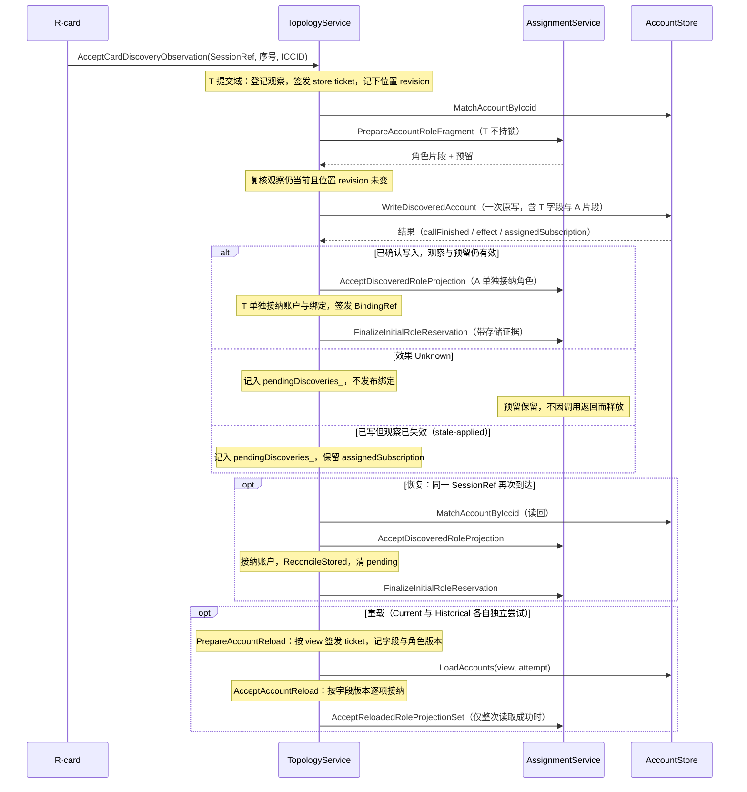
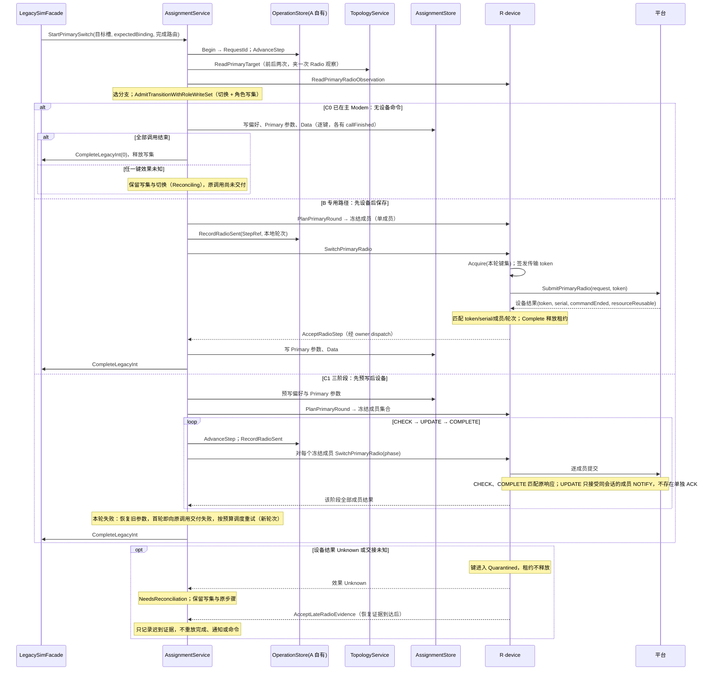
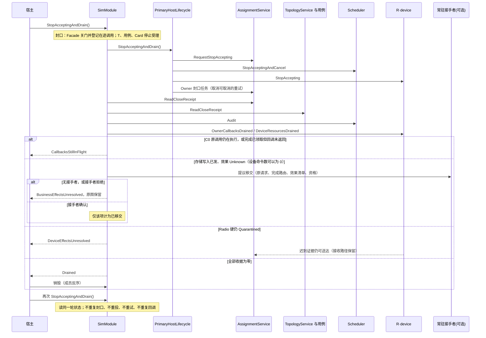
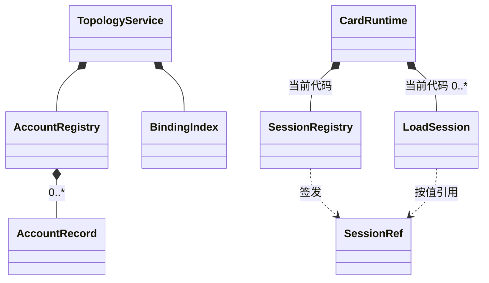

# AF-1 架构设计收敛检查点（2026-11-23）

> 文档状态：Operational / Pending。本文件是 AF-1（Architecture Design Sign-off）三轮工作的唯一进度交接入口。
> 它记录审计事实、对象模型分析和待裁决事项，**不是新的架构决策来源**；决策仍以目标架构 v1.2、源码详细设计、功能与 WU 及其批准记录为准。
> Host 证据不等于产品验收；本文件中的 PASS 仅指"本轮审计步骤完成"。

## 0. 进度总览

| 阶段 | 内容 | 状态 |
| --- | --- | --- |
| P0 | 代码仓基线和工作区保护 | PASS |
| P1 | 权威文档及已有架构决策核对 | PASS（无新增决策冲突） |
| P2 | 核心业务对象和数据所有权收敛 | 分析完成；2 项需架构负责人裁决（AF1-01、AF1-02） |
| P3～P6 | 接口契约、源码差距、文档修订、独立签收 | 不属于第一轮，未开始 |

本轮结论标记：`AF1_ROUND1_PARTIAL`（理由见 §5.1；P0～P2 的分析工作均已完成并持久化）。

## 第一部分：基线审计（P0）

### 1.1 Git 基线（2026-11-23 实测）

| 项 | 实测值 |
| --- | --- |
| Git 根目录 | `/mnt/e/github/multisim`（路径仅作本次记录，不作恢复依据） |
| 当前分支 | `main` |
| 本地 HEAD | `632f6a2a888cfbbc3c9387edc89732364e12a10e` |
| 本地 `origin/main` | `632f6a2a888cfbbc3c9387edc89732364e12a10e` |
| `git ls-remote origin refs/heads/main` | `632f6a2a888cfbbc3c9387edc89732364e12a10e` |
| HEAD 与远端 | 一致，无增量提交 |
| remote | `origin` = `github.com/zjuluowu/multisim`；`upstream` = `github.com/openharmony/telephony_core_service` |

近期提交（`git log --oneline -8`）：

- `632f6a2a8` feat(multisim): add account recovery and reload（T2）
- `06ca400a1` docs(sim): align architecture and migration gates for three sign-off conditions
- `5796fce68` feat(multisim): add account discovery provider loop（T1）
- `be63ae124` fix(multisim): seal core legacy shutdown path
- `50c0f4747` docs(sim): record three architecture sign-off decisions
- `bd4fbe833` docs(sim): independently review the multisim architecture baseline
- `befd76d4e` fix(multisim): linearize primary host shutdown
- `da99dd1a4` feat(multisim): add primary host drain gate

任务提示词中记录的基线 `632f6a2a` 仍然成立，无需增量核对。

### 1.2 工作区状态

- 暂存区：空。已跟踪文件：无修改。
- 未跟踪文件（用户文件，本轮不读写、不删除、不暂存）：`default.profraw`、`opencode.json`（均在仓库根）。
- 本文件创建前不存在 `docs/AF1*`，为全新创建；没有发现正在编辑的设计文档。
- 其他 worktree 存在（历史 G2a/审计分支及若干 `/tmp` prunable 项），本轮不使用、不清理。

### 1.3 AF-1 任务目标与本轮范围

- AF-1 目标：使核心对象、身份、关联、生命周期和唯一事实所有权达到可签收状态，让开发人员不依赖架构理论即可判断对象由谁创建、事实由谁维护、如何关联、用什么身份引用、何时失效销毁、谁有修改权。
- 第一轮范围：仅 P0～P2。P2 完成后停止。
- 本轮保护规则：不修改生产源码、GN、Golden/测试预期、历史报告和历史架构校验摘要；不 `git add`/commit/push；只新增或更新本文件。
  （仓库 AGENTS 的持续发布授权被本轮用户要求明确收窄，以本轮要求为准。）

### 1.4 必须遵循的已有设计决策（入口）

- SC-01 关闭责任、SC-02 Radio 身份和参与者、SC-03 完整写权：原始记录为
  `docs/history/reviews/SIM_Core_Architecture_Signoff_Convergence_20261123.md`，精确表述在第二部分核对。
- 一级目录五组（account / role_assignment / card / device / infrastructure）：`docs/SIM重构代码目录结构设计方案.md`。


### 1.5 当前代码结构事实（HEAD `632f6a2a` 实读）

以下只陈述源码事实。`services/multisim/` 全部 target 为 `testonly = true`（`services/multisim/BUILD.gn`），生产仍由 `services/sim/` 实现；头文件声明不等于实现。

| 责任 | 实际代码 | 本轮核实的事实 |
| --- | --- | --- |
| H | `infrastructure/assembly/`：`SimModule`、`sim_module_factory.*`、`SimHostPorts`、`SlotCatalog`、`ManagerPublicationSequence`、`PrimaryHostLifecycle` | 仅 `SimModule` 私有构造函数有定义；`AttachSimModuleToExisting`、`CreateOwnedSimServices`、两个 Deleter、`SimModule::StopAcceptingAndDrain` 均只有声明。`PrimaryHostLifecycle::StopAcceptingAndDrain` 有实现，但它是 Primary Host 切片的关闭入口，不属于 `SimModule` 成员。提示词中的 `SimModulePublication` 在源码中不存在，对应物为 `ManagerPublicationSequence` 与 `SimServicePublicationPort` |
| T | `account/`：`TopologyService`（持 `AccountRegistry`、`BindingIndex`、`DiscoveryObservationLedger`、`ActivationProgress`、`pendingDiscoveries_`）、`AccountStoreAdapter` | 实现 `CardObservationSink` 与 `PrimaryTopologyPort`；T1/T2 入口（`DiscoverAccount`、`ReconcileDiscovery`、`PrepareAccountReload`、`AcceptAccountReload`）存在 |
| A | `role_assignment/`：`AssignmentService`（持 `AssignmentAggregate`、自有 `RuntimeOperationStore`、`AccountRoleProtocol`、`pendingPrimary_`、`assignmentConflicts_`） | 实现 `RadioResultSink`、`ProfilePreferencePort`、`AccountRolePlanningPort`、`ActivationAssignmentPort`、`ScheduledRetrySink` |
| O | `infrastructure/request/`：`RequestId`、`StepRef`、`EffectKnowledge`、`RequestContext`、`RuntimeOperation`、`RuntimeOperationStore` | 容器按 `(RuntimeEpoch, RequestOwner)` 构造，由各 Owner 自持实例；不发令、不重试。`RetrySchedulerPort`/`ScheduledRetrySink` 声明也在同一头文件 |
| R·card | `card/runtime/CardRuntime`，`card/state/SessionRegistry`，`card/records/LoadSession`，`card/esim/LocalCardRequests` | `CardRuntime` 声明实现四个端口（含 `RadioExecutionPort`），但 `card_runtime.cpp` 只定义构造、`BindResultSinks`、`InvalidateVerifiedCardSession`、`PublishAcceptedCardDiscovery`、`EndLocalProfileWait`；`SwitchPrimaryRadio` 等运行方法无定义 |
| R·device | `device/resource/ResourceBarrier`、`ResourceRadioRuntime` | `ResourceRadioRuntime` 实现 `RadioExecutionPort`，自持 `barrier_`，经 `RadioPlatformPort` 发令；`device/radio/` 目录尚不存在（计划目录） |
| C | `infrastructure/compatibility/{api,events}`：`LegacySimFacade`、`LegacyCompletion`、`LegacyOutputAdapter` | 持入口引用和完成出口，不持业务状态 |
| I | `AccountStoreAdapter`（account）、`AssignmentStoreAdapter`/`AssignmentOutputAdapter`（role_assignment）、`ActivationHookAdapter`（account/activation） | 业务 Adapter 随 Owner，不集中在 infrastructure，与目录方案 §6.1 一致 |

## 第二部分：P1 架构决策核对

### 2.1 权威文档清单（均已核实存在）

| 代号 | 文档 | 唯一维护内容（依 `docs/README.md` 维护职责表） | 状态 |
| --- | --- | --- | --- |
| A | `docs/SIM_Target_Architecture_Design_v1.2.md`（1708 行） | 业务责任、事实写权、异步、资源、实施门禁 | Authoritative，整体仍 `draft/pending`，多数章节标 PROPOSED |
| B | `docs/SIM_Multisim_Source_Architecture_Detailed_Design.md`（824 行） | 当前与稳态路径、类、接口、逻辑 GN DAG | Authoritative |
| C | `docs/SIM重构代码目录结构设计方案.md`（686 行） | 一级物理职责、Infrastructure 内部边界 | Authoritative |
| D | `docs/migration/SIM_Architecture_Refactor_Design.md`（1381 行） | SIM-001～062、WU-01～09、字段台账 | Authoritative |
| — | `docs/SIM_Refactor_Execution_State.md` | 基线、实测证据、阻塞、下一批 | Operational，**不是目标架构** |
| — | `docs/history/reviews/SIM_Core_Architecture_Signoff_Convergence_20261123.md` | SC-01～03 决策记录与四文档矩阵 | Historical 记录；决策正文已落入 A/B/C/D 锚点 |
| — | `docs/history/reviews/SIM_Core_Architecture_Independent_Deep_Review_20261123.md` | 独立评审意见 | Historical；**意见不是决策** |

本轮只定向读取了 A §3、§4.1～4.2、§10、§12.3、§14；B §2、§3.2、§4、§5～11；C §4.2～4.4；签收收敛记录全文；深度评审 §2。未读 D 正文（只用其锚点），未通读执行状态。

### 2.2 设计主题索引

| 设计主题 | 权威位置 | 已收敛决策 | 当前是否存在冲突 |
| --- | --- | --- | --- |
| 业务对象定义（Slot/Subscription/Account/Binding/CardApplication/eUICC/Port/Profile） | A §3.1、§3.2.1；B §5 | 订阅绑定位置、访问卡应用、Radio 栈协议三种关系独立变化；用三个 Target 加受控索引表达，不新建实体表 | 无冲突。`EndpointInstance`/`ObservationSource` 明确为语义角色，源码无对应类型属预期 |
| T/A/O/R/C/I/H 职责 | A §4.1 边界表；B §2 | T、A 是仅有的两个业务上下文；O 是请求机制；R/C/I/H 为实现责任 | 无冲突。A §4.1 写"O 唯一拥有运行期请求状态"，B §8 写"每个进程所有者自己构造容器"，二者相容：O 定义类型和规则，实例由发起 Owner 持有（见 §3.3 表注） |
| Slot 与 Subscription 的关系、绑定基数 | A §3.1 图与注；B §5、§6 | 同一位置至多一个当前绑定，同一订阅至多一个当前位置（现有 `BindingIndex`）；空位置也保留 revision | 无冲突。多位置/多 Port 绑定为既有外部 OPEN（TGT-OPEN-006、G4），非本轮新增 |
| Role/Primary/Data/Voice/SMS 归属 | A §3.1、§4.1；B §7；C §4.3 | 全部归 A。Voice/SMS/Data 关联 `SubscriptionId`，Primary 涉及位置与 Radio 分配，不统一成一种标识 | 无冲突 |
| Request/Step/Session/Protocol/Transport/Resource 身份 | A §10.1（含 SC-02 锚点）、§11；B §8、§9 | 七类身份各有签发者与作用域，互不替代 | 设计内无冲突；**源码与设计不一致**（A 合成 `SessionRef`、成员取自目录），已由 B §9 记为待实现，见 AF1-03 |
| 资源屏障与租约 | A §12.3；B §9、§9.1；C §4.4 | 每个经证实的物理共享域一个准入者，租约由 R 统一管理；不得各建互不相知的屏障 | 设计内无冲突；**实例归属对象未命名**，见 AF1-01 |
| H 装配、生命周期、关闭 | A §14.2～14.3（含 SC-01 锚点）；B §11；C §5.3 | H 建图、封口、汇合收据、匹配销毁；不替任何一方消账 | 设计内无冲突；`SimModule` 与 `PrimaryHostLifecycle` 的关系未写明，见 AF1-02 |
| 写权与同键准入 | A §4.1、§13.2（SC-03 锚点）；B §7；D §5.2.1 | 每个物理键/DB 列一个业务 Owner 管准入 | 设计内无冲突；源码两个偏好入口仍直写，已由 B §7 记为待实现，见 AF1-05 |
| 目录与逻辑 target | C 全文；B §3.2、§4.1 | 五组目录；逻辑 target 与目录、SO 分开 | 无冲突。`ResourceRadioRuntime` 物理位于 `device/resource/`，B §3.2 稳态把 Radio 执行放 `device/radio/`（计划），属已知过渡 |

### 2.3 SC-01～03 状态

原始记录的结论为"三项条件在设计层已收敛，可提交架构负责人签收"。本轮逐项对照 A/B 锚点与当前源码，**没有发现需要推翻的依据，也没有改写其表述**。

| 决策 | 设计层 | 当前源码（`632f6a2a`） | 结论 |
| --- | --- | --- | --- |
| SC-01 关闭责任 | A §14.3 `#sc01-close`、B §11 `#sc01-receipts` 已明确 A/O/Scheduler/R/H 各自收据 | `PrimaryHostLifecycle::StopAcceptingAndDrain` 末段仍以 `AssignmentService::HasPendingDeviceEffects()`（`assignment_service.cpp:126`）作为 A 侧判据，没有 C0 原调用与逐键存储前缀的业务收据 | 设计已关闭，不重开；实现待做，B §11 已标"待实现" |
| SC-02 Radio 身份和参与者 | A §10.1 `#sc02-identity`、B §8/§9 `#sc02-radio` 已明确 | `assignment_service.cpp:199-200、239-240、392-393、600` 以 `bindingRevision` 和字面值 `"USIM"` 合成 `SessionRef`；`:253` 用 `catalog_.Slots()` 生成 C1 成员；`RuntimeOperationStore::RecordSent` 只有需要 `SessionRef` 的形式 | 设计已关闭，不重开；实现待做，B §8/§9 已标"待实现" |
| SC-03 完整写权 | A §13.2 `#sc03-key`、B §7 `#sc03-admission`、D §5.2.1 已明确 | `AcceptEntryPrimaryPreference`（`:659`）、`AcceptLocalProfilePreference`（`:662-664`，未使用来源 `StepRef`）直接调用 `store_.WriteUserPrimaryPreference`，未经 `AssignmentAggregate` 写集准入 | 设计已关闭，不重开；实现待做，B §7 已写明 |

收敛记录自带的 O1～O6 是产品/外仓证据类 OPEN，继续按原表保留，本轮不重复列出。

### 2.4 不需要重新讨论的已关闭事项

1. T、A 两个业务上下文的划分，以及 O 不是业务事实 Owner（A §4.1"O 的重新裁决"）。
2. 激活归 T、Primary/默认角色归 A（A §4.2）。
3. 五组一级目录（C）。
4. SC-01～03 的分责结论。
5. T1 账户发现、T2 恢复与重载的 Host 闭环设计（B §6）。
6. `bindingRevision`（T）与 `bindingGeneration`（R）互不具备签发效力（A §10.1）。
7. Core 拥有共享 RIL，SIM 不 Init/Stop 它（A §14.2）。

## 第三部分：P2 核心对象模型

阅读约定：**Owner** 指有权修改该事实的唯一责任方；"持有"指保存一份值或引用，不带修改权。类型列中"值"表示可自由复制的纯数据，"实体"表示有身份和可变状态，"机制"表示无业务事实的技术对象，"语义角色"表示设计中有此概念但源码无独立类型。

### 3.1 核心对象分类

| 类别 | 对象 | 归属 |
| --- | --- | --- |
| 一、物理与逻辑卡 | Slot、Endpoint、Port、eUICC、Profile、CardApplication、Subscription、AccountRecord、BindingRef、BindingIndex | 静态描述归 H；账户与绑定归 T；卡侧库存与应用归 R·card |
| 二、卡运行 | CardRuntime、SessionRegistry、SessionRef、LoadSession、CardApplicationTarget | R·card |
| 三、角色 | AssignmentAggregate、RoleSelection、Primary 投影、AssignmentTransition、角色写集 | A |
| 四、请求与设备执行 | RequestId、StepRef、RequestContext、RuntimeOperation、RuntimeEpoch、本地协议轮次、原生协议会话、传输 token、传输 serial、ResourceLease、fence、ResourceBarrier | 请求机制为 O（实例随发起 Owner）；设备执行归 R·device；epoch 归 H |
| 五、模块装配 | SimModule、工厂、SimHostPorts、SlotCatalog、ManagerPublicationSequence、PrimaryHostLifecycle | H |

### 3.2 表一：核心对象定义

| 对象 | 类型 | 创建者 | 唯一 Owner | 主要职责 | 生命周期 |
| --- | --- | --- | --- | --- | --- |
| Slot（`SlotId` / `SlotDescriptor`） | 值，只读配置 | H 启动时按产品输入构建 | H（静态目录） | 描述位置、端点种类、允许的 RIL 实例与 Radio 域、可见性 | 随模块实例；运行期不变 |
| Endpoint（`EndpointKind`） | `SlotDescriptor` 的属性；当前实例为语义角色 | 种类由 H；当前实例/可达性由 R 观察 | 种类 H；当前观察 R | 区分实体、eUICC、虚拟、受限、分布式 | 种类随配置；当前实例随来源出现/消失 |
| eUICC / Port / Profile | 语义角色。源码仅有 `legacyPortIndex`、`VerifiedPortRoute` | R·card 从卡侧协议观察 | R·card（库存与协议）；已接纳的账户绑定归 T；偏好归 A | Profile 库存、Port 路由 | 随 eUICC 在位；禁用 Profile 可无会话、无账户 |
| CardApplication（`CardApplicationTarget`） | 值（槽 + 应用键） | 调用入口按意图构造 | R·card 解释 | 定位一次卡应用访问目标 | 单次请求；应用键仅在当前载体内有效 |
| Subscription（`SubscriptionId`） | 值，包装旧 simId | 旧 provider 分配；T 接纳 | T | 本机业务身份 | 长期（持久）；不承诺跨删除/重装稳定 |
| AccountRecord（含 current/historical `AccountProjection`） | 实体 | T（`AccountRegistry::AcceptDiscoveredAccount` / 重载） | T | 账户资料及各字段 revision | 长期；内存投影可由重载重建 |
| BindingRef | 值（订阅 + 槽 + `bindingRevision`） | T（`BindingIndex`） | T | 标识"这次"订阅与位置的绑定 | 至下一次换绑/解绑；可被重新发现重建，但 revision 不回退 |
| BindingIndex（`SlotRuntimeEntry`） | 实体（索引） | `TopologyService` 构造 | T | 位置→当前绑定、空位置 revision、装配事实 | 随模块实例 |
| DiscoveryObservationLedger | 实体 | `TopologyService` | T | 每应用观察序列、发现与失效资格 | 随模块实例 |
| ActivationProgress | 实体 | `TopologyService` | T | 激活进行中标志（跨模块可见的业务进度） | 每次激活一条，完成后清除 |
| CardRuntime | 过渡接缝对象 | H（`SimModule` 成员） | R·card | 借用原生产对象、绑定结果出口、发布发现/失效观察 | 随模块实例；稳态退化为有限绑定接口（B §3.2） |
| SessionRegistry | 实体 | 当前由 `CardRuntime` 构造 | R·card（`card/state`） | 每卡应用当前会话、代次水位、`ExpectedTransition` | 随模块实例；代次只增不减 |
| SessionRef | 值（epoch + 应用 + `bindingGeneration`） | R·card（`SessionRegistry`） | R·card | 标识一次卡应用访问资格 | 至换卡、应用替换、路由失效或模块重建 |
| LoadSession / LoadToken | 实体 / 值 | R·card，每轮加载 | R·card（`card/records`） | 加载成员资格、一次消费、受影响读失效 | 一轮加载或 Refresh |
| AssignmentAggregate | 实体（聚合） | `AssignmentService` 成员 | A | 角色选择、切换事实、参数投影、角色写集登记 | 随模块实例；持久事实在参数/DB，可重载 |
| RoleSelection | 值（角色 + preference + effective） | A | A | 一个默认角色的偏好与生效订阅 | 长期（持久于旧参数/DB） |
| Primary / Data 投影（`lastPrimary_`、`lastData_`） | 聚合内属性，按 `SlotId` | A | A | 主卡位置与联动 Data 的参数投影 | 长期 |
| AssignmentTransition | 实体（每 `RadioDomainId` 至多一条） | A（`AdmitTransition*`） | A | 切换进行中、目标、阶段、业务尝试 | 一次切换 |
| 角色写集（`RoleWriteMember` 位集 + `roleWriteOwners_`） | 聚合内登记 | A | A | 同键写入的准入资格 | 一次请求；结果未知时保留 |
| PendingPrimarySwitch | 实体 | `AssignmentService::StartPrimarySwitch` | A | 一次 Primary 请求的冻结计划、成员、阶段、重试 | 一次请求至终态或核对完成 |
| RequestId / StepRef | 值 | 发起 Owner 的 `RuntimeOperationStore::Begin` | 发起 Owner（T/A/R 短请求） | 业务请求及其步骤/尝试的身份 | 一次请求；仅在本 epoch + Owner 命名空间内有效 |
| RequestContext / RuntimeOperation | 值 / 记录 | 同上 | 发起 Owner（机制由 O 提供） | 原目标、父关联、发送会话、完成路由、效果认知、终态 | 一次请求；证据保留期后 `RetireAfterEvidenceRetention` |
| RuntimeOperationStore | 机制 | 各 Owner 自行构造（A 的 `operations_` 等） | 持有它的 Owner | 步骤门控、一次领取、迟到证据 | 随所属服务 |
| RuntimeEpoch | 值 | H，每次模块实例创建 | H | 区分模块实例，使旧请求/会话/租约整体失效 | 一个模块实例 |
| ResourceBarrier | 实体 | 目前有两处构造（见 §3.7） | R·device | 物理域状态机 Checking/Available/InFlight/Quarantined、fence | 随 R 实例；新实例先 Checking |
| ResourceLease | 值 | `ResourceBarrier::Acquire` | R·device | 一次命令对完整资源集的执行资格 | 至设备结束且可复用的证据；Unknown 时转隔离保留 |
| ResourceRadioRuntime | 执行适配 | Host 测试装配（`SimModule` 未持有） | R·device | 取租约、每次发送签发传输 token、接纳设备证据后转交 A | 随装配图 |
| SlotCatalog | 只读值对象 | H | H | 静态允许接线与旧容量度量 | 随模块实例；以 const 引用/`shared_ptr<const>` 注入 |
| SimModule | 组合根 | 私有工厂（未实现） | H | 按依赖顺序持有 I/C 出口、R、T、A、用例、Facade | 一个模块实例 |
| SimHostPorts | 值（端口集合） | Core 宿主 | Core（H 借用） | 共享 RIL、入口、回调、号码查询端口 | 必须活到 SIM 排空结束 |
| ManagerPublicationSequence | 机制 | `OwnedSimServices` | H | 记录 eSIM→SIM 初始化与发布的阶段和控制块一致性 | 一次创建 |
| PrimaryHostLifecycle | 机制 | Host 装配 | H | Primary 切片的封口、单一关闭者、汇合 A/Scheduler/R 判据 | 一次模块实例的关闭轮 |
| LegacySimFacade / LegacyCompletion | 兼容边界 | H（`SimModule` 成员） | C | 原入口签名、原完成出口交付 | 随模块实例 |

### 3.3 唯一事实所有权矩阵

| 业务事实/对象 | 唯一 Owner | 主要关联对象 | 其他模块允许的操作 | 依据 |
| --- | --- | --- | --- | --- |
| 账户身份及 current/historical 资料 | T | `SubscriptionId` / `AccountRecord` | 查询；经 T 入口申请变更 | A §4.1；B §2、§6 |
| 订阅与位置的当前绑定、空位置 revision | T | `BindingRef` / `BindingIndex` | 查询、用 `StillMatches` 复核；R 只提供观察 | A §4.1；B §5 |
| 槽运行清单（是否已装配） | T（接纳 H/R 给出的装配事实） | `SlotRuntimeEntry` | 查询 | `TopologyService::AcceptSlotAssembly` |
| 激活进行中 | T | `ActivationProgress` | 查询（搜网、运营商配置等经旧出口） | A §4.1、§4.2 |
| 静态槽目录、端点种类、允许 Radio 域 | H | `SlotCatalog` | 只读 | A §3.2.1；`slot_catalog.h` |
| 原始卡/锁状态、Records、电话簿、STK、eUICC 库存 | R·card | 原生产对象（借用） | 观察；T 接纳发现/失效 | A §4.1；B §9 |
| 卡应用会话及代次 | R·card | `SessionRef` / `SessionRegistry` | 使用、复核是否仍当前 | A §10.1；B §9.1 |
| 加载成员资格 | R·card | `LoadSession` | 无 | A §10.2 |
| Voice / SMS / Data 默认角色（偏好与生效） | A | `RoleSelection` | 查询、申请切换 | A §4.1；B §7 |
| Primary 位置、Primary/Data 参数及用户偏好提示 | A | `AssignmentAggregate` 投影、角色写集 | 查询、在原节点经 A 入口提交 | A §4.1；SC-03 |
| Primary 切换进行中、目标、阶段、业务重试 | A | `AssignmentTransition`、`PendingPrimarySwitch` | 查询 | A §4.1 |
| 本轮 Radio 协议参与者（真实成员与路由） | R·device | 协议适配输出 | A 冻结一份本轮副本并只按该副本推进；H 的目录仅作输入 | SC-02；B §9 |
| 原生协议会话、传输关联 | R·device | protocolSession、token、serial | A 只携带本地轮次用于匹配 | A §10.1 |
| 设备资源状态与租约 | R·device（每个物理域一个 `ResourceBarrier`） | `ResourceLease`、fence | 用例步骤申请；不得自行释放 | A §12.3；实例归属见 AF1-01 |
| 请求步骤、效果认知、一次完成领取 | 发起该请求的 Owner（T/A/R 短请求），使用 O 的机制 | `RequestId` / `StepRef` / `RuntimeOperation` | R 提交证据；C 交付 | A §4.1、§4.2；B §8 |
| 外部持久化执行 | I（只执行，不拥有事实） | Store/参数/Provider | 执行已取得资格的 Owner 的写计划 | A §4.1；B §10.1 |
| 原完成出口登记与交付格式 | C（真实回调/等待对象在 Core 宿主） | `CompletionPlan` / `LegacyCompletion` | Owner 封存终态后交付一次 | A §4.1；B §10 |
| 模块实例、epoch、装配图、发布与销毁 | H | `SimModule` / `RuntimeEpoch` | 无 | A §14；B §11 |
| 共享 RIL 实例 | Core（不在 SIM 内） | `ITelRilManager` | SIM 借用引用 | A §14.2 |

表注：提示词初始框架中"请求步骤及完成 = O"一行按权威文档细化为"机制归 O，实例与其中记录归发起 Owner"。这不是新决策，是 A §4.1（O 不拥有任何对外可见业务事实）与 B §8（每个进程所有者自己构造容器）的合并表述。

### 3.4 表二：对象关联关系

| 对象 A | 关系 | 对象 B | 基数 | 关联维护者 |
| --- | --- | --- | --- | --- |
| Slot | 当前绑定到 | Subscription | 1 — 0..1（双向） | T（`BindingIndex`） |
| Subscription | 拥有资料 | AccountRecord | 1 — 1（current、historical 各 0..1 投影） | T（`AccountRegistry`） |
| Slot | 当前可访问 | CardApplication 会话 | 1 — 0..* | R·card（`SessionRegistry`） |
| CardApplication 会话 | 包含 | LoadSession | 1 — 0..*（按 scope） | R·card |
| eUICC | 提供 | Port | 1 — 0..* | R·card 观察（产品基数 OPEN） |
| eUICC | 容纳 | Profile | 1 — 0..* | R·card 观察 |
| 启用的 Profile / 实体卡 | 呈现 | CardApplication | 1 — 1..* | R·card |
| 已发现的卡应用会话 | 被接纳为 | BindingRef | 0..1 — 0..1 | T 接纳 R 的观察（`CardObservationSink`） |
| RoleSelection（Voice/SMS/Data） | 指向 | Subscription | 每角色 1 条 — 0..1；多个角色可指向同一订阅 | A |
| Primary 投影 | 指向 | Slot | 1 — 0..1 | A |
| AssignmentTransition | 属于 | RadioDomain | 0..1 — 1（同域同时至多一个切换） | A |
| Slot | 配置属于 | RadioDomain | * — 0..1 | H（静态） |
| RadioDomain（业务冲突域） | 对应 | 物理资源域 `ResourceKey` | 未在权威文档中给出映射规则 | 见 AF1-04 |
| RequestId | 包含 | StepRef | 1 — 1 当前步（step/attempt 递增） | 发起 Owner |
| 子请求 | 关联父 | 父 StepRef | * — 0..1 | 发起子请求的 Owner |
| 一次 Primary 请求 | 冻结 | 本轮参与者集合 | 1 — 1..* | A 冻结，R 提供并验证 |
| 一个设备步骤 | 持有 | ResourceLease | 1 — 0..1（覆盖完整资源集） | R·device |
| ResourceLease | 覆盖 | 物理资源域 | 1 — 1..* | R·device |
| 一次发送 | 标识为 | 传输 token（及可选 serial） | 1 — 1 | R·device |
| SimModule | 持有 | T/A/R/C 服务与 Adapter | 1 — 各 1 | H |
| SimModule | 借用 | Core 的共享 RIL、原生产对象、HostPorts | 1 — 各 1 | Core 拥有 |

关于"ID 作为属性还是独立关联中心"：权威设计的答案是**关系由 Owner 的受控索引维护，ID 只是引用值**（A §3.1 末、§4.1.1"不引入全局映射服务"）。`BindingIndex` 是 T 内部的索引，不是面向全模块的 ID 映射中心；其他模块拿到的是带版本的 `BindingRef`，用前复核。

### 3.5 表三：身份模型

以下七类身份互不替代。数值相等不代表可互换。

| 身份 | 源码类型 | 签发者 | 持有者 | 有效期 | 失效条件 | 禁止用途 |
| --- | --- | --- | --- | --- | --- | --- |
| 1 业务请求 | `RequestId`（value + epoch + `RequestOwner`） | 发起 Owner 的 `RuntimeOperationStore::Begin` | 发起 Owner；随 `RequestContext` 传给 R/C | 一次请求 | 终态且证据保留期结束；模块重建 | 当作设备取消序号、跨重启追踪 ID；仅按 value 识别 |
| 2 请求步骤 | `StepRef`（request + step + attempt） | 发起 Owner `AdvanceStep` | 发起 Owner；R 在发送关联中保存原值 | 一步的一次尝试 | 步骤推进、重试、终态 | 授予写权（可追溯来源，但不等于资格，B §7） |
| 3 账户绑定 | `BindingRef`（订阅 + 槽 + `bindingRevision`） | T `BindingIndex` | A 的请求计划、T 的号码/激活目标 | 至换绑或解绑 | 换卡、解绑、同槽再绑（revision 递增） | 签发或充当卡应用会话；当作全局拓扑版本 |
| 4 卡应用会话 | `SessionRef`（epoch + 应用 + `bindingGeneration`） | R·card `SessionRegistry` | 访问该应用的请求（PIN、EF、号码写卡、Profile） | 至应用被替换 | 换卡、应用替换、路由失效、模块重建 | 用于纯 Radio 步骤；由 T/A 用 `bindingRevision` 合成 |
| 5a 本地协议轮次 | `RadioSwitchRequest::protocolSession`（uint32，当前由 A 的 `nextProtocolSession_` 递增） | A（本请求内的轮次编号） | A 的 pending；R 的发送关联 | 一轮三阶段交换 | 新一轮（重试）开始 | 当作原生协议会话号；跨请求比较 |
| 5b 原生 Radio 协议会话 | 原 `RadioProtocolController` 的 sessionId（未进入 Target 类型） | 原协议/平台 | R·device 协议适配，映射到 5a | 一次原生交换 | 协议结束或被替换 | 上浮给 A 作业务身份 |
| 6 单次传输 | 传输 token：`uint64_t`，`ResourceRadioRuntime::nextTransportToken_`；RIL serial：`RadioSubmitResult::transportSerial` | token 由 R·device；serial 由平台 RIL | R·device 的 `transmissions_` | 一次发送至其结束证据 | 结果被接纳或被核对 | serial 当作跨重启或跨协议身份（可复用/回绕）；没有 serial 的通知填造 serial |
| 7 设备资源租约 | `ResourceLease`（epoch + 资源集 + holder `StepRef` + fence） | R·device `ResourceBarrier::Acquire` | 提交该命令的 R 执行适配 | 至设备结束且可复用 | 完成证据、确认未发送、恢复证据后推进 fence；模块重建后先 Checking | 由 A/T 持有或释放；用等待超时、调用返回、本地 channel 清零来释放 |
| （辅助）模块实例 | `RuntimeEpoch`（128 位） | H | 嵌入 1、4、7 | 一个模块实例 | 模块重建、进程重启 | 当作业务持久版本；由新 epoch 推断旧命令已结束 |

说明：5a/5b 的区分依据 A §10.1 与 B §9"将原生 protocolSession 映射到本地轮次。当前 Host 计数仅能关联 Host 发送"。源码中这两者及传输 token、fence 都是裸整数，没有独立类型，属于 P3 接口契约要决定是否加类型的事项（AF1-06），不是职责未决。

另有一个容易混淆的名称：`ActivationConflictLease`（`account/activation/activation_assignment_port.h`）是 **A 签发给 T 激活用例的业务冲突资格**，不是设备资源租约；A §4.2 协作规则 3 明确"资格释放不等于设备可用"。

### 3.6 生命周期模型

| 分组 | 对象 | 说明 |
| --- | --- | --- |
| 长期存在（持久事实，重启后由存储恢复） | Subscription、AccountRecord 的资料、角色偏好、Primary/Data 参数 | Owner 为 T 或 A；内存投影可通过重载重建 |
| 随模块实例存在 | SlotCatalog、RuntimeEpoch、SimModule 及其服务、BindingIndex、SessionRegistry、ResourceBarrier、各 RuntimeOperationStore | 模块重建后全部换新；epoch 使旧引用失效 |
| 随卡/载体在位存在 | 当前绑定、SessionRef、LoadSession、eUICC/Port/Profile 观察 | 换卡时：R 先经 `CardObservationSink` 让 T 撤销资格，再发布新会话（`CardRuntime::PublishAcceptedCardDiscovery`）；历史账户保留 |
| 仅一次请求期间 | RequestId/StepRef/RequestContext、PendingPrimarySwitch、AssignmentTransition、角色写集登记、ActivationProgress 条目、ExpectedTransition、ResourceLease、传输 token | 结果未知时不随调用返回而结束，保留至核对完成 |
| 由业务 Owner 管理 | 账户、绑定、激活进度（T）；角色、切换、写集（A） | 只有 Owner 的应用入口可修改 |
| 只是技术引用 | BindingRef、SessionRef、StepRef、token、serial、fence、epoch | 值类型；使用前向签发者复核 |
| Stop 时必须等待排空或移交（SC-01） | A 的已受理请求、未决角色资格、已发未确认的存储前缀；O 的已领取未返回的完成；Scheduler 的已投递/运行中任务；R 向 Owner 的在途投递；R 的在途设备命令（可在有驻留接收者时保持隔离，L3 先于 L4） | T 的在途发现写入（`pendingDiscoveries_`）、激活进度按 SC-01"其他用例由其 Owner"同样需要收据，具体形态见 AF1-07 |
| 可通过重新发现或恢复重建 | 当前绑定（T1/T2）、账户与角色投影（重载）、会话（R 重新观察）、资源状态（Checking 后凭证据恢复） | 不可重建：进程内请求身份、旧 epoch 的租约；这些不跨重启恢复（A §12.2） |

对象销毁与悬空引用：`SimModule` 成员声明顺序即创建顺序（I/C 出口 → R → T → A → 用例 → Facade），反序销毁；`TopologyService::roles_`、`CardRuntime::resultSinks_` 是构造后绑定的借用引用，`ResourceRadioRuntime` 对 sink/dispatch 用 `weak_ptr`、对 platform 用引用。设计要求（B §11）事件桥只保留 weak Owner + epoch + 在途计数；**反序销毁本身不证明异步回调已排空**（`sim_module.h` 注释），因此销毁前必须先得到 `Drained`。

### 3.7 Card 与 Device 的边界审视

先列当前 HEAD 核实到的事实：

1. `CardRuntime` 声明实现 `RadioExecutionPort`，并持成员 `ResourceBarrier resources_`（`card/runtime/card_runtime.h:104`，在 `card_runtime.cpp:26` 以 epoch 构造）。除构造外，`resources_` 在 `card/`、`infrastructure/`、`role_assignment/`、`account/` 中没有任何使用；`CardRuntime::SwitchPrimaryRadio` 等没有定义。
2. `ResourceRadioRuntime` 持自己的 `ResourceBarrier barrier_`，在 `SwitchPrimaryRadio` 中 `barrier_.Acquire(resources_, request.step)`（`resource_radio_runtime.cpp:93`），签发传输 token（`:105`），经 `RadioPlatformPort::SubmitPrimaryRadio` 发令（`:111`）。资源键由构造方传入，Host 测试使用 `"host-primary-radio:conservative-shared"`。
3. `SimModule` 的私有构造把 `runtime_`（`CardRuntime`）作为 `RadioExecutionPort` 传给 `AssignmentService`（`sim_module_factory.cpp`），`SimModule` 不持有 `ResourceRadioRuntime`。该构造没有生产或 Host 调用者。
4. Host B/C1 测试直接组合 `AssignmentService` + `ResourceRadioRuntime` + `PrimaryHostLifecycle`（`test/cases/target/primary/b_async_primary_test.cpp`）。
5. GN 中 `ResourceBarrier`、`ResourceRadioRuntime` 与 `SessionRegistry`、`LoadSession` 同属 `runtime_mechanisms`，`CardRuntime` 属 `runtime_core`。

逐题结论：

| 问题 | 结论 | 状态 |
| --- | --- | --- |
| 1. CardRuntime 管卡应用生命周期，还是也管物理 Radio 资源？ | 设计已裁决：Card 管卡应用会话、Records、安全与卡侧通道语义；真实域 lease/fence/结束资格归 `device/resource`，Radio 协议 session/phase/member 归 `device/radio`（B §9.1；C §4.2、§4.4）。`CardRuntime` 是过渡接缝，稳态退化为有限绑定接口，其 Session/Load/Resource 成员"尚未完成能力拆分"（B §3.2）。源码中它仍兼有 Radio 端口与屏障成员，属**已登记的设计与代码不一致** | 设计 PASS；代码差距入 P4 |
| 2. ResourceRadioRuntime 是否应成为设备资源的唯一执行责任方？ | 需要拆成两句。**唯一准入者**：已裁决，每个经证实的物理共享域只有一个资源准入者（A §12.3）。**唯一执行者**：未裁决。A §12.3 要求激活、Radio 协议、eSIM 开通道查询等冲突集合统一登记到 R；B §9.1 又写"Card 可直接使用注入的窄硬件能力，不强制 CardManager→DeviceManager→RIL"。因此 `ResourceRadioRuntime` 是 Radio 命令族的执行适配，文档没有说它要承接卡通道、激活等其他命令族的执行 | 准入 PASS；执行者范围 OPEN（并入 AF1-01） |
| 3. CardApplication Session 与 Radio ProtocolSession 是否完全独立？ | 已裁决为独立（SC-02；A §10.1；B §3.2"稳态不设 device/session"）。纯 Radio 步骤不得使用 `SessionRef`。源码 A 仍合成 `SessionRef`，待实现 | 设计 PASS；代码差距 AF1-03 |
| 4. ResourceLease 由谁创建、保存、释放？ | 创建：`ResourceBarrier::Acquire`，由用例步骤（`StepRef` 为 holder）或 R 的运行请求申请。保存：提交命令的 R 执行适配（现为 `ResourceRadioRuntime::Group::lease`），A/T 不持有。释放：仅 R 凭设备证据（`Complete`、`CancelConfirmedNotSent`、`AcceptRecoveryEvidence`）；Unknown 转 `Quarantine` 保留。依据 A §12.3、B §9 | PASS（Radio 命令族）；其他命令族的保存者随 AF1-01 |
| 5. 一个真实物理域是否可能存在两套互不知情的 ResourceBarrier？ | 设计禁止（A §12.3"不能按旧锁各建一个互不相知的屏障"）。**当前源码在结构上允许**：`CardRuntime::resources_` 与 `ResourceRadioRuntime::barrier_` 是两个独立实例，互无引用。目前没有任何装配图同时启用二者（前者从未被使用，`SimModule` 也不含后者），所以今天没有运行期双重独占；但没有结构性手段阻止将来同域双屏障。深度评审 §2.2 提出过同一风险，本轮以源码复核属实 | OPEN：AF1-01 |
| 6. SimModule 如何连接 Card、Radio 和 AssignmentService？ | 现状有两张互不包含的图：`SimModule`（全量声明图，A 的 Radio 端口接到无实现的 `CardRuntime`，关闭方法仅声明）和 Host Primary 图（A 接 `ResourceRadioRuntime`，关闭由 `PrimaryHostLifecycle` 实现）。设计方向明确：H 注入 device 的协议适配作为 A 的 `RadioExecutionPort`（B §9 SC-02、C §4.4），H 汇合收据（B §11）。但权威文档没有写明 `SimModule` 是否持有 `ResourceRadioRuntime`、`PrimaryHostLifecycle` 是并入 `SimModule::StopAcceptingAndDrain` 还是其下属部件 | OPEN：AF1-02 |

没有足够文档证据支持唯一答案的两点（AF1-01、AF1-02）不在本轮自行裁决。

### 3.8 核心类图



图中 `RadioExecution` 表示 device 侧实现 `RadioExecutionPort` 的协议适配这一角色；当前实现类为 `ResourceRadioRuntime`。T 的激活、号码用例及其自有 `RuntimeOperationStore` 与 A 对称，为保持图面简洁未画出。

### 3.9 核心组件依赖图

实线为编译依赖（使用方 → 被依赖的契约），虚线为运行期回调（经窄 sink，由 H 绑定）。



说明：

- T 与 A 之间的双向箭头都指向对方的**窄契约**（`*_contracts`），不指向对方的服务或聚合；当前 GN 图无环（B §4.1）。
- `RadioExecutionPort` 的声明在 `role_assignment/primary/`（消费方定义出站契约），由 device 实现。
- `AssignmentService → RadioExecutionPort → device` 是设计方向与 Host 图；`SimModule` 当前把该端口接到 `CardRuntime`（AF1-02）。
- 各 Owner 自带的 Store/输出 Adapter（I）位于各自目录，图中并入所属 Owner。

## 第四部分：遗留问题

类别标记：【决策】已有设计决策；【实现】已有代码实现；【不一致】设计与代码不一致；【缺证】证据不足。

| 编号 | 问题描述 | 证据路径及符号 | 影响范围 | 状态 | 需架构负责人裁决 | 进入第二轮 |
| --- | --- | --- | --- | --- | --- | --- |
| AF1-01 | 同一物理域的唯一 `ResourceBarrier` 实例由哪个对象持有并注入；卡通道（eSIM、ARA-M）、普通激活等命令族是经 device 的执行适配发令，还是 Card 持注入的硬件能力并只向同一屏障申请租约。【缺证】+【不一致】 | 决策侧：A §12.3（一个准入者、冲突集合统一登记）；B §9.1（Card 可直接用窄硬件能力）、B §9（"session/resource 按真实生命周期注入"，未命名持有者）。代码侧：`card/runtime/card_runtime.h:104` `resources_`（未使用）；`device/resource/resource_radio_runtime.h` `barrier_` | Card/Device 边界、所有设备命令的准入接口、关闭时 R 的设备收据形态 | OPEN | 是。需给出：屏障实例的持有对象；非 Radio 命令族的执行归属。eSIM 普通/低优先级 File 与 ARA-M 是否共享物理域属既有外部缺口（B §9.2），不阻塞对象归属裁决 | P3（设备准入端口）；P4（退役 `CardRuntime::resources_`） |
| AF1-02 | `SimModule` 与 Host Primary 图的装配关系：`SimModule` 是否持有 device 的 Radio 执行适配并注入 A；`PrimaryHostLifecycle` 与 `SimModule::StopAcceptingAndDrain` 的关系（合并、下属部件或并存）。【缺证】+【不一致】 | `infrastructure/assembly/sim_module_factory.cpp`（`assignment_(…, runtime_, …)`）；`sim_module.h`（`StopAcceptingAndDrain` 仅声明，返回枚举与 `PrimaryHostLifecycle::DrainResult` 同形）；`primary_host_lifecycle.h`；B §11（把收据契约写在 `PrimaryHostLifecycle` 名下，同时称 assembly 拥有单套生产对象） | H 的对象持有图、关闭入口的唯一性、A 的 Radio 端口接线 | OPEN | 是。倾向性信息：设计方向（B §9、C §4.4）已指向"H 注入 device 适配"，缺的是对装配对象关系的明文 | P3（H 装配与关闭契约） |
| AF1-03 | A 以 `bindingRevision` 和 `"USIM"` 合成 `SessionRef`，成员取自 `catalog_.Slots()`；`RecordSent` 只有卡会话形式。【决策】已定（SC-02），【不一致】 | `role_assignment/assignment_service.cpp:199-200、239-240、392-393、600`（合成会话）、`:253`（成员）；`infrastructure/request/runtime_operation_store.h` `RecordSent` | Primary B/C1 的发送登记与成员集合 | 设计 PASS；代码 OPEN | 否（B §8、§9 已写明待实现契约） | P3（Radio 专用发送登记、参与者规划结果的接口）；P4 |
| AF1-04 | 业务冲突域 `RadioDomainId`（来自 `SlotDescriptor`，A 用于同域至多一个切换）与物理资源域 `ResourceKey`（R 用于租约）之间的对应规则未在已读章节给出；Host 中二者各自取值。【缺证】 | `infrastructure/sim_identity.h` `RadioDomainId`；`device/resource/resource_barrier.h` `ResourceKey`；A §12.3"A 决定分配策略…R 统一管理租约，三者不是重复 arbiter" | A 的准入范围与 R 的独占范围是否一致覆盖；多栈产品 | OPEN | 待定：先在 P3 定向查 A §12.4、§17.1 及 D；若仍无规则再提请裁决 | P3 |
| AF1-05 | 两个偏好入口直写 Store，绕过 `AssignmentAggregate` 写集；`AcceptLocalProfilePreference` 未使用来源 `StepRef`。【决策】已定（SC-03），【不一致】 | `role_assignment/assignment_service.cpp:659、662-664`；B §7 `#sc03-admission` | 偏好键的同键准入 | 设计 PASS；代码 OPEN | 否 | P4 |
| AF1-06 | 本地协议轮次、原生协议会话、传输 token、fence 在源码中均为裸整数，无独立类型；本地轮次由 A 的 `nextProtocolSession_` 产生。【实现】 | `role_assignment/primary/radio_execution_port.h` `RadioSwitchRequest::protocolSession`、`RadioDeviceResult::transportToken`；`assignment_service.h` `nextProtocolSession_`；`resource_barrier.h` `ResourceLease::fence` | 身份误用的编译期防护；职责本身已清楚（§3.5） | OPEN（设计细化） | 否 | P3（决定是否引入强类型及其定义位置） |
| AF1-07 | SC-01 规定"其他用例由其 Owner"出具关闭收据，但 B §11 的收据契约只展开了 A + Scheduler + R(Radio)。T 的在途发现写入（`pendingDiscoveries_`）、激活进度、号码字段预留，以及 R·card 的在途投递，其收据形态未写明。【决策】原则已定，【缺证】契约细节 | A §14.3 `#sc01-close` 表首行；B §11 `#sc01-receipts`；`account/topology_service.h` `pendingDiscoveries_`、`ActivationProgress` | 完整模块关闭（不止 Primary 切片） | OPEN（设计细化） | 否（按 SC-01 原则展开即可；若展开时出现分歧再提请） | P3 |
| AF1-08 | `SessionRegistry`、`LoadSession` 的实例由过渡对象 `CardRuntime` 持有；稳态由 `card/state`、`card/records` 的哪个能力组件持有、如何注入，文档只给方向。【决策】方向已定，【不一致】过渡 | B §3.2 末段、§9、§9.1；`card/runtime/card_runtime.h` | R·card 内部对象持有图 | OPEN（设计细化） | 否 | P3 |
| AF1-09 | `ScheduledRetrySink::AcceptScheduledC1Retry` 这一业务命名的回调声明位于通用请求机制头。深度评审建议收回 `role_assignment` 或声明仅用于 C1；该建议不是决策。【实现】 | `infrastructure/request/runtime_operation_store.h`；深度评审 §2.3 | O 机制的通用性边界 | OPEN | 否（P3 接口落点问题） | P3 |
| AF1-10 | eUICC/Port/Profile 的多绑定基数、动态端点来源身份。【缺证】，既有外部 OPEN | A §3.1 图注、§3.2、§10.4；TGT-OPEN-006 | G4 新能力 | BLOCKED（外部产品证据） | 否（非本轮可裁决；沿用既有 OPEN） | 否 |
| AF1-11 | 提示词所列 `SimModulePublication` 无此类型；对应物为 `ManagerPublicationSequence` + `SimServicePublicationPort`。【实现】 | `infrastructure/assembly/manager_publication.h`、`host_ports.h` | 仅术语 | PASS（已澄清） | 否 | 否 |

## 第五部分：第二轮交接

### 5.1 本轮验收自评

| # | 验收标准 | 结果 |
| --- | --- | --- |
| 1 | Git 基线和工作区状态已记录 | 满足（§1.1、§1.2） |
| 2 | 权威文档及已有架构决策已核对 | 满足（§2.1、§2.2） |
| 3 | SC-01～03 没有被无依据推翻 | 满足（§2.3） |
| 4 | 核心业务对象和技术对象已分类 | 满足（§3.1、§3.2） |
| 5 | 各对象之间的身份关系清晰 | 满足（§3.5） |
| 6 | 核心对象生命周期已明确 | 满足（§3.6）；T 侧关闭收据细节见 AF1-07 |
| 7 | T/A/O/R/Device/C/I/H 职责已形成矩阵 | 满足（§1.5、§3.3） |
| 8 | 每项核心业务事实都有明确的唯一 Owner | 责任方层面满足；设备租约的责任方为 R·device，其具体持有对象未定（AF1-01） |
| 9 | Card 与 Device 的资源所有权已裁决，或明确记录 OPEN 及所需证据 | 以"记录 OPEN"方式满足（§3.7，AF1-01、AF1-02） |
| 10 | 核心 UML 类图和组件依赖图已形成 | 满足（§3.8、§3.9） |
| 11 | 第二轮工作已明确 | 满足（§5.3～5.5） |
| 12 | 成果已持久化到检查点 | 满足（本文件；未暂存、未提交、未推送） |

标记为 `AF1_ROUND1_PARTIAL` 而非 `AF1_ROUND1_P0_P2_COMPLETE` 的原因：任务规定"存在未裁决事项应标记 PARTIAL"，而 AF1-01、AF1-02 需要架构负责人裁决。P0～P2 的分析步骤本身没有遗漏。两项裁决给出后，对象模型基线即可视为稳定。

本轮验证范围：只做了文档与源码的只读核对，没有运行任何构建、测试或架构检查脚本；T1/T2 的 PASS 数字沿用既有 Host 报告，未重跑。

### 5.2 已完成与未解决

- 已完成：P0 基线与保护；P1 文档与决策索引、SC-01～03 核对；P2 对象分类、三张表、所有权矩阵、生命周期、类图、依赖图、Card/Device 六问。
- 未解决：AF1-01、AF1-02（待裁决）；AF1-04（P3 先补证）；AF1-03、05～09（设计细化或代码差距，按列分入 P3/P4）。

### 5.3 P3 需要重点设计的接口

1. **设备准入端口**（依赖 AF1-01 裁决）：命令族向唯一屏障申请/登记发送/提交结束证据的窄接口；租约保存者；`RadioDomainId` 与 `ResourceKey` 的对应（AF1-04）。
2. **Radio 参与者规划与专用发送登记**（SC-02 落地）：`RadioExecutionPort` 的只读规划结果（成员、路由、资源集、观察版本）；不依赖 `SessionRef` 的 `RecordSent` 形式；本地轮次/原生会话/传输 token 的类型（AF1-06）。
3. **H 装配与关闭契约**（依赖 AF1-02 裁决）：`SimModule` 持有图；A、T、R·card、R·device、Scheduler 各自的关闭收据类型（SC-01、AF1-07）。
4. **A 的同键准入入口**（SC-03 落地）：`AcceptEntryPrimaryPreference`、`AcceptLocalProfilePreference` 与写集的契约。
5. **R·card 稳态持有图**：`SessionRegistry`、`LoadSession` 的持有与注入（AF1-08）。
6. `ScheduledRetrySink` 的落点（AF1-09）。

### 5.4 P4 需要核对的源码

- `role_assignment/assignment_service.cpp`：`StartPrimarySwitch`、`AcceptRadioStep`、`AcceptC1RetryDue`/重试路径、`HasPendingDeviceEffects`、`CompleteOnce`、两个偏好入口。
- `device/resource/resource_radio_runtime.cpp`：`SwitchPrimaryRadio`、`AcceptDeviceResult`、`Recover`、`OwnerCallbacksDrained`、`DeviceResourcesDrained`。
- `device/resource/resource_barrier.cpp`：全部状态转移。
- `card/state/session_registry.cpp`、`card/records/load_session.cpp`。
- `account/topology_service.cpp`：`DiscoverAccount`、`ReconcileDiscovery`、`AcceptCardSessionInvalidation` 中与关闭收据相关的 pending 状态（不重审 T1/T2 业务闭环）。
- `infrastructure/assembly/primary_host_lifecycle.cpp`、`sim_module_factory.cpp`。
- `services/multisim/BUILD.gn` 中 `runtime_mechanisms`、`runtime_core`、`assembly_core` 的源与依赖。

### 5.5 下一轮需要读取的精确位置

| 目的 | 文件与位置 |
| --- | --- |
| AF1-04 资源键来源 | A（目标架构）§12.4、§12.5、§17.1；`infrastructure/assembly/slot_catalog.cpp` |
| 回调准入与关联契约 | A §11.1～11.3；`infrastructure/request/runtime_operation_store.cpp` |
| 提交协议与部分效果 | A §9.1～9.2；B §16 |
| 字段台账（SC-03 落地） | D `#sc03-ledger`（§5.2.1）、`#sc-acceptance`（§7.4～7.5） |
| 装配目录约束 | C §5.3 `#sc01-assembly-dir`、§5.4、§7.1 |
| Primary 时序 | B §15；`role_assignment/primary/primary_switch_plan.cpp` |
| A/T 协议头 | `role_assignment/account_role_protocol.h`、`assignment_requests.h`、`account/topology_requests.h`、`account/account_store.h` |
| Host 关闭证据 | `services/multisim/test/docs/Host_Lifecycle_L3_Report_20261120.md` |

### 5.6 下一轮不需要重复读取的内容

- 签收收敛记录全文、A §3、§4.1～4.2、§10、§12.3、§14.2～14.3；B §2、§3.2、§4.1～4.2、§5～11；C §4.2～4.4。其要点已进入本文件 §2、§3。
- 本文件 §1.5 与 §3.2 涉及的全部头文件（`sim_identity.h`、`request_ref.h`、`request_context.h`、`runtime_operation_store.h`、`card_runtime.*`、`session_registry.h`、`load_session.h`、`resource_barrier.h`、`resource_radio_runtime.h`、`radio_execution_port.h`、`assignment_aggregate.h`、`assignment_service.h`、`binding_index.h`、`account_registry.h`、`topology_service.h`、`sim_module*.h/.cpp`、`host_ports.h`、`slot_catalog.h`、`manager_publication.h`、`primary_host_lifecycle.*`）。若 HEAD 变化，只需对这些文件做 `git diff 632f6a2a..HEAD -- <path>`。
- T1/T2 的业务闭环与测试报告；SC-01～03 的决策过程；目录方案的历史评审。

### 5.7 下一轮开始前的检查

1. `git rev-parse HEAD` 与 `git ls-remote origin refs/heads/main`，对比 `632f6a2a`；有增量先看 `git log 632f6a2a..HEAD --stat`。
2. 确认本文件仍存在且未被改动（本轮未提交，文件为未跟踪状态）。
3. 取得 AF1-01、AF1-02 的裁决；未取得时 P3 的第 1、3 项按"待裁决的备选"书写，不自行定案。

**第一轮到此停止，未进入 P3～P6。**

---

## 第六部分：第二轮执行状态（P3～P4）

> 以上第一至第五部分是第一轮（P0～P2）的固定记录，其中的工作区状态和基线描述保持第一轮实测原貌，不随第二轮改写。

### 6.1 第二轮基线（2026-11-23 实测）

| 项 | 实测值 |
| --- | --- |
| 本地 HEAD = `origin/main`（`git ls-remote`） | `6df6973c73c05c1bd4c923733f1ccbb87e209ada` |
| `632f6a2a..HEAD` 增量 | 仅 1 个提交、1 个文件：本检查点入库（546 行）。`services/` 无变化，第一轮固定的源码事实直接复用 |
| 暂存区 | 空 |
| 未跟踪文件（用户文件，不触碰） | `default.profraw`、`opencode.json` |
| 本轮允许的修改 | 只更新本文件；不 add/commit/push |

### 6.2 阶段状态

| 阶段 | 内容 | 状态 |
| --- | --- | --- |
| P3-A | AF1-01、AF1-02 方案与接口收敛 | 完成；两项推荐方案 `PROPOSED / AWAITING_ARCHITECT_SIGNOFF`（第七部分） |
| P3-B | 核心契约、身份映射、三张时序图、P2 图示勘误 | 完成（第八部分） |
| P4-A | 源码一致性审查 | 完成（8.1 矩阵最后一列、第九部分） |
| P4-B | AF-2 最小开发清单与 P5/P6 交接 | 完成（第十部分） |

第二轮结论标记：`AF1_ROUND2_P3_P4_COMPLETE`（自评见 10.4）。AF1-01、AF1-02 的推荐方案及 8.2 的接口建议仍为 `PROPOSED`，待架构负责人签收；AF1-13 待产品证据。

## 第七部分：P3-A 两个核心 OPEN 问题的方案收敛

状态约定：本部分的推荐方案均为 `PROPOSED / AWAITING_ARCHITECT_SIGNOFF`。凡权威设计已能直接确定的原则只引用，不重新比选。

### 7.1 AF1-01 统一设备资源准入

#### 7.1.1 已由权威设计确定、无需比选的原则

| 原则 | 依据 |
| --- | --- |
| 每个经证实的物理共享域只有一个准入者，租约由 R 统一管理 | A §12.3 |
| 一次命令在同一短准入域按稳定顺序一次预留完整资源集，锁外发令，不逐把持锁等待 | A §12.3 状态表 Available 行 |
| Card 可直接使用注入的窄硬件能力，不强制 Card→Device→RIL 的转发链 | B §9.1 |
| A 的角色资格、T 的激活进度都不是设备租约 | A §4.2 协作规则 3 |
| 资源键来源不齐时用已知保守共享域，不按逻辑槽数推并发 | A §12.3 |

#### 7.1.2 本轮补充核实的源码事实

- `ResourceBarrier` **自身没有任何同步**；头文件注释要求"调用方须在同一 R 短提交域中执行"。`ResourceRadioRuntime` 用自己的 `lock_` 保护它。因此把一个屏障引用同时交给两个各持自己锁的执行适配，`Acquire` 的"检查全部键→预留"就不再原子。这正是"共享引用不等于解决并发"的具体原因。
- `ResourceBarrier::Acquire` 已实现：键排序、去重、全有或全无、不等待、holder 必须带非 `Unspecified` 的 `RequestOwner` 且 epoch 匹配（`resource_barrier.cpp`）。
- `ResourceRadioRuntime::SwitchPrimaryRadio` 在 `lock_` 内取租约和登记传输 token，**释放 `lock_` 后**才调用 `platform_.SubmitPrimaryRadio`；平台在提交过程中同步回调的结果由 `submittingTransmissions_` / `pendingSubmissionResults_` 缓冲后再接纳。向 A 的投递经 `RadioOwnerDispatchPort::PostRadioOwnerTask`，不在 `lock_` 内直接回调 sink。
- `ResourceRadioRuntime` 的资源集是构造时固定的 `resources_`，与 `RadioSwitchRequest::domain` 无关；Host 夹具中槽 0/1 的 `RadioDomainId` 分别为 `m0`/`m1`，而资源键只有一个 `host-primary-radio:conservative-shared`。

#### 7.1.3 候选方案

| | 方案 A（推荐）：屏障自带短提交域，H 建唯一实例，各命令族执行适配借用 | 方案 B：把 `ResourceRadioRuntime` 泛化为唯一设备执行者 |
| --- | --- | --- |
| 唯一实例的持有 | `ResourceBarrier` 本身就是 R·device 的准入组件（`device/resource`）。物理上作为 `SimModule` 的一个成员，声明在所有执行适配之前；事实 Owner 仍是 R·device，H 只管寿命 | 屏障留在泛化后的执行者内部 |
| 短提交域 | 屏障内置一把只保护自身 map 的叶子锁；锁内不调用任何外部代码 | 执行者的锁 |
| 命令族如何准入 | Radio（`ResourceRadioRuntime`）、卡侧通道/激活（Card 的执行适配）各自在发令前对**同一实例**调用一次 `Acquire(完整键集, StepRef)` | 所有命令族都经执行者发令 |
| Card 是否直连硬件 | 是，沿用 B §9.1；前提是先取得租约 | 否，全部改道 |
| 租约保存与释放 | 提交该命令的执行适配保存（Radio 为 `Group::lease`，Card 为其请求关联）；只凭设备证据经屏障释放 | 执行者统一保存 |
| 改动范围 | 屏障加锁；`ResourceRadioRuntime` 构造改为接收 `ResourceBarrier&`；删除 `CardRuntime::resources_` | 新建通用设备执行接口，卡通道、APDU、激活的协议语义都要穿过 device |

不推荐方案 B 的原因：与 B §9.1"不强制 Card→Device→RIL"直接冲突；卡侧通道的 AID/APDU/逻辑句柄语义属于 Card（B §9.2），穿过 device 会让 `ResourceRadioRuntime` 长成设备总管；迁移面大而对"唯一准入"没有额外收益。

#### 7.1.4 推荐方案对八个问题的回答

| # | 问题 | 回答 |
| --- | --- | --- |
| 1 | 唯一实例由谁持有 | R·device 的 `ResourceBarrier` 自身（一个模块实例内唯一），物理寿命随 `SimModule` |
| 2 | H 如何创建和注入 | H 以 `RuntimeEpoch` 构造屏障；按宿主提供的**已验证资源路由**逐键 `RegisterForInitialCheck`；把 `ResourceBarrier&` 传给各执行适配的构造函数。每个键凭 `AcceptInitialRecoveryEvidence` 才离开 Checking |
| 3 | 多命令族如何经同一物理域准入 | 各适配按自己命令实际触及的物理域给出键集，对同一屏障 `Acquire`。键集相交则后到者得不到租约，在任何平台调用之前返回 |
| 4 | Card 是否仍可直连窄硬件端口 | 可以。约束为：`Acquire` → `MarkSent` → 锁外 I/O → `Complete` / `Quarantine`，与 `ResourceRadioRuntime` 现有顺序相同 |
| 5 | 谁保存和释放租约 | 提交命令的执行适配保存；释放只经屏障的 `Complete`、`CancelConfirmedNotSent`、`AcceptRecoveryEvidence`。A/T 不持有、不释放 |
| 6 | 多命令族如何原子申请 | 一条命令只调用一次 `Acquire`，传完整键集；屏障在自己的锁内完成"全部可用才全部预留"。禁止为同一命令分两次申请 |
| 7 | 持锁跨 I/O、回调重入、锁序 | 规定锁序：Owner 提交域（A/T）→ 执行适配锁 → 屏障锁。屏障锁是叶子，不外调；适配锁不跨平台 I/O、不直接回调 sink。R·device 现状符合；**A 现状不符合**（见 9.3 的 AF1-12） |
| 8 | 不同物理域如何并行 | 屏障按键记录状态，`Acquire` 只检查所请求的键，锁只覆盖 map 操作。要真正并行，Radio 的键集必须按本轮路由得出，而不是固定全集（见 8.2） |

未裁决而保留 OPEN 的部分：普通/低优先级 EsimFile 与 ARA-M 是否同一物理域、EF/APDU 与 Radio 切换是否共享域、厂商 RIL 旁路。这些是产品/设备证据（B §9.2、A §12.3 末段）。缺证时按保守共享键处理，不承诺并发。冲突时对调用者是等待还是按原失败出口返回，属方法级行为，仍为 PROPOSED（A §12.3）。

#### 7.1.5 接口与持有关系的修改

```cpp
// device/resource/resource_barrier.h：签名不变，新增内部同步（生产实现须用 FFRT 原语）
class ResourceBarrier final { /* 现有公开方法全部沿用 */ };

// device/resource/resource_radio_runtime.h
ResourceRadioRuntime(ResourceBarrier &barrier, RadioPlatformPort &platform /*, 路由输入见 8.2 */);
// 删除成员 ResourceBarrier barrier_；改为 ResourceBarrier &barrier_

// card/runtime/card_runtime.h
// 删除成员 ResourceBarrier resources_；需要设备准入的卡侧命令族经构造注入的 ResourceBarrier& 申请
```

- GN 影响：`resource_barrier.*`、`resource_radio_runtime.*` 目前与 `session_registry.*`、`load_session.*` 同在 `runtime_mechanisms`。功能上不必拆 target 即可实现；若要用结构检查保证"只有 assembly 构造屏障"，建议把这两组源拆到独立的 device 逻辑 target，并更新 `allowed_edge`。
- 生命周期影响：屏障先于所有执行适配构造、晚于它们析构。模块级"设备已排空"判据变为：所有已注册键为 Available，且每个适配无在途组。

#### 7.1.6 验证用例

- 正常：Radio B 切换使用键 K1，同时一个卡侧通道命令使用键 K2。两者都取得租约并各自完成，互不阻塞。
- 反向：把两者映射到同一键 K。先到者 InFlight 期间，后到者 `Acquire` 失败，平台提交次数为 0；先到者结果 Unknown 时键进入 Quarantined，后到者仍不得发令，直到恢复证据被接纳。另加一条结构断言：除 assembly 外没有任何位置构造 `ResourceBarrier`。

需要架构负责人签收：是。签收点为"屏障自带短提交域 + H 持寿命 + 适配借用"以及锁序规定。

### 7.2 AF1-02 统一 SimModule 装配和生命周期

#### 7.2.1 已确定、无需比选的原则

| 原则 | 依据 |
| --- | --- |
| assembly 创建并拥有单套对象；构造次序 I/C 出口→R→T→A→用例→Facade；未完成必要绑定不得发布 | B §11 |
| H 注入 device 的协议适配作为 A 的 `RadioExecutionPort` | B §9（SC-02）、C §4.4 |
| H 在同一已封口实例汇合 A、O/完成侧、Scheduler、R 的收据；不替任何一方消账 | A §14.3、B §11（SC-01） |
| 没有已验证的接手者时原图留存 | A §14.3、B §11 |
| 产品工厂（`CreateOwnedSimServices`）与迁移附着是两件事；不为 Host 验证提前做 G2b | B §11 |

#### 7.2.2 本轮补充核实的源码事实

- `AssignmentService` 继承 `enable_shared_from_this`，重试调度用 `weak_from_this()`；`PrimaryHostLifecycle` 与 `ResourceRadioRuntime::BindResultSink` 都要求 `shared_ptr<AssignmentService>`。`SimModule` 目前按值持有 `AssignmentService`，三者接不上。
- `SimModule` 构造依赖 `ExistingSimBindings`，其中是 `SimRdbHelper&`、`MultiSimMonitor&`、`RadioProtocolController&` 等 Legacy 生产对象引用；`CardRuntime` 构造同样要求 `RadioProtocolController&`、`ITelRilManager&`。Host 无法在不引入 Legacy 对象的前提下构造。
- `CardRuntime` 覆写了四个端口的纯虚方法，但多数没有定义。按 C++ 规则推断，凡构造 `CardRuntime` 的可执行目标都会在链接期缺少虚表符号。这一点是推断，本轮没有构建验证。
- `SetShowNumberUseCase`、`ActivateSimUseCase` 只有构造函数，流程方法未定义；A 的激活相关入口以 `throw std::logic_error` 显式拒绝。
- `PrimaryHostLifecycle::StopAcceptingAndDrain` 已实现：封口先于 Owner 任务、单一清理者、重复调用读同一 `State`、用弱引用持 A 与 dispatch。

#### 7.2.3 候选方案

| | 方案 A（推荐）：`SimModule` 是唯一组合根与关闭入口，`PrimaryHostLifecycle` 作为其成员部件 | 方案 B：每个专项各有自己的 Lifecycle，由宿主逐个调用 |
| --- | --- | --- |
| 关闭入口 | 只有 `SimModule::StopAcceptingAndDrain` | 多个并列入口 |
| 同一轮封口与收据 | 一个实例、一轮、一个清理者 | 各专项各自一轮，宿主自行拼结果 |
| 复用现有实现 | `PrimaryHostLifecycle` 原样复用，负责 A + Scheduler + Radio 这一段 | 同样复用 |
| 新增工作 | `SimModule` 在其外层补 T、用例、Card、完成出口的收据 | 每加一个专项就多一个 Manager 式对象 |

不推荐方案 B 的原因：SC-01 要求 H 用"同一实例、同一轮封口"的收据判定，并列入口做不到；也违反"不成为并列的模块 Manager"。

#### 7.2.4 最小可运行 Host 对象持有图（推荐）

`SimModule` 的核心图只依赖端口；Legacy 具体对象只出现在产品附着工厂里。

| 创建次序 | 对象 | 持有方式 | 说明 |
| --- | --- | --- | --- |
| 0 | `SimHostPorts`、`SlotCatalog`、`RuntimeEpoch` | 值 / `shared_ptr<const>` | 宿主提供；见下方对 `SimHostPorts` 的窄扩展 |
| 1 | I 侧存储与输出端口（`AccountStore`、`AssignmentStore`、`AssignmentOutputPort`、旧输出） | 由工厂按变体创建后交 `SimModule` 持有 | Host 变体注入 fake/Provider bridge；产品附着变体由 `ExistingSimBindings` 构造各 Adapter |
| 2 | `LegacyCompletion` | 成员 | C 的完成出口 |
| 3 | `ResourceBarrier` | 成员 | 7.1 的唯一实例；此处注册键 |
| 4 | `ResourceRadioRuntime`（Radio 执行适配） | 成员 | 借用屏障与 `RadioPlatformPort` |
| 5 | `CardRuntime` | 成员 | 不再实现 `RadioExecutionPort`；Legacy 借用改为可选输入；未实现的方法给出显式拒绝的定义 |
| 6 | `TopologyService` | 成员 | |
| 7 | `AssignmentService` | `shared_ptr` 成员 | `radio` 参数接第 4 项 |
| 8 | 号码、号码查询、激活用例，`LocalCardRequests` | 成员 | 流程未实现的保持显式拒绝 |
| 9 | `PrimaryHostLifecycle` | 成员 | 入参为第 7、4 项及宿主的调度器与 owner dispatch |
| 10 | `LegacySimFacade` | 成员 | 最后构造，最先析构 |

构造后的绑定顺序（全部成功才允许 `LegacyEntry()` 对外可用）：

1. `topology.BindRolePlanner(*assignment)`
2. `card.BindResultSinks(numbers, activation, topology)`（去掉 Radio sink 参数）
3. `radio.BindResultSink(assignment)`；`radio.BindOwnerDispatch(host.ownerDispatch)`
4. `assignment->BindRetryScheduler(host.retryScheduler)`
5. 各资源键接纳初始恢复证据；未获证据的键保持 Checking

`SimHostPorts` 的窄扩展（宿主拥有队列与线程，头文件注释已写明"H owns queue/thread/cancel/drain"）：

```cpp
struct SimHostPorts {
    /* 现有四项沿用 */
    std::shared_ptr<RetrySchedulerPort> retryScheduler;
    std::shared_ptr<RadioOwnerDispatchPort> ownerDispatch;
    RadioPlatformPort &radioPlatform;
    // 已验证的资源路由输入，形态见 8.2
};
```

避免双向强引用与悬空回调：A 由 `SimModule` 强持有；`ResourceRadioRuntime`、调度器对 A 只持 `weak_ptr`；A 对 Radio 执行适配持引用，后者先构造后析构。`TopologyService::roles_` 与 `CardRuntime::resultSinks_` 是借用引用，其安全性依赖"得到 Drained 之后才销毁"。

#### 7.2.5 关闭：封口、排空、销毁

`SimModule::StopAcceptingAndDrain()` 的步骤：

1. **封口**：Facade 入口关门并登记在途调用；T、用例、Card 停止受理新请求；调用 `PrimaryHostLifecycle::StopAcceptingAndDrain()`，由它完成 A、调度器、Radio 的封口与 Owner 封口任务。
2. **排空判定**（可重复调用，读同一轮状态）：
   - 在途执行：Facade 在途调用、调度器已投递/运行中任务、R 向 Owner 的投递、已领取但回调尚未返回的完成。
   - 业务责任：A、T、各用例、Card 的关闭收据（形态见 8.1 的 M19）。
   - 设备：屏障所有键 Available，各执行适配无在途组。
3. **结果**：`SimModule::DrainResult` 现有三个值不足以表达"业务待完成/核对"。B §11 已允许用内部结果区分三类原因且不动公开 ABI。建议在这个私有枚举上增加 `BusinessEffectsUnresolved`。判定次序为：在途执行 → 业务责任 → 设备；全部通过才是 `Drained`。
4. **销毁**：只有 `Drained` 后才允许 Deleter 按成员反序析构。未 `Drained` 时保留原图，不 Retire、不清 pending、不解绑接收者。

T 侧与其他用例的关闭收据来源（均为现有状态，不新增业务状态）：

| 提供者 | 计入"未完成"的现有状态 |
| --- | --- |
| T 发现/恢复 | `pendingDiscoveries_` 中的条目（存储 Unknown，或已写但观察失效）；`DiscoveryObservationLedger` 中未结束的 store ticket |
| T 重载 | 已 `BeginReload` 尚未 `AcceptReload` 的尝试（`issuedLoads_` 与 `consumedLoads_` 之差） |
| T 号码、激活 | 各用例 `RuntimeOperationStore` 中未终态或未交付的请求；`ActivationProgress` 中进行中的条目；号码字段预留 |
| A | 见 9.2 的 SC-01 缺口：除 `pendingPrimary_` 外，还要计入仍被持有的角色写集、非终态的 `AssignmentTransition`、未交付的完成 |
| Card | 未结束的 `ExpectedTransition`、`msisdnAssociations_` |

可移交与必须保留原图：

| 情形 | 处理 |
| --- | --- |
| 已终态、完成已交付且回调已返回的请求 | 可回收，不需要移交 |
| 存储或参数效果 Unknown、原调用未交付、角色资格未释放 | 仅当常驻接手者确认接到原请求、完成路由、效果清单、资格和可达核对入口时可移交。当前代码与设计都没有已验证的接手机制，**默认保留原图** |
| 设备键 Quarantined | 需要仍能收证且新图无法绕过隔离的驻留方；否则保留原图（L3 与 L4 分开，A §14.3） |
| 接手者拒绝或不存在 | 保留原图，返回非 `Drained` |

#### 7.2.6 工厂范围

| 工厂 | AF-2 范围 | 说明 |
| --- | --- | --- |
| Host 装配（testonly） | 做 | 以端口和 fake 构造上表的对象图；返回 `SimModuleHandle` 或带阶段的失败 |
| `AttachSimModuleToExisting`（同 SO 迁移附着） | 不做 | 仍只声明；届时由 `ExistingSimBindings` 构造 Adapter 后复用同一核心构造 |
| `CreateOwnedSimServices`（G2b 产品工厂） | 不做 | 属于产品 SO 工程边界，不在 AF-2 |

GN 影响：`assembly_core` 需能见到 device 执行适配与调度端口（当前经 `runtime_core → runtime_mechanisms` 已可达）。全部保持 `testonly`，不触及根产品 GN。

#### 7.2.7 验证用例

- 正常：经 Host 工厂创建 `SimModule`，从 `LegacyEntry()` 发起一次 C0 和一次 B；完成后调用 `StopAcceptingAndDrain()` 得到 `Drained`，随后销毁无悬空回调。
- 反向：B 已发令、结果未回时调用 Stop，得到非 `Drained`；再次调用结果相同且平台提交次数不增加；此时不得销毁。另一条：缺少任一必要绑定或资源键未获初始证据时，工厂返回带阶段的失败或保持入口不可用，不发布半成品。

需要架构负责人签收：是。签收点为"`SimModule` 核心图端口化、A 改为共享持有、`PrimaryHostLifecycle` 成为成员部件、私有 `DrainResult` 增加业务未决值"。

## 第八部分：P3-B 核心接口、身份映射与数据流

### 8.1 设计—接口—源码追踪矩阵

这是唯一的追踪矩阵。前七列是 P3 的契约结论，最后一列由 P4-A 填写。"沿用"表示现有声明已满足契约，不改签名。源码路径均相对 `services/multisim/`。

| ID | 接口（提供方 → 消费方） | 输入 / 输出 | 事实 Owner；身份及资格 | 同步/异步与执行域 | 失败 / Unknown | P3 结论 | P4 实现状态与证据 |
| --- | --- | --- | --- | --- | --- | --- | --- |
| M01 | `CardObservationSink`（T 实现 → R·card 调用）`account/discovery/card_observation_port.h` | 入：`CardDiscoveryObservation`（`SessionRef`、观察序号、ICCID 等）、`CardSessionInvalidation`（原 `SessionRef`、序号）。无返回值 | 观察序列归 R·card；绑定接纳归 T。资格是 R 签发的 `SessionRef` + 每应用递增的观察序号 | R 在自己的状态写点同步调用。失效必须是短调用；发现包含存储 I/O，应转入 T 的执行域，不占 R 的线程 | 存储 Unknown 或已写但观察失效：T 留 `pendingDiscoveries_`，等 `ReconcileDiscovery` | 沿用签名；补执行域约束 | T 侧 `IMPLEMENTED` + `HOST_EXECUTED`（T1/T2 报告，未重跑）。R 侧 `PublishAcceptedCardDiscovery`、`InvalidateVerifiedCardSession` `IMPLEMENTED`，但 `CardRuntime` 无任何 Host 用例构造它，R→T 的真实接线未执行。`AcceptCardDiscoveryObservation` 在调用者线程同步完成含存储 I/O 的 `DiscoverAccount`，与执行域约束不符 |
| M02 | `SessionRef` / `BindingRef`（值，`infrastructure/sim_identity.h`） | — | `SessionRef` 只由 R·card 签发；`BindingRef` 只由 T 签发 | 值传递；使用前向签发者复核 | 复核不过即拒绝，不补造 | 沿用；禁止用 `bindingRevision` 构造 `SessionRef` | 类型 `IMPLEMENTED`。`SessionRef` 被 A 以 `bindingRevision` + `"USIM"` 合成（`assignment_service.cpp:199-200、239-240、392-393、600`），违反签发规则（AF1-03） |
| M03 | `AccountRolePlanningPort`（A 实现 → T 调用）`account/account_role_planning_port.h` | 入：规划输入、已规划片段、存储证据、重载片段集。出：`AccountRoleFragment`（带预留）、布尔接纳结果、投影版本 | 角色片段与预留归 A；账户行归 T。资格是片段内的预留 | 同步短调用。T 调用时不持自己的提交锁；A 在自己的锁内完成 | 调用结束不等于可释放：Unknown 或已写但失效时预留保留到 `Finalize` 证据成立 | 沿用 | `IMPLEMENTED` + `HOST_EXECUTED`（T1/T2 报告）。A 的七个方法均在 `primaryCommitLock_` 内委托 `AccountRoleProtocol`；T 的调用点均在 `commitLock_` 作用域之外 |
| M04 | `PrimaryTopologyPort`（T 实现 → A 调用）`role_assignment/primary/primary_topology_port.h` | `ReadPrimaryTarget(slot)` → `PrimaryTargetFacts{BindingRef, iccid, active}`；`BeginRouteMapping(parent, target)` → 子 `RequestId` | 绑定与账户事实归 T。A 只拿带版本的只读事实，用前后两次读取复核 | 同步只读。锁序为 A → T；T 不得在持锁时回调 A | 读不到或版本变化：A 在首次副作用前失败 | 沿用 | `ReadPrimaryTarget` `IMPLEMENTED` + `HOST_EXECUTED`（C0 拓扑集成用例）。`BeginRouteMapping` 以 `throw std::logic_error` 显式拒绝。锁序 A→T 成立，未发现 T 持锁回调 A |
| M05 | `ActivationAssignmentPort`（A 实现 → T 激活用例）`account/activation/activation_assignment_port.h` | 旧有界等待；`Admit/Release/Transfer` 激活冲突资格；入口偏好；主卡复核 | 冲突资格归 A（`ActivationConflictLease` 不是设备租约） | 同步短调用，不嵌套等待 | 效果未知时 `Transfer…ToReconciliation`，资格保留 | 沿用；偏好入口并入 M13 的准入 | 接口 `DECLARED`。A 的四个激活相关实现及 `RecheckPrimaryAfterAccountChange` 以 `throw std::logic_error` 显式拒绝；`ActivateSimUseCase` 只有构造函数 |
| M06 | `RadioExecutionPort`（R·device 实现 → A 调用）`role_assignment/primary/radio_execution_port.h` | 入：`RadioSwitchRequest{StepRef, 成员槽, domain, mode, 目标 BindingRef, 本地轮次, phase, 成员数}`。出：观察；发送无业务返回值 | 参与者、路由、传输关联、租约归 R·device；计划与轮次编号归 A | 提交在 A 的执行域发起；R 锁外交平台；结果异步经 M07 | `HandoffUnknown` 或缺 serial：R 隔离，A 转 `NeedsReconciliation`；`ConfirmedNotSent` 才撤销 | 窄扩展：增加只读的本轮规划；提交返回是否被接受（取代"上一次提交"查询）。见 8.2 | `ResourceRadioRuntime` 的实现 `IMPLEMENTED` + `HOST_EXECUTED`（B/C1 用例）。`CardRuntime` 的同名覆写仅 `DECLARED`。`PlanPrimaryRound`、带返回值的提交不存在；`WasLastSubmissionAccepted` 依赖单个 `lastSubmission_`。产品 Radio 适配 `BLOCKED`（需 O2/O3 证据） |
| M07 | `RadioResultSink`（A 实现 → R·device 调用）同上头文件 | `AcceptRadioStep(result)`、`AcceptLateRadioEvidence(result)`；`RadioSwitchResult` 带原 `StepRef`、成员、本地轮次、phase、`notify`、效果 | 步骤与角色效果的接纳归 A；设备结束与可复用的认定归 R | 异步，经 `RadioOwnerDispatchPort` 投递到 A 的执行域；R 记录投递收据 | 重复、错阶段、错成员、过期轮次不推进；迟到证据只进 `AcceptLateEvidence`，不重放完成 | 沿用 | `IMPLEMENTED` + `HOST_EXECUTED`。A 以 `operation->context.sentSession` 非空作为接纳前提，该会话是合成值 |
| M08 | `ResourceBarrier`（R·device → 各命令族执行适配）`device/resource/resource_barrier.h` | `Acquire(键集, StepRef)` → `ResourceLease`；`MarkSent`、`Complete`、`CancelConfirmedNotSent`、`Quarantine`、`AcceptRecoveryEvidence` | 物理域状态与 fence 归 R·device。资格是租约（epoch + 键集 + holder + fence） | 同步、不等待；自身短提交域；锁外发令 | 写效果 Unknown 不释放；只读命令结束且可复用可释放 | 沿用公开方法；内置同步、唯一实例注入（7.1） | 状态转移 `IMPLEMENTED`；经 `ResourceRadioRuntime` `HOST_EXECUTED`，另有纯规则用例。无内部同步；存在两个实例（`CardRuntime::resources_` 未使用）。真实命令结束与复用语义 `BLOCKED`（产品/设备） |
| M09 | `RadioPlatformPort`（平台适配实现 → R·device 调用）；回程 `ResourceRadioRuntime::AcceptDeviceResult` | `SubmitPrimaryRadio(request, token)` → `{disposition, serial?}`；回程 `RadioDeviceResult{token, result, commandEnded, resourceReusable, …}` | 传输 token 归 R·device；serial 归平台 | 提交同步返回"交接结果"；设备结果异步回程，允许在提交返回前到达 | 三态交接；无 serial 的通知按原协议关联，不填造 | 沿用 | 接口 `IMPLEMENTED`；仅 Host 测试中的 fake 平台实现，`HOST_EXECUTED`。对接原 `RadioProtocolController`/RIL 的产品适配不存在，`BLOCKED` |
| M10 | `RuntimeOperationStore` / `StepRef`（O 机制 → T、A 用例各持实例）`infrastructure/request/` | `Begin`、`AdvanceStep`、`RecordSent`、`AcceptResult`、`AcceptLateEvidence`、`ClaimCompletion`、`TryMarkTerminal`、`RetireAfterEvidenceRetention` | 记录归持有它的 Owner；O 不拥有业务事实 | 只在所属 Owner 的短提交域内调用；无内部锁 | 步骤一次消费；终态不可覆写；Unknown 的记录在有迟到证据前不回收 | 窄扩展：纯 Radio 的发送登记（8.2）；完成"已领取未返回"的计数 | `IMPLEMENTED`；经 A `HOST_EXECUTED`。T 的号码、激活用例构造了容器但没有流程使用。只有卡会话形式的 `RecordSent`。C0 成功与前置拒绝路径 `Begin` 后不回收。没有"已领取未返回"的记录 |
| M11 | `LegacyIntCompletionPort` / `CompletionPlan`（C 实现 → T、A 调用）`infrastructure/request/request_context.h`、`infrastructure/compatibility/events/` | `CompleteLegacyInt(plan, result)` | 完成出口登记与格式归 C；"是否已终态、是否已领取"归发起 Owner | Owner 封存终态并领取后调用；调用必须在 Owner 提交锁之外；真实等待在宿主适配层 | 交付失败不反转设备或存储结果 | 沿用签名；补"锁外调用 + 在途计数" | `LegacyCompletion::CompleteLegacyInt` `IMPLEMENTED`，但 Host 用例使用的是测试自带的完成 fake，`LegacyCompletion` 本身未见 Host 执行。A 在持 `primaryCommitLock_` 时调用它 |
| M12 | `AssignmentStore`（A 的 Adapter 实现 → A 调用）`role_assignment/assignment_store.h` | 写偏好、Primary 参数、Data、默认角色；读/恢复 Primary 快照。结果带 `callFinished` | 角色与参数事实归 A；Adapter 只执行 | 同步 I/O；应在 A 提交锁之外，返回后凭原资格接纳 | `callFinished=false` 表示效果未知，不得翻译为成功或失败 | 沿用 | `AssignmentStoreAdapter` `IMPLEMENTED` + `HOST_EXECUTED`（C0 Store 集成用例，经参数端口 fake）。产品参数服务未执行。A 在持锁状态调用全部写方法 |
| M13 | `ProfilePreferencePort::AcceptLocalProfilePreference` 与 `AcceptEntryPrimaryPreference`（A 实现 → Card 本地 Profile 短请求、Core 兼容入口/T 激活调用） | 入：来源 `StepRef` + 槽；或 `userSet` | 偏好键归 A。资格是 A 的角色写集成员 `kUserPreference` | 同步；保留原调用返回节点 | 写结果未知时资格保留并由 A 核对 | 签名沿用；实现改为先经写集准入（8.2 末） | `IMPLEMENTED`，但为直写：`:659` 与 `:662-664` 直接调用 `WriteUserPrimaryPreference`，不经写集，来源 `StepRef` 未使用。`LocalCardRequests::SwitchLocalProfile` `IMPLEMENTED`，仅有规则用例引用 |
| M14 | `SimModule` 与工厂（H）`infrastructure/assembly/sim_module*.{h,cpp}` | 创建结果为句柄或带阶段的失败；`LegacyEntry()`；`StopAcceptingAndDrain()` | 模块实例、epoch、装配图归 H | 创建与关闭在宿主执行域；回调线程只请求关闭 | 未 `Drained` 不销毁 | 按 7.2 调整持有图；枚举增加业务未决值 | 私有构造 `IMPLEMENTED`；两个工厂、两个 Deleter、`StopAcceptingAndDrain` 均 `DECLARED`。无任何用例构造 `SimModule`。A 的 Radio 端口接在 `CardRuntime` 上 |
| M15 | `SimHostPorts`（Core 宿主 → H）`infrastructure/assembly/host_ports.h` | 共享 RIL、入口、回调、号码查询端口 | 对象归 Core；H 借用 | 必须活到 SIM 排空结束 | — | 窄扩展：调度器、owner dispatch、Radio 平台端口、资源路由输入（7.2.4） | 结构体 `DECLARED`；multisim 内无 Core 侧实现，Host 用例不使用它 |
| M16 | `PrimaryHostLifecycle`（H 的成员部件）`infrastructure/assembly/primary_host_lifecycle.*` | `StopAcceptingAndDrain()` → 三态 | 关闭轮状态归 H | 可并发、可重复调用；只有一个清理者 | 任一条件不满足即返回未完成 | 沿用实现；A 侧判据换成业务收据（M19） | `IMPLEMENTED` + `HOST_EXECUTED`（B 异步用例中的关闭场景）。A 侧判据是 `HasPendingDeviceEffects()`，即 `pendingPrimary_` 是否为空 |
| M17 | `RetrySchedulerPort` / `ScheduledRetrySink`（宿主提供 → A 使用）`infrastructure/request/runtime_operation_store.h` | 调度、取消、审计；到期回调 `AcceptScheduledC1Retry` | 队列与线程归宿主；是否重试的业务决定归 A | 到期回调进入 A 的执行域；sink 以弱引用持有 | 调度代次不匹配即拒绝；Stop 后不重投 | 沿用。AF1-09 的处理：保留位置，在声明处注明"当前只服务 C1"，出现第二个使用者之前不泛化、不搬迁 | `IMPLEMENTED` + `HOST_EXECUTED`（测试内的受控调度器）。产品调度实现不存在 |
| M18 | 卡运行端口 `ShowNumberRuntimePort`、`ActivationRuntimePort`、`LocalCardPort`（R·card 实现 → T 用例、本地 Profile 短请求） | 号码缓存读/写卡、普通激活设备步骤、PIN/EF、本地 Profile 期望登记与执行 | 卡状态、会话、卡侧效果归 R·card | 异步结果经各自结果 sink 回发起者 | 未实现的能力显式拒绝，不给伪成功 | 沿用声明；AF-2 只补显式拒绝定义，不做业务迁移 | `DECLARED`。`CardRuntime` 仅定义了 `EndLocalProfileWait` 一个端口方法；`SessionRegistry` 有纯规则实现与规则用例 |
| M19 | 关闭收据（T、A、各用例、Card → H） | 出：一个只读计数值，见下 | 每个计数的事实归出具者 | H 在封口后查询；可重复查询；出具者在自己的提交域内取快照 | 取不到稳定快照按未完成处理 | **新增的唯一类型**，见下 | 不存在，待 AF-2 新增 |

M19 的最小形态（纯值，建议放在 `infrastructure/request` 的协议头，不引入新的服务或注册中心）：

```cpp
struct OwnerCloseReceipt {
    RuntimeEpoch epoch;
    size_t openRequests;            // 已受理、未到终态
    size_t undeliveredCompletions;  // 已终态未领取，或已领取但原回调/同步等待尚未交还
    size_t unresolvedEffects;       // 存储、参数或设备效果 Unknown，尚无核对证据
    size_t heldQualifications;      // 仍持有的角色写集、切换、发现预留、激活进度等
    size_t acceptedHandoffs;        // 已由常驻接手者确认的项；没有接手机制时恒为 0
};
// 仅当前四项全为 0，或与 acceptedHandoffs 逐项对消时，该 Owner 才算可关闭。
```

各出具者只新增一个只读方法（例如 `ReadCloseReceipt() const`），数据全部来自 7.2.5 表中列出的现有状态。

### 8.2 身份与资源映射（AF1-03、AF1-04、AF1-06）

规则（均来自 SC-02 与 A §10.1、§12.3，本节只给落地形态）：

1. 纯 Radio 步骤的发送登记只用原 `StepRef` 加本地轮次，不出现 `SessionRef`。
2. 本轮参与者由 R·device 给出，A 在本分支首次副作用（预写、通知、发令）之前取得并冻结，同一轮不增删。
3. `RadioDomainId` 是 A 的业务冲突范围（同域至多一个切换）；`ResourceKey` 是 R 的物理资源域。两者不要求一对一，对应关系只存在于 R·device 内部，由已验证的设备路由得出；A 不需要看到 `ResourceKey`。
4. 路由未知或独立性未证时，R 使用一个保守共享键。

最小签名建议（伪代码，不改源码）：

```cpp
// role_assignment/primary/radio_execution_port.h
struct RadioRoundPlan {
    std::vector<SlotId> members;   // R 已验证、可路由、互不重复的原生协议成员；可以不含某些目录槽
    uint64_t routeRevision;        // R 的路由观察版本；变化意味着旧计划需要核对
};
class RadioExecutionPort {
    // 现有方法沿用
    virtual std::optional<RadioRoundPlan> PlanPrimaryRound(
        SlotId target, const RadioDomainId &domain, PrimarySwitchMode mode) const = 0; // 无可用路由返回空
    virtual bool SwitchPrimaryRadio(const RadioSwitchRequest &request) = 0;            // 返回是否已被接受，取代 WasLastSubmissionAccepted
};
// RadioSwitchRequest 增加 routeRevision 字段；memberCount 由 plan.members.size() 填写

// infrastructure/request/runtime_operation_store.h
bool RecordRadioSent(StepRef expected, uint32_t localRound);  // 与卡用 RecordSent(StepRef, SessionRef) 并列
// RequestContext 增加 std::optional<uint32_t> sentRadioRound；A 接纳结果时检查它，而不是 sentSession

// device 内部（不出现在 A 可见的头文件）
// 由宿主注入的已验证路由表：成员槽/RIL 实例 → ResourceKey；
// R 在 PlanPrimaryRound 时据此算出本轮键集，并在首次提交时一次 Acquire。
```

`routeRevision` 的用途：提交时 R 发现版本已变，则拒绝该提交并让 A 把原轮转入核对，不在途换路。

关于强类型（AF1-06）的结论：

| 身份 | 是否建议加包装类型 | 理由 |
| --- | --- | --- |
| 传输 token、fence | 否 | 只在 R·device 内部和平台边界出现，不跨到 A/T，误用面很小 |
| 原生协议会话号 | 否 | 留在平台适配内，由 R 映射到本地轮次 |
| 本地轮次 | 否，但建议把字段 `protocolSession` 改名为 `localRound` | `RadioSwitchRequest` 中轮次、phase、成员数是三个相邻的 `uint32_t`，且调用点用位置初始化。改名并改用具名字段赋值即可消除混淆，不需要新类型 |

SC-03 的入口准入（M13）落地形态：

```cpp
// AssignmentService 内部，签名不变
void AcceptLocalProfilePreference(const StepRef &source, SlotId slot) {
    // 1. 若 source 属于一个已持有含 kUserPreference 写集的 A 请求 → 复用该资格
    // 2. 否则以独立请求登记 kUserPreference
    // 3. 取得资格后在锁外写 Store，返回后凭同一资格接纳并释放；结果未知则保留资格
}
```

当独立提示与另一请求（例如进行中的 C1）的写集相交时，提示不得直接写 Store，这一点由 SC-03 确定。**相交之后提示是延后写入还是该组暂缓切换**，收敛记录的 O4 和 D §5.2.1 都把它留给产品证据，本轮登记为 AF1-13，不自行决定。

### 8.3 三条代表性数据流

图中 `Card`、`Radio` 分别指 R·card 与 R·device；`Store` 指 I 侧的存储 Adapter。每张图后列出真实代码对应点。

#### Flow-1 账户发现、恢复与角色接纳



T 的接纳与 A 的接纳是两次独立提交，中间没有共同事务；一次原写把两者的字段合并下发，但内存投影各自接纳、各自可能失败。

代码对应点：`card/runtime/card_runtime.cpp` `PublishAcceptedCardDiscovery`、`InvalidateVerifiedCardSession`；`account/topology_service.cpp` `DiscoverAccount`、`ReconcileDiscovery`、`PrepareAccountReload`、`AcceptAccountReload`；`account/discovery/discovery_observation_ledger.*`；`role_assignment/assignment_service.cpp` 中 `AccountRolePlanningPort` 的七个实现方法；`role_assignment/account_role_protocol.h`。

#### Flow-2 Primary 角色与 Radio 执行



两点必须分开看：Radio 把租约释放、键回到 Available，只说明设备可复用；A 是否完成取决于它自己的参数写入、联动 Data 和原调用交付。反过来，A 已向原调用交付失败，也不代表设备已结束。

代码对应点：`infrastructure/compatibility/api/legacy_sim_facade.cpp` `RunPrimarySwitchAtExecutionPoint`；`role_assignment/assignment_service.cpp` `StartPrimarySwitch`、`AcceptRadioStep`、`AcceptLateRadioEvidence`、`AcceptC1RetryDue`、`AcceptPrimarySwitchTimeout`、`CompleteOnce`；`role_assignment/assignment_aggregate.*` `AdmitTransitionWithRoleWriteSet`；`role_assignment/primary/primary_switch_plan.cpp` `PlanPrimarySwitch`；`device/resource/resource_radio_runtime.cpp` `SwitchPrimaryRadio`、`AcceptDeviceResult`、`Recover`；`device/resource/resource_barrier.cpp`。图中的 `PlanPrimaryRound`、`RecordRadioSent` 是 8.2 建议的接口，当前不存在。

#### Flow-3 完整模块关闭



设备命令排空只是其中一个条件：在"存储效果 Unknown"分支中，Radio 完全空闲，结果仍然不是 `Drained`。

代码对应点：`infrastructure/assembly/primary_host_lifecycle.cpp` `StopAcceptingAndDrain`；`role_assignment/assignment_service.cpp` `RequestStopAccepting`、`StopAcceptingAndCancelScheduledRetries`、`HasPendingDeviceEffects`；`device/resource/resource_radio_runtime.cpp` `StopAccepting`、`OwnerCallbacksDrained`、`DeviceResourcesDrained`、`FlushOwnerDeliveries`；`infrastructure/request/runtime_operation_store.h` `RetrySchedulerPort::Audit`。图中的 `SimModule::StopAcceptingAndDrain` 实现、`ReadCloseReceipt`、接手者端口当前都不存在。

### 8.4 对 P2 图示的两处勘误

§3.8 类图中有两条关系画成了目标逻辑关系，与当前代码的成员持有不一致。原图保留不改，以下为更正。

| 关系 | 当前代码关系（`632f6a2a`） | 推荐稳态关系 |
| --- | --- | --- |
| T 与账户记录 | `TopologyService` 持成员 `AccountRegistry accounts_`；`AccountRegistry` 以 `map<SubscriptionId, AccountRecord>` 持有记录。原图把 `TopologyService *-- AccountRecord` 画成直接组合，漏了 `AccountRegistry` 这一层 | 不变：`TopologyService *-- AccountRegistry *-- AccountRecord`，并列 `TopologyService *-- BindingIndex` |
| 会话与加载 | `CardRuntime` **分别**持成员 `SessionRegistry sessions_` 与 `map<string, LoadSession> loads_`。`SessionRegistry` 并不持有 `LoadSession`；`LoadSession` 只是保存一个 `SessionRef` 值。原图的 `SessionRegistry *-- LoadSession` 是目标逻辑关系，不是已实现的组合 | `card/state` 的组件持 `SessionRegistry`，`card/records` 的组件持 `LoadSession`；二者通过 `SessionRef` 值关联（`LoadSession ..> SessionRef`），不是组合。具体持有组件见 AF1-08 |



## 第九部分：P4-A 源码一致性审查

### 9.1 核验口径

- 审查对象是 8.1 矩阵的 19 行；结果已写入该矩阵最后一列，本部分不另建矩阵。
- 状态含义：`DECLARED` 只有声明；`IMPLEMENTED` 有可读到的实现；`HOST_EXECUTED` 仓内存在执行它的 Host 用例或既有 Host 报告；`PRODUCT_EXECUTED` 产品装配中执行；`BLOCKED` 依赖产品或设备证据。各状态分别成立，互不替代。
- **本轮没有运行任何构建或测试。** `HOST_EXECUTED` 的依据是"用例源码或既有报告存在"，不是本轮复跑结果。
- 全部 19 行都没有 `PRODUCT_EXECUTED`：`services/multisim/BUILD.gn` 的 target 均为 `testonly`，生产仍用 `services/sim/`。
- 本轮实读的实现文件：`role_assignment/assignment_service.cpp`（全文）、`role_assignment/assignment_aggregate.cpp`（写集与准入部分）、`device/resource/resource_barrier.cpp`（全文）、`device/resource/resource_radio_runtime.cpp`（全文）、`account/topology_service.cpp`（59～316 行）、`infrastructure/request/runtime_operation_store.cpp`（全文）、`infrastructure/compatibility/events/legacy_completion.cpp`、`infrastructure/compatibility/api/legacy_sim_facade.cpp`、`card/esim/local_card_requests.cpp`，以及 `test/cases/target/primary/b_async_primary_test.cpp` 的夹具段。

### 9.2 SC-01～03 的代码落地情况

三项都是"部分落地"。

| 决策 | 已经落地的部分 | 尚缺的部分 | 证据 |
| --- | --- | --- | --- |
| SC-01 关闭责任 | 封口先于 Owner 任务、单一清理者、重复 Stop 读同一状态、对 A 和 dispatch 用弱引用（`PrimaryHostLifecycle`）。调度器封口与审计。R 向 Owner 的投递有逐条收据，设备排空与回调排空分开判定。A 取消可取消的重试。O 的终态不可覆写、完成只领取一次。A 在存储效果未知时**确实保留了**角色写集和非终态的切换 | ① A 的关闭判据只看 `pendingPrimary_`。C0 路径任一键 `callFinished=false` 时直接返回，不建 pending，于是 Stop 得到 `Drained`，而原调用未交付、写集未释放。② B/C1 设备成功后的参数写若效果未知，代码把请求标成 `NeedsReconciliation` 后**删除了 pending**，同样不再被关闭判据看到，原调用也未交付。③ 没有"完成已领取、回调未返回"的记录，且回调在持锁时发出。④ T、各用例、Card 没有关闭收据。⑤ 没有模块级 Stop，Facade 没有入口在途登记。⑥ 没有接手机制 | `assignment_service.cpp` `HasPendingDeviceEffects`（:126）；`StartPrimarySwitch` 末段 `retainUnknownEffect`；`AcceptRadioStep` 成功分支中 `store_.WritePrimaryParameters`（:476）与 `WriteDefaultData`（:486）之后的 `!callFinished` 分支；`CompleteOnce` |
| SC-02 Radio 身份和参与者 | R 侧：每次发送一个传输 token，serial 在同一关联中绑定；结果按 token、serial、成员、本地轮次、phase 匹配；UPDATE（phase 2）要求 `notify`，其余阶段要求非 notify；重复成员、过期传输被拒并计数。A 侧：每个请求有冻结的 `members`，重试换新轮次；目标 `BindingRef` 只附在目标成员上；结果的轮次、阶段、成员、绑定逐项核对 | ① C1 的成员来自 `catalog_.Slots()`，不是 R 给出的可路由成员。② 四处用 `bindingRevision` 合成 `SessionRef`，`RecordSent` 只有卡会话形式。③ 资源集是固定全集，与本轮路由无关。④ 没有路由版本，无法发现在途换路 | `assignment_service.cpp:253`、`:199-200、239-240、392-393、600`；`resource_radio_runtime.cpp` `SameCommand`、`AcceptDeviceResult`、构造函数 |
| SC-03 完整写权 | `StartPrimarySwitch` 用 `AdmitTransitionWithRoleWriteSet` 一次登记切换和 `kPrimaryRoleWriteSet`。`SetDefaultRole` 对 Data、Voice、SMS 分别登记，互不相交时可并行。`AdmitRoleWriteSet` 拒绝与他人相交的成员。结果未知（`callFinished=false`）时不释放。multisim 内只有 A 持有 `AssignmentStore` | ① 两个偏好入口直写 Store，不经写集。② `AcceptLocalProfilePreference` 不看来源 `StepRef`，无法区分"父请求复用"与"独立提示"。③ `SetDefaultRole` 不取 `primaryCommitLock_`，与其他方法并发时对聚合的访问没有互斥，目前依赖"Owner 串行执行"这一前提 | `assignment_service.cpp:659、662-664`、`SetDefaultRole`；`assignment_aggregate.cpp` `AdmitRoleWriteSet` |

### 9.3 本轮新增或细化的问题

延续第四部分的编号。类别标记同前。

| 编号 | 问题描述 | 证据 | 影响 | 状态 | 需裁决 | 去向 |
| --- | --- | --- | --- | --- | --- | --- |
| AF1-12 | A 在持 `primaryCommitLock_` 期间执行存储写、Radio 提交（进而进入平台）、输出发布和完成回调。目标架构要求锁内不做 DB/RIL/IPC/回调，收敛记录也写明"A 在锁外调用存储并核对结果"。【不一致】 | `assignment_service.cpp` `StartPrimarySwitch`、`AcceptRadioStep`、`AcceptC1RetryDue`、`CompleteOnce`；A §14.1；收敛矩阵 SC-03 的 B 列 | 回调重入、Stop 与在途调用的相互等待、7.1 的锁序 | 设计 PASS；代码 OPEN | 否 | AF2-07 |
| AF1-13 | 独立偏好提示与另一请求的写集相交时的处置（延后写入，或该组入口暂缓切换）。【缺证】 | 收敛记录 O4；D §5.2.1 第 1～3 行；B §7"原同步返回要求无法同时满足时暂缓该组切换" | SC-03 入口准入的冲突分支 | OPEN | 是，且依赖产品证据 | AF2-04 只验证"不旁路"；处置留 P5/P6 |
| AF1-14 | B/C1 设备成功后参数写效果未知时，A 删除 pending 且不交付原调用。属于 SC-01 缺口②的具体位置。【不一致】 | `assignment_service.cpp` `AcceptRadioStep`（:476、:486 之后的分支） | 关闭假 `Drained`；原调用悬空 | OPEN | 否 | AF2-05 |
| AF1-15 | T 的 `AcceptCardDiscoveryObservation` 在 R 的调用线程上同步执行含存储 I/O 的发现流程；`CardRuntime` 的注释要求失效通知不得排在发现的长 I/O 之后。【不一致】 | `topology_service.cpp:59-62`；`card_runtime.cpp` `InvalidateVerifiedCardSession` 注释 | R 状态写点被阻塞；失效与发现的相对顺序 | OPEN | 否 | AF2-07 |
| AF1-16 | `CardRuntime` 的多数端口方法无定义，推断任何构造它的可执行目标无法链接；`SimModule`、`LegacySimFacade`、`LegacyCompletion` 在 Host 中都没有被执行。【实现】（链接结论为推断，未构建验证） | `card_runtime.cpp`；`test/cases`、`test/framework` 中无对上述类型的引用 | Host 框架无法成图 | OPEN | 否 | AF2-02 |
| AF1-17 | `ResourceRadioRuntime` 在持 `lock_` 时调用 `dispatch->RadioOwnerCallbacksDrained()`。若 dispatch 的实现持自己的锁再回入 R，会形成锁序反转。目前未见此类回入。【实现】 | `resource_radio_runtime.cpp` `OwnerCallbacksDrained`、`StopAccepting`、`FlushOwnerDeliveries` | 潜在锁序风险 | OPEN（低） | 否 | AF2-07 顺带处理 |

第四部分各项的更新：

| 编号 | 更新后的状态 |
| --- | --- |
| AF1-01 | 推荐方案见 7.1，`PROPOSED / AWAITING_ARCHITECT_SIGNOFF` |
| AF1-02 | 推荐方案见 7.2，`PROPOSED / AWAITING_ARCHITECT_SIGNOFF` |
| AF1-03 | 接口形态见 8.2（`RecordRadioSent`、`PlanPrimaryRound`），`PROPOSED`；代码 OPEN → AF2-03 |
| AF1-04 | 已读 A §12.4、§12.5，其中没有 `RadioDomainId`→`ResourceKey` 的规则。按 8.2 处理：映射只在 R·device 内，由宿主注入的已验证路由得出，未证时用保守共享键。`PROPOSED`；真实路由证据仍属产品（O3） |
| AF1-05 | 落地形态见 8.2 末；代码 OPEN → AF2-04 |
| AF1-06 | 结论见 8.2：不加包装类型，只改名和具名赋值 |
| AF1-07 | 收据形态见 M19 与 7.2.5；代码 OPEN → AF2-05、AF2-06 |
| AF1-08 | 仍为设计细化；AF-2 不处理稳态拆分，只处理 `CardRuntime` 可构造（AF2-02） |
| AF1-09 | 结论见 M17：保留位置，注明只服务 C1 |
| AF1-10、AF1-11 | 不变 |

## 第十部分：P4-B AF-2 最小开发清单与 P5/P6 交接

### 10.1 AF-2 最小框架开发清单

范围只限于让 T/A/R·card/R·device/O/H 经真实接口组成可运行的 Target Host 框架，并验证三条数据流。全部保持 `testonly`；不改 `services/sim/`、Core、根产品 GN；不做业务迁移。已有实现一律复用。

| 编号 | 必要代码修改 | 解决的架构问题 | 依赖 | 最小 Host 验证 | 完成条件 |
| --- | --- | --- | --- | --- | --- |
| AF2-01 | `ResourceBarrier` 内置同步；`ResourceRadioRuntime` 改为借用注入的屏障；删除 `CardRuntime::resources_`；模块内只由 assembly 构造屏障并注册键 | AF1-01；M08 | AF1-01 签收 | 两个命令族（Radio 与一个测试用的第二执行适配）：不同键并行完成；同键时后到者在平台提交前被拒；先到者 Unknown 时键保持隔离直到恢复证据 | 现有 B/C1 Host 用例行为不变；全仓只有一处构造 `ResourceBarrier`；7.1.6 的两条用例通过 |
| AF2-02 | `SimModule` 核心图端口化；A 改为 `shared_ptr` 持有；Radio 执行适配注入 A；`CardRuntime` 去掉 `RadioExecutionPort`、Legacy 借用改为可选、未实现方法给显式拒绝定义；`SimHostPorts` 按 7.2.4 窄扩展；新增 testonly 的 Host 装配函数与 Deleter | AF1-02、AF1-16；M14、M15、M18 | AF2-01；AF1-02 签收 | 经 Host 装配得到 `SimModule`，从 `LegacyEntry()` 完成一次 C0；缺绑定或缺初始资源证据时创建失败并报告阶段 | `SimModule` 可在 Host 可执行目标中构造、使用、销毁；`LegacySimFacade` 与 `LegacyCompletion` 进入执行路径；两个产品工厂仍只声明 |
| AF2-03 | `RadioExecutionPort` 增加 `PlanPrimaryRound`、提交带返回值；`RuntimeOperationStore` 增加 `RecordRadioSent`；A 改用规划成员并去掉合成 `SessionRef`；R·device 按注入的路由表得出本轮键集；字段改名 `localRound` | SC-02、AF1-03、AF1-04、AF1-06；M06、M07、M10 | AF2-01 | 四端点两栈夹具：C1 每阶段只向两个成员发令；必需成员无路由时在预写之前失败，参数写次数为 0；`routeRevision` 在途变化时提交被拒并转入核对 | A 的源码不再出现由 `bindingRevision` 构造的 `SessionRef`，也不再用 `catalog_.Slots()` 生成成员；原双卡 B/C1 用例结果不变 |
| AF2-04 | 两个偏好入口改为先经 `AssignmentAggregate` 写集准入；按来源 `StepRef` 区分父请求复用与独立提示；`SetDefaultRole` 纳入同一提交域 | SC-03、AF1-05；M13 | AF2-07 的锁外 I/O 约定 | 无冲突时提示写一次并释放；父请求持有时复用；C1 持有写集期间到达的独立提示**不产生 Store 写**并给出可观察的内部结果 | 源码中 `WriteUserPrimaryPreference` 的每个调用点之前都有同键资格检查。冲突后的处置（AF1-13）不在此项完成 |
| AF2-05 | A、T、号码/激活用例、Card 各增加只读的 `ReadCloseReceipt`（M19）；A 在存储效果未知时保留可被关闭判据看到的记录（修 AF1-14 与 C0 分支）；完成出口增加"已领取未返回"计数；C0 成功与前置拒绝路径按终态回收记录 | SC-01、AF1-07、AF1-14；M10、M11、M19 | AF2-07 | C0 在"某键已写未确认"和"未写未确认"两种前态下，A 的收据非零且原调用未被伪交付；设备成功后参数写未知时同样非零；T 发现存储 Unknown 时 T 的收据非零 | 每个出具者的收据只读取现有状态；注入上述前态时没有任何路径把收据清零 |
| AF2-06 | 实现 `SimModule::StopAcceptingAndDrain`：Facade 入口关门与在途登记，复用 `PrimaryHostLifecycle`，汇合 AF2-05 的收据与屏障状态；私有 `DrainResult` 增加 `BusinessEffectsUnresolved`；可选的接手者端口只实现"不存在或拒绝则保留原图" | SC-01、AF1-02；M14、M16；Flow-3 | AF2-02、AF2-05 | Flow-3 的五种情形：C0 原调用在途；存储 Unknown 且 Radio 空闲；Radio 晚证据在 Stop 之后到达并被原接收者接纳；重复 Stop 不重复封口、不增加提交和回调次数；接手者拒绝后仍非 `Drained` | 上述五种情形都不返回 `Drained`（或在条件满足后才返回）；`Drained` 之后销毁无在途回调；不实现真实的常驻接手者 |
| AF2-07 | A 不在持提交锁时调用平台提交、完成回调和输出发布，存储写按"登记→锁外写→凭原资格接纳"改造；T 把发现流程转入自己的执行域，失效通知保持短调用；`ResourceRadioRuntime` 不在持锁时查询 dispatch | AF1-12、AF1-15、AF1-17；A §14.1；7.1.4 的锁序 | 无 | 平台在提交过程中同步回调结果；完成回调内再次发起请求或请求关闭；发现的存储调用阻塞期间到达的失效先于发现结果生效 | 上述重入场景无死锁、无重复完成；现有 C0/B/C1 与 T1/T2 用例结果不变 |
| AF2-08 | 更新架构检查（`allowed_edge`、include 规则），如拆分 device 逻辑 target 则同步 `BUILD.gn` 与源表 | 让 AF2-01～03 的结构约束可被检查 | AF2-01～03 | 运行纯规则与 `--with-gn` 架构检查 | 检查通过，或对既有失败（收敛记录 O6 所述完整迁移校验）给出与本批无关的证据 |

建议次序：AF2-07 与 AF2-01 可先行且互不依赖；随后 AF2-02 → AF2-03、AF2-04 → AF2-05 → AF2-06；AF2-08 随各项同步。

每项与 P3 的对应：AF2-01 → 7.1、M08；AF2-02 → 7.2、M14/M15/M18；AF2-03 → 8.2、M06/M07/M10、Flow-2；AF2-04 → 8.2 末、M13；AF2-05 → M19、7.2.5、Flow-1 的 Unknown 分支；AF2-06 → 7.2.5、Flow-3；AF2-07 → 7.1.4 第 7 问、M01/M11/M12；AF2-08 → 7.1.5、7.2.6。

AF-2 明确不做的事：产品 Radio 平台适配；`AttachSimModuleToExisting` 与 `CreateOwnedSimServices`；号码、激活、PIN/EF 的业务流程实现；`CardRuntime` 的稳态拆分；真实常驻接手者；任何 WU 的旧写者退出。

### 10.2 需要签收或外部证据的事项

| 事项 | 需要谁 | 不签收时的处理 |
| --- | --- | --- |
| AF1-01 推荐方案（7.1） | 架构负责人 | AF2-01 不开工；AF2-03 中"按路由得出键集"部分一并等待 |
| AF1-02 推荐方案（7.2） | 架构负责人 | AF2-02、AF2-06 不开工 |
| 8.2 的三处接口窄扩展（`PlanPrimaryRound`、提交返回值、`RecordRadioSent`）与 M19 收据类型 | 架构负责人（可与上两项合并签收） | AF2-03、AF2-05 不开工 |
| AF1-13 偏好冲突处置 | 架构负责人 + SIM 接口/eSIM/参数服务（O4） | AF2-04 只验证不旁路；产品切换该组入口继续暂缓 |
| 物理共享域、真实路由、命令结束与复用判据 | 产品/设备（O2、O3） | Host 用保守共享键与 fake 平台；不宣称产品完成 |

### 10.3 P5/P6 的输入

P5（权威文档修订）需要改动的位置。本轮未修改这些文档。

| 文档与位置 | 需要写入的内容 | 来源 |
| --- | --- | --- |
| A §12.3 | 屏障是一个模块实例内唯一的准入对象并自带短提交域；执行适配借用；锁序 | 7.1 |
| A §14.3（SC-01 表） | 收据提供者补全 T、各用例、Card；模块级结果增加"业务未决" | 7.2.5、M19 |
| B §3.2、§9、§9.1 | `CardRuntime` 不实现 `RadioExecutionPort`、不持屏障；屏障的物理持有者；Card 直连硬件时的准入顺序 | 7.1、7.2.4 |
| B §8 | `RecordRadioSent` 的签名；完成出口的在途计数 | 8.2、M10、M11 |
| B §9（SC-02） | `PlanPrimaryRound`、`routeRevision`、路由表到键集的映射、`RadioDomainId` 与 `ResourceKey` 的关系 | 8.2 |
| B §7（SC-03） | 两个偏好入口的准入步骤；冲突处置待 AF1-13 | 8.2 末 |
| B §11 | `SimModule` 持有图与绑定顺序；`PrimaryHostLifecycle` 为成员部件；Host 装配与两个产品工厂的范围划分 | 7.2 |
| C §4.4、§5.3 | device 核心对象列表中的 `RadioAssignmentView` 实际定义在 `role_assignment/assignment_requests.h`，需说明归属；assembly 持有屏障实例 | 7.1、7.2 |
| B §4.1 | 如拆分 device 逻辑 target，更新 target 表 | 7.1.5 |
| 本文件 §3.8 | 以 8.4 的勘误为准 | 8.4 |

关于 C §4.4 的 `RadioAssignmentView`：目录方案把它列为 device 的核心数据对象，全仓检索显示该类型定义在 `role_assignment/assignment_requests.h:37`，是 A 对外视图 `AssignmentView` 的成员，device 目录下没有同名类型。是文档归属需要更正，还是类型应当迁移，留给 P5 判断。

P6（独立签收）需要核对的清单：AF1-01～AF1-17 的状态；7.1、7.2、8.2 的 `PROPOSED` 项是否已签；SC-01～03 的"已落地/尚缺"表（9.2）是否随 AF-2 更新；三条数据流的代码对应点是否仍然成立。

### 10.4 第二轮完成标准自评

| # | 标准 | 结果 |
| --- | --- | --- |
| 1 | AF1-01、02 有明确推荐方案、依据和签收边界 | 满足（7.1、7.2、10.2） |
| 2 | 核心接口契约与身份传递规则完整 | 满足（8.1、8.2）。AF1-13 的冲突处置为 OPEN，已登记 |
| 3 | 三条信息流具备真实代码对应点 | 满足（8.3）；图中三处尚不存在的接口已逐一标明 |
| 4 | 模块装配和关闭责任明确 | 满足（7.2.4、7.2.5） |
| 5 | P4 已对照真实源码形成统一差距矩阵 | 满足（8.1 最后一列、9.2、9.3） |
| 6 | AF-2 最小框架开发清单明确 | 满足（10.1） |
| 7 | P5/P6 的文档修订输入明确 | 满足（10.3） |
| 8 | 成果已写入现有检查点 | 满足（第六至第十部分；未暂存、未提交、未推送） |

本轮的验证限度：

- 只做了文档与源码的只读核对，没有运行构建、测试或架构检查脚本。
- `HOST_EXECUTED` 依据用例源码或既有报告的存在，不是复跑结果。
- "`CardRuntime` 无法链接"是按语言规则的推断。
- 四张新增 Mermaid 图没有经过渲染验证。
- D（功能与 WU）只读了 §5.2.1 台账的表头和前 16 行；A 只补读了 §12.4、§12.5。

### 10.5 下一轮开始前的检查

1. `git rev-parse HEAD` 对比 `6df6973c`；有增量先看 `git log 6df6973c..HEAD --stat`，并对 9.1 列出的实现文件做 `git diff 6df6973c..HEAD -- <path>`。
2. 确认本文件第六至第十部分存在（本轮未提交，属工作区修改）。
3. 取得 10.2 前三行的签收结论，再决定进入 P5/P6 还是 AF-2。

**第二轮到此停止，未进入 P5/P6，未修改权威文档，未开始 AF-2 编码。**
