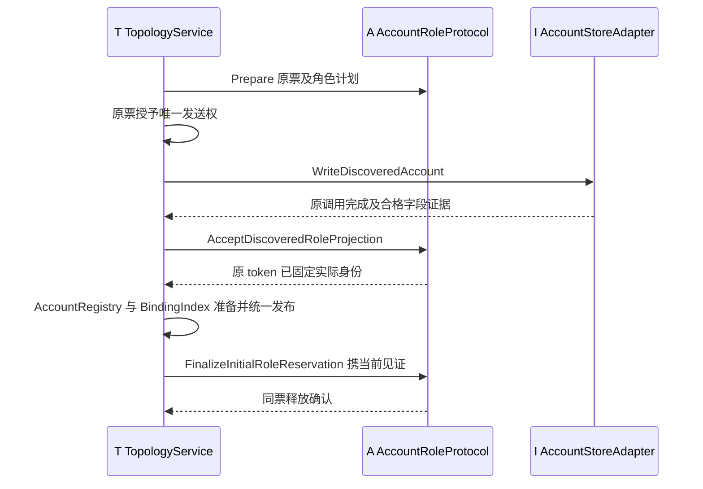
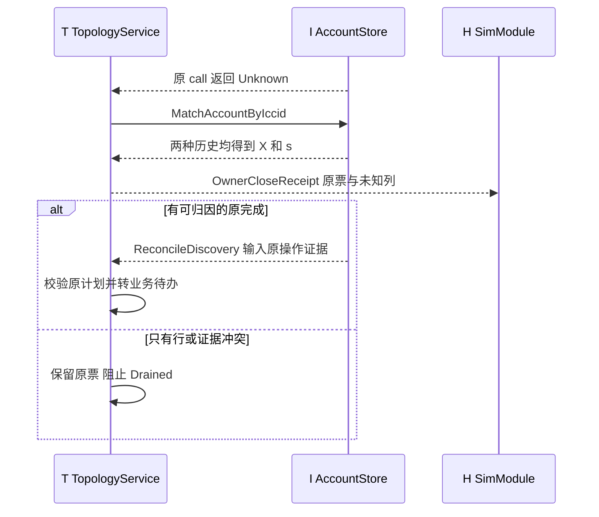
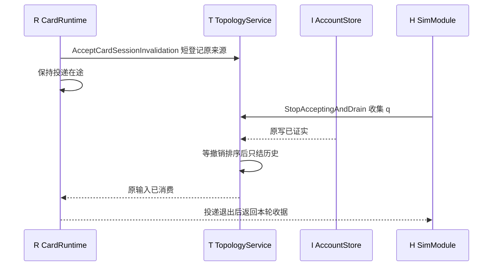
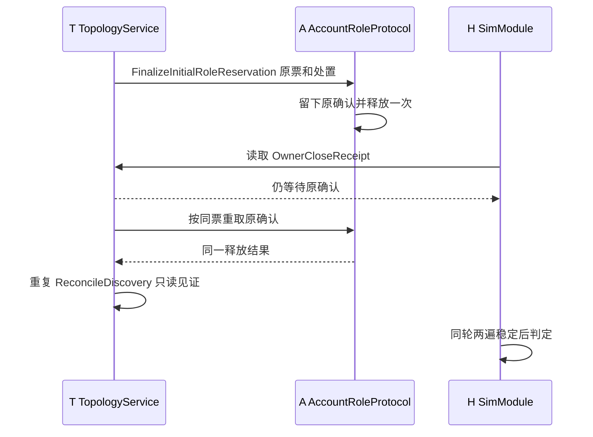

# AF-1 Part 24 · B1 三项 P0 定向设计修订提案

## 1. 执行摘要与范围

**状态为 `P0_DESIGN_REVISION_PROPOSED`。** 本文是提交独立 Gate 的设计输入，沿用 Part 23 的原票、T/A 分责及三种终局见证。此次具体选择是：以可验证的原调用证据逐字段判定效果，T 在一个短提交域内预备全部可失败操作后统一发布，H 在封闭根输入后校验同一关闭轮的两次收据集合。三者共同保证原票从领权到交还始终可寻址。

Provider 如只能提供相同行，原票可无限期停在 Unknown；宿主不能为卸载而消账。结论适用于原实例存活、各 Owner 执行本文契约的范围。独立审查结论仍为 `B1_REVIEW_NEEDS_REVISION`，H3 为 `H3_REVIEW_BLOCKED`，AF-1 为 `AF1_HARDENING_H1_H2_PARTIAL`。

## 2. Git、源码、设计与独立审查基线

|输入|可复核基线与证据范围|
|---|---|
|工作区|根目录 `/mnt/e/github/multisim`，main HEAD 与只读查询的 origin/main 均为 `d9c2d23dce7148df1fc474ce598fb1cff55b839d`。起始无已跟踪 diff、暂存区为空；独立报告、default.profraw 和 opencode.json 已在未跟踪列表。|
|源码|实际读 HEAD。与 T2 归档 `632f6a2a888cfbbc3c9387edc89732364e12a10e` 的整个 services/multisim 树对象相同（`e7986b29585d50da05198e773bf6a2e3eb0f9828`）。另读同一 HEAD 的 services/sim/src/sim_rdb_helper.cpp。|
|检查点与 A/B/C/D|Part 18–23 位于本地 AF-1 检查点，SHA-256 `0e1dd3ebfe75e86becbcea13477902b93427973bbd7f31da2b8b33ec23fbecf2`。Part 22/23 随当前 HEAD 入库，其审查时源码环境为父提交 `7a414c4e3c536ee67361095b5076614fa9444685` 加当时的工作区设计。父提交至 HEAD 仅变更检查点。A/B/C/D 在当前 HEAD 的 blob 依次为 `5c213f6d9f75c48b2016ba0b3b3e0a6b9b2a5c8b`、`88719ecf5d7b60e59b0539c53bb8abea8728b5aa`、`ab473b6e45acc980f677cfb974ed7b4fd9a4f433`、`52b51673213f64cc23b1b0649a91e6d98bbdf370`。|
|独立 Gate|已读取本地独立报告全文（13 节，318 行）。它没有提交 SHA；文件 SHA-256 为 `147d25d703419225f31937007c01c73d788f37f71a34a45897cb6612b3b7adf4`。报告审查 HEAD 即 d9c2d23dc，源码比对基线为上述 632f6a2a8。本文 P0-1、P0-2、P0-3 分别回应报告 R2、R1、R3；仅在原票闭环所需处细化 R4/R5。|
|HOST 历史与本轮|T1 报告输入 be63ae124，代码/报告归档 5796fce68；T2 输入 5796fce68，归档 632f6a2a8。Primary L3.1 输入 da99dd1a4，归档 befd76d4e。旧用例分别覆盖桥读回、reload 和 Primary 切片关闭。本轮为 SOURCE / DESIGN 静态验证；业务 Host、PRODUCT、DEVICE 均为 NOT_RUN。|

历史审查链见 [AF-1 检查点](AF1_Architecture_Design_Convergence_20261123.md) 与[独立 Gate 原报告](history/reviews/AF1_Gate_B1_Independent_Review_20261123.md)。执行证据见 [T1](../services/multisim/test/docs/T1_Account_Discovery_Host_Report_20261123.md)、[T2](../services/multisim/test/docs/T2_Account_Recovery_Reload_Host_Report_20261123.md)、[Host 生命周期](../services/multisim/test/docs/Host_Lifecycle_L3_Report_20261120.md)。

## 3. 三项根因及源码位置

以下路径相对 `telephony_core_service/services/multisim/`，另注者除外。后文的“拟”及图示均属设计契约。

|证据|SOURCE 事实|应封闭的缺口|
|---|---|---|
|S1 · 原票与 Store|`account/topology_service.h:95–100` 以位置为 pending 键；`.cpp:64–185,188–240` 的 DiscoverAccount 在锁外匹配、取得 A 计划并发写，ReconcileDiscovery 按位置取项、匹配 ICCID、接纳 A/Account、忽略 ReconcileStored 返回并释放、删除。`account/discovery/discovery_observation_ledger.cpp:31–103,124–164` 按当前位置保存观察/占用；首次 Unknown 可清 pending。|按 t 持责，按位置看当前；恢复与直接返回共用效果及业务提交门。|
|S2 · 可获得的归因信息|`account/account_store.h:32–77,94–95` 的写计划/返回和 Match 的行没有 provider 操作标识；`account/account_store_adapter.cpp:38–46` 委托桥。Host 的 `test/framework/internal/host/primary/legacy_account_store_provider.cpp:58–104` 在一次 Update/Insert 后读回，检查原 result > 0 及匹配字段，失败后相同行保持 Unknown。Legacy `telephony_core_service/services/sim/src/sim_rdb_helper.cpp:350–365,425–462,541–554` 按 ICCID 查/更新，InsertData 未写回 id 参数。|后续 Match 不能证明行的作者、原角色列、唯一身份或排除后写；正返回值的产品语义需另证。|
|S3 · T 的变更集|`account/account_registry.{h,cpp}`（cpp:75–92,190–260,262–335）先插账户再写两视图成员版，BeginReload 取共享水位及逐视图 expected；AcceptReload 对新增/缺失行及删除使用不同条件。AcceptReloadProjection 还比较身份、字段版本、retiredFieldRevisions_。`account/binding_index.cpp:30–94` 另行验证并更新槽和水位。|多个容器可分配/失败；现有 bool 及锁不提供联合发布保证。|
|S4 · 读者与角色|`account/topology_service.cpp:31–32,46–56,242–271,275–340` 的正常读者和 T reload 接纳持 commitLock_；装配位写未取该锁，AcceptStoredDiscovery 可走单独写路。`role_assignment/assignment_service.cpp:666–685` 在 A 域调用 `role_assignment/account_role_protocol.h:28–96`。AcceptDiscovered 解析身份，Finalize 删 token，reload 单独更新角色版本。|统一 T 写点；A 的原片段解析与可重读释放确认分开。|
|S5 · 来源与关闭|`card/runtime/card_runtime.cpp:34–54` 同步向 T 发旧会话失效，再撤原会话、发布新观察。`infrastructure/assembly/sim_module_factory.cpp:24–39` 注入 epoch，`sim_module.h:53` 仅声明模块 Stop。`primary_host_lifecycle.cpp:15–74`（同目录）查封口、radio 回调/资源、scheduler 审计、A 设备效果。`infrastructure/request/runtime_operation_store.h:49–57` 为 RetrySchedulerPort；`role_assignment/primary/radio_execution_port.h:89–94` 为 Owner 投递口；Host 受控实现见 `test/cases/target/primary/b_async_primary_test.cpp:97,192`。|Primary 的 Drained 不含发现写。排队、正在执行、原完成已交还和 M19 责任需分别可见。|

## 4. P0-1 · Store 原操作效果归因

**身份。** 在 TopologyService 原 pending 容器中以 t=(RuntimeEpoch,admission) 为主键，一票只允许一个原始写调用，故 call=(t,WriteDiscoveredAccount) 已足以标识操作。多次取证各有 claim 代次，不能因此取得第二次写权。写前冻结载荷并登记目标字段；同期 Match、reload、另一票以及其取证结果均无权代表此 call。ICCID 冲突索引按持票人比较释放；同位置/异位置同 ICCID 受同一占用检查。epoch 不复用，admission、claim、token 及相关水位耗尽均拒绝新分配。

|拟接纳的证据字段|签发、核验及使用条件|
|---|---|
|原票、原操作|T 签发 t/call；直接返回由原调用栈关联，异步途径只接受在提交前登记的原端口/回调关联。传入方自行填写相同 t 没有证明力。|
|原计划与身份|T 保存 Insert/Update、原观察及槽水位、ICCID、已知订阅或待分配、准确的字段和值，A 保存原 token/角色版本及 includeInStorage。逐列含身份/位置/active/eSIM、适用标签、适用角色列等，按实际计划冻结；仅哈希相等不足以取代载荷比对。|
|执行体与回执|原调用已登记/已进入/已交还独立记录。Provider 声称操作完成、原 C++ 调用已返回、交付执行体与捕获对象已退出是三个检查点；证据先到可保存，原调用未交还不能清票。|
|实际持久化身份|可为空。接纳全量成功须有原计划所指的唯一实际订阅/行和可信 ICCID 对应；已知订阅不符、同 ICCID 多行不能区分则挂起。NotApplied 需覆盖整个原目标，不要求虚构新分配身份。|
|效果与来源|每个计划字段存 Applied / NotApplied / Unknown，附原结果、证明覆盖范围、provider/连接世代、行/版本或原完成依据。T 拥有认知，I 只提供证据。原始同步结果、同一原调用的权威迟到完成、受证明约束的读回、仅观察到行，分别标识。|
|可接受条件|T 在原票短域校验 call、不可变计划、来源能力、目标及覆盖字段，按字段合并。相同回执幂等，旧 claim 不改新步骤；真实原回执即使取证 claim 已变，也须可由现任领取者按 call 消费。相互矛盾的可信答复隔离并保留原依据，禁止靠最后到达者翻案。|

**归因入口（PROPOSED）。** 扩充原 WriteDiscoveredAccount 的结果载荷，并令 ReconcileDiscovery(t, evidence) 接收同一操作的后续证明。适配器在装配时声明经核实的能力及适用操作。T 可接纳两种正向输入：① 原执行端的完成记录明确指向此调用、实际行、已提交字段或全未生效，且该记录的语义由后端保证；② 组合证据能证明原执行结果、唯一行、前后版本和本次版本跃迁的作者（例如**已证明**受控单写区间中，原提交确认与不可混淆的行版本配对）。独占区间如果只从 T 内的 ICCID 预留推出，不能排除其他 writer。仅在适配器能兑现相应条件时开放该能力；本提案不要求添加产品事务 ID、全局日志或额外 Insert。

|原写及后来看到的状态|T 允许的推进|
|---|---|
|执行 A：t 写成 X/s/值 v，但原答复 Unknown；执行 B：t 未写成，别人写出完全相同 X/s/v。两次 Match 的返回逐字段相同|两者均保持 Unknown，保存匹配行作线索。A 以后收到同 call 的可验证提交凭据才能转 Applied；B 收到明确“原写未执行/未提交任何字段”的原完成才能转 NotApplied。两者都无补证时原票、原预留和逐列收据持续存在。|
|发送资格根本未授予；或原端明确保证整笔无效果|前者凭 T 的发送登记证明未发，后者凭经核实的原操作否定回执结无效果。泛化的失败码、缺行、超时都不具备此含义。已结束的独立新尝试另按原预算和新票准入。|
|原写成功，随后别的写者改动部分列|权威原完成可证明 **当时** 的效果，不授权回填旧字段或覆盖当前值；T/A 仍检查各自版本与当前来源。没有原完成，仅见变化后的行时，未知字段继续列项。|
|证据只覆盖部分列；或所有列已知但有已写/未写的混合结果|只更新已获证字段。混合结果在 t 列“已知部分效果、业务处置待定”，禁止完整当前接纳、自动补写和无依据释放。只有独立获准的逐项处置或逐项移交才可终结这类前缀；本提案的默认出口是保图。|

现桥可证明**一次调用及它返回的数值**和**一次读到了哪些值**；其 Host 成功分类按 S2 解释。生产对正返回、全部字段提交、分配身份或迟到确认若不能给出相应保证，T 必须降为线索。Host 正控可用受控执行端在执行瞬间产生唯一 call 的内部完成记录，再延迟交付；负控保持相同 DB 行而不给该凭据。此验证测的是 T 的归因规则。
## 5. P0-2 · T 的统一发布与版本一致性

**选方案 A，预先准备后统一发布。** 对正常业务读者，新增账户投影、视图成员代次、来源、绑定及本票见证只有一个可见点。分阶段公开 Account 会迫使 ReadAccount、ReadPrimaryTarget、两个 reload 等读者长期理解半成品；本处受影响的对象都在 T 域内，可将可失败操作限于准备期。跨 Owner 的 A 确认和 Store 写已经发生，继续留在原票。这里的统一发布仅覆盖 T 的内存事实。

**准备与发布的可执行步骤（PROPOSED）。**

1. T 在自己的 commitLock_ 内认领 t 的业务步骤。按 t/call 复核原效果、实际订阅↔ICCID、A 已固定的身份、源事件排序（§6）、装配位、期望 r、跨槽唯一性和两视图的实际来源。账户只含 Historical 时，须有独立合格的 Current 输入才能补 Current；已有且较新的字段保留。可信终止转仅历史；暂停、版本冲突或来源不可证明留原票。来源见证须保存于当前绑定的 T 槽条目，原票回收后仍可验证撤销；票中另记提交当时的不可变见证。
2. AccountRegistry 构造**本次涉及的一条**候选 AccountRecord，按视图确定哪些是首次加入、恢复、已有同一成员或经证明的成员更新。对恢复的字段沿用 retiredFieldRevisions_ 防 ABA。读取使用 find；禁止用可插入的 operator[] 当作无副作用的预检。对每个新增/重新接纳成员先算新代次；同一发现只确认既存关系时不增版。BindingIndex 准备原槽条目的差量，空 r → s,r+1；同来源同订阅同水位 → 确认既存 r。不同来源、异槽占用或耗尽即退出。预先构造票内见证（t、账户身份/相关视图版本、源、原 r、结果 BindingRef、A 解析凭据）与槽来源值。
3. **具体 C++ 可行路径。** 两个 view 的外层 map 在 Registry 可发布之前建好。已有 account/成员项取稳定迭代器；可能新增的账户节点、两视图内层成员节点在 T 短域内用 try_emplace 做**私有预留**，不改变已有值和正式时钟。用栈上定长的撤销记录保存本次新插节点的迭代器；先备记录容量，逐次操作成功立即无分配登记。任何后续构造、复制、比较或拒绝均按逆序 erase(iterator)，在同一锁内恢复准备前的可见状态。候选字符串、原来源、返回见证、通知所需描述均先构造；可变状态用局部候选值或已建好的定长/独占值承载。槽目录和 t 条目事先存在。准备期间禁止外调、递归业务读、用户回调及向其他线程泄露引用；即使 mutex 是 recursive，也不能让读者看见私有预留。只留一套正式 Registry/BindingIndex。
4. **发布尾段不允许失败。** 保持 T 锁，用既得迭代器做数值赋值、无抛交换候选投影或其预分配句柄、设置槽的来源/BindingRef、写两视图成员代次和 membershipClock_，最后把 t 置为“当前已接纳，待精确释放”。实现须对实际类型检查 nothrow swap/move/destruction 或使用预构造对象的无抛指针交换；尾段无查键插入、分配、外调、日志格式化和可失败的收据生成。最后的处置标记为线性化点，解锁后读者才可见。准备期失败只记原票预留好的步骤/原因码，诊断文本延后。若候选实现不能证明尾段无抛，本方案在该实现上不成立，不能依赖异常后猜测 Binding 是否已写。
5. 源、装配、两视图、Binding、reload、M19 工作项和所有业务读口统一在该域观察/变更，跨步骤要一致快照的读者一次在域内取齐。运行时 AcceptSlotAssembly 进入 T 域；AcceptStoredDiscovery 仅限明确的建境夹具，业务接纳统一经原票入口。旧实现已发布的 Account 不予删除或覆写以模拟回滚。先核实其视图、来源、身份和成员代次；缺少元数据时以原票挂起并拒绝该成员的破坏性 reload，待权威视图确认再在同域修复，或有证据仅结历史。读者不得从未核实前缀取得 Primary 操作资格。

**旧 reload 的逐视图判定。** BeginReload(v) 由 T 签 view、attempt、当前 membershipClock_ 水位 w 及各 expected 身份/字段版本。拟为每个 expected 附该视图成员代次 m。T 对 Current/Historical 各维护 m[v,s]（包括移除后的墓碑），用同一单调时钟分别取值。两个视图都新建时可分别取 w当前+1、w当前+2；只新增一个视图只耗一个刻度。销毁/重建视图不得复用成员版。时钟、attempt、身份、字段或绑定版本不够时在准备期拒绝，禁止部分分配/回绕。

|交错|当前源码判断|提案的比较点与结果|
|---|---|---|
|Current 旧读签票时无 Y，结果也无 Y；随后发现准备插 Y 并在成员节点分配处失败；旧读返回|S3 的缺行删除需要 expected 中已有 Y 且身份/全部字段相同。在这个**准确输入**上，即使成员登记不完整，旧读也不能删新 Y；但源码可留下已公开且缺成员元数据的 Account。|方案 A 在失败时整组仍旧，旧读根本看不到准备项。若原票先重获资格并成功统一发布，Y 的 m[C,Y] > w，缺行时先判冲突并保留；若旧读先完成，T 再据最新状态准备发布。|
|Historical 分别签票且结果为空，Current 先完成或仅 Historical 新增|Historical 的 expected、issued/consumed 和字段是独立的；一个视图的读成功不能证明另一视图可删。|仅以 H 视图的 w、m[H,Y]、身份/字段判断，分别推演发布前失败、发布后返回。新 Historical 成员保留；没有可信 Historical 输入则维持原 Historical，不能以 Current 成功生成它。|
|旧票原先**有**该成员，返回时缺行，期间同身份被撤再接纳或出现旧前缀|当前删除分支 :319–329 比身份和字段，未显式比成员代次；retired 字段版另有防护。不能仅据缺少成员比较宣称产品已误删。|删除须同 view/最新未消费 attempt、成员仍在 expected、m 等于签票值且不晚于 w、身份及全部字段未变、无未核实前缀。任一失配保留并计冲突。对有行也先验成员代次，再用 AcceptReloadProjection 按字段接纳；旧读不得复活已删除投影。|
|reload 自身增删成员或分配失败|:278 先标消费；:296–329 有插入、投影构造、写墓碑与水位。|凡能改成员的 reload 写者也执行同一成员发布约束。为本次 view 的受影响行预备节点、墓碑、字段差量与消费结果；分配失败无半个成员，记录失败尝试、留原 reload 收据至处置。成功才在原域发布可接受的差量与 attempt 结果，冲突行跳过。仅成功的对应 view 可向 A 交原角色读源和版本。|

## 6. P0-3 · 发送资格、来源排序与稳定收据

**发送与续行。** H 每次模块寿命只创建一个关闭轮 q=(epoch,closeGeneration)，并冻结已装配的 Owner/输入口集合。Running→Closing 首个调用者封外层新入口，再令每个 Owner 在自身短域封根准入并确认。T 的 Store **发送**线性化于同一 T 域对“未授予”→“已授予、原调用由指定执行体持有”的一次更新，同一更新登记在途和原票，先于进入 I。T 封口先赢则根本不授予，Store 次数零，已领 A 预留走未发结清；发送先赢则原执行体可在 Closing 调原 Store 一次，H 等原调用退出。若执行体确认从未进入且交回唯一权，可按未发处置；交出与否不明保留 Unknown，另一执行者不得接管重发。外层已开始关闭而某 Owner 尚未确认封口的区间仍计入在途，H 不可宣布全图已封。

原票的**内部续行**单独在 T 按 (t,阶段,claim) 领取；Closing 仍可接受原证据、来源撤销、受理在先的 A/T 内部处理和确认返回。仅补原步骤，不能签新写权。执行体未退出前不能被超时抢占。投递到 Executor 前先登记；Post 失败且确认未交接时仍由原 Owner 持项，待具备交付能力再推进。Scheduler 停自主 retry 时必须保留原票用的完成通道（同步受控续行或仍可排空的 Owner 执行域），不得拿已封的普通重试队列承担最后一次返回。

**来源进入 T 的顺序。** 复用 CardRuntime 的同步短失效入口。对可能排队的实现，在对应来源首次受理处、可异步转交之前，先在 R·card 入口登记投递号 (epoch,来源,seq) 和执行体，再同步在 T 的来源条目登记该 seq 的待处理撤销/连续性未知；可在此短域直接完成可信撤权。**T 登记为语义受理点**，此前 R 持输入资格，任何已在 R 判断为权威的事件必须在同一次受理协议中先使 T 的发布条件失效。可实现为在 R 的每来源入口串行处理，先走 T 短登记，再对外承认该来源事件或提交到队列；同一来源后继不得越过它。此调用不持业务 R 锁等待 T，T 提交也不回调 R。若上游在更早的不可控队列就认定撤销生效，必须由该入队点先作此登记，或只允许在有同等顺序证明的来源上发布当前关系；能力未证的路由保持待证。物理拔卡发生到软件获知的探测延迟另属产品证据。

|事件阶段|责任与可观察条件|
|---|---|
|来源接收 / 语义受理|R 先持投递凭证；T 短域登记该来源的未消费序号或立即撤销，才确认受理。源停监也先使 T 连续性转未知，再撤监视。登记失败保持输入在途并封住该来源资格，不能悄悄排队继续。|
|已入队 / 正在投递|入队前有 R 或 T 所持凭证，入队后保留至接收方登记及原执行退出。队列弹出不消账；来源受影响且 pending 时 T 拒绝当前发布。投递失败保留可恢复项。|
|已进 T 域 / 业务效果完成|按原 epoch、来源、代次和序号比对。在同域排定可信撤销、暂时暂停、连续性恢复或陈旧丢弃。连续的已处理水位才越过缺口；不能只用 max(seq) 代表全交还。T 的当前提交在此域内比较来源无待处理撤销、仍连续。来源先行只结历史或待证；提交先行则后续正常撤销，按既成见证收尾。|
|返回交还|T 已登记后续责任，R/投递器在回调、捕获及执行实际退出后解除各自凭证。相同来源输入重复时不重撤、不改后继关系。|

**H 的稳定判定。** 每个参与 Owner 在自己的短域内原子生成 (q,owner,sealAck,activityVersion,在途标识,逐项 M19)。在增删/转交责任、领取或退出执行、投递/消费、输入门状态变化时推进 activityVersion，不回绕。无法取得一致快照或版本耗尽即回未完成。收据可由已有票据派生；H 不持有业务事实。

1. H 收齐同 q 的根封口确认；注销、外部订阅、已领取回调、队列中的输入及未确认注销都必须有对应责任。根封口只切断新业务；已有票的证据通道受其父项覆盖。最终销毁前使独立入口不能再进入旧图，原已进入的执行体排空；迟到重复只能在安全的寿命门被拒绝。未证明退订/入口寿命就没有终局确认。
2. **转交不断档。** 发送方登记父项和在途后才能 Post/调用；接收方在本域登记子项或结果，然后确认。发送方在收到确认且本端执行退出后才清对应项。包括 A 释放确认、证据投递、Scheduler 已出队任务和卡撤销。拒绝接管按原项留存。没有父项的内部新工作在 Closing 禁止。
3. H 收集完整第一组快照，再收集完整第二组（同 q、同参与集合）。所有根门已封、所有在途均零、未了项为空或已获有效逐项移交，且每个 Owner 两次的活动版本、封口状态与明细相同，才可结合 Primary/设备屏障自身的终局返回 Drained。任一版本变化重新获取**整组**，不拼接不同时刻的空表。原调用仍在本图内执行时移交不能抵消它。重复 Stop 复用 q，可重新取据，不重投原业务。
4. **充分性。** 两次采样之间每个参与者均无变化，所有采样区间共享“第一组收完、第二组开始前”的截面。该截面没有可生成根工作的入口，没有在途或未交还的父项。此后每项合法内部工作都必须从某个仍存父项派生，故无法从该空截面再生工作。若某输入不受任一登记覆盖或来源能绕过封口，这个证明失效，H 必须返回未完成。

|指定竞态|决定顺序的操作|允许结果与否决点|
|---|---|---|
|A 撤销已入队，H 先读到 T 空|R 的投递登记及 T 来源短登记必须早于排队|即便此时 T 无 Store 票，R/投递器仍有在途或 T 有待排序输入。单一空收据不得 Drained。|
|B 原票先取得续行资格|领取 claim 与 T 封口同域；父票存续|可补该内部步，H 查 t/claim；只有已授予的原发送权才能进 I。|
|C Store 返回与撤销交错|效果到达只记 t；实际业务发布与来源短登记同域|先撤则不建；先建后撤只改原绑定一次。仅已确认 Store，尚未发布时，撤销仍可赢。|
|D 已建 Binding，A 未返回|T 保留见证及待确认项；A 按实际阶段持 token 或释放确认|重读同一确认；A 清占用不使 T 清票。|
|E H 已读某些 Owner，A 又派生 T 义务|接收登记先于发送方清项，两端变更版本|第一遍可以错过转移；二次版本比较使该组作废，重新收齐。|
|F 并发或重复 Stop|H 只允许一次 Running→Closing 和一个封口执行者|相同 q 继续汇合；Store、A 实际释放、原通知次数不增加；回调内 Stop 不自等。|
## 7. 一张原票的联合状态机

T 的工作项从准备期就可枚举。A 的预留与它一对一绑定；对尚未获 Store 发送权的冲突，T 明确返回“本次未发”，按原政策处理新的尝试。下表的 subject 均带 t 和 epoch；无 RequestId 的发现仍可逐项定位。

|阶段、Owner 与身份|已完成的效果|尚欠义务、下一合法输入|失败后的动作|Stop 逐项表现|
|---|---|---|---|---|
|T 签 t；A.Prepare(t,plan)|至多取得原预留 a|取得 a 的精确答复、重新校验原观察/冲突|A 以 t 查原准备结果；同票不领第二份，异票冲突拒绝。若已封口则不授外部写|T:t/准备或等待 A；A:t/a|
|T 授 call 执行权，I 执行|从此最多可能发生一次原外部效果|原执行体进入、交还及按 call 归因的结果|不明交接不重发；执行者仍可交回确认未发的唯一权|T:t/call/在途；A:a|
|T 收回调用，效果未明/部分已知|原写可能已生效|原 call 的可靠证据、字段掩码和实际身份|只读核对，保留未明字段和已知前缀|T:t/EffectUnknown 或已知混合处置；A:a|
|T 已确认原写，A.Accept(t,a,s)|确定原写，A 可一次固定身份 s|原片段符合计划，当前来源及 T 写点资格|未解析前角色版本失配时 A 保留 token，返回原因；按原字段证据核对，未有当前资格则待处置。已解析后的无关 reload 不推翻原片段|T:t/待业务接纳；A:a|
|T 本地预备并发布|成功截面包含 Account、各合格视图成员版本、来源、Binding 和见证；此前仅 Store/A 已生效|当前见证、可信终止的历史见证或确认全未写，才可提交相应 Finalize|可恢复时只重做 §5 准备；待证不报成功。历史路径不要求 A 重新取得写权|T:t/待接纳或待确认；A:a|
|A.Finalize(t,a,处置)，T 等回执|在 A 的短域一次释放原资格|精确匹配的释放回执（含 t、a、原 plan、处置和身份/历史依据）|A 利用原 reservation 条目预存确认载荷，再无抛解除占用并标已释放；按 t 返回同一结果。缺 token 本身不能证明释放|T:t/释放待确认；A:a 或该票的未返交付|
|T 已登记精确回执，原出口交还|原票业务终局固定|所有已领执行/投递/外调交还，必要的 A 回执消费完成|T 禁止再领释放步骤，等先前调用归零后通知 A 已消费。A 仅在同票已释放且消费已确认后回收确认；消费通知自身登记在途。重复消费为无业务副作用的清理，不能用作最初的释放确认|未返继续列 T/A subject；T 回收票前仍有原归责记录|
|H 稳定汇合 q|本 t 可退出 T 票表|§6 双遍及全部 Owner 的终局|无驻留接手者则保留旧图|本票可消失，全图另判 Drained|

**归责规则。** 原票保留到最末步，释放后的 A 确认在 T 可安全接管其清理前一直可取。T 已有真正回执且已封该票的释放领取后，清理确认请求可以幂等重送；A 对冗余清理可答“已无清理工作”，T 不能把该答复当作第一次释放的证明。各次跨域调用使用原 epoch 的存活引用，先登记再交接。A 不发布第二份角色缓存，H 不持有第二份原票。

## 8. 核心对象及接口修订矩阵（PROPOSED）

|现有落点及局限|必要的最小修订|调用方的推进条件与负控|
|---|---|---|
|T 的 DiscoveryObservationLedger::BeginStore / CompleteStored / ReconcileStored 现按位置操作|ledger 只管当前观察、水位及带持票人的冲突索引。TopologyService 原 pending 表改按 t，持原计划、发送位、字段效果、单一 claim、业务见证和确认。旧票不依赖位置 Entry 仍存在|已证无效果可按既有预算签新票；Unknown 不获新发送权。X 的迟到结果只消费 tX|
|AccountStore::WriteDiscoveredAccount / MatchAccountByIccid|复用原写调用传输，增加可选的具来源关联的证据值；Match 保持观察读口。直接返回和异步的 ReconcileDiscovery(t,evidence) 走相同判据|桥无能力时返回证据不足及其范围；错误码和恰好相同行均不能授权业务接纳|
|AccountRegistry、BindingIndex、TopologyService|提取校验/预备及无抛发布的 T 私有步骤；同票同时记录业务见证。成员代次加入 reload 的 expected。不向外借可变对象|直接成功与恢复走同一发布点；找回同票见证只读回当时结果，不借此改新绑定。外层如仍用 bool，不可将“已结历史”映射成当前 Binding 成功|
|AccountRolePlanningPort 的 Prepare / Accept / Finalize|绑定 t，区分同票重取、冲突、未发、固定身份及释放确认；在原 A 条目内保留最终处置。无须新增角色协调器|A 校验相同 plan、token、identity，异身份/异处置拒绝；T 只在当前/历史/无效果证据真实时发 Finalize|
|CardObservationSink 与 CardRuntime|在原短入口关联来源序号、可信原因/作用域、待处理投递及连续性状态。已撤旧来源重插即使 ICCID 相同也取新资格|可信失效与当前发布同域排序；暂时失去监视只暂停，不能冒充已拔卡。条件恢复需同一来源的连续性证明|
|SimModule、PrimaryHostLifecycle、OwnerCloseReceipt 与执行器|H 向已装配 Owner 收 q 的封口确认与带活动版本的收据。源端/接收端对交接分别记在途。执行器排空覆盖已领取任务和捕获寿命|现有 Scheduler audit 与 Primary 结果仅一部分；同 q 稳定快照和逐项归责后方可回收旧图|

## 9. 四种时序（均为拟议契约）

图中沿用实际类/方法名；原票入参、归因回执、统一发布尾段和模块级收据是本提案要求的改动。

**正常 · 原写成功，持续有效。**

**异常 · 两种写历史得到同一行。**

**并发 · 撤销先受理，Store 后返回。**

**重复输入 · 绑定已提交，释放确认延迟。**

## 10. 可失败点的状态与恢复矩阵

表中 O 为本次开始前的对外可见值（可包含已有账户/绑定），C、H 为 Current/Historical 的正式成员代次，W 为 t 的业务接纳见证。以两个视图都具备合法输入、空槽初始水位 r 为例，C′、H′ 分别大于签发在先的视图水位。所有失败点均可在 Host 设确定性闸门；“后”若发生于准备域，观察结果取解锁后值。

|故障位置|Account|Current 成员版|Historical 成员版|Binding|接纳见证|后续责任及可恢复动作|
|---|---|---|---|---|---|---|
|插入前，构造候选或身份校验失败|O|C|H|O|无|T 留 t/准备失败；内存恢复后可重做构造。身份冲突须先有原身份依据|
|账户节点已预留，下一分配失败|O|C|H|O|无|T 按已记迭代器撤销仅本次插入的节点，原票有已获证的效果及 a；不重发 Store|
|Current 新代次已准备，Historical 预留失败|O|C|H|O|无|撤本次 Current 空节点及候选 Account；正式时钟未动。再次准备两视图需要原来源仍有效|
|Historical 新代次已准备，来源/见证构造失败|O|C|H|O|无|撤两个视图新节点；可重试内部构造。如已可信替换则转原历史处置|
|Binding 接纳前拒绝（装配、冲突、耗尽）|O|C|H|O|无|同域退出准备，记录拒绝原因；仅原水位仍成立且冲突消除可续。耗尽不可重绕|
|Binding 候选已构造，见证准备失败|O|C|H|O|无|丢候选，T 留“待接纳”。若已经修改**正式** Binding 后见证却能失败，则该实现违约；Host 必须在最后可失败点观察旧组，在尾段退出观察完整新组|
|发布后、发 Finalize 前执行被暂停|Y|C′|H′|s,r+1|W|T 只欠 a 的释放，Stop 可列 t/W，重放不再建绑定|
|A Finalize 返回 Unknown 或执行体未返|Y|C′|H′|s,r+1|W|T 取同票确认；A 实际持有 token 或已保存精确回执。不得再次推进 BindingRevision|
|W 生效后 Y 依法被移除，随后回执到达|由各视图读源决定|按现行事实|按现行事实|已撤/后继|原 W 保留|只结原 t；回执不能使旧 Current 或旧 Binding 复活|

其它失败截面同样有 Owner。T 票表/唯一号分配失败须发生在 A 或 I 取得工作之前；A 准备已获准但答复不明由 T 按 t 查 A 的原项；I 在交出前能证明拒绝则无外写，交出后异常按 Unknown；证据不全时 T 不进入候选区；A 拒绝或来源暂停仍列内部接纳；投递/清理返回失败由发送者持原义务至确认；收据分配或活动版本验证失败由 H 报本轮未完成，禁止用空清单降级。
## 11. 独立 Gate 七组反例的重新推演

每行给定原报告 §6 的截面；“结束”都包含原调用/交付已返回和精确释放确认。以下为设计推演。

|场景|输入及中间状态|预期终态与可反驳断言|
|---|---|---|
|1 · Y 始终有效，X 迟到|同槽同应用、不同 ICCID 和已匹配订阅；tX/aX 写 Unknown → 可信替换 → tY/aY 发写 → X 成功证据到。此时只有 X 可仅结历史|必须给 Y 自己的充分证据才有 Y 的 Current/Binding；写数 2，空槽一次 r→r+1。交换返回和核对顺序的四种组合均如此。新账户按槽互斥导致第二次准备未获准时，应得到未发结果，不能假设有第二笔写|
|2 · Y 核对期间失效|tY Unknown；可信撤销先在 T 登记；再给该 call 完成。aY 即使已解析也不能给 T 当前写权|确认终止后只结历史，FindBinding 不恢复 Y。把撤销替换为暂时失联，则 Y 待证、aY 仍有收据，不能走历史终局|
|3 · Account 成功、Binding 失败|原写已知，A 已解析；在候选账户节点插入后制造内存失败或绑定拒绝。再交重复核对和旧 reload|方案 A 新路径对读者仅有 O，t 与 aY 仍在；若是旧路径已发布的前缀，核实视图成员版本前冻结破坏性变更，禁止冒认 W。原水位仍成立才能再次准备并一次建关系|
|4 · Binding 成功、A Finalize 失败|T 已有 W。A 实际释放但回复延迟 → Stop → 原回执到达|H 先读到 t/待确认；实际释放 1 次，绑定升版 1 次。T 仅取旧确认；若期间可信换卡，事后查询可见后继，W 不授权复活旧卡|
|5 · 两人同时 Reconcile|两执行者以 t/同阶段到 T，一人获 claim；另一人读“进行中”。旧 claim 返回时当前阶段可能已变|仅当前认领推进；重放同一权威原证据可交当前领取者，无二次 Store/发布/释放。票已回收的陈旧输入拒绝，不借同位新票重解释|
|6 · Y 已绑定，旧 X 才核对|Y 已有 sY,r+1 和 W，可能仍欠释放；以 tX 查得原写和可信终止的 X 来源|X 只能动 tX/aX 及原效果。Y 的 W、aY、两视图和 BindingRef 均不变。只有版本差且不能证明终止时 X 留待证|
|7 · Stop 与续行|分别在授写前/后、执行未返、A 解析返回、W 已成、a 已释放未返及卡输入已领取时封口；重复 Stop|各截面均有 t/投递号/token 的实际主体。已授原写最多一次，未授为零；来源仍有可证连续性才可继续原业务发布。稳定切面前不得 Drained|

## 12. 联合反例与负向判据

设 Y 的原票 t 已获 a，另取一个已合法发布的成员 Z 作为旧 reload 的阳性对照（否则全程没有新成员时，无法检验“旧读不删除新成员”）。两视图均可单独安排旧读。

|时刻|T 的原票、版本与业务事实|A / R / H 的责任及可接受的下一步|
|---|---|---|
|J0|Current 与 Historical 分别签旧 reload，expected 中无 Z；随后 Z 经正常发布，两个受影响视图各有新成员代次。t 是 Y 的唯一写调用|Z 已成功的独立见证可读；a 属于 Y。记录两个旧 w、Z 的 C′/H′ 及 Y 的槽水位|
|J1 · 原写 Unknown|t 留原计划，调用已返回，按字段 Unknown。Match 命中同一行，两种写历史仍不可区分|T 出 t/原行列，A 出 a。此时注入针对 a 的 Finalize 应直接拒绝|
|J2 · 两个旧读分别回来|各自缺 Z；T 对该 view 的 expected 与 m 比较，保留 Z；也不能将 reload 的行当作 t 的回执。若该读源合法产生独立账户投影，它仍不能产生 t 的 Binding 或 W|A 仅按 reload 自己的 view/attempt/版本接纳其角色行；其中即使出现 sY 也不会释放 a|
|J3 · Y 的可信撤销已入队|T 的来源条目先挂牌待处理，t 仍 Unknown。处理前即不允许当前业务提交|R 持原 seq 的投递，在队列、执行中、回调交还三个截面均可追索|
|J4 · H 开始 Stop|T 封新写；在途撤销、t 待证、a 各有 subject。即使队列已弹空且 Radio 计数为零，也不满足稳定轮|q 首遍即可报告未完成；若跨域在采样间交接，活动版本否决旧清单|
|J5 · 独立补证分叉|**不给补证**时撤销只证原资格终止，不能证明写效果，t/a 继续保留，不存在合法的“释放答复迟到”。**给同 call 的权威成功回执**，且撤销已在 T 消费时，t 才可取得仅历史见证|后一支才允许 Finalize(t,a,历史见证)。令 A 实际释放而答复延迟，H 必见 t/待确认或原执行未返|
|J6 · 答复及执行体交还|T 记同票确认并结束清理；Y 新建 Binding 次数为零，Z 两个视图仍由原版本保护|各源排空且双遍稳定才可 Drained。重放 J1/J5 均不再产生写或角色发布|

**关闭算法的有界反证检查（设计模型，非 Host）。** 以已封根入口的一条 A→T 责任交接为例，初态 A=1、T=0。按序执行三个动作：x 在 T 登记子项，y 清 A 父项，z 完成 T 子项。独立读序为 T、A、T、A；每次 x/y/z 在对应 Owner 加一活动版本。在七个位置中选择三个放 x/y/z，保持两条序列内部次序，有 35 种安排。本轮在内存中枚举全部安排。只看第一遍时有 3 种得到空表而当时仍有工作，例如读 T → x → y → 读 A。要求两遍均空且版本相同后只有 1 种排列能签空，提前签空为 0。任何参与者漏登记、版本回绕、封口还能产生无父项工作，均超出模型并直接否决模块排空。

## 13. 四篇权威设计文档的同步位置

|文档|架构决定后需同步的条款|
|---|---|
|[A 主设计](SIM_Target_Architecture_Design_v1.2.md)|§6.5.2 加原调用证据、两视图成员保护、T 本地发布点、可信失效受理点；§14.3/M19 加发送资格、连续交接、同轮稳定切面。原 epoch、领域 Owner 及产品写权边界沿用。|
|[B 源码详细设计](SIM_Multisim_Source_Architecture_Detailed_Design.md)|§4.2、§5–7 映射 t/call、A 原回执、单成员候选和 view 水位；§11 的 OwnerCloseReceipt 补 q、活动版、封口确认及在途 subject，列清 SimModule 与 PrimaryHostLifecycle 的不同验收面。|
|[C 目录设计](SIM重构代码目录结构设计方案.md)|§4.1 标明 T 表、当前观察索引和字段证据；§4.3 标明原 A 预留及可重读确认；§5.3 标明 H 汇合和执行退出证明。五组物理目录足够。|
|[D 迁移设计](migration/SIM_Architecture_Refactor_Design.md)|§7.4 及 af1-acceptance 的 SC-01/G2c、WU-04/07 行加入 §10–12 的失败点、双遍与来源排队负控。产品 writer 覆盖及 provider 确认能力仍单独取证。|

## 14. AF-2 工作项与最小 Host 验证要求

沿检查点 §13.2 的既有划分，以下为拟议验收输入。Host 闸点按事件排序，禁止靠 sleep 构造先后。

|既有工作项/责任方|最小验证与可观察输出|
|---|---|
|AF2-07(d) · T/I/A 发现执行域|受控执行端实际执行原写时生成 call 关联记录，独立控制写返回与证据交付。跑同值异因果、错票、缺字段、迟到后写、混合效果；断言逐字段认知、t/a、写次数、内部步骤。不能只把 mock 返回 bool 改成成功。|
|AF2-02 · H 装配真实卡来源、T/A|从 CardRuntime 来源入口发 X/Y，不用 AcceptStoredDiscovery 播种代替正常路径；对两个视图分别拦 BeginReload/AcceptReload。遍历 §10 故障点并实际读 Current/Historical、成员代次、位置水位、FindBinding、ReadPrimaryTarget 和原票见证。旧 Host 关于 stale Current 的断言单独列兼容差分。|
|AF2-05/06 · 逐项收据、拒绝移交与保图|覆盖 A–F 六种竞态。阻塞 Store、原完成、撤销投递、Finalize 返回及 Scheduler 已领取任务；交叉读两次 Owner 收据，记录 q、version、逐项身份、投递返回。验证失败投递/注销、未证连续性均不能空表，旧图被保留。|
|T/A 本票释放与故障保证，随对应切片|重复准备、错 token、异身份重放、首次 A 解析前/后 reload、实际释放后丢一次回执、回收后迟到均有断言。检查尾段所用 C++ 类型的无抛保证及实际调用点，在准备的每一处分配失败注入后验证无已发布前缀。既有 C0、桥和关闭守卫保留其原证据范围。|

现有测试定位为 `test/cases/target/primary/c0_topology_integration_test.cpp:302–372,404–424`、`test/cases/architecture/topology_rules.cpp:153–184`、`test/cases/internal/shutdown_test.cpp:135–157`、`test/cases/target/primary/b_async_primary_test.cpp:622–706`。增加观测手段须在后续获授权的测试切片实施。

## 15. 仍为 OPEN 的事项

|门禁与责任方|缺少的证据|当前可执行的安全结果|
|---|---|---|
|原 provider 因果能力 · I/产品持久化负责人|Insert/Update 对行和所有列的确定语义，唯一实际身份、可靠迟到原完成或足以排除外部 writer 的版本依据；现有 Match 无此能力|默认按 Unknown/部分已知挂 t/a，拒绝仅凭行值签收。不承诺所有 Unknown 最终可解。|
|产品来源与宿主寿命 · R/H|真实入口最早语义受理点、上游队列、注销与回调实际退出、来源连续性；跨进程/实例的驻留接手者尚无逐项能力证明|无法登记的来源不能提供正向当前资格；无法封住的输入阻止 Drained。保持旧图，不虚构接手者。|
|实现级证据 · T/A/H/Host|具体容器操作的无抛尾段、所有读写入口遵守短域、每条调度边在入队前登记及回收后不触旧图，须由实际代码和故障注入验证|本提案只能接受设计复核。发现不可消除的可失败尾段、未登记写者或投递边，则对应实现和签收继续阻塞。|
|已知混合持久化效果 · T/A 业务负责人|允许何种部分业务接纳/补偿须有原用例或产品授权|本轮有唯一安全处置：保留原效果与内部待办，禁止重写及完整成功。业务上要求释放时另提逐项处置。|

## 16. 下一次独立 Gate 的通过与否决条件

独立复核者以第 2 节基线、原报告 R1–R3 和本提案为输入，在纸面或确定性模型中逐项检查：

1. 保持最终行完全相同只替换原写历史，T 对两次普通 Match 均保持 Unknown；给一个有效的原完成，只有对应 call 及被覆盖字段前进。不能区分身份却建立当前关系，否决 P0-1。
2. 在 §10 每个可失败点中断，能恢复全旧或看到全新且有 W；核对两个 view 的 expected、m/w、身份和字段。只读发现 Account 就跳过版本修复、失败后见到裸 Binding、同票重放升版，任一出现即否决 P0-2。
3. 实际标出封口、发送、来源登记、交付、T 发布、A 释放和执行退出各自排序点。任一 A–F 交错中旧来源得以继续发布、无父项出现内部工作、双遍变化仍报 Drained，即否决 P0-3。
4. 按 §11 七组及 §12 两个补证分叉，从原 subject 查到不可逆效果与下一责任；拒绝、永久 Unknown 和继续等待均可作为正确结果。原票无据消失，或仅靠迟到旧回执恢复现行写资格，否决联合方案。

**三项结论。** P0-1 已给出因果证据及缺证出口，P0-2 已选定可实施的准备/统一发布模型，P0-3 已给出封口、续行与稳定汇合协议。在这些约束内，七组交错与联合反例没有推出责任丢失、状态分裂或提前 Drained；外部证据或执行保证不足时的可观察结果是保留原责任。三项设计具备重新提交独立 Gate 的条件，本轮状态仅为 `P0_DESIGN_REVISION_PROPOSED`。
