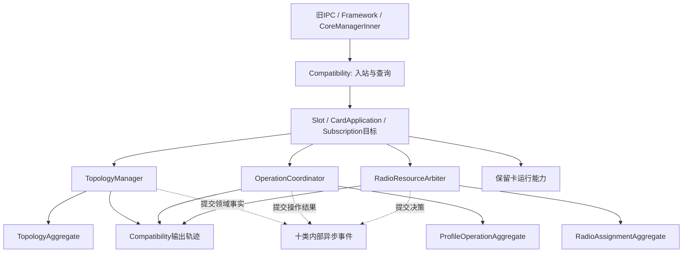
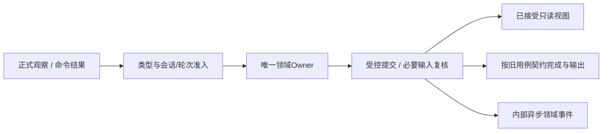

# SIM DDD目标架构导读

日期：2026-10-15。本文是[SIM-SAD-001 v0.3.1](../SIM_Refactored_Software_Architecture_Design_Version3.md)的导读，不再独立定义另一套目标。详细取舍见[统一裁决](08_design_unification_decisions.md)，类设计见[SIM-CLASS-001](../SIM_Layered_Architecture_Class_Design_Version3.md)。

## 1. 目标与非目标

目标是在外部契约冻结下，使身份/位置、领域事实/操作进度、角色/资源和原输出机制具有明确责任与有效性，降低同类改动的联动范围。

不新增公共API或SubscriptionId、不扩展IPC枚举、不新增SA/进程、不改schema/参数名/厂商ABI、不引入运行期Feature Flag。SO分离是工程边界，不是领域建模完成或故障隔离。MEP/四槽不是最小验证场景；先完成Linux无卡状态与账户切片。

## 2. 四个Context，三个聚合

| Context | 目标聚合 / 写者 | 内容 |
|---|---|---|
| Subscription Topology | TopologyAggregate / TopologyManager | simId账户、独立SlotFacts、绑定与版本 |
| Profile Operation | ProfileOperationAggregate / OperationCoordinator | 本仓命令、步骤、效果认知、门控与恢复 |
| Radio Assignment | RadioAssignmentAggregate / RadioResourceArbiter | 角色偏好/有效选择、Primary、期望/观察资源 |
| Compatibility | 无业务聚合 | 入站、查询、出站ACL与既有完成契约 |

旧方案中Subscription Management、Hardware Topology、Radio Resource等职责不是同时存在的额外Context：账户/连接整合入Topology，角色/资源整合入Assignment，长用例整合入Operation，旧协议归Compatibility。卡运行状态/文件解析保留生产实现，不机械改名为领域服务或用mock重写。

网络注册、通信业务和远端任务拥有自己的事实。本地聚合只能接受它所能核实的观察，不控制硬件现实。

## 3. 目标分类与身份

simId沿用为账户/订阅标识，不等于slot；强类型包装不改变现有分配规则。不假定跨删除、重装或设备永久稳定。

SlotTarget支持无卡与未识别位置；CardApplicationTarget支持PIN/PUK、EF、APDU、STK；SubscriptionTarget支持账户与角色。需要卡侧执行时再解析当前绑定，仅修改允许保留的历史账户属性不强求卡在线。

给定产品的两pSIM+eSIM N布局只作为配置目标；物理数量、逻辑位置、权限、MEP、Modem和业务并发分别核实。四槽批准来源未齐，不能把桩的数量上限当产品能力。

## 4. 事实、版本与完成

TopologyRevision为已接受拓扑版本，BindingGeneration为卡/应用或绑定会话，RecordsGeneration为同会话的一轮加载。请求归属保留发起时上下文、serial、step/attempt。无请求通知不伪造OperationId；合法切换用因果证据衔接新会话，不笼统按全局revision拒绝。

Domain纯规则不调用平台I/O或ffrt；Application受控队列序列化同Owner写入，锁外存储/设备I/O，回归后复核。当前Legacy写序可能不同，按字段/用例迁移，不能用该目标图悄悄改变现有查询可见点。

## 5. 事件、事务与恢复取舍

十类候选事件以SAD目录为准。保留RadioEvent、Hub、Registry、CES、账户回调及eSIM回执；不新增十个CES action，不统一去重，不强制全部通知经过总线。事件强制次数/偏序必须有契约。

当前账户走DataShare，参数和缓存各有边界；本仓直写RDB、提供方中继与事务能力缺少外仓证据。Repository/本地锁不提供跨连接原子性，不新建schema或Outbox。内部不可用ICCID与写NULL区分，后者受数据来源/兼容/回退验证门禁。

OperationRepository本阶段为运行期上下文；取消等待不保证硬件取消，超时先核实效果，不承诺跨重启同ID恢复。原V22“持久化受理/完成证据、outbox、全程Saga”的更大方案退出本阶段，仅保留有证据的补偿和核对职责。

## 6. 依赖、部署与生命周期

CoreManagerInner消费侧签名/符号/线程/注入/返回保持，背后SIM委托和非SIM能力可通过内部Host Ports分离；不直接删除门面。Core装配注入，SIM只依赖端口，目标链接Core→SIM单向。

同进程SO不隔离崩溃。当前接口无虚析构，采用具体类型控制块或工厂deleter；停止受理、反注册、门控迟到工作和排空后销毁。工厂、ABI/CFI/Feature与真实双构建差分是G2产物，尚未完成。

## 7. 实施准入

Phase0/G1先补决策与依赖来源、输出轨迹和Linux最小状态/账户边界测试；G2机械拆分；G3按三个Owner逐条切换写路径；G4只交付经确认的产品拓扑。

不使用运行期实现切换Flag；Legacy/Split分开构建运行，只读Shadow不双写或双发命令。git revert仅回退代码，设备效果和数据先核对；不能以回退覆盖新真实身份。

当前容量B1 PASS、设施16 PASS与原五业务BLOCKED分开报告。旧六聚合/多表/新公共接口建议和其他分支Shadow记录已归档至[历史04](../history/pre_unification_20261015/MultiSIM/04_ddd_target_architecture.md)，不作为并行规范。
