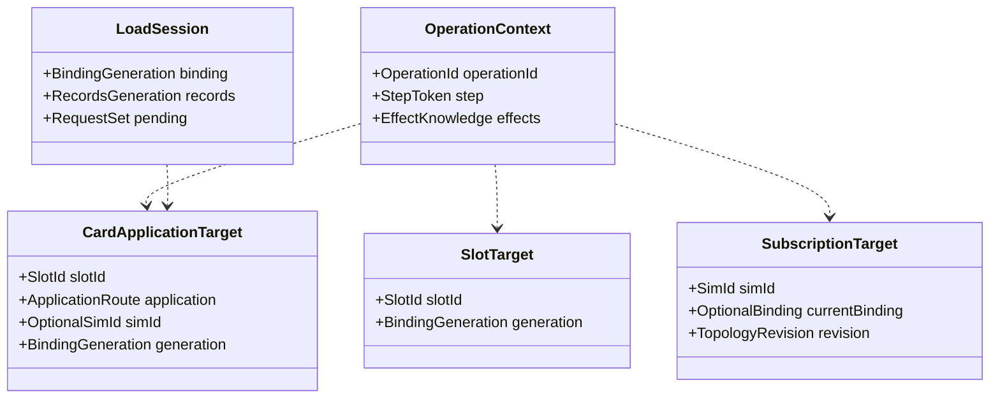

# SIM 类与数据映射：现行详细设计导读

日期：2026-10-15。规范来源是[类设计v0.3.1](../SIM_Layered_Architecture_Class_Design_Version3.md)及[SAD](../SIM_Refactored_Software_Architecture_Design_Version3.md)，方案理由见[DU裁决](08_design_unification_decisions.md)。本文不重复维护完整类图或新数据库模型。

## 1. 责任映射

| 当前实现入口 | 目标职责 | 不变项 / 限制 |
|---|---|---|
| SimManager/ISimManager | 兼容门面与应用入口 | 旧签名、错误、完成、布局；不是新公共服务 |
| CoreManagerInner | 共宿主兼容委托，非SIM能力经Host Ports注入 | 消费侧入口、注入和线程保持，不整体删除 |
| MultiSimController | TopologyManager、OperationCoordinator、RadioResourceArbiter按用例抽离 | 旧存储和Primary/Data联动在迁移前继续有效 |
| MultiSimMonitor | 依赖可用性观察、恢复输入与既有通知桥接 | 系统事件不全变领域事件 |
| SimStateManager/Handle | 保留卡状态与安全生产执行；目标接受SlotFacts | 不通过mock生成状态，不把所有安全命令要求账户 |
| IccFile/SimFile/控制器 | 保留文件生产解析，加入加载会话/轮次准入 | serial继续关联传输，不等于业务轮次 |
| RadioProtocolController | 设备/协议执行适配，Assignment决策 | 不由默认角色推导网络/数据成功 |
| EsimManager/EsimFile | Core卡侧运行能力与协议适配 | 不把所有原语转办66250 |
| SimRdbHelper | DataShare Repository Adapter | 当前未确认直写DB；无新schema |
| SimRdbInfo/IccAccountInfo | 既有存储记录/兼容DTO | 不机械改成多表或新公开DTO |
| TelephonyExtWrapper | VendorHookAdapter映射现有函数指针 | 无新厂商ABI、无超时后盲目双执行 |
| Observer/RadioEvent/Hub/Registry/CES | 专用兼容出入站适配 | 不由DomainEventBus统一替换 |

十八组件席是候选组织，不是建类指标；翻译器/队列/协调器按真实职责引入，简单只读查询无需经过写队列或多层透传。

## 2. 三聚合的内部状态

| 目标聚合 | 独立字段/值对象 | 规则 |
|---|---|---|
| TopologyAggregate | SimAccount、独立SlotFacts、SlotBinding、TopologyRevision | 空槽也有配置/状态；账户可无当前绑定；身份不伪造 |
| ProfileOperationAggregate | ResolvedTarget、step/attempt、effectKnowledge、waitCancelled | 运行期门控与恢复，不复制远端完整任务 |
| RadioAssignmentAggregate | RolePreferences、EffectiveRoleView、Primary、desired/observedAssignment | 意图、有效选择、观察与资源分开；保留旧联动 |

卡运行Adapter/Bridge保留实际业务执行与工作进度；目标Topology逐字段接受领域事实。迁移时写权只切换一次，不长期由Legacy和新聚合各自修改同一事实。

## 3. 三类目标及生命周期

这些是逻辑签名，不是已编译C++。空槽、PIN/PUK和身份未就绪不要求simId；历史账户查询不要求在线。绑定变化与同卡加载变化分别推进代次；不向旧IPC/事件追加内部字段。

## 4. 数据映射不是schema迁移

| 现有表达 | 目标语义 | 本阶段动作 |
|---|---|---|
| slotId/slotIndex | 请求路由/当前位置 | 按方法解释，不直接转物理位置或账户身份 |
| simId | 账户/订阅标识 | 强类型封装，保留旧分配规则；不新增公共SubscriptionId |
| ICCID | 可用凭据属性或不可用 | 内部显式表达；NULL写入需D-006及提供方读写/迁移验证 |
| isEsim | Legacy来源标志 | 只在适配边界解释，不据此推导eUICC/Port |
| phyCard/lsi | 产品协议字段 | 当前外部定义不匹配，先补真实协议，不猜字段值或映射 |
| simLabelIndex | 显示标签 | 不作为身份、Port或物理卡主键 |
| isActive | 既有Active语义 | 不展开成自动证明Enabled/Assigned/Registered的状态 |
| Voice/SMS默认标志 | Assignment角色视图 | 旧存储/选择/回退按逐接口保持 |
| 默认Data参数/缓存 | 当前Data运行事实 | 不以旧数据库同名字段替代实际写路径 |
| Primary参数/Radio | Assignment主卡决策/执行 | 维持默认Data联动，不统一替代所有角色 |
| portIndex/Profile状态 | 已验证的端点/凭据关系 | 不直接建立新表、回填或猜测持久映射 |
| SimState六值 | 兼容投影 | DISABLED/ERROR/RECOVERING逐case确认，不全局映射无卡 |

当前DataShare、参数、缓存和潜在提供方事务分别登记；直写RDB未经本仓证实，不创建新通道。运行期OperationRepository不建持久日志表；新Outbox、Event Sourcing和同ID跨重启重放不在本阶段。

## 5. 提交、查询与输出

同Owner命令/提交由Application执行域串行，不在Domain锁内做DB、RIL/IPC/Hook/外部回调。锁外I/O后复核必要输入，发布已接受只读视图。跨聚合组合视图校验输入版本，不伪装全局快照。

CompatibilityOutputPlan只记录旧用例的查询可见点、载荷、完成、允许重复、必要偏序与失败规则，不成为新的业务事实或持久表。不把全部既有通知推迟到内部总线消费；未核实轨迹保持OPEN。

## 6. 实施检查

- 每次迁移列出旧writer、目标writer、状态字段、保护/执行域、只读副本、失效和停止规则。
- 每条入口列出目标类别、原签名、权限、同步/异步、完成、错误、注入前及重入行为。
- 运行期取消不是真硬件中断；未知结果先重查，不盲目重试/补偿。
- 新SO使用工厂/具体类型deleter；无虚析构接口不可裸delete，停止排空与跨DSO全量构建另验。
- 测试断言只关联确认Oracle或适用前提已核实的不变量；目标类、表结构和内部次数不能定义业务PASS。

旧多表、六聚合、Primary仅派生值、新公共API及已实现Shadow叙述保存在[历史05](../history/pre_unification_20261015/MultiSIM/05_detailed_class_and_data_model.md)。当前对应实现尚未落地，详见[07](07_subscription_refactoring_status.md)。
