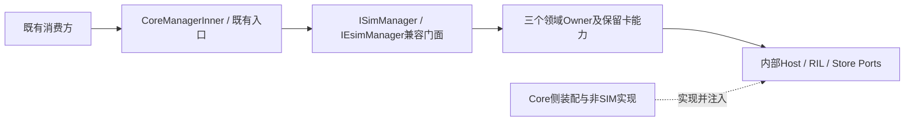

# SIM 设计冲突审视与统一裁决

日期：2026-10-15。范围为当前仓库的 SIM 架构、知识索引和独立测试说明；只刷新文档，未实施生产重构。

## 1. 输入与证据规则

新输入是 [SIM-SAD-001](../SIM_Refactored_Software_Architecture_Design_Version3.md) 与 [SIM-CLASS-001](../SIM_Layered_Architecture_Class_Design_Version3.md)。它们优于旧方案的地方在于分类目标、共宿主兼容、既有输出轨迹及真实事务边界更明确。但其声明的输入基线 `hmos_dev_20260813/core@738f51f6` 不是当前工作树。

当前依据：`zjuluowu/multisim/main@df8f2f017f83c70145b20255b4e9042f7a5fd923` 加未提交工作树。源码位置和 SHA256 见 [清单](design_alignment_manifest.json)。本轮采用 FACT（静态事实）、INFERENCE（风险推断）、DESIGN（本轮设计选择）、PRIOR_EXECUTION（历史执行证据）、OPEN（来源或规则待补）五类结论，不将它们互相晋升。

新输入引用的 `07-decision-and-conflict-log.md`、`09-business-decision-request.md`、`openharmony_sim_cross_repository_interface_inventory.md` 当前未提供。原 D-/REL-/FLOW-/CAP-/X-/SDC- 编号作为外部来源标签保留，**本文件不伪造它们的批准内容，也不与 MultiSIM/07 的状态索引混同**。本轮 DU 编号只记录文档方案取舍，不是业务批准编号。

## 2. 冲突逐项裁决

| ID | 冲突 | 当前代码与设计审视 | 统一选择 / 状态 |
|---|---|---|---|
| DU-01 | 旧六上下文、V22 四业务上下文与 V3 四 Context 并存 | 当前 MultiSimController 集中账户、角色和主卡逻辑；无限拆域会增加兼容迁移面。不同变化原因仍应区分。 | DESIGN：采用 V3 四 Context，三聚合；不将每个类或 SA 另立 Context。 |
| DU-02 | 角色归 Subscription 或归 Radio | `multi_sim_controller.cpp:1478–1527、1685–1697` 显示 Primary 与默认 Data 联动。纯物理资源不能代替角色意图。 | DESIGN：角色意图、有效选择、Primary 与资源分别建模，但本阶段由 RadioAssignment 统一领域写入；拆分内部策略和值对象，保持既有联动。 |
| DU-03 | 硬件/Profile/订阅/Modem 各建聚合，或三聚合 | pSIM/eSIM 硬件事实、账户事实与操作进度生命周期不同；当前 schema 无可信 Port 持久映射。 | DESIGN：三聚合是当前兼容重构边界，Topology 中保留独立 SlotFacts 与类型化绑定；UICC 生产状态/文件处理仍执行，不以新实体或 mock 重写。未来聚合拆分另审。 |
| DU-04 | 所有操作统一 SubscriptionId / 有效账户 | `ISimManager` 同时含按 slot 的状态、安全、文件接口和账户/角色接口。识别身份前也需要 PIN 与卡 IO。 | DESIGN：SlotTarget、CardApplicationTarget、SubscriptionTarget 分类；沿用强类型 SimId，不伪造身份，不引入第二个公共账户 ID。 |
| DU-05 | 新模型天然保证永久身份稳定 | 代码根据旧缓存、存储和卡身份解析 simId；删除/重装/迁移不变量没有完整运行证据。 | OPEN：本阶段保持旧分配与映射契约。身份政策另确认，不断言 simId==slot，也不承诺跨删除或跨设备稳定。 |
| DU-06 | “物理两槽 + eSIM 从2起”是全产品现状 | `telephony_types.h:25–65、100–151`、参数默认1，另有分布式8常量；RadioProtocol:40 初始化最多两个槽。 | DESIGN/OPEN：两 pSIM + eSIM N 是新输入的目标产品配置，非通用库固定物理上限；四槽批准证据待补，配置合法性、可见性与并发能力分开验收。 |
| DU-07 | 删除 CoreManagerInner 或把它作为不可调整实现 | Core 初始化和 InnerKit 已形成消费侧门面，SIM 又反查它获得外部能力。 | DESIGN：保留消费侧签名/符号/注入/错误/线程行为；背后委托可拆，SIM 到非SIM能力通过私有 Host Ports 注入。兼容门面保留不等于反向链接必须保留。 |
| DU-08 | 独立 eSIM SA 等于独立进程或故障隔离 | `telephony_trust.json` 将4010和66250放入telephony；客户端加载66250，服务实现与运行配置仍需外仓核实。 | FACT：配置支持共宿主，不从 SA 编号推断隔离。DESIGN：保持既有服务身份与通信，不合并全部 eSIM 能力，也不新增服务。 |
| DU-09 | SO 拆分自动形成稳定 ABI / 故障隔离 | 根 BUILD.gn 仍将 SIM 源编入 Core；ISimManager/IEsimManager 无虚析构。 | DESIGN：同进程 SO 为链接/依赖边界，采用工厂或具体类型 deleter，停止排空后销毁；禁止接口裸指针 delete，不擅自追加虚析构或破坏虚表。工厂和跨DSO验证尚未完成。 |
| DU-10 | 全部通知经新总线、旧Observer被替换 | 当前 Registry、CES、RadioEvent、账户与eSIM回执含不同完成语义，SimFile存在独立加载通知。 | DESIGN：保留六类既有机制，内部领域目录固定十类候选事件；兼容输出按逐用例轨迹执行，不能统一延迟到总线消费后。事件次数与偏序须有契约。 |
| DU-11 | 操作成功需持久化日志、Outbox与跨重启同ID重放 | 现有 schema 冻结；新 V3 运行期 OperationRepository 不提供持久日志。 | DESIGN：接受运行期操作上下文和重启后事实重查，不承诺同OperationId恢复；持久化受理、可靠完成投递、Outbox与新表退出本阶段。外部完成承诺保持旧契约。 |
| DU-12 | 本仓直写RDB + DataShare + 参数已有统一事务 | 当前 SimRdbHelper:94–136 明确调用DataShareHelper；当前SIM范围未检出NativeRdb/RdbStore事务实现。外仓报告缺失。 | FACT/OPEN：已核实的是DataShare及参数路径；直写是待提供证据的边界，不为配类图创建直写通道。StoreAccessCoordinator仅序列化本仓受控写，不能充当跨连接原子事务。 |
| DU-13 | 不可用ICCID必须立即迁为DB NULL | 新输入D-006拟写NULL，但提供方schema、约束、查询和迁移批准尚缺；当前存储协议还有14字段版本缺口。 | DESIGN：内部显式不可用且不参与身份匹配；NULL写入仍为有条件目标，未证明既有列/读者兼容前不迁移、不改schema；旧输出占位逐接口保持。 |
| DU-14 | DISABLED 总是映射 NOT_PRESENT | 公开SimState为六值；Active、Profile状态与卡存在不同。当前SimManager:176–184按HasSimCardInner派生无卡状态，并非通用DISABLED规则。 | OPEN：不采用全局映射。LegacyStateTranslator按来源、接口、前提逐case保持已确认/实采行为；ERROR/RECOVERING也不能凭新枚举决定输出。 |
| DU-15 | 一个BindingGeneration保护全部异步结果 | 同卡文件刷新也可能开始新加载；旧设计已指出serial与轮次不同。 | DESIGN：绑定/卡会话代次与RecordsGeneration分开，加载会话保留请求集合；OperationId/step/attempt仅关联命令。拓扑变更不能一律拒绝合法切换产生的新会话，需因果衔接。 |
| DU-16 | 原子聚合意味着持锁做DB/设备I/O | 新 V3 已要求锁外I/O，但异步提交后覆盖内存仍需防陈旧候选。 | DESIGN：Application受控队列序列化同Owner提交，复核必要输入后发布快照；Domain纯规则不调ffrt/DB/IPC。新增同步采用ffrt，现有std/ffrt混用是事实。 |
| DU-17 | Feature Flag 切换与新方案“不引入Flag”冲突 | 可以将同一边界套件链接两种产物；不需要双发硬件命令。 | DESIGN：不新增运行期实现切换Flag；Legacy/Split分开构建与运行。可选只读Shadow不成为writer或设备执行方。 |
| DU-18 | git revert 就可安全回退 | 已发设备命令与已写数据不会被Git撤销。厂商同进程超时也不代表函数停止。 | DESIGN：构建回退采用revert/恢复旧产物，但先停止受理、核实副作用、排空/隔离迟到工作、核对数据兼容；有迁移才需批准的配对数据修正。不能盲目恢复旧身份或重复执行。 |
| DU-19 | 文档称本仓已完成Subscription Shadow | 当前目录无对应类型和追加接口；旧07指向另一仓库/分支。 | FACT：旧完成记录转历史，当前实现状态重建；新三聚合/SlotRegistry/DomainEventBus均未在本仓落地。 |
| DU-20 | 新输入3/35、旧ST01–13与实际覆盖混计 | 本地2026-10-08结果为容量B1 PASS、INFRA16 PASS、容量负控预期失败；原五场景BLOCKED。 | PRIOR_EXECUTION：分别报告；3/35缺少输入来源，不能当当前测量。当前Phase0未就绪，不禁止已经授权的Linux测试设施推进。 |
| DU-21 | 黑盒验证数据库表、内部类、调用次数 | 用户明确要求公开/外部边界Oracle；V3的事务审计不是业务PASS标准。 | DESIGN：业务验证只用公开返回、回调/事件、稳定状态、正式外部请求。存储写计划可做提供方契约测试，但不以表结构定义SIM正确性。 |
| DU-22 | 接口码可追加被误解成本阶段允许追加 | 工程规则仅约束兼容演进方式，并非授权。 | DESIGN：本次目标冻结“不新增”；内部分层、十类事件、OperationId均不新增对外载荷或IPC。 |

## 3. 选定方案的完整边界

### 三聚合和卡运行逻辑

Topology 管账户身份、独立于账户的 SlotFacts 和绑定；Assignment 管角色意图/有效选择/Primary/期望与观测资源；Operation 管本仓一次操作的门控和效果认知。Compatibility 不拥有第二份事实。网络、通话、数据和IMS权威事实留在原模块。

卡状态机、文件解析、PIN/PUK、电话簿、SIM短信、STK和eUICC协议仍复用生产实现。Adapter 把正式输入转为观察/执行结果；被测业务不能由桩生成。迁移一个字段前明确旧writer、目标Owner、只读投影和切换时点，不在Legacy与新聚合间长期双写。

### 内部依赖与消费侧兼容

图是目标协作，不证明新SO已构建。保留 CoreManagerInner 消费侧入口与消除 SIM 对 Core 的符号链接可以同时实现。新端口不成为新的公共服务协议。

### 事件与完成

十类内部事件为：CardPresenceChanged、TopologyChanged、SubscriptionDiscovered、SubscriptionRemoved、OperationCompleted、OperationFailed、OperationCompensated、RoleAssignmentChanged、ModemAssignmentChanged、ResourceDegraded。事件目录和异步模式作为当前候选设计统一；X-1批准来源仍待补。

卡存在事件允许没有simId；原始RIL通知与eSIM回执不自动成为已提交领域事实。既有返回/事件/查询可见点不能被新总线默认重排。保留可能重复的外部通知，未核实的Registry中继、sticky、消费者行为列在轨迹表待确认。

## 4. 阶段与准入

| 阶段 | 产物与进入条件 | 当前状态 |
|---|---|---|
| Phase0/G1 | 输入决策来源、源码/依赖版本、入口/状态/输出轨迹；最小无卡状态与账户边界切片、Oracle、负控、清理和XML/JSON | NOT READY；14个存储协议字段缺口、初始化闭包和服务capability阻塞仍独立存在 |
| G2 | 保持原行为的同进程SO机械拆分；兼容门面、工厂销毁、停止排空、链接无环与Feature/ABI差分 | 未实施；不能从容量测试推断通过 |
| G3 | 按选定三聚合逐条迁移写路径；旧规则与新不变量分别验证 | 设计阶段；NULL迁移等另受来源与数据验证门禁 |
| G4 | 对已批准产品范围配置四槽/MEP/N订阅M资源，分别验收权限、协议和设备能力 | 批准来源与产品矩阵待补，不把桩卡数当产品能力 |

Phase0是生产重构准入；当前用户已批准的Linux GN适配、GMock边界设施和文档审视继续在既有范围内进行。门禁不代表授权修改生产接口、schema或外仓。

## 5. 未解决来源与协作

- 导入决策总账及决策卡，核实D-002/D-005、D-006、D-016、X-1及其批准范围。缺失不等于被否决，也不等于已批准。
- 数据提供方提供匹配的SimData协议、NULL/缺行/占位读写契约、同事务能力和反查链；本地不得猜字段或新建直写实现。
- eSIM、Registry/CES、共宿主消费者补齐逐方法部署、回调、重复/sticky和重启轨迹；SA配置不是运行验收。
- Modem/业务方确认分命令超时、三阶段协议上界、未知效果恢复、默认角色和Primary策略。
- 旧V22/V23报告和旧分支进度完整保留历史，不继续作为现行设计或完成证明。

## 6. 刷新原则

总体设计和类设计以本轮裁决修订；MultiSIM 01–07和知识索引按职责同步。旧稿在历史目录保留原始正文，历史二进制和执行记录不篡改。新旧差异有选择理由，无法由代码裁决的业务决策显式OPEN，不用更换类名掩盖不确定性。
