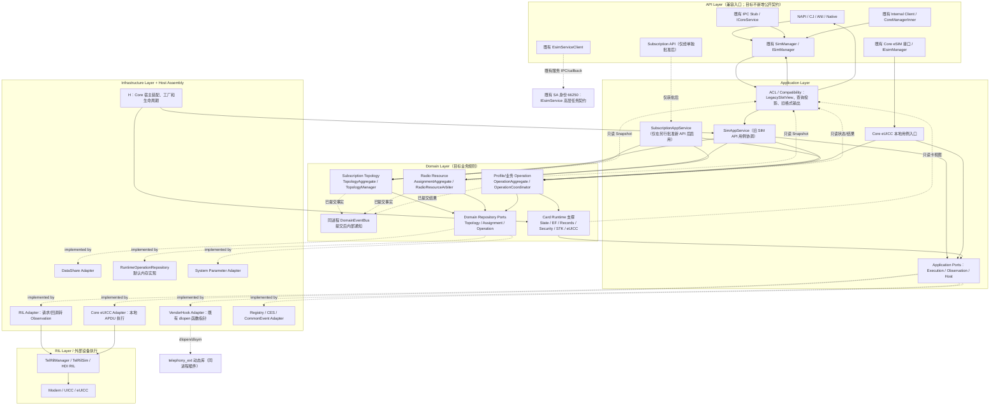
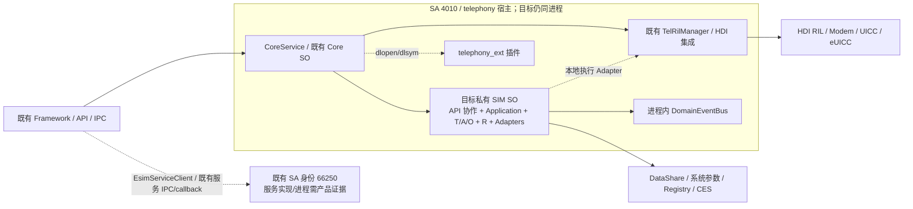
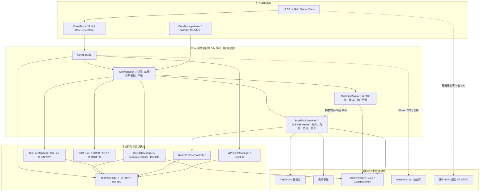
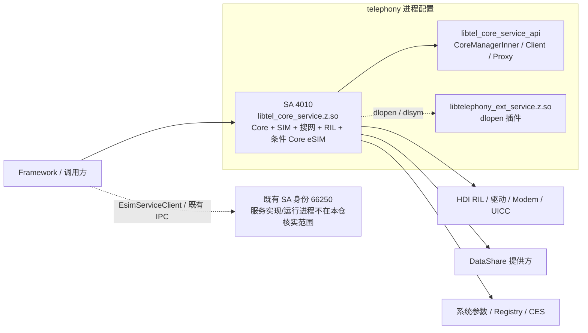
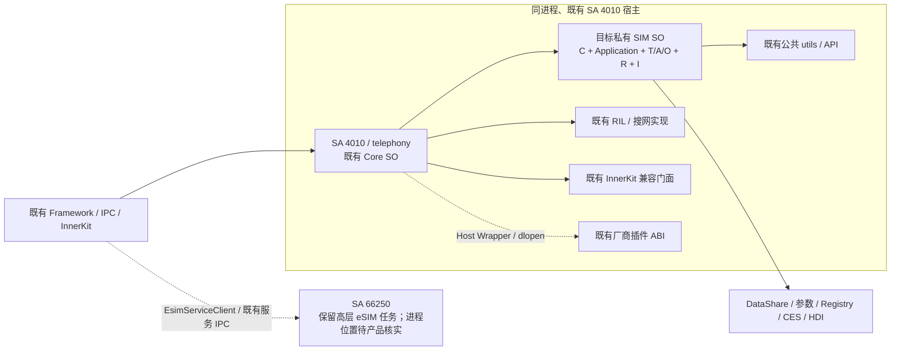
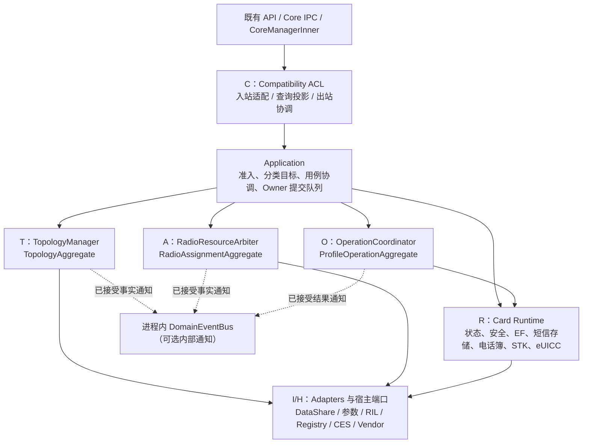

# SIM 架构分层对比与功能迁移设计

日期：2026-10-23  
性质：基于当前仓库源码和既有 SIM 重构方案的补充设计文档。本文只描述设计，不代表生产重构已实施或设备运行验证已完成。

## 1. 目的、范围与判定口径

本文以用户提供的 API / Application / Domain / Infrastructure / RIL 分层蓝本组织目标设计，并在 [SIM 架构重构设计](SIM_Architecture_Refactor_Design.md)的源码核实基础上，补充当前分层和迁移对照：

1. 重构前实际分层及其与目标分层的差异；
2. 旧模块、功能和物理部署单元到目标职责/部署单元的迁移关系；
3. 目标图中容易混淆的运行时 IPC、共享库加载、Owner 写入和跨服务事件边界。

证据等级：

| 标记 | 含义 |
|---|---|
| **FACT** | 当前检出的源码、构建配置或服务配置直接支持的静态事实；不等于设备实测。 |
| **TARGET** | 目标架构建议，尚未形成当前生产实现。 |
| **OPEN** | 依赖外仓实现、产品配置、审批或运行测试才能确认。 |

本文的目标职责采用较新的 [SIM_Architecture_Refactor_Design.md 第 4 章](SIM_Architecture_Refactor_Design.md#L202-L295)：三个业务上下文 T/A/O，另有卡运行支撑 R、兼容实现层 C、技术适配 I 和宿主装配 H。它与早期 V3 文档将 Compatibility 计为第四个 Context 的表述不同；在正式统一文档前，应明确 Compatibility 是业务上下文还是实现层，避免并列两套口径。此差异是设计文档口径问题，不是当前源码已存在的架构边界。

本轮目标不新增公开 API、IPC、SA、进程、schema、厂商 ABI 或运行期实现切换开关；保留既有卡协议和外部行为。目标 Owner/Adapter/Repository 名称不得作为当前实现证据。

## 2. 架构总览

### 2.1 设计原则

下表把用户提供的 P1–P10 蓝本整理为目标设计约束。规则编号及 `SIM-INV-*` 来源是蓝本中的提案编号，本仓没有找到可将它们视为已批准需求的独立记录；因此本表是 **TARGET**，不是当前代码行为或现行静态检查结果。

| # | 原则 | 蓝本来源 | 目标约束与本仓边界 |
|---|---|---|---|
| P1 | Subscription 身份独立于物理位置 | SIM-INV-001/006/008；ARCH-RULE-001 | 目标身份/账户不得以 `slotId` 为主键；但本轮沿用现有 `simId` 契约，不新增公共 SubscriptionId，也不承诺跨删除/设备的永久身份。 |
| P2 | 单一数据源 | SIM-INV-002/012；ARCH-RULE-002 | 每个 Aggregate 只有一个逻辑写者；迁移时不允许 Legacy 与新 Owner 对同一事实长期双写。 |
| P3 | 一次决策一个 Revision | SIM-INV-003/004；ARCH-RULE-003 | 仲裁输入应绑定同一 `TopologyRevision`；候选状态经过锁外 I/O 后，提交前复核版本/因果关系，避免过期结果覆盖新快照。 |
| P4 | 外部回调门控 | SIM-INV-009/011；ARCH-RULE-004 | RIL/eUICC 回调先转成带关联信息的 Observation/Result，再由 Application/Owner 校验 OperationId、阶段及代次；Adapter 不直接写 Aggregate。 |
| P5 | Compatibility 只读派生 | SIM-INV-005/006/014；ARCH-RULE-005 | 兼容查询和旧格式输出从核心事实派生，不成为拓扑、角色或操作事实的第二写者。 |
| P6 | Domain 层无基础设施依赖 | DDD；ARCH-RULE-006 | Domain 不依赖具体 RIL、DB/DataShare、IPC、HDI、FFRT 或 Host singleton；Port 的归属由目标模块边界明确，避免 Domain 反向 include 实现。 |
| P7 | 厂商 Hook 经过 Command | SIM-INV-013；ARCH-RULE-007 | Hook 作为受门控的外部效果，由 Application/用例在业务决策后经端口调用；不得从兼容层直接绕过 Owner 改核心事实。 |
| P8 | 领域锁内无 I/O | SIM-INV-003；ARCH-RULE-008 | 锁仅保护内存状态变更；DB、参数、RIL、IPC、Hook 和外部回调均在锁外执行。 |
| P9 | Commit 前不对外可见 | SIM-INV-003/009；ARCH-RULE-009 | 只有完成 Owner 校验并接受提交后才发布内部领域事件；内部提交不自动保证 DB、参数、快照和外部通知原子。 |
| P10 | 基数统一查询 | SIM-INV-005/014；ARCH-RULE-010 | SlotRegistry/统一配置成为槽位基数的唯一目标来源；不在业务代码散布硬编码。产品配置与当前编译常量仍须逐项核实。 |

`static_analysis` 是蓝本建议的验证方式，不代表仓库已有对应规则或 CI 检查。本轮如采纳，应将每条规则落到可执行的边界测试或静态检查，并明确豁免与结果。

### 2.2 目标分层架构（TARGET）

下图保留蓝本的 API / Application / Domain / Infrastructure / RIL 视图，并将 R（生产卡运行支撑）和 H（宿主装配）显式标出。Compatibility/ACL 作为应用边界中的兼容职责呈现；是否把它另称为第四个业务 Bounded Context，见 §1 与 §3 的口径说明。



蓝本中的 `TopologyRepository`、`OperationRepository`、`AssignmentRepository`、`CardChannel`、新 App Service 和 `Subscription API` 均为提案名称/接口，不是当前实现。`OperationCoordinator` 归本仓 SIM 目标职责；不得因名字相同而在 Core 与 SA 66250 对同一高层任务各自建立主状态机。

### 2.3 关键架构约束

| 依赖/协作边界 | 目标规则 | 状态与验证 |
|---|---|---|
| API → Application | API 负责旧契约、权限、参数/回调边界；通过应用服务处理用例，不直接改 Aggregate。 | TARGET；静态依赖检查建议。不得借此改变现有权限和错误顺序。 |
| Application → Domain | Application 编排准入、目标解析、外部效果、Owner 提交及完成输出；Domain 保持纯业务规则。 | TARGET；简单查询可走只读视图，不强制经过 OperationCoordinator。 |
| Domain → Infrastructure | Domain 依赖抽象、不 import 具体实现；Repository Port 与聚合规则同属领域边界，执行/观察/宿主 Port 由应用用例拥有，Adapter 由 H 装配。 | TARGET；端口按语义归属，禁止循环依赖和 Domain→具体 Infrastructure。 |
| Infrastructure → Application/Domain | Adapter 实现 Port、发出 Observation/Result；不直接调用 DomainService、改聚合或旁路 Application。 | TARGET；回调通过 ingress/Owner 门控。 |
| Compatibility → 核心事实 | Compatibility 只读派生旧接口视图和旧格式输出，不写 T/A/O 权威状态。 | TARGET；任何需要修改事实的旧 API 转换成应用命令。 |
| 跨聚合协作 | 使用 Command、不可变快照/值类型及已接受领域事件，不传共享可写 Aggregate。 | TARGET；同一端到端效果只由一个主协调者发出。 |
| DomainEventBus | 仅同一进程内，提交后异步通知；不替代 IPC、RadioEvent、CommonEvent、Registry、CES 或回调。 | 目标内部机制；无跨 SA/进程传输能力，无默认全局顺序/恰好一次保证。若要求单调序号，须定义其作用域并在 Owner 提交点分配。 |
| API/部署边界 | 本轮不新增公开 API、IPC、SA、进程、schema 或运行期开关。 | 当前统一设计约束；蓝本中新增接口项均须单独批准后才能成为实施目标。 |

## 3. Bounded Context 到组件映射（TARGET）

本节采用蓝本的 Topology、Operation、Radio Resource 职责拆分，同时保留当前统一方案中的 T/A/O 单写者模型。Compatibility 先作为 ACL/实现责任；早期 V3 把它称作第四个 Context，与当前主设计口径冲突，不能在没有统一裁决时同时作为两种事实。

### 3.1 Subscription Topology Context

| 领域概念 | 目标组件 | 当前对应 | 状态 | 职责与迁移关键点 |
|---|---|---|---|---|
| TopologyAggregate | `TopologyManager` | `MultiSimController` 的 ICCID/账户/映射职责（部分） | PROPOSED | 管理已核实的账户、槽事实、绑定及 Snapshot；保留现有 simId 分配/查找行为，不宣称跨删除或设备永久身份。 |
| TopologyRepository Port | `ITopologyRepository` | 无独立 Port；缓存嵌在 Controller | PROPOSED | 抽象账户/拓扑读写；只采用现有受支持持久化契约。 |
| Repository Adapter | `TopologyRepositoryImpl` | `SimRdbHelper` + Controller 缓存 | PROPOSED | 当前 `SimRdbHelper` 实际使用 DataShare；不得据命名声称 NativeRdb 直写或 DB 与快照原子。 |
| SlotRegistry | `SlotRegistry` | `SIM_SLOT_COUNT*` 宏、`slotCount_` 与多个槽位边界检查（[当前定义](../interfaces/innerkits/include/telephony_types.h#L30-L63)） | PROPOSED | 蓝本使用的 `TELEPHONY_SLOT_COUNT` 标识未在当前源码检出；目标应收敛现有多种容量来源，并覆盖产品可配置性/分布式槽规则，不能仅替换常量名。 |
| CardDetector | `CardDetector` | `MultiSimMonitor` / `MultiSimHelper::IsEsim`（部分） | PROPOSED | 将卡型检测封装为输入观察；不得把 ATR/类型识别等同于账户身份发现。 |
| RIL Adapter | `RilAdapter` | `TelRilManager` / `TelRilSim`（部分） | PROPOSED | 适配 RIL 请求和响应；回调先转类型化 Observation，不直接写拓扑。 |

**迁移关键点：**将 `MultiSimController` 中 `InitIccId`、`UpdateDataByIccId`、标签/账户查询等拓扑职责逐项迁入 T；缓存从槽索引结构整理为带身份、绑定和来源的 Snapshot。蓝本所说将槽位基数收敛至 SlotRegistry 是目标清理工作，不能借此改变产品槽位能力；`MultiSimHelper::IsEsim()` 的 ATR/类型判断进入 CardDetector，但仍与账户身份发现分开。

### 3.2 Profile / Business Operation Context

| 领域概念 | 目标组件 | 当前对应 | 状态 | 职责与迁移关键点 |
|---|---|---|---|---|
| OperationAggregate | `OperationCoordinator` | `MultiSimController` 激活/切换流程、`RadioProtocolController` 等；eSIM 本地步骤部分在 `EsimManager` | PROPOSED | 对本仓发起的激活、主卡/协议切换及本地卡步骤关联 OperationId、阶段、attempt、超时与效果核对；不复制 SA 66250 高层下载/OSU 主流程。 |
| OperationRepository Port | `IOperationRepository` | 无统一操作上下文仓 | PROPOSED | 默认仅为本进程运行期上下文；若要求重启恢复需另批持久化方案。 |
| OperationRepository Adapter | `RuntimeOperationRepository` | Handler 等待字段、请求 map/session 分散 | PROPOSED | 收拢运行态关联。进程重启后已丢失的内存项不能再更新成 `ABORTED`；只能重查设备/持久事实，或另外设计持久日志。 |
| Core eUICC Adapter | `EuiccAdapter` | `EsimManager` + `EsimFile` + `TelRilManager` | PROPOSED | 封装本地逻辑通道/APDU/回执；保留真实卡侧调用链和错误语义。 |
| CardChannel | `ICardChannel`、可选 `PsimCardChannel` | PSIM/eSIM 文件与 APDU 路径无统一 CardChannel 抽象 | PROPOSED | 仅在确有共同契约时引入；不能把 PSIM EF I/O 与 eSIM APDU 强行合并成相同协议。 |

**迁移关键点：**在既有可用操作入口上关联内部 OperationId/step/attempt，不新增公共 IDL 参数；RIL/eUICC 回调由 ingress 做门控。Core `EsimManager`/`EsimFile` 负责本地 APDU 与卡侧原语；SA 66250 的下载/OSU 主流程保留单一远端 Owner。

### 3.3 Radio Resource Context

| 领域概念 | 目标组件 | 当前对应 | 状态 | 职责与迁移关键点 |
|---|---|---|---|---|
| AssignmentAggregate | `RadioResourceArbiter` | `RadioProtocolController` + `MultiSimController` 角色/Primary 流程（部分） | PROPOSED | 管理角色意图、有效选择、Primary 与资源计划；偏好/选择不等于设备已成功切换或网络已就绪。 |
| AssignmentRepository Port | `IAssignmentRepository` | 无独立 Port；系统参数/缓存散布 | PROPOSED | 抽象当前可持久化的 Assignment 事实；不得由新接口虚构新的参数或存储表。 |
| Assignment Adapter | `AssignmentRepositoryImpl` | 系统参数 + DataShare 路径（按字段不同） | PROPOSED | 参数与 DataShare 是不同外部资源，无跨资源原子性保证。 |
| RolePolicy | `RoleAssignmentPolicy` | `MultiSimController::SetDefault*` 等（部分） | PROPOSED | 保留 Voice、SMS、Data 各自读取/回退差异及 Primary→Data 联动。 |

**迁移关键点：**`SetDefaultVoiceSlotId`、`SetDefaultSmsSlotId`、`SetDefaultCellularDataSlotId` 的角色决策进入 A；`RadioProtocolController::SetRadioProtocol` 的异步设备效果由 O 关联、A 提供资源计划、RIL Adapter 执行。不能仅用新仲裁器替换现有 condition-variable 等待而丢失超时、响应、回退和设备效果核验语义。

### 3.4 Compatibility / ACL（横切实现职责）

| 领域概念 | 目标组件 | 当前对应 | 状态 | 职责与迁移关键点 |
|---|---|---|---|---|
| ACL / 旧 Slot API | `LegacySlotApiFacade` | `SimManager` + `CoreServiceSim` / Proxy / Stub（部分） | PROPOSED | 将旧 slotId 调用翻译为 SlotTarget/SubscriptionTarget 等内部类型，保持既有签名和权限行为。 |
| LegacySlotView | `LegacySlotView` | 无独立只读投影；直接从现有缓存/Manager 查询 | PROPOSED | 从已接受 Snapshot 派生兼容查询；只读，不回写核心事实。 |
| VendorHook Port/Adapter | `IVendorHook` / `VendorHookAdapter` | `TelephonyExtWrapper` | PROPOSED | 保留 `dlopen` ABI，通过应用命令门控调用；函数指针接口抽象不代表厂商库变成 IPC 服务。 |

## 4. 部署模型

### 4.1 当前部署事实（FACT）

| 核对项 | 当前证据 | 边界 |
|---|---|---|
| Core SA 4010 | `sa_profile/4010.json` 指定 `process=telephony`、`name=4010`、`libtel_core_service.z.so`（[配置](../sa_profile/4010.json#L1-L11)）。 | 静态配置不证明设备已启动。 |
| Core / SIM / RIL 构建 | 根 `BUILD.gn` 把 Core、SIM、搜网、RIL 源编入 `tel_core_service`（[目标和源清单](../BUILD.gn#L30-L45)、[SIM/RIL/Core](../BUILD.gn#L67-L138)）。 | 当前没有独立生产 SIM SO。 |
| Core eSIM | `core_service_support_esim` 默认关闭，可由产品配置开启（[开关](../telephony_core_service.gni#L14-L40)、[条件源](../BUILD.gn#L139-L145)）。 | 不是所有产品都包含 Core eSIM Runtime。 |
| SA 身份 66250 | 本仓 `EsimServiceClient` 获取既有 `IEsimService` proxy；`telephony_trust.json` 的 `process=telephony` 条目同时列出 4010、66250（[客户端加载](../frameworks/native/src/esim_service_client.cpp#L65-L115)、[信任配置](../services/etc/init/telephony_trust.json#L1-L14)）。 | 这只是配置事实；不能单凭它证明设备实际进程、服务实现位置或故障隔离。 |
| `telephony_ext` | `TelephonyExtWrapper` 对 `libtelephony_ext_service.z.so` 执行 `dlopen`/`dlsym` 并调用函数指针（[wrapper](../services/telephony_ext_wrapper/src/telephony_ext_wrapper.cpp#L22-L64)）。 | 同进程插件边界，不是 IPC/SA。 |
| eSIM 两条路径 | 高层 Download/OSU 经 `EsimServiceClient → IEsimService`；本地 APDU 经 `CoreService → EsimManager → EsimFile → TelRilManager → HDI RIL`（[IDL/Client](../interfaces/innerkits/IEsimService.idl#L25-L53)、[APDU链路](../services/core/src/core_service.cpp#L1150-L1172)）。 | 不可合并成单一服务内调用链。 |

### 4.2 目标部署建议（TARGET）



蓝本中的“`esim_service` SA 66250 独立进程、OperationCoordinator/OperationRepository 位于该进程”不能作为当前事实，且与本仓当前统一设计“保持既有 SA/进程、不新增服务；本地 OperationCoordinator 在 SIM 私有 SO，66250 保留其既有高层任务主流程”不一致。若确需把 66250 确认为独立部署并迁移 Owner，须先有产品服务配置/实现证据、跨进程协议和唯一主编排裁决；在此之前图中把 66250 画为外部既有服务契约，不断言进程位置。

同样，蓝本中的 `IEsimManager`、`ISubscription` 拆分或新增 OperationId 公共参数属于 IPC/API 契约演进，不是本次目标部署的一部分；目标私有 SIM SO 先作为同进程链接/责任边界，不能宣称独立故障隔离。真实的 `dlopen` 调用方向是 Core/Wrapper 加载并调用扩展库，不能将 `telephony_ext.so` 画成“IPC 端点”。

| 蓝本部署项 | 核验/裁决 | 本文采用口径 |
|---|---|---|
| Core SA 4010 留在 `telephony` | 当前 profile/构建支持 SA 4010 的配置；目标保持既有宿主。 | TARGET：Core + 私有 SIM SO 同进程，不新增 SA。 |
| eSIM SA 66250 独立进程 | SA ID 和 `process=telephony` trust 配置可见；本仓未包含该服务实现或实际设备进程清单。独立进程/故障隔离未证实。 | OPEN：保持既有 `EsimServiceClient` IPC 契约；进程位置不画成事实或已批准目标。 |
| 66250 内运行第二个 OperationCoordinator | 与“一个端到端任务只有一个主编排者”冲突，也与本仓目标由 SIM OperationCoordinator 管本地操作、远端服务保留其高层任务相冲突。 | 不采用双 Owner。若批准拆分，必须重新明确端到端操作所有权和协议。 |
| `telephony_ext` 通过 IPC 访问 | 当前实现是 `dlopen`/`dlsym` 函数指针调用。 | 同进程插件；目标通过 Host/Vendor Adapter 保持 ABI，不改画成 IPC。 |

## 5. 线程模型与回调准入

本节区分**当前实现事实**和**目标线程约束**。目标的“ffrt task”是实现选项，不要求将现有线程/Handler 全量替换，也不意味着所有回调都可安全汇入一个线程。

| 组件/边界 | 当前事实（FACT） | 目标约束（TARGET） |
|---|---|---|
| `MultiSimController` | 有 `ffrt::condition_variable` 等等待状态；账户/角色/激活/主卡流程混合。 | Application 对同一 Owner 的提交串行；等待与设备操作不持有 Aggregate 锁。 |
| `RadioProtocolController` | `SetRadioProtocol` 使用 Handler、超时事件和 `ffrt::condition_variable`（[声明/入口](../services/sim/include/radio_protocol_controller.h#L38-L86)、[实现](../services/sim/src/radio_protocol_controller.cpp#L103-L141)）。 | 将状态门控、命令发送、结果核对分开；不能以超时断言设备没有效果。 |
| `EsimFile` | 多个 APDU/配置步骤各有独立 ffrt mutex/condition variable 与完成标志（[声明示例](../services/sim/include/esim_file.h#L282-L380)）。 | 以 operation/step/attempt 关联响应；不在锁内做 APDU、IPC 或等待外部回调。 |
| RIL / eUICC 回调 | 现有 Observer、Handler、request serial/session 等路径并存；不是统一 DomainEventBus。 | Adapter 将回调转类型化 Observation/Result → ingress → Owner 校验 OperationId、状态、必要的 baseRevision/generation → 提交 → 解锁后发布事件/通知。 |
| Event 分发 | RadioEvent、CommonEvent、Registry、CES、账户回调和 eSIM callback 各有独立语义。 | DomainEventBus 只在同一地址空间内部异步分发已提交事实；不能跨 SA/进程，也不默认提供全局单调顺序。 |
| 资源生命周期 | Handler、线程、条件变量和 Observer 注销分散在多个对象。 | 关闭时停止受理、注销输入、排空在途工作后销毁；不能强杀线程解决可能仍运行的厂商调用。 |

```text
RIL/eUICC callback thread
  → Adapter 解析回调与传输关联
  → 类型化 Observation / OperationResult
  → Application ingress / Owner 队列
  → 校验目标、operation/step/attempt、状态与版本
  → 锁内只更新内存 Aggregate / Snapshot
  → 解锁后执行 I/O、发布内部 Event 和兼容输出
```

如果命令发起在 SA 66250，而回调回到 Core，必须经过既有 IPC/callback 接口；不可跨进程直接投递到 Core 的 DomainEventBus。对同一个端到端任务，只能有一个主 OperationCoordinator；另一侧若需要本地相关联状态，应明确是请求关联/观察而非第二套流程、补偿或重试 Owner。

## 6. 持久化模型

### 6.1 Repository Port 与存储映射

| Repository / 目标状态 | Aggregate | 建议存储 | 当前对应 | 迁移约束 |
|---|---|---|---|---|
| `ITopologyRepository` / `TopologySnapshot` | Topology | 现有 DataShare 契约 + 受控内存快照 | `MultiSimController::localCacheInfo_` / `allLocalCacheInfo_`、按槽 Manager vectors 与 `SimRdbHelper`（[成员声明](../services/sim/include/multi_sim_controller.h#L193-L225)） | 蓝本提到的 `data_[slotId]` 未在本次核验的当前 Controller 中找到；目标可用现有 simId 表示账户身份、slot 表示位置绑定，但不因此迁移 schema 或改变 simId 规则。 |
| `IAssignmentRepository` | Assignment | 现有参数/DataShare 的字段映射 | Controller 默认角色/Primary 缓存、系统参数和 DataShare | Voice/SMS/Data/Primary 规则不同；参数服务与 DataShare 不构成一个事务。 |
| `IOperationRepository` / `OperationContext` | Operation | 默认进程内 Map；持久化需另行批准 | 无统一仓；Handler/RIL serial/session 分散 | 重启后内存记录已丢失，不能再将该记录更新为 `ABORTED`。若需恢复终态/同 ID 恢复，必须另设计持久日志并批准。 |
| Adapter cache / slot registry | 不属于业务 Aggregate | 配置值或可失效只读缓存 | 当前常量、Manager 数组与局部缓存 | 不得让缓存成为第二事实源；明确加载、失效与版本策略。 |

当前账户 CRUD 经 `DataShareHelper`，没有据此证明本仓直接 NativeRdb/RdbStore 写库（[SimRdbHelper](../services/sim/src/sim_rdb_helper.cpp#L94-L136)）。用户蓝本中的 `Snapshot 原子写`应解释为目标内存快照的提交/发布规则；它不能代表 DataShare、系统参数与内存快照之间具备分布式原子事务。

### 6.2 锁外 I/O、提交和恢复

1. 锁内只执行校验、状态迁移和内存 Snapshot 发布；数据库、系统参数、RIL、IPC、Hook、回调均锁外执行。
2. 同一 Aggregate 的写入按 Owner 串行；执行锁外 I/O 后复核必要的 `TopologyRevision`、绑定/记录代次或操作 attempt，再接受并发布新快照。禁止“解锁并发写 DB，按回包先后覆盖内存”。
3. 提交事件需在 Owner 接受变更后发出；但 DB 写成功、参数写成功、快照发布和外部通知之间仍须分别定义失败/重试/核对语义。
4. `StoreAccessCoordinator` 或本仓锁只约束受控访问，不代表跨连接、提供方事务或 DataShare+参数原子性（[聚合提交规则](SIM_Layered_Architecture_Class_Design_Version3.md#L645-L668)、[存储边界](SIM_Layered_Architecture_Class_Design_Version3.md#L1119-L1130)）。
5. 重启恢复采用已持久化事实/设备状态重查；默认不承诺同 OperationId 跨重启恢复。需要持久操作日志时，先审查 schema、数据保留、状态迁移和外部完成契约。

## 7. 重构前：源码事实与实际分层

### 7.1 现状结构图

当前代码没有显式分开的 Domain、Application、ACL、Repository 等 DDD 层。下图是对已存在组件的**逻辑分层阅读**，不是代码目录或现成层接口；同一组件可能横跨多个职责。



图中代表性实现位置：

- Core 初始化并装配 RIL、条件 eSIM、SIM、搜网和 `CoreManagerInner`：[core_service.cpp](../services/core/src/core_service.cpp#L92-L128)。
- `SimManager` 按 slot 创建多组 Manager，并拥有 Controller/Monitor：[sim_manager.cpp](../services/sim/src/sim_manager.cpp#L41-L89)、[sim_manager.h](../services/sim/include/sim_manager.h#L209-L225)。
- 账户 CRUD 实际经 `DataShareHelper`：[sim_rdb_helper.cpp](../services/sim/src/sim_rdb_helper.cpp#L94-L136)。
- RIL 状态、文件、协议控制分别通过 Observer/事件处理完成，不是统一领域总线：[sim_state_handle.cpp](../services/sim/src/sim_state_handle.cpp#L832-L877)、[multi_sim_monitor.cpp](../services/sim/src/multi_sim_monitor.cpp#L93-L115)。

### 7.2 重构前分层职责表

| 逻辑层（分析视角） | 当前实现承担者 | 当前职责及耦合点 |
|---|---|---|
| 对外/API 与服务入口 | Framework 绑定、Native Client/Proxy/Stub、`CoreServiceSim` | 参数编解码、权限/能力检查、异步结果与转发；既有 IPC 入口不等同于所有共宿主直接调用入口。 |
| 服务组合与门面 | `CoreService`、`SimManager`、`CoreManagerInner` | SA 启动装配、按槽对象构造、管理入口转发；SIM 对 `CoreManagerInner` 还有非 SIM 能力反查。 |
| 应用协调（未显式分层） | `MultiSimController`、`MultiSimMonitor` | Controller 同时承担账户缓存/写库、激活、默认角色、Primary、Modem 切换与事件；Monitor 同时承担平台监听、账户初始化重试及回调。 |
| 卡状态与应用运行 | `SimStateManager`、`SimStateHandle`、`SimFileManager`、`IccFile`、`SimFile` 等 | 状态观察、安全操作、EF IO/解析、Records 完成及状态回写；卡运行逻辑不是纯领域层或只读 Repository。 |
| 多卡资源与 RIL | `RadioProtocolController`、`TelRilManager`、`TelRilSim` | Modem/slot 协议切换、HDI 请求与 serial/callback 关联；SIM 库内的 RIL 模块仍与其他 Call/Data/Network/SMS RIL 信令共存。 |
| 持久化与系统适配 | `SimRdbHelper`、参数 API、`TelephonyExtWrapper`、Registry/CES/Hub | DataShare CRUD、系统参数、事件/回调、厂商函数指针访问分散在业务流程中；未证实有本仓 NativeRdb 直写或跨存储统一事务。 |
| eSIM 双边能力 | Core `EsimManager`/`EsimFile`；`EsimServiceClient` | Core 本地卡侧 eUICC/APDU 与既有 SA 66250 的高层任务服务是两条协作路径，不是同一对象或同一部署实现。 |

结论：当前分层主要由调用路径和代码模块形成，而不是严格依赖规则。Controller 同时混有领域决策、流程、设备访问和存储；状态/文件 Manager 同时拥有协议执行、状态转移和输出；平台事件也直接穿行于这些模块。当前整体分层基线详见 [重构设计第 3 章](SIM_Architecture_Refactor_Design.md#L78-L184)。

## 8. 物理部署：当前事实与目标提案

### 8.1 当前部署图（FACT）



| 核对项 | 当前源码事实 | 不能据此推出 |
|---|---|---|
| Core 服务身份 | `sa_profile/4010.json` 指定 `process=telephony`、`name=4010`、`libtel_core_service.z.so`（[4010.json](../sa_profile/4010.json#L1-L11)）。 | 设备上必然已启动或目标产品已装载该 SA。 |
| Core 构建内容 | `ohos_shared_library("tel_core_service")` 包含 SIM、搜网、RIL 和 Core 实现（[BUILD.gn](../BUILD.gn#L30-L45)、[SIM/RIL/Core 源](../BUILD.gn#L67-L138)）。 | 存在独立生产 SIM SO。当前并不存在。 |
| Core eSIM 条件 | `core_service_support_esim` 默认关闭，产品 `global_parts_info` 可启用（[telephony_core_service.gni](../telephony_core_service.gni#L14-L40)）；条件实现源见 [BUILD.gn](../BUILD.gn#L139-L145)。 | 所有产品/构建都包含 Core eSIM Runtime。 |
| SA 66250 | 客户端定义 SA ID 并通过 System Ability Manager 加载 `IEsimService` proxy（[esim_service_client.cpp](../frameworks/native/src/esim_service_client.cpp#L27-L32)、[加载与 proxy](../frameworks/native/src/esim_service_client.cpp#L65-L115)）。`telephony_trust.json` 将 4010、66250 同列在 `process=telephony` 配置中（[配置](../services/etc/init/telephony_trust.json#L1-L14)）。 | 该配置本身不证明设备实际启动/服务实现位置/故障隔离；也不能将它画成 Core 同进程对象。 |
| 厂商扩展 | 当前路径为 `libtelephony_ext_service.z.so`，Core 通过 `dlopen`/`dlsym` 取函数指针（[wrapper.cpp](../services/telephony_ext_wrapper/src/telephony_ext_wrapper.cpp#L22-L64)）。 | IPC、SA 或跨进程调用。 |

**Core eSIM 两条路径必须分画：**

1. 高层 Download/OSU 等任务：Framework → `EsimServiceClient` → SA 66250 `IEsimService`；IDL/方法声明见 [IEsimService.idl](../interfaces/innerkits/IEsimService.idl#L25-L53)，客户端调用见 [esim_service_client.cpp](../frameworks/native/src/esim_service_client.cpp#L202-L210)。
2. Core 卡侧 APDU：Core `SendApduData` → `EsimManager` → `EsimFile` → `TelRilManager` → HDI RIL；见 [CoreService](../services/core/src/core_service.cpp#L1150-L1172)、[EsimManager](../services/sim/src/esim_manager.cpp#L230-L239)、[EsimFile](../services/sim/src/esim_file.cpp#L1692-L1725)、[TelRilSim](../services/tel_ril/src/tel_ril_sim.cpp#L451-L458)。

### 8.2 目标部署图（TARGET）



目标是同 SA/同进程内的**链接和责任边界**，不是新的故障隔离边界。目标 SIM SO 名称、工厂、生命周期、符号导出及依赖图仍须 G2 构建验证；不要把不同设计草稿中的候选库名写成既成产物。主设计对目标部署/链接关系的定义见 [第 4.4 节](SIM_Architecture_Refactor_Design.md#L276-L295)。

## 9. 目标分层与重构前分层对照

### 9.1 目标逻辑层（TARGET）



目标 Owner 只管理各自范围内的事实：T 管账户、槽事实和绑定；A 管角色、Primary 和资源分配决策；O 管本仓操作步骤、等待/结果关联和恢复认知。卡状态机、文件解析、安全、STK、SIM 短信、电话簿及 eUICC 协议继续复用生产逻辑，不因为“领域化”而改写成 mock 或纯领域对象。见 [目标责任与 R 支撑](SIM_Architecture_Refactor_Design.md#L208-L217)。

### 9.2 对照表

| 设计维度 | 重构前（FACT） | 目标（TARGET） | 迁移约束 |
|---|---|---|---|
| 入口/兼容 | Proxy/Stub、CoreServiceSim、InnerKit 直接调用并存；转换、权限、转发职责分散。 | 保留旧入口；C 按入站、查询、出站分工。 | 保持签名、错误、权限上下文、线程与通知完成点；不能把直接调用误当公开 IPC。 |
| 用例协调 | `MultiSimController` 承载多个业务流程；`MultiSimMonitor` 混合事件接入和恢复。 | Application 负责路由、准入、串行提交和流程；简单读不强制进入操作协调器。 | 迁移按功能/字段切割，不把旧类整体改名成一个 Owner。 |
| 领域事实 | 账户缓存、卡状态、文件状态、参数和 DB 在不同 Manager/Helper 中写入。 | T/A/O 各有一个逻辑写者；只读视图标注来源、版本、失效规则。 | 同一迁移字段只允许一个权威 writer，避免 Legacy 与新 Owner 双写。 |
| 卡运行 | State/File Manager 同时处理状态、协议、回调、解析及部分输出。 | R 包住并复用生产卡逻辑；必要时经 Adapter 输出观察和执行结果。 | 保留 RIL serial、卡型路径、PIN 专用完成及 Records 原语义。 |
| 技术适配 | DataShare、参数、RIL、Hook、Registry/CES 直接嵌入业务调用。 | 内层定义端口，I/H 实现并注入；锁外执行 I/O。 | 本地锁/Repository 不代表跨进程、跨连接或 DB/参数原子事务。 |
| 事件 | RadioEvent、CommonEvent、Registry、CES、Hub、账户回调、eSIM 回执各自存在。 | 内部 DomainEventBus 仅为领域内异步通知候选；兼容输出仍走各旧通道。 | 不以领域总线重排外部完成顺序，不以其代替跨 SA IPC。 |
| 代码部署 | SIM、Core、搜网、RIL 同编入 `libtel_core_service.z.so`。 | 候选私有 SIM SO，与既有 Core 同进程、同 SA 宿主。 | 不声称新 SO 已构建，也不据此宣称崩溃隔离。 |
| eSIM | Core 卡侧 Runtime 与 66250 高层任务服务并存。 | 保留双通道；Core 仅管理本地卡能力/关联，远端服务保留其任务边界。 | 单个端到端任务只能有一个主编排者；Core 不复制 66250 的完整流程。 |

## 10. 旧模块到目标模块/功能的迁移映射

下表是**责任拆分映射**，不意味着源类会一对一搬迁。完整稳定功能项和逐方法证据参见 [SIM-001～SIM-062 主映射表](SIM_Architecture_Refactor_Design.md#L358-L424)。

| 旧模块/功能 | 当前职责事实 | 目标职责承接 | 功能在目标部署中的位置 | 迁移时保持/禁止事项 |
|---|---|---|---|---|
| `CoreService`、`CoreServiceSim`、Stub/Proxy、NAPI/Native/ANI/CJ | 服务启动、外部入口、转发与调用检查。 | H 组合根及 C 入站/查询/输出 ACL。 | Core 与既有 Framework/API SO；SIM 私有 SO 通过兼容入口协作。 | 不新增 IPC/SA，不改变权限/错误优先顺序、接口签名和异步返回。 |
| `SimManager` | 每槽对象创建、统一 SIM 门面、容量/槽检查、Controller/Monitor 生命周期。 | C 兼容入口；H/Application 装配；SlotRegistry 管配置槽事实；R 保留 Manager 运行能力。 | 入口仍在旧 Core/API 面；SIM 管理实现候选进入 SIM SO。 | 不把 SimManager 全部视为 Topology；保持按槽能力、额外槽初始化和对象寿命。 |
| `MultiSimController` 账户/ICCID/身份发现/缓存 | 发现或更新账户、当前/全量列表、simId-slot 查找、DataShare CRUD。 | T 的 TopologyManager/TopologyRepository；I 的现有 DataShare Adapter。 | T 与 Repository 在 SIM SO；DataShare 提供方留外部。 | 保留 simId 既有分配和查找规则；不承诺永久身份、不新建 schema、不创建未证实的直写 DB 通路。 |
| `MultiSimController` 默认 Voice/SMS/Data、Primary | 默认角色、参数/DB 写入、Primary/Data 联动及事件。 | A 的 RadioResourceArbiter/AssignmentRepository；O 负责多步切换；I 负责 DataShare/参数。 | A/O 在 SIM SO；系统参数与存储由外部适配访问。 | 保持 Voice/SMS/Data 不同的旧规则和 Primary→Data 联动；不将角色选择当设备/网络成功。 |
| `MultiSimController` 激活、RadioProtocol、Modem 互换 | 执行 RIL 命令、等待结果、更新状态/缓存/存储并可能触发后续主卡调整。 | O 作为流程/效果门控；A 规划资源；R/RIL Adapter 执行；T 接受已核实账户事实。 | Operation/Assignment 在 SIM SO；TelRilManager/HDI 保持现有构建边界。 | 单命令一个设备执行方；未知设备效果先核对，不能超时后盲目重试或双发。 |
| `MultiSimMonitor` | Radio/File/平台事件订阅，DataShare Ready/用户切换，账户重试和清理，账户回调/Registry 更新。 | I 事件适配和 service-watch；CommandIngress/Observation ingress；C 输出回调桥；必要的 T reconcile 用例。 | Monitor 替代职责在 SIM SO，事件提供方和 Registry/CES 保持原服务。 | 保持注册/反注册、重试条件、回调和 Registry 可见时点；不统一改成 DomainEventBus。 |
| `MultiSimHelper` | CommonEvent 组装、ICCID 哈希、SIM 数据构造。 | C 出站 CompatibilityOutput；I/数据 codec。 | SIM SO 内部适配；CommonEvent 服务外部。 | 既有载荷、sticky/ordered 属性及重复发布行为不变。 |
| `SimStateManager`、`SimStateHandle`、`IccState` | 卡状态、锁状态、安全/认证、RIL 观察、Registry/Observer 通知。 | R 保留卡状态/安全执行；Adapter 映射 Observation；C 查询层输出旧状态。 | 状态运行逻辑在 SIM SO，TelRil/Registry 保持既有边界。 | 保持六值 `SimState`、指定 ICCID/切换过滤和专用 PIN 响应；状态≠账户/Records/网络就绪。 |
| `SimFileManager`、`IccFile`、`SimFile` 等 | 卡型路由、EF 读写、解析、加载计数、Records 与状态回写。 | R 的 application/records/codec；LoadSession 和 RecordsGeneration 是渐进门控建议。 | SIM SO 内复用原生产算法；RIL 执行接口不迁入领域层。 | 不把计数/serial 当作同一代次；不改变合法刷新和对外完成时点。 |
| SIM SMS、电话簿、STK、运营商配置 | 卡内短信、ADN/FDN/PBR、STK 流程、运营商匹配/权限与 APN 初始化协作。 | R 对应 sms_storage、phonebook、stk、carrier 子模块；外部投递/联系人/数据业务留原仓。 | 卡侧代码在 SIM SO；SMS/Data/联系人提供方及业务服务仍在各自 SA/仓。 | 不扩展职责到完整 SMS、联系人、Call、Data 服务；保留 PIN2、文件多阶段和专用事件语义。 |
| Core `EsimManager` / `EsimFile` / `EsimController` | 本地 eUICC 信息、逻辑通道、APDU、认证、卡侧 Profile 原语和回执。 | R/CoreEuiccAdapter；O 仅管理本地步骤/等待关联；T 接受核实后的拓扑观察。 | 条件 Core eSIM Runtime 位于 SIM SO；HDI RIL 仍按原路径。 | 不把所有卡侧原语转给 66250；保留 Port/slot 输入及外层返回与内层 enumResult 差异。 |
| `EsimServiceClient` / 66250 | Client 加载 SA 66250 并调用既有 IDL 任务方法。 | I 的 ExistingEsimServiceAdapter/ReplyAdapter；远端任务主编排仍归既有服务。 | 66250 身份和已有 IPC 保持；trust 配置的 `process=telephony` 下同时列有 4010 与 66250，但仍须产品运行配置确认实际装载。 | 不复制下载/OSU 主流程；服务实现、重启恢复和设备实际装载需外仓/产品核验。 |
| `RadioProtocolController` | 三阶段 Radio Protocol 操作、slot/Modem 映射、回调和等待。 | A 保持期望角色/资源决策；O 关联切换流程；RilExecutionAdapter 承担既有协议执行。 | Adapter 和 Owner 在 SIM SO；RIL/HDI 路径维持原宿主。 | 不因目标接口而把当前协议状态说成无关联；保留已有 session/响应机制。 |
| `TelRilManager`、`TelRilSim` | 各信令模块适配 HDI RIL、Observer/请求回调。 | Host RIL Port/Execution Adapter + RilCallbackAdapter/CommandIngress。 | 现有 Core/RIL 构建位置可保持，不由 SIM 聚合接管全部信令。 | Adapter 的回调只映射并提交观察/结果；不直接改聚合，也不绕过 Application 调用 DomainService。 |
| `SimRdbHelper` / 参数 API | DataShare 账户 CRUD 与参数读写混在 Controller 流程。 | Topology/Assignment Repository 接口由 I Adapter 实现；参数独立 Adapter。 | SIM SO 内端口/适配代码；DataShare 服务和参数服务外部。 | 新 Repository 名称不证明新表/直写/事务；锁不保证多个连接、DataShare 与参数原子性。 |
| `TelephonyExtWrapper` | Core 调用进程内 `dlopen` 插件并取厂商符号。 | VendorHookAdapter 实现已有端口，厂商策略归调用该能力的业务 Owner。 | Wrapper 可随 Core/SIM SO 的符号和 ABI 实际依赖安排；厂商动态库仍为插件。 | 不将插件调用画成 IPC/SA，不改厂商 ABI，不在不确定效果后重复执行。 |
| 启停、同步等待、回调生命周期 | FFRT/标准同步原语、Handler、线程及析构清理分布在 Manager/Adapter。 | Application/Infrastructure lifecycle、StopAndDrain、资源 lease 与异步关联登记。 | 同进程 SO 卸载前停止受理、反注册并排空。 | 同步整理需逐路径验证；当前不存在目标全局排空保证，也不能强杀线程解决厂商调用。 |

## 11. 状态所有权、存储和事件迁移规则

### 11.1 当前事实到目标 Owner

| 当前数据/状态 | 当前主要维护位置 | 目标权威位置（TARGET） |
|---|---|---|
| 卡状态、ICCID、锁原因、CardType | `SimStateHandle` / `SimStateManager`；文件层可触发状态更新 | 卡原始运行事实由 R 保留；T 仅接受身份/绑定观察；C 投影旧公开状态。 |
| EF/Records/文件加载 | `SimFileManager`、各 `IccFile`/`SimFile` 与控制器 | R 持有卡应用会话和记录装载；BindingGeneration 与 RecordsGeneration 分离。 |
| 当前/历史账户缓存 | `MultiSimController` 的 `localCacheInfo_`、`allLocalCacheInfo_` 等 | T/TopologyRepository；只读副本有来源和失效规则。 |
| 默认 Voice/SMS | Controller 缓存和 DataShare 记录 | A/AssignmentRepository；保持各自旧规则。 |
| 默认 Data/Primary | Controller 参数、`lastCellularDataSlotId_`、RadioProtocol 状态 | A 为意图/选择/资源事实；I 写现有参数；O 协调物理切换。 |
| 操作状态与传输请求关联 | Handler 等待字段、RIL requestMap/serial、协议 session | O 保存本地运行期业务上下文；R 保持传输 serial/session。 |
| 66250 远端任务状态 | 由远端服务和既有回执承载；服务实现不在本仓验证 | 仍由既有服务持有；Core 只关联本地等待和可验证观察。 |

### 11.2 提交与恢复边界

- 目标 Domain 只计算和校验业务规则；DB、RIL、IPC、Hook 和外部回调都由 Application/Adapter 在领域锁之外执行。
- 同一 Owner 的提交需串行；执行外部 I/O 后复核必要的输入版本，再发布新的已接受快照。禁止“解锁并发写 DB，按回包先后覆盖内存”。类设计对此给出明确限制（[Aggregate 提交规则](SIM_Layered_Architecture_Class_Design_Version3.md#L645-L668)）。
- `StoreAccessCoordinator`/本仓写锁只能约束本仓受控写；不意味着提供方事务、跨连接事务、DataShare 与系统参数原子性（[存储边界](SIM_Layered_Architecture_Class_Design_Version3.md#L1119-L1130)）。
- `OperationRepository` 当前目标是**运行期内存上下文**。进程重启后旧内存记录已不存在，不能再由该内存仓更新为 `ABORTED`；若要求写入可恢复终态，就需要另行批准和设计持久化日志。现阶段采用设备/持久事实重查，不承诺同 OperationId 跨重启恢复（[运行期操作说明](SIM_Architecture_Refactor_Design.md#L347-L356)）。

### 11.3 事件边界

- 进程内 DomainEventBus 是目标内部机制，只连接同一宿主地址空间内的领域事件消费者；它本身不提供跨 SA、跨进程传输。SA 66250 回执必须经既有 IPC/callback 边界进入本地 Adapter/Ingress，不能画成可直接订阅 Core 内存总线。
- DomainEventBus 不替代 RadioEvent、CommonEventHub、State Registry、CES、账户回调或 `IEsimServiceCallback`；既有输出语义需要逐接口保持（[领域总线约束](SIM_Layered_Architecture_Class_Design_Version3.md#L1616-L1638)）。
- Adapter 的输入回调应先转换成类型化 observation/result，再提交 CommandIngress/队列，由 Application Owner 决定是否接受；Adapter 不应直接调用 DomainService 或修改聚合。
- Core 的本地 OperationCoordinator 不能与 66250 对同一高层任务各自成为主编排者。对 66250 所有的下载/OSU 任务，Core 只关联已有请求/回执；本地卡侧 APDU 操作则由 Core Runtime 按既有执行链完成（[eSIM 边界](MultiSIM/03_esim_slot_and_sa_boundary.md#L21-L35)）。

## 12. 迁移阶段与门禁

| 阶段 | 目标 | 进入/退出要点 |
|---|---|---|
| G1：现状行为基线 | 明确每个入口、writer、事件、状态可见点及依赖。 | 需有可执行的最小行为 Oracle、依赖版本/配置、初始化闭包和负控；目前 Phase 0/G1 仍 NOT READY（[状态裁决](MultiSIM/08_design_unification_decisions.md#L67-L76)）。 |
| G2：同进程结构拆分 | 先将既有实现机械拆为 Core 与私有 SIM SO，不同时激活新领域 writer。 | 验证 GN Feature 差分、实际链接/符号方向、工厂和具体类型销毁、停止反注册/排空；不能凭类图称完成。 |
| G3：按字段/用例迁移 Owner | 逐项将账户、角色/资源和操作状态切到 T/A/O。 | 每次只迁一个明确 writer；外部存储和通知按旧协议；禁止 Legacy 与目标长期双写。 |
| G4：产品拓扑扩展 | 如确有批准，再验证四槽/MEP/多 Profile/资源能力。 | 产品批准、存储映射、权限/能力、RIL/设备矩阵分开验证；不是本次内部拆分的默认结果。 |

没有运行期双实现 Flag；Legacy/Split 如需比较应采用分开构建/运行。只读 Shadow 不能写领域事实、发设备命令或形成第二主编排者。目标与当前状态还可参照 [阶段表](MultiSIM/08_design_unification_decisions.md#L67-L76)。

## 13. 目标文档审查清单

1. **总线不跨 SA 进程。** 若图中画 DomainEventBus 穿过 SA 66250 边界，应改为既有服务 IPC/callback → 本地 Adapter → CommandIngress。
2. **Operation 单写者按任务界定。** 每一类端到端命令只允许一个主编排 Owner；Core 本地关联器不能复制远端任务状态机、重试和补偿。
3. **Adapter 不直接绕过应用层。** 回调适配器返回观察/结果给 ingress；由 Application 做门控、复核和提交。
4. **内存仓不能更新已丢失记录。** 重启后无内存 OperationContext 可置 `ABORTED`；若需要持久恢复状态，必须明确持久化机制与批准边界。
5. **快照与外部存储分阶段提交。** DB 写、参数写、内存快照发布、通知发送需各自定义失败和重试语义；版本复核不能被“本地锁”或 Repository 名称替代。
6. **区分 IPC、SO 链接和动态加载。** `EsimServiceClient → SA 66250` 是服务边界；Core `dlopen` Vendor 库是进程内函数调用；目标 Core→SIM SO 是同进程链接/装载边界。图需标清依赖方向和运行时调用方向。
7. **eSIM 两条通道不可合并。** Core APDU 走本地 EsimFile→TelRilManager→HDI；LPA/下载任务走 EsimServiceClient→既有 66250。
8. **描述部署不能超出证据。** `telephony_trust.json` 是进程配置证据，不是设备运行验证；本仓没有 SA 66250 服务实现，服务主流程/重启恢复仍为 OPEN。

## 14. 关键依据索引

- [当前源码基线](MultiSIM/01_sim_subsystem_baseline.md#L5-L20)：功能范围、构建部署和 RIL/eSIM 装配。
- [当前架构问题与演进](MultiSIM/02_current_architecture_and_evolution.md#L19-L29)：旧职责交叠与拆分约束。
- [eSIM 与部署边界](MultiSIM/03_esim_slot_and_sa_boundary.md#L5-L11)：SA 66250 配置边界和 eSIM 双通道。
- [统一设计裁决](MultiSIM/08_design_unification_decisions.md#L15-L36)：方案冲突、存储、事件、Owner 和状态结论。
- [详细功能迁移主表](SIM_Architecture_Refactor_Design.md#L358-L424)：SIM-001～SIM-060 的当前模块、证据、目标层和迁移限制。
- [构建产物与目标部署](SIM_Architecture_Refactor_Design.md#L143-L169)、[目标 SO/链接建议](SIM_Architecture_Refactor_Design.md#L276-L295)。
- [目标聚合单写者与提交串行](SIM_Layered_Architecture_Class_Design_Version3.md#L581-L668)。
- [目标 Repository 与事务边界](SIM_Layered_Architecture_Class_Design_Version3.md#L1047-L1130)。
