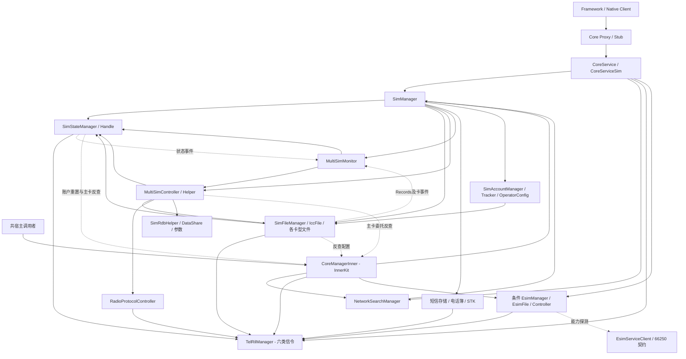
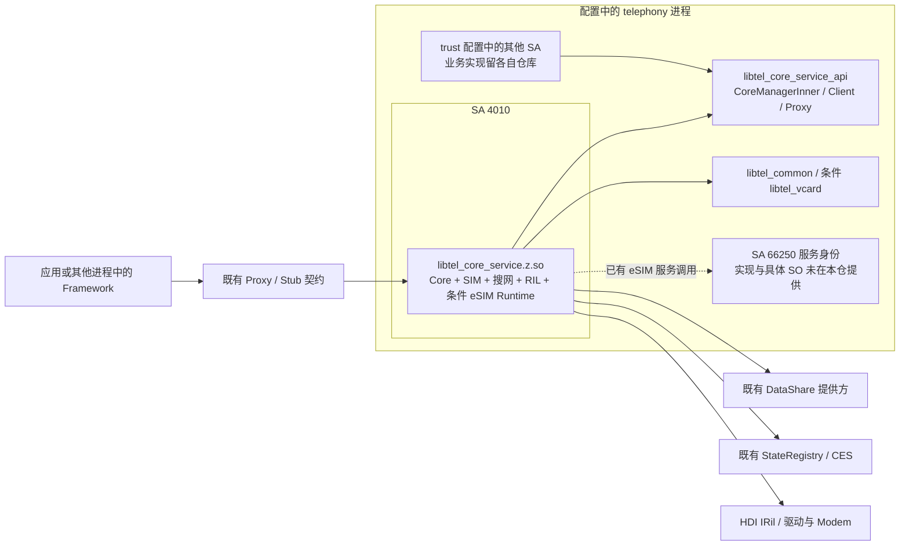
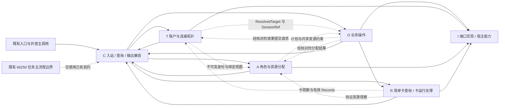
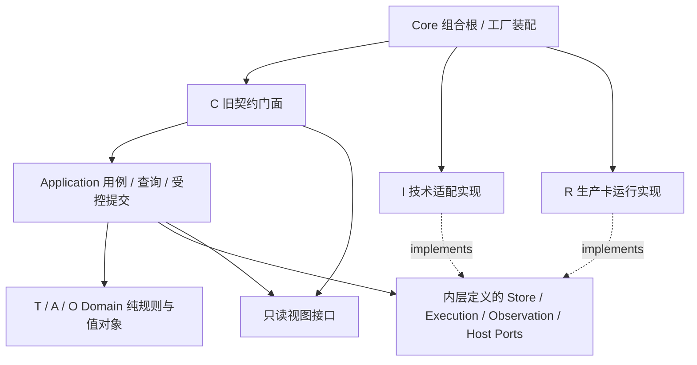
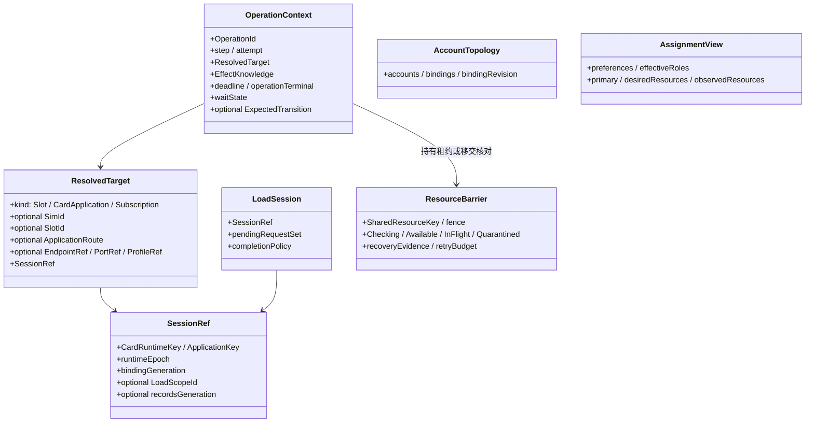
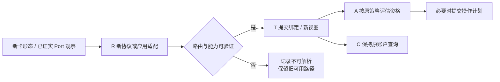
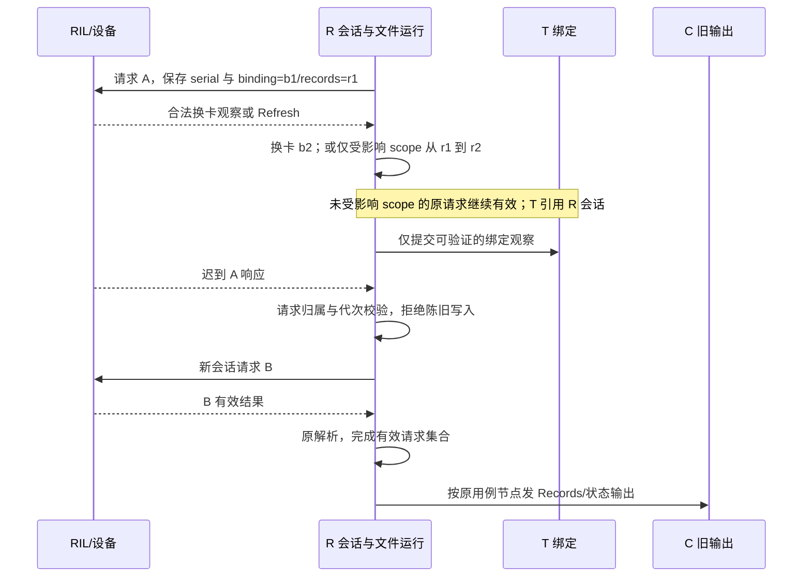
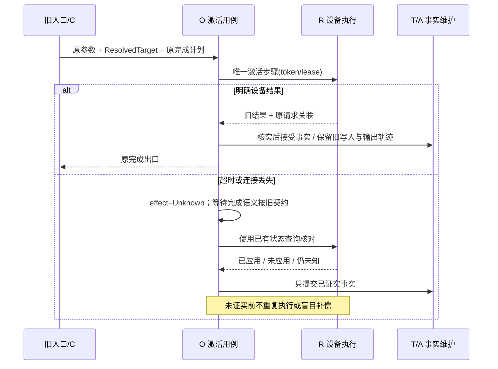
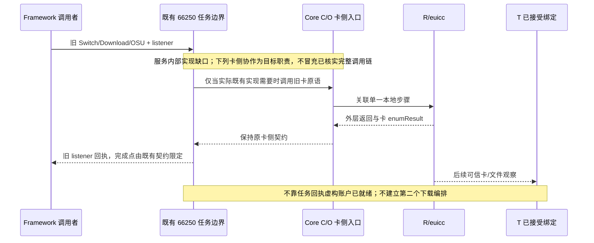

# SIM 架构重构设计

文档：`SIM_Architecture_Refactor_Design.md`。源码核查及首轮复审日期：2026-10-22；补充设计一致性复审：2026-10-23。状态：现状按证据逐项静态核查，覆盖计数不代表所有方法语义核查完成；目标为设计建议，尚未实施。本文是架构主规范，来源清单、冲突闭环、证据及待决事项均在第 9 章；补充文档只展开视图，不建立另一套规范。八项首轮审阅见 9.7，新同步补充设计的核查与裁决见 9.8；历史执行记录保留原貌。

## 1. 设计结论、范围与代码基线

### 1.1 结论与结论等级

**当前实现**以逻辑槽索引组织运行对象，`SimManager` 是总门面，`MultiSimController` 同时处理账户、角色、主卡和设备操作；卡状态、Records、账户缓存、参数和存储由多处维护。SIM 生产源仍与 Core、搜网和 RIL 合编为 `tel_core_service`；没有独立 SIM 生产 SO，也没有旧稿中的 Subscription Shadow 实现。见 [E01](#e01)、[E04](#e04)、[E19](#e19)。

**目标建议**采用三个业务上下文：账户与连接拓扑 T、角色与资源分配 A、业务操作 O；保留卡运行支撑 R，增加明确的接口兼容职责 C 和技术适配 I。保留旧稿中三个领域写者的核心责任，但不再把 Compatibility 实现层计为第四个业务上下文，也不把 R 内的协议/算法机械改名为领域聚合。数量是本次范围下的取舍，不是业务要求或扩展能力证明。

**实施顺序**先建立可执行旧行为基线与依赖闭包，再分别实施依赖/所有权整理、同进程 SO 链接拆分和关闭协议，最后按“状态写权及其全部写入口”切换唯一写者。业务用例可分批迁移，但尚未迁移用例也必须委托已经切换的写入口。简单读接口继续直接读视图；GetShowNumber 等有既有副作用的查询保留其用例。一次功能只允许一个设备执行方。保持既有 SA、进程、接口、参数、存储格式和厂商 ABI；产品拓扑扩展、持久化操作日志、NULL 数据迁移与默认角色新策略不夹带实施。

| 标记 | 含义 | 本文使用方式 |
|---|---|---|
| F：实现事实 | 当前工作树中实现体、调用与构建可共同支持 | 引用 E 编号及版本；静态事实不等同运行验收 |
| C：已确认约束 | 本次用户要求、当前公开契约、已存在并需保持的业务行为 | 保持业务/契约、只改本文、不改代码、既有 SA/进程边界 |
| P：本次建议 | 本文提出的目标职责、内部接口和迁移机制 | 未实现；评审采纳后才约束实施 |
| H：历史 | 旧基线设计、执行或另一分支成果 | 不晋升为本仓当前能力 |
| Q：待确认 | 产品决策或不可访问依赖的证据缺口 | 给出默认处理、建议、选项和进入条件，不阻塞无关切片 |

旧稿的 DU-xx 记录的是方案取舍，不等同业务批准；D-/REL-/FLOW-/CAP-/X- 编号没有原始批准记录时仍属 Q。本文的“必须”针对兼容约束或建议方案内部的一致性，不表示新增业务授权。

### 1.2 范围与可复核版本

| 对象 | 本轮基线/状态 | 使用限制 |
|---|---|---|
| 工作区/Git 根 | `/mnt/e/github/multisim`；仅发现这一 Git 根；无本地完整 OHOS `.repo` 产品树 | `telephony_core_service` 是普通目录，没有独立 `.git`/当前 gitlink；不能套用旧 submodule 版本 |
| 仓库/分支/生产证据基线 | `https://github.com/zjuluowu/multisim.git`，`main` | 生产基线 `db876e551a3fac0922f98c7b358392326663ccc1`，下文简称 B1；这是冻结证据基线，不是持续变化的分支 HEAD |
| 此次复审起点 B2 | HEAD `c9ea006254c2e703b3c42b8baf6a71c0f20d7a49`；主文档提交 `96f238593ef55b1beb9ac096de6f4de4a9def1d5` | B1→B2 仅新增本主文档及接口说明；生产源码无提交差异。复审起点索引为空，主文档无未提交修改；原 W1 改动仍保留 |
| 补充设计复审起点 B3 | HEAD `801877c95ab8d37c60cb60dc210e796be6b96599`；主文档首轮修订提交 `a4a97355bc221cf5869ac97cae04d0a0b2bbd9e6` | a4a97355→B3 仅新增补充分层设计并更新文档入口；未带入生产代码变化。本轮修订范围为本文、补充设计和 README，证据及历史执行记录仍按原基线解释 |
| 最近上游同步 | B1 将 Core 105 个文件同步到 `openharmony/telephony_core_service@b2ddf49ab0fc21f0d7f3628c702913c5d18e7977` | 上游提交是同步来源，不是本地全部文档/测试的版本；本轮不拉取覆盖工作树 |
| 初始未提交状态 W1 | 948 个 tracked 修改条目、22 个 untracked 条目（目录按 Git 折叠）；忽略行尾差异后 21 个 tracked 文件有实质改动 | 实质改动集中于 `test/systemtest`；未提交文件、测试设施和换行差异均纳入审阅，不覆盖 |
| 文档输入 | 多数现行稿声明 `df8f2f01 + dirty`；V3 输入又引用 `hmos_dev_20260813/core@738f51f6` | 都是来源版本标签，不作为 B1 代码事实；具体清单见 9.1 |
| 外仓参考 | `test/systemtest/configs/upstream_contracts.json` 的固定公开 SHA 与本地头文件副本 | 非完整匹配产品源码树；不能证明当前提供方事务、服务主编排或所有消费者行为 |
| 构建 | `BUILD.gn`、`interfaces/innerkits/BUILD.gn`、`utils/BUILD.gn`、`bundle.json`、`telephony_core_service.gni` | eSIM 默认 false，产品 global_parts 可启用；卫星、EXT/VSIM 分支各有条件；没有产品实参，不能声称产品实际开关状态 |

所有 E 证据默认版本 **B1/W1，且在 B2 工作树复核一致**，行号为工作文件从 1 开始。E 索引同时给出 LF 规范化 SHA-256，解决 Windows CRLF 与 HEAD 的显示差异；未提交测试文件版本另列。行号和摘要不从旧稿沿用。初稿保护检查覆盖当时读取的 1268 个工作区文件；本次另记录 B2 的 1226 个 tracked 文件摘要及初始状态，修订只允许本主文档变化。提交/推送后的 HEAD 以 Git 为准，不改写历史运行记录中的版本。

### 1.3 冻结边界与可调整范围

本次用户明确只分析和写文档。后续实施建议继续冻结公共 API/IPC 编码与线格式、六值 `SimState`、权限、错误、通知、旧 DataShare URI/字段/参数键、既有 SA/进程及厂商 Hook ABI。`ISimManager`/`IEsimManager` 的布局及直接 C++ 消费契约同样纳入；“IPC 码只追加”不表示本次允许追加。

允许作为后续重构切片的内部变化：源文件归组、私有接口注入、不可变读视图、分类目标、每请求关联、加载代次、Owner 提交与生命周期协议。禁止把四槽/MEP 扩容、永久订阅身份、新库表、全局事务、远端任务重写或新业务完成承诺当作内部整理。

## 2. 业务功能与外部契约

### 2.1 从场景到统一语言

| 术语 | 当前可证含义 | 目标内部表达与限制 |
|---|---|---|
| `slotId`/`slotIndex` | 请求路由/账户当前位置；参数、额外槽和产品分支共同决定范围 | `SlotId` 强类型；不直接当物理插槽、Port、Modem 或账户身份 |
| `simId` | 账户不透明 ID；`GetSlotId` 在当前 active 缓存查找，非简单算术转换 [E20](#e20) | `SimId` 沿用旧分配；不新设公共 SubscriptionId，不保证删除/重装/跨设备稳定 |
| Subscription/账户 | 本次以已有 SIM 账户为业务身份边界，包含显示属性与历史记录 | 可以无当前卡绑定；“管理账户数”与“同时激活/驻网/通信数”分别建模 |
| UICC 应用 | SIM/USIM/ISIM/RUIM 等文件、安全和认证执行目标 [E12](#e12) | `CardApplicationTarget`；身份未加载也可处理 PIN、文件、APDU |
| Profile | eUICC 中的凭据/配置对象；卡侧枚举与操作已存在 | `ProfileRef` 仅依据可信卡/服务响应；不是 simId、显示标签或卡在位的别名 |
| Port | IDL/卡侧参数已出现，不能证明账户中有可信持久映射 | `PortRef` 必须包含 eUICC/端点作用域与来源；未知时显式不可解析，禁止填 0 作为推断 |
| Endpoint/连接 | 目标用来表达卡/应用与执行路径的接入事实；当前没有统一端点注册表 | `EndpointRef` 来自已知装配/设备协议；未来映射能力受 Q-02 限制 |
| Active/Enabled | 账户激活、Profile 启用、卡在位、文件完成是不同状态 [E23](#e23)、[E45](#e45) | 各自维护，不能用一个 enabled 布尔值替代 |
| Voice/SMS/Data/Primary | Voice/SMS 有数据库字段路径，Data 有参数路径；Primary 成功/保存联动 Data | A 分开维护偏好、有效选择、Primary 与期望/观察资源；兼容阶段保持原联动 |
| 请求完成 | 可能是受理返回、卡侧结果、缓存更新、存储结果或既有通知节点 | 每方法声明完成点；“受理成功”不自动意味着操作完成、驻网或数据可用 |

关键业务不变量（C/P 分开）：C-01 参数身份不改义；C-02 现有功能和外部错误/完成轨迹保持；C-03 原 SA/进程保留。P-01 同一业务事实一个写者；P-02 同一卡应用的迟到响应不能写入新会话；P-03 角色选择不构成设备成功事实；P-04 未确认设备效果时先核对、禁止盲目重放；P-05 不持领域锁执行外部 I/O/回调。P-02 等是目标正确性要求，尚不能宣称当前已运行验证。

### 2.2 入口、调用者与保留位置

| 契约/入口 | 当前真实路径 | 目标承接 | 兼容重点 |
|---|---|---|---|
| SIM JS/CJ/ANI、Native Client | 绑定→Client/Proxy→Core Stub→CoreService→CoreServiceSim→ISimManager [E59](#e59) | 原 Framework、Proxy/Stub 留原 SO；C 的入站/查询门面承接 | 不只审头文件；异步返回、parcel、NAPI 错误转换和调用者上下文一起核查 |
| 共宿主/InnerKit | CoreManagerInner 直接委托 Manager，并路由 RegisterCoreNotify [E61](#e61) | 保留现有门面；委托新 C；HostPorts 注入外围能力 | 直接调用不天然与服务入口权限相同；保持现有路径，不擅自统一新增校验 |
| eSIM 高层任务 | Framework→EsimServiceClient→既有 66250/IEsimService/listener [E53](#e53)、[E54](#e54) | 保留；Core 仅提供已有卡侧原语/本地等待关联 | 唯一任务主编排的实现体缺口 Q-03；不在 Core 新建第二个下载/OSU 流程 |
| Core eSIM 卡侧 | Core 的 IEsimManager→EsimManager→EsimFile→RIL | C→O（需要时）→R/euicc | `int32_t` 与 `enumResult` 双结果、Port 作用域、Channel 关闭不可混同 |
| RIL/HDI | TelRilManager/业务模块、requestMap serial 与 Observer [E62](#e62) | 仍留 Core 原 RIL 构建模块；RIL Port 由宿主注入 | SIM 不接管 Call/Data/Network/Sms 信令调度器整体 |
| DataShare 直接消费者 | Core 账户 CRUD 使用既有提供方 URI；其他消费者实现不在本仓 | 原 URI、schema 和 provider 不变 | DTO 兼容不能替代直接读表/URI 消费者兼容；Q-04 |
| Registry/CES/Hub/RadioEvent/账户回调/eSIM 回执 | 多条独立输出路径 | C/output 各机制专用适配 | 不用内部事件总线统一去重、延迟或改变 sticky/首帧 |

功能以 SIM-001…SIM-062 为稳定清单（见 5.1），内部实现辅助模块另在 9.4 反向索引。无任何现有功能被本次判定“可废弃”。未装配源只保留为源文件事实，不列作已运行能力。

## 3. 原架构：模块、分层、依赖、状态与部署

### 3.1 实际模块与职责

| 实际模块/主要类 | 实现体显示的职责 | 边界与问题 |
|---|---|---|
| CoreService/CoreServiceSim/CoreServiceStub | SA 装配、权限/capability、异步任务与回调、转发 | 入口既有检查并不一致，不能按理想统一权限层重画 [E02](#e02)、[E59](#e59)、[E60](#e60) |
| SimManager | 每槽多组 vector、转发入口、容量/槽检查、全局 Controller/Monitor | 集中装配与门面；同槽的多个对象生命周期需要同步 [E04](#e04) |
| SimStateManager/SimStateHandle/IccState | 同步安全/IO 包装，RIL 卡观察、公开状态/锁原因、ICCID、Registry 与 Observer | 不止“一个状态机”；文件层也会回写状态。PIN 专用完成与通用完成并存 [E06](#e06)、[E08](#e08)、[E09](#e09)、[E15](#e15) |
| SimFileManager/IccFile/SimFile/IsimFile/RuimFile/控制器 | 卡类型路由、EF IO、文件解析、加载计数、号码/PLMN/信箱等卡记录 | 直接持状态 Manager、发布事件、回写 LOADED；不是纯 Repository [E12](#e12)～[E18](#e18) |
| MultiSimController/MultiSimHelper | 身份入库、当前/全量缓存、默认角色、激活、Primary、DSDS、标签、号码写卡及 Hook | SetShowName 仅维护账户资料，SetShowNumber 先写 MSISDN 再写账户；GetShowNumber 可能异步回写资料。不能整类迁入新领域服务 [E19](#e19)～[E29](#e29)、[E78](#e78)～[E80](#e80) |
| MultiSimMonitor | 卡/文件/系统事件，账户初始化重试、缺卡清理、账户回调、用户与服务就绪 | 业务恢复与平台监听混合，涉及反注册和重复发布 [E30](#e30)～[E33](#e33) |
| SimAccountManager/SimStateTracker/OperatorConfig* | 主要是配置缓存/匹配、芯片能力、OpKey、状态与用户事件 | 类名不能证明其拥有账户主数据；APN 初始化后续不能遗漏 [E34](#e34)～[E39](#e39) |
| SimSms*/IccDiallingNumbers*/UsimDiallingNumbersService/Stk* | 卡内短信、电话簿多文件操作、STK 命令与通知 | 与完整 SMS/联系人/呼叫业务区分；各有等待、缓存与资源约束 [E40](#e40)～[E44](#e44) |
| EsimManager/EsimFile/EsimController | 卡侧 eUICC 信息、通道/APDU、认证/安装原语、Profile 操作、通知、CA | 与 66250 高层任务不同；普通/低优先级对象不代表两套独立硬件资源 [E45](#e45)～[E52](#e52) |
| SimRdbHelper/TelephonyDataHelper/CardFileDetectManager | DataShare CRUD、helper/游标生命周期、卡文件探测资料 | 当前不是直接 RDB 事务；探测资料也有存储/缓存协作 [E55](#e55)～[E57](#e57) |
| SimCacheSyncManager | 源码中描述用户切换缓存同步 | 默认 Core 源列表无该文件，未见构造/调用装配，不算现行执行链 [E58](#e58) |

### 3.2 原架构模块与依赖图

图中实线是当前调用/持有关系，虚线是回调/事件或反查；**没有为当前实现补画不存在的 Domain 层**。符号相互依赖不自动证明动态链接闭环：目前多数对象就在同一个 Core SO，另有 InnerKit SO。

可核实的跨层/回路：文件加载→`IccFile::NotifyRegistrySimState`→状态 Manager→Registry；Handle 缺卡→CoreManagerInner→SIM 账户重置；MultiSimController 自动主卡选择→CoreManagerInner→SIM→Controller；File→CoreManagerInner→运营商配置。搜网又持 SIM 接口。见 [E06](#e06)、[E15](#e15)、[E27](#e27)、[E61](#e61)。这些是拆 SO 前必须分类的依赖，不能将 CoreManagerInner 整体搬到 SIM，也不能为“无环”删除生产调用。

### 3.3 原架构部署图与构建关系

`4010.json` 将 SA 4010 指向 `libtel_core_service.z.so`，trust 同列 4010/66250 与其他 SA；这证明**源码部署配置**，不证明设备已加载全部 SA，也不能推出 66250 的 SO 名称或独立故障隔离。[E65](#e65)、[E66](#e66)

根 `BUILD.gn` 默认源包含 `esim_manager.cpp`，其具体实现受 `CORE_SERVICE_SUPPORT_ESIM` 条件控制；`esim_file.cpp/esim_controller.cpp` 则在 GN 条件源列表中。关闭构建存在对应回退实现，不能简单说“整个 eSIM 目录均未构建”。`interfaces/innerkits/BUILD.gn` 构建现有 API SO，条件生成 IEsimService Proxy；`utils` 中 ASN.1/公共工具保留其实际链接边界。当前没有完整 GN 生成结果，依赖图是源码配置图，不是本轮 `readelf` 实测图。[E01](#e01)、[E67](#e67)、[E71](#e71)、[E75](#e75)

### 3.4 状态、数据与对象的真实维护位置

| 状态/数据 | 当前写者及读者 | 失效/寿命与限制 |
|---|---|---|
| 原始 ICC 状态、CardType、ICCID、锁原因、modemInitDone | Handle 更新；Manager 查询/安全路径参与；File 可回写公开状态 | 按槽对象存活；有切换阶段与 specifiedIccid 过滤。相同状态下仅部分字段更新，不能据类名断言身份一致 [E06](#e06)、[E07](#e07) |
| EF 内容、AID/控制器、Records 计数/loaded 标志 | FileManager 和各 File/Controller；运营商、电话簿、短信等读取 | Refresh/ClearData/卡类型变化；现有计数不是显式加载代次 [E12](#e12)～[E17](#e17) |
| 当前 localCacheInfo_ 与全量 allLocalCacheInfo_ | MultiSimController 读写与重载；Monitor 驱动更新 | 当前账户按槽缓存、历史按账户缓存；存储失败可能早于/晚于部分缓存变化 [E19](#e19)、[E23](#e23) |
| 持久账户、角色字段与显示属性 | SimRdbHelper→DataShare 提供方 | 本仓无提供方完整实现，不能认定查询/多次写入在一个事务 [E55](#e55) |
| Voice/SMS 默认与通知缓存 | Controller、DataShare 字段、defaultVoiceSimId_/defaultSmsSimId_ | 与 Data 的参数路径不同；广播失败可在存储/缓存更新后发生 [E24](#e24)、[E25](#e25) |
| 默认 Data/Primary/ICCID 偏好 | Controller、系统参数、lastCellularDataSlotId_、RadioProtocol | Primary 预写参数与失败恢复；成功/保存路径联动 Data [E26](#e26)、[E27](#e27) |
| 协议 session、通信相位、Modem/technology 观察 | RadioProtocolController、RIL 响应 | 已有 session 验证、超时清理和 complete；不能把旧实现说成完全无关联 [E28](#e28)、[E29](#e29) |
| 请求 serial/owner/result event | TelRilBase requestMap；各 Handle/Event 消费 | 传输层请求关联不等于卡会话/Records 轮次；运行期存活 [E62](#e62) |
| eUICC 通道/命令结果/eid/普通与低优先级对象 | EsimFile；Manager 持两组对象；enabledProfileNum 经 TelProfileUtil | 共享 eUICC 实体、通道关闭重试；Profile 数量不是订阅绑定 [E45](#e45)、[E46](#e46)、[E76](#e76) |
| 平台订阅、账户 callback/death recipient、重试事件 | Monitor、Tracker、各 Manager/Controller、EsimServiceClient | 反注册多在析构；Core OnStop 没有新的全局 drain 保证 [E03](#e03)、[E32](#e32)、[E53](#e53) |

### 3.5 当前主要业务如何完成

当前两项不能统一改写的规则（F，B1/W1）：

- 身份发现：`MultiSimController::InitIccId` 先拒绝空 ICCID，再查旧记录；已有记录更新，缺记录插入，并有旧记录为 eSIM/当前非 eSIM 时拒绝复用的分支。它支持既有重插复用路径，不证明账户删除或跨设备永久身份承诺。[multi_sim_controller.cpp:421](../services/sim/src/multi_sim_controller.cpp#L421)
- 默认角色读取：Voice 只选 `isVoiceCard==MAIN_CARD && isActive==ACTIVE` 的首个记录，否则 `INVALID_VALUE`；SMS 先选其对应标记的 active 记录，没有时退到 `GetFirstActivedSlotId`；Data/Primary 读取各自 last 缓存。设置角色还要经过 `GetTargetDefaultSimId` 的移除哨兵、无卡/active 前提。机械拆分保持这些差异，不建立一个全角色通用 fallback。[multi_sim_controller.cpp:1237](../services/sim/src/multi_sim_controller.cpp#L1237)、[1323](../services/sim/src/multi_sim_controller.cpp#L1323)、[1382](../services/sim/src/multi_sim_controller.cpp#L1382)

插卡/初始读取：RIL 状态通知→Handle 发状态查询→过滤并更新→READY/ICCID 等事件→File 加载→Records 事件→Monitor 的账户初始化→Controller 的 ICCID 入库/缓存/激活/主卡后续→账户回调/Registry。Records、LOADED、账户 ready 是不同节点，无法要求一条全局完成事件。

主动激活：入口校验→Controller 等待与主卡互斥→RadioProtocolController/RIL 发激活→等待结果→更新缓存/存储和 active 通知→可能调整主卡。卡侧效果、存储、缓存不是同一事务；当前存在通知/缓存更新后又失败的可能路径。[E23](#e23)

主卡切换：产品/VSIM 分支、资格→可能直接保存或不重启 Modem 路径→一般路径预写参数和切换阶段标记→check/update/complete→成功通知与 Data 联动；失败恢复部分参数并重试。不能将“返回失败”解释为硬件无变化。[E27](#e27)～[E29](#e29)

eSIM：高层任务走已有服务；卡侧 Switch/认证/安装/通知等通过 Core Runtime 执行，可能在外层返回成功时内层 enumResult 仍报告失败。当前仅能核实本仓半边调用及 IDL，服务内主流程/补偿不在证据范围。[E49](#e49)～[E54](#e54)

号码修改：`SetShowNumber→SimFileManager::SetSimTelephoneNumber→SimFile::UpdateMsisdnNumber` 发出 EF_MSISDN 更新；成功响应更新卡文件内存后，Controller 才调用 SetShowNumberToDB，Manager 仅在整体成功时通知账户变化。写卡失败与写卡成功/DB 失败不可合并为同一效果。`GetShowNumber` 优先读卡文件缓存，号码与账户不同则异步回写 DB；它不是纯账户查询。[E78](#e78)～[E80](#e80)

槽映射开始：`SimManager::NotifySimSlotsMapping` 设置 `isSimSlotsMapping_[slotId]`，再由 StateManager/Handle 人工输入 ICC_CARD_ABSENT。Handle 仍按原状态是否变化决定账户 loaded 复位、Observer/Registry/Hook 等路径；这不是 RIL 证实的物理拔卡，也不是设备重映射已经成功。Controller 的 ForgetAllData 分支消费映射标志，影响是否清标签及更新 active；因此不能只迁成 T 的资料更新。[E77](#e77)、[E81](#e81)、[E82](#e82)

## 4. 目标 DDD 架构：上下文、分层、模块、接口与部署

### 4.1 从业务责任推导上下文

推导顺序：空槽/锁卡/插卡/账户/激活/切换/恢复场景→区分 slot、账户、应用、Profile 与资源→冻结外部契约→确定身份/会话/完成不变量→给状态指定写者→形成下表→选择层和私有接口。无需先套入固定的五类或六类 Context。

| 模块 | 集中维护的业务知识、隔离的变化 | 权威状态与不变量 | 对外协作与来源 |
|---|---|---|---|
| T：账户与连接拓扑 | 身份发现、现有 simId 账户、当前位置/绑定、合法配置与可解析性；隔离硬件/账户表示差异 | 账户属性及兼容投影、已接受绑定/bindingRevision、配置清单与有效目标；空槽可存在、历史账户可无绑定；新决策遇歧义须核对，旧查询筛选/先命中语义仍保持 | 提供 ResolveTarget/账户读视图，接受 R 的带来源观察；SIM-004、020～023、031、035、056 |
| A：角色与资源分配 | Voice/SMS/Data 偏好/有效选择、Primary 与 Modem 资源策略；隔离产品策略和设备资源变化 | 角色意图/有效选择、旧 Primary/Data 查询投影、期望分配与已接受资源观察；每种角色按旧规则唯一；偏好不等于设备成功 | 纯策略接收 T/R/Host 的快照，输出执行计划给 O；SIM-025～030；SIM-045 的 IMS 偏好写权属于 T，能力观察属于 R |
| O：业务操作 | 激活、主卡/路由/Profile 本地步骤的准入、关联、超时及核对；隔离异步执行变化 | 本仓操作阶段、步骤/attempt、effects、等待取消与终态；单执行方、陈旧响应不提交、未知效果不盲重试 | 通过内层端口驱动 R/I；通知 T/A 接受已核实事实；不接管 66250 的完整任务；SIM-007～011、023.b、024、028～030、031.c、049～053、058 |
| R：卡运行支撑（支撑模块，非新增聚合指标） | UICC 应用、安全/EF/短信/电话簿/STK、运营商规则、eUICC 协议 | 原始设备观察、卡应用会话、Records 数据与加载轮次、逻辑通道/请求集合；保留生产算法和卡型差异 | 向 T/A 输出观察/结果，不直接决定默认角色；在过渡期通过 LegacyRuntimeBridge 承接旧行为；SIM-005～019、023.b/c、031.c、036～054 |
| C：兼容职责（实现层） | 旧标识、权限上下文、返回/DTO、回调和通知轨迹 | 无第二份可写业务事实；持有的回调登记/输出计划有独立生命周期 | 原 Framework/Core/InnerKit→C→用例/查询；六种旧输出分别适配；SIM-003、032、033、059 |
| I/H：技术适配与宿主 | DataShare/参数/RIL/Registry/CES/Hook/FFRT/工厂装配 | 技术连接、资源句柄；不把 adapter cache 当领域权威 | 实现由内层定义的端口；外围业务仍属原模块；SIM-001、002、034、044、055、057、060、061 |

为何这样调整旧候选：账户与连接暂在 T 内有两个模块，由同一受控提交边界维持身份/绑定关系；当前没有可信 Port 持久映射，先拆成两个独立写者会引入未获支持的跨域一致性需求。角色与资源在 A 内分模块，保留 Primary/Data 联动，避免资源层反推用户偏好。O 从旧 Profile Operation 扩为实际存在的卡安全/激活/主卡等本地业务操作，Profile 只是一个用例族。R 必须显式出现，否则“适配”会掩盖大量存量规则。未来若出现独立团队/策略/一致性需要，再基于证据拆上下文。

### 4.2 目标上下文及协作图（运行时）

这张图有交互回路，但不意味着源代码相互 include：T/A 只发布快照或返回纯数据；O 通过应用层命令接收器提交结果；R 不引用 T/A 的具体类。宿主装配将回调注入。跨上下文事件只通知已接受事实，不替代旧同步完成点。

### 4.3 目标分层与源代码依赖方向

依赖规则：Domain 只依赖值类型与纯策略，无 FFRT、IPC、DataShare、HDI、Host singleton；Application 编排规则、资源令牌、提交和兼容输出节点，依赖自己的端口；I 引用内层接口并实现；R 先作为被包住的生产实现，在完成定向抽离前不声称纯领域化。C 不直接更新领域字段/设备；组合根知道各具体类型并负责装配。公共接口中的 `PortRef`（eUICC 端口）与本节的架构 Ports（依赖抽象）不是同一概念。

| 维度 | 原架构 | 目标 | 不应产生的变化 |
|---|---|---|---|
| 入口层 | CoreServiceSim 混合检查/队列/转发；直接门面另一路 | 保留入口，C 显式管理路径差异与查询/输出 | 不把所有调用者一律按公开 IPC 权限处理 |
| 应用层 | Controller/Monitor/Handle 混编排和完成 | O 用例步骤、T/A 受控提交；生命周期明确 | 简单读不强制经过 O/总线/所有上下文 |
| 领域规则 | 散在 Controller、卡型/配置/协议函数 | T/A/O 拥有被抽出的纯规则；R 原规则继续执行 | 不把旧 Manager 一比一改名当作领域化 |
| 技术访问 | DataShare/参数/Hook 与规则交织，反查 Inner | 内层端口 + I/宿主实现；锁外 I/O | 不能制造一个不存在的全局事务 |
| 卡协议 | 现有文件/安全/通道/编解码 | R 封装复用，逐条引入会话门控 | 不用桩重写卡规则或更改真实卡协议 |
| 部署 | Core/SIM/搜网/RIL 同 SO，已有 SA/进程 | 同 SA/进程，新增私有 SIM SO 为链接边界 | SO 不提供崩溃隔离或独立服务身份 |

### 4.4 目标模块、建议目录与部署边界

下列目录是目标建议，不创建文件。表 5.1 中 `T/...` 等均相对于这些根路径。私有“接口”仅供同版本组件链接，不是新增公开 API/IPC。

| 模块代号 | 建议目录/构建单元 | SO/SA/进程容纳范围 | 职责来源 |
|---|---|---|---|
| T | `services/sim/domain/topology/`；`services/sim/application/topology/` | 目标私有 `libtel_sim`，仍由 4010 宿主装配 | SIM-004、020～023、031、035、045、056 |
| A | `services/sim/domain/assignment/`；`application/assignment/` | 同 SIM SO；`roles/primary/resources` 为内部模块 | SIM-025～030；初始化角色字段的规则仍由 A 提供给 SIM-020 |
| O | `services/sim/domain/operation/`；`application/operation/` | 同 SIM SO；请求运行期状态不另建 SA | SIM-007～011、023.b、024、028～030、031.c、049～053、058 |
| R | `services/sim/runtime/`：state/security/application/records/codec/phonebook/sms_storage/stk/carrier/euicc 等 | 同 SIM SO 容纳本仓所有卡运行职责，包括条件 Core eSIM Runtime；公共 codec 仍可链接 utils | SIM-005～019、023.b/c、031.c、036～054；不是只搬 SimManager |
| C | `services/sim/compat/`：inbound/query/direct/completion/output | SIM 内兼容实现；公开 Framework、Stub/Proxy、InnerKit 导出门面保留原构建位置 | SIM-003、032、033、059 |
| I | `services/sim/infrastructure/`：store/parameter/events/vendor/diagnostics | SIM 内适配；不把数据库提供方、通用 RIL/Registry/CES 实现搬入 | SIM-034、044、055、057、060 |
| HostPorts/装配 H | 私有 `services/sim/ports/`；宿主实现位于 `services/core/` 的私有集成层 | Core 负责构造/注入；SIM 不反链 Core 具体符号 | SIM-001、002、059 |
| 现有外围 | `services/network_search/`、`services/tel_ril/`、IMS/卫星/EXT、外仓 66250/数据提供方等 | 旧 SO/SA/进程配置保持；RIL 若仍编 Core，由 HostPorts 函数实现调用 | SIM-030、044、046、057、061 |

G2a 先在原 SO 内整理“原实现 + 私有桥”的依赖和所有权，G2b 再机械调整链接边界，G2c 单独验证新增停止/排空协议；不同时激活新领域 writer。`libtel_sim` 名称、GN target 和符号集需 G2b 审核后落地。Core/API SO 只导出旧符号；私有工厂/端口不加入公共 InnerKit vtable。纯策略 `source_set` 可在同 SO 内组织，不能据此声称已经形成多 SO 分层。

期望链接依赖为 Core→SIM→既有 API/公共 utils（按实际所需符号），Core 也可直接依赖旧 API。旧 API 中 CoreManagerInner 通过已注入的 ISimManager/IEsimManager 虚接口在运行时委托 SIM，不新增 API→SIM 具体实现符号的链接依赖。当前 CoreManagerInner 实现在 API SO，不能将其每次反查都直接称为已有的 SIM↔Core SO 链接环；当前尚无 SIM SO。G2 检查的是拆分后的真实符号和链接图。

目标部署仍为 telephony：SA4010/旧 Core SO→SIM SO（含 R 及本地 eSIM Runtime）→公共 utils；Core 同时保留搜网/RIL。66250 独立服务身份和其现有加载方式保持，SIM SO 不含该服务的下载网络/OSU 主流程。详见 7.4 的跨 SO 生命周期协议。

### 4.5 关键类、状态与内部接口设计

建议类是逻辑职责，不要求按表建类数。T 的 `TopologyService` 是应用写入口，`AccountTopology` 持账户/绑定事实；A 的 `AssignmentService/AssignmentPolicy` 管角色与资源意图；O 的 `OperationCoordinator/OperationContext` 管本地步骤；R 的 `CardRuntime/LoadSession/ChannelLease` 封装生产对象；C 的 `LegacyQueryFacade/CompletionPlan` 保持旧输出。

上述 ResolvedTarget 是三类目标的总览。实现使用 `SlotTarget | CardApplicationTarget | SubscriptionTarget` 的类型化联合：前两类必须有 SlotId，卡应用目标还必须有 ApplicationRoute；账户目标允许没有当前 SlotId/绑定。不得以一组任意 optional 字段代替目标类型约束。

| 内部契约（建议，非编译声明） | 输入与输出 | 错误、完成与生命周期语义 |
|---|---|---|
| `ResolveTarget(legacyTarget, capabilityFacts)` | 分类为 Slot/CardApplication/Subscription；返回不可变 ResolvedTarget 和关联版本 | 未识别账户不拒绝 Slot/PIN/EF；新写决策遇缺绑定/歧义先核对，内部错误由 C 按该方法既有失败协议翻译；原查询先命中规则不因此改变；解析不执行设备命令 |
| `ReadLegacyView(query, callerContext)` | 返回六值状态/旧 DTO/角色及来源版本 | 纯查询直接读已接受兼容投影；GetShowNumber/QueryImsSwitch 等分别走保留副作用/存储访问的查询用例。敏感字段按原入口裁剪，不擅自添加 RIL；具体读取来源见 7.1.1 |
| `BeginOperation(command, target, completionPlan)` | 运行期 token、当前受理结果；之后由既有出口完成 | 端口不把 OperationId 加入旧 IPC；busy/timeout/无卡等不新增公开码；参数与 caller 校验在入站线程保持原先优先级 |
| `AcceptCommandResult(token, transportSerial, step, attempt, session, result)` | 接受/重复/陈旧/无归属；有效者推进 O，必要时发 T/A 提交请求 | 在同一 O 执行域检查；终态最多一次内部完成，不额外减少旧协议允许的输出重复；技术超时不能伪装设备成功 |
| `AcceptObservation(source, route, sessionEvidence, payload)` | R 原始输入→带设备/软件来源的有效观察；T/A 接受相关事实并发布版本 | source 区分设备响应、无请求上报、映射开始的软件命令。无请求通知不伪造 OperationId；不可区分来源时触发核对，不凭空识别旧通知。代次和合法转换按 4.6 |
| `BeginLoad(application, bindingGeneration, scope, reason)` / `AcceptFileResult(loadToken, requestRef, result)` | 按 LoadScopeId 分配 recordsGeneration，维护必需/可选请求集合，生成 Records 视图 | 局部 Refresh 只替换受影响 scope；整卡变化使相关应用全部旧加载失效。请求含父子关系与读写类型，不能将未受影响请求一并丢弃；完成条件见 4.6 |
| `PlanAssignment(inputViews, legacyPolicy)` | 纯规则→期望角色/资源与执行计划 | 不做参数/DB/RIL/Hook I/O；拓扑变化后重新验证必要输入，不因不相关全局 revision 改变拒绝所有计划 |
| `ExecuteDeviceStep(step, lease, callback)` | R/Host 执行旧协议；回调带本地 token 和原结果 | SharedResourceKey 按真实 eUICC/Modem 作用域；多个对象不能各自宣称独占同一设备；取消等待不释放仍被在途设备使用的资源 |
| `TryAcquireResource(key, operation, requiredFence)` / `ReconcileResource(key, evidence)` | R 资源管理器串行授予租约或返回内部待核对；核对提交新 fence/资源状态 | 4.7 定义恢复准入；仅隔离相关资源。C 不新增公开 Busy/Unknown 码，映射按原方法失败通道验证；无兼容映射依据则不切换该用例 |
| `RegisterExpectedTransition(operation, oldSession, scope, targetFacts, allowedCause, deadline)` | O 保存一次合法转换期望；R 返回被接受的新 SessionRef，T 单独接受绑定 | 不允许任意放宽代次校验；范围/身份/因果/时限均需匹配，消费转换后旧文件结果仍无写权。期望不是设备事实 |
| `CommitAccount/CommitAssignment(writePlan, expectedInputs)` | I 按旧 DataShare/参数执行，返回每步成功/失败与 effect 分类；应用提交新视图 | 只序列化本仓受控 writer；外部直接写者仍可能竞争。存储成功但通知失败保留旧返回，登记核对，不自动回滚真实设备 |
| `StopAndDrain(deadline)` | 停止令牌、注销状态、在途数、资源可释放判断 | 关闭新接入→失效会话→注销→取消等待/排空→清理→匹配 deleter 销毁；无法排空不得卸载 SO。无新增公开 Stop 方法 |

O 的业务状态建议为 `Accepted→Executing→Reconciling?→Succeeded/Failed/Unresolved`；等待关系另为 `Waiting→Delivered/TimedOut/CancelledWait/CallerDied`。`EffectKnowledge={NotSent,Rejected,ConfirmedApplied,ConfirmedNotApplied,Unknown}` 与等待状态正交；取消等待不等于设备已取消。等待结束后可继续接纳归属有效的设备结果，但不重复完成旧回调；操作已终结时，晚到证据进入 R 的资源核对接收器，不复活旧 OperationContext。未知效果将租约责任移交 ResourceBarrier，释放调用者引用而不把设备标为可用，见 4.7。重启可丢失 OperationId；首次写准入需重新核对资源，不承诺同 ID 恢复或恰好一次设备执行。

### 4.6 会话代次、局部加载和合法转换协议（P）

R 的 `SessionRegistry` 是卡应用运行会话的唯一维护者。`runtimeEpoch` 标识一次模块实例，重建必须产生不复用的实例标识；`bindingGeneration` 在 CardRuntimeKey/ApplicationKey 作用域内递增，用于隔离运行数据。T 的 `bindingRevision` 只版本化已接受的账户/路由绑定，引用 R 发出的 SessionRef，不再自行产生一套 bindingGeneration。显示名修改不推进卡会话代次；账户未识别也可建立槽/卡应用会话。键来自已有装配与已核实协议，不用未知 Port=0 或展示标签补齐身份。

| 事件/输入 | 代次及维护者 | 旧请求处理 | 允许提交与验收 |
|---|---|---|---|
| 模块启动、同进程重建 | H 分配新 runtimeEpoch；R 建立会话，资源初始 Checking；T 重建绑定视图 | 所有旧 epoch 的写入/完成资格失效，已有设备效果交资源屏障核对 | 旧回调不写新实例；只读兼容结果可按旧启动语义返回；写入准入见 4.7 |
| 可证换卡/卡移除/应用替换 | R 使受影响应用 bindingGeneration 前进；整卡变化影响该卡全部应用；T 接纳撤销/新绑定并推进 bindingRevision | 失效相应 EF、电话簿及操作结果的状态写权；设备步骤不能因此自动取消 | 只向当前会话提交身份/Records；物理无卡不自动证明共享 Modem 已空闲 |
| 同卡全量 Refresh | R 保留 bindingGeneration，更新全部受影响 LoadScope 的 recordsGeneration | 旧轮读结果不参与新轮完成；按旧加载计划重新发所需请求 | 当前轮完成集合独立计算，原 LOADED/通知节点保持；不把计数清零当成功 |
| 同卡局部 Refresh | R 根据既有 EF 选择及 PBR/ANR/IAP 等依赖闭包确定 affected scopes，仅这些 scope 递增 | 未受影响的请求仍用原 token 完成；受影响请求注销旧成员资格，重发或采用可证明等价的重定向，不重复计数 | 验收“重载 A 时 B 的旧请求仍合法”，不会饿死整轮完成；受影响写卡请求进入 O 效果核对，不按普通读直接丢弃 |
| NotifySimSlotsMapping 软件输入 | O/remap 的应用入口登记原因；T 维护映射过程标志；R 使旧应用会话失效并执行原人工 ABSENT 转换 | 明确 source=MappingTransition；保留既有相同状态分支，不额外制造 Observer/Registry 重复 | 不断言物理拔卡或新路由成功；保留 ForgetAllData 的标签/active 条件，SIM-031.c |
| 合法操作导致的新会话 | O 先登记 ExpectedTransition；R 核对目标作用域、可证身份和因果后签发新 SessionRef；T 独立接受绑定 | 只将该操作的“后续观察步骤”关联到新会话；旧 EF/旧 attempt 仍拒绝。发命令前保存的关联不被全局替换 | 新会话可使操作继续，不能凭相同 slot/收到任意 READY 就宣布成功 |
| 无法关联的上报、重复或乱序结果 | R 不伪造请求代次；O 保留 step/attempt；按原过滤加当前关联重查 | 不从全局 revision 推断陈旧；无充分证据则保持不可判定 | 同一卡合法新观察可接纳；旧响应仅可作资源恢复证据，不能回填新卡数据 |

`ExpectedTransition` 至少保存 operation/step、旧 SessionRef、受影响键集合、目标 Profile/路由中已知的事实、允许的原因、截止条件、一次消费状态。输入为 `(observation, causalEvidence)`；输出为 Accepted(newSession)/NeedReconcile/Rejected，均为内部结果。只有范围匹配、身份符合已知目标、存在协议/关联重查的因果依据且期望未过期未消费时才能 Accepted；缺少身份或因果证据时只能 NeedReconcile。过期结束本次等待，不证明设备没有切换。该机制不改变原服务 listener 的完成点。

LoadToken 为 `(SessionRef, LoadScopeId, recordsGeneration, requestRef)`。RequestEntry 记录 EF、依赖父请求、必需/可选类别、读/写、Pending/Completed/Failed/Invalidated；重复结果只消费一次成员资格。新 Records 视图由仍有效的 scope 结果合成，允许不同未受影响 scope 保留各自代次，不要求整个应用所有字段同一个 recordsGeneration。首次/锁定/局部加载的必需集合及输出时点沿用各卡型原实现；改变缺文件时 LOADED 语义须单独裁决，不借新集合机制改变原契约。

### 4.7 设备资源隔离、恢复和重新准入（P）

R 内 `ResourceArbiter/ResourceBarrier` 维护真实共享域的独占资格；O 申请/归还使用权，A 只表达资源策略。通道实例和普通/低优先级 EsimFile 不能各建一个互不相知的设备锁。资源键优先依据已核实的 Modem/eUICC 路由；来源不足时只使用已知保守共享域，不推断额外并发能力。

| 资源状态 | 准入与责任 | 离开条件 |
|---|---|---|
| Checking | 启动/重连初态；只允许受控恢复查询，兼容缓存读继续；拒绝或按旧预算等待新的冲突写 | 确认路由和原在途执行已结束/已被已有协议失效，再授予 Available；仅服务重连不够 |
| Available | R 按固定资源键顺序申请所需集合；预留全成功后发设备步骤，不能持一把锁同步等另一把 | 发出后进入 InFlight；未发出就失败可以安全撤销预留 |
| InFlight | 原操作持租约；取消等待仅断开调用者；禁止第二个冲突执行方 | 有效完成及必要资源关闭证据后归还；超时/关联失效/关闭不明进入 Quarantined |
| Quarantined | R 持有精简恢复记录：key/fence/旧关联/可能效果/证据/预算；操作可终结为 Unresolved，不无限保留回调、凭据或完整 BPP | 证明命令效果和执行静止/资源可重用后推进 fence；无法证明则维持隔离，等待相关重连/恢复证据触发，避免无限忙轮询 |

核对请求由同一资源恢复协调器签发，允许在隔离状态进入既有安全查询路径；不能让普通写绕过屏障，也不能让核对为等待同一租约而死锁。Profile 枚举需通道、通道本身状态未知时，不强行再开通道来证明其空闲。LateResult 必须先按旧 request/owner 归属验证，再由 R 接纳为恢复证据；同目标当前值只证明状态相符，不自动证明旧命令不会继续执行。

| 命令族/功能 | 本仓可达核对输入（F） | 能证明什么、不能证明什么；P 准入规则 |
|---|---|---|
| 激活 SIM-024 | SetActive 原结果；现有 GetSimStatus/ObtainIccStatus | 卡 READY/在位与账户 active 不是同一事实；当前代码未提供可据此断言激活完成且设备静止的通用判据。保留旧超时返回，不自动重发；新增恢复准入须 Q-06 的逐设备依据 |
| RadioProtocol/Primary SIM-028～030 | GetRadioProtocol 发真实 RIL 查询；协议 session/check/update/complete [E87](#e87)、[E29](#e29) | 需覆盖受影响 Modem/槽的当前分配，并确认原会话结束或被协议可靠终止；参数回滚、一次 getter 缓存、超时清理不够 |
| MSISDN SIM-023.b | 写响应、既有 EF 读取和卡文件缓存更新 [E79](#e79) | 缓存值可能尚未刷新；经关联读取确认号码也不能单独证明旧写不再执行。明确写失败沿旧返回，未知则保留部分效果记录，不自动重写/补偿 |
| Profile 操作 SIM-051 | 卡返回 enumResult、GetEuiccProfileInfoList/GetProfile；服务任务边界 Q-03 | 库存可验证目标 Profile 状态，但服务任务和通道是否结束另验；旧外层 success 不充当确认。Core 不重放 66250 任务 |
| 通道 SIM-048 | open/close RIL 结果及原 spare-channel 清理 [E88](#e88) | 当前 SyncCloseChannel 重试后清 currentChannelId，CloseDone 未检查载荷就清本地值；本地 0 不证明设备关闭。R 新适配应保留原结果证据，可靠关闭/已有协议复位语义未证实时保持隔离，不新增 ResetMemory |

原调用者的等待预算、失败通道仍由各方法 completionPlan 决定；资源核对另有一次活动预算，只能沿用已有可证预算或等待 Q-06 确认，不设一个无依据的统一时长。预算用尽停止主动轮询，保留隔离记录和诊断；未受影响资源继续服务。新增隔离若改变旧自动重试/后续请求结果，属于 G3 的显式行为差异，必须完成方法级兼容裁决后启用；G2 不夹带。实现前需确定相关旧错误映射，不能新增公开 Busy/Unknown 码。

无持久化操作日志时，重启丢弃旧 OperationId，但 R 对可能共享的资源重新进入 Checking，H 重建端口后执行当前关联的恢复检查。不能把重建空表视为“没有旧命令”。缺少可达的静止/失效证明时，该资源相关写用例的切换保持 BLOCKED，旧实现作为独立构建继续运行；这不阻塞普通查询、证据整理或其他已完成判据的功能。

## 5. 原功能到目标模块的迁移映射

### 5.1 稳定功能清单与主映射表

表中 T/A/O 是业务上下文；R 是卡运行支撑；C/I/H 是实现责任。目录代号展开见 4.4。代码证据跳转到 9.3 的路径、关键符号、行号、版本及摘要。一个类多次出现是刻意按职责拆分；迁移不改变原入口参数与部署。

| 功能ID | 原有功能/职责 | 当前模块及关键符号 | 代码证据 | 目标上下文 | 目标层 | 目标模块/建议目录 | 拆分与迁移说明 |
|---|---|---|---|---|---|---|---|
| SIM-001 | 启动、装配与额外槽初始化 | SimManager::OnInit/InitBaseManager/InitTelExtraModule；CoreService::Init | [E02](#e02)、[E04](#e04)、[E61](#e61) | 跨模块装配 | 应用/组合根 | `H + R/lifecycle` | 拆分：保留 RIL→卡运行→搜网的依赖前提，部分就绪可见性逐入口兼容。 |
| SIM-002 | 停止、反注册、任务排空与销毁 | CoreService::OnStop；SimStateManager 析构；MultiSimController/Monitor 析构 | [E03](#e03)、[E07](#e07)、[E30](#e30) | 横切生命周期 | 应用/技术 | `R/lifecycle + C/completion` | 保留现有清理，新增内部 Stop 协议建议；不宣称原实现已有完整排空。 |
| SIM-003 | 公开入口权限、受限槽与隐私裁剪 | CoreServiceSim；MultiSimsCapabilityMgr；GetSimAccountInfo(denied) | [E59](#e59)、[E60](#e60)、[E21](#e21) | 兼容职责 | 接口适配 | `C/inbound + C/query` | 保留各方法检查顺序/错误；调用线程捕获可信 caller 上下文，跨异步不重新取成服务身份。 |
| SIM-004 | 槽清单、最大/真实容量、配置合法性 | SimManager::IsValidSlotId/GetMaxSimCount/GetRealSimCount | [E04](#e04)、[E68](#e68)、[E73](#e73) | T | 应用/领域 | `T/slot_inventory` | 拆分配置/运行已装配/对外容量；不统一参数、逻辑槽和硬件资源上限。 |
| SIM-005 | 有卡、公开状态、卡类型、Modem 初始化查询 | SimManager::HasSimCard/GetSimState/GetCardType；SimStateHandle | [E05](#e05)、[E06](#e06)、[E69](#e69) | R；C 投影 | 运行支撑/接口适配 | `R/state + C/query` | 保留六值与无卡派生分支；简单查询直读已接受视图，不启动操作事务。 |
| SIM-006 | 卡状态响应、缺卡/Unknown、锁态转换与发布 | SimStateHandle::GetSimCardData/ProcessIccCardState/HandleSimAbsent | [E06](#e06)、[E07](#e07)、[E15](#e15) | R→T 观察 | 运行支撑/应用 | `R/state + T/observation` | 拆分原始卡状态与已接受绑定事实；保留切换/指定 ICCID 过滤、Registry 重连重发。 |
| SIM-007 | PIN1/PUK1、改 PIN、设置/查询锁 | SimStateManager/Handle::UnlockPin/UnlockPuk/AlterPin/SetLockState/GetLockState | [E08](#e08)、[E09](#e09) | O + R | 应用/运行支撑 | `O/card_security + R/security` | 拆分请求关联与卡协议执行；无需先有有效 simId；错误与剩余次数按旧响应输出。 |
| SIM-008 | PIN2/PUK2、改 PIN2 | SimStateManager/Handle::UnlockPin2/UnlockPuk2/AlterPin2 | [E08](#e08)、[E09](#e09) | O + R | 应用/运行支撑 | `O/card_security + R/security` | 保留 FDN 等用途、独立请求上下文；不合并为 PIN1 的一次完成。 |
| SIM-009 | 网络个性化锁/解锁 | SimStateManager/Handle::UnlockSimLock；PersoLockInfo | [E08](#e08)、[E09](#e09) | O + R | 应用/运行支撑 | `O/card_security + R/security` | 保留 lockType/锁原因/错误，不把网络锁与 Profile 禁用归一。 |
| SIM-010 | SIM/USIM/ISIM 认证 | SimStateManager::SimAuthentication；Handle 选 AID | [E10](#e10) | O + R | 应用/运行支撑 | `O/card_io + R/security` | 转为用例和执行适配；认证数据不进入持久化操作记录或诊断。 |
| SIM-011 | 普通 SIM IO 与状态字 | SimStateManager::GetSimIO；SimStateHandle；TelRilSim | [E11](#e11)、[E62](#e62) | O + R | 应用/运行支撑 | `O/card_io + R/io` | 保留 command/fileId/path/data/sw1/sw2 与旧超时/返回包装；不新增外部 OperationId。 |
| SIM-012 | 卡类型/应用选择、GSM/USIM/RUIM/CSIM/ISIM 路径 | SimFileManager::InitSimFile/InitIccFileController/ChangeSimFileByCardType | [E12](#e12)、[E17](#e17) | R | 运行支撑 | `R/application` | 保留各卡型生产实现与默认路径；增卡形态仅扩展选择/能力适配，不复制账户规则。 |
| SIM-013 | EF 请求集合、首次加载、锁定加载与完成 | SimFile/IsimFile/RuimFile；IccFileController | [E13](#e13)、[E14](#e14)、[E17](#e17) | R | 运行支撑 | `R/records` | 保留请求/解析；逐步加入 LoadSession；记录缺失/失败不能用加载计数归零伪造成功。 |
| SIM-014 | 字符/号码/PLMN/TLV/ASN.1 解码与校验 | SimFileParse、SimCharDecode、SimNumberDecode、SIMUtils、TagService、ASN.1 | [E18](#e18)、[E47](#e47)、[E48](#e48) | R | 纯算法/运行支撑 | `R/codec；公共 utils 保留` | 保留算法，按调用归属整理；不为 DDD 重写编解码。改动另跑相应 fuzzer。 |
| SIM-015 | Refresh、同卡重载、清缓存和失效 | SimFile::ProcessIccRefresh；SimFileManager::HandleIccRefresh；IccFile | [E12](#e12)、[E16](#e16) | R | 运行支撑/应用 | `R/records` | 拆分 BindingGeneration 与 RecordsGeneration；局部刷新保留原有文件选择与输出。 |
| SIM-016 | ICCID/IMSI/GID/本机号码/IST 等读视图 | SimManager→SimFileManager→IccFile/具体 File | [E05](#e05)、[E12](#e12)、[E13](#e13) | R；T 消费观察 | 查询/运行支撑 | `R/query + C/query` | 保留授权、缺数据输出与精确接口语义；T 只接受身份发现，不拥有 EF 副本写权。 |
| SIM-017 | 语音信箱配置、标识、号码与未读计数 | IccFile/SimFile、VoiceMailConstants；SimManager 入口 | [E12](#e12)、[E13](#e13) | R | 运行支撑 | `R/telephony_records` | 保留卡 EF/运营商配置联动；业务通话/语音信箱服务不搬入。 |
| SIM-018 | 卡内呼叫转移标志与号码 | SimManager::SetVoiceCallForwarding；IccFile/SimFile/Ruim/Isim | [E12](#e12)、[E13](#e13) | R | 应用/运行支撑 | `R/telephony_records` | 保留 CFIS/CFF 路径和指示；网络补充业务仍在原模块。 |
| SIM-019 | SPN/EONS/国家/运营商名称及显示规则 | IccFile、PlmnFile、MccPool；SimManager::GetSimEons/ObtainSpnCondition | [E12](#e12)、[E18](#e18) | R | 规则/查询 | `R/operator_identity` | 保留卡侧规则；搜网的驻网/运营商显示最终决策保留在搜网。 |
| SIM-020 | 发现卡身份、账户建立及初始化后续 | MultiSimController::InitIccId/InsertData/InitData/InitActive；Monitor::InitData | [E19](#e19)、[E30](#e30)、[E55](#e55)、[E83](#e83)、[E84](#e84) | T 账户；A 初始角色；O/R 执行 | 应用/领域/运行支撑 | `T/account + A/roles + O/activation + R/execution` | 身份匹配入 T；初始化中的 force 激活与主卡后续分别委托原用例；建行角色字段由 A 提供，不把全部 InitData 搬入 T。ID 分配保持。 |
| SIM-021 | 当前/历史账户缓存、列表、缺卡失效 | MultiSimController::GetListFromDataBase/GetAllListFromDataBase/SortCache/ForgetAllData | [E19](#e19)、[E21](#e21)、[E31](#e31) | T | 应用/查询 | `T/account_view` | 合并本仓账户缓存写权；当前绑定与历史记录区分，缺卡不擅自物理删除历史账户。 |
| SIM-022 | simId↔slot 查询与目标解析 | MultiSimController::GetSlotId/GetSimId/GetTargetSimId | [E20](#e20)、[E21](#e21) | T | 领域/查询 | `T/binding` | 迁移映射规则；旧查询保留 active 筛选/先命中行为；新写决策遇歧义停止并核对，不自行改变旧查询输出。 |
| SIM-023 | 显示名称、MSISDN 写卡与号码资料同步 | MultiSimController::SetShowName/SetShowNumber/SetShowNumberToDB/GetShowNumber；SimFile::UpdateMsisdnNumber | [E22](#e22)、[E55](#e55)、[E78](#e78)～[E80](#e80) | T 资料；O 用例；R 写卡 | 应用/领域/运行支撑 | `T/account_profile + O/number_update + R/telephony_records` | 拆为 SIM-023.a～c（5.1.1）；保留写卡→DB→缓存→成功账户通知及查询异步回写，不改变卡/存储部分失败语义。 |
| SIM-024 | 卡激活/停用、卫星激活与进度 | MultiSimController::SetActiveSim/SetActiveSimSatellite/SetActiveCommonSim | [E23](#e23)、[E28](#e28) | O；T 接受激活事实 | 应用/领域/适配 | `O/activation + R/execution` | 拆分资格(T/A)、步骤(O)、设备(R)、已接受账户状态(T)；保留参数/缓存/通知既有时序。 |
| SIM-025 | 默认 Voice 选择、simId 与回退 | MultiSimController::Get/SetDefaultVoiceSlotId/GetDefaultVoiceSimId | [E24](#e24)、[E55](#e55) | A | 应用/领域 | `A/roles` | 迁移角色规则；存储字段由 A 规划，T 只投影读取；不重复在账户模块维护默认规则。 |
| SIM-026 | 默认 SMS 选择、simId 与回退 | MultiSimController::Get/SetDefaultSmsSlotId/GetDefaultSmsSimId | [E25](#e25)、[E55](#e55) | A | 应用/领域 | `A/roles` | 同一 RolePolicy 维护类型差异，不强行统一默认 Voice/SMS 的边界值。 |
| SIM-027 | 默认 Data、参数缓存与广播 | MultiSimController::SetDefaultCellularDataSlotId/SaveDefaultCellularDataSlotIdInfo | [E26](#e26) | A | 应用/领域 | `A/roles + I/parameter` | 迁移唯一 writer；保留参数键、last 值与事件，不改用数据库布尔字段作运行真值。 |
| SIM-028 | 主卡意图、策略、保存/回滚与重试 | MultiSimController::SetPrimarySlotId/SavePrimarySlotIdInfo/CheckIfNeedSwitchMainSlotId | [E27](#e27)、[E29](#e29) | A 决策；O 执行 | 领域/应用 | `A/primary + O/primary_switch` | 拆分策略、持久投影与执行；保留主卡成功/保存路径的默认 Data 联动与 EXT 分支。 |
| SIM-029 | RadioProtocol/Modem 观察、三阶段切换 | RadioProtocolController::Get/SetRadioProtocol/Process*Communication | [E28](#e28)、[E29](#e29)、[E62](#e62) | A；O + R | 领域/应用/适配 | `A/resources + O/radio_switch + R/radio_executor` | 拆分期望分配与设备观察；保留已有 session 检查，绝不由角色设置推断驻网或数据成功。 |
| SIM-030 | DSDS、M0/M2 互换、特殊槽路由 | MultiSimController/MultiSimHelper；SimManager::SetDsdsMode/SwapM0M2SimCards | [E28](#e28)、[E77](#e77) | T/A 决策；O | 应用/领域/适配 | `T/routing + A/resources + O/remap` | 保留产品 EXT/VSIM 门禁；特殊槽含义只在边界解释，不固化为通用硬件模型。 |
| SIM-031 | SIM 标签、Profile/在位展示资料及映射开始的状态处理 | MultiSimController::SetSimLabelIndex/InsertEsimData/UpdateSimPresent/IsEsim；SimManager/StateManager::NotifySimSlotsMapping | [E19](#e19)、[E21](#e21)、[E77](#e77)、[E81](#e81)、[E82](#e82) | T 资料/标志；R 状态；O 协调；C 输出 | 应用/领域/运行支撑/接口适配 | `T/binding + T/account_profile + O/remap + R/state + C/output` | 拆为 SIM-031.a～c（5.1.1）；映射开始需人工缺失处理及旧清理条件，不能当成已完成重映射或物理拔卡证明。 |
| SIM-032 | 卡状态/Records/账户等内部订阅和注销 | SimManager::RegisterCoreNotify；File/Handle/Monitor Observer | [E06](#e06)、[E12](#e12)、[E30](#e30)、[E61](#e61) | R/T/A/O 各自消费 | 应用/适配 | `I/events + R/observation` | 保留 RadioEvent 编号、订阅条件和既有首帧；领域事件另行建目录，不替换旧机制。 |
| SIM-033 | 账户回调、token、死亡清理与 Registry 更新 | MultiSimMonitor::Register/UnregisterSimAccountCallback/NotifySimAccountChanged；DeathRecipient | [E32](#e32) | C | 接口适配/生命周期 | `C/output/account_callbacks` | 保留调用次数与通知路径，不从新快照去重；回调锁外执行、死亡后注销按旧契约。 |
| SIM-034 | DataShare/CES/Registry 就绪、服务重连与重查 | MultiSimMonitor::InitListener/SubscribeDataShareReady/OnDataShareReady；SimStateTracker | [E30](#e30)、[E37](#e37)、[E56](#e56) | 横切恢复 | 应用/技术 | `I/service_watch + T/reconcile` | 拆分服务可用性与业务事实；重试读取不等同卡重新插入。 |
| SIM-035 | 用户切换、OpKey/配置重载 | MultiSimMonitor::OnUserSwitched/UpdateAllSimData；Tracker | [E33](#e33)、[E37](#e37) | T 用户分区；R 配置 | 应用/运行支撑 | `T/user_scope + R/carrier` | 保留用户范围与先后；不把未装配 CacheSync 当已执行流程。 |
| SIM-036 | SIM 短信存储增删改读 | SimSmsManager/SimSmsController | [E40](#e40) | R | 应用/运行支撑 | `R/sms_storage` | 保留真实卡存储和返回；完整短信投递/收发/会话仍在 sms_mms。 |
| SIM-037 | ADN/FDN 电话簿 CRUD 和安全前提 | IccDiallingNumbersManager/Cache/Handler | [E41](#e41) | R | 应用/运行支撑 | `R/phonebook` | 保留类型、PIN2/FDN、索引、超时及更新语义；不接管联系人数据库。 |
| SIM-038 | USIM PBR/ANR/IAP 多文件电话簿合并 | UsimDiallingNumbersService | [E42](#e42) | R | 运行支撑 | `R/phonebook/usim` | 保留多阶段关联与合并顺序；新加载代次同时覆盖辅助请求。 |
| SIM-039 | STK Envelope/Terminal Response/Call Setup | StkManager/StkController | [E43](#e43) | R | 应用/运行支撑 | `R/stk` | 保留命令格式与 EXT 特殊分支；STK 会话不以账户事务替换。 |
| SIM-040 | STK 主动命令、会话结束、卡变化事件 | StkController::ProcessEvent/OnSendRilSessionEnd/OnIccStateChanged | [E44](#e44) | R；C 输出 | 运行支撑/接口适配 | `R/stk + C/output/stk` | 转为专用输出适配；保留 action、权限、卡状态载荷和首帧/重复语义。 |
| SIM-041 | 运营商配置读取/更新/缓存及 IMS 能力输入 | SimAccountManager；OperatorConfigCache | [E34](#e34)、[E35](#e35)、[E72](#e72) | R | 应用/运行支撑 | `R/carrier/config` | 按真实职责迁移；不因 AccountManager 名称归到 T 账户领域。 |
| SIM-042 | OpKey 匹配、规则加载、海外运营商识别 | SimStateTracker、OperatorConfigLoader、OperatorMatchingRule、OperatorFileParser | [E36](#e36)、[E37](#e37) | R | 规则/运行支撑 | `R/carrier/matching` | 合并规则维护入口；文件/提供方访问为适配，匹配规则保持。 |
| SIM-043 | 运营商权限、卡内规则与证书判断 | IccOperatorPrivilegeController/Rule | [E38](#e38) | R；C 权限桥 | 规则/技术适配 | `R/operator_privilege` | 保留调用者权限判断位置和安全上下文；规则读取共用会话通道而非复制。 |
| SIM-044 | APN 配置初始化通知与失败重试 | OperatorConfigCache::notifyInitApnConfigs；PdpProfileRdbHelper | [E39](#e39)、[E72](#e72) | R 发起协作 | 应用/技术 | `R/carrier + I/datashare_apn` | 转为适配；既有 URI/BatchInsert 语义保留，数据连接与 APN 提供方留外部。 |
| SIM-045 | IMS 开关持久化、芯片能力输入 | MultiSimController::SaveImsSwitch/QueryImsSwitch；SimAccountManager::UpdateImsCapFromChip | [E34](#e34)、[E55](#e55) | T 属性；R 配置 | 应用/适配 | `T/account_profile + R/carrier` | 拆分存储偏好和配置观察；IMS 注册和通话事实不迁入。 |
| SIM-046 | eSIM 下载/OSU 等既有服务任务入口 | NAPI/ANI→EsimServiceClient→IEsimService listener | [E53](#e53)、[E54](#e54) | 外围既有 eSIM 服务 | 接口适配 | `原 Framework/66250；I/esim_service 协作` | 保留服务身份/任务入口；Core 不复制远端主流程。实现与唯一编排验证缺口见 Q-03。 |
| SIM-047 | eUICC EID/库存/能力/Port/合约查询 | EsimManager→EsimFile；GetEuiccInfo2/GetEsimPortIndex/GetContractInfo | [E45](#e45)、[E71](#e71) | R | 应用/运行支撑 | `R/euicc/query` | 保留普通/低优先级执行对象；不将缓存 PortIndex 直接推导持久账户绑定。 |
| SIM-048 | eUICC 通道、APDU 分片、关闭和同 AID 复用 | EsimFile::ObtainChannelSuccessExclusive/SendApduData/SyncCloseChannel | [E46](#e46)、[E62](#e62) | R | 运行支撑/技术 | `R/euicc/channel` | 迁移资源租约/串行规则；两个 EsimFile 仍需共享设备级互斥，不能只按对象锁隔离。 |
| SIM-049 | eUICC 卡侧认证与下载准备 | EsimManager/EsimFile::AuthenticateServer/PrepareDownload | [E47](#e47) | R；O 本地步骤 | 应用/运行支撑 | `R/euicc/provisioning` | 保留编码、错误与设备能力输入；SM-DP+ 网络与远端任务不迁入。 |
| SIM-050 | BPP 解码、分片装载与安装结果 | EsimFile::ProcessLoadBoundProfilePackage/RealProcessLoadBoundProfilePackageDone | [E48](#e48) | R | 运行支撑 | `R/euicc/provisioning` | 保留卡安装原语；传输成功、卡返回、Profile 可用分开。 |
| SIM-051 | 卡侧 Profile 禁用/删除/切换/改名 | EsimManager/EsimFile::DisableProfile/DeleteProfile/SwitchToProfile/SetProfileNickname | [E49](#e49)、[E50](#e50) | O 本地请求；R 执行；T 接受绑定 | 应用/领域/运行支撑 | `O/profile_step + R/euicc/profile` | 拆分本地步骤与事实接纳；保留外层 int 与 enumResult 双结果、偏好参数和既有服务回调。 |
| SIM-052 | eUICC 通知清单/读取/取回/移除 | EsimManager 低优先级组→EsimFile::*Notifications | [E45](#e45)、[E51](#e51) | R | 运行支撑 | `R/euicc/notifications` | 保留卡通知序号和错误；不混作内部领域事件或普通 CES。 |
| SIM-053 | SM-DP/SM-DS 地址、会话取消、卡内 ResetMemory | EsimManager/EsimFile；CancelSession/ResetMemory/SetDefaultSmdpAddress | [E45](#e45)、[E46](#e46)、[E54](#e54) | O 本地请求；R | 应用/运行支撑 | `O/profile_step + R/euicc/admin` | 保留业务命令；CancelSession 原语与取消本地等待严格区分；不联动 Core FactoryReset。 |
| SIM-054 | CA 验证、Profile 数量与 Profile 事件 | EsimController；EsimManager::PublishEsimProfileChange；TelProfileUtil；StartOsuResultCallback | [E52](#e52)、[E76](#e76) | R；C 输出 | 运行支撑/适配 | `R/euicc/ca + C/output/esim` | 保留 CA 结果/偏好与事件；空 OnStartOsu 回调不充当 OSU 编排完成证据。 |
| SIM-055 | 账户 DataShare CRUD、连接/游标关闭、错误 | SimRdbHelper/TelephonyDataHelper；Insert/Query/Update/Delete | [E55](#e55)、[E56](#e56) | T/A 规划；I 执行 | 技术适配 | `I/store` | 转为各 Owner 的存储端口实现；无新 schema/直写连接/跨系统事务。 |
| SIM-056 | 卡文件探测结果存取与账户缓存刷新 | CardFileDetectManager::SaveCardFileDetectData/GetAllSimCardInfo | [E57](#e57)、[E04](#e04) | T 接受资料；R 产出 | 应用/技术 | `T/card_metadata + I/store` | 拆分探测事实与存取；现有装配 weak_ptr 时点风险 R-05 另测，不在本次悄然修复。 |
| SIM-057 | EXT/VSIM/分布式/卫星策略与执行钩子 | TelephonyExtWrapper；MultiSimHelper；各 Manager Hook | [E27](#e27)、[E43](#e43)、[E67](#e67)、[E77](#e77) | 所属业务上下文 | 技术适配 | `I/vendor + H 外围模块` | 转为私有端口适配现有函数指针；不改厂商 ABI，不吞默认/失败分支。 |
| SIM-058 | serial/事件/同步等待/超时/进度关联 | TelRilBase requestMap；SimStateHandle/Manager；RadioProtocolController | [E08](#e08)、[E09](#e09)、[E29](#e29)、[E62](#e62) | O；R 传输关联 | 应用/运行支撑 | `O/request_gate + R/request_bridge` | 合并业务完成门控，保留 RIL serial 与协议 session；不以全局 revision 拒绝合法新会话。 |
| SIM-059 | 共宿主 Hub、直接调用及源代码反向依赖 | CoreManagerInner；SIM 对门面反查；CoreServiceCommonEventHub | [E02](#e02)、[E61](#e61) | H；C 委托 | 组合根/接口适配 | `H + C/direct + 私有 HostPorts` | 保留外部签名与调用语义；消除 SIM→Core 具体实现链接，将非 SIM 端口由宿主实现并注入。 |
| SIM-060 | dump、计时/匹配轨迹、故障事件与统计 | CoreServiceDumpHelper、OperatorConfigHisysevent、CoreServiceHiSysEvent | [E74](#e74)、[E08](#e08) | 横切诊断 | 技术适配 | `I/diagnostics` | 保留既有 dump 输出兼容与脱敏；统计超时不得当新业务成功，改行为先做定向兼容裁决。 |
| SIM-061 | Core FactoryReset 与网络恢复设置 | CoreService::FactoryReset→NetworkSearchManager::FactoryReset | [E63](#e63)、[E64](#e64) | 范围外搜网 | 原模块保留 | `H/network_search` | 保留：自动选网、首选网络和通知；不新增删 Profile/擦卡动作。 |
| SIM-062 | 未装配的用户切换缓存同步源文件 | SimCacheSyncManager；未见默认 BUILD/调用入口 | [E58](#e58)、[E01](#e01) | T 候选 | 未启用源/技术适配 | `保留原文件；未来 T/user_scope 候选` | 保留但不激活、不宣称现行业务；经确认取舍后再接入或删除，不能因重构自行废弃。 |

#### 5.1.1 混合职责的子功能拆分

62 个主编号保持稳定，以下 8 个子项细化原职责，不新增业务能力；引用主编号仍覆盖其全部子项。目录均为建议，层次按每个职责分别落位。

| 子功能ID | 已核实现有职责/入口 | 目标维护者及协作者 | 层与建议模块/目录 | 保留、拆分及完成条件 |
|---|---|---|---|---|
| SIM-023.a | SetShowName/GetShowName；账户显示名称 [E22](#e22) | T 唯一资料写者；I/store，C 输出 | 应用 `application/topology/account_profile/`；领域 `domain/topology/account/` | 保留名称校验、DB→缓存、Manager 成功账户通知；不引入卡写入 |
| SIM-023.b | SetShowNumber→写 MSISDN→SetShowNumberToDB [E78](#e78)、[E79](#e79) | O 编排一次修改；R 卡记录；T 号码资料；C 完成 | 应用 `application/operation/number_update/`；运行 `runtime/telephony_records/`；T 资料端口 | 保留卡失败不进入 DB、卡成功/DB 失败仍返回原错误且不撤销卡效果；完整成功才走原账户通知 |
| SIM-023.c | GetShowNumber、其 GetSimTelephoneNumber 回退、InitShowNumber；读卡缓存并同步资料 [E80](#e80) | T 查询用例协调 R 卡读取、Host IMS 回退与 I 存取；C 保留异步返回 | 应用 `application/topology/number_query/`；运行 `runtime/query/` | 保留卡缓存优先、账户→IMS IMPU 回退及异步 SetShowNumberToDB；回写附发起时账户/会话，换卡后的旧任务不得写新账户，门控差异在 G3b 验收 |
| SIM-031.a | SetSimLabelIndex/ByIccId、ClearSimLabel、InsertEsimData、UpdateEsimOpName、IsEsim | T 资料/绑定查询；A 提供建行角色字段；I 存取 | 应用 `application/topology/account_profile/`；领域 `domain/topology/account/` | 标签不是路由事实；保留插入/更新/查询条件与缺省角色字段，不自行建立 Port 映射 |
| SIM-031.b | UpdateSimPresent→占位记录插入/更新、全量账户重查、成功账户通知 | T 管既有展示资料；I/store；C 通知 | 应用 `application/topology/presence_view/` | 保留 INVALID_ICCID 系列占位与原筛选语义，不将该展示记录当可信物理卡身份，也不顺便改 NULL |
| SIM-031.c | NotifySimSlotsMapping→映射标志→人工 ABSENT→原状态处理；ForgetAllData 消费标志 [E77](#e77)、[E81](#e81)、[E82](#e82) | O 应用入口协调；T 过程标志/账户；R 状态；C 输出 | 应用 `application/operation/remap/`、`application/topology/binding/`；运行 `runtime/state/` | 将软件原因送入 R，不让 T 直接改卡状态；保留“标志已置而状态调用失败”的部分效果及重复 ABSENT 分支，验证 loaded 复位/标签清理/通知 |
| SIM-045.a | SaveImsSwitch/QueryImsSwitch；按 ICCID 的 IMS_SWITCH 存取 | T 账户偏好；I/store | 应用 `application/topology/account_profile/` | QueryImsSwitch 保留数据库访问与返回/缺省语义；A 不另设 IMS 偏好写者 |
| SIM-045.b | SimAccountManager::UpdateImsCapFromChip；运营商配置输入 [E34](#e34) | R/carrier 维护能力观察；Host 提供芯片协作 | 运行 `runtime/carrier/config/`；技术 `infrastructure/vendor/` | 保留能力输入和配置后续；IMS 注册/通话事实留原模块，A 若需读取只消费快照 |

### 5.2 状态、缓存、持久化与对象生命周期迁移

| 关联功能 | 当前维护位置/对象 | 目标唯一写者与只读副本 | 切换、失效及兼容要求 |
|---|---|---|---|
| SIM-004、022、031 | slot 参数、各 Manager vector、标签/映射标志 | T 管配置/已接受绑定；R 管实例清单，C 生成旧容量结果 | G2 原样装配；G3 每条绑定一次切写；标签不作身份，参数静态缓存必须在启动测试前固定 |
| SIM-005～009、015 | Handle 状态/ICCID/锁因、Manager 和 File 回写 | R 维护原始卡事实/会话与状态转换；T 持带来源版本的绑定观察；C 不写第二份 SimState | 单次切换状态写入口；文件完成通过 R 接收器回写，禁止 File 与新 T 各自推导公开状态 |
| SIM-012～019、037～038 | File/Controller、iccFileCache_、EF 内容/计数/电话簿缓存 | R 的 application/records/phonebook；LoadSession 保护同应用数据 | 换卡/应用切换失效整个旧 session；同卡 Refresh 仅失效受影响 LoadScope，未受影响在途请求仍可完成；失败保留原接口缺省/错误规则 |
| SIM-020～023、031、056 | Controller 当前/全量缓存，DataShare sim 记录，卡探测资料 | T 账户资料/绑定写者；I 是执行者；A 规划并接受其角色字段；T 中角色值仅为有版本的只读投影 | 写权与全部入口同时切换，见 5.2.1；异步读回写、初始化、重试、旧激活也必须委托。DB 重载不能整体覆盖其他 Owner 新状态 |
| SIM-024、028～030、058 | active/primary 进度、协议 session/计数、等待变量 | O 管本地进度；R 管传输 session/设备租约及 ResourceBarrier；T/A 管各自有效事实 | 操作关联运行期；重启增加 runtimeEpoch，旧回调不得改新实例；保留底层 serial 与已有 session 校验 |
| SIM-025～028、045 | Voice/SMS DB 字段、Data/Primary 参数及本地缓存、IMS 偏好 | A 角色/Primary/分配；T 账户 IMS 属性；I 参数适配 | 不把所有持久化方式统一；Voice/SMS 保留广播失败后的旧状态可见性；Primary→Data 仍是明确后续动作 |
| SIM-032～035、059 | Observer/callback/death recipient/Hub/service watch | C 持对外订阅；I 持平台订阅；T/R 各自消费受控观察 | 反注册令牌 + weak owner + session 拒绝配套；注销已发生不证明排队回调不会到达 |
| SIM-047～054 | 两组 EsimFile、channel、eid、esimProfile_、enabledProfileNum/TelProfileUtil | R/euicc 管卡侧缓存/通道；O 管单次步骤；T 仅接受可信 Profile/账户关联 | 普通与低优先级共享设备资源键；保持 TelProfileUtil 现有键和 Profile 数量含义，不将其提升为永久账户目录 |
| SIM-001、002、055～057 | helper/resultset、Handle、线程/FFRT 队列与 Hook 函数指针 | 组合根按创建方/资源方所有权持有；I 用作用域对象释放 | helper Release/resultset Close、反注册、Hook 执行结束与 SO unload 有明确顺序；不裸 delete Manager 接口 |

#### 5.2.1 写权切换单元与所有旧写路径的接管

切换单元是下面的 WU 写权，功能编号是业务交付视角。`LegacyMutationBridge` 放在 application 私有集成层，将尚未迁移的 Controller/Monitor 调用接入 Owner，不复制策略、不直接持有可写缓存。G3a 接管 T 时即安装 A 的旧实现适配写入口：A 的规则仍可执行原算法，但角色字段写入只有一个入口；G3c 替换策略和编排，不再次产生新 writer。直接字段访问须在切换提交中收口，不能约定以后再删。

| 写权单元/功能 | 状态及本仓旧写入口清单 | 新入口与过渡委托 | 切换/删除条件 |
|---|---|---|---|
| WU-01；SIM-020～022、034～035、056 | 当前/全量账户容器；GetListFromDataBase/GetAllListFromDataBase、SortCache/SortAllCache；初始化、Monitor RefreshData/UpdateAllSimData、Controller 重查事件、卡探测触发这些入口 [E85](#e85) | T::AcceptAccountSnapshot；A::AcceptRoleSnapshot 接收同一读取中角色片段；应用生成旧布局只读投影 | 全量重载不再直接赋值旧容器；排序/空槽缺省仍按旧规则；旧调用者统一委托后删除旧缓存写权 |
| WU-02；SIM-020、024、031 | isActive 账户字段；SimDataBuilder/InitActive、UpdataCacheSetActiveState、SetActiveCommonSim、SetActiveSimSatellite、UpdateDBActiveByIccId、ForgetAllData 的 DB 分支及重载 [E83](#e83)、[E86](#e86)、[E55](#e55) | T::ApplyLegacyActiveStep 分别接受“缓存可见”“持久化结果”；O/R 原执行路径先保留，所有缓存/DB 写请求委托 T | G3a 必须接管仍留在 G3c 的激活写入口；force 分支不新增 DB/缓存写；设备/缓存/存储三者不合为一个 active |
| WU-03；SIM-020、025～028 | Voice/SMS 角色字段、default*SimId；SetDefaultVoiceSlotId/SetDefaultSmsSlotId、SimDataBuilder/UpdateDataByIccId 的初始角色字段，以及数据库重载 [E24](#e24)、[E25](#e25)、[E84](#e84) | A::ApplyLegacyRoleStep/BuildInitialRoleFields；T 只接收 A 发出的版本化角色投影；I 执行既有字段写 | 建行不能绕过 A 规则；旧默认设置、重载都改委托；投影在原通知节点前可见后，删旧字段赋值与第二份默认规则 |
| WU-04；SIM-027～030 | Primary/Data 参数与 last 缓存、primarySimId_/defaultCellularSimId_；InitMainCardSlotId、SavePrimaryCardInfo/ResumePrimaryCardInfo、SavePrimarySlotIdInfo、SaveDefaultCellularDataSlotIdInfo、SendMainCardBroadCast/SendDefaultCellularDataBroadCast | A 管旧可见角色投影和已核实资源观察的分离字段；I 参数；O 提交原步骤结果 | G3c 接管全部保存/恢复/初始化/通知去重值写入；保留失败路径 lastPrimary 恢复及 Primary→Data 偏序，不把参数成功当硬件成功 |
| WU-05；SIM-023、031、045、056 | 名称/号码/标签/运营商资料/IMS/探测资料；SetShowName、SetShowNumberToDB（含 GetShowNumber/GetSimTelephoneNumber 异步及 InitShowNumber）、SetSimLabelIndexByIccId、InsertEsimData、UpdateSimPresent/ClearSimLabel/UpdateEsimOpName、SaveImsSwitch、CardFileDetectManager 及重载 | T 对应属性入口；R 的 MSISDN 与配置观察另有写权；旧调用者只提交属性补丁及固定目标 | 资料补丁不可覆盖角色；异步任务固定原目标，旧 task 返回不重解析为新卡；切换后旧容器不再被这些调用直接修改 |
| WU-06；SIM-005～019、031.c、032、037～038、058 | 卡状态/ICCID/锁因/loaded、应用/EF/电话簿；Handle 设备及 SetIccCardState 输入、Manager/文件回写、Refresh/ClearData/解析完成 | R::AcceptCardInput/AcceptFileResult；T 只持引用来源的绑定；MappingTransition 为显式软件原因 | G3b 一次接管该状态的设备/软件/文件写入口；验收局部刷新及重复 ABSENT 后再删除直接回写 |
| WU-07；SIM-024、028～030、058 | 操作进度、重试、同步等待与协议 session | O 管业务步骤；R 保留底层 serial/session 并管理资源；旧 Controller 的恢复事件委托 O | 新操作启用前关闭同用例旧重试发命令分支；只允许一个执行方，等待结束不清资源屏障 |
| WU-08；SIM-047～054 | eUICC 通道、Profile 缓存、普通/低优先级对象及关闭结果 | R/euicc ResourceArbiter + 卡缓存；O 只管本地步骤；T 不以库存代替绑定 | G3d 同时接入两组对象及已有清理路径；必须完成资源判据与 Q-03/Q-05，再删除对象各自“设备独占”的假设 |
| WU-09；SIM-032～035、059 | 对外账户回调登记/死亡清理、平台订阅、loaded 标志与重试计数 | C 回调生命周期；I 平台 token；T 账户加载状态；R 卡状态 | 注销、排队事件及重连恢复均有唯一维护者；旧 Monitor 未迁编排通过入口消费，不持第二份可写标志 |

上述缓存写入口由当前 Controller 实现体扫描闭环；公开/直接调用的入口映射见 9.4。每次切换提交必须再扫描字段赋值、引用传递及间接写者，证据是当次代码，不把本表当永不变化的白名单。外部提供方直接写者仍由 Q-04 限定，本仓收口不证明已消除外部竞争。

切换步骤为：安装委托但仍使用旧 writer→验证全部入口到达该入口→在构建切换点停止受理受影响写并排空/隔离在途→以版本和原查询语义导入状态→一次改变写权→恢复入口→删除旧写路径。无法排空时不切写。只读 Shadow 可以提前存在，不能发布旧通知或写 DB。角色规则、卡协议的后续重构可晚于字段写权切换；这是 G3a 与 G3c 能安全分开的前提。

### 5.3 调用关系迁移与对外承接

| 功能 | 原调用关系 | 目标关系 | 迁移期间的兼容出口 |
|---|---|---|---|
| SIM-005、016、021～022 | Core/Inner→SimManager→状态/File/Controller | C/query→R 已接受视图或 T 账户视图 | 旧方法/DTO/parcel；不多跳 O 或等待领域事件 |
| SIM-007～011 | CoreServiceSim 的 PIN/通用队列→Manager 同步等待→Handle→RIL | C/inbound→O 关联→R 旧安全/IO→RIL；结果→O→原 completionPlan | PIN 专用回调/通用回调仍按原方法；不改变调用者观察到的接收点 |
| SIM-023 | SetShowNumber→File 写卡→DB/缓存；GetShowNumber→卡缓存/回退→异步 DB | 写入 C→O→R→T；查询 C→T 查询用例→R/Host 读，必要时异步 T 写入口 | 保留卡失败与 DB 失败差异、卡缓存优先及仅整体成功账户通知 |
| SIM-031.c | SimManager 置映射标志→StateManager/Handle 人工 ABSENT→旧清理/通知 | C/direct→O/remap→T 标志→R 软件原因输入→T loaded/资料处理→C 原输出 | 不发新的物理拔卡结论；清理和重复状态条件原样承接 |
| SIM-020、032～035 | File/Handle Observer→Monitor→Controller→DataShare/角色/回调 | R 观察→T 接受账户/绑定→必要用例请求 A/O；C 在旧契约节点输出 | 旧 RadioEvent/账户回调/Registry 分开；不能把未来内部事件当所有旧通知的唯一触发 |
| SIM-024、028～030 | Controller 规则+等待+参数/存储+设备混合 | C→A/T 提供资格/计划→O→R/I 设备→T/A 核对提交→C 输出 | 原资格、进度、错误和后续 Data 联动保持；不双发 |
| SIM-041～045 | AccountManager/Tracker/Cache→File、DataShare、APN/Hook | R/carrier 复用规则→I 提供方与 Host 查询 | 卡配置与 APN 初始化旧请求可继续；网络/IMS 本身不迁入 |
| SIM-046、049～054 | 高层服务任务与 Core 卡原语双通道 | 66250 保留任务主流程边界；Core 的 C→本地 O/R；事实由 T 接受 | listener/enumResult、原参数和卡通知；不能 Core→66250→Core 再转回同任务 |
| SIM-059 | SIM→CoreManagerInner→SIM/搜网/其他宿主 | SIM 内依赖私有端口；Core/API 旧门面→C；宿主实现非 SIM 查询端口 | 消费方头/符号/注入/错误与线程行为保留，无新增空指针 IPC 回退 |

### 5.4 旧模块→新模块速查

| 旧模块/类族 | 新模块与去向 | 关联功能 |
|---|---|---|
| SimManager | C 门面 + H 装配 + R 卡查询，T 负责映射 | SIM-001～005、016、022、059 |
| MultiSimController | T 账户/绑定/资料，A 角色/资源策略，O 激活/Primary/号码修改/重映射，R 承接卡执行，I 存取/Hook | SIM-019～031、045、055、057～058 |
| MultiSimMonitor | T 观察/恢复入口，I service watch，C 账户通知/生命周期，R 配置重载 | SIM-020～021、032～035 |
| SimStateManager/Handle | R 状态/安全/IO，O 每请求门控，C 输出桥 | SIM-005～011、032、058 |
| FileManager/IccFile/各卡型 File/Controller | R/application、records、io、telephony_records、operator_identity | SIM-012～019 |
| SimAccountManager/Tracker/Operator* | R/carrier；配置/提供方/事件访问进 I | SIM-034～035、041～045 |
| SimSms*/DiallingNumbers*/STK | R/sms_storage、phonebook、stk；事件进入 C/output | SIM-036～040 |
| EsimManager/File/Controller/StartOsuResultCallback | R/euicc、O 本地步骤、C eSIM 输出；服务任务留 66250 | SIM-046～054 |
| SimRdbHelper/TelephonyDataHelper/CardFileDetectManager | I/store + T/card_metadata + T/A 字段写计划 | SIM-055～056 |
| CoreManagerInner/Core/Proxy/Stub | 原公开导出保留；H 装配及私有端口；C 承接 SIM | SIM-001～003、059、061 |
| SimCacheSyncManager | 原未装配源保留，未来候选 T/user_scope，不自动激活 | SIM-062 |

## 6. 关键业务流程的重构前后对比

以下五个场景是设计检验与未来验收计划；未在本次运行。用例中新增内部代次/操作状态均标为 P，不伪装现有协议字段。

### 6.1 S1：新增订阅、Port 或卡形态时的传播

| 原流程及模块 | 原约束 | 目标流程及模块 | 状态更新/维护者 | 兼容与验收 |
|---|---|---|---|---|
| Core/SimManager 按槽建多组对象；Controller/Protocol/EsimManager 有不同容量/特殊槽判断 | 加数组大小不能证明 Port、MEP、权限、路由或并发已支持；Profile 可离线存在 | 卡形态由 R 的应用/协议适配扩展；T 接受可信账户/绑定；A 只按资源视图决策；O 仅需该设备支持的步骤 | R 管卡应用实例；T 管新身份与绑定；A 管能力约束 | 不增加公开 ID/接口；先测旧拓扑全部入口。新增 Port 缺可信来源时拒绝绑定，账户离线元数据仍可保留；Q-02 未闭合不宣布扩容 |

传播验收：仅新增卡型选择/协议测试、可信能力映射和必要策略，不要求修改电话簿、Voice/SMS/Data 全部调用者。真实新硬件/协议确需变化时显式记录，不承诺“完全零修改”。Managed/Enabled/Registered/Concurrent 四个数量分别报告。

### 6.2 S2：同槽换卡或同卡 Refresh 后旧响应到达

| 原流程及模块 | 原问题/已有保护 | 目标流程及模块 | 状态更新/维护者 | 兼容与验收 |
|---|---|---|---|---|
| RIL serial→原 event owner→Handle/File；状态过滤与文件计数分别推进 | 已有 serial、切换阶段和指定 ICCID 过滤；没有统一 Binding/Records 代次；只证静态风险，未复现污染 | R 建卡应用会话与 LoadSession；O 固定发起目标；结果先按请求集合/代次准入，再给 File 原解析或提交 T | R 按作用域推进 binding；同卡刷新仅推进受影响 LoadScope 的 records；T 接受有效身份，R 写有效 EF；不相关槽变化不使本槽失效 | 同状态不同身份、重复/乱序、局部 Refresh、旧轮最后一帧、合法切换新会话均覆盖；旧响应不能使新卡账户/EF/LOADED 被污染，未受影响 scope 也不因局部刷新停滞 |

无法由通知载荷区分设备旧状态时，不用“代次校验”作虚假保证：先保持切换窗口/指定 ICCID 等已有过滤，再做带当前请求关联的重查；何种重查足够证明新绑定由协议证据决定。合法操作引起的新会话须由 `expectedTransition` 衔接，不能简单要求操作发起的全局 revision 永不变化。

### 6.3 S3：主动激活与设备执行结果不确定

| 原流程及模块 | 原约束 | 目标流程及模块 | 状态更新/维护者 | 兼容与验收 |
|---|---|---|---|---|
| CoreServiceSim→Controller→协议执行/等待→缓存→DB→通知/主卡检查 | `SetActiveCommonSim` 的前期缓存/通知与 DB 成功并非原子；设备超时不能说明未执行；同一流程可能发布不止一次 | T/A 提供资格/绑定/资源快照→O 记录一次激活→R 发唯一设备步骤→O 核对结果→按旧契约节点提交/输出，未知效果进入 Reconciling | O 管 effectKnowledge；T 管原 active 可见投影及存储阶段；A 管后续角色/Primary；R 不独立改账户 | 保留 enable/force/卫星分支与错误；模拟设备已应用但丢回包、DB 写失败、调用者死亡、晚到回包、二次激活竞争；禁止双发和假成功 |

目标写者切换保持外部“失败但部分状态已可见”的现有行为。如果改为 DB 提交后才发布所有 active 通知，需要行为变更确认。T/A 显式维护原查询使用的兼容投影及其持久化阶段，O 记录设备 effect，C 只读取/输出；“兼容缓存已可见”不宣称 DB 或硬件已经一致。具体读取来源与失败轨迹见 7.1.1。设备核对与资源重新准入按 4.7，缺少判据不承诺自动恢复成功。

### 6.4 S4：Primary 与共享 Radio 资源切换

| 原流程及模块 | 原约束 | 目标流程及模块 | 状态更新/维护者 | 兼容与验收 |
|---|---|---|---|---|
| Controller 分支→预写主卡参数→Protocol check/update/complete→成功主卡事件与 Data 联动；失败参数恢复/重试 | 两槽协议初始化是局部事实；全局设备互斥不是每卡锁可替代；失败后仍可能有设备效果 | A 纯策略产出期望→O 申请共享 Modem 资源 lease，R 保留现有三阶段→A 接受 observed assignment→按旧行为执行明确 Data 后续 | A 的用户意图/有效角色/期望分配/实际观察分开；O 管步骤/重试；I 参数只是投影 | 覆盖两卡并发主卡请求、激活竞争、错 session、三相任一失败/超时、EXT 不重启分支；Primary 成功路径的 Data 联动必须一致 |

资源键按真实协议覆盖的设备域定义，不能按 slot 各建锁绕过旧串行。旧超时数值和重试预算先保持；新增指数退避/自动补偿均非机械拆分内容。验收分别观察公开 Primary/Data、事件和正式设备请求，不用内部阶段调用次数作业务正确性替代。

### 6.5 S5：eSIM 服务协作、Profile 切换与复位边界

| 原流程及模块 | 原约束 | 目标流程及模块 | 状态更新/维护者 | 兼容与验收 |
|---|---|---|---|---|
| 高层 IEsimService/66250 listener；Core 内 IEsimManager→EsimFile 原语；另有 Core FactoryReset→搜网 | 本仓看不到高层服务实现，无法证明其完整编排；卡结果和服务回执不等于账户已经加载；FactoryReset 不是擦 Profile | 既有 66250 保留任务级唯一主编排边界（需 Q-03 对应方法核实）；Core O 仅处理本地原语请求/等待，R 执行卡协议；T 接受后续观察 | 远端任务归原服务；Core O 不补发远端任务；R 管通道/卡事实，T 管已接受绑定，A 处理原角色联动 | 外层成功+内层失败、listener 早于卡状态/Records、远端死亡、通道关闭失败、普通与低优先级竞争均验收；Core FactoryReset 不新增 Profile 删除/ResetMemory |

独立处理三种“取消/复位”：取消本地等待只终结等待关系；`IEsimManager::CancelSession` 是现有卡协议命令；`ResetMemory`/服务 ResetMemory 是可能有持久副作用的既有能力。不得相互替代。当前 Core FactoryReset 仅可证选网恢复路径，目标继续保留其位置。[E63](#e63)、[E64](#e64)

## 7. 接口兼容、数据与生命周期迁移

### 7.1 兼容检查矩阵与旧输出轨迹

| 契约维度 | 具体必须保持的内容 | 实施验收方式 |
|---|---|---|
| 标识/参数 | slot、simId、Port、Profile、AID、enable、force、默认无效值逐方法解释；不得新增公共 ID | 9.4 入口追踪表→同参数 Legacy/Split；有效、空槽、非法槽、未识别账户、受限槽分别采集 |
| 权限/身份 | 普通槽 capability 当前为 true；受限槽保留 token 检查；账户 denied 字段裁剪；直接调用路径保持原前提 | 在原检查线程记录可信身份/权限结果；不异步转线程再将 IPCSkeleton 当原 caller；系统/native/shell/普通应用测试分开 |
| 返回/错误 | 接收返回与业务回调、int32 与 enumResult、输出参数默认值、错误优先级 | Stub→Client→绑定转换全链对照；不得将所有内部 Busy/Stale/Unknown 统一成新公开错误 |
| 回调次数/顺序 | 公共方法各自的正常/失败/拒绝/死亡/超时轨迹；内部 terminal 至多一次不等于对外去重 | 捕获合法边界轨迹，声明必要偏序；未知次数先 Legacy 采集/人工审核，不设无依据全局恰好一次 |
| 通知 | Registry、CES（发布者 sticky/ordered 设置）、Hub、RadioEvent、账户回调、eSIM listener 各自契约 | 保留 action/payload、订阅权限、初次回放/重复；本仓发布选项可证，Registry 中继/消费者实际回放需 Q-05 |
| 查询可见性 | READY/Records/LOADED/账户加载不是同一完成点；写成功但广播失败的结果不抹去已发生写入 | 在关键回调/事件节点立即查询并做稳定后查询；不用最终状态相等掩盖中间兼容破坏 |
| 存储/直接消费者 | DataShare URI、列名、缺行/空串/占位/NULL、参数键、现有 ID 分配/用户分区 | 匹配提供方契约测试与直接消费者抽样；禁止把新 DTO 正确当数据兼容已完成 |
| ABI/线程 | 导出符号、vtable、C++ 容器/分配器、异常/RTTI/CFI 配置、阻塞位置、注入前错误与重入 | 同产品全量链接，符号比较；直接调用构建测试；ABI 不以源码签名未变自动判通过 |

| 关联功能/轨迹 | 当前已证节点/偏序 | 目标必须保留 | 尚缺依据 |
|---|---|---|---|
| SIM-005 GetSimState | CoreServiceSim 排队后接收返回 success；任务回调包含业务 ret 和可选 state | 两通道、弱引用失败路径、既有 Client 包装不变 | 设备负载下回调调度全序不由静态函数顺序证明 |
| SIM-013 Records 完成 | UpdateLoaded→Records Notify→NotifyRegistrySimState(LOADED)→CES→LoadVoiceMail/Hook | 保留发布调用节点及必要偏序；不得以一条新领域事件吞并 | 线程消费/Registry 中继可能重排，对外完整可观察偏序需实采 |
| SIM-020 账户加载 | Monitor InitData 成功→loaded 标记→NotifySimAccountChanged→RADIO_SIM_ACCOUNT_LOADED | 接受有效账户后保持旧回调和事件；后续重载可重复 | 所有直接消费者的重复容忍性不在本仓 |
| SIM-025/026 默认角色 | DB→缓存→default*SimId→发布；发布失败可返回错误 | 不回滚已经生效的事实来“做成事务” | provider 多字段写是否同事务 Q-04 |
| SIM-024 激活 | 普通非 force：RIL→缓存/UpdateSubState Hook→DB→再次缓存/Hook/主卡后续；整体成功才由 Manager 发账户/active 通知 | 机械拆分原样；Hook 调用与公共账户通知分开，静态失败分支见 7.1.1 | Hook 实际下游效果及运行偏序 Q-05/Q-06 |
| SIM-051 卡侧切换 | enumResult 来自卡；Manager 外层返回 success 并更新偏好参数 | 双层结果与参数副作用保持 | 与 66250 listener/账户可见性的跨仓偏序 Q-03/Q-05 |

#### 7.1.1 已核实的读取来源和部分失败轨迹

以下 F 表限定 B1/W1，在有效槽、账户已加载、无其他并发写且走指定分支时描述可观察行为；被测回调/通知中的查询需固定同一前置状态，不能把任意线程全序写成保证。P 目标必须在对应节点复现表中结果，错误仍经原 Core/Client/语言绑定转换。各表的“缓存变化”也不保证外部 DataShare 消费者已经看到相同结果。

| 旧查询 | 当前读取来源/副作用（F） | 目标读取责任（P） |
|---|---|---|
| IsSimActive | IsValidData 的卡存在前提 + 当前账户缓存 isActive；没有直接查询设备激活 [E86](#e86) | R 提供原存在性前提；T 兼容 active 投影。设备确认、DB 结果另存，不替换旧返回来源 |
| GetSimAccountInfo/GetActiveSimAccountInfoList/GetAllSimAccountInfoList | 当前/全量缓存生成 DTO；active 列表按 isActive 筛选，空列表返回既有 NO_SIM_CARD；denied 裁剪 [E21](#e21)、[E89](#e89) | T 的当前/全量兼容视图按旧筛选/错误生成；C 保留权限裁剪，不通过等待新状态一致来推迟返回 |
| GetDefaultVoiceSlotId/GetDefaultSmsSlotId | 当前缓存角色标记及 active；Voice 无匹配返回 INVALID，SMS 有首个 active 回退 | A 决定角色；用对应版本的 T active 投影计算旧规则。没有自动设置角色的步骤时，不因 active 变化改写持久角色标记 |
| GetPrimarySlotId/GetDefaultCellularDataSlotId | lastPrimarySlotId_/lastCellularDataSlotId_；主卡参数预写时 lastPrimary 已改变 | A::LegacyRoleProjection 保留旧提前可见性；observedResources 单列，不能以未证实硬件为由隐藏旧查询值 |
| GetShowNumber | 卡文件 msisdn 缓存优先→账户 phoneNumber→IMS IMPU 回退；卡/IMPU 值不同可异步写 DB，调用不等待写入完成 [E80](#e80) | T 查询用例经 R/Host 读取，按旧返回点返回；回写委托固定目标的 T 入口。不能重定向到仅账户快照 |
| QueryImsSwitch | 按当前 ICCID 查询 DB；当前实现保留其缺省值及返回判断 | T 查询用例调用 I/store，C 保持原结果；没有设计依据将其改成 A 的内存偏好查询 |

T/A 是兼容投影的唯一写者：例如 `legacyActiveValue + persistStatus`、`legacyPrimarySlot + observedAssignment`，前者按原程序节点发布，后者带确认来源。C 不拥有第二份可写事实。跨 Owner 的查询只读已发布的必要版本组合；A 角色步骤在旧通知节点前完成 T 角色只读投影的接纳，再输出旧通知，不能等异步领域事件碰巧送达。设备观察与业务投影不要求一个不存在的全局事务。

| 轨迹/功能 | 设备、缓存、存储变化（F） | 原返回与查询/通知（F）；目标验收要求（P） |
|---|---|---|
| B-A1 普通非 force 激活：RIL 失败/超时；SIM-024 | SetActiveSimToRil 返回 false；SetActiveCommonSim 未进入缓存/DB 修改；超时设备效果仍未知 | 返回 TELEPHONY_ERR_RIL_CMD_FAIL；本路径无 Manager 成功账户/active 通知，查询保留此前缓存。目标等待照旧，资源核对单独处理，不能伪造新 active |
| B-A2 RIL 成功、第一次缓存更新成功、DB 返回 INVALID_VALUE；SIM-024 | 两份 active 缓存已更新，UpdateSubState 可调用厂商 Hook 并清进度；DB 写失败 | 返回 TELEPHONY_ERR_DATABASE_WRITE_FAIL；IsSimActive/当前及全量账户列表使用新缓存，Voice/SMS 按新 active 重新筛选；Data/Primary last 不由此分支改变；不会执行后续主卡检查及 Manager 成功通知。T 保持此可见性，不能自动回滚缓存 [E86](#e86) |
| B-A3 普通非 force 激活完整成功；SIM-024 | RIL→第一次缓存/Hook→DB→第二次缓存/Hook→主卡后续；随后 SetActiveSimFunc；Manager 发账户及 active 通知 | 保留原重复 Hook 调用位置和外部成功；不把两个 Hook 调用误算为两次公共账户回调。force 路径在 RIL 后 UpdateSubState 就返回，不新增两次缓存/DB；卫星路径则先 DB 后缓存，且该函数没有普通激活的 RIL 步骤 |
| B-A4 缓存索引异常；SIM-024 | UpdataCacheSetActiveState 先写当前缓存再检查全量 simId 索引；后者失败时可能仅当前缓存变更 | 保留原 ARRAY_OUT_OF_BOUNDS、未到达 DB 的分支；正常数据与异常索引分别测试，不能只采“DB 成功/失败”两类 |
| B-P1 一般 Primary 切换进行中；SIM-028 | SavePrimaryCardInfo 先改 lastPrimary/参数，随后 setDone=false，再执行协议 | GetPrimarySlotId 可提前返回新值；Data last 仍旧；CoreServiceSim 的公开入口还提前写 USER_PREFER_PRIMARY_SLOT=true。A 保留投影，不将其当实际设备完成 |
| B-P2 一般 Primary 协议失败；SIM-028 | ResumePrimaryCardInfo 在旧参数非空且合法时恢复 last/参数；SetPrimarySlotIdDone(false)；原重试事件可排队 | 返回 TELEPHONY_ERR_LOCAL_PTR_NULL；本失败路径不执行默认 Data 联动/Manager 成功账户通知。setDone=true 只表示原阶段结束，失败路径也发，不能翻译成成功；旧参数无效时不宣称一定恢复 [E27](#e27) |
| B-P3 一般成功/无需切换/不重启路径；SIM-028 | 一般成功先主卡事件再 SetDefaultCellularDataSlotId，再 Done；已为 MODEM_ID_0 走 SavePrimarySlotIdInfo；不重启路径成功后才 SavePrimarySlotIdInfo | 分支分别保留 Data 联动、去重和返回；不重启路径失败在保存前返回，不套用一般预写回滚。参数设置返回在部分路径不传播，不能新加同步失败而声称等价 |
| B-N1 MSISDN 写失败或等待超时；SIM-023.b | UpdateMsisdnNumber 返回 false，未执行 SetShowNumberToDB；错误响应不更新 msisdn_，晚到效果仍可能未知 | 返回 TELEPHONY_ERR_FAIL；不发 Manager 成功账户通知。测试设备错误、超时与迟到成功分别注入，不把未收到结果当确定未写卡 [E78](#e78)、[E79](#e79) |
| B-N2 MSISDN 响应成功、DB 失败；SIM-023.b | SimFile::ProcessSetMsisdnDone 已更新 msisdn_/tag；账户 DB 返回 INVALID，phoneNumber 缓存未更新 | 返回 DATABASE_WRITE_FAIL，无 Manager 成功账户通知；随后 GetShowNumber 可从卡缓存返回新号码并再次异步尝试资料同步，账户 DTO 在同步前仍旧。卡效果不可回滚为旧号码 |
| B-N3 号码完整成功或查询异步回写；SIM-023.b/c | 完整写成功为卡→DB→当前/全量账户缓存→Manager 账户通知；查询回写只走 SetShowNumberToDB | 查询返回不等待回写，不补发 SetShowNumber 的成功账户通知；DB 返回成功后缓存越界仍可返回旧错误，不能统一为全链成功 |
| B-E1 卡侧 SwitchToProfile 外层/内层结果；SIM-051 | 有效对象路径将卡结果写 enumResult，随后不论该枚举成功与否都 SetParameter(USER_PREFER_PRIMARY_SLOT,"true") | Manager 外层返回 TELEPHONY_ERR_SUCCESS；无效槽/空对象则提前 LOCAL_PTR_NULL。外层成功不保证账户/卡状态/Records 就绪；R/O 保留双结果，T 等观察，服务 listener 关系仍 Q-03/Q-05 |
| B-M1 软件映射通知；SIM-031.c | HasSimCard 等检查成功后先置 isSimSlotsMapping，StateHandle 存在时构造 ABSENT 并进入原状态处理；Handle 缺失会在置标志后返回错误 | 保留部分标志可见性；状态发生变化才走 HandleSimAbsent/状态变化 Observer 等分支，同为 ABSENT 不强制多发；账户 loaded 复位不等于立即删除账户记录。后续 ForgetAllData 按映射/卡型条件清标签/改 active [E81](#e81)、[E82](#e82) |

这些表是静态分支验收规格，尚未运行。验收还需在旧返回/回调节点捕获参数、输出缺省、权限及正式外部请求；不同产品 Hook/服务引起的其他写入按各自版本加轨迹，不从表中排除它们。S2/4.7 新门控若改变迟到回包或后续请求的旧行为，单列“保留/修正批准/待决”结果，不把新旧差分失败悄然改成 PASS。

### 7.2 存储写权、事务和数据兼容

T 与 A 不直接拥有两个竞争的整行账户 Repository：各自输出按字段划分的写计划，经 I/store 复用原 DataShare 路径。存在旧整行覆盖时先保持旧行为并串行该受控写链，切换前补冲突检测/重查策略。外部 provider 或直接消费者可写的字段必须单列，不能通过本地队列宣称消除所有竞争。

`SimRdbHelper` 的 DataShare CRUD、参数 SetParameter、内存缓存和设备命令没有本轮可证统一事务。单次 provider 写的原子性仍由匹配 provider 定义；多步写、DB+参数、设备+DB 都只按每步效果记录。Application 锁内生成候选→锁外 I/O→同 Owner 受控提交前复核必要输入。若 I/O 已生效而复核失败，不能简单丢弃结果并重复写；转核对已有效果，防止陈旧候选覆盖新状态。

受控提交细化为：WritePlan 固定原账户键/关联会话、字段掩码、原存储谓词、expectedInputs（相关字段版本及必要绑定版本）、旧可见性步骤和完成计划。应用写入口在发 I/O 前取得该写权单元的逻辑预留，冲突写排队但不持领域 mutex 等 I/O；当前查询继续读旧规则要求的兼容投影。I 返回逐步结果/原返回码，Owner 验证仍由本计划持有预留后提交对应字段，再释放预留及按原节点输出。重载请求也受版本检查，不能把写入前的查询结果覆盖写入后的字段。

卡拔出/软件映射可立即撤销会话写权，不必等数据库；若旧 I/O 已发出，结果进入原目标的效果记录/重查，不把 slot 重新解析成新卡补写。发出前的失效可以拒绝，发出后的复核只能防止错误内存提交，不能撤销已发生存储写。当前 UpdateDataBySimId 只有 SIM_ID 谓词，没有版本 CAS [E90](#e90)；因此不能承诺抵挡外部提供方并发写。需要加强谓词/事务的切片须先完成 Q-04，不能静默改旧数据访问契约。

内部将“身份不可用”表示为显式缺失，不参与 ICCID 匹配；对外仍逐接口保持空串/占位/错误。写 NULL、批量清理占位或新 Profile/Port 持久表都不实施。若未来批准迁移，需提供方/直接消费者、真实数据分类、正反迁移与不覆盖后续真实身份的配对条件，见 Q-04。

### 7.3 受控提交、异步关联与恢复

T/A 各有受控写执行域；R 按卡应用/实际共享设备划分执行与资源寿命；O 按操作协调，不持领域锁等待 RIL、DataShare、IPC、Hook、外部回调或事件发布。新增同步按仓库 FFRT 约束；Domain 不直接依赖 FFRT。机械拆分不顺便全量替换已有锁。

请求关联组合：`runtimeEpoch + CardRuntimeKey/ApplicationKey + operation/step/attempt（若为命令）+ bindingGeneration + LoadScopeId/recordsGeneration（若为加载）+ 原 serial/session/owner`。不是所有结果都需要全部维度；T 的 bindingRevision 独立用于绑定提交检查。技术事件、观察、命令结果有不同类型；重复结果只终结同一内部请求一次，旧协议允许的重发/通知仍由 C 保留。会话失效只撤销写入资格；未知在途效果交 R 的 ResourceBarrier，晚到结果可核对资源，不重新完成旧回调。具体转换见 4.6/4.7。

恢复只利用已有可达观察和存储。连接丢失/重启后先重新建立服务、重新读取卡/路由/账户，分别判断设备效果与投影；未知就明确待核对，不能将旧参数写回当作设备补偿。无日志表时不承诺重启后同 OperationId、可靠受理/Outbox 或恰好一次命令执行。超时预算与自动补偿若超出现有行为需 Q-06。

### 7.4 跨 SO 对象、装配与关闭协议

保留 `ISimManager`/`IEsimManager` 公共布局；它们当前无虚析构。现有由具体类型创建的 shared_ptr 控制块并非因此错误；新工厂必须由 SIM 创建并提供匹配销毁方式，不通过接口裸指针 delete。跨 SO shared_ptr/容器仍要求同编译链/标准库/分配器/Feature 宏，发布按同产品全量重建，不宣称跨版本 ABI 稳定。

内部生命周期建议：`Constructed→Starting→Running→Stopping→Draining→Stopped→Destroyed`。Starting 的部分就绪保持旧入口错误与查询行为。工厂返回兼容门面及私有生命周期句柄；Core 创建 HostPorts（RIL、搜网查询、Hub、外围协作），再装配 R 与用例，最后按原时点公开就绪。

G2c 关闭顺序：停止新写请求→标记旧会话失效→注销平台和业务订阅→取消本地等待并隔离晚到回调→按 deadline 排空设备/Hook/队列→关闭通道、游标/helper 等资源→撤除宿主引用→匹配 deleter 销毁。恢复接收器保留旧 token/fence 到资源核对结束，不能先销毁它再要求旧设备结果帮助排空。不能先销毁宿主回调对象再等待 SIM 回调；不能先卸载 SO 再排空持有代码地址的任务。无法证明排空时保留库驻留及所需接收器，报告停止不完整；设备隔离不等于任务代码已排空。当前 OnStop 未实现完整协议，不能将其结果纳入 G2b“机械等价”断言。

G2a/G2b 前置条件是创建/销毁配对、HostPorts 寿命覆盖回调、既有对象持有关系可跨 SO 保持，以及库在仍有对象/任务时保持驻留；这不要求新增公开卸载能力。G2b 原样保持生产寿命和关闭行为，仅可在这些前置条件满足后验证链接拆分。G2c 才引入新的受理关闭、取消等待和排空行为，并单独核对原接口关闭期间的错误/回调。若产品要求拆分后立即缩短对象寿命、重启模块或卸载库，G2c 成为该产品交付的前置验收，不能先上线再补。

### 7.5 新旧实现共存、切换与清理

| 阶段/功能 | 共存方式 | 唯一写者/执行者与切换点 | 清理/回退条件 |
|---|---|---|---|
| G1 全部 | 当前生产 + 单独主机测试设施 | 原实现；未迁移 writer | 不引入目标代码来制造测试 PASS |
| G2a/G2b 全部 | Legacy、原 SO 注入版、Split 独立构建；同边界输入分别执行 | 原 writer/执行方；G2b 只重定位已解耦实现并保持原寿命 | 分别通过行为与符号/Feature/ABI 差分；不加运行期 Flag，不夹带新门控/超时 |
| G2c 生命周期 | 在 Split 上单独提交 Stop/drain 协议 | 每次运行只有一套生命周期维护者，资源接收器按 7.4 保留 | 关闭中返回/回调/任务排空独立验收；无法证明安全则不销毁/卸载 |
| G3a SIM-004、020～023、031、035、055～056 | 只读 Shadow 可提前存在；WU-01～05 写入口先收口，A 先用旧策略适配 | Shadow 无写/设备/通知权；按状态写权连同尚未迁移的激活、初始化、重试等入口一次切换，见 5.2.1 | 覆盖异常/读取轨迹后删重复 writer；不得因 G3c 尚未迁移而保留直接改账户缓存的旁路 |
| G3b SIM-005～019、023.c、031.c、032、058 | R 先封装旧逻辑，逐加载/安全用例增加门控 | 原卡协议只执行一次；一次切换该状态/加载的入口 | 新旧会话不共用可写数据；门控改变旧行为的场景经裁决再启用 |
| G3c SIM-023.b、024～030 | A 先只读计划比对；O 再接管单用例步骤 | A 决策 + O 一次发出；旧 Controller 退为委托 | 取消旧重试/参数 writer 的同功能分支，防止两个恢复器同时补偿 |
| G3d SIM-036～054 | 各支撑能力保持生产实现并按族搬迁/适配 | R 执行；eSIM 高层服务仍是原任务执行方 | 独立验证短信/电话簿/STK/配置/通道；不以账户测试替代 |
| G4 产品扩展 | 另产品配置/协议切片 | 依据批准范围选择唯一实现 | 四槽/MEP/NULL/持久化扩展均须独立验收，不靠桩卡数证明 |

Git revert/恢复旧产物只回退软件。执行前停止受理并核实在途设备效果与存储兼容；不能恢复旧身份覆盖新卡，不能把桩 reset 当 Modem 回滚。只有确有批准数据迁移才执行配对数据修正，机械拆分无需制造数据迁移。

## 8. 分阶段实施及验收条件

### 8.1 实施切片与退出条件

| 阶段 | 输入、任务和输出 | 验收/失败退出条件 | 责任角色与依赖 |
|---|---|---|---|
| G0 证据/契约冻结 | 采用 B1/W1 清单；从 9.4 入口逐方法确认参数、错误、完成、事件和直接消费者；将 Q 决策限定到相关切片 | 不能仅靠类图进实施；入口/Owner/依赖 SHA/输出偏序可追溯，未确认精确值明确记录 | SIM 架构/接口维护者；不要求一次确认未来所有产品决策 |
| G1 当前行为防护 | 先打通无卡/Ready/PIN/账户真实生产初始化闭包；匹配依赖；保留独立 `test/systemtest` | 真实生产编译/链接/运行，公开/正式外部边界 Oracle，必要负控及清理通过；编译或 Oracle 不足标 BLOCKED，不伪造 XML | SIM + 平台适配/测试；Q-04 的匹配协议及完整环境 |
| G2a 依赖/所有权整理 | 原 Core SO 内注入 HostPorts，明确工厂/匹配 deleter/回调持有者，保持旧 writer/线程/寿命 | 无新增具体反向依赖；直接调用与生产初始化闭包通过，构造失败/宿主寿命/原关闭行为一致 | SIM + 构建；先于 G2b |
| G2b SO 机械拆分 | 按 4.4 移动已经解耦的生产源，库保持原需要的驻留期 | Core→SIM 链接单向；同产品 eSIM 开/关、EXT/VSIM、卫星构建；CFI/导出/vtable/跨 SO 销毁与行为差分；不启用新停止/资源策略 | 构建/ABI + SIM；不得以容量测试证明整套通过 |
| G2c 关闭协议 | 单独实现 7.4 的停止受理/注销/取消等待/排空/资源接收器寿命 | 旧错误出口、重复停止、晚到回调、Hook 未返回、关闭超时和同进程重建验证；不完整停止不卸载 | SIM + 宿主；有动态重建/卸载要求的产品必须先完成 |
| G3a 拓扑/账户写权 | SIM-004、020～023、031、035、055～056；WU-01～05 收口，包括旧激活/角色/重试和号码查询回写；先视图后唯一写者 | ID/账户/权限及 B-A/B-N 轨迹保持；每个状态全部旧入口均委托；同槽换卡/存储失败/用户切换通过后删旧 writer | SIM 账户 + A 旧策略适配 + 提供方 Q-04 |
| G3b 卡会话/门控 | SIM-005～019、023.c、031.c、032、058；按 4.6 实现会话/LoadScope，保留生产解析 | S2、PIN、局部 Refresh 未受影响请求、人工 ABSENT 重复、查询回写跨会话、关闭晚到均通过；门控修正差异单列裁决；解析改动跑 fuzz | SIM 卡运行/测试；需合法原协议注入 |
| G3c 角色/操作 | SIM-023.b、024～030；A 纯策略、O 一次执行、R 资源屏障；WU-07 接管原重试 | S3/S4 与 B-N，超时/丢回包/重启/资源隔离后准入、部分失败；逐命令恢复判据完成，旧恢复器关闭 | SIM + Modem/业务方 Q-06；缺判据只阻塞相关用例 |
| G3d 支撑/eSIM | SIM-036～054、057、059～061；按族单独切片 | S5 与短信/电话簿/STK/运营商全部既有边界；66250 唯一主编排与回调完成核实后迁相关本地步骤 | 对应业务维护者；Q-03/Q-05 |
| G4 新能力 | Q-01/02/04/06 批准后独立产品/数据方案 | 真实协议、权限可见性、Port 绑定、并发/性能/恢复分别验收 | 产品 + 依赖仓；不阻塞既有拓扑 G2/G3 |

迁移检查点逐项签收：功能 ID→旧入口→旧/新 writer→原契约→正/异常/恢复/停止用例→代码/构建版本→实际结果。无需为每个目标类写镜像测试；领域纯规则测试、技术适配契约测试、公开行为差分各证明不同性质。

### 8.2 行为验收依据与覆盖责任

| 关联功能 | 必需的边界验收 | 来源/预期状态 |
|---|---|---|
| SIM-001～006、020～023、031～035 | 空槽、非法槽、插入/拔出、Ready/Loaded、账户可见、权限裁剪、用户/服务变化、停止/再启动 | 当前公开状态/DTO 文档与实采 Legacy；旧用例 SIM-B-001/002/003/004 只是设计，不声明通过 |
| SIM-007～011、058 | PIN/PIN2/PUK/网络锁/认证/SIMIO 正常、设备错误、超时、旧回包、无账户、取消/死亡 | 接收返回、回调/LockStatusResponse/sw1/sw2、正式 RIL 请求；精确重试/错误未确认处先记录 |
| SIM-012～019、037～038、056 | 各卡型 EF/电话簿合法与异常格式、局部/全量 Refresh、同状态换卡、读写错误、探测资料失败 | 生产解析+正式请求输入；按既有数据语义验收，内部表/计数不能定义业务 PASS |
| SIM-023、024～030、031.c、045 | 号码写卡/资料同步、软件映射 ABSENT、角色查询/设置、Primary/Data 联动、激活、共享 Modem 竞争、未知效果恢复 | S2/S3/S4 与 B-A/B-P/B-N/B-E；未知资源隔离及重新准入另验，网络/数据可用另业务验证 |
| SIM-036、039～044 | 短信存储 CRUD、STK 命令/事件、运营商规则/权限/APN 失败重试 | 正式模块边界；不是只测新聚合快照 |
| SIM-046～054 | 旧 listener、外层/内层结果、通道互斥/关闭、重复通知、服务死亡、Profile 后续可见性 | S5；不能用 Mock 服务声称真实高层流程/Modem 已通过 |
| SIM-055、057、059～062 | DataShare/参数兼容、Hook 同步/异步失败、导出符号、直接调用、关闭排空、未装配源不激活 | 构建/提供方/ABI/生命周期证据；不依赖无契约日志顺序 |

通用差分：同输入、同 caller/权限、同依赖 SHA、同 Feature/拓扑、同存储初始语义，分别运行 Legacy/Split。观察公开返回、回调、事件、稳定可查询状态与正式外部请求；内部类、表结构、无契约调用次数和全局线程顺序不作业务 PASS。运行覆盖不足时报告 BLOCKED/SKIP 子项，不能以空断言通过。

### 8.3 本次实际执行与未执行的验证

初稿与本次复审实际执行的是源码/构建/文档静态核查、入口及文件覆盖交叉检查、证据行号/摘要与链接检查、功能/模块/状态/场景 ID 一致性检查、工作区字节保护比对。本次增加对号码写卡/查询回写、人工 ABSENT、初始化角色/激活、缓存写者、部分失败查询及通道关闭证据的定向追踪；没有执行目标状态机或产品验收。业务代码、测试代码、构建配置和其他旧文档保持原样。初稿已随 96f23859 提交、c9ea0062 合并推送；本次用户另授权仅提交并推送本主文档修订，交付提交以 Git 记录为准。

历史执行分开记录：2026-10-21 上游同步后、创建 B1 提交前，执行记录的 `head_sha=322ce6c5bcad2d036906be5f5f94fdb576afdbd9`、`dirty=true`；应以其中 `production_sources` 摘要识别当时已同步源码，不能将该运行记录的 HEAD 改写为 B1。`/tmp/multisim-upstream-sync-20261021/systemtest/result.json` 记录容量查询 1 PASS、adapter 16 PASS、负控 1 项预期失败；当时验证了被测源摘要与同步工作树一致。它只覆盖受控容量与设施，未证明状态/账户/SA/权限/Modem。2026-10-08 记录的初始化 45 对象编译与 14 个外部字段缺口是旧环境执行，不升级为当前整套构建状态；当前源码仍引用相关字段，匹配 provider 定义缺口存在，但本次没有重跑初始化以声称“现在仍恰好 14 个错误”。

当前未找到 `hb`/完整 OHOS 产品树，未执行 hb、设备 gTest/fuzzer、真实 SA/IPC/权限/Modem、SO 拆分链接与 Legacy/Split 运行差分；目标方案也没有可运行实现。这些是后续阶段验收，不在本文写 PASS。旧 capability 阻塞已由代码更新关闭，不能继续列作当前 G1 必然阻塞。

## 9. 附录：文档冲突闭环、证据索引与待决策事项

### 9.1 文档来源清单与适用性

| 来源（均相对于本目录） | 阅读范围/用途 | 版本及采用方式 |
|---|---|---|
| [SIM_Architecture_Layering_and_Migration_Design.md](SIM_Architecture_Layering_and_Migration_Design.md) | API/Application/Domain/I/R 分层、部署和旧模块迁移视图；逐节与本文及源码对照 | B3 新增输入，原蓝本未随文件提供可定位的独立版本/批准记录；本轮按 9.8 修正其与本文的差异，作为补充视图，不以较新日期覆盖本文裁决 |
| [SIM管理对外接口说明_源码核实版.md](SIM管理对外接口说明_源码核实版.md) | 接口分层、CMI 对象委托、SA4010 与 66250 的签名/完成通道差异、证据深度声明 | 233eea88 提交；读取 B1，核查日期 2026-10-22；本次补入来源。声明存在性可交叉参考，未核实的运行时语义不能作为兼容完成证据 |
| `README.md`、`MultiSIM/01_sim_subsystem_baseline.md`、`02_current_architecture_and_evolution.md`、`03_esim_slot_and_sa_boundary.md` | 当前/历史边界、状态风险、身份与部署候选陈述，全文核查 | 2026-10-15，声明 df8f2f01+dirty；逐事实重证，不以入口“现行”称号代替正确性 |
| `MultiSIM/04_ddd_target_architecture.md`、`05_detailed_class_and_data_model.md`、`08_design_unification_decisions.md` | 上下文/聚合/三类目标、数据/事件/Owner、全部 DU 争议项 | 2026-10-15；作为候选与选择理由，本文细化功能迁移并修正分类 |
| `SIM_Refactored_Software_Architecture_Design_Version3.md` | 元数据、冻结项、共宿主、分层、Owner、回调/取消/恢复、事务、实施资产章节 | v0.3.1 review-draft；引用 738f51f6 输入和 df8f2f01 工作基线，P/C/Q 分别继承 |
| `SIM_Layered_Architecture_Class_Design_Version3.md` | 组件、分类目标、聚合、端口、存储、卡/RIL、兼容/生命周期等对应类设计章节 | v0.3.1 proposed；逻辑签名不是编译 API，不要求建十八个类或固定事件数 |
| `MultiSIM/06_refactoring_proposal_slides.md`、`07_subscription_refactoring_status.md` | 汇报主张/进度及版本说明；按架构/状态争议定位 | 现行导读/进度，不当当前代码实现证据 |
| `openharmony_telephony_core_service_SIM_software_design.md`、`多SIM架构重构_软件设计说明书_V22.md` | 当前为导航，完整旧稿转历史 | 不把导航与历史原稿视作两份独立支持证据 |
| `多SIM架构重构_V23_代码审查与优化说明.md`、`多SIM架构重构_开发讨论版_8页_含演讲词与备注.md` | 按版本、统计/进展、SO、状态风险及编排主张核查 | V23 已标历史；“b2ddf49 不可解析”、旧 capability/锁结论需按 B1 复核 |
| `history/pre_unification_20261015/` 的上述对应稿及 MultiSIM/01～07 | 按六上下文、角色归属、公共 ID、持久化/Outbox、Shadow 完成等争议定位阅读 | 历史完整原文；07 明指 `zjuluowu/telephony` 两分支/提交，不属于当前仓 |
| `knowledge/routing/repo-boundary.md`、`permissions.md`、`new-interface.md`；`knowledge/code_map/conditional-build.md`、`modules.md`、`ril-capabilities.md`；`knowledge/expert/constraints.md`、`historical-issues.md`；`knowledge/verify/build-test.md` | 仓界、接口/权限、构建、锁/ABI/条件编译规则与失败线索 | 知识库也会漂移；与 B1 实现不同处见 9.2，不反向覆盖代码事实 |
| `../test/systemtest/README.md`、`docs/architecture.md`、`component_entry.md`、`design_alignment.md`、`oracle_catalog.md`、`suite_matrix.md`、`run_record.md`、`initialization_closure.md`、`blocked_resolution_oct08.md`、`cases/SIM-B-001..005.md` | 组件边界、Oracle、真实结果/阻塞与未来状态/账户/PIN 场景；按相关章节核查 | 历史执行与用例设计分开；未提交设施按 W1 阅读，不更改任何结果 |
| `../test/systemtest/configs/{source_manifest,upstream_contracts,dependency_lock,storage_protocol_requirements,initialization_gaps}.json` | 固定外部 SHA、来源和缺口；W1 文件纳入证据 | 缺口记录不是最新编译结果；本轮不猜常量或复用桩行为证明产品 |
| `../test/linux_sim_guard/` | 未提交的独立目标/锁定依赖/工具清单；仅核查存在与边界 | 不与 systemtest 的执行结果混计，不作为本次生产实现或覆盖证明 |

本次没有逐页复审历史 PPTX/PDF；对应可编辑正文/审阅说明足以追踪本轮陈述。二进制演示材料不能增加代码证据强度。旧 `design_alignment_manifest.json` 是其生成时的摘要，不能充当 B1 摘要。

**W1 实质未提交文件（21 项，仓库根相对路径；均保持原样）：** 为避免 HEAD 掩盖工作树，以下记录读取时 LF 规范化摘要。

| 路径 | LF SHA-256 |
|---|---|
| [telephony_core_service/test/systemtest/BUILD.gn](../test/systemtest/BUILD.gn) | `ee3fe73c80a79688a88680d9e9168d2b2b0bdf3cd87321f212c1a2c590897c0a` |
| [telephony_core_service/test/systemtest/configs/dependency_lock.json](../test/systemtest/configs/dependency_lock.json) | `fdf71c17dd419ea43f088beaa296cdd05bf90a2a2661acdbd87238e805a70945` |
| [telephony_core_service/test/systemtest/configs/platform_resolution.json](../test/systemtest/configs/platform_resolution.json) | `c158a1df9fbef96696f7ed09dea6fab273e60f6a6d4a663afafc3f067e837658` |
| [telephony_core_service/test/systemtest/configs/upstream_contracts.json](../test/systemtest/configs/upstream_contracts.json) | `c5947631152f08bb493a4d7f09743bb5f983f12a0c768a62e0e072b247427174` |
| [telephony_core_service/test/systemtest/docs/ffrt_runtime.md](../test/systemtest/docs/ffrt_runtime.md) | `881a73b1f9604dd251d25ec2f0ac8a6d686c502b6e654db004df0212f901fcb6` |
| [telephony_core_service/test/systemtest/docs/run_record.md](../test/systemtest/docs/run_record.md) | `dcfefba17329879f4f82ad2e13e64a1777c48446d62f25b25678f72fe1ce15a4` |
| [telephony_core_service/test/systemtest/docs/suite_matrix.md](../test/systemtest/docs/suite_matrix.md) | `33df9fcf487c51c840266fbf7204368415fcbeba74a733be32ba3c06f52d616d` |
| [telephony_core_service/test/systemtest/docs/upstream_external_contracts.md](../test/systemtest/docs/upstream_external_contracts.md) | `d8b8c693ac7caab4c81d09528e273aea4e8610c58e6d1d76929a9c3a5319f01e` |
| [telephony_core_service/test/systemtest/scripts/audit_initialization.py](../test/systemtest/scripts/audit_initialization.py) | `f4382c69fcd3d6b6e62841eab3998f1519ecc5c0a7e31c5fb7982d856d940cb6` |
| [telephony_core_service/test/systemtest/scripts/run.py](../test/systemtest/scripts/run.py) | `1a53050c2e5c31e8e3c66d50d5005bfcf7980621dedab97e1f1a5d73ba7177a3` |
| [telephony_core_service/test/systemtest/stubs/include/cJSON.h](../test/systemtest/stubs/include/cJSON.h) | `25b0145150d500498e4d209cec69c18c42cf818bffcc54690be3b895a2a16dee` |
| [telephony_core_service/test/systemtest/stubs/include/compile_declarations.h](../test/systemtest/stubs/include/compile_declarations.h) | `b9e5d45c86c3020b2a6f7f28ff97cee87d9eafe97ac955d99b8efc2516bf363f` |
| [telephony_core_service/test/systemtest/stubs/include/config_policy_utils.h](../test/systemtest/stubs/include/config_policy_utils.h) | `1e6e53743a3edee84eb30e9b607d73a2fa1e897736baa8a03269b0a8b7db8420` |
| [telephony_core_service/test/systemtest/stubs/include/hilog/log.h](../test/systemtest/stubs/include/hilog/log.h) | `e191f5f05f83fdeddce8bb541a6ca49203afc8a720bb548fc62f633523d7368d` |
| [telephony_core_service/test/systemtest/stubs/include/host_standard_prelude.h](../test/systemtest/stubs/include/host_standard_prelude.h) | `be651a65f784b2c5a615cf1b18e9f2faa33b29a2499fc4281a731045ce2e6c32` |
| [telephony_core_service/test/systemtest/stubs/include/linux_platform_types.h](../test/systemtest/stubs/include/linux_platform_types.h) | `e9a7ba3305350265f379d4f888765045d372346bda19006ae9868234a98f9fca` |
| [telephony_core_service/test/systemtest/stubs/include/os_account_manager_wrapper.h](../test/systemtest/stubs/include/os_account_manager_wrapper.h) | `18cecba32b2968ec9855504410823c9aadc477d9d6b0e9cf3a79a12fae9a5bcc` |
| [telephony_core_service/test/systemtest/stubs/include/parameter.h](../test/systemtest/stubs/include/parameter.h) | `8e7c48f647ddc38568459feff6fae01c9267476492e41431effb85db6b50c8fa` |
| [telephony_core_service/test/systemtest/stubs/include/parameters.h](../test/systemtest/stubs/include/parameters.h) | `4ab650637a013fccb5fb3caa93b80bbfc9aaac22c98908513a15b049eaa83e67` |
| [telephony_core_service/test/systemtest/stubs/include/string_ex.h](../test/systemtest/stubs/include/string_ex.h) | `60f7760ed68802c2690a45d1a6dc590c38e00d739c7e16c806c9351bf3ffa909` |
| [telephony_core_service/test/systemtest/stubs/include/system_ability_definition.h](../test/systemtest/stubs/include/system_ability_definition.h) | `d438840102fb0b9a295aa86a302ce103a6e3dc6b4006e62a23d34d097a6cfc01` |

W1 未跟踪条目（Git 折叠目录口径，共 22 项）：`.codegraph/`、`telephony_core_service/test/linux_sim_guard/`、`telephony_core_service/test/systemtest/configs/infrastructure_cases.json`、`telephony_core_service/test/systemtest/configs/initialization_gaps.json`、`telephony_core_service/test/systemtest/configs/storage_protocol_requirements.json`、`telephony_core_service/test/systemtest/stubs/event_handler_runtime.cpp`、`telephony_core_service/test/systemtest/stubs/ffrt_runtime.cpp`、`telephony_core_service/test/systemtest/stubs/ffrt_runtime.h`、`telephony_core_service/test/systemtest/stubs/include/ability_manager_client.h`、`telephony_core_service/test/systemtest/stubs/include/bundle_mgr_proxy.h`、`telephony_core_service/test/systemtest/stubs/include/cellular_data_client.h`、`telephony_core_service/test/systemtest/stubs/include/extension_ability_info.h`、`telephony_core_service/test/systemtest/stubs/include/hisysevent.h`、`telephony_core_service/test/systemtest/stubs/include/hks_api.h`、`telephony_core_service/test/systemtest/stubs/include/hks_error_code.h`、`telephony_core_service/test/systemtest/stubs/include/hks_param.h`、`telephony_core_service/test/systemtest/stubs/include/hks_tag.h`、`telephony_core_service/test/systemtest/stubs/include/hks_type.h`、`telephony_core_service/test/systemtest/stubs/include/hks_type_enum.h`、`telephony_core_service/test/systemtest/stubs/include/host_refptr.h`、`telephony_core_service/test/systemtest/tests/event_transport_test.cpp`、`telephony_core_service/test/systemtest/tests/native_pointer_test.cpp`。其中 `.codegraph/` 为工具状态，不作业务实现证据；`test/linux_sim_guard/` 和其余新文件按测试设施范围处理。

**依赖参考版本单列（非第二工作仓/非匹配产品证据）：** 以下 SHA 来自 W1 的 `../test/systemtest/configs/upstream_contracts.json`；只用于声明接口来源范围，本次没有把这些公开 master 快照混入 B1 的运行调用链，也没有声称完整依赖树已审计。已有固定头副本可以辅助编译接口核查，无法替代服务实现。

| 外部参考仓 | 固定 SHA | 本轮用途/限制 |
|---|---|---|
| `telephony_data_storage` | `843a8be7f8d1dc304870a3999b754a03c6cce57d` | 部分公开头/协议参考；与 fork 字段不完全匹配，不据此证明当前 schema/事务 |
| `distributeddatamgr_data_share` | `81761d5a2eb78282decd31f4b1e9f6fc1574782b` | 外部调用接口参考；不证明 SIM provider 内实现 |
| `telephony_state_registry` | `0d8cdf08c890303c2e075c91f014bb77485e9890` | 清单记录 tree inspected；不据此补写未读服务中继链 |
| `telephony_cellular_data` | `be17a60e5cfbdf50c3570baf4ef6680eb70618d0` | 客户端协作边界；不把数据连接状态收编 SIM |
| `drivers_interface` | `ad769275f8456e288f9981b4d09f7a76efeafeed` | RIL 形状参考，不能证明当前设备支持 MEP/并发矩阵 |
| `notification_common_event_service` | `372695ec9fbe779aea0a42ecdad849bc372b38c7` | 平台接口参考；当前全部订阅者时序仍缺 |
| `notification_eventhandler` / `resourceschedule_ffrt` | `9c2641763fd4c598637d8f68bd908e5912f96583` / `1d559e70feda31fa8afd45d564daa242660e4edd` | W1 主机适配参考；不等同完整平台实现或所有线程交错验证 |
| 66250 eSIM 服务、厂商扩展实现 | 未提供匹配源码 SHA | 本轮只使用 B1 中 Client/IDL/卡侧实现；服务主编排、厂商副作用不作虚构 |

### 9.2 文档冲突闭环

| 争议点 | 各文档说法 | 适用版本/范围 | 代码证据 | 采用结论 | 影响章节 | 确认状态 |
|---|---|---|---|---|---|---|
| K01 仓库/子模块/Shadow | 历史07称 telephony 子模块及 Shadow 已实现；现行01/07称本仓未实现 | 历史 `596e0a9/7f8ade76` 两分支；现仓 B1 | Git 根/文件模式；ISimManager 与源码未见对应新类型 [E70](#e70) | 当前是普通目录；不移植“已完成”结论 | 1、3、8 | F 闭环；其他分支成果不否定 |
| K02 上游提交不可解析 | V23 称 b2ddf49 不可解析；本次上游同步已引入 | V23 df8f2f01 与 B1 不同 | B1 提交及 `git cat-file` 可解析目标 | 当时描述是历史事实；当前用 B1/W1 | 1、9.3 | 版本差异闭环 |
| K03 普通槽 capability 阻塞 | 旧01/V23/测试设计及 knowledge/permissions 称非受限槽 false | 原始 78e470da 与 B1 前；当前同步修改 | [E60](#e60)；`git diff B1^ B1` 明确 false→true | 普通槽分支已修正，受限槽规则保留；不再据旧结论阻塞服务路径 | 2、7、8 | F 闭环；未做权限实测 |
| K04 锁已全迁/尚混用 | AGENTS 称迁移完成；constraints/旧01称 SimStateManager 仍混用 | 各有旧基线 | 当前 Manager 头/体均 FFRT；SimSmsController/EsimServiceClient 仍 std [E09](#e09)、[E40](#e40)、[E53](#e53) | 本类已迁；整仓未全迁。新增采用 FFRT | 3、7 | F 闭环 |
| K05 四/六上下文与三/六聚合 | 历史多域，V22 四业务域，V3 把 Compatibility 计 Context | 候选设计不同，非“代码未实现”冲突 | [E19](#e19)～[E29](#e29)、[E34](#e34) 的责任 | 本次三业务域 T/A/O，R 显式支撑，C 为层；保留三 Owner 核心，按功能拆分 | 4、5 | P 方案闭环，非业务批准 |
| K06 默认角色归账户还是资源 | 历史 SubscriptionRole 与 RadioResource 分域；V3 归 Assignment | 目标设计 | [E24](#e24)～[E27](#e27) | A 内角色/资源分模块；T 不维护第二套默认策略；Primary→Data 保持 | 4～7 | 兼容 C；新策略 Q-06 |
| K07 所有请求先有订阅 | 部分早期身份中心模型；V3 三类目标 | 目标适用范围 | PIN/状态/IO 真实按槽 [E05](#e05)、[E09](#e09)、[E11](#e11) | 分类 Slot/CardApplication/Subscription，不造 simId | 2、4、5 | F/P 闭环 |
| K08 simId 永久稳定/等于位置 | 旧概念图易混用 ID/slot；V3 保持不透明 ID | 身份政策待证 | active 查找与账户 DTO [E20](#e20)、[E21](#e21) | 位置不是身份；保留旧分配。删除重装延续不承诺 | 2、7 | 当前 F；Q-01 |
| K09 固定两物理槽/eSIM 从2起/四槽已支持 | 新输入产品候选与旧 slot 常量混用 | 不同产品/开关/协议路径 | 参数默认1；Protocol 初始化上限2；EsimManager 排除 slot2 [E45](#e45)、[E68](#e68)、[E28](#e28) | 局部上限与保留槽分别记录，不能拼成通用硬件图/扩容能力 | 2、4、6 | F 闭环；Q-02 |
| K10 eSIM 独立 SA=独立进程；全部归 Core 或服务 | 历史隔离收益说法；现行双通道说明 | 配置与运行不能混同 | [E45](#e45)、[E53](#e53)～[E54](#e54)、[E65](#e65) | 配置共宿主；Core 卡侧/66250 任务保留；完整唯一编排需服务实现 | 2～4、6 | 配置 F；Q-03 |
| K11 独立 SO 已完成/自动稳定 ABI | 部分汇报目标与进展混读 | 目标不构成事实冲突 | [E01](#e01)、[E70](#e70)、[E71](#e71) | 当前无 SIM SO；工厂/deleter/Stop/CFI/符号差分为 G2 条件 | 3、4、7、8 | F/P 闭环 |
| K12 直接 RDB/统一事务 | 原输入提 DirectDb 与事务；现行裁决指出证据缺失 | 匹配 provider 未提供 | DataShare CRUD [E55](#e55)，参数 [E26](#e26) | I 复用现有路径；不创建直写通道，不宣称跨存储/设备原子 | 3、4、7 | F；事务 Q-04 |
| K13 不可用 ICCID 立即写 NULL | 输入 D-006；现行稿设门禁 | 目标数据迁移，非当前行为 | [E21](#e21)、[E55](#e55)；缺 provider schema/消费者 | 内部显式缺失，不匹配；外部/存储保留旧表示，NULL 延后 | 2、7 | Q-04；无隐式迁移 |
| K14 DISABLED=无卡；LOADED=业务就绪 | 旧模型简化与 V3 限定 | 状态、产品及接口范围不同 | [E05](#e05)、[E14](#e14)、[E23](#e23)、[E69](#e69) | 分开存在/锁/文件/账户/active/Profile/网络，逐接口转译 | 2～7 | F/P 闭环；精确可见性 Q-05 |
| K15 一个 generation 或无关联 | 早期一个 revision；部分风险描述忽视原 serial/session | 目标方案/当前保护不应混同 | [E07](#e07)、[E28](#e28)、[E62](#e62)、[E16](#e16) | 保留原保护，新增 runtime/binding/records/step 作用域；无标识通知需重查 | 4、6、7 | P；运行复现未执行 |
| K16 十事件总线替代旧通知/固定建类数 | 旧汇报统一总线，V3 十类/十八席候选 | 内部设计 | 多机制完成点 [E14](#e14)、[E30](#e30)、[E44](#e44)、[E76](#e76) | 按责任选事件，不设建类指标，不替换旧输出；不依总线决定同步完成 | 4、7 | P；跨仓时序 Q-05 |
| K17 持久化受理/Outbox/全重放 vs 运行期操作 | 历史长事务方案；V3 明确不增加 schema | 不同阶段目标 | 当前运行期 requestMap/等待 [E08](#e08)、[E62](#e62) | 本阶段运行期上下文 + 事实重查；不承诺跨重启同 ID | 4、7、8 | P 闭环 |
| K18 独立源文件=功能生效 | CacheSync 源存在，用户切换已有 Monitor 路径 | 源清单与运行装配范围 | [E58](#e58)、[E01](#e01)、[E33](#e33) | 未装配源保留，不激活/不宣称已同步；不自动废弃 | 3、5 | F 默认构建闭环；其他产品若另有 target 须补证 |
| K19 卡探测缓存刷新总能到 Controller | 由 weak_ptr 成员与名称容易推断 | B1 现有装配 | [E04](#e04) 先构造探测器再创建 Controller；[E57](#e57) weak lock 成功才重载 | 有装配时点静态风险 R-05，不认定生产已必现；G1 补对应合法入口测试 | 3、5、9.5 | 风险候选，非本次修复 |
| K20 Core FactoryReset 会擦 eSIM | “复位”术语可能泛化 | 方法边界不同 | [E63](#e63)、[E64](#e64)、[E54](#e54) | 选网恢复、卡内 ResetMemory、服务恢复出厂各自保留，不自动串联 | 5、6、7 | F 闭环；产品联动 Q-06 |
| K21 capacity/设施/45对象编译=状态账户通过 | 历史3/35、ST01～13计划、真实结果混计 | 不同测试等级/日期 | 旧 run_record 与 10-21 result；未存在真正 Split | 仅容量1、adapter16 历史通过；原场景仍未证明运行，旧错误数量不冒充本次编译 | 8、9.5 | H/F 闭环 |
| K22 runtime Flag、双执行或 git revert 安全回滚 | 历史候选与 V3 冻结不同 | 构建切换/设备副作用范围 | [E23](#e23)、[E27](#e27)、[E49](#e49) | 独立产物差分、单设备执行，回退前核实副作用与数据 | 7、8 | P 方案闭环 |
| K23 显示号码是否只写资料 | 本文 96f23859 的 SIM-023 将 SetShowName 行为外推至 SetShowNumber；接口说明仅按显示能力归类 | 同一 B1 代码，无版本差异可解释 | [E78](#e78)～[E80](#e80)；FileManager:366/SimFile:150 | 原文错误；号码先写卡再写 DB，查询可能回写。拆 SIM-023.a～c，并修复图表/目录/覆盖索引 | 3、4、5、7 | F 静态纠正；B-N 未运行 |
| K24 槽映射通知的副作用 | 本文初稿 SIM-031 全归 T 资料/绑定，未展开人工缺失状态 | B1；软件触发与设备观察的范围不同 | [E77](#e77)、[E81](#e81)、[E82](#e82)；Controller:150 | T 保留过程标志，R 承接人工 ABSENT，O 协调，C 保持原通知；不视为物理拔卡/路由完成 | 3、4.6、5、6 | F/P 闭环；合法时序运行待验 |
| K25 逐功能切换与唯一写者 | 初稿 G3a 迁账户、G3c 才迁激活，未枚举遗留缓存旁路 | 同基线的迁移方案缺口 | [E83](#e83)～[E86](#e86)；SetDefaultVoice:1280 | 按 WU-01～09 切写，全部旧入口同时委托；A 旧策略适配先于 G3c 新编排 | 5.2.1、7.5、8 | P 协议闭环；未实施 |
| K26 未知效果不释放 lease 的终止条件 | 初稿仅说未知时不释放，缺操作终态后的资源接管 | 本次目标建议，非当前实现冲突 | [E29](#e29)、[E87](#e87)、[E88](#e88) | ResourceBarrier 持精简恢复记录；分开效果与静止证明；无判据仅阻塞相关用例，不无限保留调用者/忙重试 | 4.7、7.3、7.4、8 | P 协议闭环；设备判据 Q-03/Q-06 |
| K27 代次与 expectedTransition | 初稿 T/R 的版本维护未明确，局部加载及合法新会话只有原则 | 同基线目标设计 | [E06](#e06)、[E16](#e16)、[E28](#e28) | R 维护运行 Session/LoadScope，T 维护 bindingRevision；转换需范围/身份/因果/期限，未受影响 EF 保留 | 4.5、4.6、6.2、7.3 | P 协议闭环；静态风险不报已复现 |
| K28 兼容中间态与“已核实事实” | 初稿要求保持部分可见性但未指定读来源；active Hook 与公共通知合称通知 | B1，普通/force/卫星及主卡分支须分开 | [E23](#e23)～[E27](#e27)、[E78](#e78)～[E80](#e80)、[E89](#e89) | T/A 管旧兼容投影，O/R 管效果/观察，C 不另写事实；7.1.1 逐分支列读取/返回/通知 | 5、6.3、7.1.1、7.2 | 本仓 F 分支闭环；外部轨迹 Q-05 |
| K29 SO 机械拆分包含新增 Stop | 初稿 G2 同时重定位和新增生命周期协议 | 目标切片混合，不是当前已有 Stop | [E03](#e03)、[E70](#e70)、[E75](#e75) | G2a 依赖/所有权，G2b 链接机械拆分，G2c 停止协议；需要动态重建的交付先完成 G2c | 4.4、7.4、7.5、8 | P 分阶段闭环 |
| K30 IMS 偏好归属 | 初稿 4.1/4.4 将 SIM-045 列为 A 来源，5.1 归 T/R | 本文图表内部差异 | Controller::SaveImsSwitch:1945/QueryImsSwitch:1959；[E34](#e34) | SIM-045.a 归 T 偏好存取，045.b 归 R 能力观察；A 无 IMS 写权 | 4、5、9.4 | F/P 闭环 |
| K31 覆盖数量与语义核实 | 初稿入口/文件全部映射，未逐项标明语义核查深度；新接口说明也明确声明不等于运行验证 | B2 新增两份文档均以 B1 代码为输入 | 9.4 入口索引及 9.7 核查深度；K23 是反例 | 覆盖、定向静态语义、外部证据缺口、产品运行验证四项分开；90 个摘要一致不证明解释一定正确 | 1、8.3、9.1、9.6、9.7 | 记录口径闭环；无新增运行 PASS |

### 9.3 当前代码证据索引

每行版本均为 **B1/W1**；摘要为完整文件内容经 CRLF→LF 后的 SHA-256（不改变原文件）。路径相对 `telephony_core_service/`；链接相对本文目录，`#L` 为该关键符号的当前起始行。索引给出实施定位，正文事实以实现、调用和构建共同核对，不能只依据命名。

| ID | 仓库相对路径、行号/关键符号 | 采用的实现事实 | LF SHA-256 |
|---|---|---|---|
| E01 | [BUILD.gn:30](../BUILD.gn#L30)；`ohos_shared_library("tel_core_service")` | Core SO 将 SIM、搜网、RIL 与 Core 一起构建；eSIM File/Controller 条件编译。 | `cda4816a5befd972f3da97988b23c8acab26157503cb2f075f77b8c44cfcca7e` |
| E02 | [services/core/src/core_service.cpp:92](../services/core/src/core_service.cpp#L92)；`bool CoreService::Init()` | 装配 Hub→RIL→条件 eSIM→SIM→IMS Client→搜网→CoreManagerInner；SIM 先创建再由共宿主门面注入。 | `e12a59b1190abd83ab86191f4150918773515a839223df27d70082b7376c3b3f` |
| E03 | [services/core/src/core_service.cpp:144](../services/core/src/core_service.cpp#L144)；`void CoreService::OnStop()` | 只显式停止 IMS Client、搜网、RIL 与 EXT；没有独立 SIM 停止排空协议。 | `e12a59b1190abd83ab86191f4150918773515a839223df27d70082b7376c3b3f` |
| E04 | [services/sim/src/sim_manager.cpp:41](../services/sim/src/sim_manager.cpp#L41)；`bool SimManager::OnInit` | 按槽建立状态、文件、账户、短信、电话簿与 STK 对象，然后建立全局多卡 Controller/Monitor。 | `9231f9b67e92d80178c878412b16d573c8ed604dfa58638e7441dda7f90a3cd5` |
| E05 | [services/sim/src/sim_manager.cpp:176](../services/sim/src/sim_manager.cpp#L176)；`int32_t SimManager::GetSimState` | HasSimCardInner 为 false 时派生 NOT_PRESENT；否则读状态缓存。 | `9231f9b67e92d80178c878412b16d573c8ed604dfa58638e7441dda7f90a3cd5` |
| E06 | [services/sim/src/sim_state_handle.cpp:403](../services/sim/src/sim_state_handle.cpp#L403)；`void SimStateHandle::ProcessIccCardState` | 原始 iccState、外部状态、ICCID 与通知路径分布于该处理函数。 | `933bc54a153923543b0b82b9e9aa4b1fd2bb31241e8a177659a171c600f7877c` |
| E07 | [services/sim/src/sim_state_handle.cpp:634](../services/sim/src/sim_state_handle.cpp#L634)；`void SimStateHandle::GetSimCardData` | 切换阶段过滤、specifiedIccid 过滤后才接受卡观察。 | `933bc54a153923543b0b82b9e9aa4b1fd2bb31241e8a177659a171c600f7877c` |
| E08 | [services/sim/src/sim_state_handle.cpp:832](../services/sim/src/sim_state_handle.cpp#L832)；`void SimStateHandle::ProcessEvent` | 成员事件处理后进入匹配、PIN 或通用完成通道；技术事件应逐类核查。 | `933bc54a153923543b0b82b9e9aa4b1fd2bb31241e8a177659a171c600f7877c` |
| E09 | [services/sim/src/sim_state_manager.cpp:197](../services/sim/src/sim_state_manager.cpp#L197)；`int32_t SimStateManager::UnlockPin(` | PIN 专用条件变量；其他同步包装含通用等待；本类当前锁为 FFRT。 | `aca12b2cd0129d2198c685bdd4bc5a7df00be41ad19d2ea72334a2afd745fa7f` |
| E10 | [services/sim/src/sim_state_manager.cpp:559](../services/sim/src/sim_state_manager.cpp#L559)；`int32_t SimStateManager::SimAuthentication` | 认证 RIL 调用、同步等待和结果转译。 | `aca12b2cd0129d2198c685bdd4bc5a7df00be41ad19d2ea72334a2afd745fa7f` |
| E11 | [services/sim/src/sim_state_manager.cpp:605](../services/sim/src/sim_state_manager.cpp#L605)；`int32_t SimStateManager::GetSimIO` | 普通 SIM IO 请求、等待与响应状态字。 | `aca12b2cd0129d2198c685bdd4bc5a7df00be41ad19d2ea72334a2afd745fa7f` |
| E12 | [services/sim/src/sim_file_manager.cpp:60](../services/sim/src/sim_file_manager.cpp#L60)；`void SimFileManager::Init(` | 按 CardType 选择文件/控制器；订阅卡类型、ICCID、Refresh 与语音制式事件。 | `12045e75e5299fda095155cb8aa2358f62a43f936df9d55aadbf4d95fb47752a` |
| E13 | [services/sim/src/sim_file.cpp:374](../services/sim/src/sim_file.cpp#L374)；`void SimFile::LoadSimFiles` | 真实 EF 文件请求与计数；不是单一账户事务。 | `a6798b25077350f348b461dd025f3699aaa6dd61b52ff9f94a4cd8816bbd6224` |
| E14 | [services/sim/src/sim_file.cpp:244](../services/sim/src/sim_file.cpp#L244)；`void SimFile::OnAllFilesFetched` | Records 通知先于本路径 LOADED 回写/Registry/CES；不能推导跨消费者全序。 | `a6798b25077350f348b461dd025f3699aaa6dd61b52ff9f94a4cd8816bbd6224` |
| E15 | [services/sim/src/icc_file.cpp:775](../services/sim/src/icc_file.cpp#L775)；`void IccFile::NotifyRegistrySimState` | 文件层直接回写 SimStateManager，再调用 Registry。 | `23eaea110b04d9a98e66b1ce1f169ed4fd485c509ae8ee0ced9bf28f508f3aff` |
| E16 | [services/sim/src/sim_file.cpp:197](../services/sim/src/sim_file.cpp#L197)；`void SimFile::ProcessIccRefresh` | 局部刷新或 ClearData/DeleteOperatorCache/LoadSimFiles。 | `a6798b25077350f348b461dd025f3699aaa6dd61b52ff9f94a4cd8816bbd6224` |
| E17 | [services/sim/src/icc_file_controller.cpp:338](../services/sim/src/icc_file_controller.cpp#L338)；`void IccFileController::ObtainBinaryFile` | 文件 IO 控制器负责 EF 路径、长度、请求与响应转发。 | `397c7805e3130236c355a0144a868bd8d091ebe7347e6856cb07e995f5fd3471` |
| E18 | [services/sim/src/sim_file_parse.cpp:30](../services/sim/src/sim_file_parse.cpp#L30)；`std::string SimFileParse::ParseSpn(` | EF 内容解析（ParseSpn/Pnn/Opl/Spdi 等）；与字符/号码/TLV 解码共同保留。 | `9d91141762124f4211d8e5bf234a3acf98dbe47c2f513c9e6ccc7fcb03dfc57b` |
| E19 | [services/sim/src/multi_sim_controller.cpp:231](../services/sim/src/multi_sim_controller.cpp#L231)；`bool MultiSimController::InitData` | 身份入库、两套缓存、激活、显示号码与主卡选择在同一类编排。 | `f2e6b1c12ba5fc6b4eb0d0343d672ef90efb4a6b419d8544494ae982c42c2245` |
| E20 | [services/sim/src/multi_sim_controller.cpp:888](../services/sim/src/multi_sim_controller.cpp#L888)；`int32_t MultiSimController::GetSlotId` | 仅在当前缓存中寻找 active 且 simId 匹配记录；无匹配返回 INVALID_VALUE。 | `f2e6b1c12ba5fc6b4eb0d0343d672ef90efb4a6b419d8544494ae982c42c2245` |
| E21 | [services/sim/src/multi_sim_controller.cpp:1209](../services/sim/src/multi_sim_controller.cpp#L1209)；`int32_t MultiSimController::GetSimAccountInfo` | 账户 DTO 从缓存生成；denied 时不填号码与 ICCID。 | `f2e6b1c12ba5fc6b4eb0d0343d672ef90efb4a6b419d8544494ae982c42c2245` |
| E22 | [services/sim/src/multi_sim_controller.cpp:1825](../services/sim/src/multi_sim_controller.cpp#L1825)；`int32_t MultiSimController::SetShowName` | 账户显示属性写入与缓存；不等同卡文件改写。 | `f2e6b1c12ba5fc6b4eb0d0343d672ef90efb4a6b419d8544494ae982c42c2245` |
| E23 | [services/sim/src/multi_sim_controller.cpp:976](../services/sim/src/multi_sim_controller.cpp#L976)；`int32_t MultiSimController::SetActiveCommonSim` | 设备命令、缓存、DataShare、状态通知和主卡后续动作；可能部分完成。 | `f2e6b1c12ba5fc6b4eb0d0343d672ef90efb4a6b419d8544494ae982c42c2245` |
| E24 | [services/sim/src/multi_sim_controller.cpp:1280](../services/sim/src/multi_sim_controller.cpp#L1280)；`int32_t MultiSimController::SetDefaultVoiceSlotId` | Voice 经存储、缓存后发布角色变化；失败点包含广播失败。 | `f2e6b1c12ba5fc6b4eb0d0343d672ef90efb4a6b419d8544494ae982c42c2245` |
| E25 | [services/sim/src/multi_sim_controller.cpp:1339](../services/sim/src/multi_sim_controller.cpp#L1339)；`int32_t MultiSimController::SetDefaultSmsSlotId` | SMS 经存储、缓存后发布；与 Data 参数路径不同。 | `f2e6b1c12ba5fc6b4eb0d0343d672ef90efb4a6b419d8544494ae982c42c2245` |
| E26 | [services/sim/src/multi_sim_controller.cpp:1701](../services/sim/src/multi_sim_controller.cpp#L1701)；`void MultiSimController::SaveDefaultCellularDataSlotIdInfo` | 默认 Data 使用系统参数、lastCellularDataSlotId 与通知。 | `f2e6b1c12ba5fc6b4eb0d0343d672ef90efb4a6b419d8544494ae982c42c2245` |
| E27 | [services/sim/src/multi_sim_controller.cpp:1483](../services/sim/src/multi_sim_controller.cpp#L1483)；`int32_t MultiSimController::SetPrimarySlotId(` | 主卡有分支、参数预写/回滚、协议切换、重试及默认 Data 联动。 | `f2e6b1c12ba5fc6b4eb0d0343d672ef90efb4a6b419d8544494ae982c42c2245` |
| E28 | [services/sim/src/radio_protocol_controller.cpp:32](../services/sim/src/radio_protocol_controller.cpp#L32)；`void RadioProtocolController::Init()` | 协议初始化最多两个槽；有 sessionId 与 check/update/complete，不能声称所有产品只支持两卡。 | `7391942fa10b22e4692b1873716d4827be68dbbe85ff63587f243e3096d79102` |
| E29 | [services/sim/src/radio_protocol_controller.cpp:250](../services/sim/src/radio_protocol_controller.cpp#L250)；`void RadioProtocolController::ProcessSetRadioProtocolTimeout` | 超时检查 session，失败完成与清理后发 complete；并非硬件自动回滚证明。 | `7391942fa10b22e4692b1873716d4827be68dbbe85ff63587f243e3096d79102` |
| E30 | [services/sim/src/multi_sim_monitor.cpp:281](../services/sim/src/multi_sim_monitor.cpp#L281)；`void MultiSimMonitor::InitData(` | 账户初始化重试、加载标记、回调/Registry 与 RadioEvent 分开。 | `b052088e35de0a0f39120014f11a9411340b4998efb04edb32300b46827a9bba` |
| E31 | [services/sim/src/multi_sim_monitor.cpp:345](../services/sim/src/multi_sim_monitor.cpp#L345)；`void MultiSimMonitor::RefreshData` | Absent/特定 Unknown/切换状态清除不同缓存并重新读取。 | `b052088e35de0a0f39120014f11a9411340b4998efb04edb32300b46827a9bba` |
| E32 | [services/sim/src/multi_sim_monitor.cpp:661](../services/sim/src/multi_sim_monitor.cpp#L661)；`int32_t MultiSimMonitor::RegisterSimAccountCallback` | 账户回调登记、死亡接收与注销。 | `b052088e35de0a0f39120014f11a9411340b4998efb04edb32300b46827a9bba` |
| E33 | [services/sim/src/multi_sim_monitor.cpp:583](../services/sim/src/multi_sim_monitor.cpp#L583)；`void MultiSimMonitor::OnUserSwitched(` | 用户变更、OpKey 刷新；不能等同未构建的 CacheSync。 | `b052088e35de0a0f39120014f11a9411340b4998efb04edb32300b46827a9bba` |
| E34 | [services/sim/src/sim_account_manager.cpp:42](../services/sim/src/sim_account_manager.cpp#L42)；`void SimAccountManager::Init(` | 该类主要装配运营商 Cache/Tracker；账户主缓存反而在 MultiSimController。 | `e76d7e9595830bfb36565ee4bc61d1eb83cb4cacc1e0a349323bf8e78b29f108` |
| E35 | [services/sim/src/operator_config_cache.cpp:199](../services/sim/src/operator_config_cache.cpp#L199)；`int32_t OperatorConfigCache::LoadOperatorConfig(` | 配置、缓存与状态驱动加载。 | `aaeb4948aea08376bd86db3277917ecd579e10476a949885719474f25f2948a9` |
| E36 | [services/sim/src/operator_config_loader.cpp:67](../services/sim/src/operator_config_loader.cpp#L67)；`std::string OperatorConfigLoader::LoadOpKeyOnMccMnc` | 规则匹配与 DataShare/卡文件数据协作。 | `c60bcac6ed36932444beeee10b21107492f2ea55c18d21d28e06d2167e70a42a` |
| E37 | [services/sim/src/sim_state_tracker.cpp:53](../services/sim/src/sim_state_tracker.cpp#L53)；`void SimStateTracker::ProcessSimRecordLoad` | Records 驱动 OpKey/配置处理；含用户/服务可用性监听。 | `0ebadb176c101095d8561c1f7eb55fa108c8757016a4d71e630e8242df44ea4c` |
| E38 | [services/sim/src/icc_operator_privilege_controller.cpp:198](../services/sim/src/icc_operator_privilege_controller.cpp#L198)；`int32_t IccOperatorPrivilegeController::HasOperatorPrivileges` | 运营商权限按调用者/证书规则判断；逻辑通道读取规则。 | `3c35b4efb01ea59ecd068e2ed0a226aeb3613194a452484bbf6874277999aba8` |
| E39 | [services/sim/src/pdp_profile_rdb_helper.cpp:42](../services/sim/src/pdp_profile_rdb_helper.cpp#L42)；`bool PdpProfileRdbHelper::notifyInitApnConfigs` | BatchInsert 现有初始化 URI 通知数据提供方；不在这里实现数据连接。 | `dffc17c008029ed133639683871ebf57a9e6593284e248113516c121280b6927` |
| E40 | [services/sim/src/sim_sms_controller.cpp:197](../services/sim/src/sim_sms_controller.cpp#L197)；`int32_t SimSmsController::AddSmsToIcc` | 卡内短信增删改读；本类仍有 std::mutex，非整仓 FFRT 全量迁移。 | `044e456c3fd8e5128503a6a9db8f0268fe9c5c5c069e309b34cfba4cf53bd0db` |
| E41 | [services/sim/src/icc_dialling_numbers_manager.cpp:270](../services/sim/src/icc_dialling_numbers_manager.cpp#L270)；`int32_t IccDiallingNumbersManager::QueryIccDiallingNumbers` | ADN/PBR 类型、卡状态、缓存、等待与超时结果。 | `5169424b7d29c86043e513f7b4d9bc4cad183df4eab7177407b1e03e39043c94` |
| E42 | [services/sim/src/usim_dialling_numbers_service.cpp:130](../services/sim/src/usim_dialling_numbers_service.cpp#L130)；`void UsimDiallingNumbersService::StartLoadByPbrFiles` | PBR/ADN/ANR/IAP 合并与多阶段加载。 | `1f08e8f2a1174ba13e24528f4aff20a8e4ee70c2eb7ab3fc92fd90d58d809e2b` |
| E43 | [services/sim/src/stk_manager.cpp:63](../services/sim/src/stk_manager.cpp#L63)；`int32_t StkManager::SendTerminalResponseCmd` | STK 命令委托，含 EXT 特殊命令分支。 | `1cfd69b4581e385f28fd020efe0067a9d5fa77b77d9f6d33d74cdbc1c3990b3f` |
| E44 | [services/sim/src/stk_controller.cpp:372](../services/sim/src/stk_controller.cpp#L372)；`void StkController::OnSendRilSessionEnd` | STK 主动会话、卡状态及事件对外发布。 | `ad0c38518762b4488cd062e99d47dc9ec2954ef1fa2f256da1231edbabd4e591` |
| E45 | [services/sim/src/esim_manager.cpp:36](../services/sim/src/esim_manager.cpp#L36)；`bool EsimManager::OnInit` | 能力探测后创建普通/低优先级两组 EsimFile；排除保留槽；恢复 enabledProfileNum。 | `c13572bf449e181015515e73a1febdc31d524bc22c57a245d3f783598920b7a2` |
| E46 | [services/sim/src/esim_file.cpp:77](../services/sim/src/esim_file.cpp#L77)；`ResultInnerCode EsimFile::ObtainChannelSuccessExclusive` | eUICC 逻辑通道独占、APDU、释放与等待。 | `55b1216126b8a5c045fcb726f75ed319400e6f203e8314888fcccd399b834046` |
| E47 | [services/sim/src/esim_file.cpp:3030](../services/sim/src/esim_file.cpp#L3030)；`bool EsimFile::ProcessAuthenticateServer(` | 卡侧认证/设备能力编码；不代表完成远端网络任务。 | `55b1216126b8a5c045fcb726f75ed319400e6f203e8314888fcccd399b834046` |
| E48 | [services/sim/src/esim_file.cpp:2108](../services/sim/src/esim_file.cpp#L2108)；`bool EsimFile::ProcessLoadBoundProfilePackage(` | BPP 解析、分片 APDU 和卡侧安装结果。 | `55b1216126b8a5c045fcb726f75ed319400e6f203e8314888fcccd399b834046` |
| E49 | [services/sim/src/esim_file.cpp:2728](../services/sim/src/esim_file.cpp#L2728)；`int32_t EsimFile::SwitchToProfile(` | 卡侧切换，等待 switchResult 并关闭通道。 | `55b1216126b8a5c045fcb726f75ed319400e6f203e8314888fcccd399b834046` |
| E50 | [services/sim/src/esim_manager.cpp:318](../services/sim/src/esim_manager.cpp#L318)；`int32_t EsimManager::SwitchToProfile(` | 返回 int32 外层结果和 enumResult 内层卡结果，另写用户偏好参数。 | `c13572bf449e181015515e73a1febdc31d524bc22c57a245d3f783598920b7a2` |
| E51 | [services/sim/src/esim_file.cpp:2270](../services/sim/src/esim_file.cpp#L2270)；`bool EsimFile::ProcessListNotifications(` | eUICC 通知清单与读取/移除；不是通用领域总线。 | `55b1216126b8a5c045fcb726f75ed319400e6f203e8314888fcccd399b834046` |
| E52 | [services/sim/src/esim_controller.cpp:68](../services/sim/src/esim_controller.cpp#L68)；`void EsimController::ProcessCommandMessage` | CA 验证命令/结果与关闭；保留专有扩展边界。 | `3618f68d05e6ff5f95e47a463482614e36c3378f524ae35b4762ed3da4977d09` |
| E53 | [frameworks/native/src/esim_service_client.cpp:65](../frameworks/native/src/esim_service_client.cpp#L65)；`sptr<IEsimService> EsimServiceClient::GetProxy` | LoadSystemAbility(66250)、等待、代理与死亡接收；实现不在本仓。 | `d9ae93eebc0e08ccfe98f75e8abf653ded03f850d6df58635e53cad8a6a7a03b` |
| E54 | [interfaces/innerkits/IEsimService.idl:25](../interfaces/innerkits/IEsimService.idl#L25)；`interface OHOS.Telephony.IEsimService {` | 高层下载、OSU、Switch、Reset 等异步 listener 契约；不能据声明推断远端步骤。 | `5112b1626ffbc08a751a3c8ec46356fe298067d80f2960a9cf7f7aab875863e5` |
| E55 | [services/sim/src/sim_rdb_helper.cpp:94](../services/sim/src/sim_rdb_helper.cpp#L94)；`int SimRdbHelper::Insert(` | 实际 CRUD 经 DataShare；不是本仓直接 RDB 连接。 | `99656cbd23c29e0575de75c9ba439eaca65c2c4f1c72e6b6528efe9496538c23` |
| E56 | [services/sim/src/telephony_data_helper.cpp:53](../services/sim/src/telephony_data_helper.cpp#L53)；`TelephonyDataHelper::CreateSimHelper` | 数据服务帮助对象、获取与服务可用性路径。 | `38183cec94bde467d7c42c47245ac64c0ea2fb99c9b7a8dd04447606c89e031b` |
| E57 | [services/sim/src/card_file_detect_manager.cpp:127](../services/sim/src/card_file_detect_manager.cpp#L127)；`int32_t CardFileDetectManager::SaveCardFileDetectData` | 卡文件探测数据插入/更新并尝试刷新账户全量缓存。 | `2986acdc382f702f0a08ee15d446d68e9a9dec846189a90e322effe762425c41` |
| E58 | [services/sim/src/sim_cache_sync_manager.cpp:45](../services/sim/src/sim_cache_sync_manager.cpp#L45)；`int32_t SimCacheSyncManager::SyncCacheOnUserSwitch` | 存在源文件；默认 Core BUILD 未列入，未检出运行装配调用。 | `8e83385b4153687d02dc2227a7e95295521e893513158fff0dbc6e2b4444b34a` |
| E59 | [services/core/src/core_service_sim.cpp:91](../services/core/src/core_service_sim.cpp#L91)；`int32_t CoreServiceSim::GetSimState` | 接收返回与异步 parcel 回调分离；不能将接收成功当业务完成。 | `42ca3c8c0ae20584f56ba7d3471011ab64a7988e63ea69e41b5c2bbfef1e3a29` |
| E60 | [common/capability_mgr/src/multi_sims_capability_manager.cpp:28](../common/capability_mgr/src/multi_sims_capability_manager.cpp#L28)；`bool MultiSimsCapabilityMgr::IsMultiSimsCapabilitySupported` | 当前非 SLOT_3_INDEX 返回 true；受限槽再检查 native/shell/system app。 | `a0e2f3766fe6717bfc76347d299608d5100144dd737c14f388291365132d0941` |
| E61 | [frameworks/native/src/core_manager_inner.cpp:40](../frameworks/native/src/core_manager_inner.cpp#L40)；`void CoreManagerInner::OnInit` | 共宿主直接门面、模块注入和事件路由；SIM 又反查该门面。 | `2bbfe3133a8f57e7774ba554874acf00763531d395a5acdd294d3e0a12e99733` |
| E62 | [services/tel_ril/src/tel_ril_base.cpp:47](../services/tel_ril/src/tel_ril_base.cpp#L47)；`std::shared_ptr<TelRilRequest> TelRilBase::CreateTelRilRequest` | serial→requestMap→原结果事件；设备关联已有机制。 | `818f9e8e57eb8ee3c4e8c68f7927f8c8dce35ecf932873de7ca50e94da581782` |
| E63 | [services/core/src/core_service.cpp:1017](../services/core/src/core_service.cpp#L1017)；`int32_t CoreService::FactoryReset` | Core FactoryReset 转交搜网；不是擦除 eUICC Profile 的证据。 | `e12a59b1190abd83ab86191f4150918773515a839223df27d70082b7376c3b3f` |
| E64 | [services/network_search/src/network_search_manager.cpp:1149](../services/network_search/src/network_search_manager.cpp#L1149)；`int32_t NetworkSearchManager::FactoryReset` | 自动选网、首选网络与通知保留在搜网。 | `273d7a109081c62c61462ff530e40e81053a57e4a628b8dffe4196e00dcfe779` |
| E65 | [services/etc/init/telephony_trust.json:2](../services/etc/init/telephony_trust.json#L2)；`"process": "telephony"` | 4010 与 66250 等配置共宿主，不能证明设备已装载。 | `6557314d60897604fc0d2f8729cdd2b5716c9ee9e5472d300f53d5bce1e1bce2` |
| E66 | [sa_profile/4010.json:6](../sa_profile/4010.json#L6)；`"libpath"` | 4010 主 SO 与进程配置。 | `0e439981e8d56f4c0bdd04dce79c7302d9fb9626d2186b10319470ca0f45c590` |
| E67 | [telephony_core_service.gni:21](../telephony_core_service.gni#L21)；`core_service_support_esim = false` | eSIM 默认关闭、产品 global_parts 可启用；卫星/EXT/VSIM 单独条件。 | `e4c861c9fa986c9a2ec1741a374932894ffb26f85dc9499599d35721ef559161` |
| E68 | [interfaces/innerkits/include/telephony_types.h:30](../interfaces/innerkits/include/telephony_types.h#L30)；`#define SIM_SLOT_COUNT` | 槽数由参数/分布式/产品分支派生；与底层协议能力不同。 | `efe4a0a12dc63f962d839b6c7e1f96a141fff4ee10ff8ac8e42f59b05d6c7d04` |
| E69 | [interfaces/innerkits/include/sim_state_type.h:84](../interfaces/innerkits/include/sim_state_type.h#L84)；`enum class SimState` | 公开六值；Active/Profile/Records/网络就绪不可混同。 | `a8c0b3ead5a99a6070b8c9fbebbb8d20fdaf00e6baeeba86c320a75ca87626e5` |
| E70 | [interfaces/innerkits/include/i_sim_manager.h:29](../interfaces/innerkits/include/i_sim_manager.h#L29)；`class ISimManager` | SIM InnerKit 全部入口；无虚析构，工厂和共享对象销毁需保持 ABI。 | `0456f3753dfafdcb55d5bb18002e5a9626513b3340be806150dba6967b944230` |
| E71 | [interfaces/innerkits/include/i_esim_manager.h:32](../interfaces/innerkits/include/i_esim_manager.h#L32)；`class IEsimManager` | Core 内 eSIM 卡侧接口；与 IEsimService 任务接口不同。 | `f1abc187c7796fc018ce1d22a91310d5c7aa68ebd680e57311ffef4f394cc6d7` |
| E72 | [services/sim/src/operator_config_cache.cpp:421](../services/sim/src/operator_config_cache.cpp#L421)；`bool OperatorConfigCache::AnnounceOperatorConfigChanged` | APN 初始化、匹配结果与配置事件耦合；不能遗漏后续请求。 | `aaeb4948aea08376bd86db3277917ecd579e10476a949885719474f25f2948a9` |
| E73 | [services/sim/src/sim_manager.cpp:1573](../services/sim/src/sim_manager.cpp#L1573)；`int32_t SimManager::GetMaxSimCount` | 容量参数与分布式分支；容量测试不验证初始化/状态。 | `9231f9b67e92d80178c878412b16d573c8ed604dfa58638e7441dda7f90a3cd5` |
| E74 | [services/core/src/core_service_dump_helper.cpp:26](../services/core/src/core_service_dump_helper.cpp#L26)；`bool CoreServiceDumpHelper::Dump(` | Core dump/诊断保留；统计与业务完成区分。 | `1eaea37cbbccf23bc791a3571f55e68b020bc629ae09dbca7cdb5fbab8048a68` |
| E75 | [interfaces/innerkits/BUILD.gn:65](../interfaces/innerkits/BUILD.gn#L65)；`ohos_shared_library("tel_core_service_api")` | CoreManagerInner、Client/Proxy 与既有 InnerKit SO 构建边界。 | `5bfd3aa4e19f0eb8cca248e895447cadf6df29e28ac496067cce1d99c35d3195` |
| E76 | [services/sim/src/esim_manager.cpp:426](../services/sim/src/esim_manager.cpp#L426)；`void EsimManager::PublishEsimProfileChange` | 既有 Profile 事件与 enabledProfileNum/TelProfileUtil，非新订阅主键。 | `c13572bf449e181015515e73a1febdc31d524bc22c57a245d3f783598920b7a2` |
| E77 | [services/sim/src/sim_manager.cpp:1471](../services/sim/src/sim_manager.cpp#L1471)；`int32_t SimManager::NotifySimSlotsMapping` | 既有槽映射操作含产品/参数/状态层协作；不可用显示标签替代身份。 | `9231f9b67e92d80178c878412b16d573c8ed604dfa58638e7441dda7f90a3cd5` |
| E78 | [services/sim/src/multi_sim_controller.cpp:1757](../services/sim/src/multi_sim_controller.cpp#L1757)；`int32_t MultiSimController::SetShowNumber` | 先 SetSimTelephoneNumber 写卡，再 SetShowNumberToDB；SetShowName 的仅资料行为不能套用。 | `f2e6b1c12ba5fc6b4eb0d0343d672ef90efb4a6b419d8544494ae982c42c2245` |
| E79 | [services/sim/src/sim_file.cpp:150](../services/sim/src/sim_file.cpp#L150)；`bool SimFile::UpdateMsisdnNumber` | EF_MSISDN 请求与等待；ProcessSetMsisdnDone(688) 成功更新 msisdn/tag，失败不设 waitResult。 | `a6798b25077350f348b461dd025f3699aaa6dd61b52ff9f94a4cd8816bbd6224` |
| E80 | [services/sim/src/multi_sim_controller.cpp:1720](../services/sim/src/multi_sim_controller.cpp#L1720)；`int32_t MultiSimController::GetShowNumber` | 卡缓存优先、账户及 IMS IMPU 回退；可异步 SetShowNumberToDB；InitShowNumber(713) 亦同步资料。 | `f2e6b1c12ba5fc6b4eb0d0343d672ef90efb4a6b419d8544494ae982c42c2245` |
| E81 | [services/sim/src/sim_state_manager.cpp:630](../services/sim/src/sim_state_manager.cpp#L630)；`int32_t SimStateManager::NotifySimSlotsMapping` | 软件映射通知调用 SetIccCardState(slotId, ICC_CARD_ABSENT)，不等同物理拔卡观察。 | `aca12b2cd0129d2198c685bdd4bc5a7df00be41ad19d2ea72334a2afd745fa7f` |
| E82 | [services/sim/src/sim_state_handle.cpp:1184](../services/sim/src/sim_state_handle.cpp#L1184)；`int32_t SimStateHandle::SetIccCardState` | 构造 IccState 并 ProcessIccCardState；原相同状态/状态变化分支决定 loaded/Observer/Registry 路径。 | `933bc54a153923543b0b82b9e9aa4b1fd2bb31241e8a177659a171c600f7877c` |
| E83 | [services/sim/src/multi_sim_controller.cpp:278](../services/sim/src/multi_sim_controller.cpp#L278)；`bool MultiSimController::InitActive` | InitData 调用 InitActive；已有 active/deactive 均通过 force SetActiveSim 执行设备步骤。 | `f2e6b1c12ba5fc6b4eb0d0343d672ef90efb4a6b419d8544494ae982c42c2245` |
| E84 | [services/sim/src/multi_sim_controller.cpp:470](../services/sim/src/multi_sim_controller.cpp#L470)；`int32_t MultiSimController::UpdateDataByIccId` | 身份/槽更新含单卡初始角色字段；SimDataBuilder(560) 同样维护角色缺省，不能全归 T。 | `f2e6b1c12ba5fc6b4eb0d0343d672ef90efb4a6b419d8544494ae982c42c2245` |
| E85 | [services/sim/src/multi_sim_controller.cpp:733](../services/sim/src/multi_sim_controller.cpp#L733)；`bool MultiSimController::GetListFromDataBase` | 当前/全量缓存整批替换、排序及重试路径；写权切换必须覆盖这些间接入口。 | `f2e6b1c12ba5fc6b4eb0d0343d672ef90efb4a6b419d8544494ae982c42c2245` |
| E86 | [services/sim/src/multi_sim_controller.cpp:956](../services/sim/src/multi_sim_controller.cpp#L956)；`int32_t MultiSimController::UpdataCacheSetActiveState` | 先改当前缓存后检查全量索引；普通激活 DB 前已更新两份缓存及 Hook；IsSimActive(915) 读缓存。 | `f2e6b1c12ba5fc6b4eb0d0343d672ef90efb4a6b419d8544494ae982c42c2245` |
| E87 | [services/sim/src/radio_protocol_controller.cpp:87](../services/sim/src/radio_protocol_controller.cpp#L87)；`void RadioProtocolController::GetRadioProtocol` | 真实 RIL 查询及 ProcessGetRadioProtocol(163) 更新；状态查询不能单独证明旧会话静止。 | `7391942fa10b22e4692b1873716d4827be68dbbe85ff63587f243e3096d79102` |
| E88 | [services/sim/src/esim_file.cpp:133](../services/sim/src/esim_file.cpp#L133)；`void EsimFile::SyncCloseChannel` | 关闭等待至多两次后清本地 channel；CloseDone(437) 未检查载荷即清值，不能据本地 0 证明硬件关闭。 | `55b1216126b8a5c045fcb726f75ed319400e6f203e8314888fcccd399b834046` |
| E89 | [services/sim/src/multi_sim_controller.cpp:860](../services/sim/src/multi_sim_controller.cpp#L860)；`bool MultiSimController::UpdateIccAccountInfoList` | 列表从当前/全量缓存生成，active 条件筛选；GetActive/GetAll(1974/1994) 的空列表及 denied 行为。 | `f2e6b1c12ba5fc6b4eb0d0343d672ef90efb4a6b419d8544494ae982c42c2245` |
| E90 | [services/sim/src/sim_rdb_helper.cpp:523](../services/sim/src/sim_rdb_helper.cpp#L523)；`int32_t SimRdbHelper::UpdateDataBySimId` | 写谓词为 SIM_ID；未含版本 CAS，本地 expectedInputs 检查不能替代 provider 并发协议。 | `99656cbd23c29e0575de75c9ba439eaca65c2c4f1c72e6b6528efe9496538c23` |

### 9.4 入口与内部模块覆盖反查

CoreServiceSim 的 70 个定义中，66 个业务方法名可对应下列 SIM/卡侧接口，其余四个为 `AsyncSimGeneralExecute/AsyncSimPinExecute/SetSimManager/GetSimManager`，分别由 SIM-001/003/058/059 的装配、队列与兼容职责承接。Core 的 eSIM 方法及 Framework 双通道另沿 IEsimManager/IEsimService 区分。

以下逐方法列表只承担覆盖检查；现状行为依据仍是实现体及主表证据，不能用声明或测试名称代替。入口方法保留原契约，不表示它们全部成为新模块公共接口。

**`i_sim_manager.h`：122 个入口，全部映射。**

| 当前入口与实现锚点（B1/W1） | 功能ID |
|---|---|
| [OnInit](../services/sim/src/sim_manager.cpp#L41) | [SIM-001](#sim-001) |
| [InitTelExtraModule](../services/sim/src/sim_manager.cpp#L92) | [SIM-001](#sim-001) |
| [HasSimCard](../services/sim/src/sim_manager.cpp#L155) | [SIM-005](#sim-005) |
| [GetSimState](../services/sim/src/sim_manager.cpp#L176) | [SIM-005](#sim-005) |
| [GetSimIccStatus](../services/sim/src/sim_manager.cpp#L186) | [SIM-005](#sim-005) |
| [GetCardType](../services/sim/src/sim_manager.cpp#L196) | [SIM-005](#sim-005) |
| [SetModemInit](../services/sim/src/sim_manager.cpp#L206) | [SIM-005](#sim-005) |
| [UnlockPin](../services/sim/src/sim_manager.cpp#L215) | [SIM-007](#sim-007) |
| [UnlockPuk](../services/sim/src/sim_manager.cpp#L224) | [SIM-007](#sim-007) |
| [AlterPin](../services/sim/src/sim_manager.cpp#L234) | [SIM-007](#sim-007) |
| [SetLockState](../services/sim/src/sim_manager.cpp#L244) | [SIM-007](#sim-007) |
| [GetLockState](../services/sim/src/sim_manager.cpp#L253) | [SIM-007](#sim-007) |
| [RefreshSimState](../services/sim/src/sim_manager.cpp#L262) | [SIM-006](#sim-006) |
| [UnlockPin2](../services/sim/src/sim_manager.cpp#L271) | [SIM-008](#sim-008) |
| [UnlockPuk2](../services/sim/src/sim_manager.cpp#L280) | [SIM-008](#sim-008) |
| [AlterPin2](../services/sim/src/sim_manager.cpp#L290) | [SIM-008](#sim-008) |
| [UnlockSimLock](../services/sim/src/sim_manager.cpp#L300) | [SIM-009](#sim-009) |
| [IsSimActive](../services/sim/src/sim_manager.cpp#L309) | [SIM-024](#sim-024) |
| [SetActiveSim](../services/sim/src/sim_manager.cpp#L318) | [SIM-024](#sim-024) |
| [SetActiveSimSatellite](../services/sim/src/sim_manager.cpp#L332) | [SIM-024](#sim-024) |
| [ResetSimLoadAccount](../services/sim/src/sim_manager.cpp#L345) | [SIM-020](#sim-020) |
| [GetSimAccountInfo](../services/sim/src/sim_manager.cpp#L355) | [SIM-021](#sim-021) |
| [SetDefaultVoiceSlotId](../services/sim/src/sim_manager.cpp#L364) | [SIM-025](#sim-025) |
| [SetDefaultSmsSlotId](../services/sim/src/sim_manager.cpp#L381) | [SIM-026](#sim-026) |
| [SetDefaultCellularDataSlotId](../services/sim/src/sim_manager.cpp#L398) | [SIM-027](#sim-027) |
| [SetPrimarySlotId](../services/sim/src/sim_manager.cpp#L415) | [SIM-028](#sim-028) |
| [SetShowNumber](../services/sim/src/sim_manager.cpp#L432) | [SIM-023.b](#sim-023-b) |
| [SetShowName](../services/sim/src/sim_manager.cpp#L445) | [SIM-023.a](#sim-023-a) |
| [GetDefaultVoiceSlotId](../services/sim/src/sim_manager.cpp#L458) | [SIM-025](#sim-025) |
| [GetDefaultVoiceSimId](../services/sim/src/sim_manager.cpp#L471) | [SIM-025](#sim-025) |
| [GetDefaultSmsSlotId](../services/sim/src/sim_manager.cpp#L493) | [SIM-026](#sim-026) |
| [GetDefaultSmsSimId](../services/sim/src/sim_manager.cpp#L506) | [SIM-026](#sim-026) |
| [GetDefaultCellularDataSlotId](../services/sim/src/sim_manager.cpp#L528) | [SIM-027](#sim-027) |
| [GetDefaultCellularDataSimId](../services/sim/src/sim_manager.cpp#L541) | [SIM-027](#sim-027) |
| [RegisterSimAccountCallback](../services/sim/src/sim_manager.cpp#L1305) | [SIM-033](#sim-033) |
| [UnregisterSimAccountCallback](../services/sim/src/sim_manager.cpp#L1314) | [SIM-033](#sim-033) |
| [GetPrimarySlotId](../services/sim/src/sim_manager.cpp#L580) | [SIM-028](#sim-028) |
| [GetShowNumber](../services/sim/src/sim_manager.cpp#L595) | [SIM-023.c](#sim-023-c) |
| [GetShowName](../services/sim/src/sim_manager.cpp#L604) | [SIM-023.a](#sim-023-a) |
| [GetActiveSimAccountInfoList](../services/sim/src/sim_manager.cpp#L613) | [SIM-021](#sim-021) |
| [GetOperatorConfigs](../services/sim/src/sim_manager.cpp#L655) | [SIM-041](#sim-041) |
| [UpdateOperatorConfigs](../services/sim/src/sim_manager.cpp#L665) | [SIM-041](#sim-041) |
| [HasOperatorPrivileges](../services/sim/src/sim_manager.cpp#L678) | [SIM-043](#sim-043) |
| [SimAuthentication](../services/sim/src/sim_manager.cpp#L688) | [SIM-010](#sim-010) |
| [GetRadioProtocolTech](../services/sim/src/sim_manager.cpp#L716) | [SIM-029](#sim-029) |
| [GetRadioProtocol](../services/sim/src/sim_manager.cpp#L726) | [SIM-029](#sim-029) |
| [GetRadioProtocolSlotIdByModemId](../services/sim/src/sim_manager.cpp#L736) | [SIM-029](#sim-029) |
| [GetDsdsMode](../services/sim/src/sim_manager.cpp#L561) | [SIM-030](#sim-030) |
| [SetDsdsMode](../services/sim/src/sim_manager.cpp#L573) | [SIM-030](#sim-030) |
| [SendSimMatchedOperatorInfo](../services/sim/src/sim_manager.cpp#L706) | [SIM-042](#sim-042) |
| [SendEnvelopeCmd](../services/sim/src/sim_manager.cpp#L745) | [SIM-039](#sim-039) |
| [SendTerminalResponseCmd](../services/sim/src/sim_manager.cpp#L758) | [SIM-039](#sim-039) |
| [SendCallSetupRequestResult](../services/sim/src/sim_manager.cpp#L771) | [SIM-039](#sim-039) |
| [GetSimOperatorNumeric](../services/sim/src/sim_manager.cpp#L788) | [SIM-019](#sim-019) |
| [GetISOCountryCodeForSim](../services/sim/src/sim_manager.cpp#L802) | [SIM-019](#sim-019) |
| [GetSimSpn](../services/sim/src/sim_manager.cpp#L816) | [SIM-019](#sim-019) |
| [GetSimIccId](../services/sim/src/sim_manager.cpp#L840) | [SIM-016](#sim-016) |
| [GetIMSI](../services/sim/src/sim_manager.cpp#L854) | [SIM-016](#sim-016) |
| [GetSpdiPlmns](../services/sim/src/sim_manager.cpp#L882) | [SIM-019](#sim-019) |
| [GetEhPlmns](../services/sim/src/sim_manager.cpp#L868) | [SIM-019](#sim-019) |
| [GetLocaleFromDefaultSim](../services/sim/src/sim_manager.cpp#L896) | [SIM-019](#sim-019) |
| [GetSlotId](../services/sim/src/sim_manager.cpp#L622) | [SIM-022](#sim-022) |
| [GetSimId](../services/sim/src/sim_manager.cpp#L638) | [SIM-022](#sim-022) |
| [GetSimGid1](../services/sim/src/sim_manager.cpp#L905) | [SIM-016](#sim-016) |
| [GetSimGid2](../services/sim/src/sim_manager.cpp#L919) | [SIM-016](#sim-016) |
| [GetOpName](../services/sim/src/sim_manager.cpp#L928) | [SIM-019](#sim-019) |
| [GetOpKey](../services/sim/src/sim_manager.cpp#L943) | [SIM-019](#sim-019) |
| [GetOpKeyExt](../services/sim/src/sim_manager.cpp#L957) | [SIM-019](#sim-019) |
| [GetSimTelephoneNumber](../services/sim/src/sim_manager.cpp#L971) | [SIM-016](#sim-016) |
| [GetSimTeleNumberIdentifier](../services/sim/src/sim_manager.cpp#L980) | [SIM-016](#sim-016) |
| [GetVoiceMailIdentifier](../services/sim/src/sim_manager.cpp#L989) | [SIM-017](#sim-017) |
| [GetVoiceMailNumber](../services/sim/src/sim_manager.cpp#L1003) | [SIM-017](#sim-017) |
| [GetVoiceMailCount](../services/sim/src/sim_manager.cpp#L1017) | [SIM-017](#sim-017) |
| [SetVoiceMailCount](../services/sim/src/sim_manager.cpp#L1031) | [SIM-017](#sim-017) |
| [SetVoiceCallForwarding](../services/sim/src/sim_manager.cpp#L1047) | [SIM-018](#sim-018) |
| [GetSimIst](../services/sim/src/sim_manager.cpp#L1278) | [SIM-016](#sim-016) |
| [ObtainSpnCondition](../services/sim/src/sim_manager.cpp#L1063) | [SIM-019](#sim-019) |
| [SetVoiceMailInfo](../services/sim/src/sim_manager.cpp#L1072) | [SIM-017](#sim-017) |
| [GetSimEons](../services/sim/src/sim_manager.cpp#L830) | [SIM-019](#sim-019) |
| [IsCTSimCard](../services/sim/src/sim_manager.cpp#L1088) | [SIM-019](#sim-019) |
| [AddSmsToIcc](../services/sim/src/sim_manager.cpp#L1102) | [SIM-036](#sim-036) |
| [UpdateSmsIcc](../services/sim/src/sim_manager.cpp#L1111) | [SIM-036](#sim-036) |
| [DelSmsIcc](../services/sim/src/sim_manager.cpp#L1120) | [SIM-036](#sim-036) |
| [ObtainAllSmsOfIcc](../services/sim/src/sim_manager.cpp#L1129) | [SIM-036](#sim-036) |
| [QueryIccDiallingNumbers](../services/sim/src/sim_manager.cpp#L1139) | [SIM-037](#sim-037) |
| [AddIccDiallingNumbers](../services/sim/src/sim_manager.cpp#L1149) | [SIM-037](#sim-037) |
| [DelIccDiallingNumbers](../services/sim/src/sim_manager.cpp#L1172) | [SIM-037](#sim-037) |
| [UpdateIccDiallingNumbers](../services/sim/src/sim_manager.cpp#L1182) | [SIM-037](#sim-037) |
| [RegisterCoreNotify](../services/sim/src/sim_manager.cpp#L1192) | [SIM-032](#sim-032) |
| [UnRegisterCoreNotify](../services/sim/src/sim_manager.cpp#L1228) | [SIM-032](#sim-032) |
| [SaveImsSwitch](../services/sim/src/sim_manager.cpp#L1287) | [SIM-045.a](#sim-045-a) |
| [QueryImsSwitch](../services/sim/src/sim_manager.cpp#L1296) | [SIM-045.a](#sim-045-a) |
| [IsSetActiveSimInProgress](../services/sim/src/sim_manager.cpp#L1323) | [SIM-058](#sim-058) |
| [IsSetPrimarySlotIdInProgress](../services/sim/src/sim_manager.cpp#L1332) | [SIM-058](#sim-058) |
| [GetSimIO](../services/sim/src/sim_manager.cpp#L1341) | [SIM-011](#sim-011) |
| [SavePrimarySlotId](../services/sim/src/sim_manager.cpp#L1369) | [SIM-028](#sim-028) |
| [IsDataShareError](../services/sim/src/sim_manager.cpp#L1378) | [SIM-055](#sim-055) |
| [ResetDataShareError](../services/sim/src/sim_manager.cpp#L1387) | [SIM-055](#sim-055) |
| [UpdateImsCapFromChip](../services/sim/src/sim_manager.cpp#L1396) | [SIM-045.b](#sim-045-b) |
| [GetDefaultMainSlotByIccId](../services/sim/src/sim_manager.cpp#L1405) | [SIM-028](#sim-028) |
| [GetAllSimAccountInfoList](../services/sim/src/sim_manager.cpp#L1485) | [SIM-021](#sim-021) |
| [GetSimLabel](../services/sim/src/sim_manager.cpp#L1414) | [SIM-031](#sim-031) |
| [SetSimLabelIndex](../services/sim/src/sim_manager.cpp#L1436) | [SIM-031.a](#sim-031-a) |
| [SetSimLabelIndexByIccId](../services/sim/src/sim_manager.cpp#L1453) | [SIM-031.a](#sim-031-a) |
| [NotifySimSlotsMapping](../services/sim/src/sim_manager.cpp#L1471) | [SIM-031.c](#sim-031-c) |
| [InsertEsimData](../services/sim/src/sim_manager.cpp#L1423) | [SIM-031.a](#sim-031-a) |
| [IsEsim](../services/sim/src/sim_manager.cpp#L1494) | [SIM-031.a](#sim-031-a) |
| [ClearSimLabel](../services/sim/src/sim_manager.cpp#L1503) | [SIM-031.a](#sim-031-a) |
| [UpdateSimPresent](../services/sim/src/sim_manager.cpp#L1512) | [SIM-031.b](#sim-031-b) |
| [UpdateEsimOpName](../services/sim/src/sim_manager.cpp#L1525) | [SIM-031.a](#sim-031-a) |
| [CheckIfNeedSwitchMainSlotId](../services/sim/src/sim_manager.cpp#L1534) | [SIM-028](#sim-028) |
| [SetIccCardState](../services/sim/src/sim_manager.cpp#L1543) | [SIM-006](#sim-006) |
| [SetTargetPrimarySlotId](../services/sim/src/sim_manager.cpp#L1555) | [SIM-028](#sim-028) |
| [IsModemInitDone](../services/sim/src/sim_manager.cpp#L1564) | [SIM-005](#sim-005) |
| [GetMaxSimCount](../services/sim/src/sim_manager.cpp#L1573) | [SIM-004](#sim-004) |
| [GetRealSimCount](../services/sim/src/sim_manager.cpp#L1587) | [SIM-004](#sim-004) |
| [SetMatchSimStateTracker](../services/sim/include/sim_manager.h#L193) | [SIM-042](#sim-042) |
| [SwapM0M2SimCards](../services/sim/src/sim_manager.cpp#L1593) | [SIM-030](#sim-030) |
| [GetOverseasCarrierBySimInfo](../services/sim/src/sim_manager.cpp#L1602) | [SIM-042](#sim-042) |
| [SaveCardFileDetectData](../services/sim/src/sim_manager.cpp#L1611) | [SIM-056](#sim-056) |
| [GetAllSimCardInfo](../services/sim/src/sim_manager.cpp#L1620) | [SIM-056](#sim-056) |
| [SetSpecifiedIccidBySlotId](../services/sim/src/sim_manager.cpp#L1629) | [SIM-006](#sim-006) |

**`i_esim_manager.h`：33 个入口，全部映射。**

| 当前入口与实现锚点（B1/W1） | 功能ID |
|---|---|
| [OnInit](../services/sim/src/esim_manager.cpp#L36) | [SIM-001](#sim-001) |
| [GetEid](../services/sim/src/esim_manager.cpp#L75) | [SIM-047](#sim-047) |
| [GetEuiccProfileInfoList](../services/sim/src/esim_manager.cpp#L85) | [SIM-047](#sim-047) |
| [GetEuiccInfo](../services/sim/src/esim_manager.cpp#L95) | [SIM-047](#sim-047) |
| [DisableProfile](../services/sim/src/esim_manager.cpp#L115) | [SIM-051](#sim-051) |
| [GetSmdsAddress](../services/sim/src/esim_manager.cpp#L128) | [SIM-053](#sim-053) |
| [GetRulesAuthTable](../services/sim/src/esim_manager.cpp#L138) | [SIM-047](#sim-047) |
| [GetEuiccChallenge](../services/sim/src/esim_manager.cpp#L149) | [SIM-047](#sim-047) |
| [GetDefaultSmdpAddress](../services/sim/src/esim_manager.cpp#L159) | [SIM-053](#sim-053) |
| [CancelSession](../services/sim/src/esim_manager.cpp#L172) | [SIM-053](#sim-053) |
| [GetProfile](../services/sim/src/esim_manager.cpp#L186) | [SIM-047](#sim-047) |
| [ResetMemory](../services/sim/src/esim_manager.cpp#L200) | [SIM-053](#sim-053) |
| [SetDefaultSmdpAddress](../services/sim/src/esim_manager.cpp#L210) | [SIM-053](#sim-053) |
| [IsSupported](../services/sim/src/esim_manager.cpp#L221) | [SIM-047](#sim-047) |
| [SendApduData](../services/sim/src/esim_manager.cpp#L230) | [SIM-048](#sim-048) |
| [PrepareDownload](../services/sim/src/esim_manager.cpp#L241) | [SIM-049](#sim-049) |
| [LoadBoundProfilePackage](../services/sim/src/esim_manager.cpp#L252) | [SIM-050](#sim-050) |
| [ListNotifications](../services/sim/src/esim_manager.cpp#L264) | [SIM-052](#sim-052) |
| [RetrieveNotificationList](../services/sim/src/esim_manager.cpp#L275) | [SIM-052](#sim-052) |
| [RetrieveNotification](../services/sim/src/esim_manager.cpp#L286) | [SIM-052](#sim-052) |
| [RemoveNotificationFromList](../services/sim/src/esim_manager.cpp#L297) | [SIM-052](#sim-052) |
| [DeleteProfile](../services/sim/src/esim_manager.cpp#L308) | [SIM-051](#sim-051) |
| [SwitchToProfile](../services/sim/src/esim_manager.cpp#L318) | [SIM-051](#sim-051) |
| [SetProfileNickname](../services/sim/src/esim_manager.cpp#L330) | [SIM-051](#sim-051) |
| [GetEuiccInfo2](../services/sim/src/esim_manager.cpp#L341) | [SIM-047](#sim-047) |
| [AuthenticateServer](../services/sim/src/esim_manager.cpp#L351) | [SIM-049](#sim-049) |
| [GetContractInfo](../services/sim/src/esim_manager.cpp#L362) | [SIM-047](#sim-047) |
| [GetEsimCaVerifyResult](../services/sim/src/esim_manager.cpp#L373) | [SIM-054](#sim-054) |
| [SetEsimCaVerifyResult](../services/sim/src/esim_manager.cpp#L384) | [SIM-054](#sim-054) |
| [GetEsimPortIndex](../services/sim/src/esim_manager.cpp#L105) | [SIM-047](#sim-047) |
| [RegisterCoreNotify](../services/sim/src/esim_manager.cpp#L395) | [SIM-032](#sim-032) |
| [UnRegisterCoreNotify](../services/sim/src/esim_manager.cpp#L412) | [SIM-032](#sim-032) |
| [PublishEsimProfileChange](../services/sim/src/esim_manager.cpp#L426) | [SIM-054](#sim-054) |

**既有 `IEsimService` 任务入口：** 以下全部保留在原 Framework/服务契约；本仓只有客户端与声明，未冒称远端实现已核实。

| 既有服务方法 | 功能ID与保留位置 |
|---|---|
| `GetEid` | SIM-046；Core 卡侧关联见 SIM-047～054；原 66250 实现留外部 |
| `GetOsuStatus` | SIM-046；Core 卡侧关联见 SIM-047～054；原 66250 实现留外部 |
| `StartOsu` | SIM-046；Core 卡侧关联见 SIM-047～054；原 66250 实现留外部 |
| `GetDownloadableProfileMetadata` | SIM-046；Core 卡侧关联见 SIM-047～054；原 66250 实现留外部 |
| `GetDownloadableProfiles` | SIM-046；Core 卡侧关联见 SIM-047～054；原 66250 实现留外部 |
| `DownloadProfile` | SIM-046；Core 卡侧关联见 SIM-047～054；原 66250 实现留外部 |
| `GetEuiccProfileInfoList` | SIM-046；Core 卡侧关联见 SIM-047～054；原 66250 实现留外部 |
| `GetEuiccInfo` | SIM-046；Core 卡侧关联见 SIM-047～054；原 66250 实现留外部 |
| `DeleteProfile` | SIM-046；Core 卡侧关联见 SIM-047～054；原 66250 实现留外部 |
| `SwitchToProfile` | SIM-046；Core 卡侧关联见 SIM-047～054；原 66250 实现留外部 |
| `SetProfileNickname` | SIM-046；Core 卡侧关联见 SIM-047～054；原 66250 实现留外部 |
| `ResetMemory` | SIM-046；Core 卡侧关联见 SIM-047～054；原 66250 实现留外部 |
| `ReserveProfilesForFactoryRestore` | SIM-046；Core 卡侧关联见 SIM-047～054；原 66250 实现留外部 |
| `SetDefaultSmdpAddress` | SIM-046；Core 卡侧关联见 SIM-047～054；原 66250 实现留外部 |
| `GetDefaultSmdpAddress` | SIM-046；Core 卡侧关联见 SIM-047～054；原 66250 实现留外部 |
| `CancelSession` | SIM-046；Core 卡侧关联见 SIM-047～054；原 66250 实现留外部 |
| `IsSupported` | SIM-046；Core 卡侧关联见 SIM-047～054；原 66250 实现留外部 |
| `AddProfile` | SIM-046；Core 卡侧关联见 SIM-047～054；原 66250 实现留外部 |
| `GetSupportedPkids` | SIM-046；Core 卡侧关联见 SIM-047～054；原 66250 实现留外部 |
| `GetContractInfo` | SIM-046；Core 卡侧关联见 SIM-047～054；原 66250 实现留外部 |
| `GetEsimFreeStorage` | SIM-046；Core 卡侧关联见 SIM-047～054；原 66250 实现留外部 |

**SIM 内部源文件反查：55 个 `.cpp`，全部指定去向。** 构建状态只依据根 Core 源清单及条件，未替代实际产品构建。Header 中的 DTO、常量、`UsimFunctionHandle` 等辅助接口随对应运行支撑迁移；不将它们各立业务上下文。

| 当前源文件（`services/sim/src/`） | 功能覆盖 | 构建与目标去向 |
|---|---|---|
| [card_file_detect_manager.cpp](../services/sim/src/card_file_detect_manager.cpp) | [SIM-056](#sim-056) | 根 Core 源列表中；T/card_metadata + I/store |
| [csim_file_controller.cpp](../services/sim/src/csim_file_controller.cpp) | [SIM-012](#sim-012)、[SIM-013](#sim-013) | 根 Core 源列表中；R/application；R/records |
| [esim_controller.cpp](../services/sim/src/esim_controller.cpp) | [SIM-054](#sim-054) | eSIM GN 条件源；R/euicc/ca + C/output/esim |
| [esim_file.cpp](../services/sim/src/esim_file.cpp) | [SIM-047](#sim-047)、[SIM-048](#sim-048)、[SIM-049](#sim-049)、[SIM-050](#sim-050)、[SIM-051](#sim-051)、[SIM-052](#sim-052)、[SIM-053](#sim-053)、[SIM-058](#sim-058) | eSIM GN 条件源；R/euicc/query；R/euicc/channel；R/euicc/provisioning；O/profile_step + R/euicc/profile；R/euicc/notifications；O/profile_step + R/euicc/admin；O/request_gate + R/request_bridge |
| [esim_manager.cpp](../services/sim/src/esim_manager.cpp) | [SIM-001](#sim-001)、[SIM-047](#sim-047)、[SIM-051](#sim-051)、[SIM-052](#sim-052)、[SIM-053](#sim-053)、[SIM-054](#sim-054) | 列入默认源，内部有 eSIM 条件/回退实现；H + R/lifecycle；R/euicc/query；O/profile_step + R/euicc/profile；R/euicc/notifications；O/profile_step + R/euicc/admin；R/euicc/ca + C/output/esim |
| [icc_dialling_numbers_cache.cpp](../services/sim/src/icc_dialling_numbers_cache.cpp) | [SIM-037](#sim-037)、[SIM-038](#sim-038) | 根 Core 源列表中；R/phonebook；R/phonebook/usim |
| [icc_dialling_numbers_handler.cpp](../services/sim/src/icc_dialling_numbers_handler.cpp) | [SIM-037](#sim-037)、[SIM-038](#sim-038)、[SIM-023](#sim-023) | 根 Core 源列表中；R/phonebook；R/phonebook/usim ；SIM-023.b 的 MSISDN 请求/回调支撑 |
| [icc_dialling_numbers_manager.cpp](../services/sim/src/icc_dialling_numbers_manager.cpp) | [SIM-037](#sim-037) | 根 Core 源列表中；R/phonebook |
| [icc_file.cpp](../services/sim/src/icc_file.cpp) | [SIM-012](#sim-012)、[SIM-013](#sim-013)、[SIM-015](#sim-015)、[SIM-016](#sim-016)、[SIM-017](#sim-017)、[SIM-018](#sim-018)、[SIM-019](#sim-019) | 根 Core 源列表中；R/application；R/records；R/query + C/query；R/telephony_records；R/operator_identity |
| [icc_file_controller.cpp](../services/sim/src/icc_file_controller.cpp) | [SIM-011](#sim-011)、[SIM-013](#sim-013)、[SIM-015](#sim-015) | 根 Core 源列表中；O/card_io + R/io；R/records |
| [icc_operator_privilege_controller.cpp](../services/sim/src/icc_operator_privilege_controller.cpp) | [SIM-043](#sim-043)、[SIM-048](#sim-048) | 根 Core 源列表中；R/operator_privilege；R/euicc/channel |
| [icc_operator_rule.cpp](../services/sim/src/icc_operator_rule.cpp) | [SIM-043](#sim-043) | 根 Core 源列表中；R/operator_privilege |
| [icc_state.cpp](../services/sim/src/icc_state.cpp) | [SIM-006](#sim-006) | 根 Core 源列表中；R/state + T/observation |
| [isim_file.cpp](../services/sim/src/isim_file.cpp) | [SIM-012](#sim-012)、[SIM-013](#sim-013)、[SIM-015](#sim-015)、[SIM-016](#sim-016)、[SIM-017](#sim-017)、[SIM-018](#sim-018) | 根 Core 源列表中；R/application；R/records；R/query + C/query；R/telephony_records |
| [isim_file_controller.cpp](../services/sim/src/isim_file_controller.cpp) | [SIM-012](#sim-012)、[SIM-013](#sim-013) | 根 Core 源列表中；R/application；R/records |
| [mcc_pool.cpp](../services/sim/src/mcc_pool.cpp) | [SIM-019](#sim-019) | 根 Core 源列表中；R/operator_identity |
| [multi_sim_controller.cpp](../services/sim/src/multi_sim_controller.cpp) | [SIM-020](#sim-020)、[SIM-021](#sim-021)、[SIM-022](#sim-022)、[SIM-023](#sim-023)、[SIM-024](#sim-024)、[SIM-025](#sim-025)、[SIM-026](#sim-026)、[SIM-027](#sim-027)、[SIM-028](#sim-028)、[SIM-029](#sim-029)、[SIM-030](#sim-030)、[SIM-031](#sim-031)、[SIM-045](#sim-045)、[SIM-055](#sim-055)、[SIM-057](#sim-057)、[SIM-058](#sim-058) | 根 Core 源列表中；T/account；T/account_view；T/binding；T/account_profile；O/activation + R/execution；A/roles；A/roles + I/parameter；A/primary + O/primary_switch；A/resources + O/radio_switch + R/radio_executor；T/routing + A/resources + O/remap；T/binding + T/account_profile；T/account_profile + R/carrier；I/store；I/vendor + H 外围模块；O/request_gate + R/request_bridge；SIM-020 初始化角色/激活委托；SIM-023.b 的 O/number_update；SIM-031.c 的 T 标志与 R 状态协调 |
| [multi_sim_helper.cpp](../services/sim/src/multi_sim_helper.cpp) | [SIM-030](#sim-030)、[SIM-057](#sim-057) | 根 Core 源列表中；T/routing + A/resources + O/remap；I/vendor + H 外围模块 |
| [multi_sim_monitor.cpp](../services/sim/src/multi_sim_monitor.cpp) | [SIM-020](#sim-020)、[SIM-021](#sim-021)、[SIM-032](#sim-032)、[SIM-033](#sim-033)、[SIM-034](#sim-034)、[SIM-035](#sim-035) | 根 Core 源列表中；T/account；T/account_view；I/events + R/observation；C/output/account_callbacks；I/service_watch + T/reconcile；T/user_scope + R/carrier |
| [operator_config_cache.cpp](../services/sim/src/operator_config_cache.cpp) | [SIM-041](#sim-041)、[SIM-044](#sim-044)、[SIM-045](#sim-045) | 根 Core 源列表中；R/carrier/config；R/carrier + I/datashare_apn；T/account_profile + R/carrier |
| [operator_config_hisysevent.cpp](../services/sim/src/operator_config_hisysevent.cpp) | [SIM-060](#sim-060) | 根 Core 源列表中；I/diagnostics |
| [operator_config_loader.cpp](../services/sim/src/operator_config_loader.cpp) | [SIM-042](#sim-042) | 根 Core 源列表中；R/carrier/matching |
| [operator_file_parser.cpp](../services/sim/src/operator_file_parser.cpp) | [SIM-042](#sim-042) | 根 Core 源列表中；R/carrier/matching |
| [operator_matching_rule.cpp](../services/sim/src/operator_matching_rule.cpp) | [SIM-042](#sim-042) | 根 Core 源列表中；R/carrier/matching |
| [pdp_profile_rdb_helper.cpp](../services/sim/src/pdp_profile_rdb_helper.cpp) | [SIM-044](#sim-044) | 根 Core 源列表中；R/carrier + I/datashare_apn |
| [plmn_file.cpp](../services/sim/src/plmn_file.cpp) | [SIM-019](#sim-019) | 根 Core 源列表中；R/operator_identity |
| [radio_protocol_controller.cpp](../services/sim/src/radio_protocol_controller.cpp) | [SIM-024](#sim-024)、[SIM-029](#sim-029)、[SIM-058](#sim-058) | 根 Core 源列表中；O/activation + R/execution；A/resources + O/radio_switch + R/radio_executor；O/request_gate + R/request_bridge |
| [ruim_file.cpp](../services/sim/src/ruim_file.cpp) | [SIM-012](#sim-012)、[SIM-013](#sim-013)、[SIM-015](#sim-015)、[SIM-016](#sim-016)、[SIM-017](#sim-017)、[SIM-018](#sim-018)、[SIM-019](#sim-019) | 根 Core 源列表中；R/application；R/records；R/query + C/query；R/telephony_records；R/operator_identity |
| [ruim_file_controller.cpp](../services/sim/src/ruim_file_controller.cpp) | [SIM-012](#sim-012)、[SIM-013](#sim-013) | 根 Core 源列表中；R/application；R/records |
| [sim_account_callback_death_recipient.cpp](../services/sim/src/sim_account_callback_death_recipient.cpp) | [SIM-033](#sim-033) | 根 Core 源列表中；C/output/account_callbacks |
| [sim_account_manager.cpp](../services/sim/src/sim_account_manager.cpp) | [SIM-041](#sim-041)、[SIM-043](#sim-043)、[SIM-045](#sim-045) | 根 Core 源列表中；R/carrier/config；R/operator_privilege；T/account_profile + R/carrier |
| [sim_cache_sync_manager.cpp](../services/sim/src/sim_cache_sync_manager.cpp) | [SIM-062](#sim-062) | 未列入根 Core 构建；保留原文件；未来 T/user_scope 候选 |
| [sim_char_decode.cpp](../services/sim/src/sim_char_decode.cpp) | [SIM-014](#sim-014) | 根 Core 源列表中；R/codec；公共 utils 保留 |
| [sim_file.cpp](../services/sim/src/sim_file.cpp) | [SIM-013](#sim-013)、[SIM-015](#sim-015)、[SIM-016](#sim-016)、[SIM-017](#sim-017)、[SIM-018](#sim-018)、[SIM-019](#sim-019)、[SIM-023](#sim-023) | 根 Core 源列表中；R/records；R/query + C/query；R/telephony_records；R/operator_identity；SIM-023.b 的 MSISDN 写入及 SIM-023.c 的卡记录读取 |
| [sim_file_controller.cpp](../services/sim/src/sim_file_controller.cpp) | [SIM-012](#sim-012)、[SIM-013](#sim-013) | 根 Core 源列表中；R/application；R/records |
| [sim_file_init.cpp](../services/sim/src/sim_file_init.cpp) | [SIM-013](#sim-013)、[SIM-014](#sim-014)、[SIM-015](#sim-015)、[SIM-023](#sim-023) | 根 Core 源列表中；R/records；R/codec；公共 utils 保留 ；SIM-023.b 的 MSISDN 请求/回调支撑 |
| [sim_file_manager.cpp](../services/sim/src/sim_file_manager.cpp) | [SIM-012](#sim-012)、[SIM-013](#sim-013)、[SIM-015](#sim-015)、[SIM-016](#sim-016)、[SIM-017](#sim-017)、[SIM-018](#sim-018)、[SIM-019](#sim-019)、[SIM-023](#sim-023) | 根 Core 源列表中；R/application；R/records；R/query + C/query；R/telephony_records；R/operator_identity；SIM-023.b 的 MSISDN 写入及 SIM-023.c 的卡记录读取 |
| [sim_file_parse.cpp](../services/sim/src/sim_file_parse.cpp) | [SIM-014](#sim-014) | 根 Core 源列表中；R/codec；公共 utils 保留 |
| [sim_manager.cpp](../services/sim/src/sim_manager.cpp) | [SIM-001](#sim-001)、[SIM-003](#sim-003)、[SIM-004](#sim-004)、[SIM-005](#sim-005)、[SIM-059](#sim-059)、[SIM-023](#sim-023)、[SIM-031](#sim-031) | 根 Core 源列表中；H + R/lifecycle；C/inbound + C/query；T/slot_inventory；R/state + C/query；H + C/direct + 私有 HostPorts ；C 号码与软件映射入口委托 |
| [sim_number_decode.cpp](../services/sim/src/sim_number_decode.cpp) | [SIM-014](#sim-014) | 根 Core 源列表中；R/codec；公共 utils 保留 |
| [sim_rdb_helper.cpp](../services/sim/src/sim_rdb_helper.cpp) | [SIM-020](#sim-020)、[SIM-021](#sim-021)、[SIM-023](#sim-023)、[SIM-025](#sim-025)、[SIM-026](#sim-026)、[SIM-031](#sim-031)、[SIM-045](#sim-045)、[SIM-055](#sim-055)、[SIM-056](#sim-056) | 根 Core 源列表中；T/account；T/account_view；T/account_profile；A/roles；T/binding + T/account_profile；T/account_profile + R/carrier；I/store；T/card_metadata + I/store |
| [sim_sms_controller.cpp](../services/sim/src/sim_sms_controller.cpp) | [SIM-036](#sim-036) | 根 Core 源列表中；R/sms_storage |
| [sim_sms_manager.cpp](../services/sim/src/sim_sms_manager.cpp) | [SIM-036](#sim-036) | 根 Core 源列表中；R/sms_storage |
| [sim_state_handle.cpp](../services/sim/src/sim_state_handle.cpp) | [SIM-005](#sim-005)、[SIM-006](#sim-006)、[SIM-007](#sim-007)、[SIM-008](#sim-008)、[SIM-009](#sim-009)、[SIM-010](#sim-010)、[SIM-011](#sim-011)、[SIM-032](#sim-032)、[SIM-058](#sim-058)、[SIM-031](#sim-031) | 根 Core 源列表中；R/state + C/query；R/state + T/observation；O/card_security + R/security；O/card_io + R/security；O/card_io + R/io；I/events + R/observation；O/request_gate + R/request_bridge；SIM-031.c 的人工 ABSENT 输入与原状态转换 |
| [sim_state_manager.cpp](../services/sim/src/sim_state_manager.cpp) | [SIM-002](#sim-002)、[SIM-005](#sim-005)、[SIM-006](#sim-006)、[SIM-007](#sim-007)、[SIM-008](#sim-008)、[SIM-009](#sim-009)、[SIM-010](#sim-010)、[SIM-011](#sim-011)、[SIM-058](#sim-058)、[SIM-031](#sim-031) | 根 Core 源列表中；R/lifecycle + C/completion；R/state + C/query；R/state + T/observation；O/card_security + R/security；O/card_io + R/security；O/card_io + R/io；O/request_gate + R/request_bridge；SIM-031.c 的人工 ABSENT 输入与原状态转换 |
| [sim_state_tracker.cpp](../services/sim/src/sim_state_tracker.cpp) | [SIM-034](#sim-034)、[SIM-035](#sim-035)、[SIM-042](#sim-042) | 根 Core 源列表中；I/service_watch + T/reconcile；T/user_scope + R/carrier；R/carrier/matching |
| [sim_utils.cpp](../services/sim/src/sim_utils.cpp) | [SIM-014](#sim-014) | 根 Core 源列表中；R/codec；公共 utils 保留 |
| [start_osu_result_callback.cpp](../services/sim/src/start_osu_result_callback.cpp) | [SIM-046](#sim-046)、[SIM-054](#sim-054) | eSIM GN 条件源；原 Framework/66250；I/esim_service 协作；R/euicc/ca + C/output/esim |
| [stk_controller.cpp](../services/sim/src/stk_controller.cpp) | [SIM-039](#sim-039)、[SIM-040](#sim-040) | 根 Core 源列表中；R/stk；R/stk + C/output/stk |
| [stk_manager.cpp](../services/sim/src/stk_manager.cpp) | [SIM-039](#sim-039)、[SIM-040](#sim-040) | 根 Core 源列表中；R/stk；R/stk + C/output/stk |
| [tag_service.cpp](../services/sim/src/tag_service.cpp) | [SIM-014](#sim-014)、[SIM-043](#sim-043) | 根 Core 源列表中；R/codec；公共 utils 保留；R/operator_privilege |
| [telephony_data_helper.cpp](../services/sim/src/telephony_data_helper.cpp) | [SIM-034](#sim-034)、[SIM-055](#sim-055) | 根 Core 源列表中；I/service_watch + T/reconcile；I/store |
| [usim_dialling_numbers_service.cpp](../services/sim/src/usim_dialling_numbers_service.cpp) | [SIM-038](#sim-038) | 根 Core 源列表中；R/phonebook/usim |
| [usim_file_controller.cpp](../services/sim/src/usim_file_controller.cpp) | [SIM-012](#sim-012)、[SIM-013](#sim-013) | 根 Core 源列表中；R/application；R/records |
| [voice_mail_constants.cpp](../services/sim/src/voice_mail_constants.cpp) | [SIM-017](#sim-017) | 根 Core 源列表中；R/telephony_records |

### 9.5 未决事项、静态风险与所需输入

| ID | 未决问题 | 默认处理/本次建议 | 备选及影响 | 所需依据与责任；限制范围 |
|---|---|---|---|---|
| Q-01 | 账户删除/重装后的身份、离线订阅保留策略 | 沿用旧 simId 分配/active 映射/历史数据；不引入新 ID | 永久订阅 ID 或重装延续将影响账户、直接消费者、隐私与迁移 | 产品/账户/提供方提供已确认规则及合法状态轨迹；只阻塞新身份政策，不阻塞机械拆分 |
| Q-02 | 产品槽/Port/端点/MEP 与并发能力 | 不扩大当前产品能力；映射须有设备/服务可信来源 | 多 eUICC/MEP/N订阅M资源需要协议、权限、设备与持久映射支持 | 产品/Modem/eSIM 提供每产品矩阵、Port 作用域、可信观察和并发限制；仅阻塞拓扑扩展 |
| Q-03 | 66250 各任务唯一主编排、重试/恢复/完成点 | 保留原服务为高层任务边界；Core 仅维护本地原语与观察 | 若某方法实际由 Core 主编排，只对该方法纠正分工，仍保持一个主编排；不能两个补偿器 | 匹配 B1 接口的服务仓/分支/SHA、实现体、反向卡调用与 listener/死亡恢复测试；阻塞该协作链迁移，不阻塞普通 SIM |
| Q-04 | 匹配 SimData 协议、provider 事务、用户分区与 NULL/直接消费者 | 复用旧 DataShare/参数；不新建 DirectDb/NULL 迁移；未知字段不猜 | provider 内事务或 schema 演进需要跨仓协议/迁移；本地锁无法替代 | 提供方给固定 SHA/字段/URI/schema/读写/反查/事务与消费者清单；现有 14字段历史缺口须重新匹配，不以旧数量断言当前错误 |
| Q-05 | 重复/sticky、回调偏序、Profile 与账户可见性 | 保留本仓发布节点与已证偏序；外部精确次数先采 Legacy | 新“最终一致”或恰好一次承诺改变客户端可见性/可靠投递需求 | Registry/CES/共宿主/eSIM 消费方提供匹配实现及边界轨迹；只阻塞改变相关时序的切片 |
| Q-06 | Primary/Data 是否未来解耦；超时/补偿/复位联动；设备隔离解除条件 | 保留联动、旧等待预算与 FactoryReset 范围；4.7 的新隔离/恢复机制单独切片 | 改变旧自动重试、资源等待/错误或擦卡联动均影响外部行为；隔离不可因超时自动解除 | 产品/Modem/业务方逐命令给出效果与执行静止判据、可达查询、活动预算、重启准入及旧错误映射；仅阻塞相应 G3c/G3d 用例，不以旧 D-/X- 标签代替批准 |

可自行由本仓闭环的风险已追到实现位置，仍未运行复现的明确如下：R-01 `memberFuncMap_` 处理后落入通用 SyncCmdResponse 的技术事件准入，PIN 有专用通道，不能泛化所有 PIN 被误完成；R-02 卡状态日志 map 查找未判 end 的风险，输入可达性及日志宏求值需合法测试；R-03 同状态身份变化的 `iccid_` 更新与现有切换/指定身份过滤联合作用；R-04 同卡刷新缺显式 RecordsGeneration，serial 仍有效但不能证明防跨轮污染；R-05 探测器在 Controller 创建前接收 weak_ptr 的装配时点。分别对应 [E06](#e06)～[E09](#e09)、[E16](#e16)、[E04](#e04)、[E57](#e57)。它们是 G1/G3 定向用例和兼容裁决输入，不是本次新发现已发生产品故障或授权修复。

### 9.6 本轮交叉检查记录

| 检查项 | 本次结果 | 证明范围/限制 |
|---|---|---|
| 基线与工作区 | 复审起点 B2=c9ea0062；B1→B2 仅两份文档；原 W1 未提交内容保留 | 本次只修改本主文档，按用户授权单独提交/推送；不将其他工作树改动纳入 |
| 功能清单 | SIM-001～062 共 62 主项；SIM-023.a～c、031.a～c、045.a～b 共 8 子项；WU-01～09 写权 | 编号唯一且有去向；覆盖计数不等于行为全部核实，无自行废弃功能 |
| 入口反查 | ISimManager 122/122；IEsimManager 33/33；IEsimService 21/21 | 前两者逐方法给出本仓实现体或 inline 实现锚点；服务方法仅声明/Client，远端实现缺口保留 |
| 内部模块反查 | services/sim/src 下 55/55 个 cpp 均有功能 ID 和去向；仅 CacheSync 不列默认 Core 源 | 编译源清单与未装配源分开，未把源存在当运行事实 |
| 证据索引 | 90 组关键符号、当前行号、相对路径与规范化完整文件 SHA-256 交叉校验；新增 E78～E90 | 摘要只证明引用内容版本；解释仍须追入口、实现和结果路径，语义核查深度见 9.7 |
| 状态与生命周期 | R Session/LoadScope、T bindingRevision、WU 写权、R 资源屏障与 T/A 兼容投影逐表核对 | 转换/恢复/关闭协议均为 P，未运行；设备静止判据及部分外部轨迹仍为明确 Q 项 |
| 图表/流程 | 9 张 Mermaid 与模块代号、源代码方向、SO/SA 和 S1～S5 交叉核查；代码块闭合 | 已核对文本结构与职责；未调用 Mermaid 渲染器做视觉验收 |
| 冲突闭环 | K01～K31 有版本、依据、结论和影响章节；本轮八项审阅逐条对应 9.7；不能由本仓代码裁决者仍归 Q-01～06 | 纠正两处实际行为误读；目标协议完善不冒充已运行，风险候选不报成已复现故障 |
| 文档/文件保护 | 相对链接、行号/锚点、表格列数、编号、章节顺序交叉检查；复审起点 1226 个 tracked 文件中只允许本主文档变化，其他 1225 个摘要复核 | 未执行产品 hb/gTest/fuzzer、设备流程或目标 SO 运行；原未提交状态与本次修改分别核对，历史结果不升级为本次 PASS |

### 9.7 本次审阅闭环与语义核查深度

| 审阅项 | 修订位置/关联功能 | 分析后采用的修改 | 状态及验证边界 |
|---|---|---|---|
| RV-01 显示号码实际写卡 | 3.5、5.1.1、7.1.1；SIM-023.a～c；K23 | 名称与号码拆开，补 MSISDN、DB 部分失败及 GetShowNumber/IMPU 异步回写 | F 调用/失败分支核实；B-N 为待执行规格 |
| RV-02 映射通知状态副作用 | 3.5、4.6、5.1.1；SIM-031.a～c；K24 | T 标志、R 人工 ABSENT、O 协调、C 输出；保留同状态分支与标签清理条件 | F 路径核实；未证明产品所有映射调用者时序 |
| RV-03 唯一写者切换 | 5.2.1、7.2、7.5、8；WU-01～09；K25 | 写权及全部旧写入口共同切换，遗留激活/初始化/重载/异步回写提前委托 | P 协议明确；F 缓存写点核实；无迁移代码 |
| RV-04 未知效果资源恢复 | 4.7、7.3/7.4、8；SIM-024、028～030、048、051；K26 | 操作终态与 ResourceBarrier 分离，增加 Checking/隔离/恢复证明及预算边界 | P 责任/准入明确；设备静止证明 Q-03/Q-06，不虚构 API |
| RV-05 会话及预期转换 | 4.5/4.6、6.2、7.3；SIM-015、023.c、031.c、058；K27 | R 的会话代次与 T 版本分开，局部 LoadScope、请求集合、ExpectedTransition 准入明确 | P 转换规则明确；运行与所有卡型完备性待 G3b 验收 |
| RV-06 中间可见性/失败轨迹 | 6.3、7.1.1/7.2；B-A/B-P/B-N/B-E/B-M；K28 | 补查询来源与 12 条静态轨迹；Hook、公共通知、DB/卡效果分开 | F 指定分支核实；外部通知消费全序及供应方行为仍 Q-04/Q-05 |
| RV-07 SO 与关闭切片 | 4.4、7.4/7.5、8；SIM-001/002/059；K29 | G2a 所有权、G2b 链接、G2c 关闭协议；交付前置条件按产品生命周期要求限定 | P 阶段/退出条件明确；未执行链接或排空测试 |
| RV-08 归属与核查口径 | 4、5、9.1/9.4/9.6；SIM-045.a/b；K30/K31 | IMS 写权统一到 T/R；新增接口文档纳入，区分覆盖与语义验证 | F 签名/存取路径核实；不把统计当完备性证明 |

| 范围 | 已完成核查深度 | 仍未证明的内容/实施门槛 |
|---|---|---|
| ISimManager 122、IEsimManager 33、IEsimService 21 个入口，55 个 SIM cpp | 覆盖映射：有功能编号与去向；本仓方法可定位实现，远端服务仅契约/Client | 不代表每方法权限、所有异常、回调次数和产品 Feature 均完成语义审计；G0 按切片补契约记录 |
| SIM-023、031.c；初始化/缓存写路径；普通激活/Primary/卡侧 Switch 分支 | 本次定向静态语义核实：真实调用、条件、读写及返回/通知节点，E78～E90 与 7.1.1 | 未运行并发交错、设备、厂商 Hook、外部服务消费；不能扩成全链运行 PASS |
| SIM-045.a/b、CMI/SA4010/66250 边界 | 本仓存取/委托及声明差异交叉核查，接口说明只在其声明深度内采用 | 提供方/服务实现未齐，无法确认跨仓事务和任务唯一主编排完成点 |
| T/A/O/R 新模型、资源屏障、会话门控、G2/G3 | 设计一致性：状态维护者、输入输出、迁移前置与待决项对应 | 未实现、未编译、未运行；本次批准修改文档不等于批准改变产品行为 |

后续每个功能切片应在同一主文档附录登记“入口/分支—实现证据—已核实语义—外部缺口—实际验收结果”。只有覆盖映射的条目保持该标记；静态语义核实不能替代产品测试。90 组代码摘要匹配、表格和图一致是文档检查结果，不能用来证明重构已经完成。

### 9.8 B3 补充分层设计的一致性复审（2026-10-23）

本轮输入为 B3 的补充分层设计及 README，逐节对照本主文档；结论依据是职责、不变量、真实调用及构建，不按日期或文件名选优。B3 的新增文档有利于并排理解分层和部署，但不替代主映射、写权协议和兼容轨迹。原蓝本的独立文件、版本和批准记录未提供，其 P1～P10 等编号保留为来源标签，不升格为已确认需求。

文档关系统一为：本文维护现状证据、目标边界、功能/写权映射、兼容轨迹、阶段和 Q 项；补充设计展开相同规则的分层/部署视图；README 导航。V3、MultiSIM 及 2026-10-15 裁决保留其原基线和推导，不再以“四 Context”等旧摘要覆盖本文；不批量改写其历史正文或执行结果。

| ID | 补充输入的差异/缺口 | 证据与采用结论 | 修正位置及状态 |
|---|---|---|---|
| UC-01 | Compatibility 又列作未决的第四 Context；README 仍指定旧文档为最高规范 | 4.1、K05：T/A/O 为业务上下文，R 为生产运行支撑，C 为实现层；业务数量非产品批准项 | 补充 §1～3、README；P 文档口径闭环 |
| UC-02 | R、OperationCoordinator 和总线放进纯 Domain；图未区分调用与源码依赖 | 4.3～4.5：应用协调依赖纯规则和内层端口，I/R 实现端口；R 未纯领域化，Coordinator 属应用职责 | 补充 §2.2/2.3/3/9.1；运行协作与编译依赖分图 |
| UC-03 | P3 的全局 Revision、P9“提交前不可见”可被理解为全接口统一原子性 | 4.5/4.6、7.1.1：校验必要作用域版本；T/A 在旧程序节点提交兼容投影，设备确认、存储与通知分步处理 | 补充 §2.1/5/6/11；保留 B-A/B-P 等部分失败轨迹，无新增全局原子保证 |
| UC-04 | 汇总映射遗漏号码查询回写、号码写卡、映射人工 ABSENT 和 IMS 属性归属 | [E78](#e78)～[E82](#e82)、[E34](#e34) 及 Controller::SaveImsSwitch/QueryImsSwitch：SIM-023.a～c、031.a～c、045.a/b 分别承接 | 补充 §3.5/10/11；F 定向静态核实，兼容验收仍待执行 |
| UC-05 | G2 合并新增关闭协议；G3 仅说逐功能/字段切换，未涵盖所有旧写入口 | 5.2.1、8.1、[E83](#e83)～[E86](#e86)：G2a/b/c 分离；WU-01～09 切换，遗留激活/重载/查询回写同时委托 | 补充 §9.2/12；只分阶段，不新增 writer 或运行开关 |
| UC-06 | BindingGeneration/RecordsGeneration 未交代维护者；超时后只要求核对未说明资源接管 | 4.6/4.7：R 维护会话及 LoadScope，T 维护 bindingRevision；ExpectedTransition 限定因果，R ResourceBarrier 接管未知效果 | 补充 §5/11；方案闭环，静止判据仍为 Q-03/Q-06 |
| UC-07 | “总线不跨 SA”混淆服务身份与地址空间；无请求上报也统一要求 OperationId | [E53](#e53)、[E65](#e65) 及 4.5：SA ID 不证明进程；66250 保持既有服务调用；无请求上报不伪造 OperationId，走带来源观察 | 补充 §2/5/11/13；不改 IPC 或推断设备部署 |
| UC-08 | 现状图省略反查与文件回写；部署图的直接箭头可能暗示 SIM 反链 Core 具体 RIL 符号 | [E15](#e15)、[E59](#e59)、[E01](#e01) 及 4.4：保留现状耦合；目标运行委托经 HostPorts，实际链接按 Core→SIM→API/utils 核验 | 补充 §4/7/8/9；图例显式区分运行调用、源码依赖和部署 |
| UC-09 | 主文档引用大量旧行号/区间，功能范围又写 001～060；规范来源跳回旧稿 | 5.1 为 62 主项/8 子项；补充改用本文稳定章节锚点、功能锚点及 E 索引；旧稿引用仅解释历史 | 补充 §1～14、本文章节锚点/9.1、README；链接与结构静态检查 |

本轮验证范围：核对 B3 文档提交范围，复查号码读写、映射状态、激活缓存写、IMS 存取、Core 装配/OnStop、SA 配置、服务 proxy 和厂商加载路径；对 90 组 E 证据重新校验文件摘要及符号行，检查三份文档的本地链接、锚点、表格和代码块，按修改前文件摘要核对保护范围。只说明文档及定向源码检查；Mermaid 未经渲染器视觉验收，未执行 hb、gTest/fuzzer、设备/服务流程或目标 SO 链接。9.6/9.7 仍是首轮审阅记录，不将其中的结果或未提交文件计数改写为本轮执行结果。

没有新增人工决策项：产品身份/拓扑、66250 服务编排、匹配提供方、外部通知和设备静止判据仍分别见 Q-01～Q-06。C 的层次归属和图表依赖方向已由本轮方案一致性裁决，不再作为产品审批缺口挂起。

