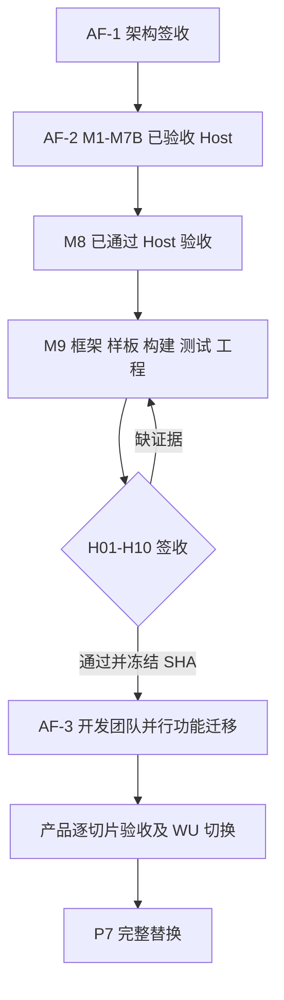
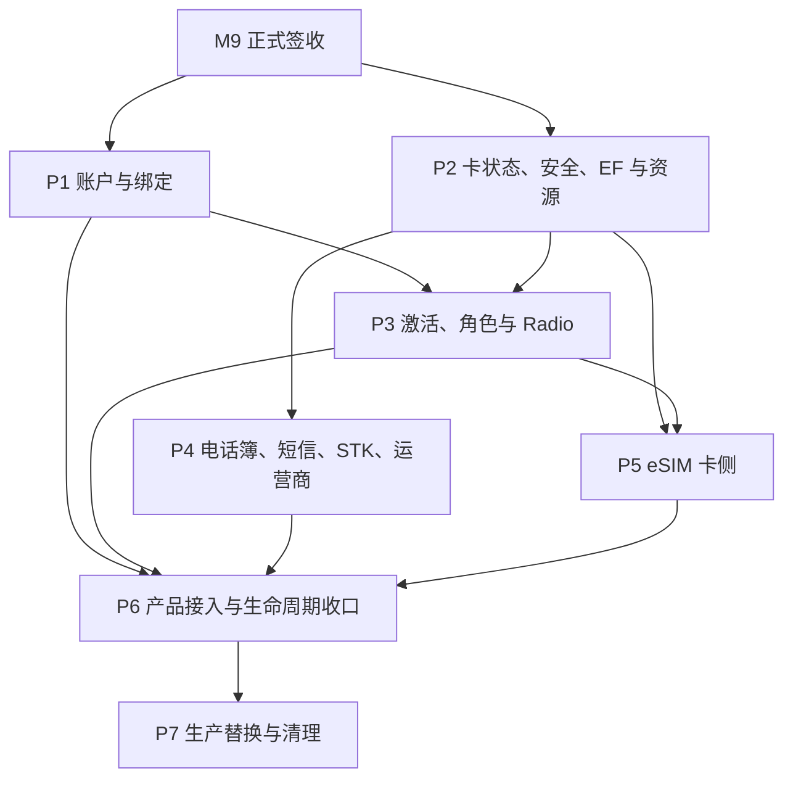

# SIM 多卡架构重构全局代码迁移与测试建设计划 v2.1

> **定位：软件架构师向开发团队交接的开发实施指导书（待签收版）**  
> 版本：v2.1 ｜ 日期：2026-11-26 ｜ 继承 v2.0 的交接门禁和详细任务，保留 v1.1 的目标目录、功能清单、WU、技术迁移指导及全局预算。  
> 计划交接点：**AF-2 M9 · `AF2_M9_DEVELOPER_HANDOFF_READY`**（建议新增，尚未批准/验收）；交接后由开发团队主导 AF-3。  
> 最新已核对的状态输入：`main@7d2c32022dc29e1fe4d235c745ef9c9fbdc43ac9`；v1.1 预算参考输入：`e316298c045cd9b1c2d98e49238dd1638c663390`。正式交接 SHA：**待 M9 签收填写**，不能用任一当前 SHA 冒充。  
> 本文不替代已签收架构、原业务裁决或产品门禁；M9 编号仅为 AF-2 新建议编号，与历史 Stage 9/M9.x Host 专项不混同。


## 0. 宣讲导读与开发快速入口

> 配套宣讲材料：`SIM_Refactor_Developer_Handoff_Brief_v2.1.pptx`（10 页）。PPT 用于统一目标、交接边界和并行节奏；本文用于领取任务、开发、测试和验收。两者使用同一状态快照和预算口径。**现在：M8 Host 已验收；下一步：M9 交接准备与签收；M9 后：AF-3 并行功能迁移。**

| 角色 / 当前需求 | 推荐阅读 |
|---|---|
| 架构师、工程/测试维护者：准备交接 | §2 M9 六项专项、H01～H10、签收模板；§4.3 P0；§7 证据来源 |
| 开发组长：拆分和派发任务 | §3.6 交接后预算；§4.1.1～4.1.5 责任田、共享文件、依赖及波次；§4.13 领取台账 |
| 业务开发者：领任务、开始开发 | §4.2 六步开发流程、实际命令；下表定位任务章节；§4.12 交付检查单 |
| 产品和外部接口负责人：接线与切换 | §4.9 P6、§4.11 WU 写权切换、§4.14 Host/Product/Cutover 门禁 |
| 测试人员：复用和新增用例 | §5 统一语义用例、C/T/D 分类、测试统计；§6 台账 |

### 0.1 最新状态（2026-11-26，固定 SHA）

| 项目 | 已核实状态 |
|---|---|
| 状态提交 | `7d2c32022dc29e1fe4d235c745ef9c9fbdc43ac9`，Record AF-2 M8 Account Reload Host acceptance |
| 阶段 | AF-1 已签收；AF-2 M1～M8 Host 已验收；拟议 M9 尚未签收 |
| M8 Verify | Legacy 147/147、Target 168/168；12 共同场景双后端 24/24；差异 0；ASan / TSan 各 66/66 |
| Target 当前源码目录树 | 101 个非测试 C/C++ 文件、539,110 字节（Git 树实测，非逐行 LOC） |
| Legacy 当前源码目录树 | 116 个非测试 C/C++ 文件、1,356,576 字节（同一口径） |
| 工程限制 | Target 仍主要为 Host testonly；VS Code GUI 尚未验收；原生产品桥、设备及生产切换未放行 |
| 预算参照 | v1.1 的 11,370 LOC 是历史抽样估算，不冒充最新 SHA 实测；M9 预计 14,450 LOC，交接后预计净增 19,050 LOC / 294 用例，最终 33,500 LOC |

### 0.2 交接后任务快速索引（预算为暂定余额）

| 工作包 | 主要开发任务 / 责任田 | 预计剩余净增 LOC | 新增独立用例 | 实施详情 |
|---|---|---:|---:|---|
| P1 | 账户、探测、资料、号码 / A | 1,160 | 26 | §4.4，§3.1/3.6 |
| P2 | 卡态、安全、EF、Records、设备资源 / B、C、G | 4,730 | 60 | §4.5，§3.3/3.4/3.6 |
| P3 | 激活、四角色、真实 Radio / D、G | 2,350 | 54 | §4.6，§3.2/3.4/3.6 |
| P4 | 电话簿、卡短信、STK、运营商 / E | 5,350 | 61 | §4.7，§3.3/3.6 |
| P5 | eSIM 卡侧与外部协作 / F | 4,050 | 53 | §4.8，§3.3/3.6 |
| P6 | 入口、装配、平台、通知和请求 / H | 1,410 | 40 | §4.9，§3.5/3.6 |
| P7 | 生产切换及删除旧实现 / 全组联合 | 不另加预算 | 不另加预算 | §4.10/4.11/4.14 |
| **合计** | **32 项生产代码建设子任务**（P1～P6） | **19,050** | **294** | 签收后据实核销 |

### 0.3 开发人员记住四条规则

1. 先跑旧实现和已有用例，理解外部行为；再参考 M9 样板补 Target，优先复用成熟算法和公共机制。
2. 一个业务状态只允许一个 Owner 写入；共享文件由指定维护者接线，公共契约变更需架构师审批。
3. 同一外部业务场景用一份测试契约运行 Legacy/Target；内部机制专项和产品专属用例分开计数。
4. Host PASS 不代表 Product PASS，更不代表 TARGET_ACTIVE；未验证的产品条件写清阻塞与负责人。

## 1. 开发目标、范围与交接后的责任

完整替代 `telephony_core_service/services/sim`，最终生产仅使用 `services/multisim` 五个一级目录（account、role_assignment、card、device、infrastructure）。保持原接口与外部行为，CD-01～03 已批准差异除外；不复制 eSIM 高层 66250 服务、vSIM、通信共享完整业务或其他子系统。已有产品配置必须兼容；新四卡产品能力、MEP 等超出现有契约的范围另行立项。代码组织以业务职责为中心，不新增抽象层作为一级目录，不使开发者依赖 DDD 术语才能定位功能。

### 1.1 管理层次与工作边界

| 层次 | 含义 | 负责人/使用方式 |
|---|---|---|
| AF-1 / AF-2 / AF-3 | 总体阶段，架构设计、框架实现与开发团队业务迁移 | 架构师维护阶段与决策；沿用既有签收 |
| AF-2 M1～M8、拟议 M9 | 框架和样板的具体交付里程碑 | 架构师负责 M9 收口；不得推翻既有成果 |
| P1～P7 | 交接后剩余业务/产品工作分解（WBS） | 团队按 P*.x 子任务领取，按依赖分批提交 |
| P0 | M9 吸收的一次性工程准备及交接后持续维护 | 不再作为每名开发者重做的串行任务 |
| G2/G3、WU-01～09 | 既有生产切换及唯一写权门禁 | 产品/Owner/架构负责人按原契约签收，不被 P/M 编号替代 |



M9 不是产品全功能完成点；它要求普通开发人员能基于真实运行的框架和样板自行增加业务，不必重写架构或测试设施。Host 交接允许明确登记产品阻塞，但不允许将 Host 核心机制缺陷、不可用的测试工程、缺失的开发样板或不可执行的任务分配伪装成产品阻塞。架构师交接后仍担任契约、公共机制和跨 Owner 变更的审批人；产品适配由专门负责人执行，普通业务开发人员不自行猜测外部协议。

### 1.2 证据现状及继承映射（不是交接时的最终状态）

AF-1 已签收；M1～M8 已有 Host 验收。2026-11-26，M8 正式登记为 `AF2_M8_ACCOUNT_RELOAD_HOST_READY`（验收提交 `7d2c32022`，实现及加固 `e316298c0`、`635e632e9`）。Current/Historical 独立恢复、刷新与重试、逐字段保护、完整角色集交付和关闭排空均有 Host 证据。Verify Legacy 147/147、Target 168/168（含 M8 六项）；12 个共同场景双后端 24/24、后端与 Oracle 差异 0；ASan/TSan 各 66/66。架构、GN/Ninja、执行审计、完整性及 Legacy CI 准入通过；LLDB 已实际调试，VS Code GUI 仍未验收。上述数字是已公布的执行结果，不是独立用例总数。产品根 GN 仍使用旧实现，新实现主要由 testonly Host 构建；真实 Provider/Radio、Core/SA/IPC、设备及生产切换仍待验证。M9 尚为建议交接里程碑，未正式批准或签收。

| 已有里程碑 | 继承的能力 | 对应 WBS（不重做） | M9 前/后剩余事项 |
|---|---|---|---|
| M1 | SimModule 装配、生命周期基础、唯一屏障 | P6.1/P2.2/P6.5 | 根关闭和生产构建补齐；产品驻留另证 |
| M2 | 实时发现、账户及 Binding | P1.1/P1.2/P2.1 | 完整卡状态、探测及平台桥 |
| M3 | Primary C0 | P3.2/P3.3 | B/C1 正式装配、完整产品分支 |
| M4/M5 | Data、Voice、SMS | P3.2/P3.5 | 恢复、查询与真实产品组合 |
| M6/M7A | 账户资料、IMS Preference | P1.3 | 剩余展示资料、原生 Provider |
| M7B | 号码 setter/query、原异步责任 | P1.4/P2.6 | 真实 EF、原生 MSISDN 桥 |
| M8 | Current/Historical Reload | P1.1/P1.2 | Host 已验收；M9 冻结前回归，开发团队只做余量 |

**三项批准行为作为共同契约直接继承**：CD-01 未知 ICCID 设置标签返回参数错误、不写 Provider，已知历史账户无需当前 Binding；CD-02 无 Binding 时 IMS 保存 -1、查询 (-1,-1)，不访问 Provider；CD-03 在异步任务实际执行时固定号码目标，后台回写保持原目标和版本，晚到证据仅结清原责任。其他行为差异必须单独裁决，不借交接放宽。

## 2. M9 工程交接里程碑（架构师主导，开发团队联合验收）

### 2.1 输入、输出和冻结方式

**输入条件**：M8 正式验收，M1～M8 及 CD-01～03 回归有完整证据，架构师确认现有框架接口可作为后续样板。M8 已通过 Host 验收，可作为 M9 的正式输入；交接时仍须在实际冻结 SHA 上核对完整回归，H01～H10 未通过不得冻结为已签收版本。

**输出**：一个经签收的 Git commit（建议附不可变 tag，名称由项目负责人批准，如 `sim-af2-m9-handoff`），对应生产源码清单、可执行 Host 工程、两后端测试目录、核心契约清单、功能/测试/预算实测台账、产品阻塞和责任清单、开发样板、实际独立开发演练记录。M9 交付不包括完整业务迁移，也不自动批准 G2/G3/WU 切换。

| M9 任务 | 负责人角色 | 明确的实现及交付工作 | 出口 |
|---|---|---|---|
| M9.1 核心机制收口 | 架构师 + T/A/R/Device/Host 维护者 | 按 AF-1 签收接口核查真实对象图；Reload、原操作归因、会话撤权、AF2-03 Host 多成员交接、回调一次完成、根关闭与双遍收据；补齐必需机制而不新增平行 Manager | H01、H02 |
| M9.2 开发样板 | 架构师 + 卡业务维护者 | 复用 M2～M8；补完整 UnlockPin 及 ICCID EF→Records→发现样板；将 B/C1 从孤立专项接入正式 SimModule 的可运行 Host 图；样板均从真实入口开始并可调试 | H03 |
| M9.3 生产构建 | 构建/产品工程负责人 | 独立 Legacy/Target 生产逻辑静态库目标、共同生产源码清单；Host/产品按平台配置独立编译，testonly 不传入生产依赖；验证未切换时根 GN 仍使用 Legacy | H04 |
| M9.4 测试归一 | 测试工程负责人 | 盘点历史用例并按语义 ID 去重；共同 Scenario/Contract/Oracle 只维护一份，通过独立后端接入；既有 Target 专属保留；尚未支持场景准确 BLOCKED | H05 |
| M9.5 开发体验与护栏 | 测试工程 + 架构师 | 用干净工作区实际验证 CLI、VS Code Remote WSL GUI Run/Debug/刷新/自动发现；支持从用例单步进入真实源码；架构规则有正反控制，脚本不需要普通开发者逐业务改造 | H06、H07 |
| M9.6 文档与联合签收 | 架构师 + 开发组长 + 产品/测试负责人 | 实测 LOC、功能清单、测试数，填写后述签收表；由非框架作者完成两个小型独立开发演练；冻结签收版本、剩余任务及公共 Owner 名单 | H08、H09、H10 |

### 2.2 H01～H10 关键检查点及可执行验收

下表每项初始均为 **待核验**；已有历史证据可复用但必须与交接 SHA 对账。必须提交证据而非勾选；任何必选项失败则 `HANDOFF_BLOCKED`。M9 完成后由架构师、测试负责人、开发组长和产品负责人按职责签收。

| 检查点 | 必做检查/代表性反例 | 必须提交的证据 | 验收责任 |
|---|---|---|---|
| H01 核心架构稳定 | 对照 AF-1 冻结责任与接口；T 只写账户、A 只写角色、R 维护会话/记录、Device 唯一资源、O 请求机制、H 装配；证明原票/Reload/部分效果与跨 Owner 交付；无未关闭 Host P0/P1 阻塞架构缺陷；已批准差异回归 | 接口与状态 Owner 台账、源码路径/签收差异、全量架构检查及审查记录 | 架构师/各 Owner |
| H02 完整运行机制 | 同一真实图发现两卡、四角色、读取/写入、异步设备操作、换卡、Stop、重建；无账户 PIN/EF；局部 Refresh 保留无关操作；共享资源争用零额外发令；迟到回包和未决原操作不得提前 Drained | 真实入口执行、ASan/TSan 适用专项、确定性交错与负控、析构/晚证据记录 | 架构师、测试负责人 |
| H03 代表性样板 | 九类样板（2.3）；每类正常、原失败、代表失效场景；正式图无成功桩；至少可从 GTest 进入业务函数及关键对象 | 样板索引、共同 case ID/Target 专属 ID、LLDB 或 VS Code 断点路径、原外部契约与断言 | 架构师、业务 Owner |
| H04 独立构建边界 | Legacy/Target 各自生产源码聚合静态库目标，独立链接、独立执行；Host/原生使用同一业务源表（允许明确条件源及平台适配差异）；生产 target 不依赖 testonly；禁用/遗漏一项关键源的负控必须失败 | GN target/源表/依赖检查、两套 ELF/链接 map 或等价构建证据；产品构建若缺环境登记阻塞，不伪称成功 | 构建负责人 |
| H05 测试归一 | 同一共同 case 定义、输入和外部断言，只切 backend；Legacy/Target/Oracle 分别报告；新场景不需手工注册一堆文件；全部历史共同场景和计划的参考样板可用，其他历史资产有迁移映射/阻塞 | 独立语义 ID 清单、后端能力矩阵、两端执行记录、负控验证断言有效、已存在 case 不重复新增 | 测试负责人 |
| H06 开发可用性 | 非框架作者从干净 WSL 工作区按指导完成构建、精确 run、debug、GUI 断点、新增用例及刷新；验证增量只更新需要目标；记录实测冷/热耗时，不以未验证 GUI 签收 | 实际环境与命令日志、GUI Run/Debug/刷新记录、调试源码位置、故障排查说明 | 开发组长/测试负责人 |
| H07 自动护栏 | GN/allowed_edge/include/循环依赖/平台依赖边界/生产执行审计通过；对越界 include、循环或重复责任的关键可检测风险注入负控；并发唯一写权用动态负控，不声称静态规则能证明全部写点 | 正常及变异后失败/恢复的日志，Golden 完整性和 CI 准入 | 架构师、测试负责人 |
| H08 任务完整可领取 | SIM-001～062 逐项对账（保留外部、批准删除也要记录）；每个 P*.x 有已完成/剩余条目、实际目录/文件、Owner、依赖、测试、预算、产品状态；准备至少两条互不冲突的可领取任务 | 冻结版任务台账、预算核销及本指导书更新，实测 LOC 和 case 语义 ID 清单 | 架构师、开发组长 |
| H09 产品边界 | Provider 原写/读取因果、RIL/HDI 真实成员和结束复用、Core/SA/IPC 入口及关闭、外部 eSIM/vSIM/厂商/共享 RIL、构建/ABI 的阻塞有明确范围、责任人、验收判据；Host 模型的限制明确 | 产品证据/阻塞台账、责任人确认、不得切换的 WU 清单 | 产品/外部接口负责人 |
| H10 独立开发演练 | 两名非框架作者（或两次独立演练）分别迁移 UnlockPuk 与一个同类 EF（如 IMSI，先核旧契约）；只用指导书和样板，分别在独立任务分支实施；至少一次跨分支合入回归，不因普通业务需求重写公共机制 | 真实任务 PR、时间/阻塞记录、共用 case、Target 负控、合入后回归；未通过则回 M9.1/M9.5 改进 | 开发组长组织、架构师验收 |

H09 可接受产品阻塞，但必须是已登记、负责人认领且不妨碍相应 Host 开发的外部条件；如果缺证据使基础契约本身无法确定，相关 H01/H02/H03 不可放行。H10 演练产生的真实业务代码及测试，如进入交接提交，归对应 P2 子任务预算，交接后不重复领取。架构师不需要完成全部 PIN/EF/电话簿/eSIM，只需建立可复用的真实模式；若样板涉及业务边界变化仍需先裁决。

### 2.3 九类样板的最小实现边界

| 类型 | 样板与已知落点 | 从入口到效果的必经路径 | 后续可参考的任务 |
|---|---|---|---|
| 创建/绑定 | M2；`account/discovery`、TopologyService | 卡观察→T 原票→Store→Account/Binding 同域发布→A 角色接纳 | P1.1/P1.2、P3.1 |
| 同步查询 | M6/M7A；兼容入口与 Account 投影/Provider | 原目标/权限→读指定视图或 Provider→原返回 | P1.3、P3.5 |
| 同步修改 | M6；名称/标签 | 真实入口→T 单字段资格→Store→版本/通知 | P1.3/P4.5 |
| 偏好保存/查询 | M7A | 原绑定→单列写/原读源→原错误；无通知与设备命令 | P1.3/P3.5 |
| 角色决策 | M3～M5；AssignmentService | T 受保护读→A 实际写集→原参数/Provider→原投影与输出 | P3.2/P3.5 |
| 异步设备操作 | B/C1 Host，M9 补正式图 | A 原轮/成员→R 设备步骤和 lease→回包/超时→原效果及完成 | P3.3/P3.4、P5.1 |
| 跨模块异步组合 | M7B | 任务执行点固定账户→卡 MSISDN→T 原字段→原回调/通知 | P1.4/P2.6 |
| 卡安全短请求 | M9 新样板 UnlockPin | 卡应用（无需 Account）→安全请求→原 token/资源→原结果/剩余次数→可信状态观察 | P2.3 |
| EF/Records 加载 | M9 新样板 ICCID | 卡应用→LoadSession/Scope→EF IO→codec→当前 Records→T 发现；旧会话无写资格 | P2.4～P2.6、P4.1/P4.2 |

**UnlockPin 最小验收**：至少实际走一次原入口与 Host RIL 适配，验证成功、错误及剩余次数、无账户、双卡交错或换卡晚回包；对真实资源关系未知不猜测。**ICCID 样板最小验收**：真实生产编解码及 Records 写点，不直接构造已确认账户代替 EF；覆盖正常、缺失/畸形、重复回包、旧会话/局部刷新、停止时仍有原请求的情况。M9 交付须有从同一测试用例切换两后端并进入对应真实源文件的记录；仅内部纯规则测试不足。

### 2.4 签收单（待填写，须入库并与实际 SHA 对应）

```text
交接状态：DRAFT / HANDOFF_BLOCKED / AF2_M9_DEVELOPER_HANDOFF_READY
M8 正式验收状态与证据：HOST_READY / 7d2c32022（签收时复核）
M9 输入 SHA / 交接 commit SHA / tag（如批准）：待填
Legacy 冻结 SHA / 原产品配置与构建清单：待填
H01–H10 各项 PASS / BLOCKED、负责人、证据链接及复核日期：待填
交接 LOC（逐文件物理/有效）与源清单：待填
已有独立 C/T/D 场景数、每后端支持数、实际执行结果、失败和阻塞：待填
样板目录/函数/测试 ID/调试路径：待填
新增/已完成 P*.x 子切片及预算核销：待填
公共接口/状态写权/共享文件 Owner 及替补：待填
可领取任务清单、未满足依赖和预计产品阻塞：待填
架构师 / 开发组长 / 测试负责人 / 产品负责人签收：待填
```

交接时应冻结一个完整可复现的工程版本，后续新 PR 不修改签收记录，只增加实际执行状态及受控设计变更；如果后续发现交接基础机制有缺陷，暂停受影响的任务，由 Owner 修复并重跑相关样板与依赖用例，不要求无关任务停工。

## 3. 全局代码与测试预算

### 3.0 全局预算

本章保留 v1.1 的估算：参考提交 101 个非测试 C/C++ 文件、535,815 字节，约 11,370 行；旧实现上一轮 116 个文件、1,356,576 字节，约 32,000–36,000 行。LOC 含空行与注释，不含测试/构建/脚本/外仓；实际物理和有效行数均须 M9 全量实测。最终 33,500 行为中心预算（关注 30,000–36,000 行）；不作为必须达到的代码指标。原 22,130 行净增、351 个新增独立用例是从 v1.1 参考点到最终的总预算，不是 M9 后的净余量。

为方便分工，本版给出**从 v1.1 参考点至 M9 交接的暂定预留**：3,080 行净增、57 个新增独立用例（C20/T37/D0），包括 v1.1 参考点之后已验收的 M8 增量以及 M9 样板、公共机制、演练；不为构建/测试代码虚构生产 LOC。对应条件式交接后余额为 19,050 行、294 个独立用例。预留是工程预算拆分，并非当前已写代码；产品用例暂全部保留在交接后，若 M9 实际完成独立产品用例则同样核销。未新增独立测试而复用已有场景的工作量单列，不重复计数。

| 模块 | 当前 LOC（估） | 最终 LOC | 净增 | 共用新增 | Target 专属 | 产品专属 | 新增合计 |
|---|---:|---:|---:|---:|---:|---:|---:|
| `account` | 4,040 | 6,150 | 2,110 | 20 | 20 | 9 | 49 |
| `role_assignment` | 2,950 | 4,150 | 1,200 | 13 | 13 | 6 | 32 |
| `card` | 1,220 | 16,700 | 15,480 | 89 | 60 | 36 | 185 |
| `device` | 850 | 2,200 | 1,350 | 7 | 14 | 10 | 31 |
| `infrastructure` | 2,310 | 4,300 | 1,990 | 15 | 22 | 17 | 54 |
| **合计** | **11,370** | **33,500** | **22,130** | **144** | **129** | **78** | **351** |

以下 3.1～3.5 为目录级生产代码及用例预算（v1.1 参考基线）；3.6 为交接前后预算分解。

所有路径相对于 `services/multisim/`，根部行不含子目录。规划目录来自已签收设计的稳态能力树；无成熟实现时不预建空目录。`card/runtime` 净退出是预算假设，确有必要的窄绑定接口可保留，按真实责任归属重新分配预算。每个测试按主责任归属一次，跨模块测试可以有多个覆盖标签，不重复计数。SIM 编号是迁移范围索引，跨目录复用编号并不意味着重复实现。

### 3.1 account

| 目录 | 当前 | 最终 | 净增 | 共用 | Target | 产品 | 合计 | 主交付批次 | SIM 功能 | 主要责任 |
|---|---:|---:|---:|---:|---:|---:|---:|---|---|---|
| `account/（根）` | 2,850 | 3,100 | 250 | 3 | 5 | 1 | 9 | P1 | 020–023,031,055 | AccountRegistry、BindingIndex、TopologyService、Store/唯一写权 |
| `account/discovery` | 320 | 850 | 530 | 5 | 5 | 2 | 12 | P1 | 020–022,031,056 | Current/Historical Reload、发现、探测、Carrier 字段接纳 |
| `account/activation` | 400 | 1,050 | 650 | 7 | 5 | 3 | 15 | P3 | 024,057 | 普通/force/卫星激活、结果、进度、换绑 |
| `account/number` | 470 | 750 | 280 | 3 | 3 | 2 | 8 | P1 | 023.b/c | 号码回退、原生 MSISDN、后台回写、初始化 |
| `account/profile` | 0 | 400 | 400 | 2 | 2 | 1 | 5 | P1 | 023.a,031.a,045.a | 名称、标签、IMS；从根部迁移现有资料代码 |
| **小计** | **4,040** | **6,150** | **2,110** | **20** | **20** | **9** | **49** | — | — | — |

### 3.2 role_assignment

| 目录 | 当前 | 最终 | 净增 | 共用 | Target | 产品 | 合计 | 主交付批次 | SIM 功能 | 主要责任 |
|---|---:|---:|---:|---:|---:|---:|---:|---|---|---|
| `role_assignment/（根）` | 2,650 | 2,700 | 50 | 3 | 5 | 1 | 9 | P3 | 025–030 | 聚合、共享写集、参数和角色唯一写权 |
| `role_assignment/primary` | 300 | 1,000 | 700 | 7 | 6 | 4 | 17 | P3 | 028–030 | Primary B/C1、偏好恢复、重试、DSDS/M0/M2 |
| `role_assignment/default_roles` | 0 | 450 | 450 | 3 | 2 | 1 | 6 | P3 | 025–027 | Voice/SMS/Data 场景与原结果；复用已有实现 |
| **小计** | **2,950** | **4,150** | **1,200** | **13** | **13** | **6** | **32** | — | — | — |

### 3.3 card

| 目录 | 当前 | 最终 | 净增 | 共用 | Target | 产品 | 合计 | 主交付批次 | SIM 功能 | 主要责任 |
|---|---:|---:|---:|---:|---:|---:|---:|---|---|---|
| `card/state` | 230 | 1,200 | 970 | 8 | 5 | 3 | 16 | P2 | 005–006,012,031.c | 卡状态/锁因、卡型/应用会话、映射和可信失效 |
| `card/security` | 30 | 1,100 | 1,070 | 10 | 4 | 4 | 18 | P2 | 007–011 | PIN/PUK/PIN2、个性化锁、认证、SIM IO |
| `card/records（根）` | 140 | 2,100 | 1,960 | 9 | 6 | 3 | 18 | P2 | 013,015–019 | EF 首次/锁定/局部加载、记录读写、刷新及 LOADED |
| `card/records/files` | 0 | 1,800 | 1,800 | 5 | 4 | 2 | 11 | P2 | 011–013,016–019 | 各卡型文件及低层 EF Controller，保留协议差异 |
| `card/records/codec` | 0 | 900 | 900 | 3 | 5 | 0 | 8 | P2 | 014 | 字符、号码、PLMN、TLV 共享解析；畸形输入 |
| `card/phonebook` | 0 | 1,900 | 1,900 | 8 | 4 | 3 | 15 | P4 | 037–038 | ADN/FDN、PBR/ANR/IAP、多 EF 更新及恢复 |
| `card/sms_storage` | 0 | 400 | 400 | 4 | 2 | 1 | 7 | P4 | 036 | 卡内短信 CRUD，不迁完整短信业务 |
| `card/stk` | 0 | 850 | 850 | 5 | 3 | 2 | 10 | P4 | 039–040 | Envelope、Terminal Response、Call Setup、事件 |
| `card/carrier/config` | 0 | 850 | 850 | 5 | 3 | 2 | 10 | P4 | 041,044–045.b | 运营商配置、缓存、APN、IMS 能力观察 |
| `card/carrier/matching` | 0 | 900 | 900 | 5 | 3 | 2 | 10 | P4 | 019,042,056 | OpKey、匹配和规则加载；账户字段交 T |
| `card/carrier/privilege` | 0 | 450 | 450 | 4 | 3 | 2 | 9 | P4 | 043 | 运营商权限、证书、ARA-M 与资源共享 |
| `card/esim（根）` | 200 | 350 | 150 | 2 | 3 | 1 | 6 | P5 | 047–054 | 本地请求、双返回值、协调入口、事件 |
| `card/esim/profile` | 0 | 1,500 | 1,500 | 9 | 5 | 4 | 18 | P5 | 047,051–054 | EID/库存/Port、Profile 操作、通知、地址、Reset |
| `card/esim/channel` | 0 | 1,000 | 1,000 | 6 | 6 | 4 | 16 | P5 | 048,052 | AID/APDU/逻辑通道、迟到 Close、普通/低优先级共享 |
| `card/esim/provisioning` | 0 | 1,400 | 1,400 | 6 | 4 | 3 | 13 | P5 | 046,049–050,054 | 本地认证、准备、BPP/安装、OSU 接缝；不复制 66250 |
| `card/runtime（过渡，净退出）` | 620 | 0 | -620 | 0 | 0 | 0 | 0 | P2 | 005–019,023 | 职责分归 state/records/security/esim；必要窄绑定接缝按归属计量 |
| **小计** | **1,220** | **16,700** | **15,480** | **89** | **60** | **36** | **185** | — | — | — |

### 3.4 device

| 目录 | 当前 | 最终 | 净增 | 共用 | Target | 产品 | 合计 | 主交付批次 | SIM 功能 | 主要责任 |
|---|---:|---:|---:|---:|---:|---:|---:|---|---|---|
| `device/resource` | 850 | 1,200 | 350 | 2 | 8 | 5 | 15 | P2 | 029,048,058 | 唯一 lease/fence、组提交、结束与复用证据 |
| `device/radio` | 0 | 1,000 | 1,000 | 5 | 6 | 5 | 16 | P3 | 024,029–030,057 | 真实 Radio/RIL 路由、成员、phase/session、激活执行 |
| **小计** | **850** | **2,200** | **1,350** | **7** | **14** | **10** | **31** | — | — | — |

### 3.5 infrastructure

| 目录 | 当前 | 最终 | 净增 | 共用 | Target | 产品 | 合计 | 主交付批次 | SIM 功能 | 主要责任 |
|---|---:|---:|---:|---:|---:|---:|---:|---|---|---|
| `infrastructure/assembly（不含 exports）` | 1,000 | 1,400 | 400 | 3 | 6 | 5 | 14 | P6 | 001–004,034,059 | 真实装配、发布、Stop/Drain、catalog、宿主生命周期 |
| `infrastructure/assembly/exports` | 40 | 100 | 60 | 0 | 1 | 2 | 3 | P6 | 001,059 | 窄导出、ABI 与匹配销毁 |
| `infrastructure/compatibility/api` | 580 | 1,400 | 820 | 6 | 3 | 5 | 14 | P6 | 003–004,022,032,046,057,059,061 | 既有 API、查询、权限契约与扩展/Host 边界 |
| `infrastructure/compatibility/events` | 260 | 700 | 440 | 5 | 4 | 4 | 13 | P6 | 032–035,040,054,060 | 原通知、回调、死亡清理、平台事件、诊断交付 |
| `infrastructure/request` | 350 | 600 | 250 | 1 | 7 | 1 | 9 | P6 | 058 | 通用原请求、步骤、超时、完成、晚证据机制 |
| `infrastructure/（根）` | 80 | 100 | 20 | 0 | 1 | 0 | 1 | P6 | 004,022 | 纯身份值类型，不新增全局映射 |
| **小计** | **2,310** | **4,300** | **1,990** | **15** | **22** | **17** | **54** | — | — | — |

### 3.6 从参考基线到 M9 的预留与交接后可领取余额

C/T/D = 双后端共用 / Target 专属 / 产品专属。每行与第 3.1～3.5 节的目录预算一一对应，P2.7 是过渡实现净退出。以下是**规划值，不是交接完成状态**；没有预留的任务不代表无需 M9 契约准备。实际核销只以已验收切片及实测差额为准，M8 与 M9 若实际超过某项预留，更新对应行，不机械补足数字。跨目录代码按实际落点计量，避免把同一改动同时算作 M9 与业务工作包。

| 子任务 | 原净增 LOC | 原 C/T/D | 原用例数 | 交接前预留 LOC | 预留 C/T/D | 预留用例数 | 交接后预计 LOC | 交接后 C/T/D | 预计用例数 |
|---|---:|---:|---:|---:|---:|---:|---:|---:|---:|
| P1.1 | 250 | 3/5/1 | 9 | 100 | 1/2/0 | 3 | 150 | 2/3/1 | 6 |
| P1.2 | 530 | 5/5/2 | 12 | 200 | 2/3/0 | 5 | 330 | 3/2/2 | 7 |
| P1.3 | 400 | 2/2/1 | 5 | 0 | 0/0/0 | 0 | 400 | 2/2/1 | 5 |
| P1.4 | 280 | 3/3/2 | 8 | 0 | 0/0/0 | 0 | 280 | 3/3/2 | 8 |
| P2.1 | 970 | 8/5/3 | 16 | 350 | 3/3/0 | 6 | 620 | 5/2/3 | 10 |
| P2.2 | 350 | 2/8/5 | 15 | 200 | 1/4/0 | 5 | 150 | 1/4/5 | 10 |
| P2.3 | 1,070 | 10/4/4 | 18 | 300 | 3/2/0 | 5 | 770 | 7/2/4 | 13 |
| P2.4 | 900 | 3/5/0 | 8 | 100 | 1/1/0 | 2 | 800 | 2/4/0 | 6 |
| P2.5 | 1,800 | 5/4/2 | 11 | 350 | 1/2/0 | 3 | 1,450 | 4/2/2 | 8 |
| P2.6 | 1,960 | 9/6/3 | 18 | 400 | 2/3/0 | 5 | 1,560 | 7/3/3 | 13 |
| P2.7 | -620 | 0/0/0 | 0 | 0 | 0/0/0 | 0 | -620 | 0/0/0 | 0 |
| P3.1 | 650 | 7/5/3 | 15 | 0 | 0/0/0 | 0 | 650 | 7/5/3 | 15 |
| P3.2 | 50 | 3/5/1 | 9 | 0 | 1/2/0 | 3 | 50 | 2/3/1 | 6 |
| P3.3 | 700 | 7/6/4 | 17 | 200 | 1/2/0 | 3 | 500 | 6/4/4 | 14 |
| P3.4 | 1,000 | 5/6/5 | 16 | 300 | 1/2/0 | 3 | 700 | 4/4/5 | 13 |
| P3.5 | 450 | 3/2/1 | 6 | 0 | 0/0/0 | 0 | 450 | 3/2/1 | 6 |
| P4.1 | 1,900 | 8/4/3 | 15 | 0 | 0/0/0 | 0 | 1,900 | 8/4/3 | 15 |
| P4.2 | 400 | 4/2/1 | 7 | 0 | 0/0/0 | 0 | 400 | 4/2/1 | 7 |
| P4.3 | 850 | 5/3/2 | 10 | 0 | 0/0/0 | 0 | 850 | 5/3/2 | 10 |
| P4.4 | 850 | 5/3/2 | 10 | 0 | 0/0/0 | 0 | 850 | 5/3/2 | 10 |
| P4.5 | 900 | 5/3/2 | 10 | 0 | 0/0/0 | 0 | 900 | 5/3/2 | 10 |
| P4.6 | 450 | 4/3/2 | 9 | 0 | 0/0/0 | 0 | 450 | 4/3/2 | 9 |
| P5.1 | 1,000 | 6/6/4 | 16 | 0 | 0/0/0 | 0 | 1,000 | 6/6/4 | 16 |
| P5.2 | 1,500 | 9/5/4 | 18 | 0 | 0/0/0 | 0 | 1,500 | 9/5/4 | 18 |
| P5.3 | 1,400 | 6/4/3 | 13 | 0 | 0/0/0 | 0 | 1,400 | 6/4/3 | 13 |
| P5.4 | 150 | 2/3/1 | 6 | 0 | 0/0/0 | 0 | 150 | 2/3/1 | 6 |
| P6.1 | 400 | 3/6/5 | 14 | 200 | 1/3/0 | 4 | 200 | 2/3/5 | 10 |
| P6.2 | 60 | 0/1/2 | 3 | 30 | 0/1/0 | 1 | 30 | 0/0/2 | 2 |
| P6.3 | 820 | 6/3/5 | 14 | 100 | 1/1/0 | 2 | 720 | 5/2/5 | 12 |
| P6.4 | 440 | 5/4/4 | 13 | 100 | 1/2/0 | 3 | 340 | 4/2/4 | 10 |
| P6.5 | 250 | 1/7/1 | 9 | 150 | 0/4/0 | 4 | 100 | 1/3/1 | 5 |
| P6.6 | 20 | 0/1/0 | 1 | 0 | 0/0/0 | 0 | 20 | 0/1/0 | 1 |
| **总计** | 22,130 | 144/129/78 | 351 | 3,080 | 20/37/0 | 57 | 19,050 | 124/92/78 | 294 |

| 工作包 | v1.1 净增 LOC / 用例 | 交接前预留 LOC / 用例 | 交接后预计 LOC / 用例 |
|---|---:|---:|---:|
| P1 | 1,460 / 34 | 300 / 8 | 1,160 / 26 |
| P2 | 6,430 / 86 | 1,700 / 26 | 4,730 / 60 |
| P3 | 2,850 / 63 | 500 / 9 | 2,350 / 54 |
| P4 | 5,350 / 61 | 0 / 0 | 5,350 / 61 |
| P5 | 4,050 / 53 | 0 / 0 | 4,050 / 53 |
| P6 | 1,990 / 54 | 580 / 14 | 1,410 / 40 |
| **合计** | **22,130 / 351** | **3,080 / 57** | **19,050 / 294** |

预计 M9 交接时生产候选代码为 11,370 + 3,080 = **14,450 行**（条件式规划，不是实测）；正式交接后按目录计算：剩余净增 = 该目录最终预算 − M9 实测 LOC；剩余新增 case = 经语义去重后的待覆盖独立契约数量，结合预算与实际核销更新。若目录发生机械搬迁，应同步调整源/目的预算；整体净值守恒。对于产品阻塞不以 Host 通过直接核销 D 类用例。

## 4. 全局实施顺序与批次验收（开发人员执行指导）

本章是以第 2 章 M9 正式签收版本为起点、从已有框架到完整替换的开发任务书。下列 P*.x 保留 v1.1 总范围和完整迁移说明；实际领取的是签收后未完成切片，M8/M9 已验收内容只复用和回归，不重新实现。表中的净增 LOC 与 C/T/D 为参考基线总预算，交接后预计余额统一见 3.6，实际余额以签收台账为准。开发人员应按“一个可运行的业务切片”接任务，而不是按文件数量、代码行数或架构层接任务。每个子批次应有明确的旧行为、目标责任、真实入口、测试及退出条件。P0～P7 是本计划的工作包编号，不重新定义 AF-2/AF-3、G2/G3 或已有签收状态；下列 P1.1 等均为计划编号，不是仓库现有里程碑。

### 4.1 主路径、并行关系和任务分配（交接后）



图中箭头表示相关能力的验收依赖，不表示所有任务必须串行。P1 与 P2 可并行；P5 通道及本地编解码可提前在 P2 公共契约明确后开发，涉及 Profile 切换、偏好和激活的验收需依赖 P3。P4 中电话簿/短信/运营商依赖 EF，STK 可在卡状态与原事件入口稳定后提前开展。P6 的宿主、Provider、Radio、测试和构建工作从 M9 即并行进入各业务切片，P6 只做剩余能力和最终集成收口。任何共享写权单元只在全部旧写者和未决责任核对通过后切换，不因子批次 Host 通过而自动切换。

| 批次 | 主要范围 | 当前 LOC | 最终预算 | 净增 LOC | 共用新增 | Target 专属 | 产品专属 | 新增合计 |
|---|---|---:|---:|---:|---:|---:|---:|---:|
| P1 | 账户、Reload、资料及号码 | 3,640 | 5,100 | 1,460 | 13 | 15 | 6 | 34 |
| P2 | 卡状态、安全、Records、设备资源 | 1,870 | 8,300 | 6,430 | 37 | 32 | 17 | 86 |
| P3 | 激活、角色与 Radio | 3,350 | 6,200 | 2,850 | 25 | 24 | 14 | 63 |
| P4 | 卡短信、电话簿、STK、运营商 | 0 | 5,350 | 5,350 | 31 | 18 | 12 | 61 |
| P5 | eSIM 卡侧 | 200 | 4,250 | 4,050 | 23 | 18 | 12 | 53 |
| P6 | 完整装配、兼容和产品接入 | 2,310 | 4,300 | 1,990 | 15 | 22 | 17 | 54 |
| **合计** | — | **11,370** | **33,500** | **22,130** | **144** | **129** | **78** | **351** |

建议按账户/角色、卡运行、卡侧成熟业务、eSIM、产品及测试基础设施分配开发人员；实际人员数由项目负责人安排。同一 Owner 的可变状态及公共契约由指定维护人负责，其他开发人员经窄接口接入，不并行创建第二套实现。M9/P0/P7 不额外占用本表预算；M9 生产候选代码及独立测试从对应 P*.x 核销；发现真正新增范围时先登记差异并调整全局预算。表中代码量为目标目录净增，测试记号 **C/T/D** 分别表示双后端共用、Target 专属、产品/设备专属的独立新增用例预算。每条具体断言是覆盖要求，不等同于必须新建一个 TEST_F；先查复用，再确定新增 ID。

### 4.1.1 并行开发责任田与人员配置建议

建议以 6～8 条业务开发流为基础，另设公共工程/集成维护角色；不是实际已分配人员。人数不足可合并不冲突的责任田，人数较多可按表 4.1.3 进一步拆分。每个公共 Owner 指定一位主维护者和一位替补；多个业务人员可以调用同一 Owner，但只有指定人员修改其核心可变状态/公共契约。组长在 M9 签收时填入具体姓名、预计排期和替补，不在本稿假设已有资源。

| 责任田 | 建议人员/角色 | 独占业务修改区 | 首批可领取任务 | 需要其他 Owner 提供的能力 |
|---|---|---|---|---|
| A 账户 | 1～2 人，T Owner | `account/` 根、discovery、profile、number；activation 独立派发 | P1.1～P1.4 剩余项 | Card 当前会话/Records、A 角色接纳、Provider 端口 |
| B 卡状态与安全 | 1～2 人，卡状态 Owner + 安全开发 | `card/state`、`card/security` | P2.1、P2.3 | M9 会话/请求/资源接口、真实 RIL 桥 |
| C EF 与 Records | 1～2 人，Records Owner | `card/records`、files、codec；逐步接收 runtime 责任 | P2.4～P2.7 | 卡应用会话、Device 资源、T 观察输入 |
| D 激活与角色 | 1～2 人，A Owner + 激活开发 | `role_assignment/`、`account/activation`（分别定维护者） | P3.1～P3.3、P3.5 | T active、Device 成员与资源、共享偏好写权 |
| E 卡侧成熟业务 | 2～3 人可分不同目录 | `card/phonebook`、sms_storage、stk、carrier 各子目录 | P4.1～P4.6 | EF/codec、事件出口、T 资料写口、通道 |
| F eSIM | 1～2 人，eSIM Owner | `card/esim`、profile/channel/provisioning | P5.1～P5.4 | Device 共享资源、T/A、外部 66250、厂商契约 |
| G 设备/平台 | 专职 Device Owner 与外部协调者 | `device/resource`、`device/radio`、所属原生桥 | P2.2、P3.4，及各批产品取证 | 真实 RIL/HDI/Modem/Provider、外部成员证据 |
| H 集成/测试 | 专职 H/O/C Owner、构建/测试维护者 | infrastructure 公共文件、GN、测试框架/公共配置 | P6.1～P6.6 持续接线、P0 维护 | 各业务组的窄入口/实际依赖，产品构建及 SA/IPC |

同一个业务组可含多个开发者，但对共享文件不按行切割责任。例：A 组账户资料和探测人员可在不同业务文件开发；涉及 `TopologyService`/`AccountRegistry` 统一由 T Owner 合入；D 组默认卡与 Primary 不同时大改 `assignment_service.cpp`，先提交各自独立用例和实现，再由 A Owner 接入根部。任何新增 Facade 方法、SimModule 装配、源表、测试公共头/能力矩阵都由 H 组或其指定维护者合入，不让所有分支同时重写公共入口。

### 4.1.2 公共契约与合入写权清单

| 共享修改点（以 M9 实际路径核对） | 唯一合入负责人 | 其他开发人员如何使用 | 禁止做法 |
|---|---|---|---|
| `account/account_registry.*`、`binding_index.*`、`topology_service.*`、Store 契约 | T Owner | 提交具名字段补丁/观察/读视图的需求及独立测试，由 T Owner 接线 | 直接改可写缓存、另建 simId 映射、把卡记录当账户字段 |
| `role_assignment/assignment_service.*`、聚合、`account_role_protocol.h` | A Owner | 提供原角色写集/偏好/恢复的真实场景，复用 A 接纳 | 独立写参数、重复角色决策/重试 |
| `card/state/session_registry.*` 与状态观察输入 | 卡状态 Owner | 持当前 SessionRef、发送可信观察或合法转换意图 | 按 slot 重新解析晚到结果、共享全局代次 |
| `card/records/load_session.*`、文件与记录契约 | Records Owner | 使用具名 EF/LoadScope、当前记录快照；申请新增记录能力 | 电话簿/短信/运营商各写一份基础卡记录或等待机制 |
| `device/resource/resource_barrier.*`、Radio 执行契约 | Device Owner | 提交真实资源键/成员需求、借用原 lease/step，证据由 Device 接收 | 按卡槽虚构资源独立、每个能力新建物理互斥器 |
| `infrastructure/request/*`、完成/晚证据 | O/C Owner | 复用原请求与私有 Owner 表，具名业务决定重试 | 通用容器接管业务流程、丢弃未决效果 |
| `infrastructure/assembly/*`、Facade/事件、根 GN、源清单 | H/C/构建 Owner | 业务 PR 提供入口接线清单和依赖目标，集成 PR 完成装配和原出口 | 新建第二组合根、事件中心代写业务、testonly 污染生产 |
| `test/framework/*`、`test/config/backend_capabilities.json`、公共测试接口 | 测试 Owner | 业务 PR 首先提交 case 文件及语义 ID、申请最小适配 | 独立复制 fake/Oracle/后端、降低 Golden 或成功桩 |

公共契约变更必须先提出小型契约 PR：原接口/消费者、业务必要性、Owner、同步/异步语义、失败/失效/Stop、资源、兼容策略、测试正反例和受影响任务；架构师审批后先合入接口和机制，再由各消费者重基线。只有新增私有业务实现且不改变公共契约时可独立开发、独立合入。不要为未来假设提前制造空目录、泛化 API 或成功实现。

### 4.1.3 任务领取、分支冲突与并行验收矩阵

以下为建议任务卡的拆分。`D` 表示可以开始编写独立算法、场景及原行为取证；`H` 表示完整 Host 功能验收所需的上游；`P` 表示另行满足的产品条件。M9 样板提供最小契约，不意味着全部卡型、真实设备和平台桥已经完成。所有任务 D 均以 M9 已签收、任务台账未完成为前提。验收依赖不强迫开发串行；仅不可用契约阻塞相交集成。表中的“产物”是建议交付子切片而非新增里程碑，预算按 3.6 的 P*.x 分摊。

| 任务 | 主责流 | 可独立开发/拆分的子切片（分别提交） | H：需要先可用的能力/接口 | P：产品验收依赖 |
|---|---|---|---|---|
| P1.1 | A | 原查询/目标解析；Store 单列 CRUD；未知身份原票恢复 | M9 T/Store、Binding | Provider 读写归因、权限 |
| P1.2 | A | 探测有/无行；缺卡展示；运营商字段接纳；未覆盖 Reload 分支 | M8、P1.1；P2.1/P4.5 对应观察 | DataShare 查询因果、探测调用者 |
| P1.3 | A | 在位/标签恢复；历史账户；eSIM 运营商名；已批准 IMS 仅回归 | P1.1、已有 M6/M7A | Provider、P5.2 原标签键 |
| P1.4 | A | 初始化号码、读回退、原后台回写；真实 MSISDN 桥 | M7B、P2.5/P2.6 对应记录能力 | EF/RIL/IMPU/Provider |
| P2.1 | B | 状态查询；锁因；可信拔卡/换卡；应用切换/映射 | M9 SessionRegistry 与观察 | 真卡态/映射协议 |
| P2.2 | G | 资源键证据；组申请；恢复及结束/复用；M9 已完成的仅回归 | M9 唯一 ResourceBarrier | RIL/HDI 真实共享资源 |
| P2.3 | B | PIN2/PUK2；锁设置/查询；个性化锁；认证/SIM IO；剩余 PIN | M9 UnlockPin/会话/原请求，P2.1/P2.2 对应能力 | 真实卡安全结果、状态通知 |
| P2.4 | C | 字符、号码、PLMN、TLV 等纯算法，分文件机械迁移 | M9 codec 样板；原字节 Golden | 原生编译/平台差异（如适用） |
| P2.5 | C | 透明/线性文件；读取/写入；按现有 SIM/USIM/ISIM/RUIM/CSIM 路径扩展 | M9 ICCID IO、P2.1/P2.2、相应 codec | EF/AID/状态字/设备回包 |
| P2.6 | C | 首次/锁定加载；局部 Refresh；IMSI/SPN/GID/PLMN；语音信箱/呼转/MSISDN | M9 LoadSession、P2.5 对应文件 | 卡型 Records、原通知/EF 写入 |
| P2.7 | C+H | runtime 接缝逐条迁出；按消费者删除，不单独造替代物 | P2.1～P2.6 对应消费者、P1.4/P5 相关接线 | 所有实际消费者及构建 |
| P3.1 | D | 普通激活/停用；force；卫星 Hook；失败进度 | T active、P2.1/P2.2、P3.4 受控端口 | 真设备激活/卫星/厂商 |
| P3.2 | D | 写键台账；建行/重载/角色偏好接纳；独立写集并发 | M9 A/T，P1.1/P1.2 | Provider 写域、Core/eSIM 键 |
| P3.3 | D | B 正式路径；C1 各 phase/重试；偏好恢复；DSDS/M0/M2 | P3.2/P3.4 真实 Host 图，P2.2 | 实际成员、设备效果、COMPLETE 门禁 |
| P3.4 | G | 成员/路由；逐成员交接；原生 Radio/Modem 适配 | P2.2、M9 A 执行契约 | RIL/HDI 真实路由和复用 |
| P3.5 | D | Voice/SMS 清除回退；Data 初始化/恢复；查询通知 | M4/M5、P3.2 | Provider/系统参数/Registry |
| P4.1 | E | ADN/FDN 基础；PBR/ANR/IAP；多 EF 部分写 | P2.3 PIN2、P2.5/P2.6 | 卡电话簿及真实 EF |
| P4.2 | E | 卡短信读/容量；增删改；错误索引/满容量 | P2.5/P2.6 | 真卡短信 EF |
| P4.3 | E | Envelope/Terminal Response；Call Setup；主动事件 | P2.1、P6.4 事件端口 | STK/EXT、原通知 |
| P4.4 | E | 配置加载缓存；APN 重试；IMS 芯片能力 | Records 快照、P6.4 用户/重连事件 | 原配置/APN/芯片能力 |
| P4.5 | E | 规则解析；OpKey 匹配；卡参数和账户字段输出 | P2.4/P2.6、P1.2 接纳 | 真实配置/Provider、用户切换 |
| P4.6 | E | 证书/规则解析；ARA-M 通道及关闭 | P2.4/P2.2，P5.1 共享通道接口（接口先行） | 真通道与权限/证书 |
| P5.1 | F | 开通道；APDU 分片；关通道、晚 Close；共享资格 | P2.1/P2.2，P4.6 契约 | eUICC/ARA-M 真实资源关系 |
| P5.2 | F | EID/库存/Port；Profile 读写；通知/地址/Reset | P5.1、P1.3/P3.2/P3.3 对应写权 | 真 eUICC、标签/偏好协议 |
| P5.3 | F | 认证/Prepare；BPP 解析/分片安装；本地回执 | P2.4、P5.1 | 66250 唯一主编排和原生安装证据 |
| P5.4 | F+H | 本地双返回；Profile 事件；外部 Hook 协作 | P5.1～P5.3 对应能力、T/A/R 契约 | eSIM/vSIM/通信共享/EXT 外部调用者 |
| P6.1 | H | 逐业务装配；真实启动/关闭；驻留/重建 | M9 H/O/R；各批真实入口 | Core/SA/共享 RIL/实际销毁 |
| P6.2 | H | 条件源；库导出；构造/销毁/ABI | M9 独立源清单，已迁模块 | 原生工具链/批准 G2b SO |
| P6.3 | H | 查询/权限；业务兼容入口；EXT/SA/IPC 逐桥 | 各 P*.x 业务实现 | 原 IPC、Provider/平台、Feature |
| P6.4 | H | 各原通知出口；回调死亡；重连；诊断 | 各业务明确输出契约 | Registry/CES/Hub/SA |
| P6.5 | H | 适用原生等待/定时器/投递；原效果收据 | M9 请求与关闭机制，各业务原关联 | FFRT/Binder/真实回调 |
| P6.6 | H | 纯类型检查；收敛不必要 ID/依赖 | M9 纯值契约 | 兼容 ABI 与原调用者 |

### 4.1.4 推荐交付波次（按依赖完成触发，不承诺固定日期）

| 波次 | 业务任务 | 集成维护者并行做什么 | 进入下一波的关键判据 |
|---|---|---|---|
| W1 交接后的第一批 | P1.1～1.3 剩余项、P2.1/2.3/2.4、P3.2/3.5 剩余项、P4/P5 纯算法/取证 | M9 契约接口维护、P2.2/P3.4 产品证据、P6 入口接线 | 可复用卡状态、资源、账户资料与角色接口；共同契约持续回归 |
| W2 卡执行能力 | P2.5/2.6、P1.4、P3.1/3.3/3.4、P4.3、P5.1 | 原生 EF/Radio 桥，按需迁移 runtime 接缝 | EF/Records、真实 Host 激活/角色执行，通道契约可被其他组复用 |
| W3 成熟业务 | P4.1/4.2/4.4/4.5/4.6、P5.2/5.3、P2.7 对应退场 | P1.2 资料接纳、P6 事件/外部桥持续集成 | 业务组合与资源并发已验收；外部阻塞独立列账 |
| W4 外部协作与产品 | P5.4、各业务遗留、P6.1～6.6 收口 | 按产品配置、ABI、SA/IPC、设备、Stop/Drain 和 WU 集成 | 全部产品及切权证据闭合后才允许 P7 |
| W5 最终清理 | P7.1～P7.4 | 固定旧版本离线回归、生产构建/链接/符号审计 | 旧生产实现完全退出，无双 writer/执行方 |

波次只表达建议集成顺序，W2/W3 某个能力早就绪即可提前合入；不等待某工作包所有无关任务结束。某项尚未支持的产品配置不阻塞其他无关 Host 切片，但不能声明该项产品完成。

### 4.1.5 多人并行开发的 PR 及集成规则

1. 开发组长按任务台账领取最小子切片并标记主负责人、评审者、共享文件维护者、输入 SHA、预计目标文件与依赖；一个任务同一时刻只有一个主负责人，多个任务允许同一目录不同独立文件。
2. 每个任务使用独立短期分支或 Git worktree（例如 `sim/p2.3-pin2`），不复用他人输出目录；Host 构建/测试输出按 worktree 隔离，防止并发 Ninja 和 ELF/证据串用。正式基线使用 M9 commit，后续对已合入 main 及时重基线并重新验证；不修改或强推他人分支。
3. PR 建议拆成 A 原行为与共同测试、B 成熟算法机械迁移、C 新机制接入与业务实现、D 产品适配/WU（必要时独立）；可先合入可运行 Legacy 测试，Target 尚未支持显式 BLOCKED，不能制造成功桩。不要把大规模目录搬迁与业务语义变更混在一次审查。
4. 共享文件修改先在任务中提交最小接口需求与证据，由 Owner 提供接口/接线补丁。业务组可并行提交私有实现；合入队列先公共契约/适配，再消费者，再正式装配与端到端场景。所有中间合入保持可构建、已启用业务不回退；未接完的能力不进入生产写权。
5. CI 至少执行本任务共同与 Target 专属用例、受影响上游/下游回归、架构/GN；涉及原请求/资源/会话/关闭的修改加相应 sanitizer 与确定性交错。最终合入由集成维护者跑全量；在变更后的提交上重新产生证据，不能只提交分支旧日志。
6. 每个任务完成状态独立维护 Host/产品/切换三列，禁止业务开发人员自行打开生产开关。跨 WU 共享键、旧发令、旧重试、关闭义务由 Owner 对账；产品负责人和架构师批准切权。未满足产品门禁的功能保留 Legacy 生产路径；Host 仅使用独立目标图。

### 4.2 所有开发任务必须遵守的执行步骤

1. **领取任务并固定输入**：记录最新实际 SHA、子批次、SIM 编号及 WU。阅读本任务涉及的目标详细设计、旧实现、调用者和已有测试。本文列出的旧文件/符号是定位锚点，必须结合当前工作树核对实际定义、调用链、条件编译和构建归属，不把计划目录或拟议接口当作已存在源码。
2. **取证旧业务契约**：至少记录真实入口 → 权限/参数校验 → 原状态读取 → 参数/数据库/设备操作 → 回调与通知 → 原返回；列出失败、空值、超时、换卡和特殊配置的有效分支。确认哪些是外部可观察行为、哪些是内部实现。已有 CD-01～03 按批准结果验收；其他外部行为变化先裁决。
3. **先建立测试护栏**：用 `test/cases/` 已有公开测试 API 构造业务场景，运行 Legacy 真实生产路径并记录原断言。已有等价场景只迁移或扩展后端能力，不重复新增。Target 尚无实现则记 BLOCKED 或预期失败，不能用成功桩使其通过。Target 独有的状态/版本/lease 不要求 Legacy 具备相同内部结构。
4. **实施最小真实闭环**：优先迁入成熟算法，必要时分开提交机械搬迁和语义改造；将业务状态写入正确 Owner，复用现有 Account/Binding、Assignment、Session、LoadSession、Request 和 ResourceBarrier。只有实际存在独立责任、状态寿命或平台依赖时才引入新接口。禁止一次性搬完整 Manager 并保留原反向依赖。
5. **运行、调试、补负控**：从正式模块入口触发，不只测试纯规则或直接修改内存。至少验证成功、原失败及该能力最重要的并发/失效风险；通过可控回包/屏障/时钟构造确定性交错，不靠 sleep 猜测。断点核对旧、新数据流及真正执行的源码；必要时加 ASan、TSan、解析 fuzz、架构负控。
6. **集成和验收**：核对调用次数、参数和记录、状态发布顺序、原出口及停止责任。更新生产源清单、GN 依赖、后端支持矩阵、迁移台账和执行状态；声明产品证据缺口、旧 writer 是否仍保留。验收范围与结果按实际日志记录，不修改 Golden 来消除不一致。

常用命令（从仓库根执行，使用已准备的 Linux/WSL、Clang、GN/Ninja 及固定依赖；具体筛选值以当前 `list` 实际输出为准）：

```bash
TEST=telephony_core_service/services/multisim/test
python3 -B "$TEST/scripts/test.py" list --filter '<现有或新增测试名>'
python3 -B "$TEST/scripts/test.py" run --backend legacy --filter '<共同场景 ID>'
python3 -B "$TEST/scripts/test.py" run --backend target --filter '<共同场景 ID>'
python3 -B "$TEST/scripts/test.py" run --backend both --filter '<共同场景 ID>'
python3 -B "$TEST/scripts/test.py" debug --filter '<精确 GTest 名称>'
python3 -B "$TEST/scripts/run_architecture.py" --with-gn --migration --output /tmp/sim-architecture-check
```

尚未登记共同 ID 的用例可先用实际 GTest 名称与正确后端执行；共同场景接线完成后再运行 `both`。具体 CLI 参数、全量回归、sanitizer 与原生环境以当前脚本帮助和 Host 指导书为准。交接后普通开发者可在 VS Code Testing 面板点击对应测试的 Run/Debug（M9 必须实际验证 GUI），业务用例不依赖内部 Host 桩头文件。首次环境设置和精确 CLI 以签收版 `test/README.md`、`test/docs/Host_Usage.md` 及脚本帮助为准；不猜测未实现参数。

验收状态分三个独立字段：Host = `NOT_STARTED` / `IN_PROGRESS` / `BLOCKED` / `PASS`；Product = `NOT_APPLICABLE` / `NOT_STARTED` / `BLOCKED` / `PASS`；Cutover = `LEGACY_ACTIVE` / `READY_FOR_REVIEW` / `TARGET_ACTIVE` / `NOT_APPLICABLE`。Host PASS 可与 Product BLOCKED 同时成立；这些是计划台账状态，不替换已有 AF 签收名称。没有产品切换资格时允许完成 Host 交付，但不得声明产品已替换。

### 4.3 P0 — 已吸收进 M9 的交接准备及后续工程维护

**任务目标**：以下 P0.1～P0.4 由 M9.3～M9.6 负责完成并冻结基线。交接后只由专职维护者持续更新，不让每个开发人员重复建设；已知产品阻塞独立跟踪，不阻塞无关业务 Host 开发。

| 子任务 | 实施动作 | 必须交付 |
|---|---|---|
| P0.1 源码与功能清单 | 枚举 `services/sim` 和 `services/multisim` 非测试 C/C++ 文件，统计物理 LOC、有效 LOC、文件及字节；核对实际 GN 源表、特性分支、原功能 SIM-001～062 及 WU-01～09 | 固定 SHA 的源码清单；目录级预算实测修订；未装配源文件及跨仓调用者清单 |
| P0.2 测试资产归一 | 读取 `test/config/backend_capabilities.json`、既有 GTest、Golden/Oracle 和历史覆盖清单；真实枚举 Legacy/Target 测试，将同一语义场景、后端实现和环境执行分开；盘点 M8 已验收测试及其独立语义 ID | 独立场景台账、后端能力矩阵、已有/迁移/新增分类；禁止把历史证据目录当现行用例 |
| P0.3 生产源码构建边界 | 检视根 BUILD.gn、`multisim/BUILD.gn` 与测试构建；建立或明确可复用生产源码聚合目标，分别以适当平台依赖构建 Host/产品；两实现独立链接和执行 | 生产源清单与 Host 源清单一致性证据；明确 G2a/b/c 路径、ABI 及销毁归属；没有产品环境时保留阻塞 |
| P0.4 外部依赖取证 | 与 Provider、RIL/HDI、Core/SA/IPC、eSIM/vSIM/厂商负责人确认真实契约 | 原写归因、读覆盖、实际成员和共享资源、设备结束/复用、宿主驻留及回调责任的证据或阻塞台账 |

**M9 必须完成的退出条件**：已冻结 Legacy、Target 和批准差异的回归输入，已有失败有明确归属；开发者可用统一命令运行已有共同场景并调试两端真实源码；新任务有明确用例归属及生产源表。P0 不修改旧业务写权、不把所有测试重写成新框架。实际产品缺口继续按项跟踪。

### 4.4 P1 — 账户与绑定全闭环（承接 M8）

> **M9 后预计可领取余额：1,160 LOC / 26 个新增用例（C/T/D = 10/10/6）。** 本节原始子任务预算为参考点至最终的全量计划，逐项实际领取余额见 §3.6；交接时以冻结 SHA 实测和验收核销为准。

**目标**：账户、持久化身份、当前绑定、Current/Historical 视图及账户资料只有一个业务写入责任方（T）。A 维护角色事实，R 提供卡观察/记录，不再由多个 Manager 各自更新账户缓存。M1～M8 现有实现和批准差异必须复用，不重复建设。

**先决条件**：M9 已签收，M8 完整 Host 验收已作为交接输入，开发人员直接复用。相关卡记录/原生 MSISDN 验收依赖 P2，真实 Provider 依赖外部证据。下列为 v1.1 参考点至最终的目录预算总计 +1,460 LOC、C13/T15/D6。

| 子批次（建议顺序） | 旧代码定位锚点 | 目标目录/现有落点 | 净增 LOC | C/T/D |
|---|---|---|---:|---|
| P1.1 账户模型、唯一 Store 与目标解析（020–023、031、055） | `multi_sim_controller.cpp` 的 GetSimId/GetSlotId/GetTargetSimId、SimRdbHelper CRUD、MultiSimHelper 建行 | `account/`：AccountRegistry、BindingIndex、TopologyService、AccountStoreAdapter | 250 | 3/5/1 |
| P1.2 M8 Reload、发现、探测及资料接纳（020–022、031、056） | Controller GetListFromDataBase/GetAllListFromDataBase、ForgetAllData、Monitor InitData/RefreshData、CardFileDetectManager | `account/discovery/`，复用根部 Registry/Store 与 DiscoveryObservationLedger | 530 | 5/5/2 |
| P1.3 名称、标签、IMS 与展示资料（023.a、031.a/b、045.a） | Controller SetShowName、SetSimLabelIndexByIccId、InsertEsimData、UpdateSimPresent、Save/QueryImsSwitch | `account/profile/`（按实际职责从现有根部实现迁出，根部预算为净值） | 400 | 2/2/1 |
| P1.4 号码读写与后台回写（023.b/c） | Controller SetShowNumber/SetShowNumberToDB/GetShowNumber/GetSimTelephoneNumber/InitShowNumber；SimFile UpdateMsisdnNumber | `account/number/`：已有 ShowNumber 用例、查询和 RuntimePort；卡侧写入归 P2 | 280 | 3/3/2 |
| **小计** | | | **1,460** | **13/15/6** |

**P1.1：明确账户对象的使用方式。** 逐一核对原入口当前使用 slotId、simId、ICCID 的实际含义；兼容入口负责解析，业务内部使用账户和 Binding 引用，不引入第二份 ID 映射。Store 适配保留真实原操作返回、单列写入、游标和失败语义。读与写均保持原权限、缺失和历史账户规则。测试验证已知/未知身份、稀疏 ID、同槽换卡、原写 Unknown 后核对、旧票不重复执行、停止仍持未决责任。验收以真实查询、数据库调用次数及当前/历史投影为准。

**P1.2：继承已签收 M8，补齐交接台账中未完成的探测及 Reload 扩展。** 从实时观察发现账户，锁外执行原 Provider 操作，回到 T 核对会话与原票后发布 Account/Binding；Reload 对两个视图独立签发票，校验读取世系、成员连续段和逐字段因果覆盖，不能凭相同值推断原写成功。向 A 交付一次完整角色集，不能将被过滤的子集当完整结果。随后接入探测资料及运营商资料接纳（只收所属字段，运营商匹配算法在 P4）。必测：旧空读取不能删除新成员、旧名称不能覆盖新写、独立合法字段可合并、同一 ICCID 重建、双视图交错、原写部分效果及读取中断、A 交付被撤回/领取、Stop 未决票。P1.1/P1.2 共享测试按主要断言归属一次。M8 已存在的用例复用，不能把计划预算变成重复新增要求。

**P1.3：基于已通过的 M6/M7A 做剩余覆盖和职责收敛。** 核对公开入口、实际 Provider 字段、通知及历史标签行为，保留 CD-01（未知 ICCID 参数错误且不写、已知历史账户可设标签）、CD-02（无 Binding 时保存 -1、查询 (-1,-1)，Provider 零调用）。补 eSIM 在位/标签/运营商名等旧展示资料入口；只写指定字段，不覆盖角色及 active。只有资料职责实际内聚后才创建/迁入 profile 目录，不因预算搬动无关文件。

**P1.4：先复用 M7B，再接真实卡侧。** 测试从原异步入口触发，在任务实际执行时冻结目标（CD-03），保留卡→库→账户缓存→适用通知的原节点，读取回退及后台回写分开。重点覆盖卡写成功而库失败、读取已返回而回写未完成、换卡后晚到效果只结清原责任、IMPU/卡缓存/账户回退及初始化；P2 负责真实 EF/Records 及硬件复用证据。不得让 T 直接改卡缓存，也不得在查询后台补发 setter 成功通知。

**P1 批次验收**：继承 M8 正式 Host 证据并对剩余实现重新回归，M1～M8/CD 全部回归；账户存储原票和 T/A 交付可单步追踪；WU-01/WU-05 的旧写点逐项列出并证明接管路径。产品读取归因、外部探测及真实卡写证据不足时保留原 writer，标记 PRODUCT_BLOCKED。

### 4.5 P2 — 卡状态、安全、Records 及设备资源

> **M9 后预计可领取余额：4,730 LOC / 60 个新增用例（C/T/D = 26/17/17）。** 本节原始子任务预算为参考点至最终的全量计划，逐项实际领取余额见 §3.6；交接时以冻结 SHA 实测和验收核销为准。

**目标**：卡应用会话与卡记录由 R 负责，真实设备资源由 Device 负责；卡尚未加载出账户身份也能够执行 PIN、认证、EF 等原能力。成熟协议、不同卡型算法优先迁入，不能把所有卡能力改造成账户事务。

**先决条件**：M9 已交付卡状态/资源核心机制、UnlockPin 和 ICCID 样板，P2.1/P2.2 仅完成未覆盖的真实能力；EF/Records 及 PIN 可基于已冻结契约并行。P2.3～P2.6 需要真实原协议接口，Host 可先受控执行，但硬件证据单独验收。

| 子批次 | 旧代码定位锚点 | 目标目录/现有落点 | 净增 LOC | C/T/D |
|---|---|---|---:|---|
| P2.1 卡态、应用与会话（005–006、012、031.c） | SimStateManager、SimStateHandle、IccState、SimFileManager 卡型切换、NotifySimSlotsMapping | `card/state/`：SessionRegistry 及真实卡状态实现 | 970 | 8/5/3 |
| P2.2 唯一资源屏障（029、048、058） | RadioProtocolController、SimStateHandle、EsimFile 等实际共享执行路径 | `device/resource/`：ResourceBarrier、ResourceRadioRuntime 现有机制 | 350 | 2/8/5 |
| P2.3 PIN/PUK/锁/认证/IO（007–011） | SimStateManager/Handle UnlockPin/UnlockPuk、PIN2、UnlockSimLock、SimAuthentication、GetSimIO | `card/security/`，复用卡会话、原请求及设备资源 | 1,070 | 10/4/4 |
| P2.4 纯编解码（014） | SimFileParse、SimCharDecode、SimNumberDecode、SimUtils、TagService 等 | `card/records/codec/` | 900 | 3/5/0 |
| P2.5 低层文件及卡型差异（011–013、016–019） | IccFileController、SimFileController、Usim/Isim/Ruim/CsimFileController、SimFileManager | `card/records/files/` | 1,800 | 5/4/2 |
| P2.6 Records、Refresh、号码及其他记录（013、015–019） | SimFile/IccFile/IsimFile/RuimFile、VoiceMailConstants、PlmnFile、MccPool 等 | `card/records/` 根部：LoadSession、记录视图和原观察输出 | 1,960 | 9/6/3 |
| P2.7 过渡运行接缝收敛 | 现有 `card/runtime/` 的 CardRuntime、观察及 MSISDN Runtime | 将真实责任归入 state/records/security/esim，必要窄接缝保留并重新分配预算 | -620 | 0/0/0 |
| **小计** | | | **6,430** | **37/32/17** |

**P2.1：先跑通真实卡状态链。** 从原设备状态观察接入当前 SessionRegistry，保持公开卡态、锁因、卡类型与原通知。区分可信拔卡、应用替换、暂时无观察、同卡 Refresh 和人工映射 ABSENT；仅相关应用会话失效。R 向 T 交付观察/撤权，不直接修改 Binding。验证无卡→锁卡→Ready、重复 ABSENT、同槽换卡/同 ICCID 新代次、晚到状态、映射过程及两张卡互不串扰。原状态输出及通知次数不得因新会话而随意变化。

**P2.2：所有设备能力复用同一资源准入。** 通过 H 注入唯一 ResourceBarrier，按经真实路由证实的资源键原子申请整组 lease/fence，不为每个卡对象或每类命令建屏障。登记原操作、成员与 transport token，明确 ConfirmedNotSent、HandoffAccepted、HandoffUnknown；原效果、执行结束及资源可复用分别取证。必测共享键冲突零发令、独立键并行、组申请部分失败无残留、早回包、错误 token/fence、晚证据、超时/Stop 不提前释放。产品资源关系未知时保持隔离和阻塞，不能以 slotId 猜测真实资源键。

**P2.3：逐个安全入口迁移。** 从 M9 UnlockPin 样板和演练结果继续，完成剩余 PIN1/PUK1，再 PIN2/PUK2、锁设置/查询、个性化锁、认证及 SIM IO。保留原剩余次数、错误码、AID 选择、同步/异步完成路径、权限和状态变化；无账户但有合法卡应用时仍可执行。统一请求关联，不用全局等待变量把不同卡的回包串起来。覆盖错误 PIN/PUK、错误/重复响应、双卡交错、超时及换卡、PIN2 与 FDN 的边界；同时核对真实 RIL 发令和完成次数。

**P2.4：纯算法先机械迁移再优化。** 以原字节输入和解析输出建立 Golden，迁入不依赖 RIL、账户、设备状态的编解码子集。测试正常、边界长度、截断、非法编码、无效 TLV 等；有解析变化时补 fuzz/ASan/UBSan 等适用验证，不以新算法自己生成预期。平台特定部分保留在实际消费方，不强行合并相似但语义不同的协议。

**P2.5：卡文件访问按卡型接回原协议。** 从实际 EF 读/写、记录读取和应用选择入手，保持原参数、AID、文件类型、错误状态字和回包关联。用现有 Session/Request/Resource 关联每次操作；测试 SIM/USIM/ISIM/RUIM/CSIM 等现有适用配置、不同 EF 并发、失败/超时、换卡旧响应。低层 IO 不持账户状态，不能为每种 EF 创建一套资源或等待机制。

**P2.6：基于 M9 ICCID 样板补齐加载会话与 Records 唯一写点。** 在真实卡文件入口接入 LoadSession，按受影响 LoadScope 管理首次/锁定/局部加载，保留卡型加载集合、SPN/EONS/语音信箱/呼叫转移等记录及既有观察通知；MSISDN 读写经此提交卡记录，账户字段仍由 P1 管理。加载成员失败不能因计数归零伪造 LOADED；同卡局部 Refresh 只失效相关请求，非受影响操作继续；旧写卡效果不明应保留责任。测试记录缺失与部分结果、重复 EF 回包、并行刷新、换卡失效、P1 号码写库失败及记录一致性。运营商匹配的具体算法由 P4 实施，本批保留必要读端契约。

**P2.7：逐项拆除过渡职责，不做整体重写。** 列出现有 CardRuntime 的每一项接口/成员，只有替代能力已跑通并有消费者迁移证据，才删除对应过渡实现。不得因 -620 LOC 预算机械删除仍需要的绑定接缝；如实际保留，调整目录预算并说明理由。

**P2 批次验收**：SIM-005～019 及相交映射/请求路径均有能力矩阵；无账户安全操作、真实状态/Records 写入和资源隔离可从公开/正式入口验证。WU-06 的旧状态、文件、刷新、电话簿相交写点及 WU-07 请求执行者必须在相应能力完整迁移时统一接管；不能在 P4/P5 仍未迁移相关 writer 时宣称整组已切换。

### 4.6 P3 — 激活、角色与真实 Radio

> **M9 后预计可领取余额：2,350 LOC / 54 个新增用例（C/T/D = 22/18/14）。** 本节原始子任务预算为参考点至最终的全量计划，逐项实际领取余额见 §3.6；交接时以冻结 SHA 实测和验收核销为准。

**目标**：以已落地的 T/A 对象图承接全部普通/force/卫星激活、默认角色及 Primary 切换业务；A 决定角色和业务重试，T 管理账户 active，Device 负责真实发令及资源，卡运行侧提供会话观察。保留 C0/B/C1 现有 Host 能力，不新增平行调度器。

**先决条件**：P1 账户/绑定、P2 卡会话和资源资格稳定。P3.1 与 P3.2/P3.4 可在统一 active/角色/设备契约冻结后并行；P3.3 的完整设备验收依赖 P3.4。

| 子批次 | 旧代码定位锚点 | 目标目录/现有落点 | 净增 LOC | C/T/D |
|---|---|---|---:|---|
| P3.1 激活/停用与进度（024、057） | MultiSimController::SetActiveSim/SetActiveCommonSim/SetActiveSimSatellite、MultiSimHelper、CoreServiceSim 激活入口 | `account/activation/`：ActivateSimUseCase、ActivationProgress、Runtime/Hook 契约 | 650 | 7/5/3 |
| P3.2 四角色共享写权（025–030） | MultiSimController 默认角色、SimDataBuilder、CoreServiceSim 及 eSIM 偏好写入 | `role_assignment/`：AssignmentService、AssignmentAggregate、StoreAdapter、AccountRoleProtocol | 50 | 3/5/1 |
| P3.3 Primary 计划、恢复与重试（028–030） | SetPrimarySlotId、Save/ResumePrimaryCardInfo、CheckIfNeedSwitchMainSlotId、RadioProtocolController；DSDS、M0/M2 原入口 | `role_assignment/primary/`，复用现有计划和执行契约 | 700 | 7/6/4 |
| P3.4 Radio/Modem 真实执行（024、029–030、057） | RadioProtocolController::Get/SetRadioProtocol、原 RIL 路由、激活和 DSDS/M0/M2 执行路径 | `device/radio/`，复用 `device/resource/` | 1,000 | 5/6/5 |
| P3.5 Voice/SMS/Data 剩余兼容（025–027） | MultiSimController 各默认 setter/getter、参数初始化及原 Provider set_card/广播 | `role_assignment/default_roles/`（按实际变化原因组织，复用 AssignmentService） | 450 | 3/2/1 |
| **小计** | | | **2,850** | **25/24/14** |

**P3.1：先完成最小普通激活闭环，再扩展 force 与卫星。** 从原 Core 激活入口到设备执行，区分参数校验、active 缓存可见、持久化事实、设备结果和最终进度。只让 T 接纳 active 变化；涉及 Primary 偏好的原写点由 A 按真实写集处理，不能由激活用例绕过。核查 force 不应新增旧路径没有的 DB/缓存写，卫星分支遵循原 Hook/错误。必测普通成功/失败、停用、重复请求、force、卫星受支持/不支持、设备与数据库结果不一致、换卡和 Stop；原发令数、原返回及通知分别断言。不要把 SIM 激活完成和账户 active 直接视为同一事实。

**P3.2：先核对现有共享写权，再补差异。** 基于 M3～M5 现有实现，列出 Primary/Data/Voice/SMS 实际参数键与 Provider 字段；包含建行、恢复、Core 激活前偏好、Profile 侧偏好等相交写入。A 依据实际共写点准入，同一原请求可复用自身资格，不同来源不可借用原票；隔离已证的 Voice/SMS 独立操作允许并行。必测共享键冲突不写、独立键并行、部分写及 Unknown、原票恢复、Reload 与角色 setter 交错，确保实际输出和角色投影一致。根部 +50 LOC 是净值，允许迁出代码到 primary/default_roles 后补全根部，不能理解为限制整个批次只能修改 50 行。

**P3.3：按 C0→B→C1 的业务路径逐一接回。** C0 已有正式 Host 验收，保护零 Radio 发令；B 复用原步骤和 45s 等旧契约（按源码核实）；C1 保留 CHECK/UPDATE/COMPLETE 各自原协议结果、预写、条件恢复、原轮和后台重试责任。业务完成、设备效果、后续资源释放是不同事件，原同步/异步出口只交付一次。补偏好恢复、初始化自动选中、DSDS/M0/M2 及合法特殊槽策略。测试覆盖初始不同角色、B 失败/超时/迟到、C1 多成员部分提交、ACK 与 NOTIFY 不混同、旧轮回包、原参数恢复、重试耗尽、用户重复请求及换绑/Stop；换绑或 Stop 后是否发 COMPLETE 必须继承已签收产品协议门禁，不能自行猜测。

**P3.4：建立真实设备执行而不是重复实现主卡流程。** Device 基于已验证的路由事实提供实际成员和版本，由 A 冻结本轮集合；不按全部 slot 遍历发令、不用 bindingRevision 合成设备 session。调用前登记原 Step/round/phase/member/token/lease，正确处理内联回包、部分交接与 HandoffUnknown；同一共享资源依靠 P2.2 保持完整 lease。测试四端点两栈仅两实际成员、缺路由零发令、重复成员、路由改变、部分失败、回包顺序、设备执行静止/复用、旧 epoch。Host 可证原协议关联，但真实 HDI/设备证明不足则不得声称产品 Ready。

**P3.5：完成四角色兼容组合。** 沿用 M4/M5 已通过的选择、清除和回退路径，补启动恢复、查询、实际 Provider 返回码、原通知和跨角色组合。通过真实对象图运行 Primary≠Data、Voice/SMS 分别选择或清除、无绑定以及 1/2/3/4 可支持端点的通用规则；不得新增超出既有产品能力的公开行为。若 default_roles 不需要独立代码结构，保留现有实现并调整预算，禁止仅为建目录复制角色规则。

**P3 批次验收**：四角色、激活、真实 Radio 的业务状态和原设备证据各有可观察出口；原参数和 Provider 写权、旧发令、旧重试及恢复器形成 WU-02/03/04/07 完整清单。相交 eSIM 偏好或宿主 writer 尚未迁移时，不提前宣称整组切权。对真实成员、设备结束和特殊配置无证明的部分保持 PRODUCT_BLOCKED。

### 4.7 P4 — 卡侧成熟业务迁移

> **M9 后预计可领取余额：5,350 LOC / 61 个新增用例（C/T/D = 31/18/12）。** 本节原始子任务预算为参考点至最终的全量计划，逐项实际领取余额见 §3.6；交接时以冻结 SHA 实测和验收核销为准。

**目标**：完整保留原 SIM 卡内电话簿、卡短信、STK、运营商配置/匹配/权限等成熟能力，在 P2 的真实卡会话、EF、请求及资源机制上运行。不得将联系人数据库、完整短信业务或全局 Telephony 配置中心迁入 SIM。

**先决条件**：P2 对应卡会话及 EF/资源契约通过。P4.1/P4.2、P4.3、P4.4/P4.5、P4.6 可按实际依赖并行；运营商字段接纳依赖 P1，ARA-M 与 eSIM 通道资源要与 P5 协同。

| 子批次 | 旧代码定位锚点 | 目标目录 | 净增 LOC | C/T/D |
|---|---|---|---:|---|
| P4.1 电话簿 ADN/FDN/PBR（037–038） | IccDiallingNumbersManager/Cache/Handler、UsimDiallingNumbersService | `card/phonebook/` | 1,900 | 8/4/3 |
| P4.2 卡内短信 CRUD（036） | SimSmsManager、SimSmsController | `card/sms_storage/` | 400 | 4/2/1 |
| P4.3 STK 命令与事件（039–040） | StkManager、StkController 的 Envelope/TerminalResponse/CallSetup、ProcessEvent | `card/stk/` | 850 | 5/3/2 |
| P4.4 运营商配置、APN、IMS 能力（041、044–045.b） | SimAccountManager、OperatorConfigCache、PdpProfileRdbHelper | `card/carrier/config/` | 850 | 5/3/2 |
| P4.5 OpKey 匹配及运营商识别（019、042、056） | SimStateTracker、OperatorConfigLoader、OperatorMatchingRule、OperatorFileParser | `card/carrier/matching/` | 900 | 5/3/2 |
| P4.6 卡内运营商权限（043） | IccOperatorPrivilegeController、IccOperatorRule | `card/carrier/privilege/` | 450 | 4/3/2 |
| **小计** | | | **5,350** | **31/18/12** |

**P4.1：按单 EF 到多 EF 电话簿迁移。** 先迁 ADN/FDN 读写、索引、PIN2 和缓存，再迁 PBR/ANR/IAP 组合及失败恢复；保留原号码/字符格式、容量和返回语义。按实际会话持有缓存，低层 ADN IO 复用 P2 文件接口，不因换卡直接将旧结果放入新缓存。必测 CRUD、空记录/满容量、FDN 与 PIN2、PBR 多文件部分写、关联记录缺失、刷新和迟到回包；不凭单次写成功声明多 EF 全部成功。

**P4.2：只迁卡内短信存储。** 复用记录访问及编码，实现已有增删改查、索引、状态和容量，保持原长度、错误码及卡状态分支。必测读取、增加、更新、删除、存储满、非法索引、卡切换及写失败；不新增 SMS 发送接收业务或独立缓存同步框架。

**P4.3：保留 STK 专用协议会话。** 迁移 Envelope、Terminal Response、Call Setup 和主动命令/会话结束，保持 EXT 特殊分支、事件权限、action、载荷及原通知时序。STK 自身持有专用会话，不依赖账户事务；兼容事件由 infrastructure 输出。必测正常应答、主动命令、重复或晚事件、拔卡、原会话结束、厂商分支和错误返回。

**P4.4：配置能力与账户偏好分离。** 迁移 ConfigCache/Parser、APN 初始化及失败重试、IMS 芯片能力观察；IMS 用户偏好仍归 T，APN/运营商配置能力不代替默认角色决策。保留参数键初始化/清理、配置失效、原 APN 通知及重试语义。测试配置命中/缺失/更新、用户切换、卡变化、APN 失败恢复、IMS 能力与偏好独立；同一配置不得出现两套可写缓存。

**P4.5：保留 OpKey 匹配算法与规则文件。** 先冻结规则及输入（MCC/MNC、IMSI、GID、SPN 等实际条件）的原输出，再迁匹配/解析。由 R 发布匹配观察，T 接纳账户 opkey/mcc/mnc/imsi 等原字段；原卡侧按槽参数及 DB 账户字段不是同一写权。验证优先级、海外匹配、无规则/无账户行、错误文件、换卡/用户切换、与探测字段并发；无行时保持原行为，不随意新增 Insert。WU-05 和 WU-06 相交写点分别核对。

**P4.6：运营商权限及 ARA-M 通道。** 迁入原证书、TLV 和规则判断，保留实际通道操作和错误映射。与 P5 使用统一设备资源准入，不能创建独立的物理通道互斥机制；权限判断失败应保持原拒绝语义。覆盖合法/不合法证书、无规则、畸形数据、通道被占用、原关闭失败/晚到、换卡后权限清理。纯规则测试不能代替真实通道和权限出口验证。

**P4 批次验收**：SIM-036～045 的既有能力及必要记录协作已覆盖；各能力保留卡型、权限、异常和 Feature 分支，机械迁移与算法优化分开提交。禁止通过新增总代管 Manager 重新引入循环依赖。跨账户字段及共享资源的接入有唯一写者/执行者证明；按 WU-05/06/07 相关范围接管，不越过整组切换门禁。

### 4.8 P5 — eSIM 卡侧及外部拓扑协作

> **M9 后预计可领取余额：4,050 LOC / 53 个新增用例（C/T/D = 23/18/12）。** 本节原始子任务预算为参考点至最终的全量计划，逐项实际领取余额见 §3.6；交接时以冻结 SHA 实测和验收核销为准。

**目标**：在 Core 内完整保留 eUICC 本地卡原语、Profile/Port、通道、卡侧认证和安装能力；保持现有 66250/eSIM 服务唯一高层任务主编排，不复制下载/OSU 业务。vSIM、通信共享、卫星及厂商扩展在既有外部职责内协作，运行期端点变化进入同一会话、绑定与资源规则。

**先决条件**：P2 卡会话/真实资源、P1 账户及 P3 角色/激活契约；P4.6 ARA-M 与通道共享关系核对。P5.1 通道优先，P5.2/P5.3 可在边界确认后并行；P5.4 做本地入口与外部协作闭环，不用本地成功桩绕过外部服务证据。

| 子批次 | 旧代码定位锚点 | 目标目录 | 净增 LOC | C/T/D |
|---|---|---|---:|---|
| P5.1 eUICC 通道与 APDU（048、052） | EsimFile::ObtainChannelSuccessExclusive/SendApduData/SyncCloseChannel、普通/低优先级对象 | `card/esim/channel/` | 1,000 | 6/6/4 |
| P5.2 Profile、库存、Port 与本地管理（047、051–054） | EsimManager/EsimFile：EID、GetEuiccInfo2、GetEsimPortIndex、SwitchToProfile、DisableProfile、通知/Reset 等 | `card/esim/profile/` | 1,500 | 9/5/4 |
| P5.3 本地认证、BPP、安装原语（046、049–050、054） | EsimFile::AuthenticateServer/PrepareDownload/ProcessLoadBoundProfilePackage、EsimController、StartOsuResultCallback | `card/esim/provisioning/` | 1,400 | 6/4/3 |
| P5.4 本地请求及外部拓扑协作（047–054、057） | EsimManager 的双结果及事件入口、原 EXT/VSIM Hook、相关外仓调用者 | `card/esim/` 根部，复用现有 LocalCardRequests/ProfileRequests/LegacyProfileResult；其他 Owner 修改归对应目录预算 | 150 | 2/3/1 |
| **小计** | | | **4,050** | **23/18/12** |

**P5.1：先完成物理通道真实闭环。** 按原 AID、逻辑通道、APDU 分片及关闭语义迁移成熟算法，明确普通/低优先级对象与 ARA-M 的实际资源关系。通道句柄归卡侧，物理共享资格归 Device；保存原 token/fence，迟到 Close 仅作用于原通道，不能释放新租约。必测打开/复用/关闭、不同 AID、并发请求、错误/超时/Unknown、分片失败、迟到 Close、同资源竞争和停止；真实结束/复用无法证明则保持隔离。

**P5.2：区分 eUICC、Port、Profile 库存和当前绑定。** 保留 EID/能力/库存读取、启停/删除/改名、通知、SM-DP/SM-DS 地址、CancelSession、ResetMemory 等原能力；库存变化不自动建立账户 Binding，必须经过合法会话观察与 T 接纳；Profile 切换相关偏好、标签恢复键按已签收写权归属委托 A/T/对应具名请求。原 `int32_t` 与 `enumResult` 分别验证，不能合并为一个 success。测试已存在/不存在 Profile、多个 Port 的既有能力、失败前缀、切换引起合法会话变化、旧结果、标签与偏好恢复、普通/低优先级交错及库存/绑定差异。

**P5.3：只迁 Core 现有本地原语。** 复用卡侧认证、PrepareDownload、BPP 解码/分片安装、CA/回执处理；先核对 66250 真实服务调用、回调与唯一任务归属。保留原字节协议和错误映射，不为同一下载任务新增第二个状态机。覆盖认证成功/失败、输入解析异常、分片或安装中断、取消、重复/迟到回执、原结果及资源释放；依赖外部服务协议的部分必须有实际证据。

**P5.4：接回本地请求和外部拓扑协作。** 复用现有具名短请求及双结果，接入原事件和厂商适配；对 vSIM、通信共享等调用者核实运行期虚拟端点发现、会话撤销、互斥/级联、静默失效、偏好重放及唯一写入口。不要凭空假设外部服务存在某接口或持有 SIM 内部 ID，也不要扩展现有业务权限。测试 eSIM on/off、EXT/VSIM/卫星原有效配置、运行期端点进入退出、相关卡形态冲突和原输出；当前仓不能单独证明的外部实现标明责任仓/阻塞。新增四卡或 MEP 产品能力超出既有契约时另行立项。

**P5 批次验收**：SIM-046～054 的本地能力与外部保留职责逐项追踪；完成 WU-08 和相交 WU-04/05/06/07 的全部旧通道、偏好、标签及发令路径核对。eSIM 关闭、厂商和外部服务配置须保留原行为；无真实原生通道、服务或设备协议证据不宣称产品完成。

### 4.9 P6 — 生产装配、外部入口、通知与生命周期收口

> **M9 后预计可领取余额：1,410 LOC / 40 个新增用例（C/T/D = 12/11/17）。** 本节原始子任务预算为参考点至最终的全量计划，逐项实际领取余额见 §3.6；交接时以冻结 SHA 实测和验收核销为准。

**目标**：将前面已逐切片验证的真实业务对象图接入原产品环境，收口兼容 API、通知、技术适配、宿主发布和停止责任，按 G2a/G2b/G2c 及 WU 切换规则完成生产资格。本批预算不意味着此前各批次不能改装配、请求和 API；对应代码/用例归本批目录预算且只计一次。

**先决条件**：M9 起并行推进原生桥与构建；P6 最终验收依赖 P1～P5 相关功能和全部产品证据。产品写权切换按已批准阶段执行，不统一等到最后一天，也不为了 Host 结果提前切权。

| 子批次 | 旧代码定位锚点 | 目标目录/现有落点 | 净增 LOC | C/T/D |
|---|---|---|---:|---|
| P6.1 真实对象图、装配与关闭（001–004、034、059） | SimManager::OnInit/InitBaseManager、CoreService::Init/OnStop、旧 Monitor/Manager 析构及共享 RIL | `infrastructure/assembly/`：SimModuleFactory、PrimaryHostLifecycle、HostPorts、SlotCatalog | 400 | 3/6/5 |
| P6.2 导出与构建/ABI（001、059） | 根 BUILD.gn、原 Core/CMI 装配与导出、已有库边界 | `infrastructure/assembly/exports/` | 60 | 0/1/2 |
| P6.3 兼容 API 及外部桥（003–004、022、032、046、057、059、061） | CoreServiceSim、CoreManagerInner、SimManager、既有 SA/IPC/EXT 入口 | `infrastructure/compatibility/api/`：LegacySimFacade、各旧入口 | 820 | 6/3/5 |
| P6.4 通知、回调、重连和诊断（032–035、040、054、060） | MultiSimMonitor、DeathRecipient、Registry/CES/Hub、SimStateTracker、原事件与 dump | `infrastructure/compatibility/events/` | 440 | 5/4/4 |
| P6.5 原请求、完成及晚证据机制（058） | 原 serial、事件、同步等待、FFRT/Owner 投递及超时调用链 | `infrastructure/request/`：RuntimeOperationStore、RequestContext/Ref | 250 | 1/7/1 |
| P6.6 纯身份类型收敛（004、022） | 原 slot/sim/card/label 等 ID 的实际消费者 | `infrastructure/` 根部：sim_identity.h 等必要纯类型 | 20 | 0/1/0 |
| **小计** | | | **1,990** | **15/22/17** |

**P6.1：以真实宿主图验收启动和停止。** 组装真实 T/A/R/Device 及平台端口，初始化成功后才发布；同一实例只有一个共享 ResourceBarrier，不在工厂里实现角色策略。停止顺序为封新入口及已发布旧句柄→按契约处理已接纳任务→撤销尚未开始的工作→回收已完成交付→保留仍需原设备证据的接收器。使用已签收关闭收据/版本与双遍取样规则，未决 Store/原调用、回调仍在执行、资源仍隔离时不能提前 Drained 或销毁。测试半初始化、重复 Stop、回调内 Stop、关闭重入、投递失败、旧实例/新实例、共享 RIL 其他消费者连续性及实际析构；明确无法安全卸载时的驻留责任。

**P6.2：构建和库边界按阶段实施。** G2a 先整理依赖和所有权、G2b 若批准独立 SO 则只机械拆分已解耦实现、G2c 独立验收关闭协议；不能在一次 SO 改动中夹带新业务门控。确认同一生产源表由 Host/产品共同使用、测试设施独立、匹配构造/销毁及窄导出；按真实 Feature 矩阵检查 eSIM on/off、EXT/VSIM、卫星、原符号/ABI/vtable/CFI 等适用约束。没有完整产品工具链或设备标 BLOCKED，不以 Host 编译签产品 SO。

**P6.3：逐入口核对兼容契约。** 从原 API、Core/CMI/Stub 的实际调用者出发，保留权限/隐私、参数检查顺序、原同步返回、异步受理、错误和查询语义；Legacy Facade 仅做边界翻译和路由，不持账户或角色写权。既有接口允许使用内部 ID 时继续兼容，但新内部业务接口不暴露无必要的 ID；外部接口重定义另行批准。接入真实 Provider/参数/设备等平台依赖，适配器按所属责任就近实现，不能将业务逻辑集中到 infrastructure。覆盖无权限、错误槽、无卡、历史账户、特殊配置、调用者兼容及真实 SA/IPC 生命周期。FactoryReset 继续由 Core/搜网原责任方执行。

**P6.4：保持原输出机制而不是造通用事件总线。** 列出 Registry、CES、Hub、RadioEvent、账户 callback、eSIM 回执等现有输出；原通知时点、次数、权限、首帧/sticky、死亡清理及重连语义分别验证。订阅 token 与生命周期由实际所有者维护，回调只保有允许的对象引用；业务状态由 T/A/R 提供快照而非事件模块直接写入。覆盖注册/注销、死亡、回调重入、平台重连、用户切换、重复事件、旧实例晚通知及原诊断输出；WU-09 不遗漏 loaded 标志、重试计数或旧 Monitor 的相交写点。

**P6.5：收敛请求机制但不收归业务调度。** 复用原请求身份、步骤、attempt、同步完成单元及 owner 私有运行表；只有实际通用的机制进入 request。一次完成与原调用退出、设备效果与执行结束分别登记；Owner 决定自身重试，不新增中央业务调度器。补原生定时器、FFRT/投递/等待桥验证；测试早回包、重复完成、投递失败、回调退出前 Stop、迟到证据、跨 epoch、并发等待隔离和适用超时。所有晚到事件必须有明确接收与归因责任，不以简单丢弃代替处理未决效果。

**P6.6：核对身份概念及依赖。** 保留纯类型和值语义，使用业务对象关系完成内部关联，slotId/simId 等只在所需边界解析或作为对象属性使用；不新增全局 ID 转换中心。用架构规则验证纯类型不依赖具体 Service、平台或可变 Store，检查跨模块 include、GN allowed edge 以及所有权反向依赖。

**P6 批次验收**：真实产品构建、ABI/Feature、Provider 原写与读取因果、SA/IPC、真实设备/资源、Stop/Drain 和共享 RIL 均具备对应证据；所有 WU 的原 writer/发令者/重试者和相交入口形成完整交接清单。Host 回归不是产品签收，任一产品门禁缺证则该能力不得切换。

### 4.10 P7 — 完整替换与最终清理

**目标**：完成已批准的全部生产写权切换，删除 `services/sim` 旧生产实现、过渡桥及重复机制。P7 不新增业务，不通过临时双生产实现长期并存解决风险。

| 子任务 | 实施动作 | 验收证据 |
|---|---|---|
| P7.1 完整能力对账 | 检查 SIM-001～062 每项功能及 WU-01～09；核查所有原 GN 条件源、公开接口和跨仓调用者 | 原功能清单逐项标记迁移、保留外部或批准删除；不能有无归属项 |
| P7.2 切换与删除 | 按已批准切换顺序关闭旧入口、旧 writer、旧设备发令及旧重试；验证未决责任移交后移除旧生产源码及临时适配 | 产品根 GN 和真实链接闭包不再引用 `services/sim`，旧写点零可达，生产仅使用目标实现 |
| P7.3 全量回归 | 用固定 Legacy SHA/Golden/Oracle 保留可追溯离线对照；Target 全量业务、架构、ASan/TSan、产品设备、兼容及性能内存基线验收 | 共同契约差异为零（按批准行为判断）；无未裁决差异、无假 PASS；原产品构建、生命周期和各 Feature 证据齐全 |
| P7.4 文档及开发体验收口 | 刷新目录说明、开发测试指导书、生产构建、能力矩阵和迁移台账；删除只用于过渡且已无消费者的工具/桥 | 普通开发者能从测试用例运行、调试并理解真实目标代码；无悬空目录和失效引用 |

SIM-061 FactoryReset 不改变 Core/搜网原职责；SIM-062 未装配源文件先证明没有产品或条件编译消费者，再经裁决删除或迁移，不为满足覆盖编号而生成代码。若产品写权、设备或宿主仍有阻塞，P7 不得签收；旧基线以固定 SHA 保留，不表示运行时长期维护两套 SIM 实现。删除后如需回退，按项目批准的版本回退流程恢复完整旧生产构建，不能在单个进程内混合两套写者。

### 4.11 开发人员必须核对的生产写权切换表

此表用于防止“功能已经能跑，但旧代码仍在改同一份数据”。下列是 WU 的主要协作批次，不是独立批准的新门禁；各 WU 完整旧入口、实际字段及切换判据仍以已签收迁移设计为准。

| WU | 需要唯一维护的业务事实或执行责任 | 主要协作批次 | 典型切换验收 |
|---|---|---|---|
| WU-01 | 当前/历史账户、Reload 与账户容器 | P1/P6 | 原 Controller/Monitor 重载不直接替换旧缓存；滞后读不能覆盖新事实 |
| WU-02 | active 账户字段与激活写入 | P1/P3 | 旧初始化、普通/force/卫星及相交直接写统一委托 T，设备结果独立取证 |
| WU-03 | Voice/SMS 等角色列及初始建行角色 | P1/P3 | 建行、重载、setter 接入 A 同一责任域，删除第二份默认规则 |
| WU-04 | Primary/Data 参数及偏好、恢复 | P3/P5/P6 | Core、Profile、Controller 共享键唯一准入，旧重试/恢复器不继续写 |
| WU-05 | 账户名称、号码、标签、IMS、探测/运营商资料 | P1/P2/P4/P5 | 单列/原目标写入，旧 Loader/探测、号码后台任务不旁路 T；标签恢复各键按批准归属 |
| WU-06 | 卡态、会话、EF、Records、电话簿等卡侧写入 | P2/P4/P5 | 原状态设备/软件/文件输入统一接纳，局部刷新与换卡负控通过，无重复可写缓存 |
| WU-07 | 业务进度、重试、等待及原步骤执行 | P2/P3/P5/P6 | T/A/R 具名业务各持原责任，O 仅机制；同一业务不再有两个设备发令者或重试者 |
| WU-08 | eUICC 通道、Profile 缓存和资源 | P2/P4/P5 | 普通/低优先级及清理统一资源资格，迟到 Close 不释放新租约，原双结果保留 |
| WU-09 | 回调、订阅、死亡清理、加载与重试标志 | P1/P2/P4/P6 | 关闭前后原通知/回调次数符合契约，旧 token/重试已回收或有正式接手责任 |

### 4.12 单个开发任务的交付检查单与示例

每个子批次可以拆为多个小型 PR，但最终验收单位是功能闭环。开发者在提交前填写如下检查单（未满足项必须标明阻塞，不以勾选替代证据）。

- [ ] 记录任务 ID、实际基线 SHA、SIM/WU 编号、原入口/调用者和旧源码定位。
- [ ] 核对原行为及 CD-01～03，列出新增行为或差异，未经批准不得启用。
- [ ] 查找现有共同测试与 Target 专属测试，先运行 Legacy 真实路径，明确复用或新增的理由。
- [ ] 生产代码落在第 3 章对应职责目录，复用统一会话/请求/资源/账户/角色机制；没有无理由的抽象或重复写者。
- [ ] 正常、错误和该业务主要失效/并发场景均从真实入口执行，关键数据和外部效果有明确断言。
- [ ] Host 单步、架构/GN、必要 sanitizer、完整回归及 Oracle 证据有记录；没有新增未解释失败。
- [ ] 实际产品桥、设备、SA/IPC 等证据已核对，无法执行项记录 PRODUCT_BLOCKED、原因和责任人。
- [ ] 统计原样迁移、改造、新写、删除和净增代码，按语义 ID 记录实际新增用例；更新迁移台账、能力矩阵和执行状态。
- [ ] 如涉及写权切换，核对全部旧写者、未决责任和批准 Gate；未满足整组门禁时旧生产写权保持不变。

**示例：开发人员领取 P2.3 中尚未完成的 PIN2/PUK2 等切片（以 PIN1/PUK1 样板为参考）。** 以下为执行示例，不是仓库已新增的用例 ID 或已验收结果。

| 执行步骤 | 具体交付 |
|---|---|
| 旧行为取证 | 在 SimStateManager/SimStateHandle 找 UnlockPin/UnlockPuk 及原回包路径，记录 PIN/PUK 返回、剩余次数、状态变化、通知和无账户时的行为 |
| 现有测试复用 | 检索 `test/cases/response_test.cpp`、`puk_test.cpp`、`pin_independence_test.cpp` 等；已有 PIN/PUK 契约场景接 Target Backend，不另写同语义测试 |
| 目标实现 | 在 `card/security/` 承接安全操作，复用 `card/state/` 的卡应用会话、`infrastructure/request/` 的请求关联及实际 Device 资源资格；原 PIN/PUK 协议保留 |
| 补齐差异护栏 | 例如卡 A 的 PIN 回包晚到时卡 A 已换卡，同时卡 B 有合法请求：断言原结果按原关联结清，不污染新卡、不影响 B，完成及发令次数正确；先查已有等价测试 |
| 双后端验收 | 共同业务场景经同一语义 ID 执行 Legacy/Target；新架构 SessionRef/原票断言仅 Target；原生 RIL/剩余次数和真实设备结果单列产品证据 |
| 交付 | 更新 P2.3 实际 LOC、复用用例及新增 C/T/D 数；若无产品设备，记录 HOST_PASS 与 PRODUCT_BLOCKED，保留原安全路径写权，等待 WU-06/07 对应条件闭合 |

**任务交付记录模板**（每个小切片一份，可随 PR 保存）：

```text
任务编号 / SIM / WU：
输入 SHA / 输出 SHA：
原业务入口、原文件及关键函数：
目标目录、生产源文件、Owner：
依赖能力、已复用的机制：
外部行为约束及批准差异：
原样迁移 LOC / 改造 LOC / 新写 LOC / 删除 LOC / 净增 LOC：
现有共用 case ID / 新增 C/T/D case ID：
Legacy 结果 / Target 结果 / Oracle 差异：
真实生产执行与源码调试证据：
架构 / GN / sanitizer / 其他专项证据：
产品证据及阻塞、责任人：
旧写权、设备执行及原任务责任是否完成移交：
交付状态 / 下一项依赖：
```

各开发者完成本任务后，维护第 6 章的全局迁移台账；只有整个工作包子任务和相关依赖均具备证据，才能升级工作包状态。预算偏差只触发原因复核，不要求补造代码或测试；禁止用测试数量、通过率或 LOC 单独替代业务完整性及生产切换验收。

### 4.13 开发任务领取台账（M9 交接时填实，随 PR 滚动维护）

每个 P*.x 下可按 4.1.3 建立子任务 ID，如 `P2.3-PIN2`、`P2.6-IMSI`、`P4.1-ADN`；这些只是建议编号，不是假装仓中已有的任务或测试。不要给整个工作包一个“已完成”状态而隐去局部差异。正式任务卡最低粒度：一个真实入口或一个可单独回归的能力族；每一项都有可复现失败、验收与剩余责任。

| 任务 ID（示例，待签收后确认） | 负责人/评审者 | 目标文件或目录 | 依赖/共享修改点 | 已完成基线 | 待完成切片 | Host / Product / Cutover |
|---|---|---|---|---|---|---|
| P2.3-PIN2 | B 组待指定 / Card Owner | `card/security/` | M9 UnlockPin；Session/Request/Device；FDN 依赖 | M9 签收时核对 | PIN2/PUK2、错误/剩余次数、FDN 边界 | NOT_STARTED / NOT_STARTED / LEGACY_ACTIVE |
| P2.6-RECORDS | C 组待指定 / Records Owner | `card/records/` | ICCID 样板、P2.5 对应文件、局部 Refresh | M9 签收时核对 | 其他 EF、记录视图、原通知 | NOT_STARTED / NOT_STARTED / LEGACY_ACTIVE |
| P4.3-STK | E 组待指定 / C Owner | `card/stk/` | P2.1 卡状态、P6.4 原输出 | M9 签收时核对 | 命令/事件/原会话结束 | NOT_STARTED / NOT_STARTED / LEGACY_ACTIVE |
| P5.1-CHANNEL | F 组待指定 / Device Owner | `card/esim/channel/` | P2.2、ARA-M 共同资源 | M9 签收时核对 | APDU/通道生命周期、晚 Close | NOT_STARTED / NOT_STARTED / LEGACY_ACTIVE |

每张实际任务卡还必须填写：旧 API/源文件/函数和 Feature，实际 baseline SHA，涉及 SIM/WU，计划新增文件及不得修改文件，依赖任务 ID 与可用版本，已有可复用 case ID，新增 C/T/D 预算及代表性断言，计划净增 LOC/实际 LOC，证据/PR SHA，产品阻塞原因与责任人。预算以 3.6 的剩余台账为池，每新增子卡分配不超过该池，发生范围变更须组长/架构师复核；一个跨模块用例只有一个主归属。

开发者每日或合入前更新状态：完成哪些真实入口、剩余哪些能力、哪些上游接口阻塞、需谁接线、实际测试结果。组长按依赖解除选择下一张卡，不按目录 LOC 百分比判断功能已完成。每次集成核对所有在途 PR 的公共接口版本及回归；遇到多个组争用相同 shared 文件由唯一 Owner 负责拆分/合并，不靠长期并行 fork 解决冲突。

### 4.14 工作包 Gate 与最终产品 Gate 的区别

P1～P6 可按具体切片分别声明 Host PASS 与 Product BLOCKED；全工作包 Host 完成须所有在范围内的 Host 场景与依赖均有证据或已批准的不适用项。产品 PASS 不等于写权切换，只有该 WU 全部旧入口/旧写者/旧重试/原未决责任已清理、生产构建和外部行为通过、负责人批准，才能 `TARGET_ACTIVE`。P7 是唯一宣告旧实现完全退出的最终 Gate。对于原始功能 SIM-061、SIM-062 或外部能力，保留原责任/批准删除也必须有对账，不允许用代码数量代替覆盖。

## 5. 测试建设计划（交接基线与剩余新增独立语义用例）

| 类型 | 新增预算 | 计数纪律 | 主要内容 |
|---|---:|---|---|
| Legacy/Target 共用业务用例 | 144 | 一个场景 ID 算一个，两个后端均运行 | 原 API 返回、状态、存储、发令、通知、失败及已批准差异 |
| Target 专属架构与机制用例 | 129 | 仅在新架构运行，Legacy 标 NOT_APPLICABLE | 对象关系、唯一写权、版本、原票、资源、会话、故障注入、停止与负控 |
| 产品/设备专属用例 | 78 | 仅计 Host 无法验证的独立契约，非 Host 复跑 | 原生桥、SA/IPC、真实设备、Feature/ABI/生命周期等 |
| **总计** | **351** | 273 个 Host + 78 个产品专属 | 参考点到最终的规划数量，先查既有等价语义再批准新增 |

共用场景采用一套 Scenario/Contract/Oracle，允许后端有不同 Adapter，不复制业务用例。新增共用场景的双后端执行为 288 次；加 129 Target 专属，新增 Host 单轮计划 417 次执行（非 417 个用例），产品专属另 78 次最小执行。ASan/TSan、压力重复、不同卡配置、Host 用例复跑产品、Oracle 比较不重复计为新增独立场景。参数化变体若代表独立业务语义需登记独立 case ID，否则归同 ID 的执行配置。

继承 M8 已公布 Legacy 147/147、Target 168/168 全量通过结果及 12 个共用场景，不默认两边独立，也不直接相加得到最终总数；M8 新增及历史已存在等价测试须在 M9/P0 去重。每条预算是净新增规划；若已有等价用例则迁移而不重复新增，并在台账中下调该项预算。交接后最终独立总数 = M9 去重后的已有独立场景数 + 实际新增独立数；产品专属、未支持及阻塞状态单列。

测试源码建议：普通场景沿用 `test/cases/` 的 `sim_test.h` / `sim_protocol_test.h`，按可读业务文件增量（例如 account、card_records、phonebook、esim）；架构专项沿用 `test/cases/architecture/` 与 `test/cases/target/`；技术适配验证沿用 `test/cases/internal/`；生产设备沿用现有 native/device runner，新增产品专属入口须与实际构建匹配。测试框架和数据 JSON 不计生产 LOC。

### 代表场景与验收断言

| 功能 | 代表场景 | 关键观察 |
|---|---|---|
| 账户 Reload | 迟到读取覆盖新名称；Current/Historical 交错 | 当前绑定与成员保护、逐字段版本、原读因果证据、完整角色集 |
| 卡状态与 EF | 换卡旧回包、局部 Refresh、PIN 无账户 | 新会话不被污染、非受影响加载继续、原错误与剩余次数 |
| 主卡和激活 | 共享键、C1 部分提交、真实两成员 | 唯一发令、参数和角色正确、同票证据、一次完成 |
| 电话簿/卡短信 | PBR 多文件部分写、FDN PIN2、满容量 | 保留原错误、缓存不伪造成功、操作关联 |
| eSIM | 通道复用、Profile 切换、晚 Close、双结果 | 原会话、资源 fence、库存与绑定分离、原结果 |
| 生产关闭 | SA 并发 Stop、旧句柄、共享 RIL 与重建 | 封口、排空、迟到设备证据有责任、不可提前卸载 |


### 5.1 M9 签收后的测试预算与责任

从 v1.1 参考点至最终共规划 351 个独立新增用例，其中交接前暂预留 57 个（C20/T37/D0）；交接后暂余 **294 个**（C124/T92/D78）。交接后计划 Host 新增 216 个独立场景，单轮 Legacy/Target 合计 340 次执行，产品专属 78 个；此为条件式预算。真实新增数由 M9 去重台账及实际契约决定。若 M9 只复用旧场景，不假造新增用例来填预算。

测试维护者统一管理语义 ID、共同断言、后端能力与环境报告；每个业务开发者为自己负责的入口补充业务用例。使用产品环境复跑同一 Host 场景不另计 D；仅真实设备/SA/IPC/ABI 等独立不可由 Host 验证的契约计 D。产品阻塞只记 BLOCKED，不能算 PASS。普通开发人员无需理解内部 fake/runner 结构即可运行共同用例。对实际缺少的适配能力，由测试 Owner 提供最小扩展，禁止在业务 case 中引入私有桩。

## 6. 迁移台账、预算核销与 AI 实施纪律

每个工作包提交必须更新一行可追踪记录：工作包 ID / SIM 功能 / WU / 原文件与函数 / 目标目录与文件 / 原样迁移 LOC / 改造 LOC / 新写 LOC / 删除 LOC / 净变化 / 已有共用场景 ID / 新增 ID / Legacy、Target、产品状态 / 证据 SHA / 阻塞及责任人。原样迁移与改造 LOC 以实际 diff/迁移映射核算，避免把搬迁量当成新增实现量。

不以新增文件数、测试数量或 LOC 作为架构验收条件。优先复用现有 Account/Binding、Assignment、Session、Request、ResourceBarrier；无独立状态/生命周期/依赖边界不新增 Port/Adapter/Manager。稳定协议和编解码优先原样迁入，机械迁移与行为变更分提交。保留真实 Legacy 断言、Golden 与 Oracle，禁止成功桩、降低预期、跳过失败或把 Host 测试冒充产品验收。


交接基线、当前执行状态、原预算和实际净增应分别维护。每次合入记录从上一验收 SHA 的实际变化；一个目录内部或目录间机械移动按实际源/目的净值登记。M9 产出的业务样板/演练和开发后续业务不重复记账；保留历史预算，不用重新估算覆盖已完成事实。若预算变更，注明功能范围、旧代码复用比例、实际必要机制/测试原因及批准者。任何与签收架构冲突的功能需求先由架构师裁决，再实施；不以 AI 自动生成的设计、接口或测试通过替代评审。

## 7. 基线来源、文档有效性与限制

- [最新状态核对提交](https://github.com/zjuluowu/multisim/commit/7d2c32022dc29e1fe4d235c745ef9c9fbdc43ac9) 与 [最新执行状态](https://github.com/zjuluowu/multisim/blob/7d2c32022dc29e1fe4d235c745ef9c9fbdc43ac9/telephony_core_service/docs/SIM_Refactor_Execution_State.md)
- [M8 Host 验收及原始证据](https://github.com/zjuluowu/multisim/blob/7d2c32022dc29e1fe4d235c745ef9c9fbdc43ac9/telephony_core_service/services/multisim/test/docs/evidence/af2_m8_20261126/README.md)
- [最新源码树（非测试文件与字节数核对）](https://github.com/zjuluowu/multisim/tree/7d2c32022dc29e1fe4d235c745ef9c9fbdc43ac9/telephony_core_service/services/multisim)
- [AF-1 向 AF-2/AF-3 交接设计](https://github.com/zjuluowu/multisim/blob/7d2c32022dc29e1fe4d235c745ef9c9fbdc43ac9/telephony_core_service/docs/AF1_AF2_Implementation_Handoff_20261124.md)
- [v1.1 预算参考源码树](https://github.com/zjuluowu/multisim/tree/e316298c045cd9b1c2d98e49238dd1638c663390/telephony_core_service/services/multisim)
- [执行状态](https://github.com/zjuluowu/multisim/blob/e316298c045cd9b1c2d98e49238dd1638c663390/telephony_core_service/docs/SIM_Refactor_Execution_State.md)
- [源码详细设计 §3.2 稳态目录树](https://github.com/zjuluowu/multisim/blob/e316298c045cd9b1c2d98e49238dd1638c663390/telephony_core_service/docs/SIM_Multisim_Source_Architecture_Detailed_Design.md)
- [原功能清单、WU 与 G2/G3 迁移门禁](https://github.com/zjuluowu/multisim/blob/e316298c045cd9b1c2d98e49238dd1638c663390/telephony_core_service/docs/migration/SIM_Architecture_Refactor_Design.md)
- [共用测试入口](https://github.com/zjuluowu/multisim/blob/e316298c045cd9b1c2d98e49238dd1638c663390/telephony_core_service/services/multisim/test/README.md)
- [后端能力矩阵](https://github.com/zjuluowu/multisim/blob/e316298c045cd9b1c2d98e49238dd1638c663390/telephony_core_service/services/multisim/test/config/backend_capabilities.json)

本次基于 v2.0 完整内容及最新执行状态修订；新增宣讲导读、快速任务索引与最新 M8 验收证据，未执行全量源码逐行计数、GTest 枚举、构建或实机测试。M9 的建议编号、检查点、预算拆分、角色配置、任务并行顺序和演练均为方案，须由项目负责人批准并在正式交接时实测核销；没有将任何未完成里程碑标成已签收。本文未修改或提交仓库。若架构签收文件或产品裁决与本文不一致，以权威设计和批准行为为准，并更新任务书。
