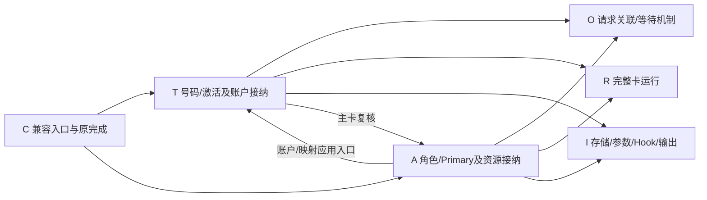
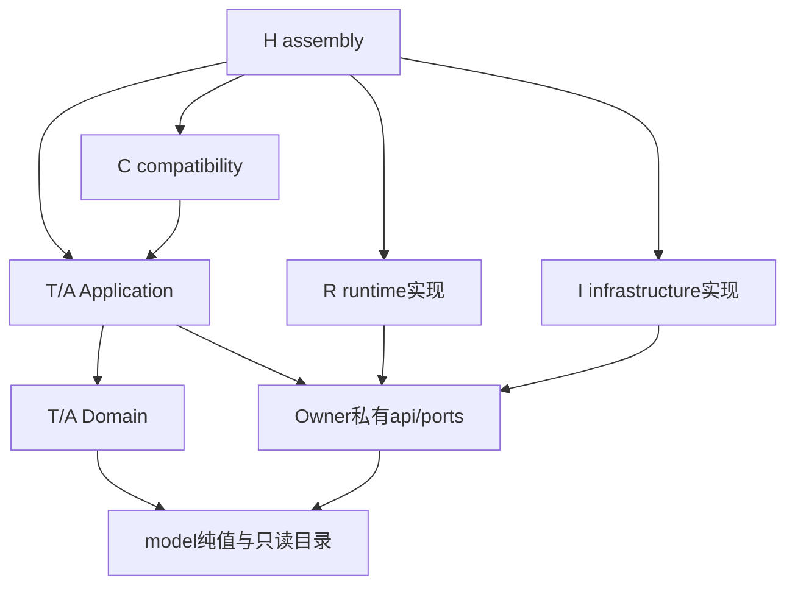
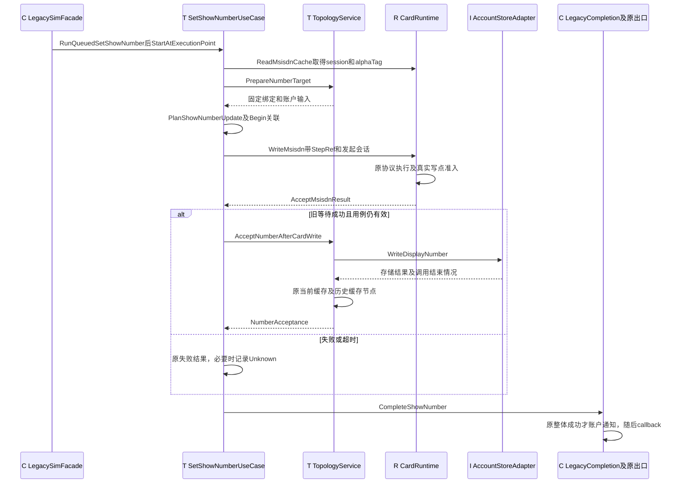

# SIM 目标架构：源码结构与功能详细设计

| 项目 | 内容 |
| --- | --- |
| 文档版本 | 0.1，目标源码骨架说明 |
| 编写日期 | 2026-10-29 |
| 适用源码 | `telephony_core_service/services/multisim/` |
| 当前状态 | 已建立可浏览源码骨架；尚未接入生产、构建或写权迁移 |
| 阅读对象 | SIM架构、C++开发、代码评审、测试及宿主集成人员 |
| 源码阅读输入 | 分支 `docs/publish-local-doc-updates-20261029`，HEAD `efbefd48cb20c2c19e5c1586528af435de518cbd`，以及该工作树中新增的51个骨架源码文件 |
| 权威范围 | 解释当前目录、类型、类和协作关系；不取代目标技术主设计、既有公开契约或功能/WU清单 |

**本文说明已经创建的代码结构，以及这些结构计划承接的功能。源码文件存在不表示对应功能已经实现。** 当前主要交付为类、接口、数据契约、构造注入和业务伪代码，生产仍使用原 `services/sim/`。本文不授权生产接入，不宣布任何目标业务规则已获批准。

新增源码尚处于工作树，不能把它们描述为上述HEAD已包含的提交产物。本文以当前文件内容说明结构；后续源码变更时，应同步更新方法表、实现状态与阅读路线。

源码内容摘要：`e831254a602e61ba912be6969591315ce182f485f35a67c05c117482e398d21f`（SHA-256；按根目录内相对路径字典序，依次连接UTF-8路径、NUL、文件原始字节、NUL）。该摘要固定本文所描述的工作树骨架，不替代Git提交号。

## 目录

1. [范围、依据与状态口径](#scope)
2. [整体结构与职责边界](#architecture)
3. [完整源码目录](#source-tree)
4. [分层与依赖规则](#dependencies)
5. [身份、目标与槽目录](#identity)
6. [T：账户与连接拓扑](#topology)
7. [A：角色与资源分配](#assignment)
8. [应用编排机制与短请求](#application)
9. [R：完整生产卡运行支撑](#runtime)
10. [C/I：兼容入口与技术适配](#integration)
11. [H：SIM侧装配与宿主契约](#assembly)
12. [业务流程：设置显示号码](#set-number)
13. [业务流程：号码查询与独立回写](#query-number)
14. [业务流程：普通SIM激活](#activation)
15. [业务流程：Primary切换与Data联动](#primary)
16. [状态、并发、失败与恢复](#consistency)
17. [原功能迁移与生产接入](#migration)
18. [IDE阅读与开发定位](#reading)
19. [未实现内容与局部设计缺口](#gaps)
20. [检查记录与验证限度](#verification)
21. [附录：逐文件功能及实现状态](#inventory)

<a id="scope"></a>

## 1. 范围、依据与状态口径

### 1.1 两个代码根目录的关系

| 路径 | 当前作用 | 本骨架的关系 |
| --- | --- | --- |
| [`services/sim/`](../services/sim/) | 现有生产实现，包含活动对象、卡协议、缓存、存储及通知路径 | 功能和行为对照来源；本批没有移动、删除或替换 |
| [`services/multisim/`](../services/multisim/) | 目标SIM管理实现的源码根目录 | 覆盖普通SIM、eSIM及所属相关管理能力；当前只有未接入骨架 |
| [`services/core/`](../services/core/) | Core服务入口、宿主装配、共享依赖和生命周期 | 保持原位置；未来通过私有端口连接目标SIM实现 |
| [`interfaces/`](../interfaces/)、[`frameworks/`](../frameworks/) | 既有公开/内部消费契约与Framework入口 | 本骨架没有修改API、ABI、IDL或调用入口 |

`multisim`描述整个目标SIM管理实现的代码范围，不只承担多张卡之间的协调，也不表示新增SO、进程或SA。

### 1.2 设计依据及冲突处理

- [SIM目标架构设计v1.2](SIM_Target_Architecture_Design_v1.2.md)：目标责任裁决的主要依据，重点为§4～6、§8～14、§16～17、§21～22。
- [设计说明与业务流程对照](多SIM架构重构_设计说明与业务流程对照.md)：业务阅读与新旧流程对照。
- [SIM架构重构设计](SIM_Architecture_Refactor_Design.md)：沿用SIM-001～062及子项、WU-01～09和迁移阶段，不在本文建立另一套编号。
- 原生产源码：从Core入口、SimManager、MultiSimController及实际卡运行路径核对原职责。

主设计§4.1/§4.2明确将O调整为Application层可复用编排机制。由此，T、A为两个业务上下文；号码与激活由T应用用例主编排，角色与Primary切换由A应用用例主编排。旧材料中O拥有全部业务流程、`operation/domain`或O绕过A预写参数的表示，不作为本目录的实现依据。裁决依据是事实与不变量的所有权，不是文档更新时间。

### 1.3 本文的实现状态

| 标记 | 含义 |
| --- | --- |
| 有限实现 | 已有可阅读的局部C++实现，例如目录查找、加载成员资格或构造注入；不代表已集成 |
| 仅声明 | 有具名接口、输入输出和关系，但没有函数定义，不能作为可用功能调用 |
| 伪代码 | `.cpp`注释描述未来步骤，编译器不会执行这些步骤 |
| 计划复用 | 原能力仍在生产目录；目标骨架说明其接入/承接位置，没有复制实现 |
| 待细化 | 已识别局部接口、行为或证据缺口；不虚构默认成功或保证 |

所有骨架文件均标记`TARGET ARCHITECTURE SKELETON / PROPOSED`并关联主设计章节。目标状态所有权描述的是未来接管后的分工；当前生产写权没有转移。

<a id="architecture"></a>

## 2. 整体结构与职责边界

### 2.1 责任划分

| 标识 | 目标职责 | 独占的状态或事实 | 不承担的职责 |
| --- | --- | --- | --- |
| T | 账户身份、资料、生命周期、位置绑定、激活和槽运行清单 | 账户、绑定revision、账户版本、active兼容投影、激活进行中 | 原始卡状态、EF协议、默认角色、Radio设备租约 |
| A | 默认Voice/SMS/Data、Primary意图、Radio分配、业务切换和重试 | 角色选择、参数投影、AssignmentTransition、资源决策观察 | 卡身份、Records、IMS注册、数据连接、原始协议session |
| O | 请求关联、等待、效果认知和有限过程状态 | 每个用例私有的RequestContext和运行记录 | 业务事实、业务进行中视图、统一发令、统一重试中心 |
| R | 完整生产卡运行及会话、加载、真实设备资源治理 | 原始卡/锁态、Records、电话簿/短信/STK/eUICC缓存、协议session与资源屏障 | T账户或A角色的独立写权 |
| C | 旧入口、检查、调用者上下文、格式投影、原完成出口 | 兼容登记、完成引用及输出格式；不持可写业务镜像 | 自主决定账户、角色、参数或重试策略 |
| I | DataShare、系统参数、厂商Hook和平台输出的具体适配 | 技术句柄及协议执行上下文 | 业务规则、独立业务缓存、全局事务 |
| H | Core宿主和SIM侧对象装配、注入、匹配销毁与生命周期 | 目录值、实例epoch、共享依赖的归属关系 | 新业务Owner、第二套活动RIL或成熟卡对象 |

### 2.2 分工的直接结果

`MultiSimController`的旧职责会进入多个位置：账户和号码进入T，默认角色及主卡参数进入A，设备协议继续在R，存储协议进入I，旧完成条件进入C。类名不要求一一对应，不能只把旧Controller重命名为新Coordinator。

T的账户与位置绑定由同一应用入口协调，但分为`AccountRegistry`与`BindingIndex`两个纯模型边界。A的业务切换状态是`AssignmentTransition`，R的协议会话和设备租约不进入该领域对象。O没有领域聚合，也没有面向全部SIM业务的统一入口。

### 2.3 主要运行协作

下图箭头表示计划中的调用/结果协作，**不是当前已运行路径，也不是源码include方向**。



应用之间经正式入口协作，不跨Owner取得可写聚合。简单资料查询、状态查询和R内部文件加载无须先登记一个全局Operation。

<a id="source-tree"></a>

## 3. 完整源码目录

以下目录树由当前文件清单生成，共36个头文件和15个源文件。`.h`表达契约/状态，`.cpp`可能只包含构造关系和明确标注的流程注释；是否已有实现见附录。

```text
services/multisim/
├── application/
│   ├── card_access/
│   │   └── local_card_requests.h
│   └── orchestration/
│       ├── request_context.h
│       └── runtime_operation_store.h
├── assembly/
│   ├── host_ports.h
│   ├── sim_module_factory.cpp
│   └── sim_module_factory.h
├── assignment/
│   ├── api/
│   │   └── assignment_requests.h
│   ├── application/
│   │   ├── assignment_service.cpp
│   │   └── assignment_service.h
│   ├── domain/
│   │   ├── assignment_aggregate.h
│   │   └── role_selection.h
│   └── ports/
│       ├── assignment_store.h
│       └── radio_execution_port.h
├── compatibility/
│   ├── legacy_boundary_ports.h
│   ├── legacy_completion.cpp
│   ├── legacy_completion.h
│   ├── legacy_sim_facade.cpp
│   └── legacy_sim_facade.h
├── infrastructure/
│   ├── account_store_adapter.cpp
│   ├── account_store_adapter.h
│   ├── assignment_store_adapter.h
│   ├── legacy_output_adapter.cpp
│   └── legacy_output_adapter.h
├── model/
│   ├── sim_identity.h
│   ├── slot_catalog.cpp
│   └── slot_catalog.h
├── runtime/
│   ├── records/
│   │   ├── load_session.cpp
│   │   └── load_session.h
│   ├── resource/
│   │   └── resource_barrier.h
│   ├── session/
│   │   └── session_registry.h
│   ├── card_runtime.cpp
│   └── card_runtime.h
└── topology/
    ├── api/
    │   └── topology_requests.h
    ├── application/
    │   ├── activate_sim_use_case.cpp
    │   ├── activate_sim_use_case.h
    │   ├── set_show_number_use_case.cpp
    │   ├── set_show_number_use_case.h
    │   ├── show_number_query.cpp
    │   ├── show_number_query.h
    │   ├── topology_service.cpp
    │   └── topology_service.h
    ├── domain/
    │   ├── account_registry.h
    │   ├── binding_index.cpp
    │   ├── binding_index.h
    │   ├── show_number_plan.cpp
    │   └── show_number_plan.h
    └── ports/
        ├── account_store.h
        ├── activation_runtime_port.h
        ├── number_query_host_port.h
        ├── show_number_completion_port.h
        └── show_number_runtime_port.h
```

### 3.1 目录组织规则

| 目录 | 内容 | 放置理由 |
| --- | --- | --- |
| `topology/` | T的命令、用例、纯模型及所需端口 | 账户、绑定、资料和激活的变化集中在同一业务责任下 |
| `assignment/` | A的角色、切换、分配规则及执行/存储端口 | 角色与Primary联动及业务重试由同一Owner控制 |
| `application/orchestration/` | 跨用例可复用的应用机制 | 复用关联与等待，不建立第三业务上下文 |
| `application/card_access/` | PIN、EF、本地Profile短请求 | 原始卡操作不强求账户，不复制复杂业务状态机 |
| `runtime/` | 生产卡能力复用、会话、加载和设备资源治理 | 保留完整卡型协议和成熟实现 |
| `compatibility/` | 旧入口桥、旧结果和完成出口 | 兼容职责可独立查看，不夹带业务写权 |
| `infrastructure/` | 具体存储、参数、Hook与通知适配 | 平台类型和协议执行留在实现侧 |
| `assembly/` | SIM侧工厂契约、具体构造和宿主输入 | 只有组合根认识需要注入的具体实现 |
| `model/` | 必要的纯身份/目标值和只读槽目录 | 共享明确语义，不集中存放服务或万能Context |

没有为State、File、电话簿、STK、eUICC建立同名空壳。当前这些能力的完整生产代码仍在`services/sim/`，通过`ProductionSlotBindings`和运行入口明确未来归属。

<a id="dependencies"></a>

## 4. 分层与依赖规则

### 4.1 源码依赖

下图箭头为**使用方指向被依赖声明/实现**，用于检查头文件和构造依赖。



Application运行时调用注入的R/I对象，编译时仅引用所需端口。R/I的实现头引用并实现这些端口。H的SIM侧装配认识实际类型，Core侧宿主实现不搬入SIM。

### 4.2 各层的约束

1. Domain只包含纯状态、值类型和规则，不引入RIL、DataShare、IPC、FFRT、真实callback或具体宿主实现。
2. T/A之间可依赖正式应用入口或不可变命令/视图，不直接读写对方私有容器。骨架并未为每个应用入口再机械包一层接口。
3. `ports/`按使用需求及Owner定义。例如`ShowNumberRuntimePort`属于T，`RadioExecutionPort`属于A；不存在覆盖全部卡能力的万能接口。
4. `api/`为模块私有协作契约，不成为新公共API、InnerKit ABI或IDL。
5. `model/`不保存业务服务、可写缓存、平台句柄或全部模块端口。
6. 原生产平台调用按切片收口；目标依赖方向不能证明旧仓库已经满足全部规则。

<a id="identity"></a>

## 5. 身份、目标与槽目录

### 5.1 纯标识与分类目标

入口文件：[model/sim_identity.h](../services/multisim/model/sim_identity.h)。

| 类型 | 表达的含义 | 使用限制 |
| --- | --- | --- |
| `SubscriptionId` | 包装既有不透明`legacySimId` | 不分配第二公共身份，不承诺跨删除/重装稳定 |
| `SlotId` | 既有逻辑槽/兼容路由索引 | 不作为永久账户身份，不直接推导Modem独立性 |
| `RadioDomainId` | 已核实的Radio资源域 | 来源由宿主/能力证据提供，不由槽数量自动生成 |
| `SlotTarget` | 对一个槽的操作或查询 | 空槽也可合法存在 |
| `CardApplicationTarget` | 槽及具体卡应用路由 | PIN、EF等不要求先有simId；applicationKey不可凭空补造 |
| `SubscriptionTarget` | 一个账户目标 | 可用于离线账户资料，不强制当前有卡 |
| `ResolvedTarget` | 上述三种合法目标的`variant` | 避免任意optional字段拼成无法解释的目标 |

`SessionRef`包含`RuntimeEpoch`、卡应用目标及`bindingGeneration`，由R使用和维护。`BindingRef`包含账户、槽及`bindingRevision`，由T维护。两者分开：位置绑定变化、卡应用会话变化、账户属性变化并不使用同一个版本号。

### 5.2 SlotCatalog

入口文件：[slot_catalog.h](../services/multisim/model/slot_catalog.h)、[slot_catalog.cpp](../services/multisim/model/slot_catalog.cpp)。

`SlotCatalog`是H构建后只读注入的值对象。其`SlotDescriptor`分别表达端点种类、RIL实例、Radio域、可见性类别及是否可在运行期加入；`LegacyCapacityMeasures`分别记录配置、可路由、已装配、对外可见及具备Radio栈的槽数。

当前构造、`Find`、`Slots`及`Capacities`已有有限实现。`Find`逐项查找，缺项返回空指针，不回退槽0或Modem0。未知资源/容量保持optional空值，不能把Unknown解释为不支持或默认0。

H的实际目录构建器尚未实现。生产接入前必须校验槽索引唯一性、路由、容量来源及对象寿命；当前构造函数不会自动检查这些约束。首次引入需逐产品对照原容量函数，不能借目录统一旧有差异，也不从目录推出四槽、MEP或Radio并发能力。

<a id="topology"></a>

## 6. T：账户与连接拓扑

### 6.1 类型和文件分工

| 元素 | 文件 | 功能 |
| --- | --- | --- |
| 命令、结果和只读资料 | [topology_requests.h](../services/multisim/topology/api/topology_requests.h) | 号码/激活命令、账户视图、存储及分步接纳结果 |
| `AccountRegistry` | [account_registry.h](../services/multisim/topology/domain/account_registry.h) | 按Subscription维护账户资料、active及激活进行中事实 |
| `BindingIndex` | [binding_index.h](../services/multisim/topology/domain/binding_index.h) | 槽运行清单、已接受绑定和局部revision |
| `PlanShowNumberUpdate` | [show_number_plan.h](../services/multisim/topology/domain/show_number_plan.h) | 纯函数，返回号码更新的必要步骤偏序 |
| `TopologyService` | [topology_service.h](../services/multisim/topology/application/topology_service.h) | T唯一应用接纳入口及字段级I/O协调 |
| `SetShowNumberUseCase` | [set_show_number_use_case.h](../services/multisim/topology/application/set_show_number_use_case.h) | 号码写卡与账户同步的主编排 |
| `ShowNumberQuery` | [show_number_query.h](../services/multisim/topology/application/show_number_query.h) | 原读源查询和独立后台资料回写 |
| `ActivateSimUseCase` | [activate_sim_use_case.h](../services/multisim/topology/application/activate_sim_use_case.h) | 激活步骤、设备结果、active及进行中状态协作 |

### 6.2 AccountRegistry：账户事实

`AccountRecord`记录ICCID、显示名、标签、IMS偏好、当前/历史显示号码、active投影、激活进行中和版本。当前/历史号码是同一Owner下需要保留旧可见节点的片段，不是两个独立业务写者。

| 方法组 | 输入/输出 | 接纳的内容 |
| --- | --- | --- |
| `Read` | Subscription→optional AccountRecord副本 | 只读账户，不暴露可写容器 |
| `AcceptNumberVisibility` | 账户、期望版本、节点、号码→AccountAcceptance | 当前或历史号码的一个可见步骤 |
| `AcceptActiveProjection` | 账户、期望版本、active→AccountAcceptance | active兼容事实，不等于卡Ready |
| `SetActivationInProgress` | 账户、进行中值→AccountAcceptance | T负责的激活进行中事实 |
| `AcceptDisplayName/AcceptLabel/AcceptImsPreference` | 账户、版本、对应字段值→AccountAcceptance | 纯字段状态变化 |
| `AcceptDiscoveredAccount` | 已分配身份的AccountRecord→AccountAcceptance | 沿旧匹配/分配政策接纳账户 |

上述方法仅声明。`accounts_`为私有映射，当前并未执行任何生产导入或写入。类上的friend声明和注释表达由`TopologyService`控制写入；方法本身仍是public，后续接入时须落实访问约束与调用检查，不能仅以friend声明宣称编译期已经封闭全部写权。

### 6.3 BindingIndex：位置绑定

`BindingIndex`引用只读目录，维护`SlotRuntimeEntry`映射。每项包含是否已装配运行实例，以及optional的已接受`BindingRef`。它不复制R的原始在位状态，不把标签当身份或Port。

`Find/StillMatches/AcceptBinding/RemoveBinding/ReadRuntimeSlots`分别用于读绑定、复核发起输入、受控绑定、按原引用解绑和读取槽运行清单。除构造函数外仍只有声明。近期模型是每逻辑位置至多一个当前绑定，Port感知绑定需单独产品/存储证据。

### 6.4 TopologyService：唯一接纳入口

构造参数为`const SlotCatalog&`和`AccountStore&`。它持有`AccountRegistry`、`BindingIndex`，借用存储端口，不持具体R对象、真实callback或共享RIL。

| 方法 | 主要输入/输出 | 职责边界 |
| --- | --- | --- |
| `FindBinding/ReadAccount` | 槽或账户→optional视图 | 应用只读入口，不承诺跨Owner原子快照 |
| `SetDisplayName/SetSimLabel` | 旧目标、字段值→原错误值 | 简单资料变更；名称不写卡 |
| `SaveImsPreference/QueryImsPreference` | 槽及偏好值/输出引用→原错误值 | 查询仍按ICCID访问原存储，不改成纯内存读 |
| `PrepareNumberTarget` | SlotTarget、SessionRef→optional NumberExecutionTarget | 固定相关绑定、会话及账户版本的准备位置 |
| `AcceptNumberAfterCardWrite` | 固定目标、号码→NumberAcceptance | 原号码设置的账户步骤，不重发写卡 |
| `AcceptIndependentNumberBackwrite` | 固定目标、号码→NumberAcceptance | 独立查询回写，不复活原设置请求 |
| `AcceptAccountReload` | loadAttempt及各账户期望版本 | 发起时保存依赖，防旧加载覆盖新字段 |
| `AcceptCardDiscovery` | 槽、ICCID、A提供的AccountRoleFragment | T接纳身份/绑定，角色由A提供只读片段 |
| `AcceptCardRemoval` | 原BindingRef | 受控解绑及旧条件下标签/active相关变化 |
| `AcceptActivationProgress/Projection` | 账户、进度或active及版本→AccountAcceptance | 接纳T事实，不把设备协议状态搬入T |

`ReserveNumberField/ReleaseAfterStoreCallFinished`是应用执行资格的预留位置，覆盖目标字段的整个外部调用。它们不是数据库锁，也没有实现provider事务。当前代码没有同步原语、实际资格表或恢复移交实现。

`AcceptCardDiscovery`接口表达T需要A角色片段，但没有完整发现用例定义身份匹配、向A取片段、组合建行及重载结果的全过程；这些仍是待补的协作细节。

### 6.5 号码结果的分步表达

- `AccountStoreWriteResult`：分别保存原错误、写入是否确认、调用是否结束。调用结束和效果确认是两件事。
- `NumberAcceptance`：包含存储结果、当前缓存是否接纳、历史缓存是否接纳及原最终错误。
- `AccountView`：只提供T账户资料，不包含可写A角色或R Records。
- `NumberExecutionTarget`：保存`BindingRef`、`SessionRef`及账户版本；不能只靠旧slot重新解析当前卡。

`NumberAcceptance`能表达DB与缓存部分效果，但未单独编码每种“未开始/未知/失败”原因；若进入生产需细化具体结果解释，不能把所有false等同于未发生。optional准备结果也尚未携带全部旧错误分支，错误映射是明确待实现项。

### 6.6 T的出站端口

| 端口 | 使用方 | 实现/注入 | 能力 |
| --- | --- | --- | --- |
| `AccountStore` | TopologyService | I的AccountStoreAdapter；H注入 | 名称/号码/标签/IMS/active字段补丁、账户加载、按ICCID查询 |
| `ShowNumberRuntimePort` | 号码用例、号码查询 | R的CardRuntime；H注入 | 读MSISDN缓存与写MSISDN，不覆盖全部卡接口 |
| `ShowNumberCompletionPort` | 号码用例 | C的LegacyCompletion；H注入 | 输出原业务结果及分步效果 |
| `NumberQueryHostPort` | 号码查询 | Core未来实现，SimHostPorts注入 | IMS IMPU回退及独立回写任务投递 |
| `ActivationRuntimePort` | 激活用例 | R的CardRuntime；H注入 | 原普通激活设备步骤 |
| `ActivationHookPort` | 激活用例 | I的ActivationHookAdapter；H注入 | 原SubState和激活完成Hook；T保留进度写权 |

`AccountStore`的具体命令与结果如下：

| 方法 | 主要输入 | 输出 |
| --- | --- | --- |
| `WriteDisplayNumber` | AccountNumberPatch：SubscriptionId和号码 | AccountStoreWriteResult |
| `WriteActiveProjection` | AccountActivePatch：SubscriptionId和active | AccountStoreWriteResult |
| `WriteDisplayName` | AccountNamePatch：SubscriptionId和名称 | AccountStoreWriteResult |
| `WriteLabel` | AccountLabelPatch：SubscriptionId和原标签值 | AccountStoreWriteResult |
| `WriteImsPreference` | AccountImsPreferencePatch：SubscriptionId和偏好 | AccountStoreWriteResult |
| `LoadAccounts` | 按原加载上下文访问存储 | AccountLoadResult：错误、完成情况及T字段行 |
| `QueryImsPreferenceByIccid` | ICCID及偏好输出引用 | 原错误值，保持原存储读源 |

存储端口仅提供所属字段命令，不提供整账户任意Save。`AccountLoadResult`区分完成情况、错误和行数据；空列表不会自动表示读取成功。

<a id="assignment"></a>

## 7. A：角色与资源分配

### 7.1 领域对象

入口：[role_selection.h](../services/multisim/assignment/domain/role_selection.h)、[assignment_aggregate.h](../services/multisim/assignment/domain/assignment_aggregate.h)。

`RoleSelection`用`DefaultRole`区分Voice/SMS/Data，并分别表达偏好及有效选择。`AssignmentAggregate`私有持有角色映射、revision、按Radio域的切换映射、lastPrimary及lastData。

`AssignmentTransition`包含资源域、目标槽、阶段和业务attempt，属于A的业务状态。阶段枚举为`Admitted/ParametersWritten/DevicePending/Reconciling/Completed/Failed`。它不包含RIL serial、协议session、设备fence、callback或条件变量。

领域声明包括`AcceptRoleSelection/ReadRoleSelection`、`AdmitTransition/PlanPrimarySwitch`、`AcceptTransitionPhase`、`IsSwitchInProgress`、`AcceptPrimaryParameterProjection/AcceptDataParameterProjection`。目前这些规则方法均未定义。其目标不变量为同一角色约束域的唯一默认选择、同一已知Radio域至多一个业务切换。

### 7.2 AssignmentService

入口：[assignment_service.h](../services/multisim/assignment/application/assignment_service.h)。构造注入目录、A存储、R执行、I输出及T正式应用入口。

| 方法 | 功能 | 原功能承接 |
| --- | --- | --- |
| `SetDefaultRole` | 按角色执行原存储、参数、缓存及输出轨迹 | Controller默认Voice/SMS/Data |
| `StartPrimarySwitch` | Primary切换主编排，持有业务进行中状态 | SetPrimarySlotId及分支 |
| `AcceptRadioStep` | 同域接纳步骤结果与资源观察 | 原协议结果到Controller的处理 |
| `RetryPrimaryAfterReconciliation` | 效果可判定后唯一业务重试授权 | RetrySetPrimarySlotId及相关事件 |
| `ReadLegacyAssignment` | 发布角色及Primary/Data兼容视图 | 原last、角色、进行中查询 |
| `AdmitActivationBeforeDevice` | 向T激活用例提供切换准入/原有界等待协作 | 激活等待Primary切换 |
| `AcceptEntryPrimaryPreference` | 接纳指定旧入口的用户偏好提示 | Core入口及本地Profile后的参数写 |
| `RecheckPrimaryAfterAccountChange` | 账户/激活变化后的主卡复核 | CheckIfNeedSwitchMainSlotId等 |
| `PrepareAccountRoleFragment` | 为T建行/重载提供版本化只读角色片段 | 混合账户行中的A角色字段 |

`AccountRoleFragment`中的`assignmentRevision`用于表达片段来源；T不能根据其中布尔列推导设备已完成切换。`AssignmentView`中的lastPrimary/lastData保留旧参数投影语义，不从同名DB列重新计算运行查询真值。

### 7.3 端口与旧语义差异

`AssignmentStore`由`AssignmentStoreAdapter`实现，包括默认卡命令、主卡参数快照/预写/条件恢复、Data保存和用户偏好写入。`RadioExecutionPort`由`CardRuntime`实现，复用原RadioProtocolController。`AssignmentOutputPort`由`AssignmentOutputAdapter`实现，保留阶段事件、主卡广播及Data输出。

A存储端口的方法输入输出为：

| 方法 | 输入/输出 | 执行限制 |
| --- | --- | --- |
| `WriteDefaultRole` | SetRoleCommand→RoleStoreResult | 沿对应角色原默认卡协议；不替代Data参数路径 |
| `ReadPrimaryParameters` | 无参数→PrimaryParameterSnapshot | 保存原槽字符串及主卡ICCID字符串，不预判有效性 |
| `PrewritePrimary` | SlotId、已按原规则编码的ICCID→AssignmentParameterResult | 保持原预写节点，返回参数结果与调用结束信息 |
| `RestorePrimaryIfLegacyValid` | 原参数快照→AssignmentParameterResult | 旧值非空且合法等原条件满足才恢复 |
| `WriteDefaultData` | SlotId→AssignmentParameterResult | 保留Data独有参数协议及原失败传播语义 |
| `WriteUserPrimaryPreference` | userSet→AssignmentParameterResult | 仅A在原适用节点授权，不由C自主写 |

Voice/SMS的provider命令及错误，Data的参数/last/广播及失败传播方式不同。`SetDefaultRole(Data)`只是应用入口归属的表达，不能把Data路由到Voice/SMS同一默认卡URI协议；接入时必须明确其分派至`WriteDefaultData`等原路径。

A保有业务策略与重试，R保有协议session与真实设备串行，I执行参数和输出。恢复参数只改变参数投影，不等于硬件回滚；阶段结束事件也不代表业务成功。

<a id="application"></a>

## 8. 应用编排机制与短请求

### 8.1 O的运行数据

入口：[request_context.h](../services/multisim/application/orchestration/request_context.h)、[runtime_operation_store.h](../services/multisim/application/orchestration/runtime_operation_store.h)。

| 类型 | 主要内容 | 维护/使用方 |
| --- | --- | --- |
| `RequestId` | 模块实例内请求引用 | 各Owner自己的运行容器 |
| `StepRef` | request、step、attempt | 具体T/A用例与运行结果关联 |
| `CompletionId/CompletionPlan` | 原完成引用及成功通知条件 | 应用携带、C/宿主解释与交付 |
| `RequestContext` | 原目标、步骤、发起会话及完成计划 | 具体用例，不是业务聚合 |
| `EffectKnowledge` | NotSent、Rejected、ConfirmedApplied、ConfirmedNotApplied、Unknown | 用例/R根据证据接纳 |
| `WaitState` | Waiting、Delivered、TimedOut、CancelledWait、CallerDied | 运行期等待，不代表设备终态 |
| `TerminalState` | Open、Succeeded、Failed、NeedsReconciliation | 当前骨架的有限过程状态 |

`RuntimeOperationStore`仅声明`Begin/Read/AcceptResult/EndWait/MarkTerminal/RetireAfterEvidenceRetention`。它不调用业务端口、不维护账户或角色、不安排重试。`AcceptResult`可区分Accepted、Duplicate、WrongStep、AlreadyTerminal、UnknownRequest，但真正目标/session校验仍需所属用例与R配合完成。

SetShowNumberUseCase、ActivateSimUseCase、AssignmentService各自持有一个容器；不存在所有请求共用的单例操作中心。请求编号只在所属容器/实例作用域内有意义，不能跨Owner仅凭一个整数关联，更不能作为公开OperationId或跨重启恢复凭证。

当前`TerminalState`未完整表达主设计的所有运行阶段，`NeedsReconciliation`与“业务终态已结束、设备证据仍待核对”的关系仍需细化。不能把枚举声明当作完整状态机已经实现。

### 8.2 LocalCardRequests

入口：[local_card_requests.h](../services/multisim/application/card_access/local_card_requests.h)。

它表达C进入应用短请求后，按具体方法使用R的`LocalCardPort`：`VerifyPin`、`ReadElementaryFile`、`SwitchLocalProfile`。请求携带卡应用目标和RequestContext，不为PIN/EF强建账户，也不强制登记多步骤业务操作。

`SwitchProfileRequest`包含ICCID和optional的已核实Port索引；未知Port不能补0。`EuiccPrimitiveResult`分别保留外层原返回与卡侧enum结果，外层成功不能证明Profile切换成功、拓扑已就绪或Radio已完成协调。

当前只有构造和方法声明，短请求的异步结果、剩余次数及具体完成通道尚未补齐。本地Profile后的A偏好写与T绑定观察也只是职责说明。下载、OSU等高层任务继续沿EsimServiceClient及既有66250边界，不复制远端主流程。

<a id="runtime"></a>

## 9. R：完整生产卡运行支撑

### 9.1 CardRuntime与成熟生产能力

入口：[card_runtime.h](../services/multisim/runtime/card_runtime.h)、[card_runtime.cpp](../services/multisim/runtime/card_runtime.cpp)。

CardRuntime实现T所需的MSISDN/激活、A所需的Radio执行及应用短请求端口，同时声明电话簿、STK、Records加载和局部Refresh入口。其目标是组织完整R运行职责及结果接纳，不是把成熟协议缩减成几个透传接口。

| 原生产能力 | 继续复用来源 | 目标接入位置 |
| --- | --- | --- |
| 卡/锁状态、软件状态输入和卡型 | SimStateManager、SimStateHandle、SimStateTracker | `ProductionSlotBindings::state`，R原状态接纳路径 |
| EF、各卡型文件、解析及加载 | SimFileManager、IccFile、SimFile、RuimFile、IsimFile及各Controller/解析器 | `files`、`BeginRecordsLoad/OnScopedRefresh`及原卡型写点 |
| MSISDN写入与卡缓存 | SimFileManager::SetSimTelephoneNumber、SimFile::UpdateMsisdnNumber/ProcessSetMsisdnDone | `WriteMsisdn/AcceptMsisdnWriteCompletion` |
| ADN/FDN、PBR/ANR/IAP | IccDiallingNumbers*、UsimDiallingNumbersService | `phonebook`、`ReadPhonebook`及原多文件协议 |
| 卡侧短信存储 | SimSmsManager/Controller | `smsStorage`；不迁入完整短信业务 |
| STK会话 | StkManager/Controller | `stk`、`SendStkTerminalResponse` |
| 运营商配置、APN、权限匹配 | SimAccountManager、OperatorConfig*、OperatorMatchingRule、IccOperatorPrivilegeController | `carrierConfig`及原运行协作，类名Account不决定归T |
| Radio三阶段协议 | RadioProtocolController | 借用`radio_`，`SwitchPrimaryRadio/EndLegacySenseSwitch` |
| 本地eUICC/APDU及Profile资料 | EsimManager、EsimFile、EsimController | 普通/低优先级原实例及`SwitchLocalProfile`等原语 |

`ProductionSlotBindings`对state/files使用引用，对其他可选能力使用指针；eUICC普通与低优先级实例、Radio实例也由外部提供。当前构造不创建任何成熟对象、不注册生产事件、不迁移卡缓存。后续须明确各指针的Feature条件及缺失时原错误语义，不能把空指针统一当作“不支持”。

### 9.2 号码结果桥

CardRuntime声明`msisdnAssociations_`保存原发起输入元数据，`ResultOwners`借用对应T/A应用对象。`BindResultOwners`仅声明，SimModule构造中也没有调用它。

计划中的原生产事件桥进入`AcceptMsisdnWriteCompletion`，恢复发起时step、号码/tag、SessionRef及原事件/serial关联，在真实卡缓存写点核对资格，再把有效结果交T号码用例。它不另建一份RIL requestMap，不再发送第二份设备命令。

当前`ResultOwners`使用裸指针表达模块内借用，并不天然具备weak生命周期或异步排空保证。正式实现必须补齐Owner存活、epoch、在途任务与关闭协议；不能把这张借用关系表直接当作安全回调实现。

### 9.3 SessionRegistry

入口：[session_registry.h](../services/multisim/runtime/session/session_registry.h)。R维护每个资源/卡应用的bindingGeneration，换卡、卡应用替换、绑定失效使旧写资格失效；显示名修改不应推进卡会话代次。

`Current/StillCurrent/InvalidateForVerifiedReplacement`表达当前会话与撤销；`RegisterExpectedTransition/AcceptExpectedContinuation`表达合法激活、Profile或Radio切换后的受控接续。

`ExpectedTransition`保存旧会话、发起步骤、受影响目标、期望身份、允许原因、时限及是否消费；`TransitionEvidence`提供原因、观察时刻、身份和协议/关联重查的因果证据。只观察到同槽READY不够。

目前除构造外均未定义。`sessions_`的字符串键如何完整编码资源与卡应用、时钟单位、身份未知时的证据门槛、如何登记及撤销期望，都需随实际协议细化。

### 9.4 LoadSession：已存在的有限规则实现

入口：[load_session.h](../services/multisim/runtime/records/load_session.h)、[load_session.cpp](../services/multisim/runtime/records/load_session.cpp)。

`LoadToken`由SessionRef、scope、recordsGeneration和成员引用构成。`LoadMember`记录请求、父成员、必需/可选、读写类型和Pending/Completed/Failed/Invalidated状态。

| 方法 | 当前实际行为 | 限度 |
| --- | --- | --- |
| `AddMember` | 只接纳Pending；有parent时要求父成员已存在；同request拒绝重复插入 | 不执行EF读取，不实现卡型完成判据 |
| `TryConsumeRead` | 比较epoch、槽/应用、bindingGeneration、scope、recordsGeneration；要求已登记的Pending读成员；一次转Completed或Failed | 不解码、不发布Records、不自行查询SessionRegistry当前状态 |
| `InvalidateAffectedReadMembers` | 将当前LoadSession内仍Pending的读成员转Invalidated | 不自动定位依赖闭包、不推进新代次、不取消写设备 |

调用方必须先选择受影响scope，并在R同一受控执行域内完成当前会话复核、资格消费和Records接纳。仅比较LoadSession构造时保存的旧SessionRef，不能保证它在换卡后仍是当前会话。

未受影响scope继续使用原token；在途写不能按过期读直接丢弃或释放设备资源。必需/可选字段目前只是数据，没有自动计算LOADED规则。原各卡型完成条件和输出仍由成熟File路径承接。

### 9.5 ResourceBarrier

入口：[resource_barrier.h](../services/multisim/runtime/resource/resource_barrier.h)。

资源键以已核实的真实共享设备域表达，不以对象数量或slot数量猜测独立性。`ResourceRecord`记录状态、fence、租约及效果认知；租约关联原步骤和资源集合。

| 状态 | 推荐语义 | 当前实现状态 |
| --- | --- | --- |
| Checking | 启动/重连后核对是否可重用 | 仅契约，未启用 |
| Available | 无未结束冲突请求，可准入 | 仅契约，未启用 |
| InFlight | 原步骤持有执行资格 | 仅契约，未启用 |
| Quarantined | 超时、失联或结束不明，保留原归属与核对责任 | 仅契约，未启用 |

`Acquire/Quarantine/AcceptRecoveryEvidence/ReadState`均无定义。成功后释放、未发送撤销、多个资源的fence及恢复证据处理也没有完整实现，不能仅补一个Acquire就启用新屏障。普通/低优先级eUICC对象共用设备时必须同域治理；Get若开通道/APDU也要按实际占用判断，缓存命中不额外发请求。

<a id="integration"></a>

## 10. C/I：兼容入口与技术适配

### 10.1 LegacySimFacade

入口：[legacy_sim_facade.h](../services/multisim/compatibility/legacy_sim_facade.h)。它是SIM内部私有桥，未来供原CoreServiceSim、SimManager及CMI路径受控委托，不替换公开签名。

| 方法 | 计划委托位置 |
| --- | --- |
| `SetShowNumber` | 通过Core宿主完成原入口检查、保留callback引用、投递旧队列 |
| `RunQueuedSetShowNumber` | T号码用例`StartAtExecutionPoint` |
| `GetShowNumberAtExecutionPoint` | T查询`ReadAtLegacyExecutionPoint` |
| `RunOrdinaryActivationAtExecutionPoint` | T普通激活用例 |
| `RunPrimarySwitchAtExecutionPoint` | A Primary切换用例 |
| `ReadAssignmentForLegacyProjection` | A只读视图供C做旧投影 |
| `VerifyPinAtExecutionPoint/SwitchLocalProfileAtExecutionPoint` | 应用短请求入口 |

Facade只借用已装配对象，没有账户/角色可写缓存。只有号码入口展开了检查/排队说明，不能据其他执行点声明宣称它们已具备完整公开入口权限、受理和完成协议。

### 10.2 兼容边界端口

- `LegacyIngressPort`：Core未来实现原号码入口检查和旧队列投递。检查顺序为SystemApp、SET_TELEPHONY_STATE、Manager/callback空值、调用者槽能力。
- `CallbackHostPort`：Core未来保留真实callback并提供原Int32结果交付。`LegacyCallerRef/LegacyCallbackRef/CompletionId`是私有引用，不改变IPC载荷。
- `LegacyOutputPort`：I提供原账户通知和号码结果交付的技术出口，C决定何时调用。

真实调用者必须在原入口捕获，不能在异步线程重新读取服务身份替代调用方。登记、死亡清理、取消后已排队任务及完成引用释放仍需真实宿主实现。

### 10.3 LegacyCompletion

[LegacyCompletion](../services/multisim/compatibility/legacy_completion.h)实现T的`ShowNumberCompletionPort`。计划仅在原整体成功且CompletionPlan要求时发原账户通知，随后交付原号码callback。

卡成功而DB或账户缓存失败，不发原整体成功通知。通知投递失败或callback失败不会撤销卡/DB效果，也不触发设备重试。当前`CompleteShowNumber`只有声明及伪代码，没有实际发送。

### 10.4 I的具体Adapter

| Adapter | 实现的端口 | 复用路径及边界 |
| --- | --- | --- |
| `AccountStoreAdapter` | T AccountStore | 借用SimRdbHelper，沿原DataShare键/URI按字段写；不写账户缓存 |
| `AssignmentStoreAdapter` | A AssignmentStore | 原默认卡URI及SetParameter键/编码；不重发Radio |
| `LegacyOutputAdapter` | C LegacyOutputPort | MultiSimMonitor原账户通知及CallbackHostPort原结果交付 |
| `AssignmentOutputAdapter` | A AssignmentOutputPort | 原主卡阶段事件、主卡广播及Data输出 |
| `ActivationHookAdapter` | T ActivationHookPort | 原UpdateSubState/SetActiveSimFunc的厂商Hook技术调用；进度清零仍交T |

上述执行方法均未定义。Hook的void返回仅保留原契约，不能当作设备确认。两个StoreAdapter可借用同一个旧helper，但由各自Owner生成不相交字段计划，不创造两份业务缓存或provider事务。

<a id="assembly"></a>

## 11. H：SIM侧装配与宿主契约

### 11.1 输入对象及所有权

入口：[host_ports.h](../services/multisim/assembly/host_ports.h)、[sim_module_factory.h](../services/multisim/assembly/sim_module_factory.h)。

| 输入 | 内容 | 所有权要求 |
| --- | --- | --- |
| `SimHostPorts` | 共享ITelRilManager引用、LegacyIngressPort、CallbackHostPort、NumberQueryHostPort | Core创建并提供，寿命覆盖SIM使用及回调排空 |
| `ExistingSimBindings` | 原SimRdbHelper、MultiSimMonitor、RadioProtocolController、各槽成熟对象及两组eUICC实例 | 原对象继续拥有；目标装配仅借用，需先明确写权切换 |
| `shared_ptr<const SlotCatalog>` | H构建的只读目录 | 模块保存共享只读引用；接入前校验非空与内容 |
| `RuntimeEpoch` | 本次实例令牌 | H提供新实例标识，不用从零重置计数假装跨实例唯一 |

Core拥有共享RIL创建、注册和生命周期。当前构造仅保存共享RIL引用，没有用它再造一套R运行对象；R借用的成熟对象沿原装配已经连接共享RIL。SIM不能停止搜网等其他消费者仍在使用的RIL。

### 11.2 具体注入关系

[SimModule构造函数](../services/multisim/assembly/sim_module_factory.cpp)已有有限实现，按成员声明顺序建立如下关系：

```text
原SimRdbHelper ──> AccountStoreAdapter ──> TopologyService
              └─> AssignmentStoreAdapter ──> AssignmentService
原Monitor + Core callback ──> LegacyOutputAdapter ──> LegacyCompletion
原State/File/Radio/eUICC ──> CardRuntime
TopologyService + CardRuntime + LegacyCompletion ──> SetShowNumberUseCase
TopologyService + CardRuntime + Core号码宿主 ──> ShowNumberQuery
TopologyService + AssignmentService + CardRuntime + ActivationHookAdapter ──> ActivateSimUseCase
CardRuntime ──> LocalCardRequests
以上应用对象 + Core入口/回调端口 + SlotCatalog ──> LegacySimFacade
```

AssignmentService另注入AssignmentOutputAdapter和TopologyService。构造顺序为宿主/目录、各Adapter、LegacyCompletion、CardRuntime、TopologyService、AssignmentService、号码用例、查询、激活、短请求、Facade。

该构造是private，创建访问结构和工厂没有实现。构造体也没有调用`BindResultOwners`、注册事件、发设备命令或构造新State/File/eUICC对象。构造注入关系的存在不等于目标模块已可运行。

### 11.3 工厂、销毁和关闭

`CreateSimModule`返回`variant<SimModuleHandle, SimModuleInitFailure>`。失败阶段声明为ValidateCatalog、BindExistingRuntime、BindHostPorts、RegisterCallbacks；工厂与`SimModuleDeleter`均无定义。

模块私有析构由匹配deleter访问，不裸delete无虚析构的旧ISimManager/IEsimManager，也不追加公开虚表。成员反序销毁只是C++对象关系，不会自动排空原队列、detached线程、回调和Hook。

`StopAcceptingAndDrain`声明Drained、CallbacksStillInFlight、DeviceEffectsUnresolved结果，尚未实现。关闭需明确停止受理、实例失效、反注册、等待结束、任务排空和匹配销毁；未证明回调代码退出不得卸载。设备效果未知与对象能否安全销毁应分别核对，不能只看引用计数或一个枚举结束全部恢复责任。

Core原RIL注册→eSIM OnInit→SIM OnInit/注入Core入口→搜网/CMI的发布时点需保持。CardFileDetectManager原weak_ptr装配风险、EXT/HiSysEvent/IMS等单例唯一定义处及动态卸载要求，不能通过本构造图宣称已经修复或验证。

<a id="set-number"></a>

## 12. 业务流程：设置显示号码

### 12.1 三类号码语义

| 名称 | Owner/来源 | 是否由本设置流程修改 |
| --- | --- | --- |
| 卡侧MSISDN及alphaTag | R中原SimFile及卡文件 | 是，先执行原写卡协议 |
| 账户显示号码 | T资料、旧DB与账户兼容缓存 | 写卡等待成功后，按原节点更新 |
| IMS IMPU回退号码 | Core IMS查询 | 查询回退来源；设置流程不把它当卡写入结果 |

本用例不修改默认角色，不需要A角色裁决。名称修改也不走这条写卡流程。

### 12.2 原生产调用与目标方法

| 原调用 | 目标职责/入口 |
| --- | --- |
| CoreServiceSim::SetShowNumber检查并AsyncSimGeneralExecute | C的SetShowNumber及Core LegacyIngressPort |
| SimManager::SetShowNumber委托 | C/目标T应用入口 |
| MultiSimController::SetShowNumber检查、取tag、写卡 | T SetShowNumberUseCase，R读取tag并执行写卡 |
| SimFileManager::SetSimTelephoneNumber / SimFile::UpdateMsisdnNumber | R计划复用的完整卡协议 |
| SimFile::ProcessSetMsisdnDone更新卡缓存/唤醒等待 | R真实结果接纳点及原事件桥 |
| MultiSimController::SetShowNumberToDB | T TopologyService + I AccountStoreAdapter |
| SimManager成功NotifySimAccountChanged | C LegacyCompletion决定原条件，I执行 |
| CoreServiceSim callback->Transfer(ret) | C完成计划及Core callback宿主 |

### 12.3 目标协作时序

下图表示骨架中的声明和伪代码关系。固定目标与结果准入是推荐增强，尚未执行。



### 12.4 主用例内的方法组织

1. `StartAtExecutionPoint`：在原异步任务执行点保留检查顺序，准备卡会话与账户绑定，生成纯计划，登记请求和PendingNumber，再经端口发写卡。
2. `AcceptMsisdnResult`：在同一T执行域检查request/step/attempt、目标输入及终态，一次消费结果资格；失败不进入账户步骤，成功才继续。
3. `ContinueAccountUpdate`：调用TopologyService的账户接纳入口，不取得AccountRegistry可写引用。
4. `OnLegacyWaitTimeout`：结束原等待，保留原错误；无结束/未写入证据时记Unknown。
5. `FinishWithLegacyResult`：保持原业务结果和卡/账户分步效果，进入C原完成出口。
6. `AcceptLateEvidence`：保留原请求核对，不重新执行账户写、不补发原成功回调或通知。

以上业务方法仍仅声明；步骤来自`.cpp`伪代码，不是可执行控制流。

### 12.5 核心规则与部分效果

`PlanShowNumberUpdate`已有纯实现，返回固定偏序：CardMsisdn→AccountStore→CurrentAccountCache→HistoricalAccountCache，且`rollbackCardOnAccountFailure=false`。它不检查平台号码格式，也不承诺设备与DB事务。

| 观察结果 | 可以存在的效果 | 用例后续与原出口要求 |
| --- | --- | --- |
| 写卡返回false | 可能未写，也可能卡效果未知 | 原失败，不进入本次账户更新；不能补造ConfirmedNotApplied |
| 写卡明确成功，DB失败 | 卡号码及对应卡缓存已变 | 保留卡效果，原存储失败，无自动反向写卡 |
| DB成功，当前缓存检查失败 | DB已变，卡已变 | 原错误，记录已有效果，不整体隐藏 |
| 当前缓存成功，历史索引失败 | 卡/DB/当前缓存可见，历史未更新 | 保留部分效果，按原错误完成 |
| 全部旧步骤成功 | 原卡/账户步骤完成 | 按原条件账户通知，再原callback |
| 原等待终结后可信成功到达 | 对原会话的卡效果可核对 | 不复活原账户步骤或原成功完成 |
| 目标已被另一张卡替换 | 旧请求可能仍有设备效果 | 不贴上新会话、不写新账户；保留核对与资源责任 |

原完成顺序只有调用路径上的必要偏序，不能推导通知消费者到达顺序，也不能保证IPC受理reply一定早于工作线程callback。

### 12.6 旧解析时点与推荐增强

| 时点 | 旧实现 | 骨架表达的推荐 |
| --- | --- | --- |
| IPC接收 | 检查并捕获slot/number/callback排队 | C保留slot和调用者，不宣称此时固定账户 |
| 异步任务执行/取File | 按当时slot定位生产对象 | 在明确执行接纳点保存会话和相关绑定 |
| 写卡后账户更新 | SetShowNumberToDB再GetTargetSimId | 复核固定的NumberExecutionTarget，避免重定向新账户 |
| 回包接纳 | 上层缺少完整的目标/步骤准入闭环 | R/T在真实写点复核原关联和资格 |
| 原请求结束后 | 原卡成功回包仍可能更新原缓存 | 可信证据只核对原作用域，不恢复原业务完成 |

固定执行目标、拒绝迟到提交为G3b推荐增强，不能把它当作G2等价重构。进一步前移至IPC接收点需要TGT-OPEN-011的行为评审。旧错误优先级与异常返回也需按方法核实，例如SetShowNumberToDB的旧越界`return false`进入整数返回值的行为，不能由新内部结果类型自动修正。

<a id="query-number"></a>

## 13. 业务流程：号码查询与独立回写

`ShowNumberQuery::ReadAtLegacyExecutionPoint`保留以下顺序：原有效性/FileManager检查→R卡MSISDN缓存→T账户显示号码→Core IMS IMPU回退。

卡缓存有号码时，若与账户不一致，可投递独立回写并立即返回；卡缓存空时按原目标查找及错误读取账户；两者空才使用IMPU，非空且不一致时也可回写。不能把该查询统一替换为纯账户快照，也不能为读缓存额外发RIL请求。

`NumberBackwrite`保存绑定、来源会话、期望账户版本、号码和NumberSource。Core未来通过`PostIndependentNumberBackwrite`投递，执行时进入`RunIndependentBackwrite`及T的`AcceptIndependentNumberBackwrite`。查询返回不等待DB或回写结束。

旧闭包只捕获slot/number，执行时才GetTargetSimId；固定回写身份与拒绝陈旧覆盖也是G3b行为增强。它是一次独立查询产生的新写入，不能把它解释为旧SetShowNumber迟到成功后的继续执行。

`ShowNumberRead`明确保留号码来源和原错误；`NumberSource::Empty`不意味着缺卡、存储失败或IMS失败全部等价，具体旧返回仍需实现。QueryImsPreference另走原按ICCID的存储查询，不随本流程改成内存读取。

<a id="activation"></a>

## 14. 业务流程：普通SIM激活

### 14.1 Owner与入口

`ActivateSimUseCase`属于T，持有TopologyService、AssignmentService、ActivationRuntimePort、ActivationHookPort及私有运行容器。T负责active投影和激活进行中；A负责指定入口偏好、Primary切换准入及后续主卡复核；R执行设备步骤；I执行厂商Hook。

骨架分别声明普通、force、卫星入口。`ActivateSimCommand`包含origin、enable、kind、fromPublicEntry和完成计划，不把初始化直接调用与公开入口的偏好写自动合并。

### 14.2 普通non-force关键步骤

| 顺序 | 责任方 | 原节点及含义 |
| --- | --- | --- |
| 1 | C/A | 仅原适用公开入口的偏好预写，交A接纳 |
| 2 | T | 接纳激活进行中和有关账户目标 |
| 3 | T/A | 设备前等待Primary切换；G2保留原4秒有界等待到期仍继续的行为 |
| 4 | R | 原SetActiveSimToRil；原进程级静态设备串行不按槽拆开 |
| 5 | R/T | 用发送时关联接纳成功/错误，防旧回包混入下一轮 |
| 6 | T/I | 当前缓存→全量索引/缓存→T进度清零→第一次原SubState Hook |
| 7 | T/I | 原DB步骤，保留失败前缓存与Hook效果 |
| 8 | T/I | 再次缓存检查/写入→第二次原SubState Hook |
| 9 | A/I/C | 主卡复核→原SetActiveSimFunc→Manager账户通知→active Registry |

当前缓存已经更新后，历史索引失败仍可能返回错误；DB失败也不能回滚前面的设备、缓存和第一次Hook。不统一延迟到最终成功发布，不全局去重两次Hook。

### 14.3 分支与实现限度

普通force仍先走普通设备步骤，后执行原Hook，不新增同样的账户写。卫星非force为DB先于缓存/Hook，卫星force只有原Hook，不套用普通“设备先于DB”顺序。

当前只有构造和关键方法声明/伪代码，完整激活输出端口、卫星端口、原两次兼容缓存片段、命令kind与入口一致性检查尚未实现。新增逐请求准入属于G3c行为增强，不能用目标结构宣称旧单一activeResponse回包已安全。

<a id="primary"></a>

## 15. 业务流程：Primary切换与Data联动

### 15.1 三种不同状态

A分别管理期望Primary/角色、原参数与last投影、为决策接纳的设备观察。保存参数不等于设备已切换；Radio完成不等于驻网或数据连接可用；DB的main/data布尔列也不是运行查询的统一真值。

### 15.2 普通切换的目标组织

1. C保留原参数/分支，进入A的`StartPrimarySwitch`；A取相关T绑定与目录资源信息。
2. A按纯计划和`AssignmentTransition`准入。O只记录关联和等待，不能绕过A写参数。
3. I保存旧参数快照并按原节点预写主卡参数、last及前置输出。
4. R复用原三阶段RadioProtocol协议；在发送时保存session、phase、slot成员和attempt关联。
5. 成功及错误都先准入和一次消费，再改本轮状态/计数；A经`AcceptRadioStep`接纳观察。
6. 成功保持原主卡广播→Data保存/广播→原结束节点的局部顺序，不承诺Primary与Data原子成功。
7. 失败满足原旧参数条件才恢复参数，按原节点结束；效果可判定后只有A授权业务重试。

原切换入口并未完整具备目标并发准入；收紧为同Radio域至多一个切换属于G3c行为变化。原Radio错误分支的session准入缺口、45秒协议超时和60秒本地等待均不能单独证明硬件已停止。

### 15.3 特殊分支和局部缺口

目标已在主Modem、用户免重启、受限第三卡厂商换路分别保留原路径。第三卡换路需要T映射应用用例与窄厂商执行端口，当前未补齐；AssignmentView也没有完整第三卡旧Voice翻译所需Radio投影。

A拥有唯一业务重试，R可保留原协议层明确定义的传输/分片机制；不能双方超时后分别重放同一设备动作。条件恢复参数不是通用补偿，更不能承诺回到所有原硬件状态。

<a id="consistency"></a>

## 16. 状态、并发、失败与恢复

### 16.1 状态所有权清单

| 状态/引用 | 目标Owner | 本代码位置 | 边界 |
| --- | --- | --- | --- |
| 账户资料、active、激活进行中 | T | AccountRegistry、TopologyService | R原始状态或I写入成功不能自行覆盖 |
| 绑定及bindingRevision | T | BindingIndex | 按相关位置核对，不用全局revision失效全部卡 |
| 槽配置、路由和容量描述 | H构建、各方只读 | SlotCatalog | 与T运行期绑定、R设备在位分开 |
| 角色、Primary/Data投影、业务切换 | A | AssignmentAggregate、AssignmentService | 不由C入口、T重载或O独立写参数 |
| 请求步骤、等待和有限终态 | 各用例私有、O机制记录 | RuntimeOperationStore | 不作为业务进行中事实或持久日志 |
| 卡会话、Records与协议关联 | R | CardRuntime、SessionRegistry、LoadSession | 不把当前会话重新贴到旧响应 |
| 真实设备租约、fence和核对责任 | R | ResourceBarrier | 对象锁/slot数不证明独立资源 |
| 真实callback与宿主句柄 | 原Core/C边界，I受托交付 | Core端口、LegacyCompletion/Output | 引用存活和代码排空必须明确 |

### 16.2 受控提交与外部调用

目标协议为短时内存复核/资格预留→锁外I/O→返回所属执行域复核→按旧可见节点接纳→锁外输出。后续同步实现按仓库约束使用FFRT；当前骨架没有新增同步原语。

冲突字段预留覆盖整个存储调用，不能W1/W2并发写库后仅靠拒绝W1内存发布来掩盖数据库已被覆盖。DB成功而目标输入过期时应核对已发生写入，不静默丢弃、不盲重发设备。未结束或效果未知的资格转交核对责任方，不因调用方等待终结自动释放。

重载需保存发起时相关账户/字段版本，过期片段按预算重读。当前账户版本较粗，字段级冲突范围、重载角色片段与版本自推进需要细化，不能用一个设备全局revision拒绝无关卡合法操作。

### 16.3 多种“完成”分别表达

| 维度 | 例子 | 不能推导的保证 |
| --- | --- | --- |
| 受理 | 原入口任务已投递 | 设备成功、DB成功、callback已交付 |
| 设备效果 | MSISDN写结果已确认 | 账户资料同步成功 |
| 持久化 | 原PHONE_NUMBER写入返回 | 当前/历史缓存均接纳 |
| 兼容可见 | 原当前缓存已更新 | 后续步骤不会失败 |
| 业务结果 | 原调用已按原错误完成 | 未知设备效果已经消失 |
| 输出交付 | 通知/回调已尝试 | 所有消费者已处理、全局有序或可靠重放 |

取消等待不等于硬件取消；注销callback不保证排队任务消失。资源隔离记录和调用者寿命应分开，不能为无限等待保留PIN、认证数据或BPP。

### 16.4 重启和恢复

RuntimeOperationStore不是持久日志。重启后不承诺同RequestId查询、自动重放或恰好一次。新epoch防止本地旧实例误接，但不会使Modem/eUICC旧执行失效。

设备域恢复需有命令结束/可靠失效、路由/通道可重用及所需事实重读的证据。读取一次READY、库存、参数或重新连接RIL均不足以普遍解除隔离。新屏障未闭合证据前保持未启用，不额外新增擦卡、ResetMemory或复位来掩盖缺口。

<a id="migration"></a>

## 17. 原功能迁移与生产接入

### 17.1 功能承接对照

| 原功能/来源 | 目标代码职责 | 保留或拆分方式 |
| --- | --- | --- |
| Core/SimManager初始化、槽能力，SIM-001～004 | H私有工厂、C桥、T运行清单、SlotCatalog | 不改变共享RIL、原发布时点和公共入口 |
| State、PIN/PUK、认证/IO，SIM-005～011 | R + 应用短请求 | 不要求simId，不复制协议/剩余次数 |
| File、Records、Refresh及卡记录，SIM-012～019 | R及LoadSession/SessionRegistry | 保留卡型/解析/原LOADED路径；不把加载放入T事务 |
| InitData/InitIccId/账户缓存，SIM-020～022 | T TopologyService/AccountRegistry/BindingIndex | 身份/账户归T，建行角色由A片段提供 |
| 名称、号码、查询回写，SIM-023及子项 | T资料/号码用例，R MSISDN，I字段存储，C完成 | 名称不写卡，号码先卡后库，查询回写独立 |
| 普通/force/卫星激活，SIM-024 | T激活用例；A准入/偏好；R设备；I Hook | active与进行中归T，各分支不统一事务化 |
| Voice/SMS/Data/Primary/Radio，SIM-025～030 | A AssignmentService/Aggregate，R协议 | 保留参数预写/条件恢复/重试与Primary→Data |
| 标签、资料、映射开始，SIM-031及子项 | T资料/映射用例；R软件状态 | 映射用例/厂商端口尚缺，人工ABSENT不证明物理拔卡 |
| 回调、Observer、重连/用户切换，SIM-032～035 | C登记、I技术token、T账户加载、R卡加载 | 当前只展开号码完成；完整订阅壳后续补齐 |
| 卡短信、电话簿、STK，SIM-036～040 | R原成熟实现 | 不迁入完整短信业务或联系人业务 |
| carrier/APN/权限/运营商规则，SIM-041～045相关项 | R原配置/匹配；T仅IMS偏好 | 不按SimAccountManager类名整类迁T |
| 下载/OSU，SIM-046 | 原EsimServiceClient/66250任务边界 | Core仅本地原语，远端完整实现仍需匹配证据 |
| 本地eUICC，SIM-047～054 | R原EsimManager/File/Controller、短请求 | 保留普通/低优先级实例、卡侧结果/通道/缓存 |
| DataShare/探测，SIM-055～056 | I store；T/A字段接纳；R探测 | 不直接建立新RDB或独立写缓存 |
| EXT/VSIM/卫星、serial、CMI等，SIM-057～060 | I/H/C及相应T/A/R Owner | 保留宿主门面/厂商ABI，按真实切片补端口 |
| FactoryReset、未装配缓存源，SIM-061～062 | 原网络Owner；缓存源不自动启用 | 不扩展为删Profile或新增活动writer |

这是一张源码责任定位表，完整功能断言、编号子项与审批条件仍以原功能/WU清单及主设计为准。

### 17.2 按WU覆盖全部写入口

| 写权单元 | 目标责任 | 迁移必须同时检查的入口 |
| --- | --- | --- |
| WU-01 | T当前/历史账户与绑定 | InitIccId、建行、缓存排序、GetList/GetAllList、Monitor/卡探测重查 |
| WU-02 | T active投影 | InitActive、普通/force/卫星、UpdateDBActiveByIccId、ForgetAllData及重载 |
| WU-03 | A Voice/SMS及角色字段 | 默认卡setter、建行片段、当前缓存/去重值、重载，不能由T整行回灌 |
| WU-04 | A Primary/Data/用户偏好 | InitMainCardSlotId、Save/Resume、last/广播去重、Core入口及EsimManager偏好 |
| WU-05 | T名称/号码/标签/IMS资料 | InitShowNumber、设置、查询异步回写、eSIM建行、卡探测、用户/provider重连 |
| WU-06 | R状态/Records/卡缓存 | 物理和软件输入、卡型File完成、Refresh、ClearData、LOADED回写 |
| WU-07 | 各用例步骤；T激活/A切换进行中 | 超时、旧重试、全部detached自调用、回包、失败恢复；O不接管业务字段 |
| WU-08 | R eUICC资源与缓存 | 普通/低优先级对象、查询开通道、关闭重试、Profile结果与库存 |
| WU-09 | C登记/I token/T账户加载/R卡加载 | 首帧、死亡清理、用户切换、服务重连和在途注销，不保留双writer |

### 17.3 生产接入边界

先形成可验证的原行为切片，再按WU收口入口与唯一Owner。G2依赖治理保持旧解析时点、错误及原活动对象；G3按方法单独验收固定目标、准入、资源隔离与重试收紧。骨架不能直接作为完整G2替换实现。

接管前停止受影响受理并排空或隔离在途，导入原语义字段状态后一次转移写权，关闭旧独立writer及重复发令。只读影子比较只使用无副作用输入/纯规则，不能双发设备、双写DB/参数或双发Hook/通知。

本批没有新增生产构建目标、SA、进程、schema、厂商ABI或运行期双实现开关。是否拆私有SIM SO是工程部署决策，不由源码目录数量决定。

<a id="reading"></a>

## 18. IDE阅读与开发定位

### 18.1 首次阅读路线

1. 从[SimModule构造](../services/multisim/assembly/sim_module_factory.cpp)查看具体对象与注入，确认共享依赖仍由Core/原生产对象提供。
2. 查看[LegacySimFacade](../services/multisim/compatibility/legacy_sim_facade.h)找到旧入口到目标应用的落点。
3. 沿[SetShowNumberUseCase](../services/multisim/topology/application/set_show_number_use_case.cpp)阅读主流程，再跳到[PlanShowNumberUpdate](../services/multisim/topology/domain/show_number_plan.cpp)。
4. 沿[ShowNumberRuntimePort](../services/multisim/topology/ports/show_number_runtime_port.h)→[CardRuntime](../services/multisim/runtime/card_runtime.cpp)，并对照旧[SimFileManager](../services/sim/src/sim_file_manager.cpp)和[SimFile](../services/sim/src/sim_file.cpp)。
5. 回到[TopologyService](../services/multisim/topology/application/topology_service.cpp)→[AccountStore](../services/multisim/topology/ports/account_store.h)→[AccountStoreAdapter](../services/multisim/infrastructure/account_store_adapter.cpp)，理解卡/DB/当前/历史缓存的分步效果。
6. 沿[LegacyCompletion](../services/multisim/compatibility/legacy_completion.cpp)和[LegacyOutputAdapter](../services/multisim/infrastructure/legacy_output_adapter.cpp)理解原通知与callback。
7. 旁读[ShowNumberQuery](../services/multisim/topology/application/show_number_query.cpp)、[ActivateSimUseCase](../services/multisim/topology/application/activate_sim_use_case.cpp)、[AssignmentService](../services/multisim/assignment/application/assignment_service.cpp)，核对另一种Owner和简单查询路径。
8. 最后阅读[LoadSession有限实现](../services/multisim/runtime/records/load_session.cpp)，区分已经写出的纯资格规则与仍待接入的真实Records写点。

IDE“转到定义”只会落到已有定义。业务方法当前有意只有声明，实际步骤位于同名`.cpp`的伪代码注释；不要把找不到函数定义解释为平台依赖缺失或功能已隐藏在Adapter中。

### 18.2 按开发问题定位

| 开发问题 | 首先修改/核对的区域 | 同时核对 |
| --- | --- | --- |
| 显示号码业务顺序或失败结果 | T号码用例/计划/TopologyService | R原MSISDN结果、I存储、C原完成 |
| 账户名称/标签/IMS偏好 | TopologyService/AccountRegistry/AccountStore | 初始化/重载及QueryImsSwitch原读源 |
| 新增槽种类或路由解释 | H的SlotCatalog来源和目录值 | A资源域、C能力投影、R装配，不直接扩数组推能力 |
| 默认角色或Primary策略 | A领域与应用 | 原参数/URI/广播差异、T绑定及R协议 |
| 同槽换卡或局部Refresh | R SessionRegistry/LoadSession及实际File写点 | T绑定失效、原在途写效果核对 |
| 替换DataShare访问 | I对应StoreAdapter | Owner字段边界、原错误、调用结束及provider重入 |
| 回调/通知变化 | C完成与I输出 | 原次数、首帧、死亡清理、必要偏序及Owner可见节点 |
| 生命周期/拆SO | H工厂/宿主输入 | 共享RIL、单例唯一定义、原队列/线程、匹配销毁与排空 |

<a id="gaps"></a>

## 19. 未实现内容与局部设计缺口

以下为当前骨架与生产落地之间的局部缺口。建议仅约束相关切片，不阻塞其他独立职责治理，也不把建议写成已经批准的行为。

| 缺口 | 当前代码情况 | 推荐处理及关闭条件 |
| --- | --- | --- |
| 完整业务实现 | 多数方法只有声明/伪代码 | 按用例补真实实现与原错误映射，禁止占位成功 |
| 可诊断结果 | 部分Prepare/Read/Acquire使用optional或bool | 保留已有简洁声明；生产前细化缺卡、陈旧、资源忙、存储错误等原因及旧出口，不统一新增公开错误 |
| T字段预留与版本 | 有方法位置，无资格表/同步/版本推进 | 明确I/O覆盖范围、相关字段版本、自身步骤与并发/重载关系，避免全局锁或只拒旧内存发布 |
| 发现、解绑与混合行 | 有T/A片段及入口，无完整写计划和装配桥 | 核对身份匹配、绑定唯一性、角色组合、重载保护及同行字段写入 |
| Domain写入口封闭 | 方法仍public，friend/注释不禁止其他调用 | 生产前落实访问方式与依赖检查，防直接绕过应用接纳 |
| 关联容器与终态 | RuntimeOperationStore无定义，终态枚举较简化 | 明确Owner/epoch/request作用域、去重、等待终结、证据保留和终态语义 |
| 号码真实结果桥 | 仅声明原输入表、裸Owner借用及BindResultOwners | 证明成功/错误/投递失败均可恢复发起关联；在实际卡缓存写点准入；补weak/epoch/排空 |
| 激活完整分支 | 有普通/force/卫星声明，完成/卫星技术端口及兼容片段未齐 | 按各旧分支补输出、进度、Hook、失败恢复与验证，不套一条统一流程 |
| Primary及第三卡 | 常规入口具备声明，T映射用例/窄厂商端口及Radio旧投影未齐 | 保留已核实产品路径，补完整换路/参数/协议/重试协作后独立验收 |
| 短请求及本地Profile | 只声明PIN/EF/Profile请求与双结果 | 补原剩余次数、异步完成、T绑定观察和A偏好节点；高层任务仍留服务 |
| 新会话/加载治理 | SessionRegistry只声明；LoadSession只做成员规则 | 明确完整资源键、Refresh闭包、当前会话门控、卡型LOADED与原通知节点 |
| 资源与恢复证据 | ResourceBarrier只声明，释放/撤销/恢复未完整实现 | 先证明资源键、结束/失效、通道静止和查询可达性；证据缺口前不启用新屏障 |
| 宿主与工厂 | Core三个宿主端口、工厂、deleter及排空无定义 | 原初始化闭包、失败清理、非空目录/句柄、回调寿命及单例归属验证 |
| 外部契约 | 匹配66250/provider/厂商/设备证据有限 | 沿主设计§21局部关闭；不新增API/schema/ABI或推导MEP/N槽产品能力 |

<a id="verification"></a>

## 20. 检查记录与验证限度

### 20.1 源码骨架阶段的既有记录

主设计§6.4记录了上一阶段对51个源码文件的独立C++17语法检查、临时LoadSession/SlotCatalog规则检查、include/分层/空白检查及编辑前文件摘要对照。这些是骨架阶段记录，不代表生产链接、OHOS初始化、IPC/ABI、Feature矩阵或设备业务通过。

本文编写阶段不修改源码、不重新声明上述检查已再次执行，也不因独立文档完成而提升G2/G3实施状态。

### 20.2 本文编写阶段的检查

本轮完成以下静态检查：

- 21个章节锚点及125个本地链接存在，目录树和附录逐项覆盖全部51个源码文件，无遗漏或重复。
- 关键流程方法名与当前源码声明对应；文首源码组合SHA-256与所述51个文件一致。
- 3个Mermaid块的节点/参与者引用、箭头及条件块结构完成静态核对；没有执行图形渲染。
- Markdown代码围栏配对、表格与空白检查完成；文档没有未替换占位标记。
- 与编辑前1328个文件内容摘要对照，仅新增本文；原源码、两份设计依据及所有已有工作区内容保持原样，HEAD未改变，未提交或推送。

本轮没有运行C++构建、单测、fuzzer、产品启动或设备业务测试。后续生产接入仍需按主设计与对应切片独立验证。

<a id="inventory"></a>

## 21. 附录：逐文件功能及实现状态

本附录逐一覆盖当前51个文件。表中“有限实现”只指所列方法；未列为已实现的业务方法仍按声明或伪代码处理。所有文件均未接入生产构建和装配。

| 文件 | 具体功能 | 当前实现状态 |
| --- | --- | --- |
| [application/card_access/local_card_requests.h](../services/multisim/application/card_access/local_card_requests.h) | PIN、EF、本地Profile请求、双结果及LocalCardPort/Requests | 构造已定义；请求与结果协议仍仅声明/待细化 |
| [application/orchestration/request_context.h](../services/multisim/application/orchestration/request_context.h) | 请求/步骤/完成引用、效果、等待及有限终态 | 运行数据类型已定义；不持业务事实 |
| [application/orchestration/runtime_operation_store.h](../services/multisim/application/orchestration/runtime_operation_store.h) | 每Owner运行容器、结果一次接纳与记录保留接口 | 仅声明；未实现等待、去重、保留或恢复 |
| [assembly/host_ports.h](../services/multisim/assembly/host_ports.h) | Core提供的共享RIL及三个窄宿主端口集合 | 私有输入契约；不实现Core职责 |
| [assembly/sim_module_factory.cpp](../services/multisim/assembly/sim_module_factory.cpp) | 具体Adapter/R/T/A/用例/C的构造注入 | 私有构造有限实现；未绑定真实回调，无生产创建入口 |
| [assembly/sim_module_factory.h](../services/multisim/assembly/sim_module_factory.h) | ExistingSimBindings、SimModule、工厂结果、匹配deleter及排空声明 | 成员关系/句柄类型已定义；工厂、deleter、排空未定义 |
| [assignment/api/assignment_requests.h](../services/multisim/assignment/api/assignment_requests.h) | 角色/Primary命令、只读视图、版本化角色片段及准入结果 | 私有数据类型已定义 |
| [assignment/application/assignment_service.cpp](../services/multisim/assignment/application/assignment_service.cpp) | A依赖注入、参数/协议/恢复/Data联动说明 | 构造有限实现；流程仅伪代码 |
| [assignment/application/assignment_service.h](../services/multisim/assignment/application/assignment_service.h) | 角色/Primary主编排、准入、重试、偏好和复核 | 构造在.cpp；业务入口仅声明 |
| [assignment/domain/assignment_aggregate.h](../services/multisim/assignment/domain/assignment_aggregate.h) | 角色映射、Primary/Data投影、业务切换状态与纯计划 | 状态及规则方法声明；无仲裁或状态转换实现 |
| [assignment/domain/role_selection.h](../services/multisim/assignment/domain/role_selection.h) | DefaultRole及偏好/有效选择值 | 纯类型定义，供API与Aggregate共同使用 |
| [assignment/ports/assignment_store.h](../services/multisim/assignment/ports/assignment_store.h) | 默认卡、主卡参数读/预写/条件恢复、Data和偏好协议 | 端口/结果定义；I计划适配原协议 |
| [assignment/ports/radio_execution_port.h](../services/multisim/assignment/ports/radio_execution_port.h) | Radio步骤/结果、设备端口及A原输出端口 | 端口定义；R执行协议、I输出 |
| [compatibility/legacy_boundary_ports.h](../services/multisim/compatibility/legacy_boundary_ports.h) | 旧调用者/callback引用，Core入口/回调端口和I输出端口 | 私有端口定义；Core宿主实现尚缺 |
| [compatibility/legacy_completion.cpp](../services/multisim/compatibility/legacy_completion.cpp) | 原整体成功通知条件及随后callback的完成说明 | 只有伪代码；无实际通知或回调 |
| [compatibility/legacy_completion.h](../services/multisim/compatibility/legacy_completion.h) | 号码完成端口实现，借用旧输出端口 | 构造已定义；CompleteShowNumber仅声明 |
| [compatibility/legacy_sim_facade.cpp](../services/multisim/compatibility/legacy_sim_facade.cpp) | Facade依赖注入及原检查、排队、目标/偏好边界 | 构造有限实现；入口/委托仅伪代码 |
| [compatibility/legacy_sim_facade.h](../services/multisim/compatibility/legacy_sim_facade.h) | 旧入口/执行点到T/A/短请求的私有桥 | 构造在.cpp；各入口方法仅声明 |
| [infrastructure/account_store_adapter.cpp](../services/multisim/infrastructure/account_store_adapter.cpp) | 号码字段DataShare写入及原错误/缓存边界说明 | 只有伪代码；无实际存储访问 |
| [infrastructure/account_store_adapter.h](../services/multisim/infrastructure/account_store_adapter.h) | 实现T字段存储，借用SimRdbHelper | 构造已定义；存储/加载/查询方法仅声明 |
| [infrastructure/assignment_store_adapter.h](../services/multisim/infrastructure/assignment_store_adapter.h) | 实现A默认卡/参数/偏好存储，借用旧helper | 构造已定义；全部技术方法仅声明 |
| [infrastructure/legacy_output_adapter.cpp](../services/multisim/infrastructure/legacy_output_adapter.cpp) | 原Monitor/callback/CES/厂商Hook适配位置说明 | 只有伪代码；无实际平台输出 |
| [infrastructure/legacy_output_adapter.h](../services/multisim/infrastructure/legacy_output_adapter.h) | LegacyOutputAdapter、AssignmentOutputAdapter、ActivationHookAdapter | 依赖构造有限实现；输出/Hook方法仅声明 |
| [model/sim_identity.h](../services/multisim/model/sim_identity.h) | SubscriptionId、SlotId、RadioDomainId、分类目标、SessionRef、BindingRef | 纯类型及比较运算已定义；无身份分配或设备行为 |
| [model/slot_catalog.cpp](../services/multisim/model/slot_catalog.cpp) | 目录值构造及按SlotId查找 | 构造/Find有限实现；缺项返回nullptr，无目录构建器 |
| [model/slot_catalog.h](../services/multisim/model/slot_catalog.h) | 端点/可见性、路由、五类容量与只读SlotCatalog | 类型和只读访问器已定义；查询实现见.cpp |
| [runtime/card_runtime.cpp](../services/multisim/runtime/card_runtime.cpp) | 成熟对象借用及MSISDN/Records真实接纳点说明 | 构造有限实现；设备/桥接步骤仅伪代码 |
| [runtime/card_runtime.h](../services/multisim/runtime/card_runtime.h) | 完整R复用契约、窄端口实现声明及会话/加载/资源/结果关系 | 原对象借用和状态布局；运行方法未定义 |
| [runtime/records/load_session.cpp](../services/multisim/runtime/records/load_session.cpp) | 成员登记、读结果一次消费、受影响读失效 | 有限规则实现；无EF I/O、Records发布或LOADED判据 |
| [runtime/records/load_session.h](../services/multisim/runtime/records/load_session.h) | LoadToken、成员、读写类型和局部加载资格 | 数据及方法声明；规则实现见.cpp |
| [runtime/resource/resource_barrier.h](../services/multisim/runtime/resource/resource_barrier.h) | 资源键/租约/fence/效果、四状态及恢复端口 | 仅声明；未启用，完整释放/撤销等仍待细化 |
| [runtime/session/session_registry.h](../services/multisim/runtime/session/session_registry.h) | R当前会话、代次失效及期望转换/证据接续 | 构造已定义；会话查询/变更/接续仅声明 |
| [topology/api/topology_requests.h](../services/multisim/topology/api/topology_requests.h) | 号码/激活命令、来源、账户视图、字段写及分步接纳结果 | 私有数据类型已定义；不改变公开DTO |
| [topology/application/activate_sim_use_case.cpp](../services/multisim/topology/application/activate_sim_use_case.cpp) | 普通激活原可见节点、两次Hook及分支差异 | 构造有限实现；业务步骤仅伪代码 |
| [topology/application/activate_sim_use_case.h](../services/multisim/topology/application/activate_sim_use_case.h) | 普通/force/卫星入口、设备结果及所需R/I/A协作 | 构造在.cpp；各分支和完成仍未实现 |
| [topology/application/set_show_number_use_case.cpp](../services/multisim/topology/application/set_show_number_use_case.cpp) | 号码用例依赖及卡→账户→完成/核对步骤 | 构造有限实现；流程仅伪代码 |
| [topology/application/set_show_number_use_case.h](../services/multisim/topology/application/set_show_number_use_case.h) | 号码主编排、PendingNumber、结果/超时/迟到入口 | 构造在.cpp；流程方法仅声明 |
| [topology/application/show_number_query.cpp](../services/multisim/topology/application/show_number_query.cpp) | 卡→账户→IMPU及异步回写说明 | 构造有限实现；流程仅伪代码 |
| [topology/application/show_number_query.h](../services/multisim/topology/application/show_number_query.h) | 原读源查询及独立后台回写入口 | 构造在.cpp；查询/回写仅声明 |
| [topology/application/topology_service.cpp](../services/multisim/topology/application/topology_service.cpp) | T账户模型及存储注入；号码接纳/迁移闭包说明 | 构造有限实现；业务步骤仅伪代码 |
| [topology/application/topology_service.h](../services/multisim/topology/application/topology_service.h) | T读写入口、字段预留、发现/解绑/重载与资料接纳 | 构造在.cpp；其他方法仅声明 |
| [topology/domain/account_registry.h](../services/multisim/topology/domain/account_registry.h) | 账户资料、active/进度、当前/历史号码及版本 | 状态容器和接纳方法声明；无实际业务状态导入 |
| [topology/domain/binding_index.cpp](../services/multisim/topology/domain/binding_index.cpp) | BindingIndex借用SlotCatalog | 仅构造有限实现；不自动建槽清单或发现卡 |
| [topology/domain/binding_index.h](../services/multisim/topology/domain/binding_index.h) | 槽运行项、位置绑定、局部revision及查询/变更入口 | 除构造外仅声明；无Port感知模型 |
| [topology/domain/show_number_plan.cpp](../services/multisim/topology/domain/show_number_plan.cpp) | 返回MSISDN→DB→当前→历史节点计划 | 纯函数有限实现；无I/O或业务成功返回 |
| [topology/domain/show_number_plan.h](../services/multisim/topology/domain/show_number_plan.h) | 号码节点顺序及无卡回滚的纯计划契约 | 类型与纯函数声明 |
| [topology/ports/account_store.h](../services/multisim/topology/ports/account_store.h) | 名称/号码/标签/IMS/active补丁、加载及查询端口 | 端口/结果定义；由I实现，不提供整行Save |
| [topology/ports/activation_runtime_port.h](../services/multisim/topology/ports/activation_runtime_port.h) | 激活设备请求/结果、ActivationRuntimePort及HookPort | 两个窄端口定义；R设备、I Hook、T事实接纳 |
| [topology/ports/number_query_host_port.h](../services/multisim/topology/ports/number_query_host_port.h) | IMPU查询、发起关联和独立回写投递 | 端口定义；Core实现尚缺 |
| [topology/ports/show_number_completion_port.h](../services/multisim/topology/ports/show_number_completion_port.h) | 卡效果/账户效果及原号码完成端口 | 端口定义；T使用、C实现 |
| [topology/ports/show_number_runtime_port.h](../services/multisim/topology/ports/show_number_runtime_port.h) | MSISDN请求/结果/缓存视图及运行端口 | 端口定义；T使用、R实现 |
