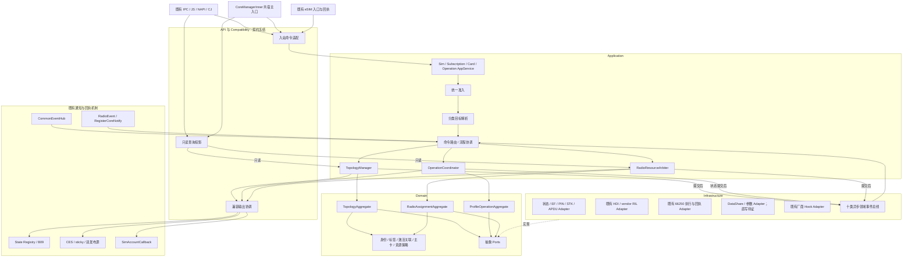

# SIM 重构后软件架构设计说明书

## 1. 文档定位

### 1.1 目的

在对外行为、部署位形和数据库结构冻结的前提下，定义 SIM 卡管理逻辑模块重构后的：

- 系统边界和共宿主调用边界；
- 分层与组件职责；
- 身份、卡位、卡应用和订阅目标模型；
- 三聚合及状态所有权；
- 命令、操作、回调和恢复机制；
- 十类异步领域事件；
- 既有接口、通知和执行时序的兼容机制；
- 数据访问、事务和迁移边界；
- eSIM、RIL、厂商扩展和跨仓协作；
- 实施、验收与回滚要求。

本次是内部组分重塑，不是对外接口演进项目。

### 1.2 权威关系

1. 本轮冲突取舍以[统一裁决](MultiSIM/08_design_unification_decisions.md)为准；本文与类设计是现行目标设计。
2. 原07决策总账、09决策卡和跨仓清单尚未提供；原D-/REL-/FLOW-/CAP-/X-编号保留来源关系，不据此声明已批准或已核实。
3. 当前源码决定现状；用户需求与确认契约决定验收。类图、十类事件和十八组件席均不构成实施授权。
4. 旧MultiSIM方案、V22/V23汇报和另一分支Shadow记录属于历史资料，不与现行目标并行作为规范。
5. 四槽、NULL迁移、默认策略、事务能力及跨仓时序等门禁未闭合时保持OPEN，不能由内部设计自行填实。

### 1.3 证据边界

本轮静态核对当前工作仓的BUILD.gn、Core装配、CoreManagerInner、SIM状态/文件/账户/角色/RIL入口、参数、SA配置及既有测试记录，源码摘要见清单。输入基线hmos_dev_20260813/core@738f51f6不冒充当前HEAD。

- 配置中的telephony进程包含4010和66250；运行部署与服务实现仍需产品/外仓验证。
- 当前账户CRUD走DataShare；未据类名或缺失跨仓报告确认本仓直写RDB或跨连接事务。
- 本轮没有编译、运行生产服务、重跑SIM测试或执行设备验证。历史执行为容量B1 PASS、INFRA16 PASS；原五场景BLOCKED。
- 未确认的DISABLED映射、无卡账户、身份延续、事件次数与恢复判据不得作为强制业务Oracle。
- 新文档中“目标/必须”只约束所选设计，不能把尚未实现的Owner、总线和SlotRegistry写成生产现状。

### 1.4 本版主要修正

v0.3输入相对v0.2的变更（本轮v0.3.1再按统一裁决限定证据与实施范围）：

1. 将 CoreManagerInner 提升为正式共宿主兼容边界；
2. 将内部目标拆为 SlotTarget、CardApplicationTarget、SubscriptionTarget；
3. 将一个 ACL 细化为入站适配、查询投影、出站适配；
4. 分离领域事件与六类既有通知/回执机制；
5. 增加兼容输出轨迹及查询可见性要求；
6. 明确 Core 与 SA 66250 的逐类操作所有权；
7. 区分已核实DataShare/参数与待证直写/反查边界；
8. 区分原配置行为等价与待补批准来源的四槽条件目标；
9. 增加接口映射、状态所有权、输出轨迹和生命周期设计资产。

---

## 2. 设计约束与冻结项

### 2.1 对外行为冻结

本次不得新增或改变：

- IPC 接口码、签名、线格式和既有语义；
- JS/NAPI/Cangjie 公开 API 签名；
- 公开六值枚举；
- CommonEvent action、载荷及既有可观测行为；
- 既有公开权限；
- 既有返回值、输出参数和错误映射；
- eSIM 对外双通道；
- 共宿主仓现有调用方式。

冻结包含“不追加”。

“接口码只追加不改号”不构成本次追加接口的授权。

### 2.2 部署与工程冻结

- 不新增 SA；
- 不新增进程；
- 不新增 IPC 通道；
- 不破坏 DB schema；
- 不破坏既有系统参数名；
- 新增同步一律采用 `ffrt::mutex`；
- eSIM、卫星和 EXT 条件编译边界完整；
- 一个状态变量只有一个逻辑写者和一把明确的保护锁；
- 非法状态转换 fail-loud；
- 不引入 Feature Flag；
- 不新增运行期实现切换Flag；回退先核实在途副作用与数据兼容，再恢复旧产物/git revert；有批准迁移才执行配对数据修正。

### 2.3 内部可调整范围

允许调整：

- 模块边界；
- 内部接口；
- 内存模型；
- 内部富状态；
- 内部 OperationId、Revision、Generation；
- 命令与领域事件；
- 执行队列、锁和回调门控；
- 缓存、只读投影和事务组织；
- 厂商策略适配。

内部调整不得突破冻结面。

### 2.4 N 槽配置与行为冻结

验收分为两种配置：

| 配置 | 验收原则 |
|---|---|
| 原有配置 | 与重构前行为等价 |
| 拟四槽目标产品配置 | D-002/D-005批准记录待补；取得批准后仅实施明确能力变化，接口、权限及格式继续冻结 |

四槽是条件目标，不是当前产品能力结论；即使批准，也不等于所有应用自动可见第四逻辑位。

需要分别判断：

- 卡位是否合法；
- 卡位是否配置存在；
- 是否有卡或 Profile；
- 调用者是否可见；
- 操作是否允许；
- 观察者是否可以注册；
- 底层是否具备相应执行能力。

---

## 3. 系统边界与部署基线

### 3.1 SIM 管理逻辑模块的范围

本模块拥有：

- SIM 账户与订阅身份；
- 卡位、卡应用、Profile/Port 与账户绑定；
- SIM 激活事实；
- 默认语音、短信、数据角色和主卡决策；
- SIM 侧操作门控、超时与恢复协调；
- SIM 对外状态、账户和事件兼容输出。

本模块不接管：

- 网络注册状态机；
- 蜂窝数据连接状态机；
- 通话状态机；
- IMS 注册状态机；
- LPA 任务的全部内部状态；
- Modem 内部协议状态。

上述状态可以作为输入或查询结果，但其权威写者仍在原业务模块。

### 3.2 共宿主部署

当前仓services/etc/init/telephony_trust.json将4006、4007、4008、4010、4011、4014、4016、4017、66250配置在telephony进程。该文件证明配置关联，不证明设备上的所有SA已加载或运行、隔离有效。

本模块只实现Core主体及相关客户端/运行能力，不接管配置中其他SA业务。原材料中的cellular_data、cellular_call、sms_mms、IMS、VoWiFi及扩展职责和装载细节需对应仓/产品核实；4005/4009和其他外部服务不在本轮运行证据内。

### 3.3 eSIM 部署口径

SA 66250 是独立服务身份，不等于独立进程。

本次采用已核实配置与保留既有入口的设计：

- 与 4010 共宿主；
- 保留既有懒加载条件；
- 保留现有 Proxy/Stub；
- 保留既有双向回执；
- 不新增 Core 与 66250 的通信契约；
- 不将所有 eSIM 能力集中转办至 66250。

### 3.4 IPC 边界口径

准确表述为：

> Core 所提供的 SIM 管理请求 IPC 收敛于 SA 4010；完整 SIM/eSIM 业务协作仍包括 66250、State Registry、CellularData 回调转暴露等既有边界。

不得将“4010 是唯一 IPC”泛化为整个 SIM/eSIM 系统只有一个 IPC 边界。

调用记录必须分开描述：

- 调用契约形态；
- 部署进程；
- 运行时是否远端；
- 是否直接 C++ 调用。

同进程存在 Proxy/Stub 契约，不等于每次调用都发生跨进程传输。

---

## 4. 共宿主兼容边界

### 4.1 CoreManagerInner 的架构地位

CoreManagerInner 是既有共宿主调用门面，不是可任意替换的普通内部实现类。

相关关系包括：

- REL-A03/A06/A09/A10/A16～A19；
- REL-D01。

本次可以拆分其背后职责，但不得要求消费仓改为调用新接口。

### 4.2 三类兼容契约

| 契约 | 内容 |
|---|---|
| 调用 | 签名、返回值、输出参数、错误、完成点 |
| 生命周期 | 注入顺序、部分就绪、停止、对象存活、反注册 |
| 执行 | 调用线程、重入、锁、回调执行位置和阻塞行为 |

保持 IPC 兼容不能替代共宿主直接调用兼容。

### 4.3 范围限制

CoreManagerInner 包含 SIM、网络和 RIL 等多类能力。

本次：

- 重构 SIM 相关委托；
- 保持非 SIM 能力原有责任；
- 不借本次将网络、数据和 IMS 状态收编到 SIM 聚合；
- 不擅自新增空指针后的 IPC 回退；
- 不任意破坏公开头、导出符号和虚接口布局。

### 4.4 生命周期不变量

- 消费方无需自行初始化 CoreManagerInner；
- 注入前和部分注入的返回行为保持；
- 停止接入后，不再接受新的内部写请求；
- 在途回调不得引用已释放对象；
- 反注册与对象释放的顺序明确；
- 不能先卸载动态库，再等待持有其函数指针的任务结束。

---

## 5. 领域划分与状态所有权

### 5.1 四个 Context

| Context | 职责 |
|---|---|
| Subscription Topology | simId 身份、账户、卡位和绑定事实 |
| Profile Operation | 操作步骤、回调门控、超时和恢复 |
| Radio Assignment | 默认角色、主卡决策、资源分配 |
| Compatibility | 旧接口、状态、账户和通知翻译 |

Context 不按 SA、进程或仓库机械划分。

### 5.2 三个聚合

| 聚合 | 唯一逻辑写者 | 权威事实 |
|---|---|---|
| TopologyAggregate | TopologyManager | 账户身份、当前位置、绑定及拓扑版本 |
| ProfileOperationAggregate | OperationCoordinator | 本仓操作状态、步骤、门控和恢复进度 |
| RadioAssignmentAggregate | RadioResourceArbiter | 默认角色、主卡和资源分配决策 |

单写者不等于只允许一份只读副本。

每份副本必须有：

- 来源；
- 版本或关联依据；
- 更新入口；
- 失效规则；
- 查询用途。

### 5.3 不属于三个聚合的状态

| 状态 | 权威所有者 |
|---|---|
| 网络注册、信号 | 网络搜索相关模块 |
| 数据连接 | cellular_data |
| 通话 | cellular_call/call_manager 等 |
| IMS 注册 | IMS 相关模块 |
| 66250 执行任务 | 既有 esim_service |
| State Registry 缓存 | Registry 的兼容分发副本，不是 SIM 决策源 |
| Modem 实际内部状态 | Modem；本仓通过执行结果或观察核对 |
| 卡应用/安全/Records | 保留生产运行逻辑处理；目标Topology接受SlotFacts，执行/加载进度不等同领域事实 |

---

## 6. 目标分层架构

### 6.1 逻辑组件图

说明：

- 图为逻辑关系，不新增进程、SA 或 IPC；
- 现有卡能力查询可通过 CardAppService 访问 Adapter，不要求全部绕经账户聚合；
- 出站实际接线以逐用例兼容轨迹为准；
- 不把全部既有通知统一推迟到领域事件消费之后；
- Hub、RadioEvent 和 eSIM 回执不是十类领域事件的同义词。

### 6.2 分层职责

| 层 | 职责 | 禁止 |
|---|---|---|
| API/Compatibility | 旧契约、目标解释、查询投影、输出兼容 | 拥有第二份业务真值 |
| Application | 准入、流程、提交、执行协调 | 复制领域规则 |
| Domain | 聚合、不变量、纯策略 | 依赖 DB、HDI、IPC、ffrt、dlopen |
| Infrastructure | 存储、硬件、服务、事件和厂商适配 | 直接越过聚合写事实 |

### 6.3 十八组件席

保留上一版十八组件席作为候选组织方式：

- SimAppService；
- SubscriptionAppService；
- OperationAppService；
- CardAppService；
- CompatibilityAcl；
- AggregateAdmissionValidator；
- CommandRouter；
- SimProcessManager；
- TopologyManager；
- OperationCoordinator；
- RadioResourceArbiter；
- SlotRegistry；
- TopologyRepository；
- OperationRepository；
- AssignmentRepository；
- CardIoAdapter；
- VendorHookAdapter；
- DomainEventBus。

该名单必须与上游正式组件席对齐。

数量一致不能证明职责合理；翻译器、执行器和出站适配器可以是组件内部类，不因细化增加 Context。

---

## 7. 身份、卡位与分类目标

### 7.1 N 槽形态

D-002/D-005来源待补。以下是新输入提出的目标产品配置，不是全产品硬件事实：两个pSIM位置0/1，eSIM逻辑位按该产品规则从2起，配置由一个eSIM位扩为两个。

通用SlotRegistry不硬编码所有产品物理基数为2，也不从逻辑位推断eUICC/Modem。当前参数默认1，分布式路径另有8槽常量，RadioProtocol初始化路径最多两个槽。必须分别验证配置槽数、实际卡数、可启用Profile、逻辑栈与业务并发。

物理基数断言只属于经确认的产品配置层；四槽批准、下层协议、能力可见性与消费者支持未齐时，不实施扩容或扩大测试结论。

### 7.2 SlotRegistry

统一提供：

- 物理槽；
- eSIM 逻辑位；
- 合法逻辑位；
- 卡位类型；
- 配置能力；
- 绑定查询。

约束：

- 经确认产品的物理基数由配置层断言守护，通用库不强制全产品两槽；
- eSIM 数量由配置校验守护；
- 业务模块不散布固定三卡/四卡判断；
- 兼容协议常量若必须保留，应局限在边界；
- slot3 管控与基数声明同步核对；
- 不假设外部固定注册 SLOT_0～3 的消费者已经支持任意 N。

### 7.3 simId 的适用范围

simId 是内部账户/订阅的主标识，不是所有硬件对象的统一地址。

以下情况可以没有可用 simId：

- 空槽；
- 卡刚插入；
- 身份尚未读取；
- PIN/PUK 未完成；
- 账户尚未建立；
- 某些卡应用或通道操作。

禁止为满足目标解析伪造 simId 或 ICCID。

### 7.4 三类目标

| 目标 | 关键定位 | 典型用例 |
|---|---|---|
| SlotTarget | slotId、配置/绑定代次 | 空槽、在位、槽状态、初始化 |
| CardApplicationTarget | 卡应用/通道/路由、代次，simId 可选 | PIN/PUK、EF、APDU、STK |
| SubscriptionTarget | simId、当前绑定、拓扑版本 | 账户、标签、默认角色、订阅激活 |

统一准入按命令选择目标类别，不能先要求所有请求都有有效账户。

### 7.5 目标有效性

解析成功不代表永久有效。

执行前需核对：

- 卡或绑定是否更换；
- 逻辑路由是否仍匹配；
- 当前资源是否可用；
- 请求是否已超时或取消等待。

旧卡迟到结果不能作用于同槽新卡。

---

## 8. Compatibility Context

### 8.1 一个 ACL、三类职责

CompatibilityAcl 是一个逻辑边界，不是必须实现为一个大类。

| 子职责 | 内容 |
|---|---|
| 入站适配 | 旧方法、slotId、参数和命令翻译 |
| 查询投影 | 状态、账户、默认卡、NULL ICCID 输出 |
| 出站适配 | Registry、CES、账户回调等既有载荷和完成语义 |

### 8.2 ICCID 不可用

内部显式表达不可用ICCID，不参与有效身份匹配；禁止为Slot/CardApplication请求伪造账户或身份。

D-006写NULL和D-016存量迁移保留为有条件目标：必须先补批准来源，确认现有列约束、DataShare编码、查询、读者兼容与配对回退；当前14个外部存储字段还存在版本缺口。未闭合时保持现有存储表示，不写NULL、不改表、不猜占位值。

读路径按既有方法保留占位与错误语义；NULL、空串、缺行、未就绪、历史账户是不同情况。旧输出不得回流为有效身份。若现schema不能支持目标则登记阻塞，不把“schema不变”当作已兼容证明。

### 8.3 状态翻译

内部可表达RECOVERING、ERROR、DISABLED，但公开六值不变。Active=false、Profile停用、卡不存在并非同义词；不采用全局“DISABLED→NOT_PRESENT”规则。

LegacyStateTranslator按来源、接口及适用前提穷举转换，保持已确认/实采READY、LOADED、返回值和输出参数。当前sim_manager.cpp:176–184的无卡派生不证明所有停用场景应映射无卡。未知规则登记OPEN，不用default静默归并，也不以新目标枚举改外部语义。

### 8.4 激活与选主

内部流程：

1. 激活命令只修改相应激活事实；
2. 激活后续策略评估是否需要选主；
3. 流程协调器显式提交选主命令；
4. RadioResourceArbiter 执行决策；
5. 对外结果与通知保持既有行为。

“显式”是内部命令显式，不要求应用增加调用。

### 8.5 内部接口拆分

ISimManager 保留兼容门面。

内部 ISubscription 等接口：

- 不新增 IPC；
- 不要求外部仓改代码；
- 不自动进入公开 API；
- 不破坏既有虚表、符号、布局和注入契约。

---

## 9. 查询、提交与兼容输出

### 9.1 已提交查询

账户、角色和绑定查询使用已提交视图。

组合查询必须检查版本对应关系，不能将不同时间的拓扑与资源状态拼接后当成一致事实。

必要的卡状态和卡能力查询可读取其原有能力来源，但应明确：

- 数据来源；
- 观察时点；
- 是否为缓存；
- 是否参与当前命令准入。

### 9.2 提交流程

1. 在唯一写入执行域读取当前事实；
2. 验证命令与目标；
3. 生成候选状态；
4. 锁外执行对应存储事务；
5. 核对提交结果；
6. 替换已提交内存视图；
7. 按既有契约完成返回与通知；
8. 发布领域事件。

同一聚合的后续写入不得越过未完成提交而发生覆盖。此为目标提交协议；旧入口的返回、Records/状态通知与查询可见点按逐用例轨迹保持，不能用统一“提交后通知”擅自重排现有兼容输出。

不宣称三个聚合、系统参数和硬件具有统一原子事务。

### 9.3 兼容输出轨迹

每个关键用例必须记录：

| 字段 | 定义 |
|---|---|
| 触发 | 哪个命令、硬件结果或事实变化 |
| 查询可见点 | 回调发生时查询应读到什么 |
| 输出通道 | Registry、CES、Hub、RadioEvent、账户回调等 |
| 相对顺序 | 已验证的因果依赖 |
| 次数 | 正常、重复、重试行为 |
| sticky | 是否保留及覆盖规则 |
| 失败 | 通知失败与原请求结果的关系 |
| 证据 | REL/FLOW 和目标 HEAD 锚点 |

只冻结已经证实的因果与可观测行为，不臆造跨进程全局顺序或固定时间间隔。

### 9.4 双发布源

当前Core中可核实状态事件直发与Registry更新。输入材料报告Registry中继形成双发布，提供方实现与运行轨迹本轮未核实。

保持当前发布路径和调用，不擅自去重、增设第三来源或延迟到内部总线消费。记录各通道载荷、查询可见性、允许重复及sticky/中继的证据等级，外仓待核不伪装为端到端已验证。

## 10. 事件与回执架构

### 10.1 十类领域事件

按本轮设计统一以下十类候选目录；X-1批准来源待补，不据此宣称总线已实现：

1. CardPresenceChanged；
2. TopologyChanged；
3. SubscriptionDiscovered；
4. SubscriptionRemoved；
5. OperationCompleted；
6. OperationFailed；
7. OperationCompensated；
8. RoleAssignmentChanged；
9. ModemAssignmentChanged；
10. ResourceDegraded。

采用独立总线、异步分发。

不与未采纳的三事件同步方案拼接。

### 10.2 既有机制分别保留

| 机制 | 角色 | 处理原则 |
|---|---|---|
| State Registry | 缓存、观察者分发、中继 | 保持方法、载荷与权限 |
| CES | 公共事件与 sticky | 保持 action、载荷和行为 |
| SimAccountCallback | 账户变化通知链 | 保持注册、死亡和重注册 |
| CommonEventHub | 既有进程内事件接入/分发 | 不等同于领域总线 |
| RadioEvent | RIL/SIM 专业通知 | 保留注册和扇出语义 |
| IEsimServiceCallback | 请求相关回执 | 先关联与门控，再决定领域事件 |

### 10.3 输入与领域事件的关系

- 原始 RIL 通知不自动成为已提交事实；
- eSIM 回执不直接表示完整业务成功；
- Hub 系统事件不全部属于 SIM 领域；
- 经过聚合确认的事实变化才产生相应领域事件。

### 10.4 出站适配

采用专用适配职责：

- StateRegistryAdapter；
- CommonEventAdapter；
- SimAccountCallbackAdapter；
- 既有 Hub/RadioEvent 桥接；
- eSIM 回执适配。

不使用一个无类型通用通知出口混合所有契约。

这些是内部实现细化，不新增组件域或对外协议。

### 10.5 总线约束

- 提交后发布；
- 不在领域锁内分发；
- 不共享可写聚合引用；
- 消费者通过命令进入自己的写者；
- 明确订阅与反订阅生命周期；
- 可识别重复、过期和版本缺口；
- 队列压力与失败不可静默；
- 不在单一分发执行域中等待自身派生事件。

### 10.6 开放可靠性细节

TGT-OPEN-001/005 仍开放：

- 跨 SA 事件映射；
- 已有契约如何承载；
- 队列容量与失败策略；
- 是否需要 Event Sourcing；
- 是否需要持久化事件能力。

本次不默认：

- 新 Outbox 表；
- 新 IPC；
- 恰好一次；
- 跨重启重放；
- 全系统全局顺序。

---

## 11. eSIM 双通道与操作所有权

### 11.1 单源的定义

“双 ACL 单源”表示核心事实所有权统一，不表示所有 eSIM 请求转至 66250。

不得形成无终止的：

Core → 66250 → Core → 66250。

### 11.2 所有权矩阵

| 能力/事实 | 所有者 | 协作方式 |
|---|---|---|
| 卡侧 APDU、逻辑通道、eUICC 原语 | Core 既有卡侧实现 | 内部执行适配 |
| LPA/配置层任务 | 既有 66250 实现 | 既有服务与回执 |
| 账户与位置绑定 | Topology | 经确认观察/命令写入 |
| 默认角色和主卡 | RadioAssignment | 显式内部命令 |
| 本仓操作门控与等待 | ProfileOperation | 内部 OperationId |
| 66250 任务步骤与进度 | 66250 | 不由 Core 复制替代 |

### 11.3 关联

内部 OperationId 不自动穿透远端接口。

使用：

- 既有请求上下文；
- 既有回调对象；
- 卡位、目标和代次；
- 当前步骤及尝试次数。

无法可靠关联时应进入核对或登记契约限制，不伪造远端任务能力。

### 11.4 反向查询与重入

66250 回调或反查 Core 时：

- 不得被 Core 持有的领域锁阻塞成闭环；
- 不在锁内调用 66250；
- 不在同一受限执行队列中同步等待彼此；
- 逐方法确认只读查询与写请求。

### 11.5 恢复出厂

是否联动清理 66250 仍按 D-023 征集。

未批准前不增加调用、通道或隐含清理语义。

“暂不联动”必须形成书面记录及残留风险验收口径。

---

## 12. 命令、并发、超时与恢复

### 12.1 操作粒度

- 卡内进度按卡位隔离；
- 跨卡物理互斥保留；
- 订阅身份与执行资源分别定位；
- 不将全局互斥简单替换为每卡锁。

### 12.2 锁纪律

新增共享状态使用 `ffrt::mutex`。

领域锁内禁止：

- DB；
- DataShare；
- HDI/RIL；
- IPC；
- 厂商 Hook；
- 外部回调；
- 事件发布。

每个状态变量明确唯一写者与保护锁。

### 12.3 回调准入

在同一受控执行域完成：

- 操作归属；
- 目标类别；
- 卡位/身份；
- 绑定代次；
- 步骤与尝试次数；
- 终态与重复判断；
- 状态转换。

非请求型通知使用 Observation 路径，不伪造 OperationId。

### 12.4 内部取消

本次只支持：

- 取消等待；
- 拒绝该次迟到结果；
- 必要时核对硬件。

不承诺真中断 Modem/eUICC。

### 12.5 超时

依据 D-008/D-021：

- 分命令超时；
- 协议三阶段独立上界；
- 明确失败或进入恢复期；
- 中断点显式处理；
- 收窄非必要阻塞窗口。

数值、Modem 超时后行为和恢复判据只能由 Modem 组输入。

缺少判据的相位不得宣称完成。

### 12.6 重试与恢复

- 分命令定义有界重试与退避；新增指数退避须核对旧次数、间隔及对外完成，不全局替换；
- 错误分流；
- 不对全部失败统一重试；
- 结果未知先核对；
- 不把超时直接解释为未产生副作用；
- 重启不保证恢复同一内部 OperationId；
- 不新增持久表时不承诺完整操作重放。

---

## 13. 数据访问与事务

### 13.1 四种边界

必须分别记录：

1. 领域写入所有权；
2. 存储执行路径；
3. 数据库事务边界；
4. 兼容读取路径。

Repository 名称不能代替事务能力证明。

### 13.2 实际路径

当前SIM账户路径已核实为SimRdbHelper→DataShareHelper的Insert/Query/Update/Delete，默认Data等还使用系统参数与内存缓存。本轮SIM范围未检出NativeRdb/RdbStore直写事务实现。

原输入声称的本仓直写、provider反查和具体连接事务需跨仓清单补证；类图可保留可选DirectDb边界，但不为配图创建新直写通道。事务能力先由提供方确认，不能由本地锁、Repository或CommitResult名称推导。

### 13.3 Repository 映射

| Repository | 内容 | 限制 |
|---|---|---|
| TopologyRepository | 账户、身份、绑定 | 既有 schema |
| OperationRepository | 运行期操作上下文 | 不默认新增日志表 |
| AssignmentRepository | 角色和分配 | 既有 DB/参数契约 |

### 13.4 D-016 首批事务

以下为输入提出、批准来源及真实事务能力待补的范围，不是已实施事务：

- 初始化写链；
- ICCID 刷新链；
- D-006 存量迁移。

每条写链明确：

- 事务在哪执行；
- 使用哪个连接；
- 哪些字段同事务；
- 哪些是提交后投影；
- 失败时缓存与参数如何核对；
- 是否存在反向调用。

### 13.5 反向依赖

不得在持有领域锁或可能形成重入闭环的事务期间，调用会触发 telephony_data 反查 Core 的路径。

禁止形成：

Core 持锁/持事务  
→ DataShare  
→ telephony_data 反查 Core  
→ 等待原锁/原执行域。

### 13.6 无法合并的写入

如果直写、DataShare 和参数无法形成同一事务：

- 明确真正原子范围；
- 明确后续投影；
- 明确失败核对；
- 不宣称全局原子；
- 不擅自要求外仓新增接口；
- 无法满足已批目标时登记实施阻塞。

### 13.7 NULL 与配对回滚

迁移必须：

- 精确识别旧占位；
- 不清空真实 ICCID；
- 仅在D-006来源和既有存储兼容验证通过后写入NULL；
- 读出经 ACL；
- 验证缺行、NULL、不可用的区别；
- 回滚不覆盖后续真实身份；
- 不新增 schema。

---

## 14. 厂商策略与执行边界

### 14.1 主卡策略

D-004：

- 核心拥有默认策略；
- 厂商提供参数或建议；
- 缺失、失败、超时回退；
- 厂商在场行为等价。

默认业务规则仍待 D-004(a)。

### 14.2 IVendorHook

IVendorHook 是内部 Port，不是新动态库 ABI。

本次不要求：

- 新导出符号；
- 新版本协商接口；
- 厂商改成约十五方法；
- 外仓改代码配合类图。

VendorHookAdapter 映射现有函数指针。

### 14.3 安全回退前提

需要 vendor 明确：

- 哪些失败可识别；
- 函数是否可并发；
- 超时后是否继续执行；
- 是否产生副作用；
- 迟到结果如何处置。

同进程超时不等于函数被终止。

不能在旧 Hook 可能继续执行时无条件启动默认路径造成双执行。

无法满足安全前提时登记阻塞。

---

## 15. 必备设计资产

以下四项是详细设计和相位验收输入，不新增业务决策。

### 15.1 接口到组件映射表

逐方法登记：

| 字段 | 内容 |
|---|---|
| 方法 | 既有完整签名 |
| 入口 | IPC/直接门面/JS/66250 |
| 目标 | Slot/CardApplication/Subscription |
| 归属 | 聚合或保留卡能力 |
| 完成点 | 既有同步/异步语义 |
| 查询 | 输出参数及数据来源 |
| 错误 | 旧错误映射 |
| 线程 | 阻塞、重入和回调要求 |
| 证据 | REL/FLOW/HEAD |
| 测试 | 回归用例 |

至少覆盖跨仓生产使用的方法，不仅覆盖 IPC 码表。

### 15.2 状态所有权与投影表

| 状态 | 原始写者 | 副本 | 更新/失效 |
|---|---|---|---|
| 账户身份/绑定 | Topology | 兼容账户视图 | 按已提交版本重建 |
| 默认角色/主卡 | Assignment目标Owner | 当前DB/参数/缓存；迁移后兼容投影 | 用户意图、有效选择和资源执行分开；保留Primary/Data联动 |
| 操作进度 | Operation | 诊断上下文 | 操作终态/恢复后释放 |
| 公开 SIM 状态 | 原事实经 ACL 派生 | Registry/消费者缓存 | 按旧链路更新 |
| 网络/数据/IMS | 原业务模块 | SIM 只读输入 | 按既有契约 |

具体字段必须逐项补齐，不能只写模块级所有权。

### 15.3 兼容输出轨迹表

优先用例：

| 用例 | 重点关系 |
|---|---|
| 插拔、READY/LOADED | REL-B01、REL-C01/C05、REL-D05 |
| PIN/PUK | REL-A16/A20及状态输出 |
| 激活与自动选主 | 默认角色、SET_PRIMARY、相关回调 |
| 默认数据切换 | REL-A06、REL-C03、REL-D01/D04 |
| eSIM 切换 | REL-A10、REL-D06 |
| 卫星/VSIM | REL-A07/A12、厂商及 RIL 链 |
| 出厂清理 | REL-E04、D-023 |

关系不完整的地方保留待核实，不能以该表宣称端到端已验证。

### 15.4 共宿主生命周期表

逐入口覆盖：

- 注入前；
- 部分初始化；
- 正常运行；
- 懒加载；
- 回调重入；
- 反注册；
- 停止；
- 迟到任务。

每项记录预期返回、对象所有权、允许调用和测试证据。

---

## 16. 跨仓配合与证据治理

### 16.1 外仓零修改预期

外部仓提供：

- 业务与 Modem 输入；
- 契约确认；
- 部署核对；
- 回归和故障联测。

发现必须改变外部契约时，停止对应变更并返回决策流程。

### 16.2 配合重点

| 对象 | 验证重点 |
|---|---|
| 共宿主消费仓 | 门面、注入、重入、停止 |
| state_registry | 六值、账户、B09、双发布源 |
| CES 消费方 | action、载荷、sticky、重复 |
| 66250 | 双通道、反查、回执、eSIM 位 |
| vendor RIL | 超时、阶段、恢复、扇出 |
| telephony_ext | VSIM、Hook 失败与迟到结果 |
| satellite/d2d | 激活和选主行为 |
| telephony_data | NULL、缺行、事务与反查 |
| 锁屏/contacts/settings | PIN、图标、标签、权限 |
| capability_mgr 团队 | slot3 清单 |
| samgr | SDC-009 |

### 16.3 报告口径澄清

本仓StkController中可核实STK事件发布，消费者运行仍需外仓确认。REL/FLOW/VERIFIED等输入等级因主档缺失不自动成为本轮结论。

其他共宿主调用、双发布、sticky、provider反查、权限和恢复按逐方法证据核实；“无检索命中”只说明当前范围，不代表产品全域永久不存在。

## 17. 验收与实施

### 17.1 Phase 0 硬门

当前Phase0 NOT READY。当前仓记录的执行结果是：SIM-COMP-001容量查询B层1 PASS、INFRA16 PASS、容量检查器负控预期失败；原五业务场景及未初始化C候选仍BLOCKED，本轮未重跑。

原输入“L3、3/35、harness D-1/D-2”缺少本地主档/分母和运行记录，作为待补来源保留，不代替当前统计。

Phase0/G1需完成匹配依赖、生产初始化及正式RIL输入驱动的最小状态/账户切片，补齐Oracle、输出轨迹与清理证据。通过前不开展生产重构；已授权的Linux host适配、外部GMock设施和文档工作可继续。

### 17.2 结构验收

- 三聚合单写者；
- 分类目标不伪造身份；
- ACL 无第二真值；
- 无新公开接口；
- 无新 SA/进程/IPC；
- 无 schema 变化；
- 条件编译完整；
- 锁与状态逐项对应。

### 17.3 行为验收

- 原配置行为等价；
- 四槽批准来源补齐后仅产生明确范围变化；
- 共宿主仓零代码改动；
- NULL 不泄漏；
- 六值输出不变；
- 激活关联由显式内部策略重现；
- 回调发生时查询视图正确；
- Registry/CES 双发布不被意外去重；
- sticky 和错误语义保持；
- Hub/RadioEvent 注册生命周期保持；
- 66250 回执与反查不形成闭环；
- 超时有退出判据。

### 17.4 系统级优先用例

默认B层级为Linux受控组件集成：独立GoogleTest进程→ISimManager→真实SIM生产逻辑→GMock外部边界。优先无卡状态/账户，再Ready、双卡隔离、PIN锁定；不依赖实体设备，不以内部类、数据库表或普通日志顺序判PASS。

A层级另验SA注册发现、真实Client/Proxy/Stub、权限/capability、Modem和实际SIM/eSIM；锁屏、IMS、数据重连、短信选卡、卫星/VSIM、设备重启及危险清理按对应产品与授权验证，B结果不能替代。

REL/FLOW/ST及领域INV编号只作追踪，须逐条关联CONFIRMED_CONTRACT、适用前提已核实的不变量、实采LEGACY_BEHAVIOR或OPEN_QUESTION。原始输入缺失时不得擅自设强制业务通过标准。

### 17.5 回滚

- 无 Feature Flag；
- 停止受理、核实副作用及数据兼容后恢复旧产物/git revert；
- 仅存在已批准数据迁移时执行配对修正；
- 停止新写入后处理在途状态；
- 不覆盖迁移后的真实身份；
- 若批准NULL迁移，先验证旧路径读取NULL与兼容输出；
- 代码回退必须演练；有数据修正时与代码成套演练。

---

## 18. 开放项

保留原编号：

- D-004(a)：核心默认主卡策略；
- D-018(b)：权限矩阵；
- D-008/D-021：Modem 数值、行为和恢复判据；
- D-023：66250 清理联动；
- X-1：异步时序与单写者协同；
- TGT-OPEN-001/005；
- SDC-009；
- DM-GAP-003/004；
- Q1～Q10；
- harness D-1/D-2；
- Phase 0 Readiness。

本文不以候选实现填补尚未批准的业务内容。

---

## 19. 架构结论

本次重构保留：

- 四个 Context；
- 三个聚合；
- 一个逻辑 ACL；
- 一个统一准入入口；
- 十类异步领域事件。

并补充六项实施必需边界：

1. CoreManagerInner 共宿主兼容边界；
2. Slot、CardApplication、Subscription 分类目标；
3. 领域事件与既有通知机制分离；
4. 查询可见性、通知轨迹和生命周期兼容；
5. 可证明的存储事务范围；
6. eSIM 逐类操作与事实所有权。

目标不是把现状所有代码塞入统一抽象，而是：

> 在不改变外部契约的前提下，使每项事实有唯一写者、每类目标有正确定位、每条通知有明确语义、每次提交有真实边界、每条跨仓链路有可执行验收。

本文仍为待评审架构；设计评审通过不替代 Phase 0 门禁。

---

## 20. 本轮整合补充：加载有效性与SO边界

### 20.1 绑定与加载不是同一代次

BindingGeneration识别卡/应用或绑定会话；同卡Records刷新另推进RecordsGeneration。LoadSession固定发起时会话、轮次与请求集合，响应写缓存前验证归属，重复请求不重复完成。本轮没有为此新增对外字段或宣称已实现。

命令响应使用内部OperationId/step/attempt和既有serial/回调上下文；非请求通知走Observation。拓扑revision变化不一律使操作失败，合法切换通过因果证据连接起始请求与新绑定；必要输入提交前复核。运行进程重启后的旧上下文失效，不承诺恢复相同OperationId。

### 20.2 兼容门面与单向链接并存

保留CoreManagerInner消费侧契约，不把其所有实现搬进SIM。非SIM Host能力由Core实现私有端口并注入，SIM仅依赖端口声明，避免SIM SO反向链接Core SO。生命周期、部分注入、线程和重入仍是兼容要求。

当前ISimManager/IEsimManager无虚析构；通过具体类型控制块或工厂deleter销毁，禁止delete接口裸指针，不追加虚函数改变ABI。停止受理、反注册、拒绝/排空在途工作后才销毁和卸载。独立SO不提供同进程崩溃隔离，也未在本仓构建完成。

### 20.3 三聚合内仍区分多种事实

Topology的SlotFacts不依赖账户存在；保留卡状态/文件生产逻辑，逐字段迁移权威接受责任。Assignment将用户偏好、有效角色、Primary、期望资源与观察资源分开保存，不把它们合为一个状态；本轮不新增独立Role聚合，也不改变Primary/Data既有联动。

候选十八组件席不是建类配额；按切片引入有独立职责的对象，不以所有逻辑签名都落成空壳作为验收。

## 修订记录

| 版本 | 日期 | 内容 |
|---|---|---|
| 0.1 | 2026-10-15 | 初始目标架构 |
| 0.2 | 2026-10-15 | 对齐冻结、simId、共宿主、十类事件、schema 和外仓约束 |
| 0.3 | 2026-10-15 | 依据输入跨仓报告形成分类目标等候选设计，批准及源码来源见原说明 |
| 0.3.1 | 2026-10-15 | 依据当前工作树及DU裁决统一现状/目标、三聚合、事件/事务、条件扩容、NULL与测试口径；补回调/加载及SO兼容边界 |