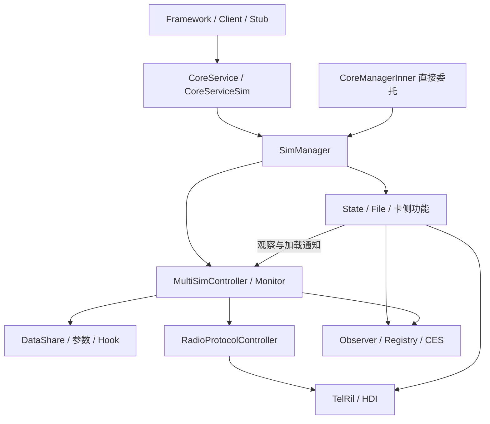
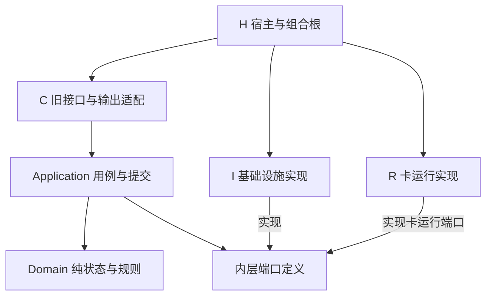
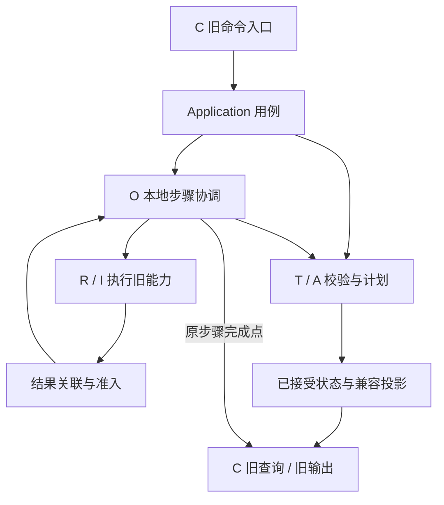
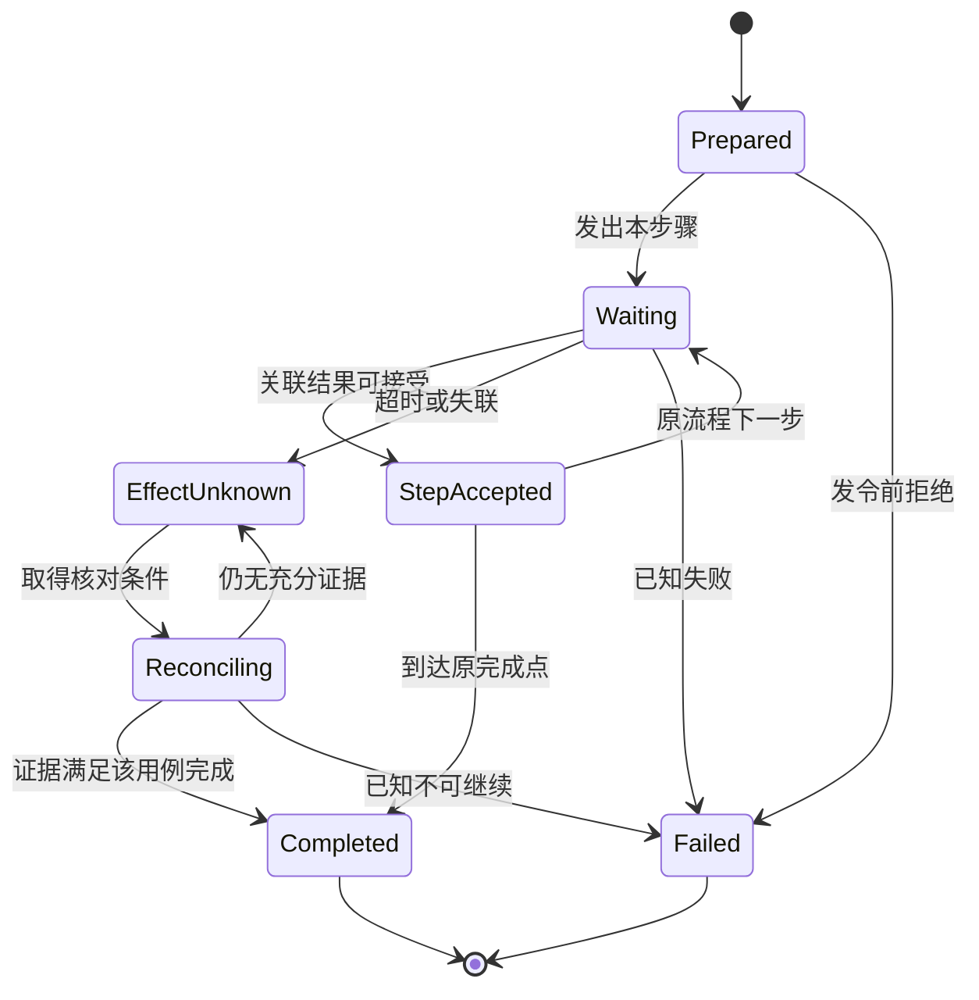

# SIM 目标架构设计

## 1. 文档定位与决策状态

### 1.1 本轮结论与阅读方式

保留“身份与位置分离、唯一写者、分层依赖、旧接口兼容”的设计方向。实现上采用 **T 账户拓扑、A 角色与资源分配、O 本地操作三类业务责任，配合 R 卡运行模块、C 兼容层、I 基础设施和 H 宿主装配**。先收口职责和写入口，再按条件拆分私有 SO；现有卡协议、文件解析和服务边界继续复用。

原 v1.2 的主要问题是把理想一致性要求直接当成存量系统的实施前提。本轮重点修正如下：

| 原表述的风险 | 本轮收敛结论 | 详细位置 |
|---|---|---|
| 所有 Operation 都归 66250，Core 只能保留只读结果 | Core 拥有其本地操作；66250 保留下载/OSU 等服务任务；同一端到端任务不复制主流程 | §4、§7、§12 |
| Manager、Coordinator、设备仲裁全放 Domain | 纯规则和状态在 Domain，执行与提交在 Application，协议与设备资源留 R | §5、§6 |
| 一律“存储成功→快照→通知”，消除所有中间可见状态 | 按旧方法的实际步骤接纳状态并输出；兼容投影与设备确认事实分开 | §8、§9、§16 |
| Repository 必须提供跨字段原子提交、CAS 和操作持久化 | 复用现有 DataShare/参数路径；运行期 O 默认内存态；新增事务/日志需独立证据和决策 | §12、§13 |
| 所有查询都变成纯快照，所有命令都先找 Subscription | 保留有副作用的查询；采用 Slot、CardApplication、Subscription 分类目标 | §3、§8 |
| 所有开放项同时阻塞实施 | 13 项均给出推荐结论、缺口和影响阶段；外仓缺口只阻塞依赖它的切片 | §21、§22 |

与开发讨论时先读 §3～§6、§9、§16、§22。实现异步和存储改造时再读 §10～§15。完整功能清单、源码展开和写权明细沿用详细设计，不再另建一套编号。

### 1.2 权威范围与文档冲突处理

本文负责目标职责、依赖、状态所有权、部署、兼容和实施门禁。领域契约与已发布接口不因本文修改而自动改变。上游文档 ID 保留用于追溯，但本轮未对所有上游版本及批准记录作完整审计；原稿对 `SIM-IDEAL-001` 多个章节的“替代”关系，不在本轮扩张为已获批准的治理事实。

六份文档的使用方式如下。名称中的“主规范”“源码核实版”或较新的日期，不能单独证明其全部结论正确。

| 输入 | 本轮用途与采用边界 |
|---|---|
| 本文原 v1.2 | 本次修改对象；保留文档 ID、文件名、24 章和原开放项 ID |
| [SIM_Architecture_Refactor_Design.md](SIM_Architecture_Refactor_Design.md) | 功能 SIM-001～062、写权 WU-01～09、旧轨迹及源码证据的详细入口；§9.8 的设计收敛纳入本文 |
| [SIM_Architecture_Layering_and_Migration_Design.md](SIM_Architecture_Layering_and_Migration_Design.md) | 分层、R 模块保留及 G2/G3 阶段划分；采用与源码相容的部分 |
| [SIM_Refactored_Software_Architecture_Design_Version3.md](SIM_Refactored_Software_Architecture_Design_Version3.md) | 共宿主边界、双通道和事务限制；“四 Context”等旧口径按本文 §4 统一 |
| [SIM_Layered_Architecture_Class_Design_Version3.md](SIM_Layered_Architecture_Class_Design_Version3.md) | 分类目标、加载代次、兼容输出和候选类；类图不能证明功能已实现 |
| [SIM管理对外接口说明_源码核实版.md](SIM管理对外接口说明_源码核实版.md) | 接口分层及已确认声明；不能替代逐方法权限、错误、时序和运行验证 |

发生冲突时：**当前代码用于判断现状；已确认契约用于判断必须保持的行为；目标提案用于选择改造方式。** 现状缺陷不因代码存在就成为永久业务规则，修复仍须单列行为变更。本文只修改自身；其他文档尚未同步，不宣称已经完成全仓规范统一。

### 1.3 状态与核验范围

| 标记 | 含义 |
|---|---|
| BASELINE | 指定提交下已读取的源码/配置事实；不等于设备运行结论 |
| PROPOSED | 本轮推荐方案，可用于评审与实施准备，批准状态仍 pending |
| ACCEPTED | 具有明确评审记录、责任人和日期的决定；本轮不代替团队批准 |
| OPEN | 尚缺业务或外仓事实；必须同时写明默认策略和阻塞范围 |
| DERIVED | 由已列证据推导的风险或设计判断，不能表述为已复现故障 |

未单独标明的目标组件和协议均为 PROPOSED。本轮读取 `main` 为 `6017003eff50c1bc8c5dfa72336a4bfe42e948b0`，六份输入与该提交一致。与前次源码基线 `801877c95ab8d37c60cb60dc210e796be6b96599` 比较，`telephony_core_service` 下 1,015 个 `.cpp/.h/.c/.hpp/.gn/.gni/.idl/.json/.cfg` 文件逐字节一致，且这些扩展名下无删除项；这不是对仓库所有文件的全量等同性声明。

本轮复核关键装配、激活、角色/主卡、号码、卡状态/文件、请求关联、DataShare、eSIM 和公开完成路径，证据见 §20。66250 服务实现、DataShare provider、厂商库及其他消费者未齐；未运行 `hb build`、生产业务测试或设备测试。

## 2. 架构目标与非目标

### 2.1 目标

1. 让开发能从一个功能定位到唯一负责的用例、状态写入口和设备执行方。
2. 分开账户身份、槽位路由、卡会话、业务角色及硬件资源事实。
3. 保留旧接口的签名、权限上下文、错误优先级、读源、完成点及通知轨迹。
4. 在不重写成熟卡协议的前提下，逐步建立范围明确的代次校验和迟到结果门控。
5. 将纯业务判断从平台调用中提取出来，使业务测试跨内部重构持续复用。
6. 每一迁移切片可单独验收与回退，避免新旧模块同时写状态或重复发命令。

### 2.2 本轮不作为实施前提的内容

不新增公共 Subscription API、SA 或跨服务协议；不默认引入新表、Event Sourcing、事务 outbox、全局 CAS；不承诺数据库、参数、Modem、eUICC 组成原子事务；不迁入完整 Call、SMS 收发、数据连接、IMS 注册或网络搜索业务；不因 SO 拆分承诺进程故障隔离。

未来若发布新 API、扩展 N 槽/MEP 产品能力或改变身份保留策略，应另设业务决策和兼容迁移。本轮内部强类型、端口抽象和测试准备可以先行。

## 3. 统一语义与身份规则

### 3.1 概念与当前落点

| 概念 | 当前与目标含义 | 不可混同 |
|---|---|---|
| `slotId` / LogicalSlot | 旧接口路由及当前位置索引；范围受配置、额外槽和 capability 约束 | 永久身份、物理插槽、Port、Modem |
| `simId` / Subscription | 本轮沿用既有账户不透明 ID；内部可用 `SimId` 值对象 | 新的全局 SubscriptionId；不承诺删除/重装/跨设备后保持 |
| ICCID | 身份相关属性，沿用当前存取及缺省行为 | 可直接推导的永久主键；缺失值不能伪造 |
| Endpoint / CardApplication | 实际执行位置、当前卡会话及应用，供 PIN、文件和认证定位 | 必须已发现的账户；PIN 阶段可无 `simId` |
| eUICC / Profile / Port | 分别是安全元件、配置对象和其作用域内连接端口 | 标签、Profile 库存数量、账户 active 或槽号 |
| Active / Enabled / Present | 分别记录账户激活、Profile 使能、在位等不同事实 | Ready、RecordsLoaded、驻网或数据可用 |
| Voice / SMS / Data / Primary | 不同业务角色与主资源偏好；当前 Primary→Data 联动保持 | 四个字段天然等价或可自由解耦 |
| Desired / Observed | 期望资源方案与经设备证据确认的实际结果 | 写参数成功就已完成设备切换 |

目标不改变现有 `simId` 分配/恢复策略。新身份规则未批准前，禁止将数组下标、ICCID 哈希或自增规则固化为永久领域不变量。账户移除、Profile 再启用和历史记录恢复继续按现有路径；新策略见 TGT-OPEN-006。

### 3.2 三类目标，按用例选择

| 内部目标 | 典型用例 | 必需信息 |
|---|---|---|
| `SlotTarget` | 容量、空槽状态、路由配置、软件映射开始 | 合法 Slot、配置/宿主范围；不要求有卡或账户 |
| `CardApplicationTarget` | PIN/PUK、认证、EF、APDU、卡侧 eUICC 原语 | Endpoint、卡会话、应用/Port（方法需要时）、相关代次 |
| `SubscriptionTarget` | 账户资料、默认角色、账户激活资格 | 既有 SimId、必要的当前位置与绑定版本 |

在入站完成原有权限与参数检查后解析目标。长操作应保存当次目标与依赖版本；禁止回包时按“现在 slot 上是谁”重新解释旧请求。对现有延迟任务从执行时绑定改为入队时绑定属于有意义的行为修正，按 §16.3 单列测试和批准，不能混入纯 SO 搬迁。

### 3.3 容量不是一个整数

分别表达：配置可寻址槽、实际装配实例、可管理账户/Profile、可同时使能数量和可同时使用的 Radio 资源。`SlotRegistry` 是候选内部配置入口，首先映射现有参数、特殊槽及条件编译，不通过放大数组或改变 `GetMaxSimCount` 推定产品已支持任意 N 槽。未知 Port 不补 0，未知能力不按最大值放开。

## 4. 目标上下文与唯一所有权

### 4.1 三类业务责任与四类支撑边界

| 代号 | 责任 | 权威状态/输出 | 明确排除 |
|---|---|---|---|
| T：Subscription Topology | 账户、资料、已接受的身份/位置关联 | 账户拓扑与资料；带来源的绑定观察；兼容账户 active 可见值 | 原始卡状态机、角色决策、远端任务进度 |
| A：Radio Assignment | Voice/SMS/Data/Primary 与资源分配规则 | 角色偏好、有效选择、期望分配、观察分配各自独立 | 卡身份、文件解析、实际协议执行 |
| O：Local Operation | Core 本地多步操作、等待、完成及结果不确定处理 | 运行期步骤、尝试、目标、局部效果与完成证据 | 复制 66250 下载/OSU 全流程；接管所有简单查询 |
| R：Card Runtime | 复用卡状态、安全、EF、电话簿、STK、卡短信、carrier、eUICC 协议 | 卡会话、原始观察、Records、协议请求、通道/设备资源状态 | 自动成为第四个大领域聚合或纯薄 Adapter |
| C：Compatibility | 旧入口、查询投影、输出与回调生命周期 | 订阅/回调登记及纯派生兼容布局 | 第二份账户/角色业务状态机 |
| I：Infrastructure | DataShare、参数、RIL/服务/事件/厂商技术适配 | 外部句柄与订阅资源 | 业务规则和跨 Owner 直接赋值 |
| H：Host | Core 装配、共享 RIL/外围能力及生命周期 | 对象、端口、服务的真实依赖关系 | 将 SIM 领域倒挂到 Core 单例 |

T/A/O 是本轮采用的逻辑责任边界，不要求拆成三个服务或三个库。C 作为防腐与兼容边界（ACL）保留，本文不再把它列作拥有核心业务事实的第四个 Context。R 的复杂生产逻辑必须保留并逐步治理，不能在分层图中省略。

### 4.2 聚合、应用写者与部署

| 状态模型（Domain） | 唯一应用写者（Application） | 首期部署 | 说明 |
|---|---|---|---|
| `TopologyAggregate` | `TopologyManager` | Core SA4010 内 SIM 模块 | 按受影响账户/绑定提交补丁；全量兼容快照为派生读模型 |
| `AssignmentAggregate` | `AssignmentService` | Core SA4010 内 SIM 模块 | 纯 `AssignmentPolicy` 产出方案；应用执行旧存储/参数步骤 |
| `LocalOperationState`（承接原 OperationAggregate） | `OperationCoordinator` | Core SA4010 内 SIM 模块 | 本地激活、主卡、号码写卡、必要卡操作；默认运行期内存 |
| 66250 服务任务状态 | 既有服务任务编排者 | 原 SA66250 边界 | 实现体未在本仓，不能从 IDL 推定持久化、恢复或最终完成能力 |

Core 的 `LocalOperationId` 与远端任务 ID 是不同命名空间。远端任务调用 Core 卡原语时，Core 可管理这一次原语的关联与等待，但不再自行推进整个下载任务；同一层级的重试、补偿、设备发令只能有一个负责人。

### 4.3 一致性边界的默认方案

不把整个设备所有字段放入一个长期独占的大聚合锁。默认按“账户身份/资料与绑定”“角色/共享资源决策”“单次本地操作”维护受控提交；跨账户确有唯一性或路由互斥要求的步骤，在 T 的短提交域内一次校验并接受相关补丁。A 对实际共享资源域串行仲裁；不同卡不因无关资料变更一律作废。

这是逻辑一致性方案，不是已证明的数据库事务。具体读集、写集、资源键和失效范围必须列入迁移切片；未知拓扑先保留当前保守互斥。MEP 的精确分区及并行能力缺证据时不启用，不能以每槽一把锁推定硬件独立。

## 5. 分层与依赖方向

### 5.1 重构前：源码中实际存在的关系

下图为核实过的主要运行关系，省略部分支撑类；箭头不代表每个接口都走同一链路。[E01]、[E03]、[E04]、[E05]

现状的主要难点是职责交叠：`MultiSimController` 同时决定规则、等待设备、改缓存/存储并发布；文件层也能回写卡状态；Monitor 同时监听平台和处理业务恢复。不能把这些类整体换名后直接宣布已完成 DDD。

### 5.2 重构后：代码依赖

图中箭头表示编译依赖。运行时由应用经端口调用 R/I，结果重新进入应用入口；领域层不导入 RIL、DataShare、FFRT、CoreManagerInner、IPC DTO 或厂商头文件。设备/存储等执行端口优先由 Application 定义；领域真正需要的抽象可以留在 Domain，不能为“所有 Port 都在 Domain”强行引入执行概念。

### 5.3 新旧分层对比

| 层/职责 | 当前实现 | 目标实现 | 首期保持 |
|---|---|---|---|
| 服务与兼容入口 | CoreServiceSim、SimManager、CMI 各自检查/委托 | C 分入站、查询和输出；旧头文件/符号继续使用 | 原权限、错误优先顺序、异步形式及直接调用路径 |
| 用例与流程 | Controller、Monitor、Manager 混合 | Application 负责准入、调用、受控提交与步骤推进 | 先委托旧生产执行；同一操作不双发 |
| 核心状态与规则 | 缓存、参数、DB 与分支规则散布 | T/A/O 纯状态模型和策略 | 不以新模型重定义外部事实 |
| 卡运行 | State/File/SMS/电话簿/STK/carrier/eSIM | R 原生产子模块及逐步加入的会话保护 | 原解析、PIN 完成、局部刷新与专用事件 |
| 基础设施 | 平台调用嵌在业务函数 | I 按 DataShare、参数、RIL、服务、厂商分开适配 | URI/schema、请求格式、条件编译及 ABI |
| 装配 | CoreService、SimManager、CMI 注入对象 | H 组合根与私有 HostPorts | 真实对象身份、初始化顺序、共享所有权及生命周期 |

### 5.4 运行协作与兼容层边界

简单只读查询可以直接走查询用例，无需创建 O。C 可以翻译写命令、组装输出和维护回调登记，不能自行判断主卡、激活策略或直接修改 T/A/R 状态。兼容层也不能用“统一通知”延迟原本发生在中间步骤的 Hook/事件。

## 6. 目标组件与功能迁移映射

### 6.1 最小组件职责

| 候选组件 | 层 | 输入与输出 | 何时需要 |
|---|---|---|---|
| `LegacySimFacade` / `LegacyQueryAdapter` / `CompatibilityOutput` | C | 旧参数/DTO/回调 ↔ 内部命令、读模型、逐方法完成计划 | 各旧入口逐步接入；不改公开声明 |
| `CommandIngress` / `ObservationIngress` | Application | 命令/外部观察 → 分类目标、来源、准入结果 | 区分请求回执与无请求上报 |
| `TopologyManager` / `AssignmentService` | Application | 状态补丁/方案 → 对应 Owner 的已接受事实 | 收口全部旧写入口 |
| `OperationCoordinator` | Application | 本地步骤、结果、超时 → 下一步/完成/核对 | 多步骤或有等待关联的用例；不覆盖所有读取 |
| `TopologyAggregate` / `AssignmentAggregate` / `LocalOperationState` | Domain | 值对象、规则、状态转换结果 | 可脱离平台做纯逻辑测试 |
| `SlotRegistry` / `TargetResolver` | Application 与纯值模型 | 现有配置和可信绑定 → 目标/能力结果 | 先承接原范围，不自动扩容 |
| `CardRuntimeBridge` / `LoadSession` / `RequestCorrelationRegistry` | R 与应用边界 | 原生产卡实现、请求上下文 → 有来源的观察/结果 | 会话与加载门控按 G3b 引入 |
| `DeviceResourceArbiter` / `ResourceBarrier` | R；使用应用提供的策略 | 物理资源租约与未知效果 → 可执行/隔离/核对 | 与 A 的业务资源分配区分，不共用“Arbiter”含糊名称 |
| `AccountStorePort` / `RoleStorePort` / `ParameterPort` | Application Port；I 实现 | 字段级写计划、原查询 → 既有存储结果 | 不要求整行 save 或 provider CAS |
| `ExistingEsimServiceAdapter` / `VendorHookAdapter` / `HostPorts` | I/H | 既有契约与私有注入端口 | 不新增 IPC、厂商 ABI 或隐含回退 |

这些名称表达职责，不要求一次创建全部新类。可先以旧实现桥接端口，再按写权切换移除旧路径。

### 6.2 功能分组映射：旧功能落到哪里

完整逐项名称和证据沿用 [SIM-001～SIM-062 主映射](SIM_Architecture_Refactor_Design.md#feature-mapping)。本表完整覆盖 62 个主项；范围表示连续 ID，不另起功能编号。目标模块是职责归属，不等于源类整体搬迁。

| 功能 ID | 旧模块/功能 | 目标责任与模块 | 迁移重点 |
|---|---|---|---|
| SIM-001～004 | CoreService/SimManager 启停、服务入口、槽/实例装配 | H/assembly；C/inbound；T/slot_config；R/instances | 原入口、额外槽、实例身份；排空与 SO 搬迁分开 |
| SIM-005～006 | SimStateManager/Handle 卡状态、观察和发布 | R/state；T/binding_observation；C/query/output | 原始状态归 R，T 不复制推导另一份公开 SimState |
| SIM-007～011 | PIN/PIN2/PUK/锁、认证、SIMIO | R/security/io；必要的 O/request；C 完成适配 | 无账户也可定位卡应用；保留专用结果与原校验 |
| SIM-012～019 | FileManager/IccFile/SimFile 等卡型、EF、解析、刷新、卡信息/信箱/呼转/运营商资料 | R/application/records/codec；T 仅接纳所需身份资料 | 原解析与局部刷新；不把文件缓存当账户 Repository |
| SIM-020～022 | MultiSimController 建账、当前/历史账户、simId/slot 关联 | T/account/binding；建行角色字段委托 A | 重载、排序、初始化和旧激活写入口一起收口 |
| SIM-023 | 名称、号码写卡和号码查询回写 | T/account_profile/query；O/number_update；R/records | 三种路径分别迁移，见下表 |
| SIM-024 | 普通/force/卫星激活 | O/activation；T/active_projection；A 资格；R 执行 | 分支顺序和部分失败保持，不统一成一个事务 |
| SIM-025～028 | Voice/SMS/Data/Primary | A/roles/primary；O/primary_switch；I 参数/存储 | 不同默认规则、预写/恢复及 Primary→Data 联动保持 |
| SIM-029～030 | RadioProtocol、DSDS、M0/M2 与特殊路由 | A/resource_policy；O/remap；R/radio_executor；T/routing | 保留已有 session，实际共享 Modem 互斥 |
| SIM-031 | 标签/Profile 展示、在位资料、软件映射开始 | T/profile_view；O/remap；R/state；C 输出 | 展示标签不作永久身份；人工 ABSENT 不等于物理拔卡 |
| SIM-032～035 | Observer/Monitor、账户回调、平台就绪、用户切换 | C/subscriptions；I/service_watch；T/reconcile；R/carrier | 注册/注销、重试、首帧和重载来源保留 |
| SIM-036 | SimSmsManager/Controller 卡短信 CRUD | R/sms_storage | 完整短信收发留外仓 |
| SIM-037～038 | ADN/FDN、USIM PBR/ANR/IAP 电话簿 | R/phonebook | PIN2、安全、索引和多文件加载语义保留 |
| SIM-039～040 | STK 命令、主动事件、会话结束 | R/stk；C/output/stk | 不迁成账户操作状态机 |
| SIM-041～044 | SimAccountManager/Tracker、配置、OpKey、权限、APN 初始化 | R/carrier/operator_privilege；I/provider | 名称含 Account 不表示拥有账户主数据；APN 提供方留外部 |
| SIM-045 | IMS 开关偏好及芯片能力输入 | T/ims_preference；R/carrier；I/store | 按 ICCID 查询存储保留；IMS 注册留原模块 |
| SIM-046 | Framework/EsimServiceClient 的下载、OSU 等高层任务 | 原 66250 服务边界；I/esim_service | Core 不建立第二套服务任务主流程 |
| SIM-047～048 | EsimManager/File 信息/Port 查询、通道/APDU/关闭 | R/euicc/query/channel | 两组 EsimFile 共用物理资源域；库存不是账户绑定 |
| SIM-049～050 | 卡侧认证、下载准备、BPP 分片装载 | R/euicc/provisioning；O/local_step | 卡侧协议留 Core，高层网络任务留服务 |
| SIM-051～054 | 卡侧 Profile 操作、通知、地址/取消/ResetMemory、CA/数量/事件 | R/euicc；O/local_step；T 可信观察；C 旧回执 | 外层返回与 enumResult、偏好副作用分别保留 |
| SIM-055～056 | SimRdbHelper、CardFileDetectManager 的存取及重载 | I/store；T 属性入口；R/card_detect | 字段写权、游标/连接释放与 weak_ptr 装配分别验证 |
| SIM-057～058 | 厂商/VSIM/卫星钩子；serial、等待、超时、重试 | I/vendor；所属 T/A/O；R/request_bridge | 原分支/ABI；一个业务步骤只有一个发令和重试方 |
| SIM-059～060 | CMI/Hub 直接调用、dump/统计/故障 | H/HostPorts；C/direct；I/diagnostics | 旧门面留原库；内部改注入，不假设现有 SO 链接循环 |
| SIM-061～062 | Core FactoryReset；未装配 SimCacheSyncManager 源 | 原 NetworkSearch 复位；未装配源继续未启用 | 不附加擦 Profile/卡；不因发现源文件就启用功能 |

### 6.3 必须拆开的八个子项

| 稳定子项 | 真实动作及目标归属 | 验收要点 |
|---|---|---|
| SIM-023.a | `SetShowName`：T → I 的 DB/缓存资料更新 | 不增加写卡步骤 [E10] |
| SIM-023.b | `SetShowNumber`：O → R 写 MSISDN → T 更新账户 | 卡已成功、DB 失败可能留下部分效果 [E09]、[E29] |
| SIM-023.c | `GetShowNumber/GetSimTelephoneNumber`：T 查询 R/账户/Host，可能异步回写 T | 保留读源优先级、立即返回；目标固定的改进单独验收 [E09] |
| SIM-031.a | 标签/Profile 展示资料 → T | 标签、库存和可信 Port 关联分开 |
| SIM-031.b | 在位/占位展示资料 → T | 保留空值、占位、筛选；不顺便迁成 NULL |
| SIM-031.c | `NotifySimSlotsMapping`：O 协调 T 过程标志、R 软件原因输入、C 输出 | 先置标志再人工 ABSENT；重复状态和失败分别核验 [E31] |
| SIM-045.a | `SaveImsSwitch/QueryImsSwitch` → T 属性用例、I DataShare | 按 ICCID 的真实存储查询与缺省行为 [E37] |
| SIM-045.b | IMS 芯片能力/配置输入 → R/carrier | 不与持久化偏好或 IMS 运行状态合并 |

## 7. 部署与跨 SA 协作

### 7.1 部署基线与首期目标

| 边界 | BASELINE | PROPOSED |
|---|---|---|
| Core/SIM/RIL | 主要实现共编入 `libtel_core_service.z.so`；CMI 在 API 构建中 [E01]、[E02] | 先在原 SO 内分层；满足 G2 门禁后候选拆出私有 `libtel_sim_service.z.so` |
| SA/进程 | SA4010 配置 `process=telephony`；trust 配置同列 4010、66250 [E23]、[E24] | 保持已有 SA 与宿主关系；配置证据不等于已实测产品装载 |
| eSIM | `EsimManager` 基础源在主构建；File/Controller 等受 eSIM 条件控制 [E01]、[E25] | 保持实际条件编译，不能概括成整个 eSIM 模块都无条件或都条件化 |
| 厂商库 | 进程内 `dlopen/dlsym` [E22] | 私有 Adapter 包装原 ABI；不改画为远端 SA |

跨 SA 表示服务契约边界，不必然表示不同进程；同一宿主也不能绕过原 IPC/代理语义改用内部 DomainEventBus。单独 SO 只改善链接与职责边界，不提供崩溃隔离。

### 7.2 两条 eSIM 通道与主编排归属

1. **服务任务通道**：原 Framework/Client → `EsimServiceClient` → SA66250/IDL/listener。保留下载/OSU 等原任务边界，具体实现与恢复能力仍需服务方证明。[E21]
2. **Core 卡侧通道**：原 CMI/`IEsimManager` → `EsimManager/EsimFile` → RIL。承接 APDU、通道和卡侧 Profile 原语；由本地 O 管必要关联，由 R 执行，T/A 只接受其权限范围内的事实。[E18]、[E19]

不能把两边同名方法合成同一签名，不能把 `IEsimService.idl` 位于本仓解释为服务实现位于 Core，也不能形成同一任务 Core→66250→Core→66250 的循环转办。

### 7.3 关联和故障的当前可实施方案

保留原回调对象、请求上下文和已存在的协议字段；本地补充关联表，记录原目标、步骤、尝试和代次。`OperationId`、拓扑版本、恢复查询等内部设计字段**不自动加入已有 IPC**。某条回执缺少关联信息时，记录能力缺口，采用原契约允许的核对/失败路径，不猜测属于最近一次请求。

服务死亡后，释放或标记本地关联，按现有代理重连机制恢复；重连本身不证明任务已回滚或可重放。是否可查询最终结果、跨重启去重、恢复未完成任务和补发通知，均需服务实现与故障证据，见 TGT-OPEN-001。未证明前，不新增无界重试、补偿或“恰好一次”的承诺。

## 8. 状态所有权、Repository 与查询

### 8.1 一份权威状态，多种明确读源

| 事实/状态 | 权威写者 | 可存在的投影与限制 |
|---|---|---|
| 账户身份、绑定、显示资料 | T 应用写者 | 旧当前/历史账户布局可派生；读取版本和失效条件明确 |
| 角色偏好、有效角色、期望/观察分配 | A 应用写者 | T 账户 DTO 中角色字段为 A 的只读投影；重载不能覆盖 A 新状态 |
| 本地操作步骤和完成 | O | C 可持请求关联和输出计划，不独立重试或决策 |
| 原始卡状态、EF/Records、MSISDN、通道/会话 | R | T 保存必要的带来源观察；不可因 DTO 需要而复制可写卡状态机 |
| DB/参数中的既有记录 | 外部存储提供方执行；本仓 T/A 分字段发起 | 本地单写者不等于全系统无外部写者，需 provider/消费者清单 |
| 对外回调注册、死亡与注销 | C；平台订阅句柄为 I | 登记状态不是账户/设备事实 |

Repository 是访问边界，不是聚合自动拥有整行数据。旧表混合 T/A 字段时，按字段补丁与所属 Owner 计划执行，禁止两个 Repository 各自整行覆盖。全量重载先拆分 T/A/R 来源，再按各自版本规则接受。

### 8.2 按现有方法划分查询

| 查询类型 | 目标路径 | 兼容要求 |
|---|---|---|
| 状态/账户快照 | C → 查询用例 → T/A/R 已接受视图 | 保留旧缺省、排序、权限裁剪及失败行为 |
| 设备或卡能力读取 | C → R/既有服务 | 不用陈旧账户快照替代原实时/卡侧请求 |
| 存储查询 | T 查询用例 → I/DataShare | 如 IMS 偏好，保留按 ICCID 的读取 [E37] |
| 带同步副作用的读取 | T 查询用例组合 R/Host/账户，再触发受控 T 写入 | 如号码读取，不取消异步回写，不增加同步等待 [E09] |
| 本地操作/诊断观察 | 内部 O/诊断口 | 不凭空新增公共 Operation 查询 API |

### 8.3 组合查询的默认策略

单 Owner 内用一致的已接受快照。跨 T/A/R 的查询按方法冻结原来源与关联关系；内部可携带版本元组并在必要时进行有界重读。无法拼出有效关联时采用该旧接口已有的缺省/错误/回退，而不是新增 `RECONCILING` 枚举、版本字段或强制阻塞。

“所有旧查询都看到全设备单一版本”不是本轮承诺。新一致性 API 若确有需求，应单独定义，见 TGT-OPEN-012。

## 9. 提交与外部可见性

### 9.1 Commit 的准确含义

本文的内部提交是：**Owner 校验并接受某一明确步骤的状态变化**。每次都要说明“接受了什么事实”“持久化是否完成”“设备效果是否确认”“哪些旧查询/输出现在可见”。四者不能用一个 `success` 代替。

同一用例可有多次受控提交。例如激活的“账户缓存 active 已变更”可以是旧查询必须看到的兼容事实，而“DB 已成功”“设备状态已由后续观察确认”是不同事实。C 只负责格式映射；这些区别仍由对应 Owner 管理，不能在 C 偷建一套可写业务缓存。

对新增且已批准的纯资料用例，可选择持久化成功后更新快照。对旧用例，必须按其已冻结步骤执行；不得把统一模板覆盖旧中间可见性。

### 9.2 四条关键旧轨迹及迁移要求

| 用例/分支 | 源码事实（BASELINE） | 目标接纳与保留方式 |
|---|---|---|
| 普通非 force 激活 | RIL 成功后，先更新当前/全量缓存并调用 `UpdateSubState`，再更新 DB；DB 失败可留下已改变缓存。后面还可能再次改缓存/Hook、检查主卡。Manager 仅整体返回成功时发账户/active 通知 [E06]、[E35] | O 按原步骤推进；T 分别接受缓存可见步骤和存储结果；Hook 与最终账户通知分开。force、卫星路径单独保留，不能套普通路径 |
| Voice/SMS 默认角色 | DB→缓存/默认值→广播；广播失败可返回错误，但前面的状态已生效；Voice/SMS 查询回退规则不同 [E07] | A 保留原角色规则与可见点；C 保留发布和错误。不因广播失败回滚已写角色 |
| Primary 普通切换 | 先保存 `lastPrimarySlotId_`/参数并发布开始，再切协议；失败按旧条件恢复、发布完成、安排重试并返回错误；成功广播主卡、调用默认 Data 设置、再完成 [E08]、[E30]、[E38] | A 分开旧偏好可见值和真实资源观察；O 唯一推进/重试。旧参数为空/无效时的恢复分支保留，不许补成“总能完整回滚”；完成事件不自动表示业务成功 |
| 号码修改与读取 | `SetShowNumber` 先写卡，成功回包可更新 MSISDN 缓存，再写账户 DB/缓存；DB 失败不撤销卡内变化。`GetShowNumber` 先读卡缓存、再账户/IMPU，可能异步回写 [E09]、[E29] | R 管卡记录，T 管账户资料，O 记录两种结果；查询仍走原优先级。显示名更新是另一条仅 DB/缓存路径 [E10] |

这些顺序为静态控制流证据，不能推出所有异步订阅者的全局观察顺序。涉及线程调度、Hook 下游或跨服务消费的偏序仍需实采。步骤内部也可能部分生效：例如激活先写当前缓存，随后全量缓存下标校验失败，不能按“该步骤返回错误”推定完全没有修改。[E06]

### 9.3 应用层执行协议

1. **解析与校验**：C 保持原检查次序；应用读取目标、相关快照及读集版本。
2. **计划与登记**：纯规则给出本步骤补丁/执行意图；登记操作上下文，并在实际冲突资源上取得执行资格。资格登记应短时完成，不持领域锁等待设备。
3. **执行**：锁外调用 R/I/服务/Hook。读取与只读观察可并发；同一字段的写入按应用提交协议排序。
4. **回执准入**：在同一受控提交域内验证目标、代次、步骤、尝试和终态，然后接受该步骤结果与必要投影。
5. **原节点输出**：锁外调用旧回调、Hook、Registry/CES 等；发布失败按旧方法处理。只有已批准的新语义才采用新的输出计划。

锁外 I/O 期间发现计划过期，不能仅丢弃回包就宣称操作无效：若外部写入/设备副作用可能已经发生，登记已知结果并按旧可见性处理，进入必要核对；不得将结果写到新目标。串行准入与版本校验不替代 provider 事务，也不能撤销已发生的物理效果。

### 9.4 崩溃与局部失败窗口

| 中断位置 | 可以确认什么 | 默认处理与限制 |
|---|---|---|
| 发令前 | 该步骤尚未由本执行方发送 | 可按旧契约失败/退出；重试次数按原用例 |
| 已发送、结果未知 | 可能有设备副作用 | 本次等待可以结束，资源仍隔离；先核对，不能直接重放 |
| 卡成功、存储失败 | 卡事实与资料存储可能暂不一致 | 保留可见的卡数据和原错误；后续按既有重读/同步路径收敛 |
| DB 成功、快照未接受 | 存储可能已新、内存可能旧 | 启动/重连按既有读源重建；本地版本号不能伪装存储未提交 |
| 状态已变、通知未送达 | 状态变化可能存在 | 保留当前查询/重查机制；未有持久事件记录时不承诺崩溃后补发每条通知 |
| 参数预写后进程退出 | 只能读到保存的偏好，不等于设备已切换 | 启动重读设备/卡和参数并核对；不能从参数独自构造实际资源事实 |

不自动增加补偿日志、outbox 或跨服务事务。对通知补发、全步骤恢复等未来要求，先给出存储、协议与消费方依据，再单独决策。

## 10. 版本与过期决策处理

### 10.1 分开五种有效性

| 内部标识 | 保护对象 | 变化条件/范围 | 持久化默认值 |
|---|---|---|---|
| `RuntimeEpoch` | 本次服务/运行实例 | 重建实例即更换；必须避免与尚可能返回的旧请求混淆 | 运行期；通过实例令牌/回调对象身份隔离，不假定每次从 0 重置就安全 |
| `BindingGeneration` | 账户与端点/卡会话绑定 | 换卡、应用/路由绑定变化使相关目标失效 | 运行期；重启先重建事实 |
| `RecordsGeneration` + `LoadScope` | 某卡应用的加载批次 | 同卡局部 Refresh 只失效受影响文件/应用范围；全量刷新另处理 | 运行期，不能用“加载计数变 0”替代 |
| `TopologyRevision` / `AssignmentRevision` | 对应 Owner 的已接受状态 | 接受相关变更递增；方案保存实际依赖读集 | 运行期；不要求现有表新增列 |
| `OperationId` / `step` / `attempt` | 单次本地操作及本次尝试 | 新操作、新步骤/重试各有明确关联 | 运行期；原 RIL serial/session 继续保留 |

以上是目标机制，当前生产代码已存在 serial/requestMap 和 RadioProtocol session 校验，不能将现状描述成“所有响应都没有关联”。[E15]、[E16]

### 10.2 校验读集，而非所有全局版本

每个计划记录真正依赖的目标、资格字段、绑定/卡会话、资源域与版本。无关卡改显示名不应一律使另一张卡的 PIN 或文件读取作废。若计划只保存一个全局 `TopologyRevision`，只能作为首期保守实现，并明确其并发代价，不能把它说成理想粒度。

发生换卡/应用切换，旧会话相关请求失效；同卡局部 Refresh 必须保留未受影响的合法在途请求。必要/可选 EF 的失败与 LOADED 判据继续按原业务规则，而不是“任意文件回包就接受全部 Records”。[E13]、[E14]

### 10.3 观察的可信度

主动响应携带发送时捕获的上下文，禁止回调到达后补上“当前代次”冒充旧请求归属。无请求型卡状态上报走 Observation 路径，记录实际来源并沿用现有切换、指定 ICCID、VSIM 等过滤；不能随意填 OperationId，也不能因载荷相同就丢弃旧机制允许的重复通知。[E11]、[E12]

## 11. 回调关联、去重与幂等

### 11.1 原子准入

同一执行域内完成以下判断及状态转换，防止两个回调都通过“还没完成”的检查：

1. 运行实例和所有者是否存活；
2. 是否为登记的请求/观察来源；
3. 目标类别、绑定/卡会话和必要加载范围是否仍适用；
4. 是否为该操作的当前步骤、尝试和原底层 serial/session；
5. 当前状态是否允许接受该结果；
6. 接受状态、登记完成，再在锁外执行外部输出。

适配器只做关联和类型转换，不能绕过准入直接写 T/A/R。没有可证明的关联时不按到达顺序猜测目标；按该方法既有错误/核对规则处理。

### 11.2 三种“去重”不能合并

| 问题 | 本轮策略 |
|---|---|
| 同一本地步骤的重复回执 | 已进入终态则不再推进同一步，不重复发下一条设备命令 |
| 两个内容相同的公共请求 | 不能仅凭参数相同当成一次请求；旧接口无幂等键时保留各自调用语义 |
| 旧账户回调/RadioEvent/CES 的重复发布 | 按原契约保留；内部终态去重不授权合并外部通知次数 |

对于设备或服务执行，不能声称端到端 exactly-once。目标是“本地步骤只推进一次、效果未知不盲重试、外部完成符合原契约”。

### 11.3 取消、注销与对象寿命

取消等待、反注册监听、结束本地操作和真正取消设备命令是四件事。反注册后仍可能有排队回调；需要订阅 token、弱所有者、运行实例检查和排空协议共同保护。卡侧 `CancelSession` 是已有专门原语，不是所有操作取消的统一实现。

## 12. 本地操作与恢复

### 12.1 适用范围与状态

原“ProfileOperation”扩展表述为 Core **本地操作**责任：包括激活、主卡、号码写卡及需要关联/等待的卡侧步骤。简单查询不进入 O；66250 高层任务保持原主编排边界。

以下是目标内部状态示意，不是新增公开状态枚举：

公共调用的等待可以先按原契约结束；`EffectUnknown` 及资源隔离可以在内部继续存在。不能为了符合状态图而延长旧 API 等待时间、改返回码或新增失败通知。

### 12.2 执行互斥与结果不确定

`DeviceResourceArbiter` 按真实资源键管理 Modem、eUICC/端口/通道等冲突范围。两组普通/低优先级 `EsimFile` 即使是不同对象，也不能被假定是两个独立设备资源。[E18]

`ResourceBarrier` 记录未解决的物理效果和禁止重入范围，其寿命可以长于请求等待。退出等待、将 channelId 清零、移除本地请求记录都不证明硬件静止；当前关闭路径存在本地清零行为，应另外确认设备终止依据。[E20]、[E34]

释放屏障必须有逐命令证据，例如对应最终响应、可靠状态查询或设备协议认可的复位/静止判据。超时数值、可否重发、查询是否可靠由 Modem/eUICC 能力输入决定；没有证据的切片不能启用新的重试/并行策略。

### 12.3 重试和补偿

首期保留现有次数、间隔、触发条件及错误映射；不统一改成指数退避。新 O 接管同一用例前关闭旧 Controller 的发令重试分支，旧事件只能转交 O。错误分成“已知未执行”“已知部分效果”“效果未知”，分别决定失败、后续核对或允许的下一步。

不引入通用 `COMPENSATING/COMPENSATED` 承诺。只有某一反向操作有明确业务规则、目标绑定、设备能力和副作用验证时才设计补偿；否则沿用原恢复或进入核对。执行反向命令也不天然恢复到原状态。

### 12.4 重启策略

运行期 O 不默认持久化。重启后更换实例身份，重新读取现有账户/参数与设备/卡观察，在事实重建完成前按现有契约限制受影响操作。不得把参数偏好、Profile 库存或空关联表解释为设备已空闲。

运行期屏障本身会随进程丢失，因此启用新恢复机制前必须提供启动核对与资源重新准入判据；不能只做旧回调拒绝就宣称跨重启安全。持久操作日志、跨重启保留同一 OperationId 和完整重放作为独立能力评估，不作为结构分层前提。

## 13. 持久化与 Repository 设计

### 13.1 已核实路径与能力边界

当前账户存取通过 `SimRdbHelper → DataShareHelper`；默认角色还有专用 URI，Data/Primary 使用参数及内存值。按 SimId 的更新谓词未体现版本 CAS。[E17]、[E32]、[E39]

| 逻辑端口 | 首期实现 | 可以保证 | 不能据此宣称 |
|---|---|---|---|
| T 账户/资料访问 | 原 DataShare 查询与字段更新 | 本仓调用归属、字段补丁、错误与读源保持 | provider 内全链原子、无其他写者 |
| A 角色访问 | 原角色 URI/字段路径 | 原步骤顺序、资格与发布行为 | Voice/SMS/Data/Primary 一次原子保存 |
| 参数访问 | 原系统参数 API | 保留参数名、缺省、读写节点与消费者兼容 | 参数变成无权威性的可随时删除缓存 |
| O 操作上下文 | 内存登记 | 本次运行的步骤关联/状态门控 | 崩溃恢复日志、自动重放 |

表、URI、参数名可能有外仓直接消费者，因此“不是公共 API”不等于可以改变。首期不新增 schema、不新增绕过 provider 的直写通道、不迁移到新的账户 ID。

### 13.2 字段所有权与写计划

T/A 各自定义可写字段；共享行的写计划按 Owner 分解，由同一应用流程协调执行。建账包含默认角色时，先调用 A 的既有规则适配获得角色片段；T 不能在初始化分支继续独立决定默认值。重载结果也分别交给 T/A，禁止 `SaveWholeAccount` 覆盖其他 Owner 的更新。

`StorageWritePlan` 仅表达要执行的旧动作和结果接纳规则，不是新事务服务。每条写链记录实际 URI、字段、执行位置、返回语义、缓存节点和失败后可见状态。若 provider 另有多字段事务能力，必须由实现证据证明原子范围、连接、反查及外部写者范围，再考虑启用。

### 13.3 锁、反查与迁移

不得在持有领域锁或会造成重入闭环的事务时调用 DataShare/IPC。provider 是否反查 Core 需要外仓取证，不能只从本仓推定存在或不存在。设计必须允许锁外调用、结果返回后受控接纳。

ICCID 占位改 NULL、初始化原子化或旧数据迁移只在来源、消费者兼容和回滚规则获确认后实施。本轮先保持现有值；缺行、NULL、不可用、真实 ICCID 不能混同。回滚不能覆盖迁移后真实发现的新身份。

## 14. 线程、装配与生命周期

### 14.1 执行域和锁纪律

| 执行域 | 负责内容 | 约束 |
|---|---|---|
| C 原调用入口 | 原权限/capability、参数校验、异步接收与 DTO | 调用者身份在原上下文使用；不移到任务线程重新取身份 |
| Owner 提交域 | T/A/O 的准入、短状态转换、版本/完成登记 | 新共享状态按仓库约束使用 `ffrt::mutex` 等 FFRT 原语；不在此等待设备 |
| R 运行域 | 原 Handler、请求/协议等待、解析及资源生命周期 | 原协议锁/session 不等于领域锁，不机械批量替换 |
| I 执行域 | DataShare、RIL/IPC、Hook 和平台调用 | 按能力调度并防重入，不用同一受限队列同步等待彼此 |
| C 输出域 | 回调、Registry/CES/Hub 等 | 在内部状态受控更新后锁外执行；按旧步骤需要调用，不统一改异步 |

每个可写字段注明 Owner、保护方式和入口。禁止持领域锁调用 DB、DataShare、RIL/IPC、厂商 Hook、外部回调或事件发布。释放锁后仍须保持本操作的执行资格与结果关联，不能把“锁外 I/O”误实现成并发乱写。

### 14.2 HostPorts、工厂和 ABI

保留消费侧 `CoreManagerInner`、`ISimManager`、`IEsimManager` 等契约；内部反向依赖改为由 Core 实现并注入的私有 HostPorts。CMI 当前是保存 Manager 的对象委托，不能擅自增加“指针为空就改走 IPC”的回退。[E05]

现有 `ISimManager/IEsimManager` 未声明虚析构；不能为新工厂方便而直接修改其公共虚表，也不能经不安全基类裸指针销毁。私有创建入口应保留具体类型控制块/正确 deleter，使创建方负责销毁，并规定库句柄寿命长于对象、回调和 deleter。[E26]、[E27]

拆 SO 前核对导出符号、vtable/布局、编译选项、CFI cross-DSO、LTO、RTTI、异常和共享所有权边界。源码反向调用不自动证明已有 SO 链接循环，需实际链接关系取证。[E01]、[E02]

### 14.3 启停顺序分阶段修改

当前 Core/SimManager 装配和 `OnStop` 不等同于目标完整排空协议；卡探测对象与 Controller 的创建/弱引用关系也应在真实装配测试中保护。[E03]、[E04]、[E33a]

目标停止顺序为：停止接收新工作 → 按原契约结束/标记在途等待 → 反注册来源 → 等待已执行回调/Hook 退出并隔离迟到事件 → 释放句柄/对象 → 最后允许卸载库。这个顺序是 G2c 需要验证的行为变化，不随 G2b 机械搬迁自动启用。

若外部 Hook 无终止/静止保证，超时不能证明它已退出；不能强杀线程、销毁仍被访问对象或卸载库。首期可维持库至进程退出，具体准入按生命周期验证决定。

## 15. 事件、观察与兼容输出

### 15.1 三类消息，分别定义语义

| 类型 | 产生位置 | 消费方式 | 限制 |
|---|---|---|---|
| 原始 Observation / ExecutionResult | R/I 的设备、服务、平台适配 | 应用准入后接受为事实或步骤结果 | 未经校验不能直接作为领域成功事件 |
| 内部 DomainEvent | 对应 Owner 接受状态后 | 只用于确有需要的内部异步订阅 | 进程内、首期可内存投递；不承诺持久恢复或跨 SA 交付 |
| 旧对外输出 | C 的逐方法输出适配 | 原 Registry/CES/账户回调/Hub/RadioEvent/eSIM listener 等 | 原格式、节点、首帧、重复和错误分别冻结 |

只有确有多个异步内部消费者时再引入 `DomainEventBus`；同步决策和简单查询优先显式调用。既有 RadioEvent、公共事件、卡内 eUICC 通知清单不是同一种总线消息，不因名称含 Event/Notification 就合并。

### 15.2 输出时点与偏序

每个用例维护一份轻量 `CompletionPlan`：规定原受理返回、步骤 Hook、业务回调、通知及失败路径。它是原轨迹的执行描述，不是新的业务状态机，不复制 O 的进度。

例如 Records 完成路径存在 UpdateLoaded、Records Notify、Registry LOADED、CES、后续信箱/Hook 的调用节点；保留有证据的局部顺序，但不从单线程调用位置推定所有订阅者的全局接收顺序。[E13] 订阅者重入查询时必须看到该旧节点应有的投影；通知不持领域锁。

### 15.3 可靠性边界

进程内事件丢失可按设计允许的快照重读/既有重查恢复“当前状态”，不等于恢复每条历史通知。只有外部契约确实要求且持久化/消费者方案获得批准时，才新增重放或 outbox。不得用新的领域事件名称、事件数量或总线调用次数作为长期业务验收 Oracle。

## 16. 对外接口兼容与未来 API

### 16.1 “接口不变”要同时保护八个方面

| 方面 | 本轮冻结内容 | 验证入口 |
|---|---|---|
| 名称与二进制 | 已发布头文件、签名、虚表/布局、导出符号、IDL/IPC 码 | 声明/符号/ABI 差分及真实客户端调用 |
| 数据与编码 | DTO、枚举、parcel 顺序、字符串/空值/缺省 | 序列化和边界样例 |
| 权限与身份 | 原检查位置、调用者身份、capability 和裁剪 | 有/无权限、系统/原生及直接调用分别验证 |
| 错误优先级 | 非法槽、无卡、空对象、权限等原先谁先返回 | 多个前置条件同时失败的差分 |
| 完成语义 | 受理返回、同步业务返回、异步 callback、enumResult 分别定义 | 正常/错误/超时/对象失效路径 |
| 查询可见性 | 原读源、回退、局部写入后的中间状态 | 在每个步骤和失败点重入查询 |
| 通知行为 | 通道、载荷、首帧、重复、sticky/ordered、已有局部偏序 | 输出轨迹与消费方契约 |
| 共享数据/部署 | URI、schema、参数、SA、原消费方链接和装配 | provider/外仓兼容及各支持产品构建 |

`GetSimState` 的当前服务路径是排队受理成功与后续回调的业务结果两通道，不能改成一次同步业务返回。[E33] 卡侧 `SwitchToProfile/DeleteProfile` 的外层整型结果与卡结果枚举分开，不能将任一层统一成新成功码；切换还存在偏好参数副作用。[E19]

### 16.2 兼容接入的落地方式

按方法登记：旧入口/消费者层级 → 目标类别 → 目标应用用例 → 原生产执行器 → 状态接纳步骤 → 返回与输出。每个方法先保留旧行为桥，再切换写权；旧 Framework、Proxy/Stub、CMI 消费契约持续可用。

同名方法若分属 SA4010、CMI、Core eSIM 和 SA66250，分别登记签名与完成点。只在枚举或头文件里见到名字不能认定整条 IPC 已可用，也不因此新增/重排事务码。

### 16.3 结构重构与行为修正分别验收

| 变更 | 本轮处理 |
|---|---|
| 类/目录/私有端口、职责搬迁 | 以旧行为差分为验收；可先实施 |
| 号码异步回写从执行时解析 Slot 改为固定原目标 | 源码显示当前在异步任务执行时找 simId，存在槽复用误归属风险；作为 DERIVED 风险与 G3 行为修正单列，补可复现交错和批准后的 Oracle [E09] |
| 新的加载代次/迟到回调拒绝 | 防止污染是目标要求；必须验证不误拒局部 Refresh、PIN、特殊槽和合法重复观察 |
| 改成功码、回调次数、统一回滚、延迟中间可见状态 | 超出机械重构；需要明确业务/接口决策，默认不做 |
| 新公共 Subscription API/一致性版本字段 | 未来独立需求；不是本轮实现或依赖条件 |

因此，“接口保持”不能解释为永不修缺陷；正确做法是把有意修正与兼容迁移分开，让团队看到具体前后行为及影响范围。

## 17. PSIM、eSIM 与厂商扩展

### 17.1 按真实能力定义端口

保留 PSIM 文件/安全、STK、卡短信/电话簿、Core eUICC 和远端 eSIM 服务各自能力边界。`ICardChannel` 不作为必须覆盖所有功能的总抽象；首期采用实际所需的小端口，只有至少两个实现共享相同语义且有调用需求时才提炼公共部分。

资源键必须包含实际设备作用域。逻辑 slot、Port、AID 和通道编号不能互相替代；多个对象共用同一 eUICC 时仍受物理互斥。是否支持多 Port/MEP 以产品和设备证据为准。

### 17.2 厂商调用分三类

| 类别 | 合适边界 | 禁止事项 |
|---|---|---|
| 能力/策略查询 | 输入只读事实，返回建议或能力；所属 T/A/O 决定是否采用 | 返回核心可写对象，直接改聚合/Repository |
| 有副作用执行 | O 或相应应用用例经 Adapter 调用，记录已知/未知效果 | 超时即盲目 fallback/重复执行；与原实现同时发令 |
| 兼容通知 Hook | 按原步骤节点从锁外调用 | 全部推迟到最终“事务提交后”，改变已存在的中间输出 |

目标要求厂商依赖通过受控端口，但首期保持原函数指针 ABI、错误与缺省路径。不能因设计了新接口就假设外部厂商已适配。

### 17.3 ABI 与异常路径

逐接口确认版本、符号缺失、类型布局、所有权/释放、线程与重入、耗时/错误及卸载安全。仅使用 POD 不足以证明 ABI 稳定。缺少厂商实现时可先封装旧路径，不能启用新的线程隔离、重试或降级语义。eSIM、EXT、卫星的类型和源文件继续受原构建条件保护。[E22]、[E25]

## 18. 架构规则与验证方式

原规则 ID 保留，以下为本轮修订提案，不能自动冒充已批准规则目录。

| 规则 | 约束 | 主要证据 |
|---|---|---|
| ARCH-RULE-001 | 业务账户身份不由 Slot 定义；按 Slot/CardApplication/Subscription 分类定位 | 模型检查、无账户 PIN、槽复用场景 |
| ARCH-RULE-002 | 每类事实一个受控写协议；旧重载/初始化/回写入口也纳入 | WU 写权表、赋值与存储入口复扫 |
| ARCH-RULE-003 | 计划只依赖必要读集；执行前与回执时校验适用性 | 无关卡并发、版本过期与已发生副作用场景 |
| ARCH-RULE-004 | 结果关联、终态判断和转换在同一受控域；保留底层关联 | 重复、错目标、迟到、重启及局部刷新测试 |
| ARCH-RULE-005 | C 可翻译命令与输出，不直接写核心事实或决定重试 | 入口依赖审查、旧 API 差分 |
| ARCH-RULE-006 | Domain 无具体平台依赖；执行与提交在 Application | 编译依赖与独立纯规则测试 |
| ARCH-RULE-007 | 厂商策略/执行/通知分别受控，ABI 与原输出保持 | 头文件/符号/故障与重入验证 |
| ARCH-RULE-008 | 领域锁内无外部 I/O/回调；锁外执行仍有顺序与关联 | 锁/调用图、DataShare/服务重入场景 |
| ARCH-RULE-009 | 每次可见状态和输出对应明确步骤证据；不虚构全局原子及持久通知恢复 | §9 的失败轨迹、查询重入与中断测试 |
| ARCH-RULE-010 | 配置槽、实例、账户、激活和 Radio 容量分别查询；保持产品门禁 | 各支持配置构建与容量/特殊槽场景 |

结构规则需要静态与构建证据；业务正确性需要真实生产逻辑和可观察输出。两者不能相互替代。

## 19. Linux 测试防护网与 DDD 复用

### 19.1 分清验证层次

| 层次 | 验证对象 | 能证明的范围 |
|---|---|---|
| 纯领域测试 | 真实策略/状态转换，平台无关 | 规则与不变量；不证明装配、IPC 或卡协议 |
| Linux 生产闭包测试 | 真实 Application/R/解析/状态代码；仅正式外部依赖使用替身 | 可控故障与并发下的业务轨迹；不能用假 Controller/假状态机代替被测业务 |
| 公开/协作契约测试 | 旧入口、错误、DTO、直接调用和回调 | 新旧实现差分；需覆盖部分失败与重入查询 |
| 产品/设备测试 | 真实 SA/权限/RIL/Modem/eUICC/provider/厂商 | 部署、真实设备效果、资源静止与外仓兼容 |

仓库 `test/systemtest/README.md` 记录的容量用例 1 PASS、基础设施 16 PASS、预期失败自检，以及原五个业务场景 BLOCKED，是历史构建范围与运行记录，不是本次执行结果。容量测试和基础设施测试不能证明账户、卡加载或本目标架构已跑通。[E28]

### 19.2 最小生产闭包按切片建设

先选择一个有明确旧输出和可替换正式外部边界的切片，把真实入口、所需生产对象、调度和外部请求串起来，再扩展激活、号码、角色、加载及 eSIM。不能要求所有 62 项闭包完成后才允许分层，也不能用一个不含生产状态链的容量测试批准 G3 写权切换。

每个切片必须写明编入哪些真实对象、替换哪些外部提供方、生命周期如何启动/结束、哪些设备事实无法在 Linux 证明。旧 Fixture/Mock 若绑定内部类结构，应迁移装配层，保留长期业务场景与观察断言。

### 19.3 Oracle 与优先场景

断言标注 `CONFIRMED_CONTRACT`（已确认契约）、`LEGACY_BEHAVIOR`（基线行为）、`VERIFIED_INVARIANT`（经确认不变量）或 `OPEN_QUESTION`。PROPOSED 方案在批准前不能自动生成生产必须满足的新业务断言。

优先场景：无卡/未建账 PIN；同槽换卡和迟到回包；同卡局部 Refresh；普通/force/卫星激活及 DB 失败；主卡预写、协议失败和旧参数为空；号码卡成功而 DB 失败、查询异步回写交错；重复/注销后回调；服务重连与排空；eUICC 两组对象竞争、关闭超时和效果未知；旧直接调用、权限与各支持构建分支。

长期业务 Oracle 使用公开返回、回调/事件、可观察查询及正式外部请求。内部类名、Repository 方法、表布局和领域事件名仅用于来源/架构审计，不能成为跨重构必须保留的业务实现细节。

## 20. 根因消除与证据

### 20.1 从问题到可验证结果

| 根因/设计风险 | 本轮机制 | 什么证据才算解决 |
|---|---|---|
| 同一状态在初始化、重载、激活和异步任务中分散写 | T/A/R 字段 Owner + 全入口 WU 切换 | 找不到仍有写权的旁路；各来源与失败路径都能到达唯一入口 |
| 账户、卡状态、设备状态和偏好混成一个成功 | 独立事实模型 + 逐步骤提交/兼容投影 | 部分失败时旧查询/输出正确，设备事实不被参数或缓存冒充 |
| Slot 同时充当身份与执行位置 | 分类目标 + 发送时上下文 + 有范围的代次 | 槽复用/刷新交错不污染其他目标，合法旧请求不过度拒绝 |
| 用例协调与设备协议混杂 | 应用 O 承接业务步骤，R 保留原协议/资源 | 一个发令方、一个重试方；协议 session/专用回调未丢失 |
| 模块划分省略成熟卡逻辑 | 显式保留 R 与 62 项映射 | 卡型/文件/电话簿/STK/carrier/eSIM 功能均有承接和验证 |
| 新层名掩盖存储能力缺口 | 字段补丁、原 DataShare/参数路径、事务范围取证 | provider 原子性有实现证据；没有时如实保留部分失败 |
| SO 搬迁与运行期变化混做 | G2a/b/c 分开、HostPorts、工厂所有权 | 真实链接/ABI/装配及排空证据，不以类图证明安全 |

### 20.2 源码证据索引

以下链接固定到本轮 `6017003` 提交，行号只对应该快照。引用证明所述代码/配置关系；外部效果、全局时序和运行性能仍需对应测试。详细主设计原有 E 编号是另一套索引，本文的 E 编号仅在本文内解释。

| 证据 | 文件/范围 | 支持的结论 |
|---|---|---|
| [E01]、[E02] | `BUILD.gn`、`interfaces/innerkits/BUILD.gn` | 共构建、CMI 所在 API 库、eSIM 条件源、CFI 等构建边界 |
| [E03]、[E04]、[E05] | CoreService、SimManager、CoreManagerInner | 装配、停止范围、Manager 对象委托；无目标全局排空保证 |
| [E06]、[E35]、[E36] | Controller/Manager 激活路径 | 普通/force/卫星分支、缓存/DB/Hook、成功后通知与 active 查询 |
| [E07]、[E08]、[E30]、[E38] | 默认角色及 Primary 保存/恢复 | 角色差异、预写、协议、条件恢复、Data 联动 |
| [E09]、[E10]、[E29] | 号码、名称和 MSISDN 回包 | 写卡/DB/缓存分离、查询回写与执行时目标解析 |
| [E11]、[E12]、[E13]、[E14]、[E31] | 状态、过滤、文件刷新与软件映射 | 原状态/Records 关系、局部刷新、人工 ABSENT |
| [E15]、[E16] | TelRilBase、RadioProtocolController | 已有请求 serial/原事件和协议 session 校验 |
| [E17]、[E32]、[E37]、[E39] | SimRdbHelper、IMS 查询 | DataShare、默认角色 URI、更新谓词与真实读源 |
| [E18]、[E19]、[E20]、[E21]、[E34] | EsimManager/File/ServiceClient | 两组卡侧对象、双结果、关闭本地状态、66250 代理 |
| [E22]、[E23]、[E24]、[E25] | EXT 包装、SA/init 配置、gni | 同进程插件、SA/宿主配置与产品条件 |
| [E26]、[E27]、[E33]、[E33a] | 公共 Manager 接口、异步状态入口、卡探测 | ABI/析构约束、两阶段完成与弱引用装配 |
| [E28] | Linux systemtest README | 历史验证范围与未完成业务闭包；不作为本次 PASS |

## 21. 决策项闭环与外部依赖

“方案已收敛”表示本文给出了可实施的推荐选择，不等于团队已经批准。以下保留原 13 个 ID，每项同时给出默认方案与阻塞边界；不再只留下一个待讨论的问题。责任为建议角色，具体人员由项目指定。

| ID | 本轮结论与状态 | 需要的确认/证据及建议责任方 | 阻塞范围与未完成时的默认策略 |
|---|---|---|---|
| TGT-OPEN-001 | **PROPOSED，外仓能力 OPEN**：两条 eSIM 通道保持；Core 只管理本地步骤，不新建跨 SA 协议 | 66250 维护者提供任务主编排、既有回执关联、死亡/重启及结果核对能力；Core 维护者补消费者轨迹 | 只阻塞依赖新增恢复保证的 G3d；旧代理封装和非 eSIM 切片可继续，未证明时不自动重放 |
| TGT-OPEN-002 | **PROPOSED，方案收敛**：采用按能力的小端口，不强建万能 ICardChannel | 卡运行负责人核对 PSIM 文件/安全、eUICC 通道各真实调用 | 不阻塞分层；若今后合并端口，先证明共同语义与设备资源范围 |
| TGT-OPEN-003 | **PROPOSED，厂商事实 OPEN**：首期包装原 ABI/Hook 节点 | 厂商与 Core 维护者确认符号、所有权、重入、阻塞及卸载能力 | 封装旧调用可先做；新的降级、并行、线程隔离和卸载需事实齐备 |
| TGT-OPEN-004 | **PROPOSED，方案收敛**：保留现有分步存储，不要求统一 Assignment 原子库 | provider 维护者仅在要启用事务时证明原子范围/外部写者/反查；A 负责人维护部分失败轨迹 | 不阻塞 A 纯规则与旧存储适配；阻塞宣称或实施新跨字段/跨参数原子语义 |
| TGT-OPEN-005 | **PROPOSED，方案收敛**：本轮不引入 Event Sourcing，也不默认 outbox | 架构负责人确认本轮范围；未来确有审计/重放需求再独立评估 | 不阻塞当前迁移；不承诺无日志条件下跨崩溃通知补发 |
| TGT-OPEN-006 | **PROPOSED，方案收敛；新规则 OPEN**：沿用现有 simId，不新增公共身份 | 业务/领域负责人只对未来跨重装保留、Profile 复用和删除策略作决策 | 内部强类型/旧账户迁移可继续；新身份生成、保留策略及新 API 暂不实施 |
| TGT-OPEN-007 | **PROPOSED，方案收敛**：按受影响账户/绑定、角色资源域和单操作提交；记录必要读集 | T/A 负责人在切片中证明跨卡唯一性、资源冲突和 MEP 范围 | 当前拓扑保守串行可先做；未验证的细粒度并行/MEP 不启用 |
| TGT-OPEN-008 | **PROPOSED，关键路径已有 BASELINE**：成功按旧方法完成点解释，不统一等于拓扑/Radio/网络收敛 | 各接口 Owner 补齐迁移方法的返回、enum、listener 和事件证据 | 仅阻塞未确认完成语义的方法切换；保持旧执行/输出桥 |
| TGT-OPEN-009 | **PROPOSED，方案收敛**：逐步骤接纳状态，保留旧中间可见性和部分失败 | T/A/O 与测试负责人按 §9 实采失败、重入查询及中断轨迹 | 不要求全局事务；切片未证明旧可见性则不切写权；持久通知恢复另评审 |
| TGT-OPEN-010 | **BASELINE 范围已核实，生产闭包待实现**：按切片建立真实 Linux 闭包 | 测试与模块负责人给出编入生产对象、替换外部边界和实际运行记录 | 文档/纯规则/机械准备可继续；对应 G3 切片缺业务闭环不能批准 |
| TGT-OPEN-011 | **PROPOSED，行为修正待确认**：G2 保留原绑定；G3 对延迟写明确固定原目标并验证 | SIM 与接口负责人复现号码异步任务等交错，批准目标变化/过期时的返回或丢弃规则 | 不阻塞结构迁移；阻塞相关绑定语义修正上线，不能把风险当已复现故障 |
| TGT-OPEN-012 | **PROPOSED，方案收敛**：旧 DTO/错误不新增版本或 RECONCILING；内部组合读按原方法来源 | 查询 Owner 和测试负责人补齐受影响接口来源、缺省和版本重读边界 | 当前接口继续；新一致性 API 留未来独立需求 |
| TGT-OPEN-013 | **BASELINE，指定范围完成**：§5 当前关系及 §7 构建/SA 配置已补证 | 后续改生产代码时由维护者更新提交与图；产品负责人验证实际装载 | 不再阻塞本轮逻辑分层评审；完整动态调用图及设备部署仍不宣称已验证 |

仍缺的事实主要集中在四组：66250 任务实现、provider 事务/直接消费者、Modem/eUICC 静止与恢复判据、厂商 ABI/生命周期。收集时只补能影响相关决策的证据；默认不为此另写一份平行主设计。

## 22. 实施阶段、写权切换与门禁

### 22.1 按依赖推进，不把全部开放项变成全局门禁

| 阶段 | 可交付内容 | 进入下一阶段的证据 |
|---|---|---|
| G1 契约与最小防护 | 冻结本批入口/输出、源事实和支持配置；选定真实生产测试切片 | 旧基线可执行或明确缺口；Oracle 分类；该批实际写入口已枚举 |
| G2a 依赖/所有权 | 原 SO 内建立私有端口、Host 注入、工厂/deleter；保留旧 writer/线程 | 直接调用、空/部分注入、对象身份与初始化差分；不启用新停止策略 |
| G2b 机械 SO 拆分（按需） | 移动编译/链接边界，运行逻辑与生命周期保持 | 支持配置真实构建、符号/ABI/CFI、装配及入口差分；拆分失败可回到原链接布局 |
| G2c 生命周期改造 | 单独启用停止受理、反注册、排空和卸载协议 | 等待/回调/Hook/服务死亡/迟到事件验证；缺静止依据时保持原生命周期或不卸载 |
| G3a T/A 账户与资料写权 | WU-01～03、05；A 旧角色规则适配先接入，旧激活/初始化/回写也委托 | 本批字段全部写入口收口；旧可见性、重载与部分失败差分；绑定修正另记录 |
| G3b R 会话与加载门控 | WU-06；卡状态/文件写者与 LoadScope | 换卡、局部刷新、重复状态、PIN/EF 合法响应、软件 ABSENT 保护 |
| G3c A/O 角色与操作 | WU-04、07；业务规则、设备发令与恢复责任分离 | 原 Primary/Data 联动、失败轨迹、逐命令资源重新准入；旧重试发令分支关闭 |
| G3d 支撑与 eSIM | WU-08、09 及各卡功能族逐步迁移 | 双对象资源域、66250 边界、订阅寿命和对应外仓缺口闭环 |
| G4 清理与收敛 | 删除已无写权/无消费者的旧实现，更新现有文档索引 | 功能映射覆盖、依赖/写者复扫、产品/设备验收及回退记录 |

G2b 的 SO 拆分不是 G3 的理论前提，职责治理也可以在原 SO 内继续。G2c 与各 G3 切片按实际依赖安排，但所有被使用的生命周期保证必须已有证据。上述为目标门禁，本文不宣称任何阶段已通过。

### 22.2 九个写权单元必须覆盖所有入口

完整定义沿用 [WU-01～WU-09](SIM_Architecture_Refactor_Design.md#writer-cutover)。功能可以分批迁，某一状态的写权不能一半新、一半旧。

| 单元 | 被切换状态及不能漏掉的旧入口 | 目标入口与删除条件 |
|---|---|---|
| WU-01 | 当前/全量账户容器；初始化、数据库重载、排序、Monitor 刷新、探测触发重查 | T 接受账户片段，A 接受角色片段；旧容器赋值全部改委托后撤旧写权 |
| WU-02 | active；建账/InitActive、普通/force/卫星分支、DB 分支、清理和重载 | T 按原可见步骤接纳；仍在旧 O/R 中执行的激活也必须委托，force 不新增写入 |
| WU-03 | Voice/SMS 字段与默认值；设置、初始建行和重载 | A 旧规则入口；T 只收角色投影；不能遗漏建行中的默认选择 |
| WU-04 | Primary/Data 参数和 last/去重缓存；初始化、保存、恢复、通知节点 | A 管偏好与观察分离字段，I 执行参数；保留旧恢复条件及联动 |
| WU-05 | 名称/号码/标签/在位/IMS/探测资料；含查询异步回写、初始化号码及重载 | T 字段补丁；R 卡记录独立；旧任务固定目标的修正单列验收 |
| WU-06 | 状态/ICCID/锁因/loaded、应用/EF/电话簿；设备/软件输入、Refresh/ClearData/文件完成 | R 唯一接纳入口，T 只存来源观察；原设备、人工状态与文件写入共同切换 |
| WU-07 | 操作进度、等待、重试与协议 session | O 管业务推进，R 保留底层关联/资源；切换前关闭旧同用例重复发令 |
| WU-08 | 两组 eUICC 对象的通道、缓存、关闭结果及清理 | R 统一实际资源域，O 管本地步骤；静止/重入判据齐备后去掉分对象独占假设 |
| WU-09 | 账户回调登记/死亡、平台 token、账户 loaded/重试、卡侧状态标记 | C/I/T/R 各归自身；旧 Monitor 通过入口消费，不保留第二份可写标记 |

一次切换的检查次序：列出全部赋值/存储入口 → 为尚未迁移的调用者提供委托 → 接通新唯一写者 → 运行来源/并发/失败差分 → 删除旁路。不能先切 T 的主入口，再等数个阶段才改旧激活或异步回写。

### 22.3 回退与完成标准

切片采用可审计的代码交接或构建版本切换，本轮不新增运行期新旧实现切换 Flag。同一次请求只走一套实际执行路径，不能同时调用新旧实现再比较副作用。只读影子比较可以使用不可变快照，但不得有设备、DB、参数或 Hook 写入。

回退前停止该切片新受理并处理在途任务；不能把仍在执行的请求直接交给旧实现重发。首期无 schema 变更使版本回退较简单，但卡/参数/DB 已发生的效果不会随二进制回退自动消失，仍须按既有事实重读与核对。已批准的数据迁移必须自带配对回滚，保护后续真实更新。

切片完成至少具备：相关入口/声明/符号差分；真实生产业务轨迹；全部写入口及依赖复扫；故障/重入/生命周期验证；支持配置构建；涉及真实设备/外仓的对应证据。文档图通过、类移动、库生成或纯 Mock 测试均不能单独替代这些结果。

## 23. 修订记录

| 版本/修订 | 日期 | 内容 |
|---|---|---|
| 1.0 | 2026-09-04 | 初始架构草案（沿用原记录） |
| 1.1 | 2026-10-23 | 原稿补充所有权、提交、跨 SA、恢复和测试边界；部分理想要求尚未对照当前实现 |
| 1.2 | 2026-10-23 | 原稿加入当前/目标分层示意，保留此前所有权与一致性方案 |
| 1.2 / 2026-10-23-review | 2026-10-23 | 对照六份文档与 `6017003` 源码优化同一文件：补 T/A/O 与 R/C/I/H、分类目标及 62 项功能映射；修正本地/远端操作归属、旧可见性、存储/恢复假设；补版本范围、生命周期、9 个写权单元及 13 项决策的默认方案和门禁。未修改生产代码、外部接口或其他设计文件 |

本轮交付检查仅覆盖 Markdown 结构、图语法、引用/锚点、功能 ID 覆盖、决策 ID 与固定源码行范围；生产验证状态仍按 §1.3 和 §19 记录，不将文档检查写成业务 PASS。

## 24. 开发讨论与实施抓手

向开发解释这次重构，可以围绕一个熟悉流程展开：“设置显示号码仍然先写卡、再改账户；R 负责写卡，T 负责账户，O 负责把步骤串起来，C 保留旧返回和通知。”接着看激活与主卡的部分失败，就能理解为什么需要拆职责、为什么又不能擅自统一事务。

讨论只需逐功能回答五个问题：

1. 这个功能今天从哪里进入、调用哪些真实生产能力？
2. 哪些字段由 T、A、O 或 R 维护，所有旧写入口是否找齐？
3. 每一步成功、失败和超时时，旧查询/调用者能看到什么？
4. 新模块接管后如何保持这些观察，哪些改进需要单独批准？
5. 用哪一个测试切片和哪些外部证据证明可以切换与回退？

开发不需要先理解几十份文档。以本文作为目标方案讨论入口，用 §6 定位功能、§9/§16 核对行为、§22 安排切换；只有需要源码展开时再进入详细设计的对应锚点。后续新事实和评审结论继续更新这些既有位置，避免再生成平行版本造成冲突。

[E01]: https://github.com/zjuluowu/multisim/blob/6017003eff50c1bc8c5dfa72336a4bfe42e948b0/telephony_core_service/BUILD.gn#L30-L145
[E02]: https://github.com/zjuluowu/multisim/blob/6017003eff50c1bc8c5dfa72336a4bfe42e948b0/telephony_core_service/interfaces/innerkits/BUILD.gn#L54-L142
[E03]: https://github.com/zjuluowu/multisim/blob/6017003eff50c1bc8c5dfa72336a4bfe42e948b0/telephony_core_service/services/core/src/core_service.cpp#L92-L158
[E04]: https://github.com/zjuluowu/multisim/blob/6017003eff50c1bc8c5dfa72336a4bfe42e948b0/telephony_core_service/services/sim/src/sim_manager.cpp#L41-L150
[E05]: https://github.com/zjuluowu/multisim/blob/6017003eff50c1bc8c5dfa72336a4bfe42e948b0/telephony_core_service/frameworks/native/src/core_manager_inner.cpp#L40-L65
[E06]: https://github.com/zjuluowu/multisim/blob/6017003eff50c1bc8c5dfa72336a4bfe42e948b0/telephony_core_service/services/sim/src/multi_sim_controller.cpp#L937-L1085
[E07]: https://github.com/zjuluowu/multisim/blob/6017003eff50c1bc8c5dfa72336a4bfe42e948b0/telephony_core_service/services/sim/src/multi_sim_controller.cpp#L1237-L1379
[E08]: https://github.com/zjuluowu/multisim/blob/6017003eff50c1bc8c5dfa72336a4bfe42e948b0/telephony_core_service/services/sim/src/multi_sim_controller.cpp#L1401-L1559
[E09]: https://github.com/zjuluowu/multisim/blob/6017003eff50c1bc8c5dfa72336a4bfe42e948b0/telephony_core_service/services/sim/src/multi_sim_controller.cpp#L1720-L1807
[E10]: https://github.com/zjuluowu/multisim/blob/6017003eff50c1bc8c5dfa72336a4bfe42e948b0/telephony_core_service/services/sim/src/multi_sim_controller.cpp#L1825-L1855
[E11]: https://github.com/zjuluowu/multisim/blob/6017003eff50c1bc8c5dfa72336a4bfe42e948b0/telephony_core_service/services/sim/src/sim_state_handle.cpp#L403-L465
[E12]: https://github.com/zjuluowu/multisim/blob/6017003eff50c1bc8c5dfa72336a4bfe42e948b0/telephony_core_service/services/sim/src/sim_state_handle.cpp#L634-L687
[E13]: https://github.com/zjuluowu/multisim/blob/6017003eff50c1bc8c5dfa72336a4bfe42e948b0/telephony_core_service/services/sim/src/sim_file.cpp#L197-L265
[E14]: https://github.com/zjuluowu/multisim/blob/6017003eff50c1bc8c5dfa72336a4bfe42e948b0/telephony_core_service/services/sim/src/icc_file.cpp#L775-L838
[E15]: https://github.com/zjuluowu/multisim/blob/6017003eff50c1bc8c5dfa72336a4bfe42e948b0/telephony_core_service/services/tel_ril/src/tel_ril_base.cpp#L47-L89
[E16]: https://github.com/zjuluowu/multisim/blob/6017003eff50c1bc8c5dfa72336a4bfe42e948b0/telephony_core_service/services/sim/src/radio_protocol_controller.cpp#L163-L267
[E17]: https://github.com/zjuluowu/multisim/blob/6017003eff50c1bc8c5dfa72336a4bfe42e948b0/telephony_core_service/services/sim/src/sim_rdb_helper.cpp#L523-L550
[E18]: https://github.com/zjuluowu/multisim/blob/6017003eff50c1bc8c5dfa72336a4bfe42e948b0/telephony_core_service/services/sim/src/esim_manager.cpp#L36-L62
[E19]: https://github.com/zjuluowu/multisim/blob/6017003eff50c1bc8c5dfa72336a4bfe42e948b0/telephony_core_service/services/sim/src/esim_manager.cpp#L308-L327
[E20]: https://github.com/zjuluowu/multisim/blob/6017003eff50c1bc8c5dfa72336a4bfe42e948b0/telephony_core_service/services/sim/src/esim_file.cpp#L426-L464
[E21]: https://github.com/zjuluowu/multisim/blob/6017003eff50c1bc8c5dfa72336a4bfe42e948b0/telephony_core_service/frameworks/native/src/esim_service_client.cpp#L65-L115
[E22]: https://github.com/zjuluowu/multisim/blob/6017003eff50c1bc8c5dfa72336a4bfe42e948b0/telephony_core_service/services/telephony_ext_wrapper/src/telephony_ext_wrapper.cpp#L29-L68
[E23]: https://github.com/zjuluowu/multisim/blob/6017003eff50c1bc8c5dfa72336a4bfe42e948b0/telephony_core_service/sa_profile/4010.json#L1-L12
[E24]: https://github.com/zjuluowu/multisim/blob/6017003eff50c1bc8c5dfa72336a4bfe42e948b0/telephony_core_service/services/etc/init/telephony_trust.json#L1-L14
[E25]: https://github.com/zjuluowu/multisim/blob/6017003eff50c1bc8c5dfa72336a4bfe42e948b0/telephony_core_service/telephony_core_service.gni#L14-L43
[E26]: https://github.com/zjuluowu/multisim/blob/6017003eff50c1bc8c5dfa72336a4bfe42e948b0/telephony_core_service/interfaces/innerkits/include/i_sim_manager.h
[E27]: https://github.com/zjuluowu/multisim/blob/6017003eff50c1bc8c5dfa72336a4bfe42e948b0/telephony_core_service/interfaces/innerkits/include/i_esim_manager.h
[E28]: https://github.com/zjuluowu/multisim/blob/6017003eff50c1bc8c5dfa72336a4bfe42e948b0/telephony_core_service/test/systemtest/README.md
[E29]: https://github.com/zjuluowu/multisim/blob/6017003eff50c1bc8c5dfa72336a4bfe42e948b0/telephony_core_service/services/sim/src/sim_file.cpp#L688-L711
[E30]: https://github.com/zjuluowu/multisim/blob/6017003eff50c1bc8c5dfa72336a4bfe42e948b0/telephony_core_service/services/sim/src/multi_sim_controller.cpp#L1694-L1706
[E31]: https://github.com/zjuluowu/multisim/blob/6017003eff50c1bc8c5dfa72336a4bfe42e948b0/telephony_core_service/services/sim/src/sim_manager.cpp#L1471-L1483
[E32]: https://github.com/zjuluowu/multisim/blob/6017003eff50c1bc8c5dfa72336a4bfe42e948b0/telephony_core_service/services/sim/src/sim_rdb_helper.cpp#L267-L325
[E33]: https://github.com/zjuluowu/multisim/blob/6017003eff50c1bc8c5dfa72336a4bfe42e948b0/telephony_core_service/services/core/src/core_service_sim.cpp#L91-L117
[E33a]: https://github.com/zjuluowu/multisim/blob/6017003eff50c1bc8c5dfa72336a4bfe42e948b0/telephony_core_service/services/sim/src/card_file_detect_manager.cpp#L127-L146
[E34]: https://github.com/zjuluowu/multisim/blob/6017003eff50c1bc8c5dfa72336a4bfe42e948b0/telephony_core_service/services/sim/src/esim_file.cpp#L133-L153
[E35]: https://github.com/zjuluowu/multisim/blob/6017003eff50c1bc8c5dfa72336a4bfe42e948b0/telephony_core_service/services/sim/src/sim_manager.cpp#L318-L373
[E36]: https://github.com/zjuluowu/multisim/blob/6017003eff50c1bc8c5dfa72336a4bfe42e948b0/telephony_core_service/services/sim/src/multi_sim_controller.cpp#L915-L926
[E37]: https://github.com/zjuluowu/multisim/blob/6017003eff50c1bc8c5dfa72336a4bfe42e948b0/telephony_core_service/services/sim/src/multi_sim_controller.cpp#L1959-L1996
[E38]: https://github.com/zjuluowu/multisim/blob/6017003eff50c1bc8c5dfa72336a4bfe42e948b0/telephony_core_service/services/sim/src/multi_sim_controller.cpp#L1567-L1581
[E39]: https://github.com/zjuluowu/multisim/blob/6017003eff50c1bc8c5dfa72336a4bfe42e948b0/telephony_core_service/services/sim/src/sim_rdb_helper.cpp#L94-L136
