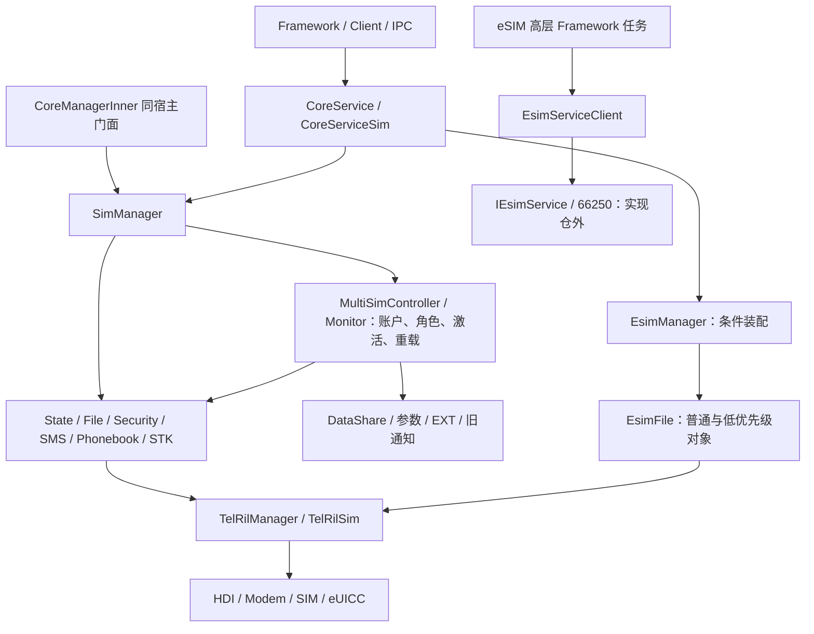
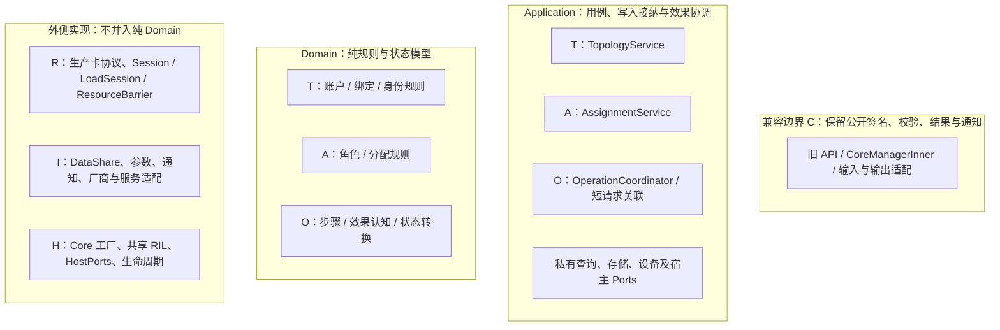
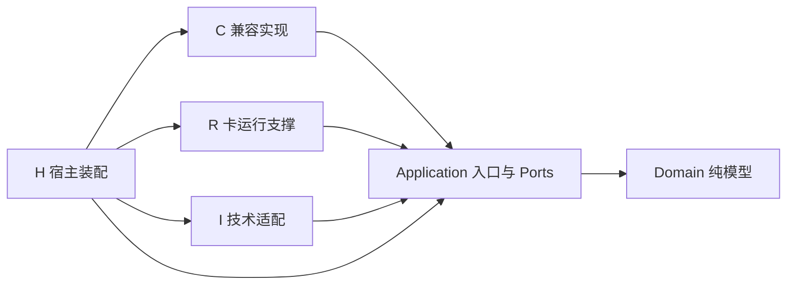
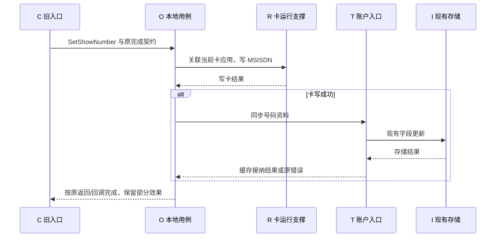
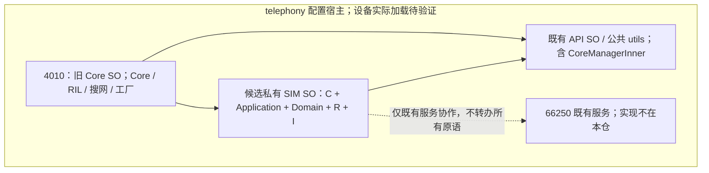

# SIM 目标架构设计

## 1. 文档定位与决策状态

### 1.1 目标与权威范围

本文是本次维护的目标架构主文档，回答上下文与聚合边界、唯一写权、分层、部署、兼容可见性、异步关联及恢复如何落地。保留 `SIM-TGT-001` 和原路径，收敛已有设计，不建立另一套功能编号或平行实现。SO 拆分是工程手段，不等于领域重构完成。

本文管理目标技术结构与协议摘要；领域业务契约、公开接口、详细迁移清单和测试用例仍由各自来源维护。**已发布或已批准的业务契约约束行为，固定源码/构建/配置证明现状，本文提出未来方案，历史材料解释背景。** 若现状与已确认契约冲突，记录缺陷及独立行为变更，不把源码缺陷永久化，也不在机械重构中悄然修复。

仓库 README 仍将《SIM 架构重构设计》称为架构主规范；本轮按任务指定以本文收敛目标技术设计，原文继续承载稳定功能清单、写权清单、迁移和既有证据。这里是明确的文档职责建议，不是仓库审批已完成的声明；未改 README 或其他文件，也不宣称废止缺失的上游契约。跨文档有冲突时，以本节来源性质及 §21 的具体裁决判断，不能按文件日期或“统一版”字样判断。

### 1.2 文档关系与实际定位

下表是在本仓 docs、索引及 front matter 检索后读取相关正文得到的关系。原稿引用的 `SIM-DDD-001 / SIM-ARCH-001 / SIM-IDEAL-001 / SIM-BND-001 / SIM-EVID-001 / SIM-FUNC-001 / SIM-SA-001 / SIM-MIG-001 / SIM-TEST-001` **均未定位到对应 document_id 的独立文档**；不把相近文件擅自重命名为这些权威源。

| 职责 / 原引用 | 实际可用材料 | 本文采用范围及限制 |
|---|---|---|
| 领域、统一语言 / SIM-DDD-001 | [DDD 导读](MultiSIM/04_ddd_target_architecture.md) §2～5；[V3 SAD](SIM_Refactored_Software_Architecture_Design_Version3.md)，实际 ID 为 SIM-SAD-001；[重构设计](SIM_Architecture_Refactor_Design.md#target-contexts) | 分类目标、身份/位置分离和单写者作为设计输入；未发现足以批准全部业务不变量的记录，不引用未经核对的 SIM-INV 编号 |
| 边界、SA、外部契约 / SIM-BND-001、SIM-SA-001 | [边界约束](knowledge/routing/repo-boundary.md)、[eSIM 专项](MultiSIM/03_esim_slot_and_sa_boundary.md)、[接口说明](SIM管理对外接口说明_源码核实版.md)；本仓 IDL、Core 入口及服务配置 | 区分本仓卡侧接口、66250 任务接口及部署配置；接口声明不证明服务实现、provider 事务或设备运行 |
| 现状与证据 / SIM-ARCH-001、SIM-EVID-001 | [旧现状基线](MultiSIM/01_sim_subsystem_baseline.md)、[演进分析](MultiSIM/02_current_architecture_and_evolution.md)、[重构设计来源](SIM_Architecture_Refactor_Design.md#document-sources) | 仅作定位与历史比较；本次结论重新读取固定提交，证据在 §20.2 |
| 理想、分层、类设计 / SIM-IDEAL-001 | [分层与迁移设计](SIM_Architecture_Layering_and_Migration_Design.md)、[V3 类设计](SIM_Layered_Architecture_Class_Design_Version3.md)，实际 ID 为 SIM-CLASS-001；[评估与优化设计](多SIM架构评估与优化设计.md) §3～5 | 保留有效职责；裁决“四业务 Context”、Coordinator 入 Domain、统一提交与持久日志等冲突。原 supersedes 对 SIM-IDEAL 章节的声明因源缺失撤回为未核实历史引用 |
| 功能及迁移 / SIM-FUNC-001、SIM-MIG-001 | [SIM-001～062 及子项](SIM_Architecture_Refactor_Design.md#feature-mapping)、[WU-01～09](SIM_Architecture_Refactor_Design.md#writer-cutover)、[迁移阶段](SIM_Architecture_Refactor_Design.md#migration-stages) | 沿用稳定功能 ID 和写权单元；本文 §6 / §22 仅给架构映射与门禁摘要，不复制完整迁移计划 |
| 测试 / SIM-TEST-001 | [systemtest README](../test/systemtest/README.md)、[初始化闭包](../test/systemtest/docs/initialization_closure.md)、[Oracle](../test/systemtest/docs/oracle_catalog.md)、[执行记录](../test/systemtest/docs/run_record.md) | 各自是设计、缺口或历史执行记录；本次不运行或晋升业务测试结果。测试目录有用户未提交修改，不能把它当固定提交产物 |
| 历史冲突与规则 | [2026-10-15 裁决](MultiSIM/08_design_unification_decisions.md)、[历史索引](history/pre_unification_20261015/README.md)、[仓库约束](knowledge/expert/constraints.md) | DU 等是历史设计取舍，不自动等于批准；约束中的新增 API/schema 禁止在本次继续遵守 |

### 1.3 状态标记

| 标记 | 含义 |
|---|---|
| FACT / F | 本次固定源码、构建或配置直接支持的静态事实，边界见 §20.2 |
| LEGACY | 已核实的旧实现行为，兼容重构默认保护；不自动等于永久业务要求 |
| PROPOSED / P | 有证据及理由的推荐技术决策，尚未批准 |
| OPEN-EXTERNAL | 已给默认边界，仍需产品、外仓或设备证据；只阻塞明确依赖的切片 |
| RESOLVED-FACT | 本仓事实问题已核清，不代表目标实现或业务审批通过 |
| CLOSED-RECOMMENDATION | 已形成不再并列选项的推荐；重新开启需新需求，仍不是 ACCEPTED |
| ACCEPTED | 仅在有批准人、批准内容和可核验记录时使用；本轮无此类新增记录 |

未单独标记的目标设计均为 PROPOSED。`owner: OPEN` 和 `approval_status: pending` 保持；责任角色是待协作对象，不冒充已接受任务的具名 owner。

### 1.4 本次可信基线与核验限度

- 分支 `main`；固定提交 `6017003eff50c1bc8c5dfa72336a4bfe42e948b0`；从该提交只读归档核查生产代码、构建和配置。后续仅文档提交不改变本轮生产代码分析基线。
- 原 `baseline_commit: 00b3faa6b02ac0f1adf77fb47f4a111cd95e665d` 在本地对象库无法解析；无法验证其来源，不断言远端也不存在。原 `last_verified: 2026-09-04` 与“本次未核验”说明已由本次静态核验记录替换。
- 编辑前目标文件无本地差异。工作区 `git status -uno` 列出 948 项修改；逐文件原始字节与 HEAD 比较另识别 1032 个仅 CRLF/LF 差异文件、21 个实质差异文件（均在 test/systemtest）和 44 个未跟踪文件。Git 状态与原始字节统计口径不同，不相加。生产代码与固定提交在换行归一后相同；所有已有修改保留。
- 只修改本文。源码证据用固定提交 URL、路径、符号及行号；文档引用用于职责导航，其历史测试基线不回写为本轮提交。
- 已读适用 AGENTS、仓库边界、专家约束、条件构建、验证说明。核验覆盖装配、公开入口、关键状态写入、设备调用/回调、存储及失败分支；不是全功能动态证明。语句先后只支持该路径局部顺序，不证明跨线程、跨 SA 的全局时序。
- 无匹配的 66250 服务实现、DataShare provider、厂商实现及设备运行证据；不以公网同名上游替代当前 fork 的契约。缺口和默认边界见 §7、§12、§13、§21。

---

## 2. 架构目标与非目标

### 2.1 目标

1. Subscription 身份与位置、路由、Radio 资源分离。
2. 每类核心业务事实具有唯一受控写入协议。
3. 聚合内状态转换具有明确的一致性边界。
4. 跨聚合和跨 SA 协作显式处理失败与最终一致性。
5. 外部回调不能绕过身份、代次和状态门控。
6. 接纳事实、旧查询可见步骤、持久化结果和未完成操作分别表达。
7. 旧 API 可以继续兼容，但不得反向决定核心领域模型。
8. 厂商扩展不能直接修改核心状态。
9. 领域测试跨 DDD 重构保留业务场景和断言。
10. 技术接入、运行时装配及存储实现允许受控演进。

### 2.2 非目标

- 近期不新增公开 Subscription API、IPC、SA、进程、schema、厂商 ABI 或运行期实现切换 Flag；
- 不强制采用 Event Sourcing；
- 不要求跨数据库、Modem 和 eUICC 建立全局原子事务；
- 不要求所有异步事件全局有序或恰好投递一次；
- 不以 Mock 替换核心业务来证明系统正确；
- 不将普通 Linux 受控测试等同于真实设备端到端测试。

---

## 3. 统一语义与身份规则

### 3.1 概念区分

| 概念 | 目标含义 | 禁止的默认等同 |
|---|---|---|
| Physical Endpoint | 硬件接入位置 | 不恒等于 API 中的 slotId |
| Logical Slot | 当前软件路由或兼容索引 | 不作为 Subscription 主键 |
| eUICC | 承载 Profile 的安全元件 | 不等于单个 Subscription |
| Port | eUICC 或设备提供的可用连接端口 | 不等于 Profile 身份 |
| Profile | 可管理的配置对象 | Disabled 不自动等于硬件不存在 |
| SubscriptionId | 内部对既有不透明 simId 的强类型表达，近期无第二公共 ID | 不由当前位置决定，不承诺跨删除/重装永久稳定 |
| ICCID | 卡或 Profile 的身份相关属性 | 不未经确认就等同于所有场景下的主键 |
| Active / Enabled | 特定对象的激活或使能维度 | 不直接等于 Ready |
| Default Role | Voice/SMS/Data 等业务角色 | 不自动等于 Primary |
| Primary | 产品定义的主资源或主卡概念 | 不自动等于默认数据 |
| Radio Assignment | Subscription 与 Radio 资源的分配 | 不等于 Subscription 身份 |
| Readiness | 特定能力的就绪条件 | 不用一个 READY 覆盖所有初始化阶段 |

### 3.2 身份与生命周期

目标要求：

- 路由变化不应无依据地创建新业务身份；
- 位置复用不能让旧回调作用于新卡或新 Profile；
- 身份恢复、删除、重新发现和保留期限必须具有业务依据；
- 身份与别名的关联应可追溯；
- 测试使用 Card-A、Profile-B、Subscription-C 等业务别名，避免将固定 Slot 当作永久身份。

近期默认沿用现有 simId 分配/匹配与历史账户可见性；不新造身份、不从 slot 或 simLabel 推导身份，不承诺跨删除、重装或跨设备永久稳定。当前 InitIccId 查询既有 ICCID 记录后更新或插入，不能据此证明全部产品的身份恢复政策。[F04](#src-04)

卡移除后的保留、Profile 再启用复用、跨设备恢复及 NULL/占位值迁移属于 TGT-OPEN-006 的外部业务确认。缺口只阻塞改变这些政策的设计，不阻塞沿用旧契约的结构改进。空槽/未识别卡使用 SlotTarget/CardApplicationTarget，不为了建立账户而拒绝 PIN、EF 或状态查询。

---

## 4. 目标上下文与唯一所有权

### 4.1 上下文划分及取舍

推荐 T/A/O 三个业务责任边界；C 是兼容边界，R/I/H 是实现责任。它们不是七个聚合或七个服务。旧材料的“四 Context”将 Compatibility 作为技术防腐边界计数；本文统一用“业务上下文”计数，因为 C 没有独立业务不变量或业务事实写权。[F04](#src-04)、[F07](#src-07)、[F11](#src-11)支持按变化原因拆分原混合控制器，而非按类名搬迁。

| 边界 | 隔离的变化 / 保护的规则 | 唯一拥有的状态 | 不承担的责任 |
|---|---|---|---|
| T — Subscription Topology（账户与连接拓扑） | 身份匹配、账户生命周期、连接映射；位置复用不得混淆身份 | 账户资料、既有 active 兼容投影、槽清单、已接受绑定及 bindingRevision、账户加载状态 | 不拥有原始卡状态、设备真实执行结果或角色决策 |
| A — Radio Resource（角色与资源分配） | Voice/SMS/Data、Primary 意图与资源限制的变化；保持已确认联动和排他规则 | 角色偏好/有效选择、Primary/Data 旧参数投影、期望分配和带来源的资源观察 | 不拥有 IMS 注册、数据连接、卡身份或硬件执行租约 |
| O — Local Operation（本地业务操作，替代原笼统 Profile Operation） | 多步骤效果、部分失败、重试责任；一次任务只有一个主编排者 | 本仓长用例的步骤、attempt、效果认知和业务终态 | 不复制远端下载/OSU 状态机，不成为账户或角色第二 writer |
| R — 生产卡运行支撑 | 卡型/EF/APDU/安全/协议变化；同会话结果归属与真实共享设备串行 | 原始卡/锁状态、Records、电话簿/短信/STK/eUICC 缓存、运行会话、传输关联、资源屏障 | 不包装成纯 Domain，不重写成熟编解码，不把库存等同账户 |
| C — Compatibility | 旧签名、校验优先级、完成、查询来源和输出轨迹 | 订阅登记、完成出口及格式；业务投影由 T/A/R 生成 | 不自行写业务存储或独立维护一份可变账户状态 |
| I / H — 技术适配 / 宿主装配 | DataShare、参数、通知、厂商、RIL 宿主访问及生命周期 | 技术句柄、订阅令牌、工厂与宿主资源所有权 | 不拥有领域策略；Repository 名称不创造事务 |

### 4.2 聚合、应用服务与部署

| 纯模型 / 一致性边界 | 唯一应用写入口 | 部署建议 | 边界理由 |
|---|---|---|---|
| TopologyAggregate（账户、绑定索引及纯身份规则） | TopologyService；原 TopologyManager 名称统一至此 | Core 4010 内部 | 账户属性与位置关联有约束，但 EF 加载和设备等待不锁住整个拓扑 |
| AssignmentAggregate（每共享资源域的角色/分配规则） | AssignmentService；RadioResourceArbiter 限为纯决策规则 | Core 4010 内部 | 跨槽 Primary 切换需要同域仲裁，无关 Modem 不应被全局队列阻塞 |
| OperationContext / 必要的 OperationAggregate（每次多步骤业务操作） | OperationCoordinator（Application） | Core 4010 的本地用例 | 只对需跨步骤维护效果/恢复的任务建模；不是设备资源锁或全局操作聚合 |
| 远端 Profile 任务状态（具体模型未知） | 既有 66250 服务的任务主编排者 | 保留既有服务身份，不由本仓指定其内部类 | 本仓仅有接口/客户端，不能宣称远端已经实现 OperationAggregate |

**Coordinator、TopologyService、AssignmentService 属于 Application；纯状态转换与策略属于 Domain。** 协调器执行 I/O、等待和恢复的职责不能放进 Domain 框。[F01](#src-01)、[F10](#src-10)～[F13](#src-13)证明 Core 卡侧能力与服务任务是两个现有边界。

简单状态查询、EF 加载、电话簿多文件读取、STK 会话继续由 R 的生产协议模型处理。PIN/PUK、认证、单次 APDU 需要发起时关联和完成门控，通常仅用短生命周期 RequestContext；不为其强建持久业务聚合。激活、号码“写卡→账户同步”、Primary/Radio 切换及本地 Profile 步骤可使用 O。用例跨多个 Owner 时逐步协调，不持有跨 Owner 可写引用或共享锁。

### 4.3 聚合粒度与不变量

近期保留一个 T 应用写入口统一索引，使用**短时内存提交 + 按受影响账户/绑定键预留**：身份关联唯一性或绑定迁移在同一次内存提交中核查旧/新键；显示名修改只检查该账户版本，不让另一槽加载导致无意义冲突。I/O 在锁外执行，返回时复核有关输入。不同账户可以并行准备；触及相同账户或绑定键的变更序列化，不将设备等待占据整个 T 通道。

A 的默认角色选择可能是产品全局规则，按该规则保护最小资源域；资源域未证明独立前保守共享，不从 slot 数或两个对象推断并发能力。O 按 operation 建模，设备冲突交 R 的资源屏障；协议 session、文件加载集合均不扩大 T 事务。

这里保证的是本进程内规则和提交准入，不是 DataShare/provider 的原子事务。跨行唯一性、跨存储提交仍受 §13 限制。TopologyAggregate 名称保留为逻辑模型，不要求一张整设备持久快照或一个覆盖所有 I/O 的大锁。详见 TGT-OPEN-007。

---

## 5. 分层与依赖方向

### 5.1 当前架构与目标架构对比

#### 5.1.1 图示范围与状态

当前图是固定提交核实的主要**运行调用**；目标图是 PROPOSED 的**职责分层**。编译依赖单列 §5.2，运行协议在 §5.3，部署/链接在 §7。图不声称覆盖全部调用或设备实际部署。目标组件名不是现有实现声明。

#### 5.1.2 当前架构：主要运行调用（FACT）

Core 初始化 RIL，再条件装配 EsimManager、SimManager 和搜网；SimManager 装配每槽 State/File/Account/SMS/电话簿/STK 及多卡 Controller/Monitor。[F01](#src-01)、[F03](#src-03) 普通与低优先级 EsimFile 针对同 slot 创建，不因此获得两个独立 eUICC。[F12](#src-12)

源码列入根 `tel_core_service` 的 SIM/RIL/Core 尚未形成独立 SIM SO；eSIM 文件/控制器及宏受 GN 条件控制，EsimManager 源列入根表与运行时条件装配应分开看。SimCacheSyncManager 源存在但未见根构建或生产调用装配。[F02](#src-02)、[F28](#src-28) SimAccountManager 主要承接运营商配置，账户主缓存实际在 MultiSimController。[F04](#src-04)、[F24](#src-24)

#### 5.1.3 目标职责分层（PROPOSED，无箭头表示编译或运行依赖）

R 保留 EF/APDU、解析、安全、STK 等生产实现，不为整齐的图强行拆协议；Application 只抽出用例和事实写权。仅有内部规则才进入 Domain。简单查询不必经过 O 或总线。66250 的完整任务模型不画进 Core Domain，任务边界见 §7.2。

#### 5.1.4 差异与收益

| 当前已核实结构 | 目标变化 | 实际消除的问题 |
|---|---|---|
| Controller 同时改账户、角色、参数并等待设备 | T/A 写权 + O 本地编排 + R 执行 | 修改身份规则不需复制设备协议；部分效果有明确接收方 |
| File 可回写卡状态，Monitor 重载账户 | R 统一状态接纳，T/A 按字段接收重载 | 避免旧路径与新 Owner 同时写入 |
| 返回、卡结果、缓存、DB、通知分离发生 | 保留各节点并记录效果维度 | 不把广播失败误作角色未变或把外层成功当卡成功 |
| slot、RIL serial、协议 session 各自存在 | 保留协议标识，增加内部作用域关联 | 防换卡、局部重载及迟到污染，不制造一个万能 Revision |
| Core/API/SIM 源码依赖交织 | 私有 Ports 与工厂注入，分阶段拆库 | 保留消费侧契约，真实链接图可验，无须新增公开 ABI |

#### 5.1.5 抽象的最小性

组件按责任实现，不按图逐框建 Manager。私有端口只用于隔离真实变化或阻止反向具体依赖；无该需求的纯函数和现有协议类直接复用。事件总线不是必经层，Repository 不替代写计划；§6.1 列出新增抽象的目的与不用它的具体风险。

### 5.2 源码编译依赖（箭头：使用方 → 被依赖接口/模型）

R/I/H 实现应用定义的端口，编译依赖向内；运行时 Application 调用注入对象，方向可以相反。领域策略只依赖纯值类型/规则接口，DB/RIL/IPC/FFRT 的端口归 Application，不把技术接口伪装成领域实体。对 R 既有平台调用分切片收口；不声称当前全部代码已满足该依赖图。

### 5.3 运行调用及回调

典型本地写用例：`C → T/A 取得资格或计划 → O → R/I 执行 → O 接纳结果 → T/A 接纳各自事实 → C 按旧出口完成`。简单资料修改可 `C → T → I`；卡状态只读可由 C 经应用定义的查询端口直接读取 R 注入的视图，无需创建 O。入站设备通知走 `R 接纳观察 → T/A 应用入口`，没有请求就不伪造 OperationId。

图描述目标协调，局部旧行为见 [F08](#src-08)。CoreServiceSim 的接收返回发生在队列任务完成之前，不能把图末尾当成 IPC 同步返回；卡失败不进存储，卡成功/DB 失败不自动补偿卡。[F15](#src-15)

### 5.4 Compatibility 的准确约束

C 无独立业务写权，但可调用有副作用的正式查询用例。LegacySlotView 是 T/A/R 受控发布的只读投影，不是另一套可写模型，也不是所有查询唯一数据源。GetShowNumber 保留卡缓存→账户→IMPU 回退及异步 T 回写；QueryImsSwitch 保留按 ICCID 的存储读取。[F09](#src-09) 保持签名之外，还要保持权限/错误优先级、接收返回、业务回调、读取来源、中间可见性、通知次数和必要偏序，详见 §9 / §16。

---

## 6. 目标组件、接口与原功能承接

### 6.1 最小组件及数据契约（PROPOSED）

下列是职责和内部接口建议，不是要求新增同数目的类或公开 API。数据使用私有 C++ 值类型；不变更现有 DTO、IDL、接口虚表或 schema。

| 组件 / 所在层 | 核心输入输出 / 唯一状态 | 为什么需要；不采用的风险 |
|---|---|---|
| TopologyService / Application；TopologyAggregate / Domain | `AcceptAccountPatch(target, expectedInputs, patch)`；账户字段、绑定、局部版本 | 汇合初始化/重载/后台写，防账户和路由规则散落；不接受角色字段整行覆盖 |
| AssignmentService / Application；AssignmentPolicy / Domain | `PlanAssignment(facts, legacyPolicy)` 产生纯计划；`AcceptAssignmentStep` 接纳参数/设备/持久化各结果 | 区分期望与观察，防 Primary/Data/角色多写；原 RadioResourceArbiter 是此规则职责，不是另一套设备锁 |
| OperationCoordinator / Application；OperationContext / Domain 状态 | `Begin`、`AcceptResult`；target、step/attempt、effect、waitState、terminal | 为多步用例保留部分效果、唯一重试责任；单步请求只用 RequestContext，不要求业务聚合 |
| RuntimeOperationStore / Application 私有容器 | 原 OperationRepository 的近期实现：进程内关联与有限终态保留 | 明确非持久日志，防“Repository 即可重启恢复”；无持久恢复需求不新增表 |
| CardRuntime / R；SessionRegistry、LoadSession / R | 分类目标解析到生产对象；SessionRef、LoadToken、请求集合 | 复用协议且隔离换卡与 Refresh，防当前代次补填及重复计数 |
| ResourceBarrier / R | `Acquire(resourceKeys)`、`AcceptRecoveryEvidence(oldRequest, evidence)`；租约、fence、Checking/Available/InFlight/Quarantined | 约束真实共享 Modem/eUICC，防对象锁各自独占及超时后双发；按 §12 门禁启用 |
| AccountStore / AssignmentStore Ports / Application；I 实现 | 字段级写计划、现有 URI/参数、逐步结果；原 Topology/AssignmentRepository 名称可作为接口别名 | 隔离存储协议；禁止用通用 Save 整行覆盖对方字段，不要求两个独立数据副本 |
| LegacyFacade / C；CompletionPlan / Application+C | 原参数/调用者上下文→分类目标；原返回/回调/输出轨迹 | 保持旧边界，避免异步后权限变成服务身份或统一延迟通知 |
| Capability / Host Ports；H 实现、注入 | 已核实容量/路由、RIL、IMS 回退等宿主能力；工厂创建/销毁令牌 | 解开 SIM 对宿主具体符号依赖；能力未知不能默认等于 slot 数 |
| VendorCapability / Notification / Command Ports；I 适配 | 现有 Hook 能力查询、输出、正式用例输入 | 隔离厂商变化；保留既有 ABI，不新增一套厂商 SDK |

`ResolvedTarget` 为 `SlotTarget | CardApplicationTarget | SubscriptionTarget` 类型化联合：空槽可有 SlotTarget；PIN/EF 可在没有 simId 时使用 CardApplicationTarget；离线账户属性使用 SubscriptionTarget。卡侧执行再解析当前有效绑定。不得用任意 optional 字段组合伪造合法目标。

`SessionRef = (runtimeEpoch, resource/application key, bindingGeneration)`；`LoadToken = (SessionRef, LoadScope, recordsGeneration, requestRef)`；`RequestContext = (originTarget, step, attempt, transport correlation, completionPlan)`；`EffectKnowledge = NotSent / Rejected / ConfirmedApplied / ConfirmedNotApplied / Unknown`。这些都是内部数据，不追加到旧 IPC。

### 6.2 原功能到目标的架构映射

完整明细沿用 [62 项稳定功能及 8 子项](SIM_Architecture_Refactor_Design.md#feature-mapping)。以下摘要覆盖全部主编号；范围表示原编号集合，不创建竞争编号。唯一写者指相应事实，I 只是受托存取者。

| 原功能 ID / 模块 | 目标上下文 → 层/组件 | 唯一写者 | 保留、拆分或委托方式 |
|---|---|---|---|
| SIM-001～004；Core/SimManager 生命周期、入口、槽能力 | H/C，T → 装配/兼容/TopologyService | H 实例；T 槽清单；C 订阅与完成 | 保留公开入口、检查次序和部分就绪；不把公开容量当硬件并发数 |
| SIM-005～011；StateManager/Handle、PIN/PUK/认证/IO | R；必要 O 关联 → 卡状态/安全/IO | R 卡状态/锁因；O 请求状态 | 保留协议与剩余次数，Slot/CardApplication 目标不强求账户；不用全局操作聚合 |
| SIM-012～019；File/Controller/解析、Refresh、号码/语音信箱/CFIS/运营商名 | R → application/records/codec/telephony records | R 对应会话/加载 scope | 保留卡型和算法，I/O 不进 Domain；网络侧通话、转移和驻网仍在原模块 |
| SIM-020～022；Controller/Monitor 账户建立、缓存及映射 | T → TopologyService/纯身份规则；A 初始角色 | T 账户/绑定；A 角色字段 | InitData 仅账户步骤归 T；force 激活与主卡后续委托 O/R/A；重载不覆盖其他 Owner |
| SIM-023.a～c；名称、号码写卡、查询回写 | T 资料；O 号码用例；R MSISDN | T 账户资料；R 卡记录 | 名称仅存储；号码先卡后库；查询异步回写仍入 T；保留部分失败 |
| SIM-024；激活/卫星分支 | O → Application；R 执行；T 接纳 | O 进度；T active 投影；R 设备观察 | force/普通/卫星分别沿原语义，不以 active 等同 READY |
| SIM-025～030；Voice/SMS/Data/Primary/Radio/DSDS | A → Application/Domain；O 编排；R 协议 | A 角色/分配；O 步骤；R 协议会话 | 保留参数预写、回滚、重试和 Primary→Data 后续；无双发设备命令 |
| SIM-031.a～c；标签/在位资料/映射开始 | T 资料/映射标志；O 协调；R 软件状态输入 | T 资料；R 卡状态 | 标签不是身份或 Port；人工 ABSENT 不是物理拔卡或映射完成 |
| SIM-032～035；Observer/账户回调/服务重连/用户变化 | C/I/R/T → 订阅、观察、重载 | C 对外登记；I 平台 token；T 账户加载；R 卡加载 | 保留首帧、重复和死亡清理；重连不是新插卡；全部后台入口委托 |
| SIM-036～040；SIM SMS、ADN/FDN、PBR/ANR/IAP、STK | R → sms_storage/phonebook/stk；C 输出 | R 卡缓存/会话 | 保留实际卡读写及安全前提；完整短信业务/联系人不迁入 |
| SIM-041～044、045.b；SimAccountManager/Operator*/Tracker | R → carrier/config/privilege；I 提供方/Hook | R 配置、能力观察和匹配缓存 | 类名含 Account 不整类入 T；保留 APN 初始化、证书及规则读取 |
| SIM-045.a；IMS 开关偏好 | T → 资料用例；I store | T IMS 偏好 | 保留 SaveImsSwitch/QueryImsSwitch 路径；IMS 注册不归 A 或 T |
| SIM-046；下载、OSU 等服务任务 | 仓外服务 → IEsimService/66250 | 服务原任务主编排者，待匹配实现核实 | Core 仅承接既有本地原语，不复制完整任务或补偿 |
| SIM-047～054；EsimManager/File/Controller | R → euicc 查询/通道/认证/BPP/Profile/通知/CA；O 本地步骤 | R 卡缓存/资源；O 本地关联；T 接受绑定 | 普通/低优先级共用设备域；保留双结果、卡通知、数量和原参数含义 |
| SIM-055～056；DataShare/helper/卡探测 | I store；T/A 字段计划；R 探测 | T 账户资料；A 角色；I 句柄 | 不新增直写 RDB；卡探测重载也接管；已有 weak_ptr 装配时点风险单独评审 |
| SIM-057～060；EXT/VSIM/卫星、serial、CoreManagerInner、诊断 | I/H/C；O 关联；R 协议 | 各事实 Owner；诊断不写业务状态 | 保留产品分支、宿主消费门面、RIL serial 和协议 session；不把统计当完成 |
| SIM-061；Core FactoryReset | 原搜网模块 | 原网络 Owner | 不自动删 Profile、ResetMemory 或新增远端任务 |
| SIM-062；SimCacheSyncManager | 未装配源；未来 T/user_scope 候选 | 当前不授予新 writer | 保留文件，不因存在源码而启用或宣称现行业务 |

依据 [F01](#src-01)～[F29](#src-29)及既有功能原文。映射覆盖不等于所有方法和条件分支已动态验证。

### 6.3 写权切换：以状态单元而非一个公开方法为单位

沿用 [WU-01～09](SIM_Architecture_Refactor_Design.md#writer-cutover)：账户全量/当前缓存、active、Voice/SMS、Primary/Data、资料、卡状态/Records、操作进度、eUICC、订阅/加载分别切换。迁移前扫描字段赋值、可写引用和间接写者，覆盖 InitData/InitIccId/建行、GetListFromDataBase/GetAllListFromDataBase、Monitor RefreshData/用户切换/服务就绪、号码异步回写、force 激活、重试/失败恢复、卡探测和 EXT/VSIM/卫星分支。[F04](#src-04)、[F05](#src-05)、[F09](#src-09)、[F23](#src-23)、[F27](#src-27)

切换顺序：旧入口先委托唯一应用写入口 → 核对所有路径 → 停止受影响受理并排空或隔离在途 → 导入原语义的分字段状态 → 一次转移写权 → 删除旧直接写。T 切换时，尚未重构的 A 策略经旧实现桥提供角色片段；不得留下 T 建行/重载偷偷重写 A 字段。桥是私有委托函数，不能保存第二份可写缓存。只读 shadow 不发设备请求、不写存储、不发旧通知；不引入运行期双实现 Flag。

---

## 7. 部署与跨 SA 协作

### 7.1 部署配置与目标链接

FACT：4010.json 指向 telephony 中的 `libtel_core_service.z.so`；telephony_trust.json 列出 4010、66250 等共宿主配置。配置不证明设备已安装/加载，独立 SA ID 不等于独立进程。现有 CoreManagerInner 实现在 API SO，不应把其每次反查都称为当前 SIM↔Core SO 环，因为当前尚无 SIM SO。[F02](#src-02)、[F14](#src-14)、[F30](#src-30)

目标部署保持原 SA/进程配置，图中实线是目标**链接依赖**，虚线是既有服务调用；框不是新进程：

`libtel_sim_service.z.so` 只是候选名称；GN target、符号和安装关系待 G2b 验收。Core 工厂实现 HostPorts，注入共享 ITelRilManager 能力；SIM 不反链 Core 的具体实现。API 中原门面通过注入虚接口运行时委托，不新增 API→SIM 具体符号依赖。66250 的服务 SO/内部结构不由本仓猜测。

### 7.2 一类端到端任务只有一个主编排者

| 任务类别 | 本次核实边界 | 默认主编排 / Core 责任 |
|---|---|---|
| 下载、OSU、高层 Profile 任务 | IEsimService 声明 listener、DownloadProfile、StartOsu、SwitchToProfile 等；Client 加载 66250；没有匹配服务实现 [F10](#src-10) | 保留既有服务为任务责任边界；由外仓负责人补步骤/重试/补偿证据。Core 不新建第二完整任务状态机 |
| Core eUICC 卡侧原语 | EsimManager/File 执行认证、BPP、通道、切换及双结果 [F11](#src-11)～[F13](#src-13) | R 执行原协议；O 仅关联本地步骤。来自服务的子请求不反向转办同一高层任务，禁止 Core→66250→Core→66250 循环 |
| 普通 SIM 激活、号码修改、Primary/Radio 切换 | Controller/RadioProtocol/File 本仓完整主要路径 [F05](#src-05)～[F08](#src-08) | Core Application 的 O 主编排；T/A 唯一接纳事实；R 执行 |
| PIN/PUK、单次 IO/认证；EF/电话簿/STK | 本仓安全与卡运行能力 [F15](#src-15)、[F16](#src-16)、[F25](#src-25)～[F26](#src-26) | 应用短请求门控 + R 协议/加载状态，不要求独立 OperationAggregate，不委托 66250 |
| 名称、角色查询、状态只读 | 本仓旧接口/缓存来源 | T/A/R 对应用例直接提供；无需 O |

原“所有 OperationCoordinator 部署于 esim_service SA，Core 只有只读投影”撤回。此裁决仅确定本仓架构，不声称已核实远端任务完成点。远端服务与本地子步骤可各有技术重传，但同一业务步骤的重试/补偿必须由其主编排者授权，不能双方超时后各自重放。

### 7.3 跨 SA 交付、重连与能力边界

近期保持现有 IPC、listener、parcel 和死亡接收路径，不向旧载荷追加 OperationId/epoch。内部关联在发起时保存已有请求/回调对象，接收时验证原归属；不能用当前 slot 反填缺失身份。跨 SA 不共享聚合实例、锁、全局顺序或内存事件总线。

现有 IEsimService 的 GetEuiccProfileInfoList/GetOsuStatus 等是特定事实查询，**没有通用 QueryOperation(OperationId)、持久结果重放或可靠取消证明**。[F10](#src-10) 连接恢复仅重建访问能力，不证明任务成功或旧执行终止。关联丢失时本地记 Unknown，按 §12 核对可达事实；不重复投递旧成功，不替服务执行补偿。

长期若要求结果不丢失/跨重启查询，再独立设计协议版本、稳定任务 ID、结果保留、幂等/重放、查询及必要持久记录；由服务/API/产品负责人确认并做断线/崩溃实验。这需要新增协议或日志时进入独立审批范围，不是 G2 拆库前置条件。详见 TGT-OPEN-001/008/009。

---

## 8. 状态所有权、Repository 与查询

### 8.1 单一事实来源不等于一张全量快照

每个状态字段组只允许对应 T/A/R/O 入口修改。Domain 检查纯规则，Application 决定旧兼容节点及 I/O 协调，I 按计划存取，C 格式化输出。T 中若带角色字段，只能是 A 发布的版本化只读投影；R 缓存卡记录，T 的号码资料不能反向覆盖 R 的设备观察。

旧 DataShare、参数、内存和设备各有真实能力，不被“已提交快照”统一替代。内存受控接纳、持久化结果、设备观察和外部完成是正交事实，§9 规定其组合。Repository 不另设可独立变更的业务缓存，也不默认拥有跨进程唯一写权。

### 8.2 查询分类

| 查询类别 | 目标承接与兼容要求 |
|---|---|
| 账户、角色、公开卡状态的旧查询 | 读取原来源所对应的 T/A/R 兼容投影，保留 active 筛选、缺省、历史账户和权限裁剪；不等待整个用例终态 |
| GetShowNumber | 应用查询用例读取 R 卡缓存→账户→Host IMS IMPU；需要时异步向 T 提交资料回写，查询返回不等回写完成 [F09](#src-09) |
| QueryImsSwitch | 保留按 ICCID 的存储查询和原缺省/返回语义，不能统一改为内存读取 [F09](#src-09) |
| 设备/库存观察 | 最近观察 + 来源/会话/有效性；需要实时查询时仅用该方法原有路径，不为所有查询新增 RIL 请求 |
| 内部操作查询 | 返回本地接纳、效果、等待与终态；不新增公开 Operation 查询接口或跨重启承诺 |

Readiness 分为服务可访问、卡存在/锁态、Records 加载、账户可见、Profile 启用、角色有效、Radio/网络可用。不能一个 ready 或一条成功回执代表全部。

### 8.3 组合查询

内部组合视图携带各自版本及绑定引用，读取前后核对相关输入，必要时在有界预算内重读；不依赖全局 Revision 拒绝另一槽合法变化。对外旧方法保留原字段、错误及返回点，不凭内部“协调中”新增错误码或隐藏旧可见数据。若旧接口无法表达不确定，保持原投影并记录内部来源，不能宣称它是跨聚合原子快照。需要强一致组合或新 readiness 字段时另走 API 契约评审（TGT-OPEN-012）。

---

## 9. 提交、兼容可见性与关键失败行为

### 9.1 Commit 的限定定义

Commit 是**某个 Owner 在其作用域内接纳状态的一次动作**，必须说明接纳的是何种事实。它不等于数据库、Modem、eUICC、公开回调和通知同时成功。

每次用例至少区分 `acceptance`（请求接纳）、`effect`（设备效果认知）、`legacyVisibility`（旧查询投影）、`persistence`（各存储步骤结果）、`terminal`（用例结果）、`delivery`（回调/通知出口结果）。这些维度不合并成一个成功布尔值，也不要求每次都持久化。

### 9.2 两类提交协议

1. **兼容重构协议（近期默认）**：按旧方法已核实节点，让对应 Owner 接纳每个可见步骤；保持存储、参数、缓存、设备与输出的原必要偏序。原节点前的候选不可见，原节点后即使后续失败也不能统一隐藏。存储结果与设备效果单独记录，C 无自主写权。
2. **严格持久后发布协议（有条件长期目标）**：仅对已经具有事务/条件更新能力且契约允许的状态，构造候选→锁外持久化→复核输入/处理冲突→发布快照→发对应事实通知。未证明 provider CAS/事务时不能承诺；旧行为不同的方法须单独批准行为变化，不把这一协议全局套用。

同一写权内有关候选受控排序，锁外 I/O 返回后再验证目标/版本。若存储已成功但内存接纳因新版本失效，进入核对，不能静默抛弃已发生写入，也不能盲目重复设备步骤。对无关卡不持整聚合通道等待外部调用。

### 9.3 本次核实的兼容轨迹与目标处理

表中顺序为源码单条路径的局部顺序；通知消费者到达顺序、并发查询实际交错需另做运行采集。失败验收是将来的要求，非本轮测试结果。

| 功能 / 已核实主张与证据 | 正常及部分失败节点 | 目标处理 / 必须验证的差异 |
|---|---|---|
| SIM-024 普通激活 [F05](#src-05) | SetActiveSimToRil 成功后，非 force 先 UpdataCacheSetActiveState / UpdateSubState，再 UpdateDBSetActiveResult；DB 失败直接返回，前面缓存不回滚；后续成功路径还可能再次 UpdateSubState。force 分支保留其原有步骤子集 | T 接纳 active 兼容投影与存储结果分别发生；O 不谎称整体未发生。保留分支、返回和原输出节点；不全局去重 |
| SIM-028 Primary [F06](#src-06) | 普通路径先 SavePrimaryCardInfo 写 last/参数，再设备协议；失败 ResumePrimaryCardInfo 有旧值/格式条件，后接重试；成功广播并联动 Data；另有特殊槽和免重启分支 | A 区分意图、参数投影与观察；O 持唯一重试责任；参数恢复不证明硬件回滚。检查旧值空/非法、设备失败和后续 Data 结果 |
| SIM-025/026 默认角色 [F07](#src-07) | 先 provider 默认卡命令，再缓存/default*SimId，再广播；广播失败返回 PUBLISH_BROADCAST_FAIL，角色可能已变 | A 不回滚已接受角色以制造原子成功；C 保留原错误；核对查询能见新值且通知失败。相同角色分支是否再发按原路径 |
| SIM-023.b 号码修改 [F08](#src-08)、[F15](#src-15) | 写 MSISDN 失败不进 DB；卡成功后 DB 失败，卡效果保留；DB 成功后缓存边界检查仍可能失败；Manager 仅整体成功发原账户通知 | R 卡记录、T 资料分别接纳，O 保留部分结果。旧接收成功与后续 parcel 错误分开；不自动改回卡号码 |
| SIM-023.c 查询回写 [F09](#src-09) | 卡缓存非空可立即返回并异步 SetShowNumberToDB；账户为空可从 IMPU 回退并回写；查询不等待 DB | 保留返回/来源。回写固定发起目标及会话；拒绝换卡后陈旧写是显式行为修正，不能混入 G2 |
| SIM-051 卡侧 Profile [F11](#src-11)、[F13](#src-13) | EsimManager::SwitchToProfile 外层返回成功，enumResult 承载卡侧失败/超时；随后仍写 USER_PREFER_PRIMARY_SLOT | 不把外层 int 成功当 Profile 已切换、拓扑/Radio 就绪；保持旧双结果及参数节点，缺陷修改另审 |
| SIM-031.c 映射开始 [F18](#src-18) | SimManager 先置映射标志，再 StateManager/Handle 注入人工 ABSENT；后者失败不撤销标志；旧相同状态分支及清理条件另受状态机控制 | T 标志、R 软件原因状态、O 协调、C 输出分别维护；不宣称物理拔卡/路由已完成 |

### 9.4 崩溃、输出失败与恢复

| 崩溃或失败位置 | 近期可承诺的处理 | 不能推断的结论 |
|---|---|---|
| 设备发出前 | 未发出关联可撤销；保持旧错误 | 受理成功不是已执行 |
| 缓存可见后、DB 失败/退出 | 当前进程保留已发生兼容投影；重启按旧存储/设备重建并核对 | 不承诺该内存步骤跨重启保留，不捏造回滚 |
| DB 写后、内存发布前 | 重读现有持久事实，按字段接纳 | 读取到目标值不证明本次 operation 身份或其他存储成功 |
| 角色已变、广播失败/未发 | 保持角色与原错误，沿旧查询/服务重连路径观察；无 outbox 不保证崩溃后补发 | Publish 返回成功也不等于所有订阅者送达 |
| 设备动作后、响应丢失 | Unknown；对应资源进入核对，见 §12 | 超时、进程退出、本地表清空不证明未执行或静止 |
| 回调已交付后收到迟到结果 | 不重复完成调用者；有效证据交资源核对 | 不复活旧操作、不借旧结果写新卡 |

### 9.5 需要单独批准的行为修正

拒绝陈旧号码回写、对未知设备效果增加隔离、禁止原无证据自动重试、修正错误成功码/未检查通道关闭结果，都可能改变返回、时延、重试或后续可用性。推荐修正有风险的路径，但须记录具体方法的旧/新轨迹、故障原因、错误映射、产品影响及回退条件，完成定向故障/并发差分后才启用（G3b/G3c/G3d）。例如 SetShowNumberToDB 越界 `return false` 出现在 int32 方法中，只能记作缺陷候选，不能在文档中宣称已经修复。[F08](#src-08) 新增持久日志、强一致查询或可靠通知属于 G4 的独立需求。

---

## 10. 身份、版本与会话有效性

### 10.1 标识的产生者与失效范围

| 标识 | 产生/维护者 | 变化或失效条件 / 不可替代的标识 |
|---|---|---|
| simId / 内部 SubscriptionId 包装 | T 接受现有账户分配与匹配结果 | 不新造第二公共 ID；删除/重装/跨设备稳定性未承诺，不能等同 slot |
| Slot / Endpoint / Port / Profile / ApplicationRoute | T 接受 R 与已核实能力来源 | 位置、硬件、Profile、应用分别表达；缺 Port 证据不填默认 0，标签不作身份 |
| runtimeEpoch | H 每次模块实例创建分配；R 使用 | 模块重建/进程重启更换实例令牌（建议私有随机 128 位值）；不能只用从零重置的计数器，不是业务持久版本 |
| bindingGeneration | R SessionRegistry，按卡/应用作用域 | 换卡、应用替换、路由绑定失效；显示名变更不递增 |
| TopologyRevision / bindingRevision / accountVersion | T | 接纳有关拓扑/绑定/账户变化；只复核实际依赖键，不以全局 Revision 拒绝所有请求 |
| LoadScope + recordsGeneration | R 每轮有关文件/依赖闭包加载 | 同卡 Refresh 只更新受影响 scope；不用 bindingGeneration 吞掉所有合法在途响应 |
| AssignmentRevision / 决策依赖集 | A | 角色/分配事实变更；记录所依赖绑定及资源版本，不要求每次 T 变化都失效 |
| OperationVersion / step / attempt | O 单次操作 | 状态推进、步骤及重试；不能冒充设备取消/事务序号 |
| RIL serial / RadioProtocol sessionId / eSIM transactionId | 原 RIL / 协议 / 服务生成 | 保留各自协议作用域，serial 可复用/回绕；不能当跨重启业务身份 [F17](#src-17)、[F19](#src-19) |
| resource fence | R 每个真实共享资源域 | 已核实恢复或新租约边界推进；区分旧响应和新执行资格，不证明硬件自行停机 |

### 10.2 换卡、Refresh 与合法会话接续

换卡/移除使受影响卡应用的旧状态写权失效；R 清理对应 Records/电话簿会话，T 独立撤销或接纳绑定。无关卡和历史账户不随之全局失效。卡移除也不自动证明共享 Modem 空闲。

同卡全量 Refresh 更新有关加载 scope；局部 Refresh 按已有 EF 选择及 PBR/ANR/IAP 依赖闭包更新局部代次。LoadSession 维护必需/可选请求集合、父子关系、读写类型、Pending/Completed/Failed/Invalidated 状态；一次结果只消费一次成员资格。未受影响请求保留原 token 完成；新视图可包含不同 scope 的有效代次。原 fileToGet 计数与 LOADED/通知路径须逐卡型兼容，不把计数归零作为成功依据。[F16](#src-16)、[F25](#src-25)

合法激活/Profile 切换可能产生新会话。O 在发起前记录 `ExpectedTransition(operation, step, oldSession, affectedKeys, expectedIdentity, allowedCause, deadline, consumed)`；R 仅在范围、已知目标、协议或关联重查的因果证据、时限均匹配时签发新 SessionRef。只允许该操作的后续观察步骤接续，旧 EF/旧 attempt 仍无写权。相同 slot 或任意 READY 不够；证据不足进入核对，不无条件接纳新会话。期望本身不是事实。

### 10.3 决策复核

发出设备步骤前及接纳结果前分别核对目标、有关绑定、资源租约和实际依赖版本；无关属性变更不拒绝合法结果。若目标已变而设备步骤已发，撤销的是新状态写权，不是假定设备没执行；转 O/R 的效果核对。运行期计数器不能恢复旧 operation；重启后的资源先进入 Checking，见 §12。

---

## 11. 回调准入、关联与幂等

### 11.1 发起时关联，禁止到达时补造

发请求时把目标类别/身份中已知部分、SessionRef、LoadToken 或 operation/step/attempt、resource fence、原 callback/InnerEvent/RIL serial 关联存入不可变请求上下文。RIL 已有 requestMap 和 FindTelRilRequest 的按 serial 取回删除机制，应复用而非另造一套传输关联。[F17](#src-17)

适配层可补存本地元数据，但只能从发起上下文补足，**不能响应到达后读取当前 bindingGeneration 并贴到旧响应上**。底层不携带身份/代次的 unsolicited 通知仅视为带来源的观察；无法分辨新旧时使用可达重查和现有过滤，不虚构因果或 OperationId。无匹配关联不写当前卡数据。

### 11.2 最终准入与状态转换同一受控边界

格式/权限预校验 → 定位原 Owner/请求 → 在该执行域内复核 epoch、目标、scope/attempt、成员资格及终态 → 原子消费结果资格并推进状态 → 锁外必要 I/O → 回到同域复核并接纳结果 → 按原 completionPlan 输出。预校验或一次取快照不能替代最后复核。跨 Owner 使用不可变输入及正式应用入口，不直接回写其他聚合。

### 11.3 重复、迟到与取消

- 内部同一请求完成资格最多消费一次，不额外删去旧协议允许的外部通知重复。
- 等待状态 `Waiting / Delivered / TimedOut / CancelledWait / CallerDied` 与业务终态、设备效果分别保存。取消等待不会停止硬件，也不等于 IEsimService::CancelSession 的卡/服务协议语义。
- 调用者超时后，归属有效的设备结果仍可送 O/R 核对；已终结操作不复活，R 持最小恢复记录接纳旧关联证据，不再回调原调用者。
- 注销 callback/observer 不保证已入队工作消失；weak owner + epoch + 在途计数 + 排空共同保护对象生命周期。关联表到期不能顺便解除资源隔离。
- 密码、认证材料、完整 BPP 不进入长期日志或恢复记录；仅保留必要的合成标识/受控引用与效果证据。

---

## 12. 本地操作、Profile 步骤与资源恢复

### 12.1 操作状态与成功范围

本地多步骤用例采用 `Accepted → Executing → Reconciling? → Succeeded / Failed / Unresolved`。取消、补偿仅在该方法存在实际能力和契约时增加，不能用统一 COMPENSATED 状态暗示可撤销所有设备动作。效果认知与等待状态见 §6 / §11；PIN 等单请求无须完整业务状态图。

成功范围逐接口保持：接收返回、卡业务结果、拓扑重新发现、角色/Radio 协调、网络驻网分别判断。EsimManager 外层成功不能覆盖 enumResult，66250 listener 的完整保证需匹配服务契约；不默认把网络就绪加入成功条件。TGT-OPEN-008 给出当前默认边界。

### 12.2 运行期操作记录与跨重启边界

近期 RuntimeOperationStore 只保存内存关联、进度及有限终态，不存在已核实的持久 OperationRepository。重启可丢失本地 OperationId；按旧 DataShare/参数/设备事实重建，并为相关共享资源进入 Checking。不宣称可重放原请求、查询同 ID 结果或恰好一次执行。

只有产品明确要求跨重启同 ID 追踪/可靠结果交付时，才另行引入持久受理/效果日志、保留期限、协议关联及隐私规则，并验证“设备已做但日志未写”的窗口。新增 schema、provider 或服务协议需独立授权。设备副作用存在是需要核对的理由，不是本轮自动新建日志的授权。

### 12.3 真实共享资源屏障（PROPOSED）

R 按经证实的 Modem/eUICC/通道共享域维护一个资源准入者；普通和低优先级 EsimFile 的对象锁不能各自证明设备独占。[F12](#src-12) 资源键来源不齐时采用已知保守共享域，不把逻辑 slot 数当并发能力。A 决定分配策略，O 申请执行资格，R 管真实租约；三者不是重复 arbiter。

| 状态 | 准入及唯一责任 | 离开条件 |
|---|---|---|
| Checking | 启动/重连由 R 核对；兼容只读仍按旧路径；冲突写等待或按既有失败出口返回 | 证实原执行已结束/被可靠协议失效，路由和资源可重用 |
| Available | 按稳定顺序一次预留所需资源集合；不持一把锁同步等待另一把 | 发出后 InFlight；确知未发出可撤销预留 |
| InFlight | O 持执行资格；R 记录资源在途，等待取消不释放 | 有效完成及所需通道关闭证据后释放；超时/失联/关闭不明转 Quarantined |
| Quarantined | R 持 key/fence/旧请求归属/可能效果/证据/预算；O 可终结 Unresolved | 同时证明效果与执行静止/资源可重用；推进 fence 后再准入 |

恢复查询由同一 R 协调入口签发，不能为拿被隔离租约而死锁，也不能以“查询”名义随意开新通道。预算用尽停止主动轮询，保留隔离与诊断，等待有根据的新证据或已批准恢复动作；无关资源继续服务。不以无限等待保留调用者、密码或 BPP。

### 12.4 可达核对输入与证明缺口

| 操作族 / 本仓依据 | 可采用的核对 | 解除隔离仍需什么 |
|---|---|---|
| 激活；SetActive 结果、卡状态查询 [F05](#src-05)、[F19](#src-19) | 关联原结果和正式卡状态观察 | READY/在位不等于 active 已生效且无在途；设备负责人给结束/失效判据 |
| Primary/Radio；GetRadioProtocol、原 session/check/update/complete [F19](#src-19) | 按受影响槽/Modem 查询当前协议，核对旧 session 完成 | 当前分配相符不保证旧命令不会继续；缓存 getter、参数回滚、超时 CleanUp 均不足 |
| MSISDN；写响应、EF 读取 [F08](#src-08) | 原会话下有因果的读回及写响应 | 缓存可能旧；读到目标值仍需旧写已结束证据；不盲目重写/反向补偿 |
| Profile；enumResult、GetEuiccProfileInfoList [F11](#src-11)～[F13](#src-13) | 核对库存中目标状态；服务任务由 66250 确认 | 库存不是通用任务查询；任务终止及通道静止另验，不能 Core 重放远端下载 |
| 逻辑通道；open/close 回调 [F20](#src-20) | 保留真实关闭结果及原请求归属 | 当前 SyncCloseChannel 重试后清本地值，CloseDone 未检查载荷即清零；本地 channel=0 不证明设备关闭。通道未知时不能再开通道来“验证空闲” |

每个迁移用例提交“可达接口→结果含义→因果关联→静止判据→错误映射→预算来源”的验收证据；未具备可靠判据的资源用例保持未切换，旧实现作为独立构建继续使用。不得新增 ResetMemory/擦卡/硬件复位来替代缺失证明。新屏障可能改变旧自动重试和可用性，属于显式 G3 行为差异，不能夹带入 G2；缺口仅阻塞对应切片（§21.2）。

---

## 13. 存储、字段所有权与恢复依据

### 13.1 已核实能力与没有证明的能力

SimRdbHelper 的 Insert/Query/Update/Delete 调用 DataShareHelper；UpdateDataBySimId/ByIccId 按 ID 构造谓词并提交 ValuesBucket，没有版本 CAS 谓词。Voice/SMS 使用专门 default-set URI 和 SIM_ID/CARD_TYPE 命令。Primary/Data 使用系统参数和 last 缓存，helper Release/游标 Close 是资源管理，不是事务提交。[F21](#src-21)、[F22](#src-22)、[F06](#src-06)、[F07](#src-07)

这证明本仓调用能力，不证明 provider 无事务，也不证明有事务。匹配 fork 的 provider 实现、默认卡多行更新原子性、返回值含义、通知与外部直写者尚缺证据。不能用本地锁、队列、Repository 或一次 Update 证明跨连接/跨参数/跨设备原子性。本仓未建立第二条直接 RDB 写通道。

### 13.2 近期可实施方案：保留协议，按字段写

| 数据组 | 规划/接纳 Owner | 当前持久化边界及目标约束 |
|---|---|---|
| 身份/绑定、名称/号码/标签/IMS/探测资料、active 账户投影 | T | 现有 DataShare URI/列/占位语义；属性补丁，不能夹带角色字段 |
| Voice/SMS 等角色 | A | 保留 provider 默认卡命令；初始化角色字段亦由 A 规划，不假定该命令跨存储原子 |
| Primary/Data 的参数与 last 投影 | A | 保留参数键、预写/条件恢复及查询来源；不在拆库时把参数降级成只读镜像 |
| 卡/Records/Profile 库存与 enabledProfileNum 等 | R 对应运行事实 | 保留现有缓存及 TelProfileUtil 键的原含义，不升级为永久账户目录 |
| 本地 OperationContext | O | 内存关联；不持久化虚构提交版本或同 ID 恢复能力 |

**禁止 T/A 各自整行 Save 同一账户。** I 接受带字段所有者和目标的窄补丁/现有命令，拒绝越权字段；建行由 T 与 A 形成一次明确写计划，重载把字段分别交相应 Owner，再生成只读旧 DTO。共享数据库行不意味着共享领域可写引用。

本仓存储协调只排序本仓受控写请求；跨进程直接写者清单由 provider 负责人提供，确认前假定可能存在。对会覆盖未知字段的计划不实施，不能用“先读后整行写”消除竞争。provider 更改通知、服务重连和启动重读仍按旧路径；重读也要防止旧读取覆盖本地新版本，但无法从无版本 provider 结果证明全局新鲜度。严格跨进程保证留待独立协议。

### 13.3 长期增强及独立前提

若需要一次 Assignment 完整持久提交、跨账户条件更新或强重启恢复，应由存储/provider 负责人证明可用事务与条件更新、外部写者协议、失败返回及崩溃行为；再选择复用 provider 事务或增量协议。需要新 schema、日志、公开 API 时进入独立需求，不能仅凭抽象接口先行承诺。ICCID 不可用在内部显式表达；写 NULL、删除历史行或改变占位值须核实 schema/旧读者/回退，不在本轮默认执行。

推荐不默认采用 Event Sourcing，也不为内部事件必配 Outbox。当前收益不足以覆盖旧 schema、外部写者和设备非原子性带来的复杂度；持久日志仅由具体恢复/审计需求驱动。TGT-OPEN-004/005/009 分别处理存储能力、技术选型与可见性。

### 13.4 故障恢复

存储失败保留各步骤结果，只有确认未发设备动作时才可安全按原规则重试。设备已改变时走 §12，不用旧快照“回滚现实”；持久写已成功但内存未发布时走字段重查。重启按现有参数/DataShare 和可达设备事实重建，不恢复不存在的操作日志。验证至少包含跨 Owner 字段并发、初始化/重载竞争、provider 更新失败、参数部分写和外部写者；未取得 provider 的切片只验本仓计划与兼容，不宣称全局事务通过。

---

## 14. 线程、生命周期与跨 SO 所有权

### 14.1 执行模型

Domain 无线程/FFRT 依赖；Application 按事实作用域序列化相关提交。锁只保护短时内存操作，锁内不做 DB/RIL/APDU/IPC/厂商回调。异步 I/O 返回同一 Owner 执行域复核，不能指望线程池自然有序；无关卡工作不被一个长操作占住全局通道。

新增生产同步采用 FFRT 原语，这是仓库约束；现有代码仍有 std 与 FFRT 混用，不宣称已经全量迁移。Core 的通用/PIN 队列及各协议完成线程是旧可观察路径的一部分；拆库不擅自合并队列。[F15](#src-15)、[F25](#src-25) 明确队列上限、超时/取消、背压、重入和公平性；沿用已验证方法预算，没有证据不指定统一秒数。

### 14.2 对象与 RIL 所有权

ISimManager/IEsimManager 无虚析构；不向公开虚表追加析构、不裸 `delete interface*`。Core 通过具体类型创建的 shared_ptr 控制块或创建库提供的匹配 deleter 销毁，工厂失败和半初始化路径同样受控。[F01](#src-01)、[F30](#src-30) 私有工厂/端口不变成新的公共 InnerKit ABI。

Core 拥有共享 RIL 生命周期，SIM 仅释放自身注册和引用，不可停止供搜网等模块使用的 RIL。HostPorts、callback、observer、线程任务及 deleter 的代码所在 SO 必须活到最后使用结束；不能只看对象引用计数就卸载含回调代码的库。

### 14.3 新增 StopAndDrain 协议与机械拆分分开

当前 CoreService::OnStop 只见 IMS、搜网、RIL 和 EXT 清理，未证明完整 SIM/eSIM 排空。[F01](#src-01) 目标私有关闭协议为：停止新受理 → 失效实例准入 → 反注册外部订阅 → 结束等待但保留未知设备效果 → 排空已排队/在途回调和 Hook → 确认代码不再执行 → 匹配销毁。排空失败不得卸载 SO；设备隔离记录与对象安全分开处理。

常驻 SO 的 G2b 可保持旧生命周期并如实列出限制，不要求先实现所有长期关闭增强；产品有动态卸载、模块重建或初始化失败回收要求时，相关 G2c 能力必须先验收。跨 SO 还需导出符号/版本脚本、C++ 类型布局/RTTI、分配释放、跨 DSO CFI、PAC、LTO、Feature 宏和依赖安装验证。[F02](#src-02) 编译成功不能替代生命周期或行为兼容证明。

### 14.4 通知与锁

订阅登记由 C/I 各自维护，回调锁外调用；异常/慢消费者不持有领域锁。偏序按用例定义，不承诺所有 Context/进程/订阅者全局有序。重复通知和注销后入队回调按原契约及 epoch 门控处理。

---

## 15. 事件与集成通知

### 15.1 语义分开，不默认统一总线

| 类别 | 用途 / 边界 |
|---|---|
| 原协议消息 | RIL RadioEvent、EF/APDU 回应、协议 session；由 R 处理，未必是已接受业务事实 |
| 内部 Domain Event | Owner 已接受事实的内部协作；可用直接应用调用或轻量分发，不强制所有路径经过总线 |
| Integration Notification | 既有跨 SA listener/IPC；不等同内存事件，恢复能力见 §7 |
| Published External Event / Callback | Registry、CES、Hub、账户回调、eSIM 回执；受旧契约约束，不能统一重排或去重 |

### 15.2 候选目录与发布条件

TopologyChanged、SubscriptionDiscovered/Removed、OperationStateChanged、RoleAssignmentChanged、ResourceAssignmentChanged 可作内部事件名；不固定十类事件或新增十个 CES action。载荷带事实作用域、来源版本与所需最小数据；卡存在观察可无 simId，不携带多余敏感身份。

事件只声明其对应事实已被接纳，不宣称设备、存储和通知同时完成。接收方通过自己的入口修改状态，不直接回写发布者。重复/遗漏/乱序需按实际投递能力处理；内部幂等不等于擅自去掉旧输出重复。

### 15.3 通知恢复的真实界限

无持久发送/结果记录时，内存队列不能保证崩溃后必达。近期保留原查询和重连重发能力，承认没有通用可靠重放；产品要求必达时另审结果查询/持久通知方案，不能只命名为 EventBus 就宣称解决。Event Sourcing 与可靠投递是独立问题，默认均不引入新机制（TGT-OPEN-005/009）。

---

## 16. API 与兼容协议

### 16.1 冻结范围及验收维度

保留既有公开 Framework、ICoreService、ISimManager/IEsimManager、IEsimService、CoreManagerInner 消费侧契约；不新增或重排 IPC，不改 IDL、公开枚举、schema、厂商 ABI、SA 或进程。本轮仅文档设计，不授权生产重构。接口明细继续维护于[接口说明](SIM管理对外接口说明_源码核实版.md)。

逐方法验收签名/二进制兼容、权限及错误优先级、slot capability、敏感字段裁剪、同步接收返回、异步业务结果与 out 参数、查询来源、可见中间态、通知次数/首帧/必要偏序、超时与重试影响。CoreServiceSim::SetShowNumber / UnlockPin 中调用线程的检查与队列任务回包分开，[F15](#src-15)不能把检查移到异步后再用服务身份查询权限。

### 16.2 旧写命令目标绑定

当前部分入口在接收时仅捕获 slot，目标查找在异步任务执行时发生。[F15](#src-15) 因此原提案“统一在命令接纳时绑定 Subscription 身份”并非已验证的兼容事实。

近期结构切片保留方法原解析时点及 Slot/CardApplication/Subscription 分类，不让 PIN、空槽和未识别卡因缺 simId 被新模型拒绝。增强建议是在**该方法明确的执行接纳点、发设备步骤或后台回写之前**固定目标/会话，并在结果阶段复核；不能旧 slot 被复用后静默重定向新身份。若要求前移至 IPC 接收点、禁止原有重定向或改变等待/返回，作为 TGT-OPEN-011 的行为变化评审；比较接收→排队→换卡→执行→回调的轨迹和非目标卡影响。

### 16.3 新 Subscription API

近期不新增第二公共 SubscriptionId 或 OperationId。内部强类型包装既有 simId 不改变其分配、恢复和失效含义。长期新 API 若有独立需求，应明确同步接纳/异步终态、权限、幂等、取消、结果保留与跨重启含义；不得通过修改旧签名、错误码或返回字段暗中引入。身份政策见 TGT-OPEN-006，强组合查询见 TGT-OPEN-012。

---

## 17. PSIM/eSIM 与厂商差异隔离

### 17.1 按实际能力设端口

统一业务语义，不统一全部协议。近期不创建覆盖 EF、APDU、STK、电话簿、安全和全部 eSIM 任务的万能 ICardChannel；保留现有 IccFileController/卡型选择/EsimFile，按具体用例提取窄执行与结果端口。协议解析与数据分片保留在 R；只有纯可复用规则抽出。TGT-OPEN-002 已形成该推荐，不再以抽象范围悬置全部迁移。

能力区分硬件接入点、可路由 Slot、已装配实例、对外可见数量、每 eUICC 的 Port/可启用 Profile、Radio 并发和调用者权限。eSIM 默认宏关闭但产品可启用；专有槽排除、协议初始化的双槽限制等需逐产品核验。[F02](#src-02)、[F12](#src-12)、[F19](#src-19)、[F29](#src-29) 扩数组不能证明四槽/MEP，当前接口含 portIndex 也不证明完整持久映射和设备支持。

### 17.2 厂商三类责任

将现有 Hook 包装为能力查询、结果通知、正式业务命令三类私有端口。核心策略保留在对应 Owner，厂商不能得到可写聚合引用或独立存储入口。旧 Hook 的返回、默认/缺符号分支、同步重入与调用节点仍须保留；并非所有 Hook 都已是“提交后通知”，不得按分类标签重排。[F06](#src-06)、[F26](#src-26)、[F28](#src-28)

### 17.3 动态库与 ABI

近期适配现有 dlopen/dlsym 函数指针，不新建厂商 ABI。接口版本/能力协商是长期联合演进建议，须厂商实现及匹配头文件证据。验证类型布局、工具链、所有权与释放方、缺库/缺符号、回调线程/重入及卸载前在途调用；POD 本身不能证明 ABI 稳定。厂商同进程函数超时不等于它停止执行，不据此释放对象或卸载库（TGT-OPEN-003）。

---

## 18. 架构规则与验证方式

保留原 ARCH-RULE 编号，作为本文内部评审规则，不冒充缺失上游规则的批准记录。

| 规则 | 修订后的约束 | 主要验证方式 |
|---|---|---|
| ARCH-RULE-001 | 身份、位置与会话分开；沿用既有 ID 契约 | 固定源码及身份/换卡场景，不断言永久稳定 |
| ARCH-RULE-002 | 每字段组唯一写入口；初始化/重载/恢复同样接管 | 赋值及引用扫描、WU 清单、并发负控 |
| ARCH-RULE-003 | 决策复核实际依赖版本，不使用全局 Revision 一刀切 | 无关槽变化、旧绑定决策测试 |
| ARCH-RULE-004 | 发起时关联，最终准入与状态转换同域；迟到可作核对证据 | 换卡、Refresh、attempt/epoch、重复与迟到测试 |
| ARCH-RULE-005 | C 无业务写权；允许保留查询用例的异步回写和存储读取 | 查询来源与后台写者检查 |
| ARCH-RULE-006 | Domain 纯规则；Coordinator 在 Application；R 单列 | 编译依赖/头文件/平台类型检查 |
| ARCH-RULE-007 | 厂商能力、输出与命令经私有端口；保留原 ABI | Hook 节点、缺符号、ABI/重入验证 |
| ARCH-RULE-008 | 领域锁内无外部 I/O；相关提交有序且无关资源可前进 | 阻塞、饥饿、重入与竞争测试 |
| ARCH-RULE-009 | 事实只在对应接纳点可见；旧中间可见性保持，可靠通知能力不虚构 | §9 部分失败轨迹、崩溃/输出失败与恢复证据 |
| ARCH-RULE-010 | 容量、路由、权限和真实共享资源分开；未知能力保守处理 | Feature 矩阵、多拓扑/设备验证 |

规则通过代码/结构与运行证据共同验收。静态依赖、链接通过、Linux host PASS 和真实设备 PASS 分开；本轮只运行文档检查。

---

## 19. Linux 测试防护网与 DDD 复用

### 19.1 既有工程及可信范围

继续以 [test/systemtest](../test/systemtest/README.md) 的独立 GN/Clang/GoogleTest 工程及其[场景目录](../test/systemtest/docs/cases/README.md)、[Oracle](../test/systemtest/docs/oracle_catalog.md)为详细来源，不在本文复制用例全集。原文“不得依赖现有 test 的任何 Mock/清单”过宽：应禁止借用能替换被测业务的旧单测替身及未知测试静态库；可复用已核实的独立 host 边界设施、依赖锁定和真实生产源清单，保持执行审计。

历史记录只有容量切片、有限设施自检的运行证据；无卡/Ready/账户/PIN/双卡及完整初始化闭包不能由容量 PASS 推出。初始化审计记录 45 个 object 编译、14 个 fork 存储字段缺口及链接/运行未闭合，均是其记录时的状态，**本轮未重跑，不当成当前重新测得的数字**。工作区 test/systemtest 21 个实质修改及未跟踪 test/linux_sim_guard 等保留，不能冒充固定提交内已通过工程。

### 19.2 测试分层与最小下一切片

| 层次 | 验收对象 | 不能替代 |
|---|---|---|
| 纯 Domain 测试 | 真实规则与状态转换，输入为纯值 | 原协议/公开接口兼容 |
| Linux 组件边界测试 | 未修改生产 SIM，正式 RIL 响应/事件与受控 DataShare/参数/CES 边界 | 真实 SA、IPC、权限、Modem/eUICC |
| 已发布接口差分 | 旧返回、回调、查询来源/中间态、外部请求及输出 | 仅内部方法调用次数不能证明业务 |
| 架构/链接适应度 | 依赖、writer、工厂销毁、符号、Feature/CFI | 编译成功不证明并发及设备恢复 |
| 产品/设备实验 | 真实协议、外仓服务、资源静止、重启与厂商组合 | host Fake 不证明这些能力 |

推荐最小业务运行闭包仍是 `ISimManager::OnInit(1)` + 正式 RIL 无卡输入 + 已核实平台边界，再观察状态/账户查询；真实生产 State/File/Monitor/Controller 不被桩改写。未提供的平台能力明确失败/BLOCKED，不能用未初始化对象或空 Mock 账户冒充无卡场景。先补匹配存储协议及链接/运行设施，再采集业务 Oracle；不要求设备作为所有 host 工作前提（TGT-OPEN-010）。

### 19.3 跨重构稳定项与验收重点

业务场景、稳定功能 ID、已确认契约/不变量、目标/非目标影响保持；允许入口绑定、装配、边界替身和调度设施变化。内部类名、Repository 方法或事件数量不是长期业务断言。Legacy/Split 以分开构建运行采集相同输入和外部轨迹，不双发设备命令；只读 shadow 不获写权。

优先覆盖 §9 的七类部分失败、同卡局部 Refresh 与另一 scope 合法响应、换卡/重建的旧结果、合法 ExpectedTransition、未知效果后第二请求、普通/低优先级 eUICC 共享资源、provider 字段互不覆盖、通知失败、排空失败及有条件重启恢复。恢复测试只能断言已有/已批准的接口能力，不能把本轮建议作为已实现不变量。

### 19.4 Oracle 分类

继续区分 CONFIRMED_CONTRACT、VERIFIED_INVARIANT、LEGACY_BEHAVIOR、OPEN_QUESTION。源码静态候选需运行采集后才能标为运行观察；运行观察仍不自动成为永久业务规则。旧 Oracle 对 capability 的解释如与当前实现不符，以 [F29](#src-29) 定向复核，而非复制旧 BLOCKED 理由；更新测试文件需另次任务。本轮无 hb、gTest、fuzzer、设备、真实双版本或 LSP 通过声明。

---

## 20. 冲突裁决与可追溯证据

### 20.1 主张—证据—判断—修改

| 原主张或冲突 | 证据 | 判断及正文落位 |
|---|---|---|
| 四业务上下文；Coordinator/运行机制入 Domain | Controller 混合职责、卡运行装配 F03～F09；既有 DDD/类设计原文 | C 是兼容边界，T/A/O 三业务责任；Coordinator 在 Application，R 单列，§4～6 |
| Operation 唯一部署 66250，Core 无本地操作事实 | F10～F13 的双通道；F05/F06/F08 普通本地用例 | 拆分本地编排与远端任务，禁止双编排/循环委托，§7 |
| 所有候选持久化后可见，查询只读 | F05～F09/F11/F15 的中间态与双结果 | Owner 分步骤接纳，保留副作用查询，§8～9；严格新协议另受门禁 |
| Repository 和本地串行即原子存储/重启日志 | F21/F22 的现有 DataShare 请求、F06 参数写；未发现目标操作日志实现 | 窄字段计划、保留当前数据源、运行期操作记录，§12～13 |
| 一个 Revision 保护所有结果，等待完即资源释放 | F16/F17/F19/F20 的加载、serial、协议 session 及清理 | 按作用域门控，合法会话接续，资源核对需静止证据，§10～12 |
| 按现有类搬迁，切一个 API 即完成写权迁移 | F04/F23/F24/F27 的重载/配置/后台路径 | 原功能与 WU 全入口切换，§6；SimAccountManager 不整体入账户域 |
| 所有增强关闭前不能结构拆分 | F01/F02/F30 当前生命周期与 ABI；旧迁移材料 | G2a 依赖、G2b 机械链接、G2c 生命周期及 G3 行为分别验收，§14/22 |

### 20.2 本轮固定源码证据索引

以下链接全部固定到 `6017003eff50c1bc8c5dfa72336a4bfe42e948b0`，路径相对于 `telephony_core_service/`。行号由该提交归档定位，关键符号用于跨版本追踪。F 编号只用于本文证据，不替代 SIM 功能 ID。已读取所引实现及相关分支；索引证明静态路径，不证明所有调用者时序或设备结果。

| 证据 | 固定路径、行号与关键符号 | 支持的事实 / 限度 |
|---|---|---|
| F01 | [services/core/src/core_service.cpp:92](https://github.com/zjuluowu/multisim/blob/6017003eff50c1bc8c5dfa72336a4bfe42e948b0/telephony_core_service/services/core/src/core_service.cpp#L92)；`bool CoreService::Init()` [services/core/src/core_service.cpp:144](https://github.com/zjuluowu/multisim/blob/6017003eff50c1bc8c5dfa72336a4bfe42e948b0/telephony_core_service/services/core/src/core_service.cpp#L144)；`void CoreService::OnStop()` | Core 装配共享 RIL、SIM、条件 eSIM 和搜网；OnStop 不能证明完整 SIM 排空。 |
| F02 | [BUILD.gn:30](https://github.com/zjuluowu/multisim/blob/6017003eff50c1bc8c5dfa72336a4bfe42e948b0/telephony_core_service/BUILD.gn#L30)；`ohos_shared_library("tel_core_service")` [BUILD.gn:139](https://github.com/zjuluowu/multisim/blob/6017003eff50c1bc8c5dfa72336a4bfe42e948b0/telephony_core_service/BUILD.gn#L139)；`if (core_service_support_esim) {` [telephony_core_service.gni:21](https://github.com/zjuluowu/multisim/blob/6017003eff50c1bc8c5dfa72336a4bfe42e948b0/telephony_core_service/telephony_core_service.gni#L21)；`core_service_support_esim = false` | Core/SIM/RIL 根共享库、CFI/PAC、eSIM 条件源及产品宏；不是设备实际配置。 |
| F03 | [services/sim/src/sim_manager.cpp:41](https://github.com/zjuluowu/multisim/blob/6017003eff50c1bc8c5dfa72336a4bfe42e948b0/telephony_core_service/services/sim/src/sim_manager.cpp#L41)；`bool SimManager::OnInit` [services/sim/src/sim_manager.cpp:53](https://github.com/zjuluowu/multisim/blob/6017003eff50c1bc8c5dfa72336a4bfe42e948b0/telephony_core_service/services/sim/src/sim_manager.cpp#L53)；`void SimManager::InitMultiSimObject` [services/sim/src/sim_manager.cpp:133](https://github.com/zjuluowu/multisim/blob/6017003eff50c1bc8c5dfa72336a4bfe42e948b0/telephony_core_service/services/sim/src/sim_manager.cpp#L133)；`void SimManager::InitSingleSimObject` | 按槽装配 State/File/Account/SMS/电话簿/STK；随后 Controller/Monitor；目标工厂尚未实现。 |
| F04 | [services/sim/src/multi_sim_controller.cpp:231](https://github.com/zjuluowu/multisim/blob/6017003eff50c1bc8c5dfa72336a4bfe42e948b0/telephony_core_service/services/sim/src/multi_sim_controller.cpp#L231)；`bool MultiSimController::InitData` [services/sim/src/multi_sim_controller.cpp:421](https://github.com/zjuluowu/multisim/blob/6017003eff50c1bc8c5dfa72336a4bfe42e948b0/telephony_core_service/services/sim/src/multi_sim_controller.cpp#L421)；`bool MultiSimController::InitIccId` [services/sim/src/multi_sim_controller.cpp:733](https://github.com/zjuluowu/multisim/blob/6017003eff50c1bc8c5dfa72336a4bfe42e948b0/telephony_core_service/services/sim/src/multi_sim_controller.cpp#L733)；`bool MultiSimController::GetListFromDataBase` [services/sim/src/multi_sim_controller.cpp:759](https://github.com/zjuluowu/multisim/blob/6017003eff50c1bc8c5dfa72336a4bfe42e948b0/telephony_core_service/services/sim/src/multi_sim_controller.cpp#L759)；`bool MultiSimController::GetAllListFromDataBase` | 账户匹配、建行、force 激活与主卡后续混合；缓存重载替换容器，是写权切换入口。 |
| F05 | [services/sim/src/multi_sim_controller.cpp:956](https://github.com/zjuluowu/multisim/blob/6017003eff50c1bc8c5dfa72336a4bfe42e948b0/telephony_core_service/services/sim/src/multi_sim_controller.cpp#L956)；`int32_t MultiSimController::UpdataCacheSetActiveState` [services/sim/src/multi_sim_controller.cpp:976](https://github.com/zjuluowu/multisim/blob/6017003eff50c1bc8c5dfa72336a4bfe42e948b0/telephony_core_service/services/sim/src/multi_sim_controller.cpp#L976)；`int32_t MultiSimController::SetActiveCommonSim` [services/sim/src/multi_sim_controller.cpp:1041](https://github.com/zjuluowu/multisim/blob/6017003eff50c1bc8c5dfa72336a4bfe42e948b0/telephony_core_service/services/sim/src/multi_sim_controller.cpp#L1041)；`int32_t MultiSimController::SetActiveSimSatellite` | 普通激活的缓存/UpdateSubState 先于 DB；force 路径不同；失败不等于无效果。 |
| F06 | [services/sim/src/multi_sim_controller.cpp:1483](https://github.com/zjuluowu/multisim/blob/6017003eff50c1bc8c5dfa72336a4bfe42e948b0/telephony_core_service/services/sim/src/multi_sim_controller.cpp#L1483)；`int32_t MultiSimController::SetPrimarySlotId(` [services/sim/src/multi_sim_controller.cpp:1567](https://github.com/zjuluowu/multisim/blob/6017003eff50c1bc8c5dfa72336a4bfe42e948b0/telephony_core_service/services/sim/src/multi_sim_controller.cpp#L1567)；`void MultiSimController::ResumePrimaryCardInfo` [services/sim/src/multi_sim_controller.cpp:1701](https://github.com/zjuluowu/multisim/blob/6017003eff50c1bc8c5dfa72336a4bfe42e948b0/telephony_core_service/services/sim/src/multi_sim_controller.cpp#L1701)；`void MultiSimController::SaveDefaultCellularDataSlotIdInfo` [services/sim/src/multi_sim_controller.cpp:2071](https://github.com/zjuluowu/multisim/blob/6017003eff50c1bc8c5dfa72336a4bfe42e948b0/telephony_core_service/services/sim/src/multi_sim_controller.cpp#L2071)；`int32_t MultiSimController::SetPrimarySlotIdWithoutModemReboot` | 主卡普通路径参数预写/条件恢复/重试/默认 Data 后续；免重启分支先设备后保存。 |
| F07 | [services/sim/src/multi_sim_controller.cpp:1280](https://github.com/zjuluowu/multisim/blob/6017003eff50c1bc8c5dfa72336a4bfe42e948b0/telephony_core_service/services/sim/src/multi_sim_controller.cpp#L1280)；`int32_t MultiSimController::SetDefaultVoiceSlotId` [services/sim/src/multi_sim_controller.cpp:1339](https://github.com/zjuluowu/multisim/blob/6017003eff50c1bc8c5dfa72336a4bfe42e948b0/telephony_core_service/services/sim/src/multi_sim_controller.cpp#L1339)；`int32_t MultiSimController::SetDefaultSmsSlotId` | Voice/SMS 存储和缓存更新后广播可失败；不是全部回滚。 |
| F08 | [services/sim/src/multi_sim_controller.cpp:1757](https://github.com/zjuluowu/multisim/blob/6017003eff50c1bc8c5dfa72336a4bfe42e948b0/telephony_core_service/services/sim/src/multi_sim_controller.cpp#L1757)；`int32_t MultiSimController::SetShowNumber(` [services/sim/src/multi_sim_controller.cpp:1774](https://github.com/zjuluowu/multisim/blob/6017003eff50c1bc8c5dfa72336a4bfe42e948b0/telephony_core_service/services/sim/src/multi_sim_controller.cpp#L1774)；`int32_t MultiSimController::SetShowNumberToDB` [services/sim/src/sim_file.cpp:150](https://github.com/zjuluowu/multisim/blob/6017003eff50c1bc8c5dfa72336a4bfe42e948b0/telephony_core_service/services/sim/src/sim_file.cpp#L150)；`bool SimFile::UpdateMsisdnNumber` [services/sim/src/sim_manager.cpp:432](https://github.com/zjuluowu/multisim/blob/6017003eff50c1bc8c5dfa72336a4bfe42e948b0/telephony_core_service/services/sim/src/sim_manager.cpp#L432)；`int32_t SimManager::SetShowNumber(` | 号码写卡、DB、缓存和成功通知分节点；卡等待/DB 失败与 int32 返回 false 的缺陷候选。 |
| F09 | [services/sim/src/multi_sim_controller.cpp:1720](https://github.com/zjuluowu/multisim/blob/6017003eff50c1bc8c5dfa72336a4bfe42e948b0/telephony_core_service/services/sim/src/multi_sim_controller.cpp#L1720)；`int32_t MultiSimController::GetShowNumber` [services/sim/src/multi_sim_controller.cpp:1861](https://github.com/zjuluowu/multisim/blob/6017003eff50c1bc8c5dfa72336a4bfe42e948b0/telephony_core_service/services/sim/src/multi_sim_controller.cpp#L1861)；`int32_t MultiSimController::GetSimTelephoneNumber` [services/sim/src/multi_sim_controller.cpp:1945](https://github.com/zjuluowu/multisim/blob/6017003eff50c1bc8c5dfa72336a4bfe42e948b0/telephony_core_service/services/sim/src/multi_sim_controller.cpp#L1945)；`int32_t MultiSimController::SaveImsSwitch` [services/sim/src/multi_sim_controller.cpp:1959](https://github.com/zjuluowu/multisim/blob/6017003eff50c1bc8c5dfa72336a4bfe42e948b0/telephony_core_service/services/sim/src/multi_sim_controller.cpp#L1959)；`int32_t MultiSimController::QueryImsSwitch` | GetShowNumber/IMPU 可异步回写；IMS 开关按 ICCID 存取；非全量只读内存查询。 |
| F10 | [frameworks/native/src/esim_service_client.cpp:29](https://github.com/zjuluowu/multisim/blob/6017003eff50c1bc8c5dfa72336a4bfe42e948b0/telephony_core_service/frameworks/native/src/esim_service_client.cpp#L29)；`constexpr int32_t TELEPHONY_ESIM_SERVICE_SYS_ABILITY_ID` [frameworks/native/src/esim_service_client.cpp:65](https://github.com/zjuluowu/multisim/blob/6017003eff50c1bc8c5dfa72336a4bfe42e948b0/telephony_core_service/frameworks/native/src/esim_service_client.cpp#L65)；`sptr<IEsimService> EsimServiceClient::GetProxy` [frameworks/native/src/esim_service_client.cpp:118](https://github.com/zjuluowu/multisim/blob/6017003eff50c1bc8c5dfa72336a4bfe42e948b0/telephony_core_service/frameworks/native/src/esim_service_client.cpp#L118)；`void EsimServiceClient::OnRemoteDied` [interfaces/innerkits/IEsimService.idl:25](https://github.com/zjuluowu/multisim/blob/6017003eff50c1bc8c5dfa72336a4bfe42e948b0/telephony_core_service/interfaces/innerkits/IEsimService.idl#L25)；`interface OHOS.Telephony.IEsimService {` | 66250 加载、死亡接收、既有任务 IDL；无通用 OperationId 查询/重放定义，服务实现未提供。 |
| F11 | [services/sim/src/esim_manager.cpp:318](https://github.com/zjuluowu/multisim/blob/6017003eff50c1bc8c5dfa72336a4bfe42e948b0/telephony_core_service/services/sim/src/esim_manager.cpp#L318)；`int32_t EsimManager::SwitchToProfile` [services/sim/src/esim_manager.cpp:85](https://github.com/zjuluowu/multisim/blob/6017003eff50c1bc8c5dfa72336a4bfe42e948b0/telephony_core_service/services/sim/src/esim_manager.cpp#L85)；`int32_t EsimManager::GetEuiccProfileInfoList` | Core 本地 Profile 双结果，外层成功与 enumResult 不等同；偏好参数仍写。 |
| F12 | [services/sim/src/esim_manager.cpp:36](https://github.com/zjuluowu/multisim/blob/6017003eff50c1bc8c5dfa72336a4bfe42e948b0/telephony_core_service/services/sim/src/esim_manager.cpp#L36)；`bool EsimManager::OnInit` [services/sim/src/esim_file.cpp:77](https://github.com/zjuluowu/multisim/blob/6017003eff50c1bc8c5dfa72336a4bfe42e948b0/telephony_core_service/services/sim/src/esim_file.cpp#L77)；`ResultInnerCode EsimFile::ObtainChannelSuccessExclusive` | 同 slot 的普通/低优先级 EsimFile 实例；对象锁不证明两个独立设备。 |
| F13 | [services/sim/src/esim_file.cpp:2728](https://github.com/zjuluowu/multisim/blob/6017003eff50c1bc8c5dfa72336a4bfe42e948b0/telephony_core_service/services/sim/src/esim_file.cpp#L2728)；`int32_t EsimFile::SwitchToProfile` [services/sim/src/esim_file.cpp:3030](https://github.com/zjuluowu/multisim/blob/6017003eff50c1bc8c5dfa72336a4bfe42e948b0/telephony_core_service/services/sim/src/esim_file.cpp#L3030)；`bool EsimFile::ProcessAuthenticateServer(` [services/sim/src/esim_file.cpp:2108](https://github.com/zjuluowu/multisim/blob/6017003eff50c1bc8c5dfa72336a4bfe42e948b0/telephony_core_service/services/sim/src/esim_file.cpp#L2108)；`bool EsimFile::ProcessLoadBoundProfilePackage(` | 卡侧 Profile 切换/认证/BPP 原语存在；不证明远端端到端任务实现。 |
| F14 | [sa_profile/4010.json:6](https://github.com/zjuluowu/multisim/blob/6017003eff50c1bc8c5dfa72336a4bfe42e948b0/telephony_core_service/sa_profile/4010.json#L6)；`"libpath"` [services/etc/init/telephony_trust.json:2](https://github.com/zjuluowu/multisim/blob/6017003eff50c1bc8c5dfa72336a4bfe42e948b0/telephony_core_service/services/etc/init/telephony_trust.json#L2)；`"process"` | 4010 Core SO 与 telephony 配置；trust 列出 66250，不证明实际 PID/装载。 |
| F15 | [services/core/src/core_service_sim.cpp:502](https://github.com/zjuluowu/multisim/blob/6017003eff50c1bc8c5dfa72336a4bfe42e948b0/telephony_core_service/services/core/src/core_service_sim.cpp#L502)；`int32_t CoreServiceSim::SetShowNumber` [services/core/src/core_service_sim.cpp:688](https://github.com/zjuluowu/multisim/blob/6017003eff50c1bc8c5dfa72336a4bfe42e948b0/telephony_core_service/services/core/src/core_service_sim.cpp#L688)；`int32_t CoreServiceSim::UnlockPin(` | 权限/空对象/capability 先检查，捕获 slot 排队，接收返回与业务 callback 分离。 |
| F16 | [services/sim/src/sim_file.cpp:197](https://github.com/zjuluowu/multisim/blob/6017003eff50c1bc8c5dfa72336a4bfe42e948b0/telephony_core_service/services/sim/src/sim_file.cpp#L197)；`void SimFile::ProcessIccRefresh` [services/sim/src/sim_file.cpp:226](https://github.com/zjuluowu/multisim/blob/6017003eff50c1bc8c5dfa72336a4bfe42e948b0/telephony_core_service/services/sim/src/sim_file.cpp#L226)；`void SimFile::ProcessFileLoaded` [services/sim/src/icc_file.cpp:775](https://github.com/zjuluowu/multisim/blob/6017003eff50c1bc8c5dfa72336a4bfe42e948b0/telephony_core_service/services/sim/src/icc_file.cpp#L775)；`void IccFile::NotifyRegistrySimState` | 局部 Refresh 与完整重载、计数及 LOADED 回写；新增 scope 机制为目标建议。 |
| F17 | [services/tel_ril/src/tel_ril_base.cpp:47](https://github.com/zjuluowu/multisim/blob/6017003eff50c1bc8c5dfa72336a4bfe42e948b0/telephony_core_service/services/tel_ril/src/tel_ril_base.cpp#L47)；`std::shared_ptr<TelRilRequest> TelRilBase::CreateTelRilRequest` [services/tel_ril/src/tel_ril_base.cpp:69](https://github.com/zjuluowu/multisim/blob/6017003eff50c1bc8c5dfa72336a4bfe42e948b0/telephony_core_service/services/tel_ril/src/tel_ril_base.cpp#L69)；`std::shared_ptr<TelRilRequest> TelRilBase::FindTelRilRequest` | serial→requestMap→原事件，匹配后删除；serial 回绕，不是永久业务身份。 |
| F18 | [services/sim/src/sim_manager.cpp:1471](https://github.com/zjuluowu/multisim/blob/6017003eff50c1bc8c5dfa72336a4bfe42e948b0/telephony_core_service/services/sim/src/sim_manager.cpp#L1471)；`int32_t SimManager::NotifySimSlotsMapping` [services/sim/src/sim_state_manager.cpp:630](https://github.com/zjuluowu/multisim/blob/6017003eff50c1bc8c5dfa72336a4bfe42e948b0/telephony_core_service/services/sim/src/sim_state_manager.cpp#L630)；`int32_t SimStateManager::NotifySimSlotsMapping` [services/sim/src/sim_state_handle.cpp:1184](https://github.com/zjuluowu/multisim/blob/6017003eff50c1bc8c5dfa72336a4bfe42e948b0/telephony_core_service/services/sim/src/sim_state_handle.cpp#L1184)；`int32_t SimStateHandle::SetIccCardState` | 映射标志先置，StateManager 注入人工 ABSENT；不证明物理缺卡或映射成功。 |
| F19 | [services/sim/src/radio_protocol_controller.cpp:32](https://github.com/zjuluowu/multisim/blob/6017003eff50c1bc8c5dfa72336a4bfe42e948b0/telephony_core_service/services/sim/src/radio_protocol_controller.cpp#L32)；`void RadioProtocolController::Init()` [services/sim/src/radio_protocol_controller.cpp:87](https://github.com/zjuluowu/multisim/blob/6017003eff50c1bc8c5dfa72336a4bfe42e948b0/telephony_core_service/services/sim/src/radio_protocol_controller.cpp#L87)；`void RadioProtocolController::GetRadioProtocol(` [services/sim/src/radio_protocol_controller.cpp:250](https://github.com/zjuluowu/multisim/blob/6017003eff50c1bc8c5dfa72336a4bfe42e948b0/telephony_core_service/services/sim/src/radio_protocol_controller.cpp#L250)；`void RadioProtocolController::ProcessSetRadioProtocolTimeout` | 双槽协议初始化、可达 GetRadioProtocol、session 超时清理/complete；非硬件静止证明。 |
| F20 | [services/sim/src/esim_file.cpp:133](https://github.com/zjuluowu/multisim/blob/6017003eff50c1bc8c5dfa72336a4bfe42e948b0/telephony_core_service/services/sim/src/esim_file.cpp#L133)；`void EsimFile::SyncCloseChannel` [services/sim/src/esim_file.cpp:437](https://github.com/zjuluowu/multisim/blob/6017003eff50c1bc8c5dfa72336a4bfe42e948b0/telephony_core_service/services/sim/src/esim_file.cpp#L437)；`bool EsimFile::ProcessEsimCloseChannelDone` | 关闭超时重试后本地清零；CloseDone 未检查返回载荷，不能宣称关闭成功。 |
| F21 | [services/sim/src/sim_rdb_helper.cpp:94](https://github.com/zjuluowu/multisim/blob/6017003eff50c1bc8c5dfa72336a4bfe42e948b0/telephony_core_service/services/sim/src/sim_rdb_helper.cpp#L94)；`int SimRdbHelper::Insert(` [services/sim/src/sim_rdb_helper.cpp:117](https://github.com/zjuluowu/multisim/blob/6017003eff50c1bc8c5dfa72336a4bfe42e948b0/telephony_core_service/services/sim/src/sim_rdb_helper.cpp#L117)；`int SimRdbHelper::Update(` [services/sim/src/sim_rdb_helper.cpp:287](https://github.com/zjuluowu/multisim/blob/6017003eff50c1bc8c5dfa72336a4bfe42e948b0/telephony_core_service/services/sim/src/sim_rdb_helper.cpp#L287)；`int32_t SimRdbHelper::SetDefaultVoiceCard` [services/sim/src/sim_rdb_helper.cpp:307](https://github.com/zjuluowu/multisim/blob/6017003eff50c1bc8c5dfa72336a4bfe42e948b0/telephony_core_service/services/sim/src/sim_rdb_helper.cpp#L307)；`int32_t SimRdbHelper::SetDefaultMessageCard` | 实际 DataShare CRUD、default-set 命令；客户端没有证明 provider 跨行事务。 |
| F22 | [services/sim/src/sim_rdb_helper.cpp:523](https://github.com/zjuluowu/multisim/blob/6017003eff50c1bc8c5dfa72336a4bfe42e948b0/telephony_core_service/services/sim/src/sim_rdb_helper.cpp#L523)；`int32_t SimRdbHelper::UpdateDataBySimId` [services/sim/src/sim_rdb_helper.cpp:538](https://github.com/zjuluowu/multisim/blob/6017003eff50c1bc8c5dfa72336a4bfe42e948b0/telephony_core_service/services/sim/src/sim_rdb_helper.cpp#L538)；`int32_t SimRdbHelper::UpdateDataByIccId` [services/sim/src/sim_rdb_helper.cpp:585](https://github.com/zjuluowu/multisim/blob/6017003eff50c1bc8c5dfa72336a4bfe42e948b0/telephony_core_service/services/sim/src/sim_rdb_helper.cpp#L585)；`int32_t SimRdbHelper::ForgetAllData(int32_t` | ID 谓词更新无版本 CAS；ForgetAllData 的 active/标签条件保留；不证明不存在外部写者。 |
| F23 | [services/sim/src/multi_sim_monitor.cpp:281](https://github.com/zjuluowu/multisim/blob/6017003eff50c1bc8c5dfa72336a4bfe42e948b0/telephony_core_service/services/sim/src/multi_sim_monitor.cpp#L281)；`void MultiSimMonitor::InitData(` [services/sim/src/multi_sim_monitor.cpp:345](https://github.com/zjuluowu/multisim/blob/6017003eff50c1bc8c5dfa72336a4bfe42e948b0/telephony_core_service/services/sim/src/multi_sim_monitor.cpp#L345)；`void MultiSimMonitor::RefreshData` [services/sim/src/multi_sim_monitor.cpp:583](https://github.com/zjuluowu/multisim/blob/6017003eff50c1bc8c5dfa72336a4bfe42e948b0/telephony_core_service/services/sim/src/multi_sim_monitor.cpp#L583)；`void MultiSimMonitor::OnUserSwitched(` | Monitor 初始化重试、缺卡/Unknown 清理重载、通知/加载及用户切换路径。 |
| F24 | [services/sim/src/sim_account_manager.cpp:42](https://github.com/zjuluowu/multisim/blob/6017003eff50c1bc8c5dfa72336a4bfe42e948b0/telephony_core_service/services/sim/src/sim_account_manager.cpp#L42)；`void SimAccountManager::Init(` [services/sim/src/pdp_profile_rdb_helper.cpp:42](https://github.com/zjuluowu/multisim/blob/6017003eff50c1bc8c5dfa72336a4bfe42e948b0/telephony_core_service/services/sim/src/pdp_profile_rdb_helper.cpp#L42)；`bool PdpProfileRdbHelper::notifyInitApnConfigs` | SimAccountManager 装配运营商 cache/tracker；APN 初始化通过现有 provider URI。 |
| F25 | [services/sim/src/sim_sms_controller.cpp:197](https://github.com/zjuluowu/multisim/blob/6017003eff50c1bc8c5dfa72336a4bfe42e948b0/telephony_core_service/services/sim/src/sim_sms_controller.cpp#L197)；`int32_t SimSmsController::AddSmsToIcc` [services/sim/src/icc_dialling_numbers_manager.cpp:301](https://github.com/zjuluowu/multisim/blob/6017003eff50c1bc8c5dfa72336a4bfe42e948b0/telephony_core_service/services/sim/src/icc_dialling_numbers_manager.cpp#L301)；`int32_t IccDiallingNumbersManager::QueryIccDiallingNumbers(` [services/sim/src/usim_dialling_numbers_service.cpp:130](https://github.com/zjuluowu/multisim/blob/6017003eff50c1bc8c5dfa72336a4bfe42e948b0/telephony_core_service/services/sim/src/usim_dialling_numbers_service.cpp#L130)；`void UsimDiallingNumbersService::StartLoadByPbrFiles` | 卡短信读写、电话簿类型/安全/等待及 PBR 多文件生产加载，不是账户聚合。 |
| F26 | [services/sim/src/stk_manager.cpp:63](https://github.com/zjuluowu/multisim/blob/6017003eff50c1bc8c5dfa72336a4bfe42e948b0/telephony_core_service/services/sim/src/stk_manager.cpp#L63)；`int32_t StkManager::SendTerminalResponseCmd` [services/sim/src/stk_controller.cpp:372](https://github.com/zjuluowu/multisim/blob/6017003eff50c1bc8c5dfa72336a4bfe42e948b0/telephony_core_service/services/sim/src/stk_controller.cpp#L372)；`void StkController::OnSendRilSessionEnd` | STK 命令含 EXT 特殊分支，SessionEnd 走既有 CES 输出。 |
| F27 | [services/sim/src/card_file_detect_manager.cpp:127](https://github.com/zjuluowu/multisim/blob/6017003eff50c1bc8c5dfa72336a4bfe42e948b0/telephony_core_service/services/sim/src/card_file_detect_manager.cpp#L127)；`int32_t CardFileDetectManager::SaveCardFileDetectData` | 卡探测存储后尝试刷新全账户缓存，亦是需接管的写/重载入口。 |
| F28 | [services/telephony_ext_wrapper/src/telephony_ext_wrapper.cpp:46](https://github.com/zjuluowu/multisim/blob/6017003eff50c1bc8c5dfa72336a4bfe42e948b0/telephony_core_service/services/telephony_ext_wrapper/src/telephony_ext_wrapper.cpp#L46)；`void TelephonyExtWrapper::InitTelephonyExtWrapper()` [services/sim/src/sim_cache_sync_manager.cpp:45](https://github.com/zjuluowu/multisim/blob/6017003eff50c1bc8c5dfa72336a4bfe42e948b0/telephony_core_service/services/sim/src/sim_cache_sync_manager.cpp#L45)；`int32_t SimCacheSyncManager::SyncCacheOnUserSwitch` | 厂商库动态加载及函数指针；CacheSync 源存在但根 BUILD/生产装配检索未命中。 |
| F29 | [common/capability_mgr/src/multi_sims_capability_manager.cpp:28](https://github.com/zjuluowu/multisim/blob/6017003eff50c1bc8c5dfa72336a4bfe42e948b0/telephony_core_service/common/capability_mgr/src/multi_sims_capability_manager.cpp#L28)；`bool MultiSimsCapabilityMgr::IsMultiSimsCapabilitySupported` | 非 SLOT_3_INDEX 直接 true；受限槽检查 native/shell/system app，不能沿用旧文档的反向结论。 |
| F30 | [interfaces/innerkits/include/i_sim_manager.h:29](https://github.com/zjuluowu/multisim/blob/6017003eff50c1bc8c5dfa72336a4bfe42e948b0/telephony_core_service/interfaces/innerkits/include/i_sim_manager.h#L29)；`class ISimManager {` [interfaces/innerkits/include/i_esim_manager.h:32](https://github.com/zjuluowu/multisim/blob/6017003eff50c1bc8c5dfa72336a4bfe42e948b0/telephony_core_service/interfaces/innerkits/include/i_esim_manager.h#L32)；`class IEsimManager {` [interfaces/innerkits/BUILD.gn:65](https://github.com/zjuluowu/multisim/blob/6017003eff50c1bc8c5dfa72336a4bfe42e948b0/telephony_core_service/interfaces/innerkits/BUILD.gn#L65)；`ohos_shared_library("tel_core_service_api")` [frameworks/native/src/core_manager_inner.cpp:40](https://github.com/zjuluowu/multisim/blob/6017003eff50c1bc8c5dfa72336a4bfe42e948b0/telephony_core_service/frameworks/native/src/core_manager_inner.cpp#L40)；`void CoreManagerInner::OnInit` | 接口声明无虚析构；CoreManagerInner 编入 API SO；具体类型共享控制块需保持。 |
| F31 | [services/core/src/core_service.cpp:1017](https://github.com/zjuluowu/multisim/blob/6017003eff50c1bc8c5dfa72336a4bfe42e948b0/telephony_core_service/services/core/src/core_service.cpp#L1017)；`int32_t CoreService::FactoryReset` [services/network_search/src/network_search_manager.cpp:1149](https://github.com/zjuluowu/multisim/blob/6017003eff50c1bc8c5dfa72336a4bfe42e948b0/telephony_core_service/services/network_search/src/network_search_manager.cpp#L1149)；`int32_t NetworkSearchManager::FactoryReset` | Core FactoryReset 委托搜网，不能据方法名新增 eUICC 擦除。 |

### 20.3 本轮检查记录

2026-10-23～2026-10-26 完成定向源码复核与文档自检。实际静态检查结果：195 个链接（84 处固定提交源码定位、111 处本地导航）、36 个所引源码/配置文件的路径/行号/符号与工作树换行归一内容一致；25 张 Markdown 表格、代码围栏、24 个章序、62 个主功能覆盖、10 条 ARCH-RULE、13 个 TGT-OPEN 主记录检查通过。5 张图经 Mermaid 11.4.1 解析通过；未做图形渲染或设备部署验证。人工复核了上下文/写权、编译与运行图义、部分失败、恢复能力、决策状态和门禁之间的一致性。

编辑前文件摘要对比确认仅本文变化，另外 1272 个已纳入检查的工作区文件保持原始字节；`git diff --check` 通过。核验工具及临时依赖仅置于 `/tmp`，不作为仓库交付物。未运行 hb、业务 gTest、fuzzer、设备/跨 SA、真实 Legacy/Split 或 LSP 验证；历史测试记录不作为本轮运行结果。

---

## 21. 逐项决策与外部缺口

### 21.1 原 TGT-OPEN-001～013 的收敛

下表的“推荐明确”不等于已批准。除事实项外，目标方案仍为 PROPOSED；所有责任角色均待对应团队确认，未虚构姓名/审批日期。验收栏是未来实施验收条件，不是本轮测试报告。

| 原 ID / 问题及影响 | 已核实证据 | 推荐与取舍 / 正文落位 | 验收方式 | 状态、责任角色与剩余阻塞范围 |
|---|---|---|---|---|
| TGT-OPEN-001 跨 SA 传输、结果查询/恢复；易双编排 | F10：66250 加载/死亡接收与任务 IDL；F11～F13：Core 卡侧原语；无通用操作查询 | 保留既有 IPC/listener；本地 O 在 Core，高层任务边界留服务；不添 OperationId/可靠重放承诺，§7/12 | 匹配服务调用链，逐任务核实主编排、重试/补偿、丢回调/重连；有协议增强才做持久交付实验 | OPEN-EXTERNAL；eSIM 服务/API 负责人；只阻塞依赖远端任务终止/持久恢复的新用例，不阻塞 Core 普通功能及机械拆库 |
| TGT-OPEN-002 ICardChannel 是否包揽 PSIM/eSIM | F03/F08/F12/F16/F25/F26：EF/APDU/安全/电话簿/STK 各有真实协议 | 不建万能通道；保留协议，按用例抽窄执行端口，共享设备域由 R 屏障表达，§6/17 | 每个端口有实际调用者、数据/错误/生命周期；无跨层平台类型泄漏 | CLOSED-RECOMMENDATION；SIM 架构/Runtime 负责人；不再悬置全部接入，具体端口仍随切片评审 |
| TGT-OPEN-003 厂商端口、ABI/版本 | F28 的 dlopen/dlsym；F06/F26 同步 Hook 与特殊分支 | 私有适配现有 ABI，能力/通知/命令分责；不擅改签名或统一延迟 Hook，§17 | 匹配厂商头/库，符号与类型布局、缺库/符号、重入、在途卸载及 Feature 组合 | OPEN-EXTERNAL；厂商集成/构建负责人；只阻塞相关产品分支与新 ABI，不阻塞不含该 Hook 的切片 |
| TGT-OPEN-004 Assignment 原子存储 | F06/F07/F21/F22：参数、缓存及默认卡 URI 分离；无客户端 CAS | 近期保留旧协议并按字段计划；不承诺统一原子性。长期先证 provider 事务/写者再定方案，§13 | provider 默认卡跨行故障/崩溃；字段并发、参数部分失败、外部写者；重启观察 | OPEN-EXTERNAL；数据提供方/角色负责人；阻塞强原子持久增强，不阻塞保留旧行为的 A 入口整理 |
| TGT-OPEN-005 Event Sourcing | F21/F22 现有存储路径，F10 无通用重放契约；未发现该目标实现或独立业务需求 | 默认不采用；操作日志和可靠通知按具体需求独立论证，避免无收益的 schema/协议扩张，§12/13/15 | 无新增日志/schema/事件重建依赖；未来有审计/恢复需求时给替代方案与成本证据 | CLOSED-RECOMMENDATION；架构负责人；关闭为当前设计取舍，不是批准。不阻塞任何近期结构切片，可靠通知缺口归 001/009 |
| TGT-OPEN-006 Subscription 身份生成/恢复 | F04/F22：ICCID 匹配、既有 simId/绑定路径；永久身份批准缺失 | 沿用不透明 simId，强类型不改变政策；不引入第二公共 ID、NULL 迁移或永久稳定承诺，§3/10/16 | 插拔/重启/停用重启用/删除重建的旧行为采集；产品确认身份保留/迁移 | OPEN-EXTERNAL；产品/领域/存储负责人；只阻塞新身份政策与 schema，不阻塞沿用旧 ID 的解耦 |
| TGT-OPEN-007 Topology 事务范围 | F04/F23：全量缓存重载；F16：局部加载；F21/F22 无全局事务证明 | T 统一入口和短提交，按账户/绑定键预留/复核，A 按共享资源域；O 每操作；不把设备等待锁进设备级大聚合，§4.3/10 | 无关卡可前进、同绑定冲突、跨键绑定迁移唯一性；无全局版本误拒绝 | PROPOSED，推荐明确；SIM 架构负责人；阻塞实际写权迁移的并发设计验收，不阻塞源码依赖收口 |
| TGT-OPEN-008 成功是否含拓扑/Radio 收敛 | F05～F08/F11/F15：不同返回、业务结果、部分效果与后续动作 | 逐旧方法保持成功范围；新增内部 Unknown 不加公开码；远端 listener 范围待契约，不默认含驻网，§9/12/16 | 正常/部分失败轨迹与返回/out/callback/查询对照；服务与产品确认长期收敛语义 | PROPOSED + OPEN-EXTERNAL；API/产品/eSIM 负责人；只阻塞改变成功保证的接口或远端依赖切片 |
| TGT-OPEN-009 Commit/可见性/通知 | F05～F09/F11 直接反例；F21 无跨存储事务证据 | 近期按旧节点接纳，严格持久后发布与可靠投递另设前提；通知失败不虚构回滚，§8/9/13/15 | 七类失败轨迹、查询中间态、通知次数/偏序；新可靠投递做真实崩溃窗口实验 | PROPOSED；SIM/API 负责人，可靠投递需 provider/服务；仅阻塞所改方法的行为切换，长期增强不阻塞 G2 |
| TGT-OPEN-010 Linux 最小生产闭包 | F03 装配；systemtest 原文和工作树差异；F29 当前 capability 与旧 Oracle 不一致 | 复用独立 host 工程，从真实 OnInit+无卡 RIL 输入切片起；先补匹配平台/存储契约，不能以容量 PASS 代替，§19 | 真实链接/生产函数执行审计、合法边界输入、负控、清理和 XML/JSON；未知依赖明确 BLOCKED | PROPOSED；测试/平台适配负责人；事实范围已明确，完整闭包仍未运行，只阻塞对应业务自动化门禁 |
| TGT-OPEN-011 Slot 写命令绑定时点 | F15：接收只捕获 slot，业务在队列执行；F09 后台任务回写 | G2 保留原解析点；G3 在实际执行接纳/发起处固定目标，前移至 IPC 接收或禁止旧重定向须独立行为评审，§10/11/16 | 接收后排队期间换卡、后台回写迟到、无 simId PIN、非目标不受影响及原错误/时延 | PROPOSED + OPEN-EXTERNAL；API/产品负责人；只阻塞受影响异步方法的增强，非所有查询/拆库 |
| TGT-OPEN-012 多版本组合查询 | F07/F09/F23：不同来源独立更新，无原子组合证明 | 内部携带版本/来源、有界重读；旧外部输出不加新字段/错误，不宣称原子快照；强组合另审，§8.3/16 | 并发 T/A/R 变化、原查询来源和错误；新接口明确一致性及预算 | PROPOSED；查询/API 负责人；不阻塞旧查询适配，阻塞新增强一致保证 |
| TGT-OPEN-013 当前图真实组件/调用/SA | F01～F03/F10/F14/F24/F28/F30 的装配、GN、配置及接口 | 已用固定代码重画当前图；区分 Runtime/任务、配置/实测、源码存在/装配，§5.1/7/20 | 固定 URL/符号/行号复核，GN 条件与实例构造一致；设备装载另由产品验证 | RESOLVED-FACT；本仓静态问题关闭；设备真实进程/加载未验证，仅阻塞设备部署结论 |

### 21.2 正文隐含决策的归并与剩余边界

不另建竞争决策编号。以下缺口归入原 ID，并补齐可执行默认边界：

| 隐含问题 / 原 ID 去向 | 默认方案及责任角色 | 仍需证据、验收与仅阻塞范围 |
|---|---|---|
| 单主编排的本地/远端划分 → 001/008 | Core 本地 O，服务高层任务不复制；eSIM 服务负责人 | 匹配服务仓及逐任务时序/补偿；只阻塞该远端任务重构 |
| 超时后静止、共享设备资源键/恢复预算 → 001/007/008/011 | R 保守共享域，Unknown 不当可用；Runtime/RIL/设备负责人 | 实际 Modem/eUICC 映射、可达查询、结束/失效判据、旧错误映射和已有预算；没有证据不启用该写用例的新屏障/重试政策，其他资源可推进 |
| provider 直接写者、T/A 整行覆盖、NULL → 004/006/009 | 字段级计划、保持旧 schema/占位；provider 负责人 | 匹配实现、写者清单/权限、事务/条件更新、旧读者及恢复实验；只阻塞强一致/数据迁移，不阻塞保留既有 CRUD |
| 新操作日志、Outbox、可靠结果 → 001/005/009 | 内存关联、不承诺同 ID 重启；服务/存储/API 负责人 | 产品需求、协议及持久格式审批、崩溃验证；只阻塞新增恢复承诺 |
| 合法会话接续/Refresh scope → 007/011 | R 产代次，T 产绑定版本；ExpectedTransition 仅有证据接续 | Runtime 负责人核对卡型依赖集合和因果输入；只阻塞相关 G3b 会话迁移，不阻塞纯规则整理 |
| 新增关闭协议与 ABI → 003/013 | 具体类型销毁、共享 RIL 归宿主、失败不卸载；构建/宿主负责人 | 工厂/deleter、在途回调、CFI/Feature、实际链接/生命周期实验；常驻机械拆库与动态卸载门禁分开 |
| 四槽/MEP/新公共 Subscription API → 006/012/013 | 保持原产品/公开能力；产品/API/RIL 负责人 | 匹配硬件/权限/配置、端到端契约及设备矩阵；仅阻塞 G4 产品增强 |
| 上游 ID/批准来源缺失与主规范重叠 → 006/008/013 | 本文承接目标设计，原清单/迁移/测试保留职责；文档/领域负责人 | 补领域契约和审批记录、确认跨文档权威关系；不以更新日期裁决，不授权改变业务不变量 |

---

## 22. 分阶段实施门禁

### 22.1 按依赖切片，不设置一刀切总门禁

沿用既有 [G 阶段迁移设计](SIM_Architecture_Refactor_Design.md#migration-stages)。下表只列目标架构的准入/退出要求；本文修改不表示生产实施已获授权。

| 阶段 | 允许推进的内容 | 必须满足的本切片门禁 | 不应被无关缺口阻塞 |
|---|---|---|---|
| G0/G1 基线与护栏 | 固定代码/产品配置、文档来源、原接口轨迹、依赖清单及 host 设施 | 区分契约/静态候选/运行记录；受影响功能有明确边界与 Oracle | 远端日志/新身份未定不妨碍只读核查、纯规则测试或设施建设 |
| G2a 原 SO 内依赖/所有权收口 | 私有 HostPorts、委托、工厂/deleter 设计；保持原 writer 和原协议 | 消费侧 ABI、初始化/失败清理、共享 RIL 所有权明确；定向差分 | 不要求先迁所有聚合或新增持久日志 |
| G2b 机械链接拆分 | Core→SIM→API/utils；同进程常驻 SO | 真实 GN/符号/导出/CFI/PAC/LTO/Feature 及安装验证；原返回/通知/加载行为差分 | 不把全部长期恢复/原子存储增强当必备；编译本身不足验收 |
| G2c 生命周期增强 | 私有 StopAndDrain、重建/卸载/半初始化回收 | 新任务停止、注销、迟到准入、排空、匹配销毁和不可排空时不卸载 | 按产品需要前置；有动态卸载/重建需求的产品不能跳过，常驻拆分不假装已增强 |
| G3a 账户/字段写权 | WU-01/02/03/05 等按实际状态切换；A 旧策略桥同步提供角色片段 | 所有初始化/重载/后台/恢复/分支 writer 收口，字段互不覆盖，§9 旧可见性 | 严格 provider 原子性未证可保留旧协议；不能声称已获得全局一致性 |
| G3b 会话与加载 | WU-06，runtimeEpoch/局部 LoadScope/ExpectedTransition | 换卡、局部 Refresh、合法新会话与后台迟到；行为差异独立确认 | 无关 eSIM 任务日志不阻塞有完整证据的卡型 |
| G3c 本地编排与角色 | WU-04/07；唯一执行者，部分失败与资源核对 | 关闭旧重复重试发起；作用域、效果/静止判据、预算和旧错误映射明确 | 无证据资源保留旧构建，其余已闭合用例独立推进 |
| G3d 外围/eUICC/订阅 | WU-08/09，普通/低优先级共享资源及旧输出 | 完整相关入口接管、匹配服务/厂商边界、通道静止/销毁及回调验证 | 未装配源码不自动激活，不把外围功能遗漏为“后续再说” |
| G4 独立新行为 | 新身份/NULL/schema、日志/可靠交付、新 API、四槽/MEP | 明确需求和批准、外仓支持、数据回退、产品设备验证 | 不反向作为所有机械优化的门槛 |

### 22.2 每次切片的验收与回退

确认受影响 SIM 功能、WU 字段与调用者；正常、部分失败、超时、迟到、重连/重启分别说明可保证范围。结构检查和 Legacy/Split 运行差分分别出证据，保持未覆盖/不可比较状态，不通过改测试期望掩盖行为变化。

回退不是只执行 git revert：先停止相关受理，确认在途设备效果及代码/回调生命周期，核对旧产物可读的数据/参数，再切回；未知效果保持隔离，不将旧快照强写为现实。无 schema 变化的切片不发明数据迁移，确有新格式的 G4 必须有配对迁移/回退方案。长期增强缺口只能阻塞它实际依赖的功能和产品组合。

### 22.3 不构成完成的证据

移动文件、增加层/Manager、编译通过、仅正常返回相同、设施 Mock PASS、当前配置中列出 SA、清空 channel/operation 变量，都不能单独证明行为兼容、设备静止或领域写权迁移完成。

---

## 23. 修订记录

| 版本 | 日期 | 变更 |
|---|---|---|
| 1.0 | 2026-09-04 | 初始架构草案 |
| 1.1 | 2026-10-23 | 明确决策状态和权威范围；消除操作聚合部署歧义；补充提交、可见性、版本、回调、跨 SA、恢复和兼容协议；补充 DDD 复用测试边界 |
| 1.2 | 2026-10-23 | 原修订：合并当前与目标逻辑图；当时未重新核验代码，保留原所有权及一致性提案 |
| 1.2（本轮复审） | 2026-10-26 | 固定 6017003e 基线，核实文档关系与源码；纠正全部 Operation 归 66250、Coordinator 入 Domain、统一持久后可见及查询只读；补全状态写权/功能映射、局部会话与资源恢复、存储能力/跨 SO 边界；逐项收敛 13 个 OPEN 和隐含决策；区分分阶段门禁、外部缺口及本轮静态检查，保持 draft/pending |

---

## 24. 目标设计的边界

保留身份与位置分离、T/A/O 事实所有权、纯 Domain、应用协调、生产卡协议复用及旧接口兼容。本文将这些原则落到真实写路径、可见节点、作用域关联和有限恢复能力上：目标结构可以演进，部分效果不能被一个成功/提交标签掩盖。

当前图由固定源码支持；目标图、接口和协议为推荐设计，未表示已经实现或批准。缺少 provider、66250、厂商、产品与设备证据的地方均给出默认边界及局部阻塞范围。后续开发沿用既有功能/写权/迁移/测试清单，不再维护另一套业务模型。
