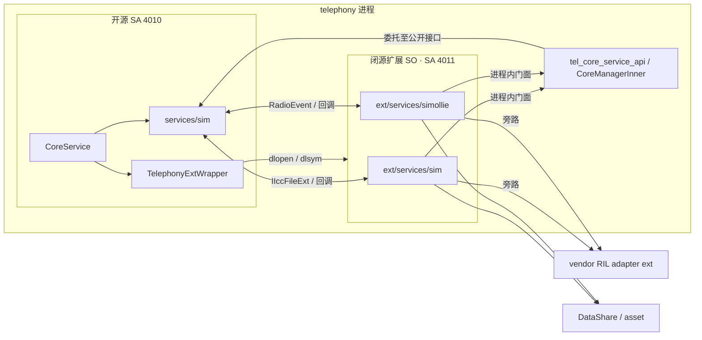

# SIM 开闭源架构边界与重构决策依据

> **文档定位**：现有系统（As-Is）架构事实基线、闭源兼容性契约与架构决策输入  
> **适用对象**：SIM 架构师、模块 Owner、闭源扩展责任人、测试及 AI 辅助编码团队  
> **分析范围**：仅现有开源 `services/sim` 与两个闭源增强目录；**不分析未来替代模块的任何现有实现或设计**  
> **依据**：《SIM 开闭源功能边界分析报告》（用户提供的静态代码审计报告）  
> **证据等级**：本文是对上述报告的提炼与复核性梳理，**未重新访问代码仓、未执行编译、单测或设备验证**。路径与行号沿用原报告；事实与建议严格区分。

## 0. 架构决策摘要

### 0.1 核心结论

1. **开源模块是通用 SIM 能力的主体，不是闭源模块的简单底座。** 现有开源 `services/sim` 负责 SIM 状态、文件与记录、PIN/锁卡基础操作、账户与持久化、STK 框架、多卡基础控制及按条件构建的 eSIM Profile 能力。
2. **两个闭源目录的性质不同，不能笼统视为“SIM 扩展”。** `telephony_ext/services/sim` 主要承担开源流程增强、文件缓存加速、运营商定制、BIP、IoT 检测、语音信箱等能力；`telephony_ext/services/simollie` 主要承担多卡拓扑切换、eSIM 电路切换、PIN 记忆及部分 VSIM/质量上报业务。
3. **真正的重构风险不在闭源代码的内部类，而在跨边界的 ABI、数据语义、事件和时序。** 静态分析识别五类通道：`dlopen/dlsym`、`CoreManagerInner` 进程内门面、`IIccFileExt` 双向虚接口、`RadioEvent` 事件体系、RIL/DataShare/asset 旁路。
4. **开源实现可以重新组织，但外部可观察的能力与闭源消费的契约不能在缺少验证时被破坏。** 尤其关注 `CoreManagerInner` 的单实例及初始化、`IIccFileExt` 虚表和对象生命周期、事件注册路由、PIN 投递、身份映射和多卡切换时序。
5. **当前静态报告已经发现一处需要闭源 Owner 核实的潜在导出断链。** `RegisterEsimSwitchNotify/UnregisterEsimSwitchNotify` 存在查找与实现，但报告在 vendor versionscript 未找到导出；应先用目标构建产物的动态符号表核实，再决定修复与兼容策略。
6. **本文足以作为兼容性风险清单和测试护栏设计输入，但不足以单独证明重构完成后闭源业务兼容。** 尤其是拓扑切换、RIL 旁路、实际导出表和运行期时序，需要闭源构建/设备集成验证。

### 0.2 建议形成的架构决策

| 决策 ID | 需要确定的事项 | 建议原则 | 决策状态 |
|---|---|---|---|
| AD-01 | 开源与闭源的职责边界 | 开源保持通用 SIM 能力；闭源保留产品差异化业务编排；以对外能力契约而非内部类划界 | **建议，待裁决** |
| AD-02 | 兼容性策略 | 优先维持现有 API/ABI、事件、数据和时序语义；允许通过兼容层替代旧内部结构 | **建议，待裁决** |
| AD-03 | 共享状态与写权 | 先确定账户、拓扑、APN 等事实所有权，消除“调用方拥有流程、被调用方负责写库”产生的责任歧义 | **建议，待裁决** |
| AD-04 | 闭源不可见时的验证门槛 | 开源契约测试是必要条件，闭源集成/设备验收是最终条件 | **建议，待裁决** |
| AD-05 | 既有导出断链 | 以实际 ELF 导出表与产品配置复核；区分缺陷、未启用特性与历史保留契约 | **待闭源 Owner 核实** |
| AD-06 | 变更许可与范围 | “外部语义冻结、内部实现可变”，涉及跨 SO ABI、初始化或进程模型变化必须专项评审 | **建议，待裁决** |

---

## 1. 范围、基线和可信度

### 1.1 三个目标模块

| 标识 | 代码目录 | 源报告规模 | 现有定位 |
|---|---|---:|---|
| A | `code/base/telephony/core_service/services/sim` | 106 文件，37,181 行 | 开源 SIM 主实现 |
| B | `code/vendor/huawei/base/telephony/telephony_ext/services/sim` | 12,075 行 | 闭源 SIM 扩展与部分独立业务 |
| C | `code/vendor/huawei/base/telephony/telephony_ext/services/simollie` | 11,048 行 | 闭源多卡形态与运行编排子系统 |

源报告的 Git 基线：

- `code/base/telephony/core_service`：`5de9cebe5392bbe49055dd74bad2a418a5d64854`（2026-11-03）
- `code/vendor/huawei/base/telephony/telephony_ext`：`9652c091b6ae1826404744d9ae9909ff2fef71ba`（2026-11-04）

**排除范围**：未来替代模块的代码、目录结构与目标架构；其他仓库仅在解释当前跨边界调用时作为必要外部依赖，不对其内部实现下结论。

### 1.2 证据与结论的使用方式

- **F｜静态事实**：报告列有直接文件、函数、构建文件或符号证据，可作为架构讨论的事实起点；重要变更前仍应在当前基线复核。
- **I｜静态推断**：由构建关系或调用链推导的运行时效果，例如静默失效、竞态、CFI 崩溃等；不能当作已观测的设备故障。
- **P｜建议/决策**：本文面向未来重构给出的原则、优先级、护栏或决策选项，**不是现状实现结论**。

原报告声称静态检查了 17 个功能域、85 个 wrapper 调用点以及 16 条跨界契约；其中“SIM 域 dlsym 30 个”与附录列出的 SIM 相关符号列表口径不完全一致，“开源主实现 12 域”与矩阵中明确标为“●”的条目数量亦未直接吻合。**本文保留 17 域及 16 契约作为分析分类，不把有争议的细分计数作为决策或验收基线；应在工程化清点时重新核算。**

---

## 2. 三个模块的职责边界

### 2.1 一句话定位

- **A：通用 SIM 内核**——负责卡状态、卡文件、账户、PIN 基础操作、STK 与多卡基础控制，并对外提供通用服务。
- **B：产品能力增强层**——依托 A 的生命周期、接口和回调，把文件加速、定制解析、BIP 等功能接入现有业务流程。
- **C：多卡形态编排层**——消费 A 的状态和能力，协调多卡拓扑、eSIM 电路、PIN 记忆和产品专有流程；业务结果可能回写到 A 的账户及事件体系。

这只是**当前实现的描述**，并不代表未来必须保留三个内部实现单元或相同代码目录。

### 2.2 功能责任矩阵（决策精简版）

标记：**主** = 基础/主要实现；**扩** = 插桩、扩展、转发；**专** = 闭源主导的专有功能；**—** = 原报告未标为主要参与者。

| 能力域 | A 开源 `sim` | B 闭源 `sim` | C 闭源 `simollie` | 对重构的含义 |
|---|---|---|---|---|
| SIM 状态与卡生命周期 | 主：状态机、卡状态转换 | 扩：状态处理插桩 | — | 状态与外部通知语义须兼容 |
| EF 文件/记录加载 | 主：真实文件访问、记录管理 | 扩：booster 缓存及回退 | — | **双向接口与加载时序为高风险点** |
| 运营商配置/Opkey | 主：装载、匹配 | 扩：版本/定制解析 | — | 保留定制入口、载荷和结果通知 |
| 多卡主副卡、协议栈 | 主：基础控制与状态/DB | — | 专：TSTS、拓扑切换、检测 | **保留命令前后时序与状态回灌** |
| SIM 账户/持久化 | 主：账户及 RDB | 扩：账户事件 | 扩：拓扑切换驱动 active 变化 | 核清唯一写权与回写链 |
| eSIM | 主：Profile 管理（条件编译） | — | 专：电路切换/LSI/SCI | **Profile 与电路切换不是同一职责** |
| VSIM | 扩：状态/DB 分支 | — | 专：通过 eSIM 承载部分场景 | 其他 vendor `vsim_service` 亦在边界外参与 |
| PIN/锁卡 | 主：Unlock/Alter/SetLock | 扩：产品锁卡能力 | 专：PIN 记忆与 asset | **安全载荷与调用时点需专项护栏** |
| STK / BIP | 主：STK 控制和事件入口 | 专：BIP 协议与回送 | — | 保持转发和 TR/Envelope 闭环 |
| IoT 卡检测 | 主/扩：卡文件检测框架 | 专：通知、HTTP 增强 | — | 按构建特性保留扩展能力 |
| SIM 功耗管理 | — | 专：电源事件处理 | 扩：消息适配 | 不强制并入开源主流程 |
| CHR 上报 | 扩：触发转发 | 扩：质量上报 | 专：部分模块上报 | 维护跨界事件/参数语义 |
| Voicemail | 扩：公共转发入口 | 专：定制实现 | — | 与 B 兼容，不要求开源重写专有逻辑 |
| slot/sim/label 身份映射 | 扩：查询、透传 | 扩：系统参数 | 专：LSI 映射 | **整数标识及映射规则是跨仓契约** |
| 分布式/设备协同 | 扩：对外转发 | — | 专：部分导出能力 | 具体调用方仍有范围缺口 |
| 基础工具/编解码 | 开源公共工具 | 闭源自有编解码 | — | 不据此认定业务实现重复 |

> **边界判定**：开源 `multi_sim_controller` 与闭源 `MultiCardSwitchManager/EsimSwitchManager` 并非能直接相互替代的同构模块。前者参与基础协议/账户控制，后者负责特定拓扑及电路编排；两者共享操作结果和部分时序约束。此结论来自源报告静态调用链，仍需产品场景验收。

### 2.3 保留专有能力，而非将闭源实现复制进开源

在业务兼容的前提下，应将 B/C 视为开源模块的**外部参与者**：明确开源对它们提供什么、从它们接收什么、何时发生交互。未来重构不需要学习或复刻 B/C 的内部算法，但必须保障它们所消费的接口、数据、状态与事件语义。BIP、PIN 资产管理、eSIM 电路拓扑等不应仅因为与开源 SIM 有调用关系就被判定为开源职责。

---

## 3. 当前运行架构与五类跨界通道

### 3.1 部署与启动关系

| 对象 | 源报告给出的当前事实 | 决策影响 |
|---|---|---|
| SA 4010 | `CoreService`，`libtel_core_service.z.so`，`telephony` 进程 | 通用服务的启动入口 |
| SA 4011 | `TelephonyExtService`，`libtelephony_ext_service.z.so`，同一 `telephony` 进程；`depend: [4010]` | 当前闭源扩展依赖同进程及顺序 |
| vendor 扩展 SO | 同时作为 SA 4011 载体和 4010 通过 wrapper `dlopen` 的符号提供者 | **装载与初始化语义不能靠猜测修改** |
| `CoreManagerInner` | 实现编译进 `tel_core_service_api` 共享库，进程内函数静态单例、由 4010 注入 manager 指针 | 闭源基于同一对象访问开源能力 |
| 跨 SO 虚接口 | `ISimManager`、`ITelRilManager`、`IEsimManager`、`IIccFileExt` 等 | C++ ABI、虚表布局、生命周期是重点 |



*图示为逻辑依赖图，并非完整调用图；`CoreManagerInner` 的存储归属是 innerkits 共享库，而不是 SIM 目录本身。*

### 3.2 五类跨界通道

| 通道 | 主要方向 | 当前机制 | 实际约束 |
|---|---|---|---|
| ① 动态扩展函数 | A → B/C/其他 vendor | wrapper `dlopen/dlsym`，函数指针调用 | 符号名、签名、导出表、缺失符号的降级行为 |
| ② 进程内服务门面 | B/C → A | `CoreManagerInner` → `ISimManager` 等 | 单实例、方法语义、ABI、初始化就绪状态 |
| ③ 文件双向扩展 | A ↔ B | `IIccFileExt`、对象回注、原生 IO 回退 | 虚表、对象存活期、请求时序、文件类型枚举 |
| ④ 事件/回调 | A ↔ B/C | `RadioEvent` 和事件范围路由 | 事件数值、订阅范围、载荷和发布顺序 |
| ⑤ 外部旁路 | B/C → RIL/DataShare/asset | vendor 适配和外部数据服务 | 状态一致性与可观测性，不能仅以 A 的调用链理解完整业务 |

### 3.3 关键初始化窗口

源报告根据 `services/core/src/core_service.cpp:83-150` 给出当前主要顺序：

```text
CoreService Publish
→ CommonEventHub 初始化及注入
→ InitTelephonyExtWrapper（加载扩展符号）
→ TelRilManager 初始化及注入
→ 可选 EsimManager 初始化及注入
→ SimManager::OnInit
→ 其他组件初始化
→ CoreManagerInner::OnInit（设置全部对象就绪）
```

**决策含义**：扩展符号加载早于 SIM 管理对象就绪。因此不能把“符号可查找”误判为“依赖的 Manager 已初始化”；未来若变更时序，必须按场景确认首次访问、注册回调和故障恢复行为。

---

## 4. 状态与数据的所有权问题

| 数据或状态 | 当前持有/写入路径（源报告） | 需确认的边界 | 重构风险 |
|---|---|---|---|
| SIM 账户 `active/enabled` | A 的 `SimRdbHelper` 负责 DB 操作；C 的拓扑切换可主导获取状态、触发 A 回写 | **业务决策权与物理写库权不同**；应确认谁是权威事实源 | 多处编排导致覆盖、回写时序不一致 |
| eSIM LsiCfg/SCI/槽位映射 | C 的 `EsimSwitchManager` 管理；A 查询/消费 label 结果 | 映射事实来源、读写时序、ID 语义 | 插卡、多卡切换与 profile 状态错位 |
| PIN 记忆资产 | C 使用 asset 存取；A 在 PIN 操作/卡移除处投递事件与参数 | 安全数据保管方为 C；A 只负责受控触发 | 载荷错序、错误对象的 PIN 恢复 |
| SIM 文件缓存 | vendor RIL booster 缓存 + A 原生文件 IO 两条路径 | 缓存有效性、失败回退和最终数据一致性 | 加载顺序和运营商配置差异 |
| Opkey/配置版本 | A 负责装载，B 提供升级/定制判断 | 版本判断与装载时序 | 装载中断或定制配置丢失 |
| APN 数据 | B 的 BIP 使用 DataShare 修改；源报告还列有其他 APN helper | **未证实单一写权**；涉及三目录外数据服务 | 不能仅凭 SIM 模块建立单写者保证 |
| RadioEvent | A 与 C 均产生不同类别事件 | 事件 ID、发布者、消费者和先后关系 | 错误路由、漏事件或竞态 |

**特别注意**：源报告将某些场景归为“多写者”，但其证据中同时出现“C 主导流程、A 执行 DB 回写”的链条。**不能将“业务决策方不同”直接等同于“直接物理双写”**。是否真有两个独立的 DB 写入口，需要补充代码级写路径图后再做所有权裁决。

---

## 5. 必须带入重构的兼容性契约

以下沿用原报告的 `SIM-OC-001` 至 `SIM-OC-016` 标识。其作用是**描述对外效果的受约束边界**，而非要求未来永久保留原有内部类、对象数量或目录结构。

### 5.1 平台与二进制边界

| ID | 当前契约/依赖 | 未来至少必须证明的兼容性 | 关键证据（源报告） |
|---|---|---|---|
| **SIM-OC-001** | SA 4010/4011 当前同进程、4011 依赖 4010；扩展 SO 双用途 | 既有产品仍能按要求装载、初始化并互相访问；若变更进程模型须另立架构决策 | `sa_profile/4010.json`；vendor `sa_profile/4011.json` |
| **SIM-OC-002** | wrapper 加载早于部分 manager 就绪，退出时反初始化 | 首次注册、业务访问、销毁与重启行为在新旧实现中等价 | `core_service.cpp:83-150` |
| **SIM-OC-003** | 开源通过 dlsym 查找 SIM 相关函数；缺失时多数调用走判空分支 | 现有符号名、类型和按特性降级语义可用；不得出现无感知功能丢失 | `telephony_ext_wrapper.h/.cpp`；开源 sim 调用点 |
| **SIM-OC-004** | vendor versionscript 规定动态导出符号 | wrapper 查找项与实际产品导出表匹配；缺失导出需明确产品策略 | vendor `telephony_ext_service.versionscript` |
| **SIM-OC-005** | `CoreManagerInner` 的进程内单实例和对象注入 | 闭源消费到的状态与操作始终来自正确实例，且初始化状态一致 | `core_manager_inner.cpp:39-52`；innerkits `BUILD.gn` |
| **SIM-OC-006** | B/C 经 `CoreManagerInner`、`ISimManager` 等访问开源能力 | 已消费方法的 ABI、输入输出、错误码、回调与线程语义兼容 | `core_manager_inner.h`；B/C 调用索引 |
| **SIM-OC-016** | 构建宏、公共库、include 路径及部件配置 | 公版与厂版可构建；原有闭源模块仍可链接、装载和切换特性 | `telephony_core_service.gni`；两侧 `BUILD.gn` |

> **变更原则 P**：优先保持现有二进制/源码消费面不变；如需改变内部实现，可引入兼容转接，但必须证明同一公开 API 或 ABI 下的行为等价。对 C++ 虚表、导出符号、共享 SO 和进程拓扑的变化，不能只通过开源单测批准。

### 5.2 业务与行为边界

| ID | 当前契约/依赖 | 关键不可丢失的外部行为 | 关键证据（源报告） |
|---|---|---|---|
| **SIM-OC-007** | `IIccFileExt` 开闭源双向虚接口，`FileChangeType` 数值及 shared/weak 关系 | B 能接入记录加载、回退原始 IO，且不发生悬挂/重复释放；虚表与枚举兼容 | `icc_file.h:43`；`icc_file.cpp:872-917`；B `sim_file_ext.cpp:59-61` |
| **SIM-OC-008** | `CreateIccFileExt` 在原始文件对象完成必要初始化后创建扩展 | 扩展使用前必需的 RIL/controller、slot、配置均已就绪 | `sim_file_manager.cpp:140-147` |
| **SIM-OC-009** | B 在 Opkey 加载后回调 `OnOpkeyLoad`，A 广播带槽位与配置字段的事件 | 事件触发时点、载荷顺序、订阅方看到的状态语义保持 | `icc_file.cpp:884-897` |
| **SIM-OC-010** | `RadioEvent` 数值和区间跨 SO 使用 | 现有事件 ID、消息载荷及订阅语义稳定 | `radio_event.h`；`esim_manager.cpp:421/449` |
| **SIM-OC-011** | `Register/UnRegisterCoreNotify` 按事件区间路由 | 文件、状态、账户及 eSIM 切换相关事件正确到达既有消费方 | `sim_manager.cpp:1240-1296` |
| **SIM-OC-012** | STK 初始化/事件被转发给 BIP；B 经 CoreManagerInner 回送 TR/Envelope | STK/BIP 命令与应答闭环、失败及超时语义保持 | `stk_controller.cpp:77,404`；`stk_manager.cpp:71` |
| **SIM-OC-013** | A 的 PIN 操作与卡状态触发 C 的 PIN 记忆投递 | 触发条件、卡标识、操作类型、敏感载荷和生命周期与旧场景等价 | `sim_state_manager.cpp:222,262,299,346`；`sim_state_handle.cpp:457` |
| **SIM-OC-014** | 多卡操作经 `RetrieveSimActiveState`、modem swap、`SetActiveSim` 等桥接 C 的编排 | 拓扑动作、DB 结果、通知与重启检测的业务先后关系等价 | `multi_sim_controller.cpp:440,526,531,1328,1905`；C `multi_card_switch_manager.cpp:1308` |
| **SIM-OC-015** | `slotId/simId/label` 及 VSIM 特殊值与跨仓映射 | 对外整数值、无效值、映射与业务身份语义不变 | `sim_manager.cpp:669-687`；`multi_sim_helper.cpp:272` |

**业务决定优先于函数位置**：保持某个调用点原封不动并不是唯一方案；同样，简单把调用点移动到新内部流程也不能证明兼容。对 `007/008/009/011/013/014/015`，应采用场景前置条件、事件序列和最终业务状态来定义可替代的兼容标准。

### 5.3 对高风险契约的具体解释

**文件加载（007–009）**：A 创建基础文件对象并为 B 提供扩展接入点，B 可用 vendor RIL 缓存快路径读取数据，失败再回调 A 的真实文件 IO；Opkey 就绪后由 B 通知 A。外部不变量是**能完成正确文件加载、失败回退、配置通知与对象安全释放**，而不是必须保留 A 的所有具体内部类。

**多卡切换（010–011、014–015）**：A 负责基础卡/账户服务，C 负责特定产品的电路与拓扑编排；操作命令、状态读回、DB 回写、事件通知跨越多个路径。必须使用多卡时序图和端到端状态断言防止“函数调用成功但最终拓扑/账户不一致”。

**PIN 记忆（013）**：A 的 PIN 操作和 SIM 状态变化会触发敏感信息跨界传递，C 承担安全资产管理。现状包括同进程的明文 PIN 参数传递；这是**需要兼容和安全审查的事实**，不能据此推导该方式是未来应保留的安全设计。任何改造均需安全负责人核定、避免日志泄露和用例真实 PIN 落盘。

**STK/BIP（012）**：A 只保留初始化和事件转发而不复刻 B 的全部 BIP 实现；必须验证终端响应和 Envelope 能回到正确 Modem/卡对象。

---

## 6. 需优先处理的风险与待裁决事项

| 优先级 | 风险/议题 | 源报告依据 | 决策或验证动作 | 责任建议 |
|---|---|---|---|---|
| **P0** | eSIM 切换事件 `RegisterEsimSwitchNotify/UnregisterEsimSwitchNotify` 疑似导出断链 | R1；`wrapper.cpp:187-189` 与 vendor versionscript 不一致 | 在**目标配置的实际 ELF** 上执行 `readelf -Ws`/`nm -D` 核实；确认消费者、启用条件及修复必要性 | vendor 扩展 Owner + 集成 |
| **P0** | PIN 记忆敏感载荷及触发时点 | `SIM-OC-013` | 固化操作类型、ICCID/slot 关联、成功/失败/拔卡事件和安全约束；补 Mock 断言 | SIM + 安全 + simollie |
| **P0** | 跨 SO ABI 与单实例/初始化契约 | `005/006/007`、R2/R8 | 固化动态符号、虚表/导出、库归属、加载序列；改动须厂版链接与设备验证 | 基础接口 + 集成 |
| **P1** | 多卡/eSIM 拓扑和账户状态一致性 | `010/011/014/015`、R4/R7 | 梳理完整命令→Modem→DB→事件序列，覆盖失败恢复和交错事件 | SIM + simollie |
| **P1** | 文件 booster 与真实 IO 的双路径 | `007–009`、R3/R5 | 确认缓存命中/失效、超时、回退和配置可见性 | SIM + vendor RIL |
| **P1** | wrapper 判空后静默功能退化 | R6 | 将必需能力与可选能力分开；增加装载诊断和契约检查 | SIM + 扩展 |
| **P2** | APN/DataShare 多方读写边界 | R4 | 追踪真实 DB 写入口、版本/事务责任，厘清所有权 | BIP + 数据服务 |
| **P2** | HDI proxy 与附属产品宏组合 | R9、016 | 形成代表性构建配置矩阵和集成检查 | 构建/集成 |

### 6.1 本轮不能直接下定论的事项

1. **R1 是否造成当前真实产品故障**：静态 versionscript 缺项只能说明该源码配置下可能不可导出；实际结果还取决于构建产物、链接选项、其他导出路径及启用状态。
2. **是否存在物理双写**：源报告有多个写入或回写路径，但有些是 C 决策后通过 A 执行，需进一步核实真正的写入执行方。
3. **闭源调用集合是否已完全覆盖**：原报告给出 B `CoreManagerInner` 36 次/20 方法、C 124+ 次/32 方法，部分由子代理扫描统计、抽样复核，并非逐方法经过运行验证。
4. **时序竞态是否真实发生**：RIL 旁路及双读路径是合理风险，但没有设备时序、日志或复现实验，不应写成已发生的故障。
5. **CFI/虚表异常的具体形式**：跨 SO 接口变更是风险，是否在具体构建中崩溃、报错或行为异常需目标构建验证。
6. **部分符号来自三目录之外的 vendor 服务**：例如 `vsim_service`。因此闭源依赖面不应被简化为仅 B/C 两个目录；本次不对其内部作完整审计。

---

## 7. 在闭源代码不可见时如何开展开源重构

### 7.1 明确“可以改变什么、不允许无验证地改变什么”

| 变化对象 | 原则 | 需要的证明 |
|---|---|---|
| 开源内部类名、目录、私有实现、内部状态机结构 | **原则上可以调整** | 对外功能/事件/ABI/时序等价，且无隐式外部依赖 |
| 对 B/C 提供的公共方法、`CoreManagerInner`、公共枚举/头文件 | **不得直接破坏兼容** | API/ABI 比对、Mock 契约测试、厂版构建 |
| `IIccFileExt` 虚接口及对象持有关系 | **高风险变更** | 双向调用、对象生命周期、CFI/链接与文件场景验证 |
| 初始化/销毁、SA/进程与共享 SO 组织 | **架构决策级变更** | 完整装载链、单实例、依赖就绪、异常恢复证明 |
| 多卡身份、DB、事件顺序与 PIN 载荷 | **以业务语义冻结** | 场景输入、状态/时序断言、闭源端到端验收 |
| 专有 BIP、拓扑算法、PIN 资产内部存储 | **不要求开源复制** | 明确连接契约，保留 B/C 责任与扩展能力 |

### 7.2 建议形成“单一契约清单 + 证据索引”

为每项跨界契约建立结构化记录：

```text
Contract ID
业务能力与使用场景
调用者 / 提供者 / 条件编译开关
API 或 ABI（符号、签名、枚举、对象生命周期）
前置状态 / 输入 / 错误码
异步回调 / 事件 / 时序约束
后置状态与用户可观察结果
产品可选或必需属性
开源侧可执行的契约测试
必须闭源验证的场景
源码证据索引与当前验证状态
```

静态源码证据保留在访问受控的内部附录。用于闭源不可见 AI 环境的版本应只保留必要的**能力契约、测试断言和非敏感标识**，不要求重新阅读 vendor 私有源码。

### 7.3 最小但有效的兼容性测试护栏

| 测试组 | 覆盖契约 | 最小断言 | 是否可在开源环境独立完成 |
|---|---|---|---|
| G1 动态扩展加载/符号映射 | 001–004、016 | 对应配置下查找成功或按照明确策略降级；无意外空指针或隐式失能 | **部分**；实际 vendor ELF 需闭源环境 |
| G2 CoreManagerInner 门面与生命周期 | 002、005、006 | 只有一个有效实例；初始化前后行为、错误码、回调语义符合契约 | **大部分**；厂版加载需集成 |
| G3 文件扩展与回退 | 007–009 | 初始化后接入、缓存成功/失败两路结果一致、Opkey 载荷准确、释放安全 | **可以 Mock**；真实 booster 需集成 |
| G4 事件与订阅路由 | 010、011 | 事件 ID、订阅区间、注册/注销、载荷与时序匹配 | **可以**；闭源消费者需集成 |
| G5 PIN 安全交互 | 013 | PIN 操作不同结果、卡插拔、对象 ID、操作类型和触发次数正确；不泄露敏感数据 | **可以 Mock**；asset 端需集成 |
| G6 多卡与 eSIM 拓扑 | 014、015 | 单/双/多卡、启停、swap、失败恢复后最终映射/账户/通知一致 | **部分**；真实 Modem/LSI 必须集成 |
| G7 STK/BIP 命令闭环 | 012 | 初始化事件发送、TR/Envelope 回送及失败超时语义正确 | **部分**；真实 BIP 需集成 |
| G8 公版/厂版构建 | 003、004、006、016 | 公版无 vendor 时基础功能正常，厂版符号/链接/依赖可用 | **公版可独立**；厂版需闭源环境 |

**验收等级（建议）**：

- **L1：开源契约通过**——编译、静态校验、Mock/Stub 及单测验证；只证明公开契约实现按预期工作。
- **L2：厂版构建与装载通过**——实际 ABI、versionscript、依赖与初始化验证；证明二进制可联通。
- **L3：闭源功能与设备场景通过**——多卡/电路切换、STK/BIP、PIN 记忆、booster、异常恢复的真实场景完成；才能声明对闭源业务的兼容性验证完成。

### 7.4 推荐迁移控制点（与未来实现架构无关）

1. **前置取证**：冻结现有编译基线和实际厂版符号导出表，完成 R1 定性；落实契约所有者。
2. **建立护栏**：先实现 G1–G5 的核心 Mock/编译/事件测试，再调整开源内部组织。
3. **按场景逐步替换**：一次只改变可验证的功能边界，记录跨界输入/输出、旧新行为对比；不是按文件数迁移。
4. **高风险专项**：任何影响 PIN、安全、文件双向 ABI、多卡状态写回的修改，先通过针对性场景再合入。
5. **双环境验收**：以 L1→L2→L3 形成交付门槛；L1 不能替代 L3。

---

## 8. 架构评审需回答的关键问题

建议评审会围绕以下问题形成明确结论，而非继续扩展现状文档数量。

| 议题 | 需要架构师/Owner 签署的结论 | 决策依据 |
|---|---|---|
| **1. 产品差异化责任边界** | BIP、eSIM 电路、PIN 记忆、多卡拓扑分别由谁继续承载；开源只需要提供哪些稳定能力？ | §2、§5 |
| **2. 兼容层边界** | 现有 `dlsym`、`CoreManagerInner`、`IIccFileExt` 中哪些保持原状、哪些允许以适配方式替换？ | §3、§5 |
| **3. 账户/拓扑事实所有权** | 谁决定 active/enabled、谁真正写 DB、谁发通知？失败时如何恢复一致性？ | §4、§6 |
| **4. 标识模型** | slotId、simId、label、VSIM 特殊值能否对内重新表达？对外由谁承担等价转换？ | 014、015 |
| **5. 安全与事件时序** | PIN 载荷是否符合当前安全要求；何时缓存/恢复/清理；哪些事件顺序必须固化？ | 010、011、013 |
| **6. 已有导出异常** | R1 是真正缺陷、产品未启用能力，还是需兼容的保留入口？由谁修复并验证？ | §6 |
| **7. 验收责任** | 哪些检查由开源流水线完成，哪些必须由 vendor/设备集成团队签收？ | §7 |

**建议的决策完成条件**：每个议题有一名 Owner、一个明确的方案/约束、一组对应契约 ID、一项可执行验收标准，以及仍未消除风险的记录。未完成关键决定前，不建议将“闭源完全兼容”写入重构完成标准。

---

## 9. 关键代码证据索引

以下路径和行号转录自用户提供的静态分析报告，**不是本次重新核验的代码坐标**。源报告中相对路径默认相对于对应仓根。

| 证据对象 | 源码/构建锚点 | 对应结论 |
|---|---|---|
| 当前服务启动 | 开源 `services/core/src/core_service.cpp:83-150`；两侧 `sa_profile/4010.json`、`4011.json` | 001/002 |
| CoreManagerInner 单实例及导出 | 开源 `frameworks/native/src/core_manager_inner.cpp:39-52`；`interfaces/innerkits/BUILD.gn:66-99`；`interfaces/innerkits/libtel_core_service_api.versionscript:22` | 005/006 |
| 动态扩展函数 | 开源 `services/telephony_ext_wrapper/src/telephony_ext_wrapper.cpp:46-263`；对应 `.h`；vendor `services/telephony_ext_service.versionscript` | 003/004/016 |
| 文件扩展 | 开源 `services/sim/src/sim_file_manager.cpp:140-147`、`icc_file.cpp:872-917`；vendor `services/sim` 的 `sim_file_ext.cpp:59-61` | 007/008/009 |
| 事件路由 | 开源 `services/sim/src/sim_manager.cpp:1240-1296`；`interfaces/innerkits/include/radio_event.h` | 010/011 |
| PIN 记忆调用 | 开源 `sim_state_manager.cpp:222/262/299/346`、`sim_state_handle.cpp:457`；vendor `simollie_manager.cpp:160-200` | 013 |
| 多卡切换 | 开源 `multi_sim_controller.cpp:440/526/531/1328/1905`；vendor `multi_card_switch_manager.cpp:1308` | 014/015 |
| STK/BIP | 开源 `stk_controller.cpp:77/404`、`stk_manager.cpp:71`；vendor `bip_proxy.cpp` | 012 |
| 构建条件 | 开源 `telephony_core_service.gni:29-37`、根 `BUILD.gn`；vendor `telephony_ext_config.gni`、`services/BUILD.gn` | 016 |

### 源报告待确认点（保留）

- **Q1**：eSIM 事件注册符号是否确实未被最终 SO 导出，以及真实业务影响。
- **Q2**：vendor `versionscript` 中部分 C++ `*Link` 符号的消费者在本次范围外，未形成完整使用契约；后续需要独立授权分析，不得依赖本次排除范围中的代码来补事实。
- **Q3**：`observer_handler.h` 存在潜在同名头，实际引用路径待编译数据库确认。
- **Q4**：`CoreManagerInner` 方法调用总量来自扫描和抽样复核，逐方法输入输出语义尚待验收。
- **Q5**：RIL booster、拓扑切换的真实竞态与时序窗口需设备测量。

---

## 10. 最终建议

**本轮架构决策应确立的不是“旧类必须保留”，而是“闭源所依赖的外部能力、数据事实、事件与时序必须有明确的兼容边界”。**

建议先批准 **16 条兼容性契约作为初版候选基线**，对其中 005/007/011/013/014 所涉及的单实例、双向虚接口、事件路由、PIN 安全与多卡拓扑实施重点评审；同时优先完成导出断链的 ELF 核实、账户/拓扑写权澄清和 L1–L3 验收责任划分。只有经过上述验证，才能把静态逆向分析转化为真正可执行、可持续的开闭源兼容性工程约束。

> **使用限制**：本文含闭源模块名称、接口和内部证据路径，应按项目内部架构材料管理；如向纯开源工作区或外部模型投喂，需先制作不含专有实现证据的契约摘要版。
