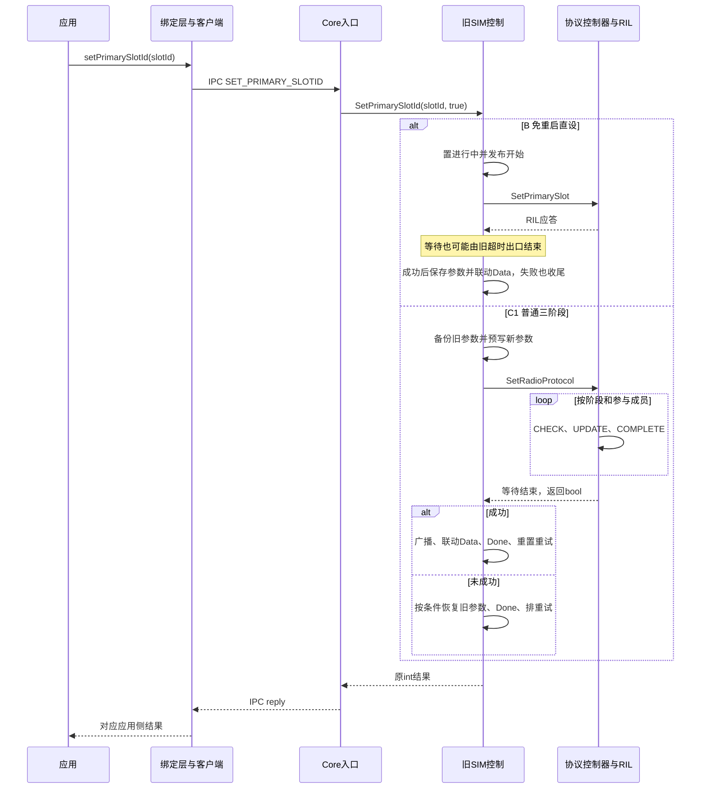
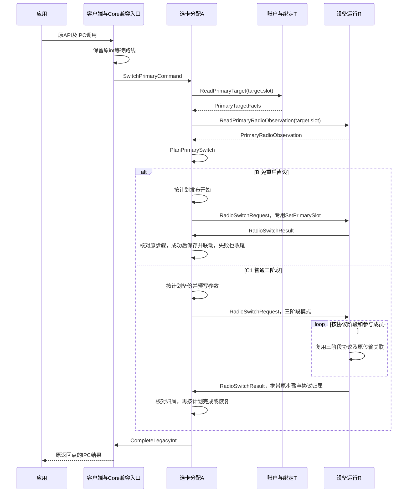

# SetPrimarySlotId 重构前后实现对比说明

> 版本：1.0 · 整理日期：2026-11-11  
> 配套材料：《SetPrimarySlotId_重构前后数据关联与流程_整合版_定稿.pptx》  
> 源码基线：`zjuluowu/multisim@f2acb72fa83d203cea9422a83da0d2dcac19a2c2`  
> 本文说明该固定基线中的生产实现和目标设计，不将其解释为此后远端主分支的实时状态。

## 1. 对比结论与阅读范围

`SetPrimarySlotId` 重构的核心，是保留逻辑槽作为切换目标，同时把**卡绑定事实、主卡切换计划、设备协议状态和业务请求归属分开管理**。

旧实现由 `MultiSimController` 同时承担分支选择、参数保存、设备等待、默认数据槽联动和完成收尾。目标设计由选卡分配用例负责决策和业务进度，通过窄接口读取绑定事实、调用设备执行，再按原返回点完成旧接口。

| 对比项 | 重构前生产实现 | 重构后目标设计 |
| --- | --- | --- |
| 对外入口 | 应用 API、SA 4010、`SET_PRIMARY_SLOTID`、Core IPC `int` 返回 | 保持原契约 |
| 操作对象 | `slotId` 表示目标逻辑槽 | `SlotTarget` 继续表示目标逻辑槽 |
| 卡事实 | 按槽查询当前卡和 ICCID，参与主卡参数处理 | T 通过 `PrimaryTargetFacts` 提供绑定、ICCID、激活事实 |
| 分支决策 | `MultiSimController::SetPrimarySlotId` 内部条件分支 | A 读取事实并生成 `PrimarySwitchPlan` |
| 设备执行 | Controller 直接调用共享 TelRil 或协议控制器 | A 经 `RadioExecutionPort` 请求 R，复用对应成熟设备路径 |
| 结果关联 | TelRil 的 `serial`、协议控制器的会话和事件、Controller 的标记与等待结果 | 保留传输和协议关联，增加显式 `StepRef` 业务归属 |
| 参数和联动 | Controller 保存/恢复主卡参数，联动默认数据槽并通知 | A 按模式计划，经专属存储与输出端口执行 |
| 实现状态 | 成熟生产业务仍走 `services/sim/` | 计划函数和接口骨架已存在，完整主卡切换生产接线尚未完成 |

**本接口不是默认语音卡或默认短信卡的设置接口。** 主卡切换路径可能联动默认数据槽，不能据此把 Voice、SMS、Data、Primary 当成同一种设置。[S01][S02]

本文中的“调用栈”指跨模块的逻辑调用链。JS 异步工作、Binder IPC、RIL 事件和同步等待并不共享一条线程调用栈。

### 1.1 术语

| 记号 | 含义 | 主要责任 |
| --- | --- | --- |
| C | 兼容入口 | 保持原入口、校验语义、返回时点和结果交付 |
| T | 账户与绑定责任 | 提供已接纳绑定、ICCID、激活事实，承接相关换路子请求 |
| A | 选卡与分配责任 | 选择模式，维护主卡参数、业务进度和唯一业务重试 |
| R | 卡/设备运行责任；本用例主要涉及 Radio 执行 | 维护设备观察、协议会话、发令关联和设备效果认知 |
| H | 宿主装配 | 提供共享对象、真实资源域及必要适配 |

下文的分支 `C0`、`C1` 与“兼容入口 C”无关。

## 2. 分支统一：三条旧分支，对应四种目标模式

原分析把旧实现划为 A、B、C 三条分支。普通分支 C 内部还有“目标已在主 Modem、无需发设备指令”的快捷路径。为避免在不同视图中混淆，本文统一拆为 C0、C1。[S01][S03]

| 判断顺序 | 旧分支 | 条件 | 目标模式 | 行为与返回特点 |
| --- | --- | --- | --- | --- |
| 1 | A：扩展槽换路 | 旧实现命中 `SIM_SLOT_3`；目标根据厂商换路事实判断 | `VendorRouteMapping` | 取得映射后的目标槽，安排卡就绪后的继续。保留原早返回，不能把它当作整个主卡切换完成 |
| 2 | B：免重启直设 | `isUserSet` 且支持专用 RIL 设主槽命令 | `WithoutModemRestart` | 先执行专用命令，成功后保存主卡参数、广播并联动默认数据槽；失败也执行对应收尾 |
| 3 | C0：已在主 Modem | A/B 未命中，普通检查通过，目标槽当前在 M0 | `AlreadyPrimary` | 保存参数、广播、联动默认数据槽、重置重试，不发设备协议 |
| 4 | C1：普通三阶段 | 以上均未命中且普通检查通过 | `ThreePhaseProtocol` | 先备份和预写参数，再执行三阶段；成功联动，失败按条件恢复参数和安排原重试 |

这张表表示分支优先级，不表示所有守卫应被提前合并成同一组全局校验。各分支原有检查、错误优先级和返回时机仍须保持。

特别需要保留三种不同顺序：

- **B：设备成功后保存主卡参数。**
- **C0：不发设备命令，直接执行该模式对应的保存与联动。**
- **C1：设备发令前预写参数，失败时只按旧条件恢复。**

目标计划中的 `VendorRouteMapping` 即使带有参数位置描述，也不能解释成厂商分支早返回时立即写入最终 Primary 参数。[S03]

## 3. 重构前：从外部接口到设备的调用链

### 3.1 公共入口与 IPC

| 层次 | 调用关系 | 传递内容 |
| --- | --- | --- |
| JS 绑定 | `radio.setPrimarySlotId` → NAPI `SetPrimarySlotId` → `NativeSetPrimarySlotId` | 目标槽，JS 异步执行上下文 |
| ArkTS 绑定 | ANI `SetPrimarySlotId` → `CoreServiceClient::SetPrimarySlotId` | 目标槽 |
| IPC 客户端 | `CoreServiceClient::SetPrimarySlotId` → `CoreServiceProxy::SetPrimarySlotId` → `SendRequest(SET_PRIMARY_SLOTID)` | 接口令牌、序列化槽号 |
| IPC 服务端 | `CoreServiceStub::OnSetPrimarySlotId` → `CoreService::SetPrimarySlotId` → `CoreServiceSim::SetPrimarySlotId` | 反序列化后的槽号 |
| 旧 SIM 业务 | `SimManager::SetPrimarySlotId` → `MultiSimController::SetPrimarySlotId` | `slotId`、`isUserSet` |

该 IPC 入口执行权限、槽能力、在卡和激活等检查，并按原节点记录用户偏好，再调用 `SimManager::SetPrimarySlotId(slotId, true)`。进程内其他入口可传入自己的 `isUserSet`，不能把所有内部调用都等同于用户操作。[S04]

### 3.2 分支调用关系

| 分支 | 主要函数调用 |
| --- | --- |
| A | `NeedSwitchSimCard` → `SwapM0M2SimCards` → `SetTargetPrimarySlotId`；保存厂商返回的映射槽并安排后续事件 |
| B | `SetPrimarySlotIdWithoutModemReboot` → `SetPrimarySlotToRil` → `SendSetPrimarySlotEvent` → `TelRilManager::SetPrimarySlot` → `TelRilSim::SetPrimarySlot` → `IRil::SetPrimarySlot` |
| C0 | `SavePrimarySlotIdInfo`，随后处理对应广播、默认数据槽和重试计数，不进入设备发令链 |
| C1 | `RadioProtocolController::SetRadioProtocol` → 按阶段、成员槽调用 `TelRilManager::SetRadioProtocol` → `TelRilSim::SetRadioProtocol` → `IRil::SetRadioProtocol` |

B 的 HDI 路径是专用 `SetPrimarySlot`；C1 是三阶段 RadioProtocol。公开仓可证明这些结构化调用和等待行为，不能把具体厂商 AT 字面或所有产品上的 Modem 重启行为当作已经核验的事实。[S01][S05]

### 3.3 结果如何返回

B 等待专用 RIL 请求的应答或旧超时出口。C1 等待协议控制器返回 `bool`。`MultiSimController` 再按分支完成参数、广播、Data 联动及重试处理，返回原 `int`，经 SimManager/Core 回到 Stub，写入 IPC reply。

JS/ArkTS 外层可以表现为异步 API，但本 Core 接口的结果交付是 IPC `int`，不要套用 `SetShowNumber` 的业务回调模型。

## 4. 重构前：数据为什么不断通过 slotId 关联

### 4.1 数据和状态的落点

| 数据 | 旧落点或来源 | slotId 的作用 |
| --- | --- | --- |
| 用户目标 | 外部入参，逐层转发 | 指定要设为主槽的逻辑位置 |
| 在卡、激活状态 | 旧卡管理对象和查询 | 选择当前槽的卡状态 |
| 当前 Modem | `RadioProtocolController` 的当前协议视图 | 查询目标槽当前处于哪个 Modem |
| ICCID | `simFileManager_[slotId]->GetSimIccId()` | 按槽找到当前卡文件对象 |
| 主卡参数 | `lastPrimarySlotId_`、主槽系统参数、加密主卡 ICCID 参数 | 把当前选择的逻辑槽及卡信息投影为兼容参数 |
| 设备协议 | `RadioProtocol` 的成员槽、会话和阶段等字段 | 指定每个参与成员，形成逐槽设备请求 |
| 重试 | 原重试事件、`setPrimarySlotRemainCount_[slotId]` 等 | 标识原重试目标与计数项 |

同一个数值在多个位置出现，并不意味着这些位置拥有同一种数据语义。**目标槽、当前卡、设备路由和一次切换请求，是四个需要区分的概念。**

### 4.2 主卡参数不是一个完整的账户事务

`SavePrimaryCardInfo(slotId)` 的可见顺序是：先更新主槽内存值和系统参数，再按槽取得卡 ICCID，非空时加密保存。其间存在对象缺失或 ICCID 为空的分支，不能把它概括为“原子保存槽号和账户”。

`SavePrimarySlotIdInfo` 在保存主卡信息后，还会发主卡广播并设置默认数据槽。这里涉及系统参数、内存状态与通知；SimManager 的成功路径还可发账户变更通知。**发账户通知不等于本方法直接更新了 SIM 账户数据库。**[S01][S06]

### 4.3 旧实现并非完全没有回包关联

旧代码已具备两层机制：

1. TelRil 为单条传输分配 `serial`，以它找到原完成事件。
2. 三阶段控制器维护协议 `sessionId`、阶段事件和参与成员计数，处理协议应答和状态通知。

重构要补足的是业务请求和其状态修改资格的明确归属，不应把旧实现描述成“仅靠槽号处理所有回包”。[S07][S08]

## 5. 重构后：职责和关键结构

### 5.1 职责如何落到模块

| 模块或端口 | 责任 | 不应承担的责任 |
| --- | --- | --- |
| `LegacySimFacade`、完成适配 | 保持原入口与完成路线，在宿主保留同步等待 | 主卡策略、设备协议状态机 |
| `AssignmentService` | A 的用例入口，决策、业务进度、结果接纳与业务重试 | 直接读取 T 的私有对象，直接执行厂商协议 |
| `PrimaryTopologyPort` | 向 A 提供 T 的绑定事实，发起相关换路子请求 | 把 T 的可写对象暴露给 A |
| `PlanPrimarySwitch` | 生成应用层执行计划，表达参数/设备/通知的顺序 | 平台 I/O、等待、自动证明设备效果 |
| `RadioExecutionPort` | A 所需的设备观察与执行契约 | 取得账户和角色事实的写权 |
| R 的执行适配 | 复用共享 RIL 或成熟协议控制器，保存发令时的关联 | 反调旧混合 Controller 来决定业务策略 |
| `AssignmentStore`、输出端口 | A 专属参数保存/恢复，以及原通知输出 | 新增平行参数源或改变原 URI/键 |

用例内部可以使用请求机制，但不需要增加一个全局流程转发中心。主卡流程的业务所有者仍是 A。[S02][S09]

### 5.2 关键结构及关系

| 结构 | 方向 | 主要字段 | 用途 |
| --- | --- | --- | --- |
| `SwitchPrimaryCommand` | 兼容入口 → A | `target`、`userSet`、`completion`、可选 `parent` | 表达用户目标和原完成路线 |
| `PrimaryTargetFacts` | T → A | `binding`、`iccid`、`active` | 表达目标槽当前已接纳的卡事实 |
| `PrimaryRadioObservation` | R → A | `slot`、可选 `currentModemId`、专用命令/换路能力、`observationRevision` | 为模式选择提供动态设备观察 |
| `PrimarySwitchPlan` | A 内部 | `target`、`domain`、`mode`、参数位置、各阶段动作列表 | 固化本模式的执行顺序 |
| `RadioSwitchRequest` | A → R | `step`、`target`、`domain`、`mode`、可选 `expectedBinding` | 请求特定设备步骤，并保存其业务归属 |
| `RadioSwitchResult` | R → A | `step`、`memberSlot`、`protocolSession`、`phase`、`effect`、`legacyResult` | 返回原设备步骤的证据与结果 |

下列代码节选自目标骨架，省略了命名空间和包含项；它说明接口形状，不表示完整流程已实现。[S10]

```cpp
struct SwitchPrimaryCommand {
    SlotTarget target;
    bool userSet;
    CompletionPlan completion;
    std::optional<StepRef> parent;
};

struct RadioSwitchRequest {
    StepRef step;
    SlotId target;
    RadioDomainId domain;
    PrimarySwitchMode mode;
    std::optional<BindingRef> expectedBinding;
};

struct RadioSwitchResult {
    StepRef step;
    SlotId memberSlot;
    uint32_t protocolSession;
    uint32_t phase;
    EffectKnowledge effect;
    int32_t legacyResult;
};
```

### 5.3 标识之间不能互相替代

| 标识 | 回答的问题 | 需要避免的误解 |
| --- | --- | --- |
| `SlotTarget` / `SlotId` | 要操作哪个逻辑槽？ | 槽号不是账户 ID，也不是请求 ID |
| `SubscriptionId` | 当前绑定涉及哪个账户？ | 它包装原 `simId`，不引入新的公共永久身份规则 |
| `BindingRef` | 哪个账户与哪个槽的哪一版绑定？ | 绑定版本不是设备协议会话编号 |
| `RadioDomainId` | 哪个真实 Radio 资源域参与执行？ | 槽数不证明资源独立性，不能每槽复制一个共享资源域 |
| RIL `serial` | 应答属于哪一条传输请求？ | 一次业务可能产生多条 RIL 请求，二者不一一等同 |
| `protocolSession` / `phase` / `memberSlot` | 哪轮设备协议、哪个阶段、哪个参与成员？ | 不等同于卡应用的 `SessionRef` |
| `StepRef` | 哪次业务请求的哪一步、哪次尝试？ | 还须包含 RequestId 的 `epoch`、`owner`、`value`，不能只比较一个流水号 |

`PrimaryRadioObservation` 中未知的 Modem 或能力，不能默认为 M0 或可执行。目标规划使用真实描述与观察，不能根据目录里有几个槽就推导设备能力。[S03][S10]

## 6. 重构后：目标调用链与同步兼容

### 6.1 主调用链

对外 JS/ANI、Client/Proxy、IPC 命令和 Core 接口保持；Core 内部的目标接入方向为：

| 步骤 | 目标调用 | 状态说明 |
| --- | --- | --- |
| 1 | Core 接入 → `LegacySimFacade::RunPrimarySwitchAtExecutionPoint` | Core 到该目标链的生产接线尚待迁移 |
| 2 | `RetainSynchronousWaiter` → 设置 `SynchronousCompletionRoute` | 兼容层代码已表达原同步等待路线 |
| 3 | `StartLegacyPrimarySwitch` → `AssignmentService::StartPrimarySwitch` | 薄入口已有代码，完整用例仍为目标流程 |
| 4 | 读取 T/R 事实 → `PlanPrimarySwitch` | 计划函数已有实现，用例的全链路尚未接通 |
| 5 | A 分支经 T 发换路子请求；B/C1 经 `SwitchPrimaryRadio` 请求 R | R 的完整生产执行适配尚待接入 |
| 6 | B/C1 的结果经 `AcceptRadioStep` 接纳 | 按原请求和设备协议归属核对后推进 |
| 7 | 各模式到原返回点，调用 `CompleteLegacyInt` | A/C0 不必等待 B/C1 的设备结果入口 |
| 8 | 宿主 `AwaitOriginalIntResult` → Core 写 IPC reply | 不把同步旧接口改成无条件立即返回的异步受理接口 |

### 6.2 兼容层保留等待，不让业务提交域阻塞

现有目标骨架中的适配逻辑如下。[S11]

```cpp
int32_t LegacySimFacade::RunPrimarySwitchAtExecutionPoint(
    const SwitchPrimaryCommand &command)
{
    auto issued = command;
    const auto waiter = callbacks_.RetainSynchronousWaiter(
        LegacySynchronousCall::PrimarySwitch);
    issued.completion.route = SynchronousCompletionRoute {waiter};
    StartLegacyPrimarySwitch(assignment_, issued);
    return callbacks_.AwaitOriginalIntResult(waiter);
}
```

这段代码说明：对外仍等到该方法原有的返回节点取得 `int`；内部 A 的短提交域不承担跨模块阻塞等待。完成可能早于等待开始，等待适配要能接收这种顺序。扩展槽原本存在的早返回，也不能被升级成“等待所有硬件动作结束”。

目标将原适用入口的用户偏好写入交给 A 在对应节点处理，不能因为增加兼容层而提前、重复或遗漏该副作用。

## 7. 重构前后的 UML 时序对照

以下两图都只展开 B 与 C1，与配套 PPT 的两页时序图范围一致。A/C0 的差异见第 2 节。为保持可读性，将绑定层与客户端合并，将相关旧设备模块合并为设备执行参与者。

### 7.1 重构前



图中设备参与者包含异步应答和事件处理；内部 `bool` 不是设备直接返回给应用的结果。阶段的正常顺序是 CHECK、UPDATE、COMPLETE，CHECK 失败可直接进入 COMPLETE。

### 7.2 重构后目标



这里的 `R->>A` 是经窄结果接口交付的事件/结果，不要求 R 同步重入 A。具体调度和串行域由实现落实。所有目标动作仍须按旧分支的守卫、结果与通知顺序实现，而不是仅按图中箭头机械串接。[S02][S10][S11]

## 8. 三阶段设备协议和业务结果怎么关联

### 8.1 原设备协议保留什么

| 阶段 | 主要载荷 | 推进依据 |
| --- | --- | --- |
| CHECK | 本轮会话与原协议配置 | 各参与成员的阶段结果；检查失败可进入结束阶段 |
| UPDATE | 本轮会话与拟更新配置 | 相应状态通知及成员进度；命令应答不等于协议已完成 |
| COMPLETE | 按阶段结果选择旧/新配置的结束请求 | 结束阶段应答及原等待出口 |

旧代码中的 `RadioProtocol` 携带 `slotId`、`sessionId`、`phase`、`technology`、`modemId`、`status`。一个业务切换会涉及多个成员、多个阶段和多条传输，不能假定只有一条 RIL 命令。[S07]

### 8.2 目标接纳需要回答三层问题

1. **传输层：**这个应答能否通过 `serial` 找回原完成事件？
2. **协议层：**它是否属于原协议会话、阶段和成员槽？
3. **业务层：**原 `StepRef` 是否仍属于允许推进的那一轮请求和尝试？

前两层关联成功，并不自动授予修改当前业务状态的资格。A 接纳结果后，还需按自身业务状态和计划判断能否执行参数、通知、完成和重试动作。

### 8.3 同槽两轮切换示例

以下值仅作说明，不是一次设备实测结果。

| 时间 | 情况 | 应采用的关联 |
| --- | --- | --- |
| t0 | 旧请求 Q1 以槽 1 为目标，步骤为 `Q1/step1/attempt1` | R 保存原步骤及实际协议关联 |
| t1 | Q1 的本地等待结束，设备效果仍不确定 | 保留原效果认知，不推断设备已停止 |
| t2 | 新一轮 Q2 已登记；假设它确已获得进入后续处理所需的资格 | Q2 拥有自己的请求、步骤和协议关联；这不是允许 Unknown 下无条件再次发令 |
| t3 | Q1 的应答或通知迟到，槽号仍为 1 | 应答仍归 Q1，不能拿相同槽号把它当作 Q2 的成功或结束信号 |

旧结果可作为原设备效果的核对证据，但不得完成新请求、清新一轮进行中状态、重复交付原 IPC 结果，或触发新一轮未经授权的重试。

同理，绑定版本用于表达“当时是哪张卡的哪版绑定”；它不取代协议会话或 `StepRef`。`expectedBinding` 在设备请求中是可选值，其使用条件必须依照具体模式和设计约束，不能擅自把所有主槽操作改为永久固定账户。[S02][S10]

## 9. 兼容重构与行为增强分别验收

目标中收紧并发准入、拒绝迟到或隔离未知效果，可能改变原轨迹。这些属于主设计中的 G3c 行为增强；不能混入结构搬迁后便宣称完全等价。

| 方面 | 兼容重构要保持 | 行为增强或产品验证要另外确认 |
| --- | --- | --- |
| 外部接口 | API、IPC 码、权限及错误检查顺序、返回类型 | 如要调整错误或返回时机，需独立裁决 |
| 参数顺序 | B 成功后写；C0 不发令；C1 发令前预写 | 未知设备效果下的新恢复和隔离策略 |
| 模式选择 | A、B、C0、C1 的优先级和相关守卫 | 新硬件能力或新槽路由政策 |
| 结果交付 | 原返回节点、通知偏序、部分效果 | 更强的请求资格校验和迟到接纳约束 |
| 重试 | 原预算、节点和唯一业务发起方 | 设备结束未证时何时可重试 |
| 物理边界 | 共享 RIL、原协议实现与对象生命周期约束 | 产品 SO、启动发布、设备侧结果和厂商路径实测 |

四个容易混淆的结论需要贯穿实现：

- 参数恢复成功，不能证明设备已经回滚。
- 本地等待结束，不能证明设备已经静止或共享资源可复用。
- `SetPrimarySlotIdDone` 的阶段结束信号，不能等同设备成功。
- `PlanPrimarySwitch` 或端口定义存在，不能证明生产业务已被替代。

## 10. 建议验证场景

下表是迁移时应获得的验证证据，不是本文已经执行并通过的测试清单。

| 场景 | 关键检查 |
| --- | --- |
| A：厂商换路 | 使用厂商返回的目标槽；保留早返回；后续事件与父步骤对应 |
| B：专用命令成功 | 原开始事件先发生；设备成功后才保存主卡参数、广播并联动 Data |
| B：失败或超时 | 返回与旧等待出口对应；执行必要 Done；不凭本地超时推定无设备效果 |
| C0：已在 M0 | 不产生设备切换命令；保留保存、联动及重试重置动作 |
| C1：正常成功 | 预写、协议、广播、Data、Done 顺序保持；各参与成员和阶段正确关联 |
| C1：未成功 | 按旧有效性条件恢复参数；保留旧返回和重试轨迹；不虚构设备回滚成功 |
| 同槽两轮交错 | 旧应答不能清新进度、完成新请求或消耗新尝试 |
| 重复或错误归属回包 | 不能重复完成，错会话、错阶段或错成员不能推进不对应的步骤 |
| 模式能力未知 | 不默认为 M0、不从槽数推导能力或独立资源 |
| 全链路完成 | IPC 返回与应用侧结果保持；成功通知与方法完成按原适用规则交付 |

## 11. 基线中的实现完成度

| 代码范围 | 可确认内容 | 不能据此宣称 |
| --- | --- | --- |
| `services/sim/` | 本文旧主卡切换的成熟实现和真实调用点 | 旧问题已经由目标实现修复 |
| `PlanPrimarySwitch` | 已有四种模式及关键动作顺序的实现 | 参数 I/O、设备链和产品行为都已接通 |
| `LegacySimFacade` / 薄入口 / `LegacyCompletion` | 已表达同步等待路线、用例转接和结果交付逻辑 | Core 已把生产主卡切换接入目标用例 |
| `AssignmentService` / `CardRuntime` 相关方法 | 已有接口、对象和流程契约；完整执行链仍待实现或接线 | 主卡切换完整生产替代、G3c 验收或真机验证通过 |

本文只做材料整理与固定源码对照，没有运行主卡切换端到端测试，也没有修改或推送生产代码。

## 12. 源码与设计依据

所有链接固定到同一提交，避免文档阅读时因 `main` 后续变化出现错位。行号仅用于定位，不替代方法级阅读。

[S01]: https://github.com/zjuluowu/multisim/blob/f2acb72fa83d203cea9422a83da0d2dcac19a2c2/telephony_core_service/services/sim/src/multi_sim_controller.cpp#L1483-L1580
[S02]: https://github.com/zjuluowu/multisim/blob/f2acb72fa83d203cea9422a83da0d2dcac19a2c2/telephony_core_service/services/multisim/card_selection/assignment_service.cpp#L54-L66
[S03]: https://github.com/zjuluowu/multisim/blob/f2acb72fa83d203cea9422a83da0d2dcac19a2c2/telephony_core_service/services/multisim/card_selection/primary/primary_switch_plan.cpp#L21-L50
[S04]: https://github.com/zjuluowu/multisim/blob/f2acb72fa83d203cea9422a83da0d2dcac19a2c2/telephony_core_service/services/core/src/core_service_sim.cpp#L464-L494
[S05]: https://github.com/zjuluowu/multisim/blob/f2acb72fa83d203cea9422a83da0d2dcac19a2c2/telephony_core_service/services/tel_ril/src/tel_ril_sim.cpp#L422-L431
[S06]: https://github.com/zjuluowu/multisim/blob/f2acb72fa83d203cea9422a83da0d2dcac19a2c2/telephony_core_service/services/sim/src/sim_manager.cpp#L415-L429
[S07]: https://github.com/zjuluowu/multisim/blob/f2acb72fa83d203cea9422a83da0d2dcac19a2c2/telephony_core_service/services/sim/src/radio_protocol_controller.cpp#L177-L387
[S08]: https://github.com/zjuluowu/multisim/blob/f2acb72fa83d203cea9422a83da0d2dcac19a2c2/telephony_core_service/services/tel_ril/src/tel_ril_base.cpp#L47-L89
[S09]: https://github.com/zjuluowu/multisim/blob/f2acb72fa83d203cea9422a83da0d2dcac19a2c2/telephony_core_service/services/multisim/card_selection/assignment_store.h#L26-L39
[S10]: https://github.com/zjuluowu/multisim/blob/f2acb72fa83d203cea9422a83da0d2dcac19a2c2/telephony_core_service/services/multisim/card_selection/primary/radio_execution_port.h#L26-L69
[S11]: https://github.com/zjuluowu/multisim/blob/f2acb72fa83d203cea9422a83da0d2dcac19a2c2/telephony_core_service/services/multisim/integration/api/legacy_sim_facade.cpp#L28-L35

| 编号 | 位置与阅读重点 |
| --- | --- |
| [S01] | 旧 Controller 的模式选择、参数备份/预写和失败处理 |
| [S02] | A 用例的目标流程契约、结果接纳、完成和 G3c 边界 |
| [S03] | 四种目标模式与动作顺序的可执行计划 |
| [S04] | Core 的权限、槽能力、在卡/激活与用户偏好节点 |
| [S05] | HDI RadioProtocol 载荷转换；专用 SetPrimarySlot 见同文件相应方法 |
| [S06] | 原 SimManager 转发和成功账户通知 |
| [S07] | 三阶段设备协议、会话、成员和阶段推进 |
| [S08] | serial、原完成事件和请求表 |
| [S09] | A 专属参数读写与恢复端口 |
| [S10] | 设备观察、请求、结果及窄结果接口 |
| [S11] | 保留旧 int 语义的宿主等待适配 |

补充定义可在同一基线的 `card_selection/assignment_requests.h`、`card_selection/primary/primary_topology_port.h`、`support/sim_identity.h` 和 `support/request_ref.h` 中查阅。目标约束以 `docs/SIM_Target_Architecture_Design_v1.2.md`、源码详细设计和仓内执行状态各自职责为准。
