> 状态：HISTORICAL_INPUT v0.3 / 非现行规范。此为2026-10-15上传输入原文；其基线与批准来源声明尚未完成本仓校准。现行v0.3.1见docs/README.md。

---
document_id: SIM-CLASS-001
title: SIM 分层架构类设计说明书
version: 0.3
status: review-draft
date: 2026-10-15
owner: OPEN
supersedes_version: "0.2"
parent_document: SIM-SAD-001
parent_version: "0.3"
decision_authority:
  - 07-decision-and-conflict-log.md
decision_details:
  - 09-business-decision-request.md
derived_inputs:
  - "10 · 决策总账与跨仓配合清单 v1.0"
  - "OpenHarmony/HarmonyOS SIM 卡管理跨仓库接口清单报告"
design_status: proposed
source_verification: "依据输入材料设计，本次未重新核查目标工作区"
public_contract_change: none
new_sa_process_ipc: none
database_schema_change: none
external_repository_change_expected: false
implementation_gate: "Phase 0 NOT READY；通过前不得开始生产代码重构"
---

# SIM 分层架构类设计说明书

## 1. 文档定位

### 1.1 目的

将 `SIM-SAD-001 v0.3` 的分层架构细化为：

- 类与接口；
- 职责和关键方法；
- 状态所有权；
- 继承、组合与依赖；
- 执行、提交与回调边界；
- 共宿主和既有接口兼容要求。

本文不新增业务决策，不定义新的公开 API、IPC、SA、进程或数据库结构。

### 1.2 权威关系

- 决策口径以 07 登记册为准；
- 批准范围以 09 决策卡为准；
- 跨仓事实以接口清单主档为准；
- 本文是目标类设计，不代表已经实现；
- 方法签名为逻辑签名，不是可直接编译的 C++；
- 既有方法的真实签名和布局以目标 HEAD 为准。

### 1.3 v0.3 主要变化

1. 将统一 InternalCardTarget 拆为三类目标；
2. 将 ACL 拆分为入站、查询、出站职责；
3. 强化 CoreManagerInner 的调用与生命周期契约；
4. 将兼容完成协调细化为逐用例输出计划；
5. 将既有通知机制拆成专用适配器；
6. 明确 Core 卡侧能力与 66250 任务执行的边界；
7. 分开本仓写入序列化与数据库事务；
8. 增加反向查询重入约束；
9. 增加原配置与四槽配置的兼容规则；
10. 保留十八组件席口径，不按每个实现类新增组件。

### 1.4 类图约定

| 标记 | 含义 |
|---|---|
| interface | 抽象契约 |
| aggregate | 聚合根 |
| value object | 不可变值对象 |
| application service | 应用服务 |
| adapter | 基础设施适配器 |
| projection | 只读投影 |
| existing contract | 既有契约，不代表可修改 |
| `*--` | 生命周期组合 |
| `-->` | 持有或调用 |
| `..>` | 临时依赖 |
| `..|>` | 接口实现 |

图中的集合和可选类型为概念表达。

实现必须使用类型化命令、事件和结果，不使用无约束 Object 透传。

---

## 2. 模块覆盖与组件归属

| 层 | 模块 | 主要类 |
|---|---|---|
| API/Compatibility | 既有 IPC 与 Framework | ExistingCoreServiceStub、ExistingFrameworkBindings |
| API/Compatibility | 共宿主直接入口 | CoreManagerInner、SimManagerFacade |
| API/Compatibility | 入站 ACL | LegacyCommandTranslator、LegacyTargetTranslator |
| API/Compatibility | 查询 ACL | LegacyQueryFacade、LegacyStateTranslator、LegacyAccountTranslator |
| API/Compatibility | 出站 ACL | CompatibilityCompletionCoordinator、CompatibilityOutputPlan |
| Application | 用例服务 | SimAppService、SubscriptionAppService、CardAppService、OperationAppService |
| Application | 统一准入 | AggregateAdmissionValidator、TargetResolver |
| Application | 命令与流程 | CommandRouter、SimProcessManager |
| Application | 聚合管理 | TopologyManager、OperationCoordinator、RadioResourceArbiter |
| Domain | 拓扑 | TopologyAggregate、SimAccount、SlotBinding |
| Domain | 操作 | ProfileOperationAggregate、OperationContext |
| Domain | 角色与资源 | RadioAssignmentAggregate、AssignmentSnapshot |
| Domain | 策略 | IdentityPolicy、LabelPolicy、ActivationFollowupPolicy、PrimarySelectionPolicy |
| Domain | 端口 | Repository、Card、Radio、eSIM、Vendor Ports |
| Infrastructure | 存储 | RepositoryAdapter、StoreAccessCoordinator、事务适配 |
| Infrastructure | 卡能力 | CardIoAdapter、ExistingCardManagerBridge |
| Infrastructure | RIL | RilExecutionAdapter、RilCallbackAdapter |
| Infrastructure | eSIM | ExistingEsimServiceAdapter、ExistingEsimReplyAdapter |
| Infrastructure | 厂商 | VendorHookAdapter、ExistingTelephonyExtBridge |
| Infrastructure | 领域事件 | DomainEventBus、EventDispatchTask |
| Infrastructure | 既有通知 | Registry、CES、账户回调、Hub、RadioEvent 适配 |
| 装配 | 生命周期 | SimCompositionRoot、SimLifecycleCoordinator |

### 2.1 十八组件席

沿用架构文档的候选组件席：

1. SimAppService；
2. SubscriptionAppService；
3. OperationAppService；
4. CardAppService；
5. CompatibilityAcl；
6. AggregateAdmissionValidator；
7. CommandRouter；
8. SimProcessManager；
9. TopologyManager；
10. OperationCoordinator；
11. RadioResourceArbiter；
12. SlotRegistry；
13. TopologyRepository；
14. OperationRepository；
15. AssignmentRepository；
16. CardIoAdapter；
17. VendorHookAdapter；
18. DomainEventBus。

下文的翻译器、执行器、输出适配器和聚合类是组件内部实现。

本表应与上游正式组件名单对齐，不能仅因数量吻合就视为边界已经批准。

---

## 3. 内部标识与分类目标

### 3.1 设计原则

内部 simId 是账户/订阅主标识，不是所有卡操作的统一地址。

以下操作可能发生在没有有效 simId 时：

- 空槽查询；
- 卡刚插入；
- PIN/PUK；
- 身份读取；
- 卡应用初始化；
- 部分 EF/APDU 操作。

禁止为了统一目标而伪造账户身份。

### 3.2 类图

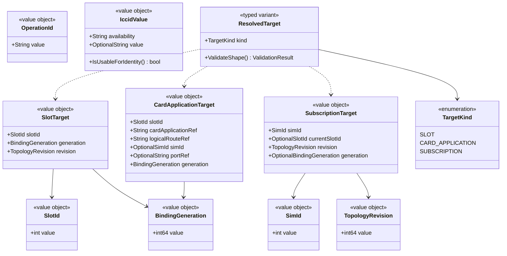

### 3.3 目标使用范围

| 目标 | 典型操作 |
|---|---|
| SlotTarget | HasSimCard、槽位状态、初始化、空槽查询 |
| CardApplicationTarget | PIN/PUK、EF、APDU、STK、卡应用操作 |
| SubscriptionTarget | 账户、标签、默认角色、订阅激活 |

SubscriptionTarget 可以表示历史账户，不要求始终存在当前卡位。

需要硬件执行的命令必须进一步解析当前绑定；仅修改允许保留的账户属性时，不强制要求卡在线。

### 3.4 代次与版本

- Revision 表示拓扑事实版本；
- Generation 表示卡或绑定更换代次；
- 目标解析不是永久授权；
- I/O 下发前需再次校验绑定；
- 无请求标识的通知不能凭空构造可信 OperationId。

---

## 4. API 与共宿主兼容入口

### 4.1 类图

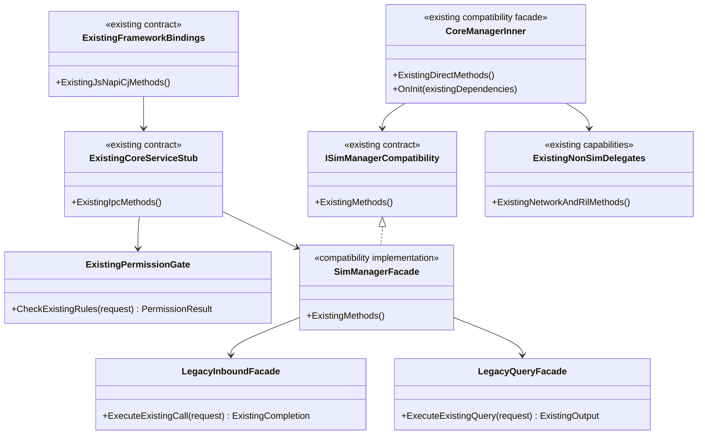

### 4.2 CoreManagerInner 契约

必须逐方法保持：

- 参数和输出参数；
- 返回值；
- 同步/异步语义；
- 错误；
- 注入前和部分就绪行为；
- 回调执行位置；
- 注册和反注册；
- 对象生命周期。

本次只调整 SIM 背后委托，不接管所有网络、RIL 和数据职责。

### 4.3 二进制与构建兼容

不能任意：

- 改变既有虚接口布局；
- 删除导出符号；
- 改变共享对象布局；
- 改变已有头文件使用方式；
- 要求外部消费者重新选择新入口。

内部职责接口不得自动成为新的公开接口。

### 4.4 执行上下文

Application 可使用内部 InvocationContext 保存：

- 来源；
- 已完成的入口检查；
- 现有完成语义；
- 关联信息。

它不是新权限模型，也不进入 Domain。

不得在异步执行阶段重新读取已经不属于原调用的线程本地 IPC 身份。

---

## 5. 一个 ACL 的内部职责

### 5.1 类图

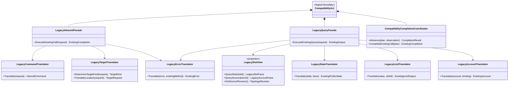

### 5.2 入站适配

负责：

- 旧请求解释；
- 目标类别选择；
- slotId 边界翻译；
- 内部命令生成。

不负责：

- 决定主卡；
- 分配 Modem；
- 直接写数据库；
- 修改聚合。

### 5.3 查询投影

必须区分：

- 未配置槽位；
- 已配置空槽；
- 卡在位但身份未就绪；
- 已识别账户；
- 已解绑历史账户；
- 当前有效绑定。

不能仅用“是否存在账户记录”判断是否有卡。

### 5.4 ICCID 翻译

内部：

- NULL 对应不可用；
- 不参与真实身份匹配。

外部：

- 按原方法恢复既有占位输出；
- 不把占位重新写回有效身份链；
- 不统一假定所有旧查询使用同一种字符串形式，需逐方法核对。

### 5.5 状态翻译

LegacyStateTranslator：

- 穷举内部状态；
- 使用必要的兼容事实；
- 保留原 READY/LOADED 行为；
- 保持六值枚举；
- 不用 default 掩盖新状态。

---

## 6. Application 服务与统一准入

### 6.1 类图

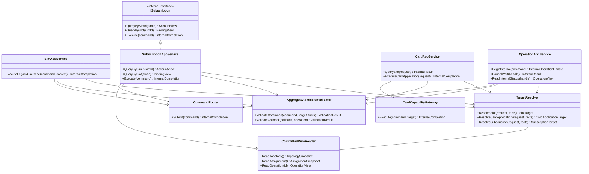

### 6.2 准入次序

1. 既有入口校验；
2. 参数和目标类型检查；
3. 解析所需目标；
4. 统一准入；
5. 聚合命令或卡能力执行。

不要求所有查询都进入写命令队列。

纯空槽查询不能因无 simId 被拒绝。

### 6.3 组合视图

CommittedViewReader 返回 Topology 与 Assignment 时，必须检查：

- Assignment 引用的拓扑版本；
- 当前绑定是否有效；
- 是否处于重算或恢复状态。

内部可以表达不一致/待重算，但对外仍按既有方法契约翻译。

### 6.4 内部接口限制

ISubscription、OperationAppService：

- 不新增 IPC；
- 不新增 JS；
- 不向公开载荷追加 OperationId；
- 不要求外仓修改。

---

## 7. 聚合管理、提交和流程

### 7.1 类图

```mermaid name=sim-managers-v03.mmd
classDiagram
direction TB

class TopologyManager {
    -ffrt_mutex topologyMutex
    +Handle(command) InternalCompletion
    +ApplyObservation(observation) InternalCompletion
    +ReadCommitted() TopologySnapshot
}
class OperationCoordinator {
    +Handle(command) InternalCompletion
    +HandleCallback(callback) InternalCompletion
    +HandleTimeout(timeout) InternalCompletion
    +Reconcile(target) InternalCompletion
}
class RadioResourceArbiter {
    -ffrt_mutex assignmentMutex
    +Handle(command) InternalCompletion
    +Recalculate(snapshot) InternalCompletion
}
class AggregateExecutionQueue {
    -ffrt_mutex queueMutex
    +Submit(ownerKey, task) InternalCompletion
}
class CommitCoordinator {
    +CommitTopology(changeSet) CommitResult
    +CommitAssignment(changeSet) CommitResult
    +CommitRuntimeOperation(changeSet) CommitResult
}
class PhysicalResourceGuard {
    -ffrt_mutex resourceMutex
    +Acquire(resources, operationId) GuardResult
    +Release(token) void
}
class SimProcessManager {
    +OnDomainEvent(event) void
    +OnExecutionResult(result) void
    +Advance(processContext) void
}
class TopologyAggregate
class ProfileOperationAggregate
class RadioAssignmentAggregate

TopologyManager *-- TopologyAggregate
OperationCoordinator o-- ProfileOperationAggregate
RadioResourceArbiter *-- RadioAssignmentAggregate

TopologyManager --> AggregateExecutionQueue
OperationCoordinator --> AggregateExecutionQueue
RadioResourceArbiter --> AggregateExecutionQueue

TopologyManager --> CommitCoordinator
OperationCoordinator --> CommitCoordinator
RadioResourceArbiter --> CommitCoordinator

OperationCoordinator --> PhysicalResourceGuard
SimProcessManager --> CommandRouter
```

### 7.2 单写入

- TopologyManager 写拓扑事实；
- OperationCoordinator 写本仓操作上下文；
- RadioResourceArbiter 写角色和分配；
- SimProcessManager 只编排，不直接写聚合。

### 7.3 提交串行

同一聚合的数据库提交未确认前，不允许后续写命令覆盖候选状态。

不能采用：

“计算时加锁 → 解锁并发写 DB → 按返回顺序覆盖内存”。

### 7.4 I/O

领域锁内不执行：

- DB/DataShare；
- HDI；
- IPC；
- 厂商 Hook；
- 外部回调；
- 事件投递。

异步执行期间使用受控命令队列和提交协调，不依赖长时间持锁。

### 7.5 资源粒度

- 卡内进度隔离；
- 同卡冲突操作受控；
- 跨卡物理互斥保留；
- 不以 per-operation 锁替代实际共享硬件互斥。

---

## 8. Domain：TopologyAggregate

### 8.1 类图

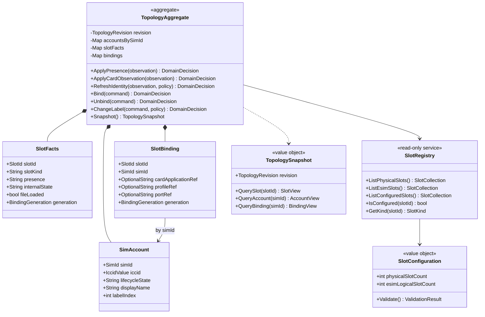

### 8.2 重要修正

SlotFacts 独立于 SimAccount 存在。

因此：

- 空槽也有配置事实；
- 卡身份未就绪也能报告槽位状态；
- PIN/PUK 不需要伪造账户；
- 历史账户可以没有当前 SlotBinding。

### 8.3 基数

- 物理基数固定为 2；
- eSIM 逻辑位从 2 起算；
- 数量来自配置；
- 无 eSIM 构建保留合法的无 eSIM 路径；
- 不把 eSIM 位等同于 Modem；
- SlotRegistry 不执行权限决策。

### 8.4 不变量

- 无效 ICCID 不参与有效身份匹配；
- 绑定引用存在的账户；
- 旧代次不能覆盖新卡；
- 账户身份不随换槽改变；
- 状态事实只有一个写入口；
- 只读投影不回写。

---

## 9. Domain：ProfileOperationAggregate

### 9.1 类图

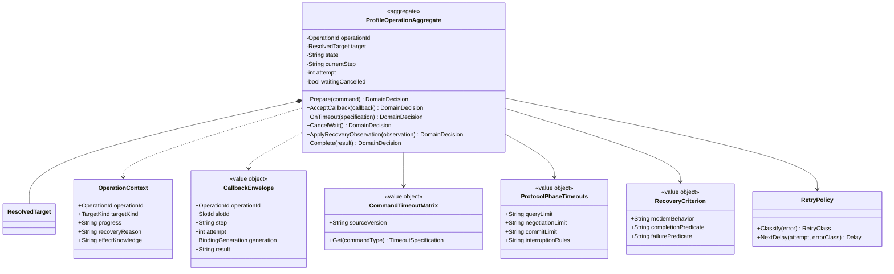

### 9.2 操作与远端任务

该聚合拥有本仓操作状态，不复制 66250 的完整任务状态机。

内部 operationId 不要求加入既有远端接口。

### 9.3 门控

在同一执行域检查：

- 操作；
- 目标；
- 步骤；
- 尝试次数；
- 代次；
- 终态；
- 重复。

关联不足时核对硬件，不猜测归属。

### 9.4 超时与取消

- 取消等待不等于真中断；
- 超时不等于无副作用；
- 明确失败与进入恢复分开；
- 恢复退出判据由 Modem 输入；
- 数值未闭环时相关相位不能完成。

### 9.5 持久化边界

不新增操作日志表。

运行期上下文可在重启后丢失，重启通过既有持久状态和硬件核对恢复事实，不承诺恢复相同 OperationId。

---

## 10. Domain：RadioAssignmentAggregate 与策略

### 10.1 类图

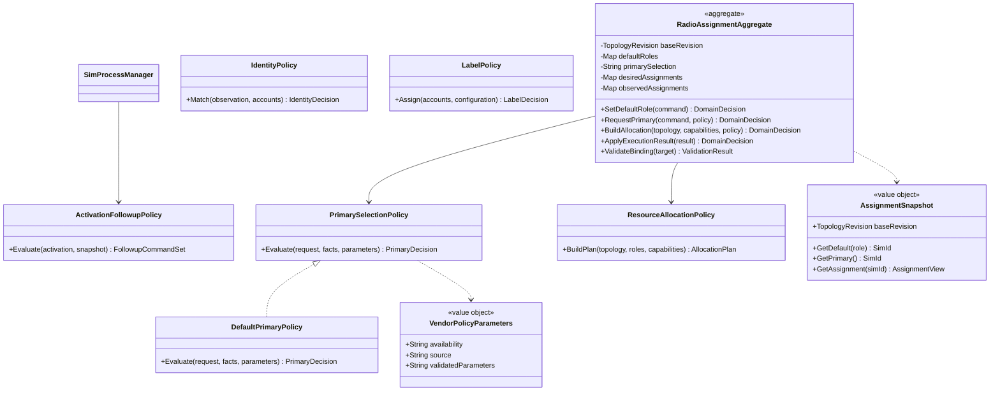

### 10.2 规则

- 默认角色与 Modem 分配分开；
- 期望与观察结果分开；
- 资源分配不代表驻网；
- 驻网不代表数据连接成功；
- 不用卡位索引推导 Modem；
- 不用数组反转代替通用分配；
- 无线能力来自既有 RIL 输入。

### 10.3 激活关联

ActivationFollowupPolicy 返回后续命令，不直接写主卡事实。

默认策略重现既有自动联动，应用不需要增加调用。

### 10.4 纯策略

IdentityPolicy、LabelPolicy、PrimarySelectionPolicy、ResourceAllocationPolicy：

- 不读 DB；
- 不调 RIL；
- 不读线程身份；
- 不调用 dlopen；
- 使用已验证输入。

默认主卡业务规则仍待 D-004(a)，不得在实现中自行决定。

---

## 11. Domain Port

```mermaid name=sim-domain-ports-v03.mmd
classDiagram
direction TB

class ITopologyRepository {
    <<interface>>
    +ReadCommitted() TopologySnapshot
    +CommitExistingSchema(changeSet) CommitResult
}
class IOperationRepository {
    <<interface>>
    +Get(operationId) OperationContext
    +PutRuntime(context) void
    +RemoveRuntime(operationId) void
}
class IAssignmentRepository {
    <<interface>>
    +ReadCommitted() AssignmentSnapshot
    +CommitExistingStorage(changeSet) CommitResult
}
class ICardExecutionPort {
    <<interface>>
    +ReadSlot(target) InternalResult
    +ExecuteCardApplication(target, command) InternalCompletion
}
class IRadioExecutionPort {
    <<interface>>
    +ExecuteExistingCommand(request) InternalCompletion
    +ReadRecoveryState(target) InternalResult
}
class IEsimTaskPort {
    <<interface>>
    +ExecuteExistingServiceMethod(request) InternalCompletion
    +ReadExistingTaskFacts(request) InternalResult
}
class IVendorHook {
    <<internal interface>>
    +ReadParameters(context) VendorPolicyParameters
    +NotifyExistingHook(context) InternalResult
}
class IInternalEventPublisher {
    <<interface>>
    +PublishCommitted(event) PublishResult
}
```

说明：

- Repository 不代表新表；
- Port 不代表新 IPC；
- 聚合不主动执行 Port I/O；
- Application 管理器调用 Port；
- 不支持的能力明确返回，不提供伪成功空实现；
- IEsimTaskPort 只表示既有服务任务，不囊括全部卡侧 eUICC 原语；
- 具体卡能力可继续细分为文件、锁、STK、APDU 子接口。

---

## 12. Infrastructure：存储与事务

### 12.1 类图

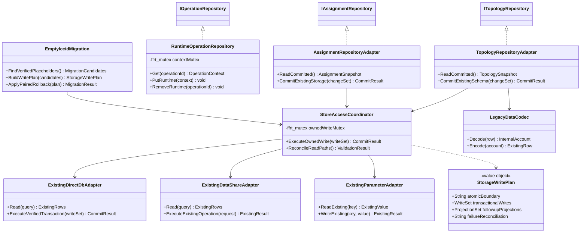

### 12.2 重要语义

ownedWriteMutex 只序列化本仓受控写入。

它不保证：

- 其他进程不写；
- 不同数据库连接共用事务；
- DataShare 与直写原子；
- 系统参数与 DB 原子。

### 12.3 StorageWritePlan

写计划必须明确：

- 真正事务边界；
- 同事务字段；
- 提交后投影；
- 失败核对；
- 可观察完成点。

不能仅因返回 CommitResult 就宣称所有存储已原子提交。

CommitResult 应区分：

- 成功；
- 明确失败；
- 冲突；
- 结果未知。

### 12.4 反向查询

telephony_data 可能反查 Core。

因此禁止：

持有领域锁或形成闭环的事务  
→ DataShare  
→ provider 反查 Core  
→ 等待原锁或执行域。

相应调用应在详细设计中标注重入风险。

### 12.5 首批事务与迁移

D-016 首批：

- 初始化；
- ICCID 刷新；
- D-006 迁移。

无法在既有能力中满足批准目标时登记阻塞，不擅自新增外部事务接口或改 schema。

---

## 13. Infrastructure：卡能力与 RIL

### 13.1 类图

```mermaid name=sim-card-ril-v03.mmd
classDiagram
direction TB

class CardIoAdapter {
    +ReadSlot(target) InternalResult
    +ExecuteCardApplication(target, command) InternalCompletion
}
class ExistingCardManagerBridge {
    +ResolveSlotRuntime(slotId) ExistingManagerSet
    +ValidateApplication(target) ValidationResult
    +RetireBinding(slotId, generation) void
}
class RilExecutionAdapter {
    +ExecuteExistingCommand(request) InternalCompletion
    +ReadRecoveryState(target) InternalResult
}
class ProtocolPhaseExecutor {
    +ExecuteQuery(request) InternalCompletion
    +ExecuteNegotiation(request) InternalCompletion
    +ExecuteCommit(request) InternalCompletion
    +HandlePhaseTimeout(context) void
}
class RequestCorrelationRegistry {
    -ffrt_mutex requestMutex
    +Register(context) CorrelationKey
    +Resolve(response) CorrelationResult
    +InvalidateGeneration(generation) void
}
class RilCallbackAdapter {
    +OnExistingResponse(raw) void
    +OnExistingNotification(raw) void
}
class ObservationMapper {
    +MapSlotObservation(raw) SlotObservation
    +MapCardObservation(raw) CardObservation
    +MapExecutionResult(raw, context) ExecutionResult
}
class CommandIngress {
    +SubmitObservation(observation) void
    +SubmitCallback(callback) void
}
class ExistingRadioEventAdapter {
    +RegisterExisting(request) ExistingResult
    +UnregisterExisting(request) ExistingResult
    +ForwardExistingEvent(event) void
}

ICardExecutionPort <|.. CardIoAdapter
IRadioExecutionPort <|.. RilExecutionAdapter

CardIoAdapter --> ExistingCardManagerBridge
RilExecutionAdapter --> ProtocolPhaseExecutor
RilExecutionAdapter --> RequestCorrelationRegistry

RilCallbackAdapter --> RequestCorrelationRegistry
RilCallbackAdapter --> ObservationMapper
RilCallbackAdapter --> CommandIngress
RilCallbackAdapter --> ExistingRadioEventAdapter
```

### 13.2 保留能力

通过 Bridge 复用：

- SimStateManager；
- SimFileManager；
- SimSmsManager；
- IccDiallingNumbersManager；
- StkManager；
- 既有 eUICC/APDU 能力。

ExistingManagerSet 是图示集合，不建议实现成新的全能 Manager。

### 13.3 RIL 关联

RequestCorrelationRegistry 保存既有契约能够提供的关联。

底层缺少标识时：

- 采用资源串行约束；
- 记录不确定；
- 通过重读核对。

本地 Registry 不能凭空补足底层信息。

### 13.4 RadioEvent

保留：

- 注册/反注册；
- 事件类型；
- 回调形态；
- 扇出与生命周期。

不能直接用 DomainEventBus 替换。

---

## 14. Infrastructure：eSIM 双通道

### 14.1 类图

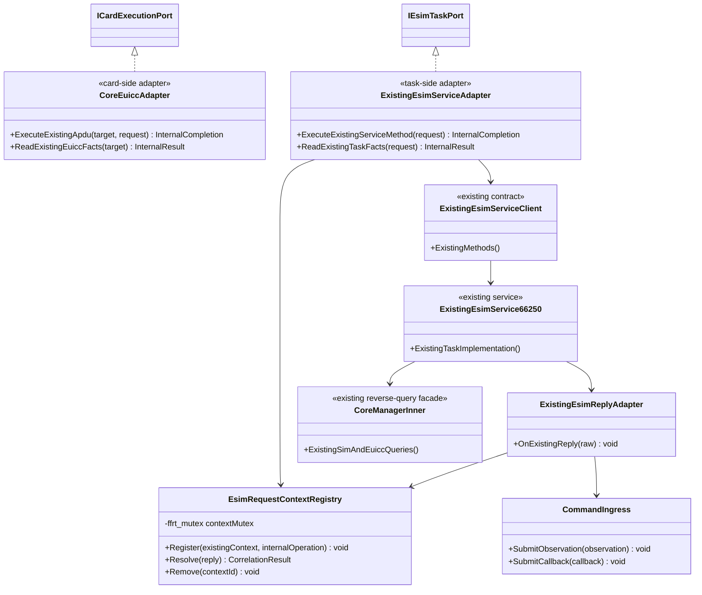

### 14.2 所有权

| 内容 | 所有者 |
|---|---|
| APDU/卡侧原语 | Core 既有实现 |
| LPA/配置层任务 | 66250 |
| 账户绑定 | Topology |
| 主卡与资源 | Assignment |
| 本仓操作等待和门控 | Operation |

### 14.3 禁止循环转办

CoreEuiccAdapter 不应因统一抽象而把所有卡侧请求再次转到 66250。

否则 66250 反查 Core 时可能形成递归或等待闭环。

### 14.4 回执

- 先关联；
- 再门控；
- 再更新操作；
- 必要时核对卡事实；
- 再提交拓扑；
- 按既有契约输出。

收到远端回执不自动代表账户、主卡、网络和数据均已成功。

### 14.5 故障

服务失效、回执缺失或关联不明时，不直接假定未执行。

通过既有可用查询进入恢复核对；不新增远端任务查询契约冒充现有能力。

---

## 15. Infrastructure：厂商策略

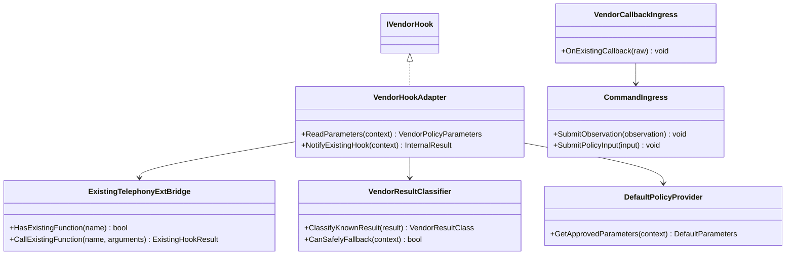

约束：

- IVendorHook 是内部端口；
- 不新增动态库 ABI；
- 不要求厂商改导出符号；
- 不传递聚合可写引用；
- 不绕过命令写核心事实；
- 缺失/失败/超时回退需满足安全条件；
- 无失败返回的 Hook 不能凭空分类为成功或失败；
- 超时后旧函数可能继续执行，不能无条件双执行；
- 同进程动态库不提供崩溃隔离。

---

## 16. 兼容完成与专用出站适配

### 16.1 类图

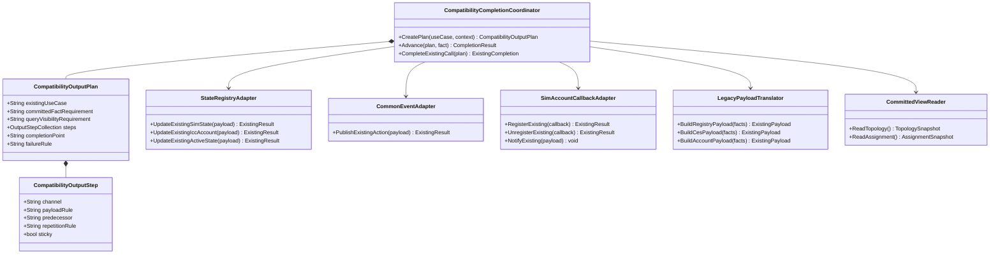

### 16.2 计划不是新业务状态机

CompatibilityOutputPlan 表达既有可观测契约：

- 查询何时可见；
- 哪些输出发生；
- 已验证的相对顺序；
- 原返回何时完成；
- 通知失败如何影响调用结果。

它不拥有账户、主卡或资源事实。

不要求新增持久化计划表。

### 16.3 不保证虚假的全局顺序

predecessor 只表达有证据的因果依赖。

不表达：

- 所有进程严格全序；
- 固定毫秒间隔；
- 所有回调都已被远端消费。

### 16.4 双发布源

CommonEventAdapter 不消除 State Registry 的中继发布。

本次：

- 保留既有双发布；
- 不增加第三来源；
- 不按内部 eventId 对既有外部广播擅自去重。

### 16.5 对外格式

内部事件字段不得直接泄漏到：

- CES；
- Registry；
- JS observer；
- 账户回调。

原载荷构建规则逐方法保持。

---

## 17. 十类异步领域事件与既有总线

### 17.1 领域总线类图

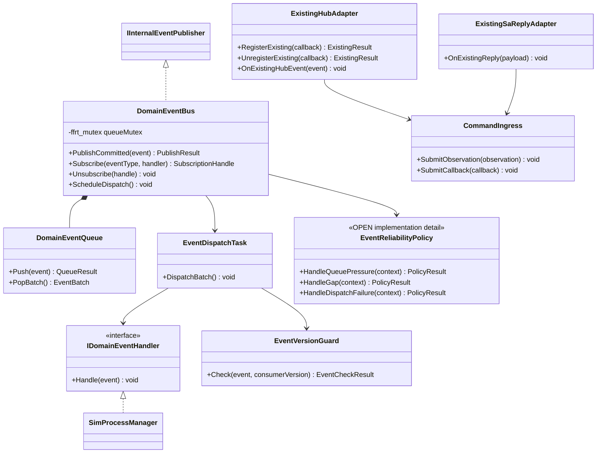

### 17.2 十类事件

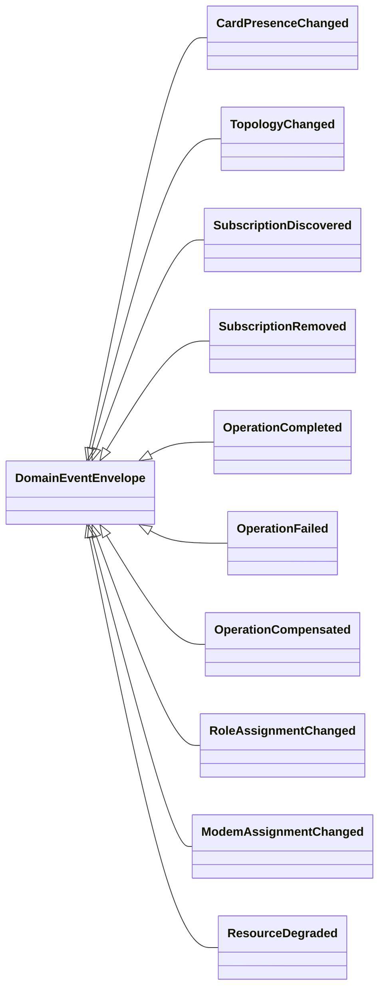

继承表示公共信封关系，实现可以使用组合和类型化变体。

### 17.3 分离原则

DomainEventBus 不替代：

- CommonEventHub；
- RadioEvent；
- State Registry；
- CES；
- SimAccountCallback；
- IEsimServiceCallback。

这些机制可提供输入或输出，但语义分别定义。

### 17.4 可靠性

本次不默认：

- 持久化 Outbox；
- Event Sourcing；
- 跨重启重放；
- 恰好一次；
- 全局顺序；
- 新跨 SA 通道。

相关细节按 TGT-OPEN-001/005 裁决。

### 17.5 重入

- Handler 不持有发布聚合的锁；
- Handler 只提交命令，不直接写其他聚合；
- 不在分发执行域等待必须由该域消费的后续事件；
- 反订阅后在途回调的处理规则明确；
- 慢消费者和队列压力不得静默丢失。

---

## 18. 生命周期、装配与故障处理

### 18.1 类图

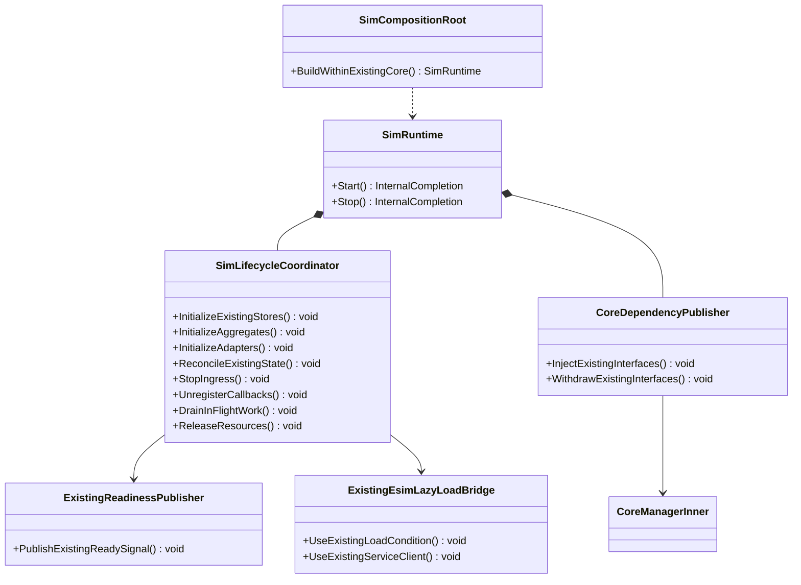

### 18.2 启动

内部装配可以调整，但必须维持既有：

- 注入时点；
- 未就绪返回；
- ready 输出；
- 66250 懒加载；
- 共宿主调用窗口。

不新增 readiness 公共事件，也不擅自改变其语义。

### 18.3 停止

1. 停止新写请求；
2. 停止新执行；
3. 注销观察；
4. 门控迟到回调；
5. 排空或记录可恢复状态；
6. 释放 Manager/Adapter；
7. 最后卸载动态库。

不保证通过强制终止线程解决在途同进程厂商调用。

### 18.4 恢复出厂

FactoryResetCoordinator 作为应用流程内部实现：

- 遍历 SlotRegistry 的合法卡位；
- 通过指定写者清理事实；
- 通过存储计划执行；
- 核对账户、标签、参数和关联残留；
- 按 D-023 的书面选择决定既有 66250 协同范围。

未批准前不增加远端清理动作。

---

## 19. 状态所有权与锁表

| 状态 | 唯一写者 | 保护 |
|---|---|---|
| 账户、槽事实和绑定 | TopologyManager | topologyMutex |
| 单操作状态 | OperationCoordinator | 对应操作上下文 ffrt::mutex |
| 默认角色和分配 | RadioResourceArbiter | assignmentMutex |
| 跨卡物理资源占用 | PhysicalResourceGuard | resourceMutex |
| 命令队列 | AggregateExecutionQueue | queueMutex |
| 请求关联 | RequestCorrelationRegistry | requestMutex |
| eSIM 回执上下文 | EsimRequestContextRegistry | contextMutex |
| 运行期操作索引 | RuntimeOperationRepository | contextMutex |
| 本仓写入队列 | StoreAccessCoordinator | ownedWriteMutex |
| 事件队列 | DomainEventBus | queueMutex |
| 兼容只读投影 | 指定投影构建者 | 整体替换或明确 ffrt::mutex |

注意：

- 表中同名锁是各对象独立成员，不表示共享一把锁；
- Repository 索引锁不替代聚合状态锁；
- 本仓写锁不替代数据库事务；
- 兼容投影不能通过其他路径独立修改；
- 具体字段必须在详细设计中逐项登记。

---

## 20. 接口、输出与生命周期设计资产

### 20.1 接口映射

每个生产调用方法登记：

- 既有签名；
- IPC/直接门面/Framework/66250 入口；
- 目标类别；
- 所属聚合或卡能力；
- 同步/异步；
- 完成点；
- 查询来源；
- 错误映射；
- 线程与重入；
- REL/FLOW；
- 测试。

不能只按 IPC 码表覆盖，必须包含 CoreManagerInner 直接调用。

### 20.2 状态投影

逐字段登记：

- 权威写者；
- 原始存储；
- 副本；
- 版本；
- 更新入口；
- 失效；
- 重建。

单一数据源不是删除全部缓存，而是禁止缓存成为独立事实写者。

### 20.3 输出轨迹

优先覆盖：

- 插拔和 READY/LOADED；
- PIN/PUK；
- 激活与自动选主；
- 默认数据；
- eSIM；
- 卫星/VSIM；
- 恢复出厂。

记录查询可见点、通道、顺序、次数、sticky 和失败语义。

### 20.4 生命周期

覆盖：

- 注入前；
- 部分就绪；
- 正常；
- 懒加载；
- 重入；
- 反注册；
- 停止；
- 迟到任务。

这些表格属于实现准入材料，不由类图自动替代。

---

## 21. 禁止依赖与反模式

| 禁止项 | 原因 |
|---|---|
| 所有请求先要求有效 simId | 空槽和未识别卡操作失效 |
| slotId 直接作为账户身份 | 位置与身份混淆 |
| API 直接写聚合 | 绕过编排 |
| 回调直接改字段 | 绕过门控 |
| LegacySlotView.Commit | 投影成为写者 |
| Domain 读取 DB/HDI/ffrt/dlopen | 分层破坏 |
| NULL 直接公开 | 破坏占位兼容 |
| 新内部状态追加公开枚举 | 违反冻结 |
| operationId 追加 IPC | 违反冻结 |
| 十类事件逐一变成新 CES | 违反冻结 |
| 领域总线替换 RadioEvent/Hub | 契约和生命周期变化 |
| 统一去除双发布 | 改变既有行为 |
| 写锁等同跨进程事务 | 虚假原子性 |
| 事务持锁调用反查 Core 的 provider | 重入死锁 |
| 所有 eSIM 请求转 66250 | 循环转办与职责混淆 |
| 内部取消等同硬件中断 | 错误副作用判断 |
| 厂商超时立即无条件双执行 | 迟到副作用冲突 |
| N 槽自动对任意应用开放 | 绕过能力管控 |

---

## 22. 验收与实施门禁

### 22.1 结构

- 三聚合写者唯一；
- 三类目标正确；
- ACL 无第二真值；
- 共宿主入口保持；
- 无新公开 API/IPC/SA/进程；
- 无 schema 改变；
- 条件编译完整；
- 所有新增共享状态有锁归属。

### 22.2 行为

- 原配置行为等价；
- 四槽仅有已批准能力变化；
- 无 simId 的合法卡操作可执行；
- NULL 不泄漏；
- 六值与 READY/LOADED 保持；
- 激活联动由显式策略重现；
- 回调时查询视图正确；
- sticky、双发布和错误语义保持；
- Hub/RadioEvent 注册保持；
- 66250 无循环转办；
- DataShare 反查无锁闭环；
- 迟到回调不污染新绑定。

### 22.3 待输入

不得自行填实：

- 默认主卡策略；
- 新权限限制；
- 超时数值；
- Modem 行为；
- 恢复退出判据；
- 66250 清理联动；
- 事件持久化与跨 SA 细节。

### 22.4 Phase 0

类图评审通过不等于允许实施。

L3 Readiness、覆盖、harness 差异和目标 HEAD 证据未闭环前，不得开始生产重构。

---

## 23. 结论

本类设计围绕六条边界收敛：

1. 共宿主门面是正式兼容边界；
2. 卡槽、卡应用与订阅采用不同目标；
3. 聚合拥有事实，管理器协调提交；
4. 领域事件与既有通知分别定义；
5. Repository 只承诺可证明的事务能力；
6. Core 与 66250 按操作和事实划分所有权。

后续应先完成接口映射、状态投影、输出轨迹和生命周期四项资产，再将类图落为代码拆分任务。

---

## 修订记录

| 版本 | 日期 | 内容 |
|---|---|---|
| 0.1 | 2026-10-15 | 初始分层类设计 |
| 0.2 | 2026-10-15 | 对齐对外冻结、simId、共宿主、schema 和十类事件 |
| 0.3 | 2026-10-15 | 对齐 SAD v0.3：分类目标、ACL 拆责、输出轨迹、专用通知适配、eSIM 所有权、真实事务及生命周期 |