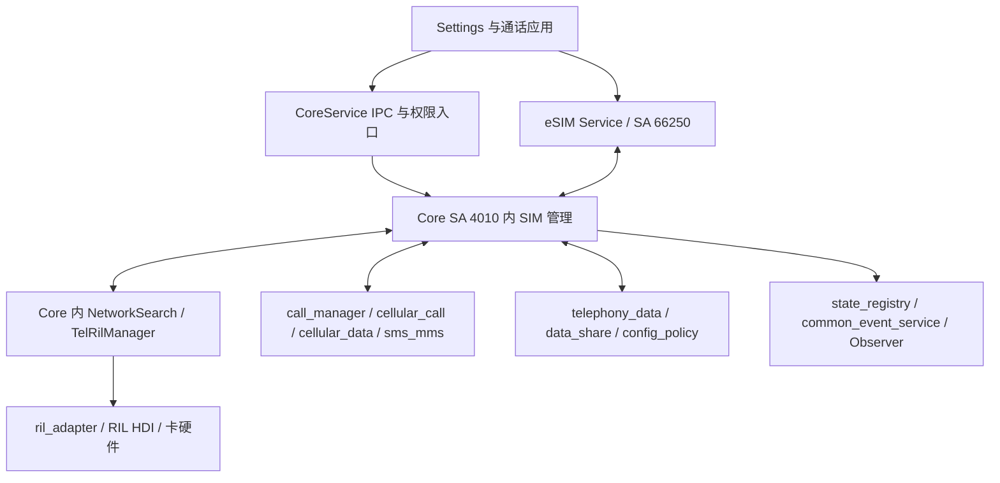
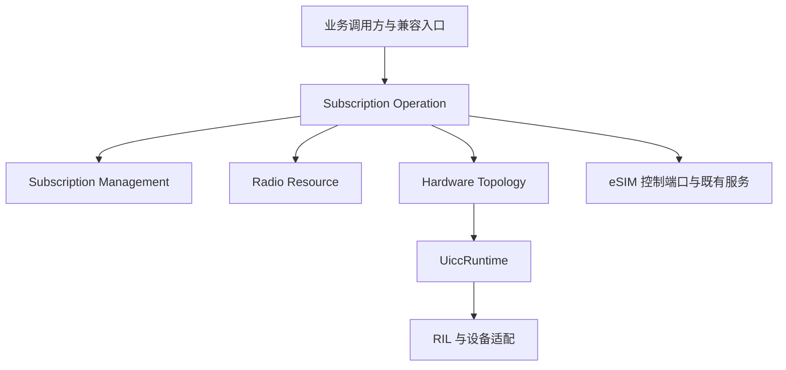
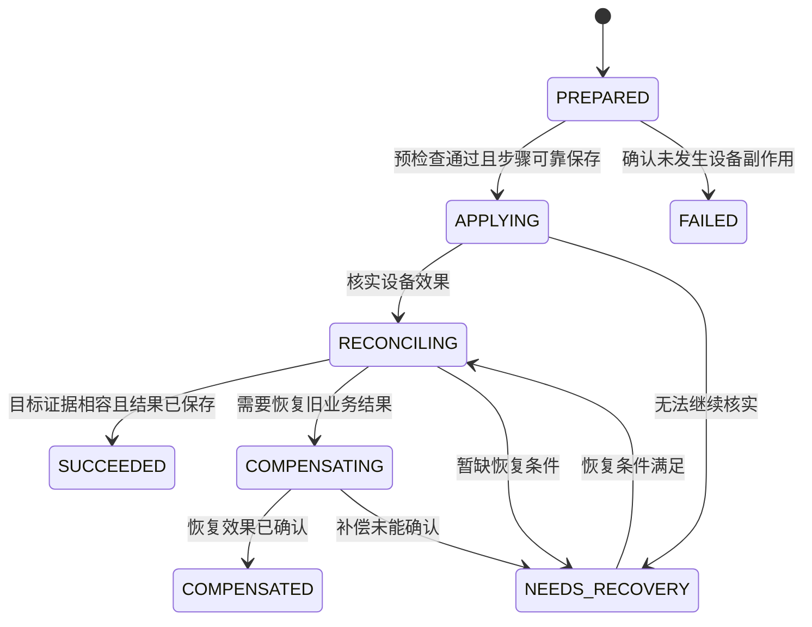

# 历史原稿：已退出现行设计

> 2026-10-15统一前的完整正文保留如下，不是当前实现状态或实施规范。现行目标见docs/README.md和MultiSIM/08_design_unification_decisions.md。

---

# 多 SIM 架构重构：问题分析与软件设计说明书

**版本：V22　日期：2026-10-15**

本说明书与《多SIM架构重构_问题分析与软件设计_V22.pptx》使用同一论证结构：业务挑战、设计缺口、方法选择、总体方案、状态与用例闭环、兼容及验证。PPT 主报告为 P1–41（含封面与目录），技术附录为 P42–81。正文按设计推导组织，具体代码历史、模型和异步协议可从技术附录及逐页对照查阅。

软件设计的重点是让业务对象、变化责任和不变量形成清晰逻辑抽象，减少 slotId 背后的语义解释和流程知识向调用方扩散。身份与当前位置分开，状态事实与操作进度分开，必要复杂性由稳定接口和受控入口维护。

## 文档目的与证据边界

文档服务于设计评审和开发细化。现状结论、平台参考和目标建议分别使用。接口、聚合、版本、状态机与测试均为设计约束，不代表目标仓库已经实现或完成产品运行验收。

状态报告固定于 `b2ddf49ab0fc21f0d7f3628c702913c5d18e7977`，日期 2026-09-30。六份早期材料使用各自历史基线，未在该提交全部逐项重审。AOSP 提供概念与职责参考，不推导本平台的 SA、进程、卡数和业务并发。软件设计哲学提供判断原则，具体多 SIM 机制由本地问题推导。

Owner 指一种软件事实的接受、修改和发布责任。它不控制硬件现实，事实还需说明作用域、版本、新鲜度及未知原因。四个业务上下文不等于四个核心域、线程、进程或服务。

## 目录

1. [第 1 章 业务能力与核心挑战](#ch1)
2. [第 2 章 问题证据与设计缺口](#ch2)
3. [第 3 章 设计原则与参考选择](#ch3)
4. [第 4 章 总体方案与多 SIM 演进](#ch4)
5. [第 5 章 状态治理与用例闭环](#ch5)
6. [第 6 章 兼容边界与验证依据](#ch6)
7. [技术附录 A 证据与 AOSP 补充](#ch7)
8. [技术附录 B 详细模型与实现设计](#ch8)
9. [技术附录 C 异步有效性与恢复协议](#ch9)
10. [PPT 与说明书逐页对照](#appendix-d)
11. [逐页内容与演讲备注](#appendix-e)
12. [来源链接](#appendix-f)


<a id="ch1"></a>
## 第一章 业务能力与核心挑战

对应 PPT P3–7。先介绍业务和外围协作，再明确产品能力与核心挑战。


### 1.1 业务生命周期与责任边界

SIM 管理围绕开机、插卡、识别解锁、读取卡资料、账户可用、选卡和业务协同展开。切换、异常和重启恢复贯穿生命周期。它提供卡身份、状态、账户与选卡基础，网络注册、通话和数据连接由相关业务模块协同完成。

| 能力 | 典型场景 | 管理职责 | 不应混淆的结果 |
| --- | --- | --- | --- |
| 识卡与状态 | 开机、插拔、换卡 | 卡存在、卡类型、ICCID，区分 Locked/Ready/Loaded | 服务注册成功不等于卡功能全部可用 |
| 安全与卡文件 | PIN/PUK 解锁、运营商资料读取 | 安全操作、认证、SIM IO、IMSI/SPN 等 Records | 解锁命令成功不等于 Records 加载成功 |
| 身份与账户 | 新卡加入、旧卡重插 | 按身份建立或恢复账户，查询 simId 和当前映射 | 当前 slot 索引不等于永久卡身份 |
| 多卡与默认角色 | 双卡共存、主卡和业务默认卡切换 | Active、语音/短信/数据默认角色、Primary 与 Radio 协调 | 用户意图、有效选择和硬件执行状态分别确认 |
| eSIM 与 Profile | 库存查询、启停、Profile 切换 | eUICC/EID、Profile、按产品能力处理 Port/MEP | 已安装不等于已启用，启用不等于网络可用 |
| 通知与恢复 | 状态变化、依赖延迟、服务重启 | 通知消费者，通过重试与复核恢复一致 | 通知送达不等于所有消费者已收敛 |

不同能力在不同时间就绪。`CORE_SERVICE_READY` 不能作为全部 SIM 功能可用的总开关。开发规格应分别描述卡应用、安全、Records、账户、角色、资源和通信业务的就绪条件。


### 1.2 多 SIM 管理与周边模块的接口关系

对应 PPT P4。现状接口图将具体模块与接口配对列示，便于定位提供方与协作方。NetworkSearch 和 TelRilManager 是 Core 内部模块，其余按应用、服务、部件或硬件层次标识。连线表示调用、返回、上报或通知，不表示源码、共享库或进程的双向依赖。具体调用路径按目标 commit 与 Feature 核对。



| 协作分组 | 具体部件或模块 | 接口总体介绍 | 边界与完成语义 |
| --- | --- | --- | --- |
| 应用与系统设置 | applications_settings（设置）、applications_call（通话与 SIM 设置），Telephony JS/ANI/Native 客户端 | 经 CoreService Proxy/Stub 的既有 IPC 使用卡状态、标识、账户、安全和选卡能力 | 保持 IPC、权限、参数和错误码；具体产品入口及外部方法独立冻结 |
| Core 内部协作 | SimManager、EsimManager，以及 SIM 外围的 NetworkSearch、TelRilManager | ISimManager/IEsimManager 是进程内协作接口，机械 SO 拆分再配工厂与可替换依赖 | Core 内部模块不等于独立服务；跨 SO 所有权和 Stop 成对定义 |
| 通信业务部件 | call_manager（通话管理）、cellular_call（蜂窝通话）、cellular_data（蜂窝数据）、sms_mms（短彩信），IMS/卫星协作按产品能力 | 查询卡信息和角色，消费必要变化，协调活动业务和资源；Core 内 NetworkSearch 承担搜网协作 | 能力图不声明每个模块调用相同接口或全部直接调用；网络注册、通话和数据连接由对应业务模块完成 |
| RIL 接入与卡硬件 | Core 内 TelRilManager，ril_adapter、RIL HDI，Modem、UICC/eUICC | 经 ITelRilManager/Adapter 发送安全和 IO 等命令，接收响应与主动上报 | 区分软件接入层与硬件实体，保留发送时请求关联，设备反馈不自动等于用例成功 |
| 既有 eSIM 服务 | eSIM Service（SA 66250），EsimServiceClient，Core 内 eSIM Runtime | EsimServiceClient/IEsimService 提供库存、下载授权、Profile 等业务与回调 | 应用可直达既有服务；Core 主/子编排独立确认，单个业务不由两边重复补偿 |
| 数据存储与系统依赖 | telephony_data（data_storage 仓），data_share、config_policy，以及目标产品的用户依赖 | DataShare 账户和运营商配置访问，配置与依赖就绪协作 | 区分部件名、仓库称谓和接口机制；依赖延迟不是拔卡，恢复按必要事实和版本幂等执行 |
| 状态通知与产品扩展 | state_registry（电话状态注册）、common_event_service（公共事件）、Observer，以及厂商扩展 | 观察者订阅、状态发布、公共事件和扩展契约 | Observer 不额外虚构为独立 SA；各通道分别冻结发布、失败和回放，扩展不得绕过事实 Owner |

SIM SMS、电话簿、STK 等卡侧能力属于 SIM 拆分范围，不表示全部短信或业务模块迁入 SIM。独立 eSIM SA 不自动证明独立进程或完整故障隔离。现状图介绍能力和接口边界，目标设计再通过端口、Adapter 和 ACL 收敛依赖。

开发时为每类接口补齐：输入标识及作用域、权限、同步/异步形式、完成定义、线程与重入、所有权、超时/取消、错误码、依赖不可用、重复与乱序、版本/新鲜度、通知与回放、Feature/ABI、提供方和消费者测试。外部格式无法新增版本时，在内部适配层保留关联，不擅自修改公共 schema。

模块名补充基于既有系统分析、本地固定代码基线的 README 与 bundle，以及公开部件、应用职责说明。这里没有新增外部接口，也不声称完成跨仓逐方法调用审计。来源和历史 eSIM 基线限制保留于 P4 演讲备注。


### 1.3 产品能力与数量模型

可管理订阅数、已启用凭据数、逻辑协议栈数、同时驻网数和业务并发数是不同维度。历史材料中的三卡主要指双 pSIM 加 eSIM，不应推导所有产品固定使用 slot-2，也不能推导三路同时通信。API 出现 `portIndex` 只证明接口表达了端口，仍需核查账户、状态、事件、资源和测试是否全链路支持 MEP。

产品能力矩阵至少记录：硬件接入位置、可用 eUICC/Port、支持的 Profile 组合、逻辑映射约束、Radio 容量、语音/短信/数据并发、活动业务切换限制、Feature 与厂商实现版本。DSDS/DSDA 按实际能力描述，不直接换算物理芯片数。目标 N 订阅/M 资源模型必须有界，不能用泛化类型替代设备约束。


### 1.4 能力演进与状态可信度的挑战

设计同时回答两类业务问题：新增卡数、Port 和 Profile 形态时怎样控制联动修改；换卡、切换、刷新和重启时怎样判断状态属于谁、何时有效以及什么才算成功。

可管理订阅、已启用凭据、逻辑映射和通信业务并发分别受产品能力约束。现有 IPC、启动依赖、数据库与设备副作用也必须纳入设计。业务目标在前，模型和协议由后面的证据与规则推导。


<a id="ch2"></a>
## 第二章 问题证据与设计缺口

对应 PPT P8–13。把源码形态和风险窗口转成可解释的设计要求。


### 2.1 Slot-Centric 模型的复杂性来源

当前实现使 `slotId` 路径承担身份、位置、账户、默认角色、资源分配和操作进度等不同生命周期。典型信号包括 Manager 的 slot 级集合、账户/缓存索引、SimRdb 的多义字段、Primary 与 Radio 的多步骤流程，以及 eSIM 的技术路由。

| 复杂性来源 | 修改时的后果 | 治理目标 |
| --- | --- | --- |
| 身份与位置混合 | 换槽、重映射和重装容易改变身份解释 | 稳定身份、来源、当前连接分别表达 |
| 多点写入同一状态 | 一个模块更新后，其他缓存仍保持旧值 | 每类软件事实有一个权威提交入口 |
| 流程与事实混合 | 回调完成、设备生效和业务成功相互替代 | 请求、步骤、事实确认和用例结果分开 |
| 隐式时序和共享标志 | 初始化、加载、通知与恢复靠经验协作 | 前置条件、代次和发布顺序成为契约 |
| 数量分支和特殊槽位 | 扩卡影响账户、默认卡、Radio、eSIM 等多处 | 能力数据、映射模型和策略替代重复分支 |

扩卡成本趋势图是示意图，不是人天测算。架构能减少代码组织制造的复杂性，仍需要对真实硬件组合进行验证。


### 2.2 逻辑抽象不足：数据与流程围绕 slotId 定义

对应 PPT P9。已有数据、状态与合入证据说明，一个关键设计问题是业务逻辑抽象不充分：位置和技术路由索引承接了身份、连接、角色和运行生命周期的多种含义，调用方因此需要自行补充业务解释。

逻辑抽象用业务对象、行为、职责与不变量表达系统。它要求业务接口能够表达“哪个订阅”“希望哪个 Profile 生效”“什么才算完成”，同时把当前位置和设备执行作为明确协作关系。新增类型或类名只有在保护这些语义时才有价值。

| 抽象维度 | 当前设计信号 | 需要明确的逻辑 |
| --- | --- | --- |
| 数据 | slot 级对象集合、账户/缓存索引，SimRdbInfo 混放多类字段 | Subscription 身份、Source、当前 Binding 和角色各有语义与变化责任 |
| 流程 | Active、Primary、Radio 和 eSIM 多步联动，入口需要解释 slot/Port | 业务意图、设备执行、事实接受、完成证据和恢复职责分开 |
| 状态 | 卡应用、Records、操作进度和外部状态通过同一下标关联 | 请求、会话和加载具有各自有效性，事实与操作进度分开 |

示例为 slotId 仍为 0，但连接已由 A 变为 B，或同一卡会话已开始新一轮加载。位置相同不能证明旧结果属于当前对象。准入规则需关联 requestId、发送时的会话及加载轮次，并在写入前验证。合法 Profile 切换产生新会话时，由操作证据关联前后状态，不能只凭位置接受，也不能拒绝所有新会话。

该判断不表示现有实现完全没有抽象，现有 simId、portIndex 等概念仍有价值。问题在于它们尚未充分形成贯穿数据、流程和状态的明确契约。材料支持上述设计诊断，未量化全仓转换次数，也不推定所有访问都先转 slotId。slotId 的物理、逻辑或技术含义按具体接口定义。


### 2.3 抽象不足如何使复杂性分散

对应 PPT P10。映射通常同时包含选择、歧义、缺失、变化和有效性判断。若多个模块分别解释这些知识，即使每次查询都很简单，系统仍会出现规则重复和联动修改。

| 业务场景 | 分散在调用方的知识 | 目标责任边界 |
| --- | --- | --- |
| 账户与默认角色 | 订阅到当前 slot/Port 的关系，用户意图与有效选择 | 身份和角色模型表达业务，Topology 提供已接受的版本化 Binding |
| Profile 与切换 | 端点选择、设备返回、缓存更新和完成判定 | 唯一主编排承接用例，相关 Owner 接受事实并提供证据 |
| Records 与状态通知 | 会话和加载轮次、旧响应、清理与通知时序 | UiccRuntime 的受控入口维护准入、快照、失效和发布 |
| Radio 与设备路由 | 逻辑协议栈映射、资源容量和活动业务资格 | Radio 维护资源规则，Topology 接受映射，Adapter 承接平台路由 |

软件设计的目标是让业务模块表达目标与约束，让连接和设备边界维护各自知识。只增加公共 GetSlotId() 可以减少重复查询代码，但调用方若继续处理映射缺失、多候选、版本失效、旧回调和未知设备效果，复杂性仍然分散。

信息隐藏要求稳定契约包含调用方需要的作用域、有效性、失败与完成语义。复杂用例封装必要恢复，简单查询保持直接只读路径。知识内聚不等于把全部状态放进一个巨型聚合，局部一致性边界仍由不变量推导。

从这些证据可以自然引出下一章：借鉴 AOSP 的概念和职责区分，再用信息隐藏、深模块与 DDD 明确目标模型。新抽象必须说明消除的歧义、隔离的变化及保护的规则。


### 2.4 状态管理风险与证据等级

| 风险 | 代码分析含义 | 必须保留的限定 | 对应治理 |
| --- | --- | --- | --- |
| F01 完成归属不清 | 共享完成路径可能让技术事件影响业务等待 | 静态路径确认，运行串扰仍需复现 | 请求级 PendingCommand |
| F02 映射访问风险 | 事件范围与映射表范围不一致，缺少相应检查 | 运行影响取决于日志宏求值等条件，不能直接断言生产崩溃 | 有界访问、独立反例与日志配置验证 |
| F03 相同状态不同身份 | READY/A 到 READY/B 可能被状态去重忽略 | 某些平台会先发 ABSENT，代码也有条件身份保护 | 身份变化判定和 SessionRef |
| F04 旧加载响应 | 合法旧 serial 仍可能属于旧加载轮次 | 已有 RIL serial 关联及去重，问题不是完全没有请求关联 | LoadSession 与 recordsGeneration |
| F05 多轴状态混用 | 一个枚举承接多种条件 | 外部枚举可以保留，由内部事实派生 | 多轴事实与兼容投影 |
| F06 锁和执行责任混合 | 共享字段保护和执行域不统一 | 静态疑点不等于已证明数据竞争或死锁 | 快照提交、执行器契约、并发测试 |
| F07 清理原因不清 | UNKNOWN 等状态触发过宽失效 | UNKNOWN 不总表示真实拔卡 | 原因化失效与设备范围 |
| F08 发布与可见性 | 通知、状态写入和重新查询存在时序差 | 需按每条旧通道冻结可见性承诺 | 提交后发布、版本关联 |
| F09 回放语义 | 全局 LOADED 回放可能混淆新事实与历史状态 | 既有回放是兼容行为，不能直接删除 | 版本化回放与契约迁移 |
| F10 责任混杂 | 状态处理路径包含命令、配置、账户及厂商逻辑 | 保留必要技术入口，逐步提取业务责任 | Owner 分工与端口适配 |

软件事实的唯一 Owner 负责接受、校验和提交观测，不意味着它控制硬件现实，也不意味着软件缓存始终即时准确。查询必须表达确认程度、版本和新鲜度。


### 2.5 软件设计目标

目标是让能力演进主要落在相应模型、策略与设备适配，让状态变化具有明确事实归属和完成证据。设计需同时降低跨模块联动、调用方理解负担和故障定位成本。

| 目标 | 对应设计选择 | 判断方式 |
| --- | --- | --- |
| 多 SIM 演进 | 身份、来源、端点、Binding、角色和资源分开，数量由能力表达 | 同类扩展的修改范围及产品组合验证 |
| 状态正确 | 请求、会话、加载与操作分别关联，提交后通知，未知效果核实 | 历史反例与异常交错测试 |
| 外部兼容 | 契约独立定义，ACL 派生旧读语义，唯一 writer | API、事件、错误、时序及数据库差分 |
| 长期维护 | 按变化隐藏知识，深模块承接用例复杂性，删除无用转发层 | 规则重复、调用方知识及跨 Owner 修改减少 |

历史文件数、引用数和扩卡影响估计需要复核统计口径，不用于承诺排期或未经测量的性能收益。


### 2.6 证据如何支持判断

位置索引、共享完成条件、加载与清理、提交与通知共同指向逻辑抽象及生命周期责任不足。合入统计和历史演进辅助识别共同变化的责任，频次、共变与回退不能直接当作缺陷因果。

请求串扰、同状态换身份和跨轮加载影响分别保留静态路径与运行影响的限定。未知状态的处理和小范围映射错误也需要独立反例，不泛化为所有设备必然故障。详细统计和演进链见技术附录 A。


<a id="ch3"></a>
## 第三章 设计原则与参考选择

对应 PPT P14–19。从问题选择原则，在本平台边界内借鉴 AOSP，再说明 DDD 的采用依据。


### 3.1 复杂性与信息隐藏

复杂性体现在变更放大、认知负担和难以预见的影响。`slotId` 同时代表位置、身份和业务角色，会使一个数量变化传播到不应共同变化的模块；共享完成标志和分散清理又让调用方依赖隐藏时序。

信息隐藏应围绕会一起变化的知识划分模块。身份延续策略由身份模型维护，连接映射由拓扑接受，默认角色由策略计算，设备协议由适配器承接。只有知识有清晰的权威维护位置，模块边界才能缩小变更范围。把一个长函数拆成多个共享状态的小类，不保证复杂性下降。

| 隐藏的知识 | 公开的必要语义 | 判断方法 |
| --- | --- | --- |
| 身份建立、恢复与冲突规则 | SubscriptionId、来源与身份决策结果 | 换槽不迫使业务模块重建身份算法 |
| 设备与端点映射细节 | 已接受 Binding、TopologyVersion、有效性 | 消费者不自行组合多个可变缓存 |
| 请求和文件加载内部流程 | 请求结果、SessionRef、Records 质量与完成语义 | 调用方不依赖 Handler 次序或内部计数 |
| Profile 步骤与恢复算法 | 目标、受理、operationId、结果和恢复状态 | 调用方不重复实现超时与补偿 |

事实有效性不能被隐藏。版本、Unknown 原因、权限、线程和生命周期直接影响正确使用接口，必须写入契约。软件设计原则的判断结果是调用方少了解无关实现，同时仍能作出正确业务决策。

原则参考：[原作者介绍](https://web.stanford.edu/~ouster/cgi-bin/book.php)、[第 2 章复杂性](https://yingang.github.io/aposd2e-zh/ch02.html)、[第 5 章信息隐藏](https://yingang.github.io/aposd2e-zh/ch05.html)。这些原则在多 SIM 的对应关系属于本方案的设计应用。


### 3.2 深模块、适度通用与不同层次的抽象

深模块用相对简单的接口承接有价值的内部复杂性。它与继承深度、类的长度和聚合的大小没有直接对应关系。`EnableProfile(target, constraints)` 可以统一处理资格、设备步骤、核实、恢复与完成证据，但必须清楚区分 Accepted、启用确认和业务就绪。

| 设计原则 | 本方案的选择 | 边界条件 |
| --- | --- | --- |
| 深模块 | 复杂设备用例具有统一入口、结果与恢复查询 | 不能吞掉未知效果或以简单 success 掩盖阶段差异 |
| 适度通用 | 用有界 N 订阅 / M 资源、端点和能力描述变化 | 不假定所有产品支持四卡或 MEP，不建立无限通用框架 |
| 合理拆合 | 共同规则内聚，独立生命周期分开 | 深模块不等于巨型聚合，单一职责不要求一件小事一个类 |
| 每层有不同抽象 | 入口承接契约，领域守规则，适配器处理协议 | 同名原样转发且不增加语义的层可删除 |
| 简单路径保持直接 | 查询已发布快照，纯策略返回计划 | 不强制 ApplicationService → DomainService → Repository 的空链路 |

抽象评审应检查：删除这一层会失去什么隔离、规则保护或替换能力？若没有具体损失，该层可能不必存在。新增请求集合、版本或日志带来的内存和时延成本，也需要与避免的错误和维护成本一起衡量。

原则参考：[第 4 章深模块](https://yingang.github.io/aposd2e-zh/ch04.html)、[第 6 章通用模块](https://yingang.github.io/aposd2e-zh/ch06.html)、[第 7 章不同层次的抽象](https://yingang.github.io/aposd2e-zh/ch07.html)、[第 9 章合理拆合](https://yingang.github.io/aposd2e-zh/ch09.html)。


### 3.3 本平台部署与 AOSP 参考

本平台 Core SA 4010 中包含 SIM 管理和 Core 进程内 eSIM Runtime，既有 eSIM SA 66250 通过相应客户端/接口协作。独立 SA 不自动证明独立进程或完整故障隔离。SO 拆分只提取 Core 内 Runtime，不搬迁既有外部 eSIM 服务、授权交互或 UI。

| AOSP 参考 | 可借鉴内容 | 本平台采用边界 |
| --- | --- | --- |
| UiccSlot/UiccCard/UiccPort | 硬件、安全载体与端口分开 | 不照搬 Java 对象树、单例和线程组织 |
| UiccProfile | 当前运行应用视图 | 不等同于全部已安装 eSIM Profile 库存 |
| phoneId/逻辑 slot 与 subId | 运行路由和订阅身份分开 | 本平台索引由 Adapter 转换，明确各自作用域 |
| SubscriptionManagerService | 订阅更新与身份职责 | 用本平台事实 Owner 和数据协议落实 |
| MultiSimSettingController | 用户偏好、有效角色和策略协调 | 不把一个 Controller 替换成另一个巨型协调器 |
| UICC/Records 状态路径 | 应用状态与文件加载生命周期分开 | 发布次序逐通道验证，不宣称跨模块全局事务 |
| EuiccController/LPA/EuiccService | 服务主编排、授权与底层设备协作 | 确认既有主流程，避免 Core 与外部 SA 各自补偿 |
| MEP | 一个 eUICC 的多个 Port 可分别启用 Profile | 每 Port 至多一个当前启用 Profile，按设备能力验收 |

AOSP 的特定方法回调先于广播，只说明该路径的时序约束，不能推出所有消费者、数据库和硬件同步提交。借鉴重点是概念和责任分离，具体部署、设备并发和资源容量需要本平台证据。


### 3.4 DDD 的采用依据与工具边界

DDD 用于解决业务语义、模型边界和一致性责任不清的问题。它提供统一语言、限界上下文和聚合等工具，但不自动解决硬件副作用、线程竞争、性能与崩溃恢复。

| 现有问题 | 建模方法 | 软件机制 |
| --- | --- | --- |
| 位置与订阅混用 | 统一语言、带类型标识和来源模型 | SubscriptionId、Endpoint、Source、Binding |
| 多点写入与变化相互牵连 | 限界上下文、Context Map、事实 Owner | 公开命令、快照及受控提交入口 |
| 不知道哪些状态必须一起正确 | 不变量先于聚合 | 本地事务或执行域保护共同状态 |
| 异步设备效果跨越本地提交 | 用例编排与显式生命周期 | requestId、SessionRef、StepToken、核实和恢复日志 |
| 外部接口绑死内部模型 | 兼容边界独立于模型 | ACL、版本化契约及消费者测试 |

限界上下文规定模型语言有效的范围。聚合在上下文内部保护共同提交的不变量。实体用身份区分，值对象按属性和语义表达值，OOP 对象可用于实现这些行为。上下文、聚合、对象、线程、进程和共享库是不同维度，不能机械一一映射。

本方案以四个业务上下文组织身份、拓扑、操作和资源，以 UiccRuntime 支撑卡运行事实。它们是根据当前问题提出的候选边界，应由场景与变化证据持续检验。


### 3.5 防止 DDD 形式主义

> DDD artifact should be justified by domain complexity, not architectural preference.

每个新增 Aggregate、Domain Service、Repository、Domain Event 都要说明消除了什么歧义、隔离了什么变化、保护了什么不变量，以及对应的验证。不同工具不必承担全部职责，不适用的项要说明原因，不能编造收益。如果只是为了符合模式而存在，就不引入。

战略 DDD 优先：先统一 SIM/Slot/Card/Profile/Subscription 语义、系统边界和上下游，再考虑战术对象。SimManager/SimController/SimService 是代码组织，不能直接充当领域模型。Aggregate 由必须共同保护的状态决定，关联对象不必进入同一个聚合。不变量先于聚合设计。

外部 API、事件、错误码、状态和调用时序独立冻结。内部模型调整不能降低外部承诺。简单查询可直接读取已发布快照。Repository 仅在明确持久化、生命周期或恢复问题需要时引入。线程消息、IPC 回调和函数完成通常是技术事件，不能统一改名为领域事件。保留存量 IPC、初始化顺序和必要状态机，逐步提取业务规则。

新增抽象评审记录至少包含：业务问题、作用域、不变量、替代方案、公开接口、运行成本、代码落点和测试。边界通过依赖检查落实，不变量通过测试落实，外部契约通过提供方/消费者测试落实。


### 3.6 设计推导方法：场景、规则、接口与对象

设计按以下依赖逐层精化。每一步都可以用新证据返回修正前一步，不要求先画完全部类图。

1. **业务与外部契约**：确定意图、成功、错误、通知及可观察状态，记录现状约束和批准的语义变化。
2. **统一语言与生命周期**：说明每种身份、位置、版本何时创建、变化和失效，以及作用域。
3. **边界与不变量**：确定事实 Owner，列出必须共同成立的规则，明确本地一致性范围。
4. **接口与备选方案**：比较调用方必须掌握的知识、责任分配和失败路径，选择更简单且完整的契约。
5. **必要对象与协议**：由共同状态推导聚合，由设备、存储和线程约束补全端口、执行范围、版本及恢复机制。
6. **场景与反例核对**：验证正常、并发、超时、重复、重启、回放与兼容，并建立规则到代码和测试的关系。

不变量应采用“作用域 + 前提 + 必须成立的关系 + Owner + 反例”的结构。例如在支持多端口的产品上，“同一 Port 同时最多一个当前启用 Profile”，不能泛化为“同一 eUICC 同时最多一个启用 Profile”。设备效果未知时应禁止误报成功，而不能假定软件事务能原子回滚硬件。

聚合由一致性边界决定，不由对象之间有没有关联决定。对象图可以很大，但大部分跨聚合关系只需通过 ID、不可变快照或契约表示。


### 3.7 契约、注释与设计理由

公开接口应说明前置条件、权限、参数及结果所有权、执行线程、重入、取消、超时、幂等、副作用、完成含义和通知次序。调用方需要凭这些语义正确使用模块，无需理解完整 Handler 链或缓存清理算法。

接口注释记录代码无法直接表达的约束。局部注释解释“为什么先校验代次再写缓存”“为什么 Stop 需要排空回调”“为什么超时必须核实设备”，避免重复描述语法。设计决定记录必要的替代方案和否决原因。

权威规格、API 注释和测试通过规则编号相互引用，同一状态规则不复制成多份独立文档。若一个接口需要冗长实现说明才能正确调用，先检查抽象边界。契约变化必须评估消费者，而不仅修改提供方。

书中的战略式编程指持续投入结构改进，战略 DDD 指领域语言与模型边界，两者不能混为同一方法步骤。参考：[第 3 章战略式编程](https://yingang.github.io/aposd2e-zh/ch03.html)、[第 15 章先写注释](https://yingang.github.io/aposd2e-zh/ch15.html)。


### 3.8 设计推导与总体方案的衔接

设计原则先回答边界应隐藏哪些变化、接口应公开哪些语义。AOSP 的身份、端口、逻辑连接和策略分离提供参考，但具体服务、设备和一致性条件按本地契约决定。DDD 用于组织语言、责任与不变量，不自动处理硬件原子性、线程和崩溃恢复。

下一章先给出总体责任分配，再展开语言、对象与演进机制。战术对象和实现层次由规则需要决定，详细选择记录与接口原理见技术附录 B。


<a id="ch4"></a>
## 第四章 总体方案与多 SIM 演进

对应 PPT P20–26。先建立总体责任图，再解释模型如何支持数量、映射与角色变化。


### 4.1 四个业务上下文与支撑边界

| 边界 | 权威事实或意图 | 对外协作 | 不负责的事实 |
| --- | --- | --- | --- |
| Subscription Management | 身份、来源、生命周期、用户角色意图、有效角色 | 身份/角色查询、受控偏好修改、变更事实 | 不提交硬件绑定或资源分配 |
| Hardware Topology | 端点、Profile/Port Binding、逻辑映射和能力接受 | 接受连接观测、发布 TopologySnapshot | 不维护 PIN、Records 或操作进度 |
| Subscription Operation | 激活/切换用例的步骤、证据、结果和恢复 | 业务命令、操作查询、请求其他 Owner | 不直接改写其他上下文内部状态 |
| Radio Resource | 资源池预留、容量、分配和业务保护 | 仲裁、预留、提交、释放 | 不改写用户意图或把分配当网络就绪 |
| UiccRuntime 支撑 | 卡存在、应用、安全、Records、有效会话 | 接受运行观测、失效/重载、发布快照 | 不决定默认角色、全局业务成功 |
| Compatibility ACL 迁移边界 | 旧接口解析及只读兼容投影 | 翻译旧命令/查询/事件与错误 | 不建立第二份可写业务事实 |

既有外部 eSIM 服务保持部署与授权职责。四个业务上下文不等于四个 DDD 核心域，不要求四个进程、服务或线程。ProfileOperation 是 Subscription Operation 内具体用例模型，本地偏好更新不必创建长操作。



图示表达契约协作，具体源码依赖应通过 API/端口隔离。输入来自多个合法路径，但接受规则和提交权集中在相应 Owner。所有组合查询保留输入版本和未知原因，不构造虚假的全局同步快照。


### 4.2 统一语言与标识

| 名称 | 统一含义 | 约束 |
| --- | --- | --- |
| Card | UICC/eUICC 安全载体 | 与订阅、当前位置分开 |
| SIM | 按契约明确指凭据、应用或订阅 | 避免一个全局 Sim 对象包办全部语义 |
| HardwareEndpoint | 设备的卡能力接入位置 | HardwareEndpointId 标识位置，历史 CardHardwareEndpoint 归一为此名称 |
| RuntimeEndpoint | 运行路由端点 | EndpointId 标识位置，会话代次另由 SessionRef 表达 |
| PhysicalSlotId | 物理位置标识 | 由硬件与产品作用域定义 |
| LogicalSlotId/LogicalModemId | 逻辑路由/协议栈标识 | 不默认等于端点、订阅或芯片数量 |
| ProfileKey | EuiccId + ProfileId | 区分安装库存、启用绑定和当前运行应用 |
| SubscriptionId | 业务订阅身份 | 按身份生命周期策略延续，不能由当前位置决定 |
| SubscriptionSource | 带类型的凭据来源引用 | pSIM 卡/应用作用域或 eSIM ProfileKey，每条有效订阅一个来源 |
| Binding | 当前连接关系 | 状态、版本和有效范围明确，历史关系单独保存 |
| SessionRef | 端点会话有效性 | 设备与端点代次组合，详见第五章 |

pSIM 以卡/应用来源关联业务订阅，eSIM 以 eUICC 库存中的 ProfileKey 关联。关联 ISIM 不自动创建另一业务订阅。重复发现、换槽、临时不可用、删除重装和凭据迁移分别定义身份策略。相同 ICCID 或 slot 不能自动证明应合并成同一身份。

Registry 是权威事实派生的多索引查询，不获得跨上下文写权。`GetById/ListByEndpoint/ListByPort` 返回版本与有效性。旧 `GetSimId(slot)` 按冻结规则解析，不唯一时使用已规定结果或显式新契约，不能任取首条。


### 4.3 问题、设计机制与验证的对应

| 问题证据 | 设计思想与机制 | 所保护的行为 | 对应详细设计 |
| --- | --- | --- | --- |
| slotId 多义、扩卡联动 | 区分变化原因，Source/身份/Binding 与能力分离 | 换槽、扩端点不重建所有业务规则 | 第四章 |
| 多点写入与状态混合 | 信息隐藏、唯一 Owner、多轴事实 | 同一事实一个提交入口，SimState 只读派生 | 第三、四章 |
| 无关消息完成命令 | 请求级关联和一次终结 | A 的迟到不会完成 B，统计不完成业务 | 第五章 |
| 同状态换身份、旧 EF 返回 | SessionRef、LoadSession 与写前准入 | 旧会话和旧轮次不能写入新数据 | 第五章 |
| 通知与查询不一致 | 本地提交、版本、分通道发布和回放 | 可追溯版本，回放不重复设备动作 | 第五章 |
| 超时与重启误判结果 | 深模块、因果证据、核实与持久化恢复 | Unknown 不冒充失败无副作用或成功 | 第五章 |
| 内部模型与外部行为耦合 | 依赖反转、ACL、稳定黑盒边界 | 兼容行为与单 writer 约束可验证 | 第五、六章 |

所有设计机制都应能回溯到一个问题、一个保护目标和一个独立反例。软件结构的完整性不以模式清单齐全来判断。


### 4.4 方案怎样解决多 SIM 演进

对应 PPT P24。演进能力来自分开变化原因，并复用能力、映射与规则，不由目录拆分或 DDD 类型数量自动获得。

| 演进问题 | 方案机制 | 修改范围与验证 |
| --- | --- | --- |
| 卡身份和位置混用 | SubscriptionId/带类型 Source 与当前 Binding 分离 | 换槽、换 Port 主要修改连接；身份延续按产品策略验证 |
| 卡数和特殊 slot 分支 | HardwareEndpoint、RuntimeEndpoint、Port/Profile、能力矩阵和有界 N/M 模型 | 新硬件或路由主要在能力发现/Adapter/Topology 落地，不能承诺所有设备四卡或 MEP |
| 默认角色与实际资源耦合 | RolePreferences、DefaultRolePolicy、EffectiveRoleView 与 RadioAssignment 分开 | 新订阅进入候选选择和资源计划；复核输入版本、容量及活动业务保护 |
| 多模块重复实现相同规则 | 每类事实一个 Owner，公开契约及 Compatibility ACL | 所属 Owner 修改规则，消费者读契约；契约变化仍分析跨域影响 |

“新增一个可管理订阅”的目标路径是：确认产品能力，按身份策略登记 Source/SubscriptionId，接受当前 Binding，重新计算有效角色与资源需求。它不是只扩大数组，也不应让每个模块重新解释新 slot 的意义。

若扩展只是已支持能力范围内增加实例，尽量复用既有规则和协议。若出现新的 Port、eUICC、设备互斥、并发业务或资源策略，仍需要对应模型、Adapter 和验证调整。架构的预期收益是减少无关模块联动，不承诺任何扩展都只改一个文件。

验收分别检查可管理订阅、已启用凭据、逻辑映射、同时驻网和业务并发。用固定基线的同类任务比较直接修改文件、跨 Owner 变更、重复数量分支、调用方知识和运行成本。详细规则见本章角色、拓扑与资源设计及第六章兼容与验证。


### 4.5 角色、拓扑、资源的协作

**角色。** `RolePreferences` 保存用户意图。`DefaultRolePolicy` 依据资格、能力和策略生成有效选择。`EffectiveRoleView` 保留 inputVersions 和策略版本。`RadioAssignment` 表达实际资源执行。RoleScope 应保留既有设备级语义，是否用户作用域必须单独冻结。Active、Primary、默认语音/短信/数据分别定义。

**拓扑。** Hardware Topology 校验设备能力和观测，原子接受 Binding 与逻辑映射，并推进 TopologyVersion。`MappingVersion` 只是 TopologyVersion 的别名或引用，不维护独立时钟。Snapshot 标明 Confirmed/Unknown 等确认程度及新鲜度。设备效果不能纳入软件数据库事务。

**资源。** RadioResourceArbiter 以纯计算生成计划，输入包含有效角色、资格、当前占用、活动业务保护、紧急需求及能力。资源聚合先预留，再复核必要输入并提交 Assignment。预留要有范围、生命周期和释放规则。设备映射由 Topology 确认。资源分配成功不等于注册、通话或数据连接成功。


### 4.6 不变量与候选聚合

| 不变量 | 必须共同保护的状态 | 候选聚合/保护范围 |
| --- | --- | --- |
| 单条有效订阅来源明确，身份不随位置改变 | 身份、Source、生命周期 | Subscription/SubscriptionId |
| 同一作用域每个默认角色至多一个目标 | 角色到订阅的意图映射 | RolePreferences/RoleScope |
| 每 Port 至多一个当前启用 Profile，接受的映射内部一致 | 必要端点、Binding、能力约束 | TopologyState/必要一致性集合 |
| 当前步骤唯一准入，成功有确认依据，终态稳定 | 步骤、证据、状态、操作版本 | ProfileOperation/OperationId |
| 占用不冲突、不超过容量、满足活动业务保护 | 资源池预留和分配 | RadioAssignment/ResourcePoolId |

聚合是本地一致性边界，不由“对象有关联”决定。MEP 允许同一 eUICC 多 Port 分别启用 Profile，因此不能使用“一个 Slot 只能有一个 active SIM”的无条件全局规则。未确认启用 Profile 不作为普通通信凭据，其库存查询、管理、恢复另有契约，紧急业务也需独立规则。

Entity 以稳定身份区分，Value Object 以值和语义约束表达。OOP 对象用于实现这些责任。公开 DTO/Snapshot 不等于可写聚合。设备 IO、跨 Owner 等待和外部通知不得放入本地原子提交持锁区。


### 4.7 演进方案的完整回答

身份与当前绑定分开，使换槽与换 Port 主要改变连接关系，身份是否延续由明确策略决定。能力与有界 N/M 模型表达数量和资源约束，默认意图、有效角色和设备分配各有责任。

新增设备组合仍可能修改能力发现、适配器及系统契约。架构收益是减少重复数量分支和无关模块联动，不能承诺每次扩展只修改一个目录。角色和资源判断依赖可信的运行事实，下一章继续定义这些事实何时有效，以及设备操作何时完成。


<a id="ch5"></a>
## 第五章 状态治理与用例闭环

对应 PPT P27–34。先解释状态有效性和完成契约，再比较接口，使用 Profile 场景检验正常与恢复路径。


### 5.1 方案怎样解决 SIM 状态混乱

对应 PPT P27。状态正确性由受控事实写入、准入有效性、提交发布和未知效果恢复共同保证。

| 混乱来源 | 机制 | 必须证明的行为 |
| --- | --- | --- |
| 同字段多责任、多点写入 | 各事实 Owner 唯一提交，UiccRuntime 多轴事实，SimState 只读派生 | 卡 Ready、Records 完成、角色/资源和业务就绪不互相替代 |
| 无关事件唤醒命令 | PendingCommand 匹配 requestId、类型、发送时 serial/SessionRef，终态提交一次 | 统计/Handler 事件不完成业务；A 迟到不完成 B |
| 换卡、复位旧工作继续生效 | SessionRef 和设备影响范围，身份变化的接受规则 | READY/A 到 READY/B 按证据重建会话，重复 READY 不降级，旧结果不写当前事实 |
| Records 刷新轮次混用 | LoadSession + recordsGeneration，写前准入，请求集合和质量分开 | 旧 A 不写 B、不减 B 计数；必要失败不伪装 Loaded |
| 通知先于提交或回放制造变化 | 本地 Snapshot/OwnerVersion 先提交，再锁外通知，各通道冻结恢复 | V 事件和查询版本可追踪，精确 V 读取另有机制，回放不发设备命令 |
| 清理过宽、超时被当未执行 | 原因化失效，必要持久操作记录，设备事实重查和确认补偿 | Unknown 不等于真实拔卡；副作用未知不误报失败或回退成功 |

合法 Profile 切换可能产生新 SessionRef。旧 token 只证明原步骤，不得写新缓存；新的已确认事实按当前准入规则接受，并由起始步骤、目标、前后 Binding 和重查结果形成因果转换证据。不能简单要求新旧会话相等，也不能把所有会话变化一律拒绝。

六项机制分别用无关事件、A/B 迟到、身份变化、加载交错、发布回放、依赖就绪、复位和崩溃反例核对。Profile B 用例依赖这些协议提供有效事实与完成证据。第五章定义算法与标识，第六章定义兼容协议与独立验证。


### 5.2 UiccRuntime 多轴事实

状态分为 Presence、AppState、SecurityState、RecordsPhase 和 Validity。Records 可表达 NotStarted/Loading/Loaded/Failed，加载完成另附数据质量和失败原因。兼容 SimState 是只读投影，不能成为另一处可写权威状态。

同身份重复 READY 不应无故把 Loaded 降为 Ready。相同 READY 但身份发生有效变化，需要建立新会话并使旧工作失效。身份为空可能表示暂不可得，不能直接推断新卡。具体身份接受规则由设备观测、证据和产品策略共同决定。


### 5.3 受理、用例完成和业务就绪

| 阶段 | 目标内部语义 | 外部保护 |
| --- | --- | --- |
| Command | 目标 Subscription/Profile、请求键、期限，按需表达约束 | 权限、能力、资格、歧义检查 |
| Accepted | 请求与 operationId 可靠保存 | 同作用域同键同内容复用，不表示已启用 |
| EnableProfile 完成 | 目标启用与 Binding 经确认，会话转换证据相容，结果持久化 | 不隐含 Records/Radio/网络就绪 |
| 业务就绪 | 相应用例按能力组合安全、加载、角色、资源和业务事实 | 旧 API 更强完成承诺继续满足 |
| PendingReconcile | 副作用结果仍需核实 | 不误报成功，也不等同已确认失败 |

操作状态、事实确认状态和契约返回值是三个命名空间。`SUCCEEDED/RECONCILING`、`Confirmed/Unknown`、`Accepted/PendingReconcile` 不能互相替代，也不能未经批准扩充旧外部枚举。


### 5.4 设计两次：用同一用例比较职责分配

以启用已安装 Profile B 为例，至少比较以下两种方案，不必完整实现两套系统。

| 比较项 | 调用方编排设备步骤 | 业务命令与各 Owner 协作 |
| --- | --- | --- |
| 调用方知识 | 自行选择 Port、发送命令、协调缓存和超时 | 表达目标与约束，按 operationId 查询结果 |
| 变化传播 | 多入口重复就绪判断、恢复与通知规则 | 具体用例内聚完成与恢复，各 Owner 接受自己的事实 |
| 正确性风险 | 调用链短，但容易遗漏崩溃窗口和旁路写入 | 需要明确因果、输入版本和本地提交顺序 |
| 运行代价 | 状态较少，复杂性转移给调用者 | 增加必要操作记录与协调，需有界并测量 |
| 适用范围 | 简单、无设备副作用且规则稳定的路径 | 有部分成功、迟到、重启与恢复的设备用例 |

本方案选择后者承担复杂 Profile 用例，并保留简单查询和纯策略的直接路径。固定相同的成功、超时、Reset、重复与恢复场景检查选择。若两个边界总是共同修改，或调用方仍需重建内部流程，应调整边界或合并浅层转发。

原则参考：[第 11 章设计两次](https://yingang.github.io/aposd2e-zh/ch11.html)。


### 5.5 eSIM 主编排与用例封装

每条业务命令只确定一个主编排。已有 eSIM 服务组织下载、授权和完整业务流程时，Core Operation 只做约定子步骤。Core 入口主导时，控制端口只执行约定底层操作。两个边界不能各自重试、补偿同一整条命令，也不能由回调重新进入原业务入口。

`IProfileInventory` 提供带 eUICC 作用域与新鲜度的库存，`IEuiccProfileControl` 隔离设备控制。`IEsimService` 与 Core 的 `IEsimManager` 有不同边界，不能因名字相近而合并。实际主/子责任、控制能力和回调协议须在目标实现仓库冻结。

深模块可提供 `EnableProfile/GetOperation` 等目标接口，内部承接校验、步骤执行、核实和恢复。对比“调用方自行串联设备流程”的方案时，应在同一场景、故障和成本约束下评价调用方知识、规则重复、兼容风险及运行开销。


### 5.6 接口与对象职责草案

以下名称是设计建议，不宣称仓库中存在同名接口。端口只在实际协作和变化需要时建立。

| 接口/对象 | 职责 | 契约重点 |
| --- | --- | --- |
| EnableProfileService | 用例入口和跨 Owner 协作 | 权限、幂等、目标消歧、主编排 |
| ProfileOperation | 状态转换、步骤准入、成功证据、补偿计划 | TryObserve/TryComplete 受控，不公开任意 setter |
| ITopologyReader/接受入口 | 查询快照、提交待接受观测 | 观测请求不等于调用方拥有提交权 |
| IUiccRuntimeReader | 查询会话/状态/Records 质量 | 版本、作用域、新鲜度 |
| IRadioReservation | 预留、复核、提交、释放 | 资源池范围、容量与业务保护 |
| IEuiccProfileControl | 执行约定设备步骤和查询现状 | 关联请求、超时、可重试性、设备影响范围 |
| OperationStore | 保存恢复所需操作、CAS 版本、待执行动作 | 原子性、重启恢复和幂等保留 |
| SnapshotReader | 简单只读查询 | 权限检查、真实版本、缓存有效性 |

简单查询采用权限检查后读取已发布 Snapshot 并映射 DTO。无需强行经过 ApplicationService、DomainService、Repository、Aggregate 多层转发。硬件缓存和能力查询可以使用 Reader。OperationStore 因持久化和恢复有明确理由，不能因此给所有对象配 Repository。

接口说明至少包含输入作用域、前置条件、输出与完成定义、权限、错误/未知状态、线程和重入约束、所有权、超时取消、幂等、版本、Feature/ABI、兼容要求和验证。插件返回策略计划或证据，不能绕过 Owner 直接改事实。


### 5.7 长操作状态机



这里 FAILED 分支用于已证明没有设备副作用的拒绝。硬件已发送但结果未知时进入核实/恢复，不能直接判定未执行。COMPENSATED 表示恢复确认，不表示原目标成功。终态稳定，旧消息可引发新的独立核实任务，不能倒改历史操作结果。

每个 operationId 采用串行执行或 CAS 条件提交。同一设备的多个操作还需设备级调度、预留或排空协议。StepToken 只能防止错误接受回调，不能阻止已经发送的硬件命令。设备不支持 fencing 时，应串行化受影响命令，排空后重查现状。

回调准入与条件保存作为一个受控步骤：

```text
ObserveOperation(operationId, token, evidence):
  load operation or expose load failure
  remember expected OperationVersion
  evaluate token and legal transition in the operation's execution scope
  if stale: ignore current-operation mutation or request reconciliation
  save operation plus required pending action with expected version
  if conditional save fails: expose conflict/storage failure; do not dispatch
  dispatch persisted action outside the critical section
```

内部 AcceptedForDispatch 只表示动作已安排，不等于外部 Accepted 或用例完成。存储条件保存失败后不能继续设备 IO，重复工作须通过持久记录和恢复协议重新判定。


### 5.8 Profile B 的端到端设计

前置条件：sub-B 已存在，profile-B 已安装，目标 Port 与产品能力明确，主/子编排已冻结，必要权限和业务保护条件可检查。

| 步骤 | 责任方 | 输出和判断 |
| --- | --- | --- |
| 1 可靠受理 | Operation | 保存 op-42、目标、请求摘要和查询语义 |
| 2 副作用前复核 | Subscription/Radio/设备调度 | 检查资格、活动业务和容量，预留，固定起始会话 |
| 3 执行步骤 | Operation/Adapter | 持久保存 StepToken 后发送，保留发送时请求关联 |
| 4 接受事实 | Topology/UiccRuntime | 确认目标 Binding 与后继版本，按影响范围建立新会话 |
| 5 确定结果 | ProfileOperation | 将起始步骤、目标、前后 Binding 和复核证据关联，持久化 SUCCEEDED |
| 6 通知和后续 | Operation/Radio/业务消费者 | 结果可查询后通知，按需要继续加载、分配或激活 |

Profile 切换本来可能产生新 SessionRef。旧步骤回调只证明旧步骤反馈，不写新缓存；新的已确认事实按当前有效性接受，并用因果转换证据关联原操作。既不能把所有会话变化当失败，也不能仅因版本更大就断言本次成功。中间状态允许待核实，并说明未知原因。


### 5.9 错误和补偿规则

副作用前输入陈旧可以拒绝/Conflict，副作用后输入变化必须重新核实。超时、取消、进程或设备重启都可能保留未知设备效果。补偿通过后继版本确认恢复结果，不倒退 TopologyVersion。恢复失败保留 NEEDS_RECOVERY，使用有界退避和升级处理。权限、硬件、存储错误必须真实表达，不能通过默认成功“消除异常”。


### 5.10 详细协议的阅读关系

总体治理包括事实归属、结果准入、提交发布和未知恢复。它们分别保护状态来源、时间有效性、外部可见语义和设备副作用。下面保留开发所需的标识、请求、加载、发布与生命周期协议，与技术附录 C 对应。

重要不变量包括：只完成匹配请求一次，旧会话和旧加载不写当前事实，提交后再通知，Unknown 不冒充真实缺卡或成功，合法会话转换通过因果证据接受。各 Owner 承诺本地一致性，多版本输入不构成硬件和软件的全局事务。


### 5.11 有效性与关联标识

| 标识 | 结构/范围 | 推进或绑定时机 |
| --- | --- | --- |
| OwnerVersion | ownerEpoch + revision | 本 Owner 提交推进 revision，重建改变 epoch |
| TopologyVersion | Topology 的 OwnerVersion | Binding 与逻辑映射同次接受 |
| DeviceEpoch | DeviceId 范围的复位生命周期 | 受影响设备复位时推进 |
| SessionRef | DeviceId + DeviceEpoch + EndpointId + endpointGeneration | 换卡、相关绑定变化或应用重建，应用作用域另在接口声明 |
| recordsGeneration | 当前 SessionRef 下加载代次 | Refresh/重载时推进 |
| LoadSession | SessionRef + recordsGeneration + 请求集合 | 一轮加载开始时建立 |
| requestId | 单次命令请求身份 | 发起时关联，生命周期独立于长操作 |
| StepToken | operationId + stepId + attempt + SessionRef | 设备步骤发起前固定并可靠记录 |
| inputVersions | 消费的各 Owner 版本集合 | 组合查询和决策记录必要输入 |

同 epoch 内可以比较 revision，跨 epoch 不能用裸 revision 大小判断新旧。历史材料的 `sessionEpoch` 归一到 SessionRef 语义，`loadGeneration` 是 recordsGeneration 的别名，不新增第二套权威代次。

RIL serial 必须在发送时绑定 requestId/SessionRef/加载轮次或 StepToken。收到回调后把“当前代次”补贴到旧消息，会把旧结果伪装成新结果，应禁止。保留现有 serial 关联和重复过滤。


### 5.12 请求级完成协议

PendingCommand 至少记录 requestId、命令类型、发起 SessionRef、transport serial、等待期限、结果和终态。只有匹配且准入的命令结果可以完成该请求，原子提交终态一次。统计定时器、Handler 消息和无关卡事件不能唤醒业务完成。

处理流程如下，伪代码用于表达契约：

```text
ReceiveCommandResult(result):
  request = FindBySendTimeCorrelation(result.serial)
  if request missing: record unmatched result; return
  enter request's serialized completion scope
  if type/request/session not admissible: record stale result; return
  if request terminal: record duplicate; return
  commit request result and terminal state once
  notify that request's waiter outside the state lock
  if device effect remains uncertain: schedule scoped reconciliation
```

PIN 请求成功只表达命令结果，安全事实和 Records 完成另有观测确认。等待超时或取消可结束调用者等待，不证明设备未执行。迟到结果仍可作为独立核实线索，但不能串到下一请求或改写已完成结果。


### 5.13 Records 加载协议

一轮加载维护必要请求集合和可选请求集合。接收结果时，先校验端点、SessionRef、recordsGeneration、requestId 与终态，再修改本轮缓存。请求终结集合与最终质量分别判断。必要字段失败不得靠 pending count 归零宣告 Loaded，可选 EF 的降级语义按旧契约冻结。

```text
AcceptFileResult(result):
  correlation = LookupOriginalRequest(result.serial)
  enter endpoint's controlled mutation scope
  load = current LoadSession
  if correlation not admitted by load: discard current-cache write; return
  if request already terminal: return
  apply this request's accepted data or failure
  mark this request terminal once
  if required requests resolved:
    evaluate mandatory-data quality and optional-data policy
    commit Records snapshot and compatible projection
  publish committed change outside the lock
```

核心反例是 A 轮发出请求，Refresh 建立 B 轮，A 的合法 serial 后返回。它只能关联 A，不写 B 缓存、不减 B 的计数、不触发 B 完成。单纯清零旧计数不能代替代次校验。


### 5.14 快照、通知和回放

一个 Owner 在受控执行域内验证和提交完整快照，推进版本后释放锁，再发送通知。版本 V 的事件之后，最新查询可以返回 V 或后续 V'。需要严格读取 V 时，事件携带不可变快照，或提供有界历史版本查询。不能一面返回最新值，一面承诺查询永远等于事件版本。

回放同步已知事实，不制造新的版本或重新执行业务动作。原全局 LOADED/Registry 回放在契约批准前保留并差分验证。投递失败不能回滚已经提交的事实。需要可靠投递的通道采用持久待发送记录或日志，消费者去重并能重新同步。


### 5.15 原因化失效与恢复

| 原因 | 最小失效范围 | 恢复要求 |
| --- | --- | --- |
| 真实拔卡/身份变化 | 受影响端点会话、请求、Records | 新身份接受后建立会话 |
| Binding/应用变化 | 相关端点和应用范围 | 用接受的连接事实重建会话 |
| Modem/设备复位 | DeviceId 影响范围 | 旧观测标为 Stale，重新确认设备 |
| 同会话 Refresh | Records 加载代次 | 不随意改变 SubscriptionId 或清无关端点 |
| DataShare/用户/配置依赖延迟 | 依赖的可用性和关联投影 | 依赖就绪后幂等重试，不伪造拔卡 |

账户和配置更新消费必要卡事实、SessionRef、用户作用域及配置版本。交换数据库、用户和配置就绪顺序后，应得到相同的合法最终结果，不能仅依赖“某个事件先到”。清理与新加载交错时不得清除新轮有效数据。


### 5.16 持久化、幂等和崩溃恢复

以下字段是开发细化建议：操作记录包含 operationId、调用方作用域、幂等键与内容摘要、目标与约束、状态、OwnerVersion、当前步骤/尝试、起始 SessionRef、必要 inputVersions、完成证据、待执行动作、错误原因和恢复预算。

同作用域同键同内容返回原操作，同键不同内容返回冲突。幂等保留窗口、查询期限、数据清理和重启后行为须批准。持久化期限不能直接保存跨进程无意义的单调时钟绝对值，应定义重启后的剩余预算或到期策略。

| 崩溃窗口 | 恢复判定 | 禁止行为 |
| --- | --- | --- |
| 意图未可靠保存 | 按契约确认未受理 | 返回 Accepted |
| 动作已保存、未确认是否发送 | 对照设备现状与步骤证据 | 不加判定地再次发送 |
| 设备可能生效、结果未保存 | 进入 RECONCILING，接受当前事实 | 把软件旧状态当成设备未执行证明 |
| Owner 已提交、通知未发 | 从持久待发送记录恢复，消费者去重 | 回滚事实或宣称端到端恰好一次 |
| 补偿发送但未确认 | 保存恢复责任，重查补偿目标 | 标记已回退并切换 writer |

本地聚合提交与必要待发送事件可以在同一存储事务内完成。跨设备、Owner 和消费者不具备全局 ACID。轻量日志是否足够，应由实际持久化和恢复需求决定，不强制引入完整事件溯源平台。


### 5.17 C++ 生命周期与事件分类

对象所有权优先采用明确 RAII。只有真实共享所有权才使用 shared_ptr。weak_ptr 的 lock 不提供线程安全，也不替代 Stop 屏障。异步跨边界传值、ID 或拥有生命周期的对象，避免栈引用与裸 `this`。

关闭顺序应明确：停止受理、取消/解除订阅、禁止新回调进入、处理在途请求、排空执行器和回调、释放资源、销毁对象。析构中不承担可能失败的设备补偿。跨 SO 创建与销毁必须遵循工厂协议。

领域事件描述业务事实，集成事件承诺消费者可依赖的版本化变化，技术事件描述 Handler、线程和传输。RIL 回调是输入证据，不能自动等于用例完成。SimReady 必须说明是哪个事实和条件就绪。事件可包含事件 ID、OwnerVersion、相关身份、SessionRef、发生原因，operationId 仅用于真实因果，不强加给被动热插拔。

Observer、CommonEvent、StateRegistry 分别定义发布、去重、失败与重同步。旧 schema 不能增加版本字段时，在内部适配层保存关联，不擅自改外部格式。Trace 建议关联 requestId、serial、SessionRef、recordsGeneration、StepToken、各 OwnerVersion 和失效原因，但敏感身份脱敏。诊断记录不得反向成为业务完成依据。


<a id="ch6"></a>
## 第六章 兼容边界与验证依据

对应 PPT P35–41。将责任落到端口和兼容边界，以独立反例、契约和资源预算检验设计。


### 6.1 代码依赖与旧类迁移

业务规则依赖 API、类型和所需端口，基础设施实现端口，composition 组装。源码依赖方向与运行调用方向不同。外部模块不直接包含其他上下文的 domain/infrastructure 内部头文件。

| 旧结构 | 迁移方向 |
| --- | --- |
| Manager slot 级集合 | 保留兼容 facade/LegacySlotContext 运行容器，转移事实写权 |
| SimStateHandle/SimStateManager/SimFile/IccFile | UiccRuntime 的请求、会话、Records 和技术适配 |
| MultiSimController/MultiSimMonitor | 身份/角色、拓扑、用例、资源责任逐项归位 |
| Radio Protocol | 仲裁规则与设备 Adapter 分开 |
| EsimManager/EsimFile | 保留必要 Runtime 和控制端口，遵循主/子编排 |
| SimRdbHelper/CoreManagerInner | Owner 存储和显式依赖，保留 DataProvider 协作 |

迁移目标是让每条规则和每类事实有可检查的落点，技术入口可以继续存在。LegacySlotContext 是运行容器，不因名称变化自动成为聚合。


### 6.2 目标代码组织

下列目录表达责任，不要求一次性建立全部空壳层次。

```text
sim/
├── bounded_contexts/
│   ├── subscription_management/
│   ├── hardware_topology/
│   ├── subscription_operation/
│   └── radio_resource/
├── supporting/uicc_runtime/
├── migration/legacy_slot_acl/
├── composition/
└── system_tests/

一个需要完整写用例的上下文可包含：
api/ application/ports/ domain/ infrastructure/ tests/ specs/
DESIGN.md / specs（设计理由、规则与契约）
```

公开头文件与内部头文件清单明确。跨上下文只能通过批准 API/端口写入。分析问题可以查阅内部实现，跨上下文实现依赖仍须遵守公开契约。依赖检查应同时覆盖公开头、构建 target 和共享库链接。


### 6.3 独立 SIM 共享库

将 Core 内 SIM 管理从 `libtel_core_service.z.so` 提取为 `libtel_sim_service.z.so`，限制后续变更的代码依赖和影响范围。保留同一进程、同一 Core SA、既有 IPC、数据库、启动时序与外部业务行为。

| 内容 | 设计约束 |
| --- | --- |
| 新 SO 范围 | 状态与安全、UICC 文件、账户与多卡、Radio Protocol、SIM SMS/电话簿/STK、Operator Config、Core 内 eSIM Runtime |
| Core 的职责 | 在 composition/factory 组装，注入外部依赖 |
| 稳定入口 | SIM Subsystem Factory、ISimManager/IEsimManager 等既有协作接口 |
| 设备协作 | ITelRilManager 等可替换依赖，由明确适配器提供 |
| 依赖规则 | SIM SO 禁止反向链接 Core SO，公共接口放在独立可依赖位置 |
| 导出和生命周期 | 只导出稳定接口/工厂，创建、销毁、回调、Stop 和 ABI 成对定义 |

`.so` 只是构建和部署边界。稳定黑盒边界由工厂、稳定接口、可替换外部依赖和可观测输出共同形成。不能只移动源文件却保留全局可变状态和双向内部头文件依赖。

机械拆分仅改变构建与依赖组织，保持领域语义。已批准缺陷修复具有独立行为预期，差分时单独判定。跨 SO 不通过改变单例实现或静态初始化方式意外复制对象身份。销毁方、分配释放约定和回调停止屏障必须明确。


### 6.4 稳定黑盒契约与可回退条件

系统级测试防护网与独立 SIM SO 相互支撑。黑盒边界由工厂、稳定接口、可替换外部依赖及可观测输出组成。Fake RIL、可控时钟和依赖事件让迟到、重复、复位及服务延迟可以重复安排；API、事件、数据库和 Trace 提供独立判断依据。

| 边界属性 | 必要约束 |
| --- | --- |
| 可验证 | 行为基线明确，比较规则预先定义，已批准缺陷修复单独标记 |
| 可隔离 | 公开头文件、构建目标、链接和导出可见性一致，禁止 SIM SO 反向链接 Core SO |
| 生命周期正确 | 创建与销毁、分配与释放、Stop 与回调排空成对定义，单例身份不被复制 |
| 可回退 | 停止新受理、处理在途命令、核实未知设备效果、确认存储兼容，再切换唯一 writer |
| 运行约束 | 全 Feature 构建与产品能力矩阵明确，启动、内存、ABI 和恢复满足约定预算 |

构建开关只能切换代码路径，不能撤销已经执行的硬件命令。独立 SO 和测试接缝是边界与验证能力，也不能据此宣称业务模型已完成重构。


### 6.5 ACL、唯一写入与切换协议

ACL 独立冻结旧 slot、GetSimId、SimState、默认角色、eSIM、厂商扩展和错误码映射。影子只读或只计算，不发送第二份硬件命令，不建立双写权威。原路径无法形成自洽视图时，影子标为 Unknown 并记录差异。

切换和回退均要停止新受理、处理在途操作、排空/核实设备效果、检查存储兼容，再切换 writer。代码回退不会自动撤销硬件动作。未知副作用尚未闭合时禁止盲目切换。旧 ACL 可因外部兼容长期保留，内部旧 writer 必须移除或禁用。


### 6.6 数据兼容与事实归属

| 旧数据 | 目标处理 | 验证 |
| --- | --- | --- |
| simId/iccId/isEsim | 验证身份延续，建立旧 ID 映射和带类型 Source | 重复、重装、冲突、历史账户 |
| slotIndex/phyCard/lsi | 按实际语义映射物理接入、运行端点或逻辑路由 | 多 Port、换槽、重映射，无法判定不猜测 |
| 默认卡/isActive | 意图、有效角色、运行资格分别迁移 | 不能从单布尔值反推完整状态轴 |
| 身份与偏好 | 可靠保存必要业务事实 | 作用域、重启与旧读兼容 |
| 硬件观测缓存 | 带有效性/版本，可失效重建 | 复位后不使用未确认缓存作资格 |
| 操作日志 | 持久化恢复必要信息 | 崩溃窗口、查询、幂等与清理策略 |

数据兼容协议包含可回退的 schema 扩展、幂等回填和身份映射，只读影子用于核对候选事实。切换后只有一个 writer，旧读视图由权威事实派生；兼容数据仅在回退窗口结束后清理。涉及 TelephonyDataProvider 的 schema、索引、事务、隐私及回退协调必须纳入设计。必要字段建议包括 OwnerVersion、身份映射版本、当前/历史 Binding 有效范围及迁移版本，最终 schema 依据实际存储能力评审。


### 6.7 系统级测试防护网

现有测试不足以保护所有外部可观察行为，直接修改领域模型、状态机和开机时序，容易在集成阶段才发现回归。先建立行为与性能基线，补充关键场景、Fake RIL、故障注入、事件/数据库/状态 Trace，再用同一输入比较 Legacy 与 Split。

比较项包括 API 返回、错误码、通知内容和相对次序、数据库可见结果、状态轨迹及性能。时间戳、随机 ID 和允许的事件重排应预先定义归一化规则，不能在出现差异后随意放宽。将差异分为应保持行为、已批准修复、未定义行为。Characterization Test 记录现状，已知错误进入例外清单。

测试清单采用 ST01–ST13 分组：ST01–04 关注生命周期、身份、订阅、默认角色，ST05–08 关注多卡隔离、Radio、eSIM、恢复，ST09–13 关注事件、故障、并发、跨域、兼容。具体组名和编号应继承原测试设计，不能在没有原条目的情况下宣称每组已经完整实现。

优先场景包括无卡/单卡/双卡/产品允许的三卡、pSIM+eSIM、PIN/PUK、Records、Active/Primary、DataShare/Modem/eSIM 服务延迟、在途拔卡、重启、超时、乱序和重复事件。MEP、多个 eUICC、N/M 组合、业务并发及性能需要真实设备验证。


### 6.8 验证分层与独立预期

行为基线来自确认的旧外部契约和批准例外。领域/状态机测试来自不变量，契约/故障测试来自提供方与消费者协议，架构/构建测试来自依赖和 ABI 规则。预期不能照抄实现。

Fake RIL 使用脚本化事件、虚拟时钟和可控队列安排重复、乱序和超时，避免随机 sleep 使反例不稳定。真实设备负责能力、活动通信、性能与长稳验证。平台支持时使用 ASan/TSan 等检查 UAF、泄漏和竞争，不能将工具不可用等同于无风险。


### 6.9 规则、代码与测试追踪

| 规则 | 受控入口 | 独立反例 |
| --- | --- | --- |
| INV-CMD-01 匹配请求只完成一次 | PendingCommand/CompleteCommand | 无关定时器、A/B 迟到、重复、解析失败 |
| INV-UICC-01 旧会话不写当前事实 | AcceptCardObservation/InvalidateSession | READY/A 到 READY/B、重复 READY、复位 |
| INV-REC-01 旧轮不完成新加载 | AcceptFileResult/LoadSession | A/B 交叉、必要失败、可选降级 |
| INV-SNAP-01 查询与通知可追踪 | Commit/Get/ReplaySnapshot | 晚注册、并发查询、投递失败 |
| INV-OP/TOP/ROLE/RAD | 相应 Owner 提交入口 | 成功证据、竞争绑定、角色回退、并发预留 |

每条规则应关联作用域、事实 Owner、实现入口、独立反例和执行结果。变更接口同时检查消费者，不变量变更同时检查正常及失败路径。


### 6.10 历史反例验收矩阵

| 测试组 | 输入安排 | 核心断言 |
| --- | --- | --- |
| 完成串扰 | 等待命令时插统计超时，A 超时后 B 发起再收到 A | 不误完成，结果归属正确，未知效果有核实 |
| 同状态换身份 | READY/A、READY/B、同身份重复 READY、空身份恢复 | 会话变化正确，旧工作失效，重复不降级 |
| 加载轮次 | A 请求后开始 B，A/B 交叉、重复、必需/可选失败 | 写前准入，每请求终结一次，质量独立 |
| 提交与回放 | 查询与三路通知并发，晚注册、Registry 暂断 | 版本可追踪，旧契约保持，无额外设备动作 |
| 清理与依赖 | 清理和新加载交错，交换 DB/用户/配置就绪顺序 | 不清新数据，幂等账户更新，不误伤端点 |
| 并发与协议 | 状态读写、切卡成功/失败、共享设备复位、全 Feature | 快照自洽，执行域、容量、兼容和回退受控 |


### 6.11 非功能约束

队列、缓存、日志、历史版本、幂等记录和恢复任务均需有界。基于基线确定启动、命令响应、恢复的 P95/P99 与最坏时延，记录内存和资源高水位。不给出未经测量的固定毫秒或百分比预算。

同一受影响设备/端点的写路径按约定串行，不同独立范围可并行。锁内不执行设备 IO、跨模块等待或不受控回调。验收包括启动/Stop 顺序、权限、敏感 ICCID/IMSI/EID 脱敏、Feature 裁剪、导出 ABI 和跨 SO 生命周期。


### 6.12 复杂性治理收益

选取相同类型扩展/缺陷任务，在固定 commit、设备、负载和范围下比较直接修改文件数、跨 Owner 修改数、规则重复点、调用方需要理解的内部协议、问题定位步骤、反例覆盖和运行成本。SO 数、类数、Repository 数和 DDD 术语数不是收益指标。

历史 187/192 文件涉及 slot 术语、31,880 引用、71% 冲突集中度及第四卡影响估计需要复算口径。12 个功能域、14 条不变量、7 类竞态、248 个测试条目是历史分析/设计规模，不等于实现或执行结果。维护设计、已实现、已执行、已通过四个状态。


### 6.13 产品与协议的设计待决约束

| 待决项 | 涉及职责 | 需要明确的设计 |
| --- | --- | --- |
| 目标代码/Feature/设备能力矩阵 | 架构、构建、RIL、产品 | 固定 commit 与支持组合 |
| Subscription 身份重用、重装与迁移 | SIM、Data、产品 | 身份策略和冲突用例 |
| SessionRef 设备/端点/应用作用域 | SIM、RIL、eSIM | 接口类型、复位与绑定影响范围 |
| 必要 Records、降级质量、旧 LOADED | SIM 文件、业务消费者、测试 | 完成条件与契约测试 |
| 各事件、Registry 回放和查询可见性 | SIM、消费者、测试 | 通道矩阵、版本与重复策略 |
| eSIM 主/子编排和控制步骤 | eSIM、Core SIM、架构 | 唯一主 Owner、关联/恢复协议 |
| 设备互斥、排空、fencing 能力 | RIL、Radio、SIM | 在途效果核实与切换协议 |
| RoleScope/用户作用域和默认策略 | SIM、Data、产品 | Active/Primary/默认角色契约 |
| 持久化、幂等、日志与恢复预算 | SIM、Data、架构 | schema、CAS、崩溃窗口、清理规则 |
| 权限、ABI、性能与回退预算 | 构建、安全、测试、模块负责人 | 权限、ABI、性能和恢复约束 |


### 6.14 设计审查要点

设计审查围绕真实问题展开：新增抽象消除了什么歧义、隔离了什么变化、保护了什么不变量；接口让调用方少知道哪些内部知识；正常、并发、超时和重启时的语义是否仍一致；能否用更简单的方案达到同样效果。

不变量检查代码与测试，边界检查依赖与可见性，外部契约检查提供方和消费者的可观察行为。性能与内存按相同设备、负载和能力配置比较，不能把更清晰的模型直接解释为更快运行。

设计稿、实现状态、测试执行和产品验证分别记录。未明确的能力、身份、LOADED、事件回放、eSIM 主编排和设备排空条件列为设计待决项，不能由开发者自行猜测。


---


### 6.15 设计结论与待决约束

多 SIM 演进由稳定身份、当前连接、能力、角色与资源的明确分工承接。状态治理由事实唯一归属、请求与会话及加载准入、提交发布和核实恢复共同保护。兼容设计把外部承诺、存储和设备切换条件独立定义。

身份重用、产品能力、会话作用域、Records 质量、LOADED 语义、回放、主编排和设备排空仍需在固定目标基线上冻结。实际验收包括产品场景、设备组合、启动、内存、时延和恢复预算。所列机制和测试是要求，不能作为已经完成运行验证的证明。


<a id="ch7"></a>
## 技术附录 A 证据与 AOSP 补充

对应 PPT P42–47。补充语义风险、合入统计、演进链和 AOSP 服务状态职责，不打断主报告。


### 7.1 合入反复性与相关性

PPT 引用 2024-01-01 至 2026-09-30 的第一父合入统计：486 个 SIM 样本，排除两次大批改造后为 484。热点包含 MultiSimController 131、SimManager 90、MultiSimMonitor 75、SimStateHandle 66、SimFile 50、IccFile 38、SimStateManager 36 次。SimStateHandle 与 SimStateManager 共同修改为 25/36，约 69.4%。涉及测试文件的样本为 217/484，不能解释为测试覆盖率。

九条演进链分别涉及：H01 命令完成归属、H02 LOADED 发布、H03 账户触发、H04 清理恢复、H05 锁范围、H06 依赖就绪、H07 统计与回退、H08 Primary/Radio Protocol、H09 条件身份过滤。重复修复和共同修改说明责任值得检视，不能单凭频率证明缺陷因果。回退也可能由集成环境或策略造成。

报告包含 10 项发现、42 条源码索引、9 条演进链和 34 条固定提交。具体链路和固定链接见附录 B 的 P12、P43–45、P85 及附录 C。收益验证应使用同类需求、固定基线和设备，而非统计类数或把共同修改直接算作缺陷。


### 7.2 原始证据页入口

P42 说明语义混合与多点写入的风险链。P43–45 保存合入热点和九条演进链，P46–47 补充 AOSP 服务与状态策略。固定代码、历史窗口、样本剔除和运行影响限定保留在对应备注及来源链接。


<a id="ch8"></a>
## 技术附录 B 详细模型与实现设计

对应 PPT P48–71。补充建模推导和软件实现细节，与主报告总体判断相互对应。


### 8.1 模型与实现的查阅范围

P48–50 说明设计推导、问题追踪与接口文档。P51–59 说明身份、信息隐藏、候选边界、协作、不变量、战术对象、聚合、拓扑、资源及 eSIM。P60–71 说明对象、旧类、最小分层、扩展接口、目录、SO、数据兼容、规则追踪、独立预期与非功能约束。

正文已经保留相应开发规则，逐页附录进一步保留表格、图示节点和演讲备注。限界上下文、聚合、运行支撑、技术端口和部署边界的不同含义应始终区分。


<a id="ch9"></a>
## 技术附录 C 异步有效性与恢复协议

对应 PPT P72–81。补充异步状态机制，从标识、准入和发布到重启恢复闭合实现责任。


### 9.1 协议依赖顺序

P72 定义版本与代次。P73–74 定义请求和 Records 准入。P75–76 定义提交、通知、回放与原因化失效。P77–79 补充跨会话回调、C++ 生命周期和事件分类。P80–81 说明持久化与异常设计。

读取时先确认作用域与发送时捕获的信息，再检查准入与写入是否处于同一受控范围，最后检查通知、关闭和崩溃窗口。查询、重试、恢复、补偿和外部返回需保持同一套语义。


---


<a id="appendix-d"></a>
## 附录 D：PPT 与说明书对照

目录和封面计入原稿 81 页。本表提供逐页来源入口，正文按章节重组，完整原文见附录 E。

| PPT 页码 | 原稿主题 | 正文位置 | 原页内容 |
| --- | --- | --- | --- |
| P1 | 多 SIM 架构重构：问题分析与软件设计 | [文档目的与证据边界](#ch1) | [查看](#p001) |
| P2 | 目录：六个设计问题构成主报告 | [主报告与技术附录目录](#ch1) | [查看](#p002) |
| P3 | SIM 卡管理：从识卡到多卡业务协同 | [业务能力与核心挑战](#ch1) | [查看](#p003) |
| P4 | 多 SIM 管理与周边模块：接口关系总览 | [业务能力与核心挑战](#ch1) | [查看](#p004) |
| P5 | 当前多卡能力：管理数量与业务并发分别验收 | [业务能力与核心挑战](#ch1) | [查看](#p005) |
| P6 | 现有多SIM架构使扩卡成本与版本风险持续上升 | [业务能力与核心挑战](#ch1) | [查看](#p006) |
| P7 | 核心挑战：能力扩展与状态可信度同时受限 | [业务能力与核心挑战](#ch1) | [查看](#p007) |
| P8 | 代码证据：slotId 关联不同语义与生命周期 | [问题证据与设计缺口](#ch2) | [查看](#p008) |
| P9 | 逻辑抽象不足：数据与流程围绕 slotId 定义 | [问题证据与设计缺口](#ch2) | [查看](#p009) |
| P10 | 逻辑抽象不足：解释规则分散到业务模块 | [问题证据与设计缺口](#ch2) | [查看](#p010) |
| P11 | SIM 状态复杂性：同一字段承接多种责任 | [问题证据与设计缺口](#ch2) | [查看](#p011) |
| P12 | 优先风险：完成归属与状态有效性不明确 | [问题证据与设计缺口](#ch2) | [查看](#p012) |
| P13 | 设计要求：由问题推导逻辑边界与状态协议 | [问题证据与设计缺口](#ch2) | [查看](#p013) |
| P14 | 软件设计原则：按变化划分职责，接口承接复杂性 | [设计原则与参考选择](#ch3) | [查看](#p014) |
| P15 | 本平台服务边界：独立 eSIM SA 与 Core Runtime 共存 | [设计原则与参考选择](#ch3) | [查看](#p015) |
| P16 | AOSP 对象与映射：物理结构、逻辑连接和身份分开 | [设计原则与参考选择](#ch3) | [查看](#p016) |
| P17 | AOSP 参考的采用边界 | [设计原则与参考选择](#ch3) | [查看](#p017) |
| P18 | DDD 的采用依据：先确定语义与边界，再保护规则 | [设计原则与参考选择](#ch3) | [查看](#p018) |
| P19 | DDD 反形式主义：每个概念都要有业务理由 | [设计原则与参考选择](#ch3) | [查看](#p019) |
| P20 | 总体方案：业务逻辑边界与运行支撑 | [总体方案与多 SIM 演进](#ch4) | [查看](#p020) |
| P21 | 统一语言：硬件接入、运行端点与订阅身份 | [总体方案与多 SIM 演进](#ch4) | [查看](#p021) |
| P22 | 目标对象关系：硬件分叉，订阅身份归一 | [总体方案与多 SIM 演进](#ch4) | [查看](#p022) |
| P23 | 状态责任：事实、操作进度与对外投影分开 | [总体方案与多 SIM 演进](#ch4) | [查看](#p023) |
| P24 | 多 SIM 如何演进：能力与映射承接数量变化 | [总体方案与多 SIM 演进](#ch4) | [查看](#p024) |
| P25 | 映射与容量：身份、端点和逻辑栈分别建模 | [总体方案与多 SIM 演进](#ch4) | [查看](#p025) |
| P26 | 默认角色：用户意图、策略选择与资源执行分开 | [总体方案与多 SIM 演进](#ch4) | [查看](#p026) |
| P27 | 状态治理总览：明确事实，限制旧结果，闭合未知效果 | [状态治理与用例闭环](#ch5) | [查看](#p027) |
| P28 | UiccRuntime：分开事实轴，集中维护有效性 | [状态治理与用例闭环](#ch5) | [查看](#p028) |
| P29 | 用例契约：受理、启用确认与业务就绪分开 | [状态治理与用例闭环](#ch5) | [查看](#p029) |
| P30 | 设计两次：通过同一用例比较不同方案 | [状态治理与用例闭环](#ch5) | [查看](#p030) |
| P31 | 深模块示例：Profile 启用接口承接用例复杂性 | [状态治理与用例闭环](#ch5) | [查看](#p031) |
| P32 | 长操作状态机：正常推进与恢复路径分别明确 | [状态治理与用例闭环](#ch5) | [查看](#p032) |
| P33 | Profile B 场景：设备效果、会话转换与完成证据 | [状态治理与用例闭环](#ch5) | [查看](#p033) |
| P34 | 失败语义：区分操作状态、事实确认与对外结果 | [状态治理与用例闭环](#ch5) | [查看](#p034) |
| P35 | 依赖反转：业务通过端口使用设备与存储 | [兼容边界与验证依据](#ch6) | [查看](#p035) |
| P36 | 稳定黑盒边界：可替换依赖与可观测行为 | [兼容边界与验证依据](#ch6) | [查看](#p036) |
| P37 | 兼容迁移：切换唯一写入者，回退也受协议约束 | [兼容边界与验证依据](#ch6) | [查看](#p037) |
| P38 | 系统级测试：同一外部契约贯穿拆分与业务重构 | [兼容边界与验证依据](#ch6) | [查看](#p038) |
| P39 | 状态协议验证：覆盖历史反例与异常交错 | [兼容边界与验证依据](#ch6) | [查看](#p039) |
| P40 | 复杂性治理验收：证明规则修改与理解成本下降 | [兼容边界与验证依据](#ch6) | [查看](#p040) |
| P41 | 方案结论与设计待决约束 | [兼容边界与验证依据](#ch6) | [查看](#p041) |
| P42 | 语义混合与多点写入放大一致性风险 | [证据与 AOSP 补充](#ch7) | [查看](#p042) |
| P43 | 合入热点：状态与文件生命周期持续共同变化 | [证据与 AOSP 补充](#ch7) | [查看](#p043) |
| P44 | 三条演进链：局部修复背后是共享的完成与失效责任 | [证据与 AOSP 补充](#ch7) | [查看](#p044) |
| P45 | 其余六条演进链：将关联修改转成治理责任 | [证据与 AOSP 补充](#ch7) | [查看](#p045) |
| P46 | AOSP SIM 管理：服务入口、运行对象与设备协作 | [证据与 AOSP 补充](#ch7) | [查看](#p046) |
| P47 | AOSP 状态与策略：职责分开，发布次序有契约 | [证据与 AOSP 补充](#ch7) | [查看](#p047) |
| P48 | 设计推导：从业务证据到必要对象与协议 | [详细模型与实现设计](#ch8) | [查看](#p048) |
| P49 | 问题与方案的对应：每项机制都有保护目标 | [详细模型与实现设计](#ch8) | [查看](#p049) |
| P50 | 契约与设计理由：让模块可以被正确使用 | [详细模型与实现设计](#ch8) | [查看](#p050) |
| P51 | 订阅来源与身份规则：稳定身份独立于当前绑定 | [详细模型与实现设计](#ch8) | [查看](#p051) |
| P52 | 信息隐藏：每个 Owner 内聚维护一种变化 | [详细模型与实现设计](#ch8) | [查看](#p052) |
| P53 | 候选边界映射：六项业务职责落入明确 Owner | [详细模型与实现设计](#ch8) | [查看](#p053) |
| P54 | 协作关系：读公开事实，写入由各 Owner 决定 | [详细模型与实现设计](#ch8) | [查看](#p054) |
| P55 | 不变量的适用范围：能力、状态与一致性边界 | [详细模型与实现设计](#ch8) | [查看](#p055) |
| P56 | 战术工具与 OOP：根据业务规则选择必要对象 | [详细模型与实现设计](#ch8) | [查看](#p056) |
| P57 | 聚合推导：从不变量确定共同保护的状态 | [详细模型与实现设计](#ch8) | [查看](#p057) |
| P58 | Topology：连接事实与映射由一个 Owner 发布 | [详细模型与实现设计](#ch8) | [查看](#p058) |
| P59 | Radio：领域服务计算，资源聚合提交 | [详细模型与实现设计](#ch8) | [查看](#p059) |
| P60 | eSIM 协作：既有服务与本地操作只有一个主编排 | [详细模型与实现设计](#ch8) | [查看](#p060) |
| P61 | 对象职责：业务规则逐步脱离技术控制结构 | [详细模型与实现设计](#ch8) | [查看](#p061) |
| P62 | 旧类迁移：保留技术入口，转移事实写入责任 | [详细模型与实现设计](#ch8) | [查看](#p062) |
| P63 | 最小实现：简单查询与复杂写用例采用不同路径 | [详细模型与实现设计](#ch8) | [查看](#p063) |
| P64 | 分层的价值：每层提供不同的抽象 | [详细模型与实现设计](#ch8) | [查看](#p064) |
| P65 | 扩展接口：策略可以变化，事实写入受 Owner 约束 | [详细模型与实现设计](#ch8) | [查看](#p065) |
| P66 | 代码组织：业务上下文与运行支撑各有边界 | [详细模型与实现设计](#ch8) | [查看](#p066) |
| P67 | 独立 SIM SO：构建边界与稳定黑盒契约 | [详细模型与实现设计](#ch8) | [查看](#p067) |
| P68 | 数据迁移：先保兼容，再按事实 Owner 转移写权 | [详细模型与实现设计](#ch8) | [查看](#p068) |
| P69 | 设计追踪：状态规则必须落到代码和测试 | [详细模型与实现设计](#ch8) | [查看](#p069) |
| P70 | 独立测试防护网：从契约确定预期结果 | [详细模型与实现设计](#ch8) | [查看](#p070) |
| P71 | 非功能设计：资源、时延与部署约束同步验收 | [详细模型与实现设计](#ch8) | [查看](#p071) |
| P72 | 版本与代次：每种标识只维护一种有效性 | [异步有效性与恢复协议](#ch9) | [查看](#p072) |
| P73 | 请求级完成：无关事件不能唤醒业务命令 | [异步有效性与恢复协议](#ch9) | [查看](#p073) |
| P74 | Records：先校验加载会话，再修改缓存 | [异步有效性与恢复协议](#ch9) | [查看](#p074) |
| P75 | 状态发布：提交快照后通知，回放同步已知事实 | [异步有效性与恢复协议](#ch9) | [查看](#p075) |
| P76 | 清理与恢复：按原因失效，按必要事实协调 | [异步有效性与恢复协议](#ch9) | [查看](#p076) |
| P77 | 异步回调：身份、代际与状态转换共同准入 | [异步有效性与恢复协议](#ch9) | [查看](#p077) |
| P78 | C++ 生命周期：所有权与关闭协议必须显式 | [异步有效性与恢复协议](#ch9) | [查看](#p078) |
| P79 | 事件语义：领域事实、集成契约与技术通知 | [异步有效性与恢复协议](#ch9) | [查看](#p079) |
| P80 | 持久化与事件：崩溃窗口需要可恢复协议 | [异步有效性与恢复协议](#ch9) | [查看](#p080) |
| P81 | 异常设计：用明确语义减少特殊处理 | [异步有效性与恢复协议](#ch9) | [查看](#p081) |

<a id="appendix-e"></a>
## 附录 E：逐页内容与演讲备注

以下转录用于保留原稿全部文字、64 张原生表格及 81 页演讲备注。仅去掉正文区域重复的页码、导航页脚和章节标识。原稿图示的文字节点与解释保留，连接关系在正文相关设计中展开。转录按文本对象及表格组织，不模拟投屏位置。备注中的历史数字、候选设计、参考时序和待验证项仍按原有证据等级使用。正文、页码、章节与备注按本版设计结构对应；历史来源版本仅用于证据追溯。


<a id="p001"></a>
### P1 多 SIM 架构重构：问题分析与软件设计

**页面文案与图示节点**

- MULTI-SIM SOFTWARE ARCHITECTURE
- 多 SIM 架构重构；问题分析与软件设计
- AOSP、DDD、软件设计哲学与状态治理
- 业务与设计判断  /  总体方案  /  技术附录
- 架构综合评审  /  V22 · 2026.10
- EVIDENCE
- DOMAIN
- CODE
- PROOF
- 设计
- design rationale

**演讲备注与来源说明**

本材料围绕多 SIM 演进和状态可信度形成完整设计论证。业务能力与产品边界提出两类挑战，代码和反例揭示逻辑抽象与生命周期责任的缺口，软件设计原则与平台参考指导边界选择，总体模型和状态协议分别回应问题，兼容与独立验证检验外部行为和维护成本。主报告包含封面、目录和六章正文，至第六章结论结束。其后三个技术附录保存代码历史、详细模型与异步协议。

目标方案在既有服务与部署约束内组织四个业务上下文、UiccRuntime 支撑和 Compatibility ACL。它们不是四个核心域、进程或服务。概念和协议的价值取决于是否降低知识泄露、缩小变更范围和保护不变量。方案和测试要求不等于产品实现或真机验收完成。

[返回逐页对照](#appendix-d)


<a id="p002"></a>
### P2 目录：六个设计问题构成主报告

**页面文案与图示节点**

- 02 / 目录
- 目录：六个设计问题构成主报告
- 主报告 P3–41 按问题推导方案，源码、模型与协议细节放在技术附录
- 01
- 业务能力与核心挑战
- SIM 管理提供什么能力，演进与状态变化带来什么风险
- P3–7
- 02
- 问题证据与设计缺口
- 代码与反例如何证明逻辑抽象和生命周期责任不足
- P8–13
- 03
- 设计原则与参考选择
- 怎样划分逻辑边界，借鉴什么，为什么采用 DDD
- P14–19
- 04
- 总体方案与多 SIM 演进
- 模型与责任如何分开，数量、角色与资源怎样演进
- P20–26
- 05
- 状态治理与用例闭环
- 先明确有效性与完成契约，再用 Profile 场景检验方案
- P27–34
- 06
- 兼容边界与验证依据
- 如何保持兼容、检验行为和维护成本，哪些约束待定
- P35–41
- 技术附录
- A  证据与 AOSP 补充
- P42–47
- B  详细模型与实现设计
- P48–71
- C  异步有效性与恢复协议
- P72–81
- 主报告说明设计判断，技术附录提供可追溯的细节依据

**演讲备注与来源说明**

主报告用六个递进问题组织设计：SIM 提供什么业务能力，现状为何难演进和维护状态，按什么原则选择模型，总体方案怎样支持多 SIM，状态与 Profile 用例如何保证正确，兼容和验证怎样证明结果。正文到 P41 结束，后续三个技术附录分别保存证据与 AOSP 补充、详细模型与实现、异步有效性与恢复协议。

演讲按主报告推进，技术评审可跳转到附录核对具体规则。源码统计与 C++ 细节不打断总体论证，主报告中出现的设计机制均有相应详细页和来源。

[返回逐页对照](#appendix-d)


<a id="p003"></a>
### P3 SIM 卡管理：从识卡到多卡业务协同

**页面文案与图示节点**

- SIM 卡管理：从识卡到多卡业务协同
- 围绕 SIM 生命周期，提供状态识别、身份与账户、多卡角色、eSIM 管理、业务协同和变化恢复。
- 开机/插卡
- 识别与解锁
- 账户可用
- 选卡与业务协同
- 切换、异常及重启恢复
- 不同能力按各自条件就绪
- 识卡与状态
- 场景：开机、插卡、拔卡、换卡
- 能力
- 识别有无卡、卡类型，读取 ICCID；区分 Locked / Ready / Loaded
- 安全与卡文件
- 场景：锁卡解锁、读取运营商资料
- 能力
- PIN/PUK、SIM 认证与 IO；加载 IMSI、SPN 等卡文件
- 身份与账户
- 场景：新卡加入、旧卡重新插入
- 能力
- 按卡身份建立或恢复账户；simId、当前 Slot 映射与账户查询
- 多卡与默认角色
- 场景：双卡共存、切主卡或业务卡
- 能力
- Active 管理，默认语音/短信/数据；Primary 与 Radio 资源协调
- eSIM 与 Profile
- 场景：查询、启停或切换 Profile
- 能力
- eUICC/EID、Profile 管理；Port/MEP 按产品能力处理
- 变化通知与恢复
- 场景：状态变化、重启、依赖延迟
- 能力
- 通知状态、账户与默认角色变化；重试、重新检查，促使状态收敛
- SIM 管理提供卡身份、状态、账户与选卡基础；；网络注册、通话和数据连接由相关业务模块协同完成。

**演讲备注与来源说明**

开机或插卡后，先识别卡与安全状态，再读取卡信息，建立或恢复账户。多卡场景需协调激活状态、默认角色和Radio资源；eSIM增加Profile与Port维度，按产品能力处理。最后通过通知、重试和重新检查，把变化传递给通信业务模块。各项能力就绪时刻不同，账户可用不代表通信业务已经就绪。

【依据与能力边界】

用户提供的 telephony_core_service SIM 管理能力清单，结合 V14 的现状、服务边界和契约分析归纳。按产品能力提供 Port/MEP，不据此推导任意设备的卡数或并发能力。Slot 表示当前接口映射，非永久卡身份。Locked、Ready、Loaded 是不同条件的状态表达，服务注册就绪不代表全部 SIM 能力可用。网络注册、通话与数据连接由对应业务模块协作完成。eSIM 库存和控制还需既有服务及设备能力协作。

【本章导览】

[返回逐页对照](#appendix-d)


<a id="p004"></a>
### P4 多 SIM 管理与周边模块：接口关系总览

**页面文案与图示节点**

- 多 SIM 管理与周边模块：接口关系总览
- 周边部件、Core 内部模块与接口成对呈现，重构保持现有外部契约
- 调用 / 返回
- 查询 / 订阅
- 命令 / 上报
- 请求 / 回调
- 读写 / 就绪
- 通知 / 扩展
- 应用与系统设置
- applications_settings（设置）
- applications_call（通话 / SIM 设置）
- Telephony JS / ANI / Native 客户端
- 接口：CoreService IPC / 权限
- 网络、通话、数据与短信
- Core 内：NetworkSearch（搜网）
- 通话：call_manager / cellular_call
- 数据：cellular_data　短信：sms_mms
- IMS / 卫星协作（按产品能力）
- 接口：卡信息 / 角色查询 / 变化订阅
- RIL 接入与卡硬件
- Core 内：TelRilManager
- ril_adapter / RIL HDI（设备接入）
- Modem / UICC / eUICC
- 接口：ITelRilManager / 命令 / 上报
- 既有 eSIM 服务
- eSIM Service（SA 66250）
- EsimServiceClient / IEsimService
- 下载、授权与 Profile 业务协作
- 接口：业务请求 / 回调
- 数据存储与系统依赖
- telephony_data（data_storage 仓）
- data_share / config_policy
- SIM 账户、运营商配置与用户依赖
- 接口：DataShare / 数据访问 / 就绪
- 状态通知与产品扩展
- state_registry（电话状态注册）
- common_event_service（公共事件）
- Observer / 厂商扩展（按产品）
- 接口：订阅 / 状态发布 / 扩展契约
- SIM 管理子系统
- Core SA 4010 内
- SimManager / EsimManager
- 卡状态与安全；身份、账户与默认角色；Profile 与资源协同
- ISimManager / IEsimManager
- Core 进程内协作接口；对外入口保留 IPC 与权限
- SIM 提供卡事实与选卡基础，通信业务由周边模块协同完成
- 连线表示能力协作，非链接或进程依赖。Core 内部模块已标注，其余按部件或服务列示。

**演讲备注与来源说明**

本页先从业务外围解释 SIM 管理的位置，再进入内部架构。左上是系统应用和设置，经 JS/ANI/Native 客户端、CoreService 的既有 IPC 入口与权限检查使用状态、身份、账户、安全和选卡能力。中心是 Core SA 4010 内的 SIM 管理能力，ISimManager 与 IEsimManager 属于 Core 内部协作接口，不能将它们直接画成全部对外 IPC。机械 SO 拆分保持这一外部入口和原有部署。

左中是网络、通话、数据和短信业务的协作视图，表达查询卡事实、获取角色和订阅变化等能力，不表示每个模块都直接调用图中每个具体接口。网络注册、通话和数据连接仍由对应业务模块完成，SIM 不独立实现这些业务。SIM SMS、电话簿和 STK 中属于 SIM 的卡侧能力仍在拆分范围，不能把全部短信模块迁入 SIM。

左下经 ITelRilManager 和设备适配进行安全、IO、请求响应和主动卡状态上报。右上是既有独立 eSIM SA，IEsimService 是外部服务契约，Core 仍有 eSIM Runtime，两者的主/子编排须明确。eSIM 应用也可能直接通过 EsimServiceClient 访问既有服务，本图聚焦 SIM 子系统周边协作而不绘制完整应用路由。独立 SA 不自动等于独立进程或故障隔离。

右中是 Telephony Data/DataShare 和用户、配置等依赖，右下是 Observer、StateRegistry、CommonEvent 及产品扩展的概括。双向线表示查询、返回、回调或通知协作，不代表双向源码或共享库链接依赖，也不意味着通道原子一致。后续目标架构通过 Adapter/公开契约连接这些依赖，SIM SO 不反向链接 Core SO。

接口清单应进一步固定输入作用域、权限、错误码、线程、完成时刻、依赖失效、重复与回放语义。本页介绍现状能力边界，不增加新外部方法或改变已有 API。

【来源】

01_sim_subsystem_baseline.md，v2.0，2026-08-18，声明基线 cd3bca9ca9b1b0c163ba05a3cef5bba5ae2ac038，5.5、18、25.3 节。

03_esim_slot_and_sa_boundary.md，2026-09-06，包含 90ad4f1…、feaed741… 等历史切片。未在 b2ddf49 重新逐项核查。

<https://github.com/openharmony/telephony_core_service/blob/feaed7419494c7f3bcdcc046a035dcab59290fd6/interfaces/innerkits/IEsimService.idl#L25-L76>

<https://github.com/openharmony/telephony_core_service/blob/feaed7419494c7f3bcdcc046a035dcab59290fd6/frameworks/native/src/esim_service_client.cpp#L29-L83>

【V22 模块名称补充】
本页按六组将周边模块名与接口成对呈现。applications_settings 是设置应用，applications_call 承载通话及 SIM 设置入口，这不表示所有产品保留相同 UI 或全部应用都经过同一服务。NetworkSearch 与 TelRilManager 属于 Core 内部模块，虽然它们在 SIM 子系统外围，却不是新独立服务。call_manager、cellular_call、cellular_data、sms_mms 是通信业务部件，图示是能力协作范围，不能理解为每个模块都直接调用 SIM 的每个接口。IMS、卫星和厂商扩展按产品能力保留。

telephony_data 是数据存储部件名，data_storage 是其代码目录/仓库名称中的称谓。data_share、config_policy 是系统依赖部件，用户依赖按目标产品接入。state_registry 是电话状态注册部件，common_event_service 提供公共事件。Observer 表示观察者接口或回调机制，不额外虚构独立 SA。ril_adapter 与 RIL HDI 是设备接入层，Modem、UICC、eUICC 是硬件或卡实体，不是同层软件服务。各组接口为总体分类，具体提供方、消费者、路由、权限、错误码、时序与完成语义仍需按目标基线冻结。

模块命名核对使用本地 telephony_core_service 固定基线 b2ddf49ab0fc21f0d7f3628c702913c5d18e7977 的 README_zh.md、bundle.json 及既有 01/03 分析。公开部件和应用说明用于名称与职责补充，不声明本次完成跨仓逐方法调用审计。eSIM 服务 SA 66250 沿用 03 历史边界分析，不能从独立 SA 推导独立进程。

<https://github.com/openharmony/telephony_core_service/blob/b2ddf49ab0fc21f0d7f3628c702913c5d18e7977/README_zh.md>

<https://github.com/openharmony/telephony_core_service/blob/b2ddf49ab0fc21f0d7f3628c702913c5d18e7977/bundle.json>

<https://github.com/openharmony/docs/blob/master/en/application-dev/telephony/telephony-overview.md>

<https://github.com/openharmony/applications_settings>

<https://github.com/openharmony/applications_call>

<https://github.com/openharmony/telephony_sms_mms>

[返回逐页对照](#appendix-d)


<a id="p005"></a>
### P5 当前多卡能力：管理数量与业务并发分别验收

**页面文案与图示节点**

- 当前多卡能力：管理数量与业务并发分别验收
- 附件反映相应历史基线的支持范围，实际产品能力还需结合 Feature、RIL 与设备核对
- “三卡”可以表达三个逻辑订阅，不能直接推出三路同时业务可用
- 历史扫描数值与四卡工作量估计保留为待复核资料，不作为当前代码测量、硬件能力或排期承诺。

**原生表格 1**

| 维度 | 附件中的现状依据 | 重构与验收含义 |
| --- | --- | --- |
| 功能和定制基础 | SIM、安全、文件、账户、STK、eSIM<br>Feature 和厂商扩展覆盖较广 | 保留已有能力与裁剪方式<br>功能覆盖和拓扑扩展分别评价 |
| 三卡语义 | 主要面向双 pSIM + eSIM 订阅<br>eSIM 位置受电路、参数和产品配置影响 | 不固定为 slot-2 = eSIM<br>管理数量与驻网 / 业务并发分开 |
| MEP 支持范围 | eSIM API 已有 portIndex<br>账户和状态仍存在 slot 级假设 | 按端口检查绑定与状态隔离<br>接口含 Port 不代表全链路已支持 |
| Radio 与扩展方向 | 当前 Radio Protocol 偏向两个主要资源<br>多 eUICC、N 订阅 / M 资源需完整模型 | 使用能力发现与约束矩阵<br>DSDS / DSDA 不直接换算芯片数 |


**演讲备注与来源说明**

附件 01 强调现有功能和扩展基础，附件 02 区分功能定制能力与多拓扑能力，这两点需要同时呈现。当前三卡的材料定义主要面向两张 pSIM 加一个 eSIM Subscription，但公开代码无法保证某一数值 slot 永远代表某种卡。slot-2 的保留业务、ATR、系统参数、电路切换和厂商扩展都会影响路由。三个可管理身份、三个启用凭据、三个同时驻网以及三个并行业务是不同验收目标。MEP API 出现 portIndex 只是接口具备端口维度，账户、状态、事件、资源和测试仍需全链路核查。DSDS / DSDA 是能力与运行模式，不应照附件示例表直接换算物理芯片数量。附件描述的 Radio Protocol 双资源约束也不等于所有硬件只有两个 Modem。

历史文件数、引用数、缺陷数和第四卡工作量估计仍保留在原版本链及本页附注。它们没有由这六份资料重新验证，不能作为当前扫描结果、资源能力证明或排期承诺。实施时固定 commit、扫描脚本、Feature 和样本范围，重新生成量化基线。

【历史估计附注，待重新核验】

【数字口径】

本页保留既有分析材料的规模记录：192 个 SIM 相关文件中，187 个出现 GetSlotId 或 slot_id，187 除以 192 约为 97.4%。这表示相关术语覆盖的文件比例，不能解释为 97% 的代码有缺陷，更不能解释为 97% 的代码都要重写。31,880 是既有材料中的相关引用计数，具体搜索表达式和排重方式仍应随扫描基线一起保留。

【事实与估算】

右侧直接修改文件、传递影响文件、涉及模块和回归场景是历史影响估计，不是确定承诺。直接修改与传递影响可能重叠，不能简单相加。71% 的冲突集中度同样需要补齐统计区间和分母，正式排期前应复算。2,126 行只是当时控制器规模的一项信号，不能单独证明职责划分错误。

【验证资产的状态】

12 个功能域、14 条系统不变量、7 类竞态和 248 个验收与契约测试条目表示分析和设计覆盖规模。其中测试条目不等于已经实现并通过的可执行测试。必须继续建立“设计条目、已实现、已执行、已通过”的分层记录。

【如何用这些数字】

这些记录支持启动系统性重构评估。正式立项与收益验收应绑定 commit、扫描范围、脚本和时间区间，并以代表性需求的实际修改文件数、跨上下文修改数和回归结果衡量改进。

【依据】

本页的聚合、接口、恢复流程和规则编号为目标设计建议，需结合固定仓库切片与实际产品约束验证。

历史影响估计还包括：第四卡直接修改 35–55 文件、传递影响 90–140 文件、12–18 个模块与 80–150 个回归场景。范围可能重叠，均为待复核历史估计，不能相加或直接用作排期。

【本轮对照来源】

01_sim_subsystem_baseline.md，v2.0，2026-08-18，声明源码基线 cd3bca9ca9b1b0c163ba05a3cef5bba5ae2ac038

02_current_architecture_and_evolution.md，v2.1，2026-08-28，初始基线 cd3bca9…，代表性合入历史截至 2026-08-28

06_refactoring_proposal_slides.md，汇报日期 2026-08-28，重构建议与候选实施方案

使用边界：用户附件内容为分析依据，相应附件事实未在 b2ddf49 基线逐项复核，设备能力仍需验证。

【讲述过渡】

这页界定管理订阅、启用凭据、逻辑栈与业务并发的差异。接下来讨论的扩卡问题，是在明确产品能力范围内如何降低跨模块改造与维护风险，不把数量扩展误读为硬件并发能力承诺。

[返回逐页对照](#appendix-d)


<a id="p006"></a>
### P6 现有多SIM架构使扩卡成本与版本风险持续上升

**页面文案与图示节点**

- 现有多SIM架构使扩卡成本与版本风险持续上升
- 三卡扩展暴露跨模块联动，四卡需要可复用的模型与一致性机制
- 1
- 扩展成本
- 扩展成本非线性上升
- 双卡逻辑按卡槽固化，扩展能力难以复用
- 2卡→3卡不是简单“增加一张卡”
- 账户、默认卡、Radio、eSIM映射需联动修改
- 联调与回归压力大，改造工作量显著增加
- 3卡→4卡仍需重复投入，扩展成本非线性上升
- 2
- 维护成本
- 持续性维护成本
- 模块耦合高，单点修改难以局部收敛
- 状态与规则分散，影响范围难以准确评估
- 问题修复伴生新问题，连锁副作用明显
- 单点修复容易扩大联动与回归范围
- 持续性维护成本与版本风险同步上升
- 扩卡工作量趋势
- 趋势示意 · 非人天测算
- 改造总工作量
- 基线
- 2卡
- 明显跳升
- 3卡
- 继续陡增
- 4卡
- 维护副作用循环
- 跨模块修复增加回归与副作用风险
- 修复问题
- 跨模块改动
- 引入新问题
- 扩大回归
- 再次修复
- 高成本循环

**演讲备注与来源说明**

【业务问题】

当产品从双卡扩展到三卡、四卡，增加的是组合：物理卡和 eSIM 如何共存，多个 Profile 如何映射到端点，用户默认卡与实际 Radio 分配如何协同。历史实现如果把这些关系编码成固定数组、特殊槽位或数量分支，一种能力变化就会传播到多个模块。

【图表的含义】

左下曲线表达原有架构下工作量可能加速增加的趋势，并非人天测算。三卡改造经历提供了问题背景，但不能据此直接推算四卡一定增加多少人月。右下循环说明高耦合的维护风险：一个修复触发多处修改，评审者难以判断所有副作用，新的回归问题又继续增加补丁。

【软件设计原理】

高内聚表示围绕同一种业务规则变化的代码集中在一起。低耦合表示协作通过稳定、少量且含义清楚的契约完成。当默认角色、物理位置、订阅身份都由 slotId 牵引时，不同变化原因混合，高内聚就很难实现。

【本次目标】

让新增卡数量主要体现为能力数据和映射关系变化，让用户偏好、订阅生命周期和资源仲裁分别拥有自己的修改入口。仍然需要验证新的硬件组合，架构优化不能消除真实业务复杂度，但可以减少由代码组织额外制造的复杂度。

【依据】

本页的聚合、接口、恢复流程和规则编号为目标设计建议，需结合固定仓库切片与实际产品约束验证。

[返回逐页对照](#appendix-d)


<a id="p007"></a>
### P7 核心挑战：能力扩展与状态可信度同时受限

**页面文案与图示节点**

- 核心挑战：能力扩展与状态可信度同时受限
- 业务需要可持续的多卡演进，也需要能判断当前对象和业务是否可用
- 这次设计同时回答两件事：怎样扩展多 SIM，怎样让状态变化可解释、可验证
- 后续用代码与反例解释设计缺口，再由问题推导边界和协议。

**原生表格 1**

| 业务挑战 | 现有设计带来的负担 | 需要达到的结果 |
| --- | --- | --- |
| 增加卡数与卡形态 | 身份、位置、角色和资源联动变化<br>数量分支扩散到多个模块 | 能力变化有明确修改范围<br>管理订阅与通信并发分别表达 |
| 换卡、切换与重启 | 同一位置对应的对象和加载轮次变化<br>旧结果与当前状态难以准确区分 | 业务状态有清晰归属与有效期<br>成功、未知和恢复各有语义 |
| 保持既有通信业务 | 接口、启动依赖、设备副作用高度耦合<br>局部改动可能影响外围业务 | 外部契约有独立保护<br>设计变化可验证且满足回退条件 |


**演讲备注与来源说明**

SIM 管理支撑卡身份、账户、默认角色、Profile 和其他通信业务的协作。产品能力明确后，架构需要同时处理数量演进和状态可信度。增加可管理订阅并不自动增加同时驻网或通话的数据能力；换卡、Profile 切换和服务重启也不能只用一个“已就绪”表示所有阶段。

第一类挑战是新增卡数和卡形态会牵动原本不同的身份、连接、角色与资源规则。第二类挑战是异步变化时无法简单判断当前状态属于哪个对象、请求和加载轮次。这两类问题共同指向逻辑抽象和生命周期责任的设计缺口。

这里先界定设计要回答的业务问题。下一章查看源码形态与反例，判断问题由哪些规则混用和隐式时序造成，再提出设计要求。方案需保持既有外部 API、事件、错误码、数据库可见结果和启动约定。验证要求不能被写成已经完成产品验收。

【来源与使用边界】
沿用 V20 同页及相关固定代码、历史和设计材料。现状证据与目标建议区分，未新增运行验收结论。
<https://github.com/openharmony/telephony_core_service/blob/b2ddf49ab0fc21f0d7f3628c702913c5d18e7977/services/sim/src/sim_state_handle.cpp#L403-L446>
<https://github.com/openharmony/telephony_core_service/blob/b2ddf49ab0fc21f0d7f3628c702913c5d18e7977/services/sim/src/sim_state_handle.cpp#L832-L858>
<https://github.com/openharmony/telephony_core_service/blob/b2ddf49ab0fc21f0d7f3628c702913c5d18e7977/services/sim/src/sim_file.cpp#L244-L265>
<https://github.com/openharmony/telephony_core_service/commit/3bbc458d2e659361e0282d75f0005a360a15fb40>
<https://github.com/openharmony/telephony_core_service/commit/2b531b70102734ffc7912de6259edd24ac7be38c>

[返回逐页对照](#appendix-d)


<a id="p008"></a>
### P8 代码证据：slotId 关联不同语义与生命周期

**页面文案与图示节点**

- 代码证据：slotId 关联不同语义与生命周期
- 先看索引与调用链承接了什么知识，再解释为何修改会传播
- 相同下标便于找到运行对象，却不足以完整表达业务对象之间的关系
- 这些源码形态提供设计诊断依据，具体路径与运行影响仍需按目标版本核对。

**原生表格 1**

| 代码形态 | 隐含约束与后果 | 暴露的设计缺口 |
| --- | --- | --- |
| 多组 Manager vector | 依靠同一 slot 下标和初始化顺序关联<br>跳过特殊 slot 时容易出现生命周期分歧 | 位置索引同时关联多类对象<br>对象身份和生命周期需要独立表达 |
| localCacheInfo_[slotId]<br>GetSimId(slotId) | 账户查询隐含一槽一有效身份<br>MEP 下必须回答“哪个 Port / 订阅” | 当前位置不唯一决定业务身份<br>Port、订阅和绑定的语义需明确 |
| SimRdbInfo 多类字段 | 身份、位置、角色、安全载体与加载数据混放<br>数据库字段成为隐式领域边界 | 不同事实缺少清晰修改责任<br>组合视图与权威状态需要区分 |
| SetPrimarySlotId / RadioProtocol | 主卡联动角色、资源、参数和持久化<br>设备成功后可能留下部分更新 | 业务目标与设备步骤耦合<br>完成与失败条件需要完整定义 |
| EsimFile[slotId] + portIndex | 操作入口认识 Port，账户 / 通知未完整对齐<br>类型依靠 ATR、参数和特殊 slot 推导 | 技术路由与业务关系未充分隔离<br>能力、位置与身份需要明确映射 |


**演讲备注与来源说明**

多组 Manager 集合用相同 slot 下标和初始化次序关联，账户与缓存以 slot 索引，SimRdbInfo 平铺身份、位置、角色与加载字段，Primary 和 Radio 又跨越多步副作用。这些形态说明数据关系和行为规则依赖位置与技术流程，调用方需要理解额外业务含义。

材料中的 GetSimId(slotId) 表达当前运行位置到有效账户的关系，MEP 必须进一步回答哪个 Port 和订阅。EsimFile[slotId] 与 portIndex 表明入口已认识端口，但账户、通知与状态的语义还需一致。现有 simId 和 Port 并非没有价值，设计缺口是这些概念尚未贯穿全部相关契约。

本页沿用附件 01、04、05 的源码形态，未声明重新扫描整个仓库。相关材料分别使用历史基线，不能将目标聚合或接口当成已有实现。下一页归纳为逻辑抽象不足，并用业务场景解释知识如何向调用方扩散。

【来源与使用边界】
沿用 V20 同页及相关固定代码、历史和设计材料。现状证据与目标建议区分，未新增运行验收结论。

[返回逐页对照](#appendix-d)


<a id="p009"></a>
### P9 逻辑抽象不足：数据与流程围绕 slotId 定义

**页面文案与图示节点**

- 逻辑抽象不足：数据与流程围绕 slotId 定义
- 位置与路由索引承接了不同业务语义，缺少贯穿数据、行为与规则的逻辑模型
- 逻辑抽象应明确业务对象、职责和不变量，并把设备位置作为可变化的映射
- 生命周期示例
- slotId 仍为 0，但连接已从 A 变为 B，或开始新一轮加载；仅凭位置相同，无法证明旧回调仍属于当前业务对象
- 关键问题是业务逻辑未被充分封装，调用方需要自行解释位置背后的业务含义
- slotId 的具体含义依接口而定；本页不推定所有调用都先转换 slotId，也不把它当永久物理卡槽身份。

**原生表格 1**

| 抽象维度 | 现有数据与流程的信号 | 未充分表达的逻辑 |
| --- | --- | --- |
| 数据定义 | slot 级对象集合、账户与缓存索引<br>SimRdbInfo 混放身份、位置与角色 | 订阅是谁、当前连在哪里、承担何种角色<br>身份延续、绑定变化与角色规则分别定义 |
| 流程定义 | 默认角色、Primary 与 Radio 多步联动<br>eSIM 操作需同时解释 slot 和 Port | 业务意图与设备步骤分开<br>完成条件、事实提交和恢复各有责任 |
| 状态定义 | 卡状态、Records 与操作进度相互关联<br>同一 slot 下标关联不同生命周期 | 事实、操作进度与对外投影分开<br>请求、会话与加载各有有效性范围 |


**演讲备注与来源说明**

本页将已有代码与合入证据归纳为一个软件设计问题：缺少足够清晰、贯穿数据和行为的逻辑抽象。逻辑抽象不是把整数换名，也不是增加几十个领域类，而是用业务对象、行为、职责和规则表达问题，使调用方能够按业务意图使用能力，不必重复理解设备位置与技术时序。

数据方面，多组 Manager 集合和 slot 级缓存通过相同下标关联，GetSimId(slotId) 隐含当前位置与有效账户的关系，SimRdbInfo 又混放身份、位置、角色和 Records 字段。现有实现已有 simId、portIndex 等概念，不能说完全没有抽象；关键是这些概念没有充分形成端到端稳定的身份、绑定、角色和事实责任契约。一个索引承担多种含义，就需要每个消费者再次解释。

流程方面，SetActiveSim、SetPrimarySlotId 与 RadioProtocol 涉及设备、缓存、数据库、参数和事件；eSIM 控制入口又引入 Port。调用者若必须知道选哪个位置、何时发命令、何时更新缓存以及哪条通知代表完成，业务用例的复杂性就没有被统一封装。业务意图、设备执行、事实接受和完成证据应有各自责任，这也是后续操作模型与深模块的设计依据。

状态方面，卡应用观测、Records 加载、操作进度和外部 SimState 有不同生命周期。示例为同一逻辑位置先连接 A，随后连接 B，或在同一卡会话中开始新一轮 Refresh。slotId 相同并不证明身份、会话或加载轮次相同。旧结果是否可以写入，必须由请求关联、SessionRef 和 LoadSession 在受控入口判断。该示例用于说明机制，不是新报告的一条已复现缺陷。

目标设计将 SubscriptionId、Source、Binding、RolePreference、RadioAssignment 和运行事实分开表达，接口公开必要语义，各 Owner 保护自己的规则。技术路由仍由适配边界承接。DDD 和软件设计原则的价值取决于是否降低这些解释负担，而不是术语数量。

【证据与适用边界】

沿用 V19 P8–15 的附件源码形态、固定状态报告与合入链，未在本页重新全仓扫描。现状信号支持上述设计诊断，不推导所有访问均需显式转换，也不声明所有产品存在同样路径。slot 的物理、逻辑或技术含义按具体接口定义。

固定状态报告基线：b2ddf49ab0fc21f0d7f3628c702913c5d18e7977。

<https://github.com/openharmony/telephony_core_service/blob/b2ddf49ab0fc21f0d7f3628c702913c5d18e7977/services/sim/src/sim_state_handle.cpp#L403-L446>

<https://github.com/openharmony/telephony_core_service/blob/b2ddf49ab0fc21f0d7f3628c702913c5d18e7977/services/sim/src/sim_file.cpp#L244-L265>

设计思想参考：<https://yingang.github.io/aposd2e-zh/ch05.html>

本方案对逻辑抽象与多 SIM 的对应解释属于设计分析，非原书规定。

[返回逐页对照](#appendix-d)


<a id="p010"></a>
### P10 逻辑抽象不足：解释规则分散到业务模块

**页面文案与图示节点**

- 逻辑抽象不足：解释规则分散到业务模块
- 多个调用方反复掌握映射和时序知识，同一规则变化因此影响多处
- 关键负担来自对连接关系、有效性和失败语义的重复解释
- 业务能力需要稳定语义，映射与流程知识需要明确的维护位置。

**原生表格 1**

| 业务场景 | 分散在调用方的知识 | 需要形成的逻辑责任 |
| --- | --- | --- |
| 账户与默认角色 | 订阅当前对应哪个 slot / Port<br>默认选择是意图、有效角色还是资源结果 | 统一维护身份延续与角色规则<br>连接事实提供明确、有效的绑定 |
| Profile 与切换 | 目标 Profile 对应哪个端点<br>设备返回、事实更新与业务完成的关系 | 完整用例承接执行、核实和恢复<br>事实修改与操作完成各有责任 |
| Records 与状态通知 | 当前是哪次卡会话、哪轮加载<br>旧响应、清理和通知谁先谁后 | 卡运行模块维护会话与加载有效性<br>旧结果准入、提交与通知集中受控 |
| Radio 与设备路由 | 逻辑协议栈、slot / Port 如何对应<br>容量、活动业务与映射变化是否允许 | 资源管理维护容量与业务保护<br>设备边界承接实际路由和协议差异 |


**演讲备注与来源说明**

上一页说明位置索引没有充分表达业务逻辑，本页说明它为何增加维护成本。转换通常不仅是整数查表，还包含目标选择、多个候选、暂时缺失、版本变化、旧回调和设备结果未知。若调用方分别处理这些规则，同一知识就散落在账户、默认角色、Profile、Records 和 Radio 等模块中。

此时一个新增 Port、映射变化或失效规则调整，可能要求多个模块同步修改。增加公共 GetSlotId() 能减少重复查询代码，却不会自动统一其余语义。软件设计需要让业务接口表达意图，让具有明确职责的边界承接连接、状态准入和恢复规则。

本章暂不预设目标类和上下文名称。后续先从信息隐藏与本平台约束选择建模方法，再在总体架构中定义这些责任的具体落点。这样设计名称出现在理由之后。全仓转换次数和所有访问路径仍需专门统计，本页不作数量或全覆盖断言。

【来源与使用边界】
沿用 V20 同页及相关固定代码、历史和设计材料。现状证据与目标建议区分，未新增运行验收结论。
<https://yingang.github.io/aposd2e-zh/ch02.html>
<https://yingang.github.io/aposd2e-zh/ch04.html>
<https://yingang.github.io/aposd2e-zh/ch05.html>

[返回逐页对照](#appendix-d)


<a id="p011"></a>
### P11 SIM 状态复杂性：同一字段承接多种责任

**页面文案与图示节点**

- SIM 状态复杂性：同一字段承接多种责任
- 源码基线 b2ddf49 · 事实、加载过程、命令结果和兼容投影未形成统一协议
- 治理对象是语义、生命周期和提交规则；增加一把锁或一个类不能单独解决。
- 已确认结构：卡应用、文件完成与业务流程共同影响对外 SimState

**原生表格 1**

| 复杂性来源 | 代码路径 / 事实 | 治理要求 |
| --- | --- | --- |
| 状态语义混用 | READY：RIL 应用观测；LOADED：文件流程<br>NOT_READY：解锁过渡；UNKNOWN：多种原因 | 内部按状态轴表达<br>旧枚举仅作为兼容投影 |
| 写入与锁范围分散 | Handle / Manager / IccFile 多入口<br>公共标志、多套锁与直接设值 | 列明每项事实的准入入口<br>检查与提交在同一执行域 |
| 提交与消费脱节 | Records 通知与 LOADED 回写有先后<br>Observer / Registry / 广播各自发布 | 提交不可变快照后投递<br>明确版本、失败与回放 |
| 变化源相互牵动 | 状态处理联动账户、配置、主卡与清理<br>注册回放可能触发全局事件 | 消费者按必要事实幂等处理<br>技术事件不跨越业务边界 |


**演讲备注与来源说明**

F05 的核心问题是 externalState_ 同时承接卡应用观测、Records 加载完成以及解锁后的过渡阶段。RIL 到 SimStateEscape、IccFile 到 SetSimState、解锁到 NOT_READY 是不同输入和责任，并不意味着字段所属类就是唯一状态决策者。UNKNOWN 还通过 Modem、切卡和初始化标志决定清理行为。

F06 显示 Manager 锁、Handle 锁及直接字段访问规则不同；单个 Handler 有队列不代表所有写路径在同一执行域。具体数据竞争需要调度验证。F08 中 Records 路径存在先通知观察者、后回写 LOADED 的顺序，多个通知渠道没有同一提交版本；消费者收到 slotId 再读取的是当时的当前值，未必是事件发生时的视图。F09 的监听注册路径会发送全局 LOADED 广播，需区分回放和变化，但外部行为必须先冻结。

F10 的状态处理同时接受命令、配置统计、账户协调与厂商副作用，变化来源过多。治理应围绕知识与事实 Owner 隐藏变化，而不是把所有函数移到新 SimStateService。

证据与适用范围：

E01: <https://github.com/openharmony/telephony_core_service/blob/b2ddf49ab0fc21f0d7f3628c702913c5d18e7977/services/sim/src/sim_state_handle.cpp#L403-L446>

E05: <https://github.com/openharmony/telephony_core_service/blob/b2ddf49ab0fc21f0d7f3628c702913c5d18e7977/services/sim/src/sim_state_manager.cpp#L88-L176>

E06: <https://github.com/openharmony/telephony_core_service/blob/b2ddf49ab0fc21f0d7f3628c702913c5d18e7977/services/sim/src/sim_file.cpp#L244-L265>

A01: <https://github.com/openharmony/telephony_core_service/blob/b2ddf49ab0fc21f0d7f3628c702913c5d18e7977/services/sim/src/icc_file.cpp#L775-L783>

E09: <https://github.com/openharmony/telephony_core_service/blob/b2ddf49ab0fc21f0d7f3628c702913c5d18e7977/services/sim/src/icc_file.cpp#L431-L444>

E13: <https://github.com/openharmony/telephony_core_service/blob/b2ddf49ab0fc21f0d7f3628c702913c5d18e7977/services/sim/src/multi_sim_monitor.cpp#L345-L372>

E24: <https://github.com/openharmony/telephony_core_service/blob/b2ddf49ab0fc21f0d7f3628c702913c5d18e7977/interfaces/innerkits/include/sim_state_type.h#L84-L118>

E26: <https://github.com/openharmony/telephony_core_service/blob/b2ddf49ab0fc21f0d7f3628c702913c5d18e7977/services/sim/src/sim_state_tracker.cpp#L53-L84>

E27: <https://github.com/openharmony/telephony_core_service/blob/b2ddf49ab0fc21f0d7f3628c702913c5d18e7977/services/sim/include/sim_state_handle.h#L176-L179>

E30: <https://github.com/openharmony/telephony_core_service/blob/b2ddf49ab0fc21f0d7f3628c702913c5d18e7977/services/sim/src/sim_state_handle.cpp#L1184-L1191>

所引用状态报告的静态与历史审查固定于 b2ddf49ab0fc21f0d7f3628c702913c5d18e7977（2026-09-30）。代码路径已审查；未进行完整 OHOS 构建、真机或故障复现。目标协议须经基线、兼容契约及故障测试验证。

[返回逐页对照](#appendix-d)


<a id="p012"></a>
### P12 优先风险：完成归属与状态有效性不明确

**页面文案与图示节点**

- 优先风险：完成归属与状态有效性不明确
- 区分代码行为已确认与生产影响待验证；已有保护继续保留
- 先用故障注入锁定反例，再选择最小修复，避免先做全面状态机重写。
- 事件已到达，不等于本次命令完成；状态相同，不等于会话相同

**原生表格 1**

| 反例窗口 | 审查结论与证据边界 | 需要保护的规则 |
| --- | --- | --- |
| F01 无关事件唤醒 | 统计超时进入通用完成分支：已确认<br>对同步请求的实际影响：待注入复现 | 仅匹配请求与类型可完成<br>超时不证明硬件未执行 |
| F02 日志映射遗漏 | 状态 4–11 不在字典，访问未检查 end()<br>是否崩溃取决于输入与宏求值 | 未知值安全输出<br>枚举与转换覆盖可检查 |
| F03 同状态换身份 | READY/A → READY/B 可跳过缓存更新<br>中间状态与指定 ICCID 过滤需核对 | 身份 / 状态分别判定<br>换会话先使旧工作失效 |
| F04 旧加载响应 | serial 关联已存在；加载代次不足<br>跨轮旧请求影响缓存：待调度验证 | 会话 + 代次 + 请求共同校验<br>先准入，再写缓存与完成集合 |


**演讲备注与来源说明**

F01 已确认 EVENT_MATCH_SIM_TIMEOUT 位于 memberFuncMap_，通用 ProcessEvent 尾部仍对其执行 SyncCmdResponse。它只做配置匹配统计，却能置通用完成标志。RefreshSimState、PUK、鉴权和 SIM IO 等等待路径可能被无关事件唤醒。条件变量等待释放互斥锁，共享 ctx_/cv_/responseReady_ 不能独立证明整个生命周期只有一个请求；未复现生产影响。

F02 日志 map 只覆盖原始状态 -1 至 3，原始枚举声明 4 至 11，ProcessIccCardState 未检查 find() 是否 end() 就访问 iter->second。日志宏执行该参数时存在未定义行为风险；不能声称已发生崩溃。

F03 同类型 READY/A 到 READY/B 在方法内部可能跳过 ICCID 缓存更新；实际平台中间 ABSENT 信号可能规避。已有 specifiedIccid 非空时身份过滤是有效保护，但不覆盖所有会话。F04 RIL serial 已关联请求并拒绝相同 serial 重复响应；合法旧请求仍可能跨 Records 轮次，因此需要在缓存写入之前校验加载代次。旧文件污染是待回放风险，不能说没有请求关联。

这些发现形成定向修复与目标协议的优先级，不替代兼容契约或系统验证。

证据与适用范围：

E01: <https://github.com/openharmony/telephony_core_service/blob/b2ddf49ab0fc21f0d7f3628c702913c5d18e7977/services/sim/src/sim_state_handle.cpp#L403-L446>

E02: <https://github.com/openharmony/telephony_core_service/blob/b2ddf49ab0fc21f0d7f3628c702913c5d18e7977/services/sim/src/sim_state_handle.cpp#L61-L118>

E03: <https://github.com/openharmony/telephony_core_service/blob/b2ddf49ab0fc21f0d7f3628c702913c5d18e7977/services/sim/src/sim_state_handle.cpp#L832-L858>

E04: <https://github.com/openharmony/telephony_core_service/blob/b2ddf49ab0fc21f0d7f3628c702913c5d18e7977/services/sim/src/sim_state_handle.cpp#L1208-L1222>

E14: <https://github.com/openharmony/telephony_core_service/blob/b2ddf49ab0fc21f0d7f3628c702913c5d18e7977/services/sim/src/sim_state_manager.cpp#L504-L520>

E15: <https://github.com/openharmony/telephony_core_service/blob/b2ddf49ab0fc21f0d7f3628c702913c5d18e7977/services/sim/src/sim_state_manager.cpp#L565-L581>

E16: <https://github.com/openharmony/telephony_core_service/blob/b2ddf49ab0fc21f0d7f3628c702913c5d18e7977/services/sim/include/icc_state.h#L23-L36>

E17: <https://github.com/openharmony/telephony_core_service/blob/b2ddf49ab0fc21f0d7f3628c702913c5d18e7977/utils/common/include/enum_convert.h#L342-L355>

E19: <https://github.com/openharmony/telephony_core_service/blob/b2ddf49ab0fc21f0d7f3628c702913c5d18e7977/services/sim/src/sim_state_handle.cpp#L635-L687>

E07: <https://github.com/openharmony/telephony_core_service/blob/b2ddf49ab0fc21f0d7f3628c702913c5d18e7977/services/sim/src/sim_file.cpp#L226-L241>

E20: <https://github.com/openharmony/telephony_core_service/blob/b2ddf49ab0fc21f0d7f3628c702913c5d18e7977/services/sim/include/sim_data_type.h#L56-L77>

E22: <https://github.com/openharmony/telephony_core_service/blob/b2ddf49ab0fc21f0d7f3628c702913c5d18e7977/services/tel_ril/src/tel_ril_base.cpp#L47-L89>

所引用状态报告的静态与历史审查固定于 b2ddf49ab0fc21f0d7f3628c702913c5d18e7977（2026-09-30）。代码路径已审查；未进行完整 OHOS 构建、真机或故障复现。目标协议须经基线、兼容契约及故障测试验证。

[返回逐页对照](#appendix-d)


<a id="p013"></a>
### P13 设计要求：由问题推导逻辑边界与状态协议

**页面文案与图示节点**

- 设计要求：由问题推导逻辑边界与状态协议
- 数据、调用链与反例指向同一缺口：业务语义和变化责任未充分封装
- 模型必须表达身份与关系，协议必须保护状态在变化中的有效性
- 设计成效以变更范围、理解负担、历史反例和运行成本衡量。

**原生表格 1**

| 问题归纳 | 必须满足的设计要求 | 后续判断依据 |
| --- | --- | --- |
| 身份与位置混用 | 身份、当前连接、角色与资源分开<br>按各自变化原因确定责任 | 换槽与扩端点不重建所有业务规则<br>同类扩展的联动修改减少 |
| 状态与流程混用 | 事实、操作进度与外部投影分开<br>请求、会话和加载有明确有效期 | 无关事件不完成命令<br>旧结果不写当前状态 |
| 知识与写入责任分散 | 每种规则有权威维护位置<br>接口承接必要执行与恢复复杂性 | 调用方所需内部知识减少<br>规则变化能追踪到受控入口 |
| 外部契约与技术结构耦合 | 内部模型可演进，外部承诺独立保持<br>设备、存储和生命周期约束显式 | 行为差分、依赖和资源验证<br>回退满足在途与存储条件 |


**演讲备注与来源说明**

这一页结束问题论证。slotId 关联不同语义，状态与流程存在共享条件，历史补丁和反例揭示完成、清理、加载及发布的责任。这些证据需要转成设计要求，不能直接从类名画出领域模型。

第一，区分身份、连接、角色和资源的变化原因。第二，区分软件事实、操作进度和外部可观察投影，并为异步结果定义有效期。第三，让接口和事实责任内聚必要知识，减少调用方重复推断。第四，外部契约独立于内部模型，设备副作用和生命周期需要明确协议。

复杂性仍用变更放大、认知负担与遗漏风险检查。文件变小、类变多、SO 增多或编译通过都不能单独证明收益。接下来用软件设计原则解释怎样划分边界，并在本平台约束下借鉴 AOSP 和选择 DDD。

【来源与使用边界】
沿用 V20 同页及相关固定代码、历史和设计材料。现状证据与目标建议区分，未新增运行验收结论。
<https://web.stanford.edu/~ouster/cgi-bin/book.php>
<https://web.stanford.edu/~ouster/cgi-bin/aposd2ndEdExtract.pdf>

[返回逐页对照](#appendix-d)


<a id="p014"></a>
### P14 软件设计原则：按变化划分职责，接口承接复杂性

**页面文案与图示节点**

- 软件设计原则：按变化划分职责，接口承接复杂性
- 信息隐藏与深模块用于检验逻辑抽象的质量
- 设计应让调用方理解业务目标和必要约束，减少对内部步骤的依赖
- 原则提供判断标准；本地不变量、设备约束和外部契约共同决定具体模型。

**原生表格 1**

| 原则 | 针对当前问题的应用 | 设计检查 |
| --- | --- | --- |
| 信息隐藏 | 身份、连接、角色和资源分别维护<br>同一规则只有清晰的权威来源 | 变化是否主要留在相应责任内<br>调用方是否重复实现同一判断 |
| 深模块 | 复杂用例内聚执行、核实与恢复<br>公开受理、完成、未知与副作用 | 接口是否足以正确使用<br>调用方是否仍需拼装内部流程 |
| 生命周期显式化 | 对象身份与当前位置分开<br>状态更新说明作用域与有效期 | 相同位置能否识别不同会话<br>旧工作是否明确失效 |
| 适度通用与最小分层 | 提炼已有 N/M 能力与映射变化<br>简单查询保留直接只读路径 | 是否消除数量分支和纯转发层<br>新增成本是否有具体问题依据 |


**演讲备注与来源说明**

信息隐藏围绕变化原因封装知识，不只把字段设为 private。同一种映射规则或状态判断复制到多个模块，即使字段都私有，变化仍会传播。应明确每个边界隐藏的知识和向外提供的稳定语义。

深模块的接口相对实现简单，并承担有用的复杂性。复杂设备用例可以承接步骤、核实、补偿和重启恢复，但不能隐藏调用方必须知道的权限、线程、未知结果与完成条件。深模块也不能成为巨型聚合的理由。

生命周期显式化是本方案对复杂性原则的应用：订阅身份、设备连接、卡会话、文件加载和操作进度具有不同变化条件。适度通用从已有变化提炼能力、映射和规则，简单路径保持直接，避免空壳服务和仓库。

书中的战略式编程讨论持续设计投入，战略 DDD 讨论语言和边界。原书并未规定多 SIM 或 DDD 目标架构，下文的具体对应由本地问题推导。随后先核对本平台边界，再借鉴 AOSP 的概念分离，选择合适的建模工具。

【来源与使用边界】
沿用 V20 同页及相关固定代码、历史和设计材料。现状证据与目标建议区分，未新增运行验收结论。
<https://yingang.github.io/aposd2e-zh/ch03.html>
<https://yingang.github.io/aposd2e-zh/ch04.html>
<https://yingang.github.io/aposd2e-zh/ch07.html>
<https://yingang.github.io/aposd2e-zh/ch16.html>
<https://web.stanford.edu/~ouster/cgi-bin/book.php>
<https://web.stanford.edu/~ouster/cgi-bin/aposd2ndEdExtract.pdf>

[返回逐页对照](#appendix-d)


<a id="p015"></a>
### P15 本平台服务边界：独立 eSIM SA 与 Core Runtime 共存

**页面文案与图示节点**

- 本平台服务边界：独立 eSIM SA 与 Core Runtime 共存
- 依据附件 01 / 03 的接口与初始化证据，分别表达服务边界和进程内运行责任
- 本地模型沿用既有服务契约，Core 运行接口与独立 eSIM SA 各有职责
- Core Service  /  SA 4010
- telephony 进程内的 SIM 状态、安全、文件、账户；EsimManager / EsimFile 保留 eSIM Runtime；ISimManager / IEsimManager 经 RIL 访问设备
- 独立 eSIM 服务  /  SA 66250
- EsimServiceClient 通过 IEsimService 访问；Profile 下载、切换、OSU 等服务接口；实际进程与恢复责任需在实现仓核对
- AOSP LPA 用于职责参考。本平台以 IEsimService、Core 接口和对应实现仓的实际契约为准。

**原生表格 1**

| 边界 | 架构含义 |
| --- | --- |
| 领域与服务边界 | SA 独立不自动形成正确领域模型，业务身份和事实 Owner 仍需统一 |
| SO 拆分范围 | 只提取 Core 内 SIM / eSIM Runtime，保持现有 SA、IPC、数据库和启动时序 |
| 部署与隔离判断 | 独立 SA 不直接证明独立进程或故障隔离，不能据此扩大重构范围 |


**演讲备注与来源说明**

附件 01 描述 Core Service SA 4010 及 telephony 进程内的 SIM 子系统，附件 03 的 EsimServiceClient 代码片段加载 TELEPHONY_ESIM_SERVICE_SYS_ABILITY_ID 66250，IEsimService 暴露 Profile 下载、切换和 OSU 等接口。与此同时，CoreService 的 CORE_SERVICE_SUPPORT_ESIM 分支仍初始化 EsimManager，EsimFile 经 RIL/APDU 执行底层操作。因此是独立服务与 Core Runtime 共存。

独立 SA 可能服务于权限、生命周期和演进，但 SA 注册标识本身不等于独立进程，更不能直接证明故障隔离。对应实现仓和部署配置尚未提供，本材料将这些列为待核对。AOSP 的 LPA / EuiccController / UiccProfile 分工只用于参照责任，不把 AOSP 组件名称当成本平台实际实现。

libtel_sim_service.z.so 的前置机械拆分只针对 Core 进程内 SIM 与 eSIM Runtime，保持 Core SA、旧 IPC 和数据库，独立 eSIM 服务保持原边界。两边的完整调用链、权限、同步 / 异步、回调方向与重启接管需逐入口冻结。后续 Subscription Operation 若承担本地恢复，必须与既有服务明确主 / 子操作及唯一最终完成责任。

【本轮对照来源】

01_sim_subsystem_baseline.md，v2.0，2026-08-18，声明源码基线 cd3bca9ca9b1b0c163ba05a3cef5bba5ae2ac038

03_esim_slot_and_sa_boundary.md，2026-09-06，引用 90ad4f1f…、feaed741…、c6683b2d… 多个会话基线

使用边界：用户附件内容为分析依据，相应附件事实未在 b2ddf49 基线逐项复核，设备能力仍需验证。

【本章导览】

这页在平台参考前明确本地约束。接下来只借鉴 AOSP 的概念与职责分离，服务、IPC 和初始化语义仍按本平台契约决定。

[返回逐页对照](#appendix-d)


<a id="p016"></a>
### P16 AOSP 对象与映射：物理结构、逻辑连接和身份分开

**页面文案与图示节点**

- AOSP 对象与映射：物理结构、逻辑连接和身份分开
- 模型关系图用于消除术语歧义，不用于直接决定事务或聚合边界
- physicalSlotIndex、portIndex、phoneId / 逻辑槽、subId 具有不同作用域
- UiccSlot
- 物理位置
- UiccCard
- UICC / eUICC 载体
- UiccPort  0..N
- 数量受设备能力限制
- UiccProfile
- 当前端口卡应用
- SubscriptionInfo / subId
- 订阅身份与激活关系
- Phone / 逻辑 Modem
- 活动逻辑协议栈
- 映射到物理 Slot + Port
- 一个 Port 至多关联；一个 UiccProfile
- 默认语音 / 短信 / 数据选择引用 subId
- 已安装 Profile 库存另由 eSIM 服务提供
- MEP 打破“一个物理槽只有一个运行端点”的假设。这里的关系不等于本系统必须复制的类结构。

**演讲备注与来源说明**

AOSP 的对象组织提供了区分物理结构、当前运行态和订阅身份的参考。物理 Slot 可以承载 UICC 或 eUICC，支持 MEP 的设备可在同一 eUICC 上暴露多个 Port。官方 MEP 文档明确，一个 Port 至多关联一个 UiccProfile，逻辑槽索引对应活动逻辑 Modem 栈，映射需要物理槽和端口两个坐标。图中的 UiccProfile 表达当前端口上的卡应用运行态，不应被当作全部已安装 eSIM Profile 的库存数据库。Profile 库存需要从相应 eSIM 服务或设备接口获取。Subscription 的 subId 与物理位置分开，默认语音、短信和数据策略指向订阅。这里的连线是模型关系，不意味着对象必须属于同一聚合，也不意味着数据库外键已经这样实现。我们的目标模型还要引入会话代次和映射版本，以处理移卡、重映射和复位后的陈旧回调。端口数和逻辑栈数由设备能力决定，不能从图推导四卡同时业务可用。来源：用户附件及官方 MEP 文档。

参考来源：

用户附件《AOSP_SIM管理软件架构分析.md》

<https://source.android.com/docs/core/connect/esim-mep>

适用说明：组件归纳以附件为基础，官方文档及订阅状态入口作补充核对。未将混合分支视作同一固定提交审计。

[返回逐页对照](#appendix-d)


<a id="p017"></a>
### P17 AOSP 参考的采用边界

**页面文案与图示节点**

- AOSP 参考的采用边界
- 借鉴职责和映射关系，保留本系统的部署、兼容和实时约束
- 模型可扩展与产品并发能力是两项独立验证
- AOSP 提供职责分离参考，本地设计由变化原因、不变量与外部契约共同决定。

**原生表格 1**

| 参考项 | 值得采用的设计思想 | 需要限制或另行验证 |
| --- | --- | --- |
| 分层对象 | 物理槽、卡、端口、订阅分别表达<br>避免一个 slotId 贯穿全部语义 | 不复制整棵 Java 对象图<br>聚合仍由本系统不变量推导 |
| 服务与策略分工 | 订阅存储与默认策略职责可区分<br>设备协议由适配边界承接 | AOSP Controller / 单例不是 DDD 边界<br>线程和生命周期不能机械移植 |
| MEP 与多 Modem | 显式端口及逻辑栈到物理端点映射 | MEP 不等于四卡同时通信<br>受硬件、HAL、厂商与业务能力限制 |
| eSIM 与兼容 | LPA、系统服务与设备访问职责清楚 | 不以参考为由改变 SA、IPC 或进程<br>下载授权与 UI 生命周期单独保留 |


**演讲备注与来源说明**

借鉴 AOSP 时需要避免另一种形式主义：把成熟系统的类结构直接等同于目标架构。AOSP 包含长期兼容、全局管理器和平台初始化约束，这些有现实背景，却不自动适用于我们的 C++、SA 和共享库环境。值得采用的是它对身份、端口、逻辑连接和订阅策略的区分。是否引入聚合、领域服务或持久化接口，仍要由本地不变量和恢复需求决定。MEP 说明一个 eUICC 可以通过多个端口管理启用配置，但可用端口、逻辑 Modem 数和同时可用业务数不是同一个指标，厂商 HAL 与基带能力必须纳入验证。LPA 的独立职责有助于审视下载授权和 UI 边界，但不能因此擅自改变既有进程或 SA。每一项参考都应对应一个已知问题、一个设计决定和一个测试证据。如果只改变命名，增加转发层，却没有减少跨模块修改或时序风险，就没有产生重构收益。

参考来源：

用户附件《AOSP_SIM管理软件架构分析.md》

<https://source.android.com/docs/core/connect/esim-mep>

<https://source.android.com/docs/core/connect/esim-overview>

适用说明：组件归纳以附件为基础，官方文档及订阅状态入口作补充核对。未将混合分支视作同一固定提交审计。

【软件设计思想与本方案应用】

用软件设计原则重新审视 AOSP：借鉴身份与映射分离、UICC 生命周期及默认卡策略分工，同时独立检查每个边界隐藏的知识。集中工厂、多处协作状态和平台历史特例不能因为来自 AOSP 就被当成目标模式。

【设计原则来源】

【方法选择过渡】
本平台的业务范围、代码风险和参考边界已经明确。已知原则和平台参考共同支持本地建模选择，接下来说明 DDD 如何承接语言、变化边界和不变量。

[返回逐页对照](#appendix-d)


<a id="p018"></a>
### P18 DDD 的采用依据：先确定语义与边界，再保护规则

**页面文案与图示节点**

- DDD 的采用依据：先确定语义与边界，再保护规则
- 将设计要求落实为业务语言、职责和一致性责任
- 战略 DDD 定义模型在哪里有效，战术工具由具体不变量与复杂度决定
- DDD 提供业务建模工具，硬件效果、并发、时延和恢复仍由具体协议解决。

**原生表格 1**

| 设计要求 | 采用的 DDD 方法 | 产生的设计结果 |
| --- | --- | --- |
| 区分身份、位置与角色 | 统一语言与带类型的标识<br>明确含义、范围和生命周期 | 业务对象与当前连接分开<br>同一术语在边界内含义一致 |
| 隔离不同变化原因 | 限界上下文与协作关系<br>明确事实和规则的维护责任 | 公开命令、查询与事实契约<br>跨边界共享必要信息 |
| 保护必须共同成立的规则 | 先写不变量，再决定聚合<br>对象关联不直接决定事务范围 | 本地提交边界和受控状态入口<br>长设备流程另定义恢复协议 |
| 保持兼容并控制依赖 | 兼容边界与端口适配<br>内部模型与外部契约分别定义 | 旧接口映射保持独立<br>设备、存储和生命周期可验证 |


**演讲备注与来源说明**

多 SIM 的关键问题是语义含混、变化责任不清和一致性条件分散，DDD 的统一语言、限界上下文和聚合分别回应这些要求。先从场景与外部契约统一语言，再定义谁接受事实和保护规则，最后才选择必要对象。

四个业务上下文的具体名称和职责在下一章首次完整定义。限界上下文不自动等于线程、进程、SO 或事务，聚合也不等于整棵对象图。简单查询和稳定编解码不必套齐战术模式。

DDD 不自动提供跨硬件的原子性。请求关联、会话准入、执行范围和持久化恢复还需具体软件协议。采用工具的理由是降低解释负担、隔离变化和保护规则，下一页用反形式主义规则检查必要性。

【来源与使用边界】
沿用 V20 同页及相关固定代码、历史和设计材料。现状证据与目标建议区分，未新增运行验收结论。
<https://martinfowler.com/bliki/BoundedContext.html>
<https://alistair.cockburn.us/hexagonal-architecture>

[返回逐页对照](#appendix-d)


<a id="p019"></a>
### P19 DDD 反形式主义：每个概念都要有业务理由

**页面文案与图示节点**

- DDD 反形式主义：每个概念都要有业务理由
- 每项概念都需领域理由，并检查接口是否减少理解和修改成本
- 每项设计都回答：消除什么歧义，隔离什么变化，保护什么不变量
- DDD artifact should be justified by domain complexity,；not architectural preference.
- 新增 DDD 抽象需领域理由。暴露内部状态、重复规则或增加无效层次时，重新审视设计。

**原生表格 1**

| 评审问题 | 多 SIM 中的具体理由 | 不能成立的理由 |
| --- | --- | --- |
| 消除了什么歧义 | SubscriptionId 与位置分开，避免身份混用 | 把 SimManager 改名为 Domain Service |
| 隔离了什么变化 | 拓扑变化与角色策略分属明确 Owner | 照现有类名或目录机械划分模型 |
| 保护了什么不变量 | 当前步骤与完成证据共同决定操作结果 | 仅因 Slot 与 SIM 有关系就合并聚合 |


**演讲备注与来源说明**

【本页目的】

DDD 在本次重构中服务于复杂度治理。它的价值是让业务语言更清楚，让变化有明确责任边界，让重要规则得到保护。Entity、Aggregate、Repository、Domain Service 和 Domain Event 都是可选的设计工具。类名、目录、层数或模式覆盖率不构成采用成功的证据。

【三个判断问题】

每引入一个概念，评审都要逐项说明它具体消除了什么歧义、隔离了什么变化、保护了什么不变量。回答必须指向真实业务场景与代码证据。并非每种工具都承担全部职责，例如值对象重点消除标识混用，聚合重点保护共同提交的规则；不适用的项应说明原因，而不能编造收益。如果没有任何明确的领域问题，就不要引入。

【多 SIM 示例】

把 SubscriptionId 与 PhysicalSlotId 分开，可以阻止把业务身份当作位置使用。把拓扑观测与用户默认角色分别归属不同模型，可以隔离不同变化原因。ProfileOperation 管理当前步骤与完成证据，可以阻止旧回调推进新操作。它们的依据来自业务问题，而不是为了给架构图补齐几类框。

【反例与正式规则】

将 SimManager 改名为 SimDomainService，却保留原来的共享缓存、旁路写入和混合职责，并没有改善模型。一个没有恢复或生命周期需求的硬件查询也不因加上 Repository 后缀而更合理。

本项目采用的评审规则是：DDD artifact should be justified by domain complexity, not architectural preference.

工程含义是：任何新增的 Aggregate、Domain Service、Repository、Domain Event 都必须说明解决的领域问题。若唯一理由是符合 DDD 模式，评审不予引入。

【讲述衔接】

下一章先给出总体责任图，再统一语言与对象关系，解释演进机制。具体聚合、对象与设计推导在技术附录进一步展开。这里的顺序是决策优先级，设计仍需通过具体场景反复验证，候选模型可以随证据调整。

【把反形式主义落到评审】

每个新增 DDD 设计项保留一条简短决策记录：领域问题及证据、消除歧义与隔离变化的说明、相关不变量或“不适用”的理由、最小方案、考虑过的更简单方案、Owner、实现入口和验证入口。不需要为每个小类另写一篇长文，可以写在任务规格或 PR 中。不能用形式化模板本身制造新的文档负担。

【四种概念的具体依据】

ProfileOperation 聚合的依据是步骤、结果证据与终态必须共同受到保护。RadioResourceArbiter 领域服务的依据是 N 个订阅竞争有限资源的规则不自然归属某一个订阅。IOperationStore 的依据是操作生命周期与崩溃恢复，它已经承担所需存取语义时，不再强制新增同义 Repository。TopologyChanged 事件的依据是消费者需要获知已提交拓扑变化，并按版本重算。每个概念都对应可指出的业务问题。

【反例】

一个只有 Forward() 的 Domain Service、为每个数据库表创建的 Repository、把整个 SIM 对象图装入的 Aggregate，或将 Handler 收包重命名为领域事件，都不能仅凭模式名称通过评审。技术抽象若确有隔离协议或替换设备的理由，可以保留为端口或 Adapter，不必冒充领域概念。

【代码与验证闭环】

Invariant 落为领域测试、状态机测试或故障测试。Boundary 落为构建可见性、公开头文件清单和禁止依赖检查。External Contract 落为调用方与提供方的 Contract Test，覆盖返回值、错误码、事件和调用时序。映射中的测试入口还要关联实际执行结果，文档中列出了测试不能等同于已经通过。

【成效判断】

用同类需求的修改范围、跨边界变更、回归成本、缺陷和运行资源来判断架构是否降低复杂度，不统计新增了多少 Entity、层或模式。收益没有体现时，允许调整边界、合并纯转发层或删除无用概念。

新增概念的评审证明归入规则追踪页 P69，避免单列重复口号。战略边界、规则和外部契约先行，采用最小方案；评审既检查必要性，也检查能否删去转发层。

【软件设计思想与本方案应用】

反形式主义规则继续适用：领域复杂性证明概念有必要，接口检查进一步证明实现有价值。例如一个聚合只提供任意 setter，调用方仍需手工维护全部不变量，就没有真正保护规则。不要用“深模块”给巨型聚合辩护，也不要用“单一职责”强制把紧密相关知识拆成一组浅类。

【设计原则来源】

[返回逐页对照](#appendix-d)


<a id="p020"></a>
### P20 总体方案：业务逻辑边界与运行支撑

**页面文案与图示节点**

- 总体方案：业务逻辑边界与运行支撑
- 四个业务上下文组织变化责任，运行支撑与兼容边界保持明确协作
- 各 Owner 维护事实与规则，公开必要语义并隐藏其实现变化
- 订阅与角色  Subscription Management
- 身份生命周期、角色意图；DefaultRolePolicy / 有效选择
- 连接与映射  Hardware Topology
- 物理端点、逻辑映射、Binding；已接受的拓扑观测与版本
- 业务操作  Subscription Operation
- 激活 / 主卡切换 / Profile 操作；按用例编排、核实、恢复与补偿
- 资源管理  Radio Resource
- 候选方案、资源预留和分配；引用已确认的映射与资格
- UiccRuntime 支撑模块
- 卡应用 / PIN、PUK / Records / 会话代次；通过稳定端口连接既有 RIL、存储和 eSIM 服务
- Compatibility ACL 承接旧接口与状态投影。四个业务上下文不代表 SIM 子系统只有四类职责。

**演讲备注与来源说明**

架构包含四个业务上下文，表达四组需要独立维护的知识：订阅身份与角色、硬件连接与映射、长操作进度与恢复、无线资源约束与分配。“四个业务上下文”描述候选模型边界，不表示四者都被战略分类为 DDD 核心域，也不要求四个进程、四个 SO 或四套线程。

UiccRuntime 作为运行支撑维护卡存在、卡应用、安全、Records 和端点会话有效性。它可以先在现有 Handler 和技术结构中封装准入规则。Topology 维护接入位置、能力和连接映射，消费必要运行事实，不能同时维护另一套权威 PIN 或 Records 状态。只读投影允许复制信息，但必须记录来源和有效性。

Subscription Operation 只拥有操作进度，ProfileOperation 是具体用例状态模型，不持有其他上下文可写对象。既有 eSIM 服务若是主编排，本地操作仅承担约定子步骤，不能两边都独立补偿。Compatibility ACL 承接旧 slot、错误码和状态投影，核心规则不反向依赖迁移层。

四个上下文仍需真实切片验证。若同一种知识反复跨边界修改，应调整责任；若某项简单功能不需要聚合或多层服务，就采用足够直接的实现。

【来源与固定证据】

04_ddd_target_architecture.md，v2.0，2026-09-03，声明源码基线 90ad4f1f005191eae3843e441de18388703cb9a5

06_refactoring_proposal_slides.md，汇报日期 2026-08-28，重构建议与候选实施方案

<https://yingang.github.io/aposd2e-zh/ch05.html>

本章先通过总体责任图定位身份、连接、操作、资源和运行支撑，再解释统一语言和对象关系。随后逐项说明多 SIM 演进如何使用这些边界。

[返回逐页对照](#appendix-d)


<a id="p021"></a>
### P21 统一语言：硬件接入、运行端点与订阅身份

**页面文案与图示节点**

- 统一语言：硬件接入、运行端点与订阅身份
- 对象位置与生命周期分别命名，旧 slot 语义由兼容层按契约解析
- 标识回答“是谁、在哪里”，代次回答“这次结果现在是否仍有效”。

**原生表格 1**

| 术语 | 本材料的统一含义 | 使用规则 |
| --- | --- | --- |
| SIM / Card | SIM 按接口明确指凭据、应用或订阅<br>Card 指 UICC / eUICC 安全载体 | 避免全局 Sim 对象混装状态<br>卡存在、应用状态和身份分开 |
| HardwareEndpoint | 设备中的卡能力接入位置<br>HardwareEndpointId 标识该位置 | 涵盖可插拔 UICC 与嵌入式 eUICC<br>CardHardwareEndpoint 归一为此名称 |
| RuntimeEndpoint / EndpointId | RuntimeEndpoint 定位运行路由<br>EndpointId 是其标识，应用另定作用域 | 位置标识不包含会话生命周期<br>有效性另外引用 SessionRef |
| Slot / LogicalModem | PhysicalSlotId / LogicalSlotId 分开<br>LogicalModemId 表达逻辑协议栈 | 平台索引由 Adapter 转换<br>不默认等于端点、订阅或芯片数 |
| Profile / Source / Binding | ProfileKey = EuiccId + ProfileId<br>Source 是凭据来源，Binding 是当前连接 | pSIM 用卡与应用作用域的来源引用<br>已安装、已启用、当前应用分开 |
| Subscription / SessionRef | SubscriptionId 是业务身份<br>SessionRef 是端点会话的有效性标识 | 身份延续按产品规则<br>设备、端点与加载代次见 P72 |


**演讲备注与来源说明**

本材料统一使用 HardwareEndpoint 表达设备接入位置，CardHardwareEndpoint 作为早期材料中的名称不再单独形成另一种对象。RuntimeEndpoint 表达稳定可定位的运行路由，例如可插拔 UICC 的运行端点或 eUICC Port。EndpointId 是 RuntimeEndpoint 的标识，位置本身不随每次请求改变。

端点位置与会话寿命分开：SessionRef 由设备范围、DeviceEpoch、EndpointId 和 endpointGeneration 共同确定。一个端点可包含多个卡应用，应用相关接口还须声明应用身份或应用选择作用域。是否整端点重建或仅应用子作用域失效，由实际规则决定，不能仅使用空 ICCID 或状态值判定换卡。

ProfileKey 使用 eUICC 作用域。SubscriptionSource 引用 pSIM 的卡与订阅相关应用，或者 eSIM Profile，不把 ISIM 等附属应用机械增加为独立订阅。Binding 是当前连接关系，Source 是身份来源，端口切换不能悄悄改写订阅来源。

PhysicalSlotId、LogicalSlotId、LogicalModemId 的平台映射由 Adapter 冻结。它们不自动等同于 SubscriptionId、EndpointId 或物理芯片数。身份延续、重装和迁移由产品契约决定，不能依据整数相同或 ICCID 相同自行合并。

【来源与固定证据】

02_current_architecture_and_evolution.md，v2.1，2026-08-28，初始基线 cd3bca9…，代表性合入历史截至 2026-08-28

04_ddd_target_architecture.md，v2.0，2026-09-03，声明源码基线 90ad4f1f005191eae3843e441de18388703cb9a5

05_detailed_class_and_data_model.md，v1.0，2026-08-28，领域模型与类图设计输入，未单列固定 commit

<https://yingang.github.io/aposd2e-zh/ch14.html>

【本章导览】

[返回逐页对照](#appendix-d)


<a id="p022"></a>
### P22 目标对象关系：硬件分叉，订阅身份归一

**页面文案与图示节点**

- 目标对象关系：硬件分叉，订阅身份归一
- 使用 HardwareEndpoint 表达接入位置，使用带类型的 Source 表达身份来源
- pSIM 与 eSIM 保留载体和凭据差异，位置与资源通过动态关系连接
- 可插拔 UICC 接入点
- RemovableUiccSlot；当前连接 PhysicalUicc
- pSIM 凭据来源
- UiccApplicationRef；应用身份与卡身份共同限定作用域
- 嵌入 / 集成 eUICC 接入点
- Euicc + 已安装 Profile 库存；PortProfileBinding 表达当前启用连接
- eSIM 凭据来源
- ProfileKey = EuiccId + ProfileId；Port 为当前运行关联，不作为订阅主键
- Subscription
- SubscriptionId + 生命周期；唯一 SubscriptionSource；引用 pSIM 应用或 eSIM Profile；身份策略决定延续与重建
- 连接事实：Topology / Binding
- 角色选择：Subscription    资源执行：Radio
- 关系图不决定聚合。Profile 库存、当前卡应用、逻辑映射和资源分配分别有事实来源。

**演讲备注与来源说明**

【业务对象关系】

这页把身份与承载分开。pSIM 由物理槽位承载卡内凭据。eUICC 可以保存多个 Profile，并提供设备能力所支持的 Port。某一时刻，一个可用 Profile 端口至多绑定一个已启用 Profile；已安装但未启用的 Profile 保留在 eUICC 的目录中，并不属于某个 Port。

【MEP 的含义】

MEP 即 Multiple Enabled Profiles，允许支持该能力的 eUICC 通过多个端口启用多个 Profile。实际端口数量、命令路由和并发能力必须读取平台与硬件能力。本页仅用它解释为什么一个物理槽位不足以表达全部连接关系，不把其他平台的接口直接当作本仓实现。

【统一 Binding】

SubscriptionBinding 把系统身份与当前端点连接起来。凭据引用按端点类型区分：pSIM 引用卡内凭据，eSIM 引用对应 eUICC 范围内的 ProfileKey，不能要求 pSIM 必须拥有 eSIM Profile。Binding 只引用 ID，不把完整 Subscription 对象嵌入拓扑。硬件重绑改变 Binding，身份是否延续由 Subscription 身份策略决定。不存在“任何换 Profile 都保持同一订阅”的普遍规则。

【角色和资源独立】

RolePreferences 记录每类业务期望使用哪个 Subscription。RadioAssignment 记录资源池的实际分配，发布只读 AssignmentSnapshot。用户期望与资源可用性可能不同，必须分别表达，不能继续压缩成 primarySlotId。

【一致性范围】

TopologySnapshot 表达 Topology Owner 在某个版本发布的完整模型，保持内部一致并不等于对现实设备状态实时全知。因此快照还包含确认状态和观测信息，未知或恢复中需要显式报告。

【依据】

本页的聚合、接口、恢复流程和规则编号为目标设计建议，需结合固定仓库切片与实际产品约束验证。

概念参考：

AOSP, Multiple enabled profiles: <https://source.android.com/docs/core/connect/esim-mep>

【关系图不是聚合图】

连线说明业务关联与数据引用。Subscription、Slot、Profile、角色和 Radio 资源即使彼此有关，也不会自动进入同一个聚合。后续由不变量和本地原子提交需求另行确定一致性边界。

模型补充：此关系图不把已安装 Profile 清单、当前卡应用运行态或逻辑栈映射合并成同一对象。完整库存经 eSIM 服务查询。Topology 维护已接受的物理端点与逻辑映射事实，UiccRuntime 管理卡应用、安全与 Records，Radio 管理分配。各模型用 ID 和版本协作。

关系图描述语义关联，不决定聚合。Profile 清单通过 IProfileInventory 查询，启用控制通过 IEuiccProfileControl 适配现有 IEsimManager。Binding 仅表达连接确认，不承载卡应用或 Records 状态。逻辑映射与 Binding 的必要一致性由 Topology 同次提交保护。

本页采用附件 04 v2 的 HardwareEndpoint 思路，以带类型的引用保留 pSIM 与 eUICC 差异，不要求为每个框建立独立聚合或继承层。Profile 安装在 eUICC 的库存中，PortProfileBinding 只表示当前启用关联；端口重新关联不改变 Profile 的库存归属。SubscriptionSource 表示唯一凭据来源，不等于当前 RuntimeEndpoint。pSIM 的卡应用身份锚点与同卡附属 ISIM 能力区分，不能每个应用都建立一条 Subscription。LogicalSlot 与 LogicalModem 的对应取决于平台路由契约，按需建映射，不假设两者或物理芯片数始终相等。

【本轮对照来源】

04_ddd_target_architecture.md，v2.0，2026-09-03，声明源码基线 90ad4f1f005191eae3843e441de18388703cb9a5

05_detailed_class_and_data_model.md，v1.0，2026-08-28，领域模型与类图设计输入，未单列固定 commit

使用边界：用户附件内容为分析依据，相应附件事实未在 b2ddf49 基线逐项复核，设备能力仍需验证。

[返回逐页对照](#appendix-d)


<a id="p023"></a>
### P23 状态责任：事实、操作进度与对外投影分开

**页面文案与图示节点**

- 状态责任：事实、操作进度与对外投影分开
- Owner 是权威提交责任，允许多个合法输入通过同一规则接受
- READY、Records Loaded、Profile Enabled、Radio Assigned 与业务就绪分别定义。

**原生表格 1**

| 事实 / 意图 | 权威提交责任 | 协作约束 |
| --- | --- | --- |
| 卡存在、应用、安全、Records | UiccRuntime<br>接受卡观测，维护端点会话与加载 | Topology 提供连接版本<br>旧会话不写入当前事实 |
| 端点、Binding、逻辑映射 | Hardware Topology<br>校验能力并接受连接观测 | 引用必要运行态事实<br>不改写卡安全或 Records |
| 身份、偏好、有效角色 | Subscription Management<br>身份与角色意图分别维护 | 有效选择注明输入和策略版本<br>不等同资源分配或业务就绪 |
| 激活 / 切换流程进度 | Subscription Operation<br>保护步骤、证据与完成条件 | 只写本用例状态<br>通过契约请求其他 Owner |
| 预留与资源分配 | Radio Resource<br>提交受容量与业务保护约束的分配 | 使用已确认映射及有效资格<br>不反向改写用户偏好 |
| SimState / 综合业务就绪 | 只读投影与组合查询<br>每种契约有明确派生规则 | 无新增权威 writer<br>保留 inputVersions 与未知原因 |


**演讲备注与来源说明**

本页区分事实、意图、操作进度和派生视图。卡存在、应用、安全和 Records 是 UiccRuntime 的运行事实；连接与映射是 Topology 的接受事实；订阅身份、偏好与有效角色由 Subscription 维护；Operation 管理步骤和结果；Radio 管理预留与分配。

事实 Owner 是唯一权威提交责任，不等于只能有一个函数调用点，也不等于一个全局线程。多个合法来源可以进入同一组受控规则。各 Owner 的线程和锁按具体不变量设计，同一字段的检查与提交必须在同一执行域中完成。

对外 SimState 是兼容投影，综合业务就绪是只读组合。不同外部契约可以有不同投影，但每项派生规则必须唯一维护，不能反向成为事实写入者。组合视图携带 inputVersions 和未知原因，版本集合不能提供跨 Owner 的全局原子快照。

本页解决谁拥有状态，后续不变量页解决哪些规则必须共同成立，再由状态协议章节说明请求、会话、加载和通知如何在异步条件下守住这些规则。

【来源与固定证据】

<https://github.com/openharmony/telephony_core_service/blob/b2ddf49ab0fc21f0d7f3628c702913c5d18e7977/services/sim/src/sim_state_handle.cpp#L403-L446>

<https://github.com/openharmony/telephony_core_service/blob/b2ddf49ab0fc21f0d7f3628c702913c5d18e7977/services/sim/src/sim_file.cpp#L244-L265>

[返回逐页对照](#appendix-d)


<a id="p024"></a>
### P24 多 SIM 如何演进：能力与映射承接数量变化

**页面文案与图示节点**

- 多 SIM 如何演进：能力与映射承接数量变化
- 将身份、位置、默认角色和资源分开，复用规则与协议处理新增组合
- 新增订阅主要进入能力数据和映射，各 Owner 复用自己的规则
- 示例：新增一个可管理订阅
- 确认能力，登记来源与身份，接受 Binding，再重算角色与资源
- 以模型、策略和设备适配承接扩展，减少重复数量分支
- 管理数量、启用凭据和业务并发分别验收；四卡 / MEP 支持由产品与硬件能力确定。

**原生表格 1**

| 原有扩展阻力 | 方案中的解决机制 | 演进时主要改变什么 |
| --- | --- | --- |
| 身份与位置混用 | SubscriptionId / Source 与 Binding 分开 | 换槽、换端口更新连接<br>身份按产品策略延续 |
| 拓扑与数量写死 | 硬件端点、Port / Profile + 能力矩阵<br>有界 N 订阅 / M 资源模型 | 三 / 四卡与 MEP 复用映射<br>按设备能力处理组合 |
| 角色与资源混用 | 用户意图、有效角色、Radio 分配分开<br>策略计算、预留与输入版本复核 | 新增订阅重算候选与资源计划<br>保护活动业务和并发约束 |
| 变更向多模块扩散 | 唯一 Owner、公开契约、Compatibility ACL | 主要修改所属规则与 Adapter<br>契约变化仍需评估消费者 |


**演讲备注与来源说明**

本页直接回答方案怎样解决多 SIM 演进。第一项是拆开稳定身份和当前位置。新增卡、换槽、换 Port 主要改变来源登记和当前 Binding，订阅身份是否延续由已批准策略决定，不能由 slot 或相同 ICCID 自动推导。pSIM 与 eSIM 用带类型 Source 表达不同来源，拓扑统一接受连接事实。

第二项是把数量和硬件差异转为能力、端点、Port/Profile 和有界 N/M 映射模型。四个可管理订阅不表示四路并发，也不保证每种产品支持 MEP。新增 eUICC、Port 或逻辑协议栈仍可能需要设备 Adapter 和能力发现修改，架构的收益是避免在账户、角色和资源各处重复固化某个卡数或特殊 slot。

第三项是默认角色与 Radio 分配分离。用户偏好不直接等于有效角色，有效角色也不等于设备资源执行。新增订阅后复用 DefaultRolePolicy 与 Radio 仲裁，对必要输入版本复核，按设备容量与活动业务保护进行预留和提交。逻辑分配必须使用已确认映射，不替代真实设备状态。

第四项是以唯一事实 Owner 和公开契约收敛修改范围。身份策略、拓扑接受、角色算法、资源规则和厂商适配分别有落点，Compatibility ACL 维持旧 slot 与 API 语义。并非所有变更都能只修改一个目录，外部契约和跨业务策略变化必须评估消费者，新增硬件组合仍需系统回归和真机验证。

示例为新增一个可管理订阅：先确认能力，再按策略登记 Source 与 SubscriptionId，接受当前 Binding，随后重算角色与资源。不是扩大数组后让每个模块自行解释新的 slot。验收比较同类任务的修改文件、跨 Owner 变化、重复规则和运行预算，不统计新增了多少 DDD 类。

【与详细设计的关系】

本页是机制摘要，统一语言、身份策略、容量、Owner、角色和 Radio 的详细页提供具体规则。本页为目标方案，尚未证明产品实现与真机能力。

【来源】

V17 P30–44、P69–71、P79–82 及对应演讲备注；沿用其历史材料和设备能力限定。

[返回逐页对照](#appendix-d)


<a id="p025"></a>
### P25 映射与容量：身份、端点和逻辑栈分别建模

**页面文案与图示节点**

- 映射与容量：身份、端点和逻辑栈分别建模
- Topology 接受连接事实，Radio 管理资源计划、预留与逻辑分配
- 订阅数、可用端点数、逻辑栈数和业务并发能力不能互相代替
- 版本的 Owner 重启代次、设备代次与端点会话代次分开定义；统一规则见 P72。

**原生表格 1**

| 维度 | 目标表达 | 约束 |
| --- | --- | --- |
| 身份与库存 | SubscriptionId / ProfileKey<br>订阅身份与已安装 Profile 分别查询 | 4 条订阅记录不表示 4 路并发<br>库存存在不等于运行可用 |
| 物理端点 | HardwareEndpointId + 运行端点引用<br>平台 slot 索引由 Adapter 转换 | 端口数由设备能力决定<br>换卡、复位与会话切换有独立失效范围 |
| 逻辑映射 | LogicalModemId → RuntimeEndpoint<br>映射与 Binding 共用 TopologyVersion | 映射与 Binding 同次接受<br>MappingVersion 仅作别名或引用 |
| 资源与业务容量 | AssignmentVersion + inputVersions<br>容量、互斥和活动会话保护 | 语音、数据并发分别验收<br>逻辑分配不替代已确认硬件映射 |


**演讲备注与来源说明**

此页把身份、端点、映射和资源容量拆开。SubscriptionId 表示本系统的业务身份，ProfileKey 标识 eSIM 清单中的配置；同一 eUICC 可能支持多个端口，但端口数和激活能力必须来自目标设备能力表。逻辑 Modem 映射到物理 Slot / Port，不代表该组合支持任意数据和语音并发。Radio 的计划、预留和已接受逻辑分配不替代硬件真实连接。初版把必须同时自洽的映射和 Binding 放在 Topology 的同次本地提交，MappingVersion 仅作为该 TopologyVersion 的别名或引用，不再建立另一套可独立推进的权威时钟。若实测证明提交边界必须拆分，应先批准契约和对应规则再调整。DeviceEpoch 标识设备复位生命周期，endpointGeneration 标识换卡或应用会话重建，两者都不等于 Owner 发布版本。

物理端点字段采用 HardwareEndpointId 和带类型的 RuntimeEndpoint 引用。硬件接入点与平台 physicalSlotIndex 是不同概念，Adapter 明确映射。对可插拔 UICC 仍可保留 PhysicalSlotId 表达卡座，eUICC 端点不需要伪造插拔能力。LogicalModemId / LogicalSlotId 是否一一对应以平台契约为准。

[返回逐页对照](#appendix-d)


<a id="p026"></a>
### P26 默认角色：用户意图、策略选择与资源执行分开

**页面文案与图示节点**

- 默认角色：用户意图、策略选择与资源执行分开
- Subscription Management 拥有身份、偏好和有效选择，Radio 负责资源执行
- 默认语音、短信、数据按各自契约计算，不以 primarySlot 代替所有角色
- Active SIM、默认角色和 Primary Slot 的旧语义分别冻结，由 ACL 映射；不得统一成一个隐含状态。

**原生表格 1**

| 模型 / 规则 | 写入责任与行为 | 输出与验证 |
| --- | --- | --- |
| Subscription | 身份生命周期：Register / Suspend / Retire<br>位置、Profile 与 Modem 不作为身份主键 | 维护身份合法性<br>资格由所需事实和策略判断 |
| RolePreferences | RoleScope 内保存 role → 可选订阅<br>SetPreference 保存用户意图 | 暂不可用不自动抹除意图<br>每个角色至多一个偏好目标 |
| DefaultRolePolicy | 按资格、能力、业务保护和规则计算<br>回退顺序与恢复策略须显式定义 | 确定性选择或无可用目标<br>简单规则可直接用纯函数 |
| EffectiveRoleView | Subscription Owner 接受有效选择<br>保存 inputVersions 与策略版本 | 每个角色至多一个有效目标<br>变更输入后重算或标记失效 |
| RadioAssignment | 基于有效需求进行预留与逻辑分配<br>使用前再检查资格和确认映射 | 不反向改写用户偏好<br>角色选择不等于资源或业务就绪 |


**演讲备注与来源说明**

本页明确角色选择的四个层次。Subscription 保护单条订阅身份与生命周期，RolePreferences 保存设备范围的用户意图，两者不因关联就合成巨型聚合。DefaultRolePolicy 使用已确认资格、能力、业务保护和规则版本，为语音、短信、数据分别计算选择。简单规则可以用纯函数，不必引入 Domain Service 类和一层转发。由 Subscription Owner 接受 EffectiveRoleView 并记录 inputVersions，任一关键输入变化后重新计算或标记失效。每个角色至多一个有效目标，但无可用目标是合法结果，不能伪造默认卡。

必须显式规定：用户偏好指向暂不可用订阅时是否保留、候选回退顺序、恢复后是否自动回到偏好目标、何种场景需用户确认。角色意图不等于当前有效选择，有效选择不等于设备已分配资源，也不保证网络业务可用。Radio 执行前重新检查最新资格、硬件确认映射、容量和活动会话，不反向覆盖用户偏好。Active SIM、Primary Slot 可能是既有不同技术和产品概念，应各自冻结接口语义，经 ACL 映射，不能把它们全部解释成默认数据卡。

RoleScope 默认沿用现有设备级角色作用域。附件 05 的 UserId + RoleType 是候选扩展，只有现有多用户产品契约要求时才将用户纳入 Scope；不因类图多一个字段就改变全局默认卡行为。RolePreferences 保存意图，EffectiveRoleView 保存当前选择和输入版本。

【本轮对照来源】

05_detailed_class_and_data_model.md，v1.0，2026-08-28，领域模型与类图设计输入，未单列固定 commit

使用边界：用户附件内容为分析依据，相应附件事实未在 b2ddf49 基线逐项复核，设备能力仍需验证。

演进模型能够组织身份、连接、角色和资源，但这些规则需要可信的运行事实。下一章说明事实有效性和操作完成如何在异步变化中受到保护。

[返回逐页对照](#appendix-d)


<a id="p027"></a>
### P27 状态治理总览：明确事实，限制旧结果，闭合未知效果

**页面文案与图示节点**

- 状态治理总览：明确事实，限制旧结果，闭合未知效果
- 总体责任已确定，状态协议继续规定更新何时有效、何时可被依赖
- 唯一写入责任与有效性协议共同保护状态，任何一项缺失都无法保证正确
- 先明确什么是事实与完成，再用代表性用例检验准入、提交和恢复责任。

**原生表格 1**

| 治理环节 | 总体机制 | 保护的行为 |
| --- | --- | --- |
| 事实归属 | 卡运行、连接、身份角色和资源分别维护<br>旧 SimState 按契约派生 | 事实与操作进度分开<br>每种事实有受控提交入口 |
| 结果准入 | 请求、卡会话和加载轮次分别关联<br>验证与写入处于同一保护范围 | A 迟到不能完成 B<br>旧会话、旧轮次不写新数据 |
| 提交与发布 | 先提交自洽快照和本地版本<br>再按各通道契约通知与回放 | 查询与事件可追溯<br>回放不产生额外设备动作 |
| 未知与恢复 | 按原因确定失效范围<br>操作记录与设备重查支持核实 | 未知不冒充拔卡或成功<br>补偿也需确认实际结果 |


**演讲备注与来源说明**

状态治理有四个互相依赖的环节。事实归属解决谁能接受和修改某一种软件事实，多轴状态区分卡存在、应用、安全和 Records，操作只维护自己的进度和结果，旧 SimState 作为兼容投影。

结果准入解决同一个事实 Owner 收到旧输入时如何拒绝污染。PendingCommand 关联请求和已有 RIL serial，SessionRef 表达设备与端点的有效会话，LoadSession 和 recordsGeneration 隔离加载轮次。发送时捕获关联信息，检查与写入处于同一执行范围，不能在接收时把当前代次贴到旧结果上。

提交发布在本地快照和版本提交后进行，锁外通知。收到版本 V 后的最新查询可以返回 V 或后继，需要精确 V 时携带不可变快照或提供有界历史读取。不同通知通道独立冻结回放，不假定全局同步事务。

未知与恢复按真实拔卡、绑定变化、设备复位、Refresh 和依赖延迟分别确定影响范围。长操作不能把超时解释成设备未执行，需要必要恢复记录和当前重查。合法 Profile 切换会产生新会话，操作用步骤、目标及前后 Binding 关联因果，旧反馈不直接写新缓存。

后面先区分运行事实与受理、完成和业务就绪，再比较 Profile 用例的两种职责分配，用正常和失败场景检验整体方案。字段、算法和 C++ 生命周期详见异步协议附录。

【来源与使用边界】
沿用 V20 同页及相关固定代码、历史和设计材料。现状证据与目标建议区分，未新增运行验收结论。

[返回逐页对照](#appendix-d)


<a id="p028"></a>
### P28 UiccRuntime：分开事实轴，集中维护有效性

**页面文案与图示节点**

- UiccRuntime：分开事实轴，集中维护有效性
- 模型回答谁维护规则，本章进一步说明请求、会话、加载与发布如何保护这些规则
- 对外 SimState 是兼容投影；卡 READY、Records 完成、业务可用各有条件。
- 事实由 Owner 提交；调用方不再组合私有布尔标志猜测状态

**原生表格 1**

| 状态维度 | 表达与受控入口 | 保护的语义 |
| --- | --- | --- |
| 来源与新鲜度 | 当前端点会话 / Valid、Stale、Unknown<br>AcceptCardObservation / InvalidateSession | 缓存可以保留，资格必须看有效性<br>未知原因不等同于真实缺卡 |
| 卡应用与安全 | Presence / AppState / SecurityState<br>按应用观测与匹配命令事实更新 | PIN 成功不直接证明 Records 已加载<br>重复 READY 不强制降级 LOADED |
| Records 阶段与质量 | NotStarted / Loading / Loaded / Failed<br>Loaded 另带数据质量<br>本轮必要数据与可选 EF 分别判定 | 响应收敛、加载结果和质量分开<br>失败不能靠计数归零掩盖 |
| 兼容状态与业务资格 | 只读 SimState 投影 + inputVersions<br>资格另查绑定、角色、资源与能力 | 投影不成为新权威 writer<br>卡就绪不等于订阅 Active 或数据可用 |


**演讲备注与来源说明**

本页修订既有 UiccRuntime 模型，并吸收 F03、F04、F05、F07。状态分轴不意味着每一轴都要新建实体或仓库；可以由同一端点会话中的结构体与规则函数表达。每项事实必须有受控写入口，业务上下文消费公开快照。

观测有效性表示来源与新鲜度；Presence、AppState 与 SecurityState 描述卡及应用；Records 描述本轮加载阶段和必要数据质量。UNKNOWN 不能自动等价于缺卡或删除账户，保留重置、映射切换、依赖延迟等原因。

内部身份与端点区分：物理 Slot 不等于运行端点，eUICC 多 Port 能同时承载多个 Profile。正常重复 READY 不应破坏当前会话已完成 Records；同状态但身份或绑定变化应启动新会话。身份暂不可读不能简单把空 ICCID 当换卡。

账户、默认角色、配置与 Modem 分配是独立事实，不塞入 UiccRuntime。综合业务资格由只读用例按必要输入组合；携带输入版本集合，不能伪称全系统原子快照。简单 GetSnapshot 直接读合法的只读边界，不强行增加五层转发。

证据与适用范围：

E01: <https://github.com/openharmony/telephony_core_service/blob/b2ddf49ab0fc21f0d7f3628c702913c5d18e7977/services/sim/src/sim_state_handle.cpp#L403-L446>

E19: <https://github.com/openharmony/telephony_core_service/blob/b2ddf49ab0fc21f0d7f3628c702913c5d18e7977/services/sim/src/sim_state_handle.cpp#L635-L687>

E23: <https://github.com/openharmony/telephony_core_service/blob/b2ddf49ab0fc21f0d7f3628c702913c5d18e7977/services/sim/src/sim_file.cpp#L971-L1007>

E24: <https://github.com/openharmony/telephony_core_service/blob/b2ddf49ab0fc21f0d7f3628c702913c5d18e7977/interfaces/innerkits/include/sim_state_type.h#L84-L118>

E25: <https://github.com/openharmony/telephony_core_service/blob/b2ddf49ab0fc21f0d7f3628c702913c5d18e7977/services/sim/src/sim_state_handle.cpp#L895-L902>

E29: <https://github.com/openharmony/telephony_core_service/blob/b2ddf49ab0fc21f0d7f3628c702913c5d18e7977/services/sim/src/sim_state_handle.cpp#L1139-L1147>

E30: <https://github.com/openharmony/telephony_core_service/blob/b2ddf49ab0fc21f0d7f3628c702913c5d18e7977/services/sim/src/sim_state_handle.cpp#L1184-L1191>

所引用状态报告的静态与历史审查固定于 b2ddf49ab0fc21f0d7f3628c702913c5d18e7977（2026-09-30）。代码路径已审查；未进行完整 OHOS 构建、真机或故障复现。目标协议须经基线、兼容契约及故障测试验证。

【本章导览】

[返回逐页对照](#appendix-d)


<a id="p029"></a>
### P29 用例契约：受理、启用确认与业务就绪分开

**页面文案与图示节点**

- 用例契约：受理、启用确认与业务就绪分开
- 以下是目标内部契约，既有外部 API 的完成承诺由 ACL 单独适配
- 操作状态、事实确认状态与外部结果分别映射，内部细化不自动新增外部枚举。

**原生表格 1**

| 阶段 / 接口 | 本用例的可依赖语义 | 边界与验证 |
| --- | --- | --- |
| Command | 目标订阅与 Profile、请求键、deadline<br>按需提供端点或预期版本约束 | 权限、资格、能力与歧义校验<br>执行上下文由内部解析并固定 |
| Accepted | 请求与 operationId 已可靠保存<br>同作用域同键同内容复用 | 受理不等于完成<br>幂等窗口与重启行为明确 |
| EnableProfile 完成 | 目标启用及 Binding 经 Topology 确认<br>完成证据与结果已持久化 | 当前会话与因果转换可核实<br>不隐含承诺 Records / Radio 就绪 |
| 业务就绪 / Query | 激活或业务就绪由相应用例另行定义<br>查询返回确认状态、输入版本与原因 | 旧 API 若承诺更强完成条件<br>须继续等待并满足原契约 |
| 超时 / 取消 / 通知 | PendingReconcile 表达继续核实<br>可查询结果先于完成事件投递 | 等待结束不证明设备未生效<br>错误码、回放和投递语义独立冻结 |


**演讲备注与来源说明**

候选内部 Command 表达订阅、Profile、请求关联和 deadline。端点、Port 或预期版本仅在调用方确有目标约束时由契约提供，通常由内部解析和固定执行上下文。目标不唯一时按已批准策略处理或明确拒绝，不能任取首项。

Accepted 只表示请求与 operationId 已可靠受理。幂等键包括调用方作用域，配合内容摘要与保留窗口使用。相同键和内容复用操作，相同键但不同内容返回冲突。恢复后保持约定查询和幂等行为。

基础 EnableProfile 的完成条件是目标启用和 Binding 经 Topology 确认，相关会话转换可解释，操作结果已经持久化。此条件不自动包含 Records 加载、Radio 分配或网络业务就绪。现有外部 API 若承诺更强条件，ACL 必须继续履行，必要时组合相应激活用例，不能以内部接口简化为由降低原承诺。

SUCCEEDED / RECONCILING 等是操作状态，Confirmed / Unknown 等是事实确认状态，Accepted / PendingReconcile 等是契约结果。内部细化不自动扩充旧枚举。取消或超时可以终止调用者等待，但不证明硬件没有执行，后续副作用仍需核实。

查询返回实际版本与新鲜度，组合结果保留 inputVersions。操作结果可查询后再投递完成事件，重复投递、回放和消费者重同步按各通道契约处理，不宣称全局原子或端到端恰好一次。

【来源与固定证据】

<https://yingang.github.io/aposd2e-zh/ch04.html>

<https://yingang.github.io/aposd2e-zh/ch21.html>

明确受理、完成和业务就绪之后，才比较用例接口与调用方编排。以同一成功和失败语义审查两种方案。

[返回逐页对照](#appendix-d)


<a id="p030"></a>
### P30 设计两次：通过同一用例比较不同方案

**页面文案与图示节点**

- 设计两次：通过同一用例比较不同方案
- 先比较关键接口与责任，不必把多个备选方案都实现完整
- 以“启用已安装 Profile B”为例，比较调用方负担、规则重复和迁移风险
- 本方案倾向 B，需用同一成功 / 超时 / Reset / 回退场景验证。简单查询继续使用直接只读路径。

**原生表格 1**

| 比较维度 | 方案 A：调用方编排设备步骤 | 方案 B：业务命令与 Owner 协作 |
| --- | --- | --- |
| 接口与调用方知识 | 调用者选择 Port、发送命令<br>协调缓存、超时和事件顺序 | 表达目标与必要约束<br>通过 operationId 查询用例结果 |
| 规则与变化范围 | 多个入口重复判断就绪与绑定<br>设备步骤变化传播到调用者 | 各 Owner 维护自身事实<br>具体用例统一恢复与完成规则 |
| 一致性与运行代价 | 调用链短，但遗漏恢复窗口<br>单点补丁容易形成旁路 writer | 增加必要日志、检查与协调<br>不引入设备全局事务或新 SA |
| 迁移与验证 | 短期较易沿用旧结构<br>旧问题仍可能逐次累积 | 稳定接口与测试接缝保持可替换性<br>需验证兼容、崩溃与资源预算 |


**演讲备注与来源说明**

设计两次是探索彼此有实质差异的方案并比较，不要求把同一系统完整开发两遍，也不是让两个模型互相认可第一版代码。

本页用相同 Profile B 启用目标比较两种设计。方案 A 暴露设备步骤，单次开发可能更快，但每个调用者都要理解 Port、超时和绑定确认。方案 B 让用例模块承担流程知识，通过 Owner 契约保护事实，接口更集中，却增加日志与协调成本。选择 B 的理由是减少调用者负担和规则重复，而不是它更像 DDD。

评审需要固定场景、输入、错误语义、设备能力和外部兼容目标，使用一套独立预期比较成功、重复、迟到、Reset 和恢复路径。记录方案被否决的原因、运行成本与适用边界。代表性业务场景用于验证设计假设，若协调成本过高或边界总是共同变化，就重新调整边界。物理 SO 机械拆分仍保持行为；简单查询、纯资源计算和本地角色偏好修改不被迫套用长操作模式。

【设计原则来源】

John Ousterhout，A Philosophy of Software Design，第 2 版。

第 11 章：<https://yingang.github.io/aposd2e-zh/ch11.html>

原作者：<https://web.stanford.edu/~ouster/cgi-bin/book.php>

公开第二版节选：<https://web.stanford.edu/~ouster/cgi-bin/aposd2ndEdExtract.pdf>

【应用边界】本页的多 SIM 对应关系、候选接口和验收方式是本方案的设计应用，不是原书或 AOSP 规定。

[返回逐页对照](#appendix-d)


<a id="p031"></a>
### P31 深模块示例：Profile 启用接口承接用例复杂性

**页面文案与图示节点**

- 深模块示例：Profile 启用接口承接用例复杂性
- 候选内部用例 API 经兼容层适配现有入口，现有外部契约继续独立冻结
- 调用方表达业务目标，操作模块承担步骤推进与恢复，事实由各 Owner 提交
- 接口简洁仍需完整语义。受理不代表完成，超时不证明设备未生效，业务就绪按相应契约判断。
- 调用方依赖的契约
- EnableProfile(command)；GetOperation(operationId)
- 目标 Profile 与订阅身份；请求关联、权限及必要目标约束；受理、完成、未知结果的定义
- Subscription Operation 内部
- 内部细节：RIL serial、Handler 消息、重试步骤和存储布局；公开约束：完成条件、取消限制、错误与结果新鲜度

**原生表格 1**

| 集中处理的流程 | 协作与边界 |
| --- | --- |
| 受理、幂等、步骤关联 | 保持请求范围与可查询操作身份 |
| 目标解析、预留协调、设备步骤 | 经 Radio / eSIM 契约协作 |
| Binding 核实与结果提交 | Topology 接受连接事实 |
| 超时、重启与待核实恢复 | 流程只写自身进度与结果 |


**演讲备注与来源说明**

深模块不是少写几个公有方法，而是让接口相对其完成的工作更容易理解。下沉复杂性意味着某项功能不可避免的处理成本应集中到提供该功能的模块，避免让所有调用者各自实现同一流程。

对 Profile 启用，本方案希望调用方只表达订阅、目标 Profile、请求关联和必要约束，通过 operationId 查询结果。业务 API 不暴露 RIL serial、Handler 消息号、操作内部步骤或数据库写顺序。操作上下文统一完成受理、预留协调、设备步骤、Binding 核实、超时恢复和结果发布。它仍然不能越过其他 Owner 写事实，也不持有跨领域可写对象。卡应用和网络就绪是独立事实，不能藏在一个模糊的 success 中。

本页是候选接口设计，不声称已经存在。若调用方确实需要指定 Port、端点或预期版本，就通过明确的目标约束表达；目标无法唯一确定时必须拒绝或按已批准策略处理，不能任意选择。一般调用不必携带内部执行上下文，实际 endpoint、版本、StepToken 在执行前解析和校验。旧 API 保持其既有语义，内部候选变化需通过 ACL 与契约测试验证。

【设计原则来源】

John Ousterhout，A Philosophy of Software Design，第 2 版。

原作者：<https://web.stanford.edu/~ouster/cgi-bin/book.php>

公开第二版节选：<https://web.stanford.edu/~ouster/cgi-bin/aposd2ndEdExtract.pdf>

【应用边界】本页的多 SIM 对应关系、候选接口和验收方式是本方案的设计应用，不是原书或 AOSP 规定。

[返回逐页对照](#appendix-d)


<a id="p032"></a>
### P32 长操作状态机：正常推进与恢复路径分别明确

**页面文案与图示节点**

- 长操作状态机：正常推进与恢复路径分别明确
- Subscription Operation 编排长用例，ProfileOperation 只维护一次操作的步骤和结果
- 完成证据持久化后才宣告成功，设备结果未知时保留核实责任
- PREPARED
- 意图与恢复依据已保存
- APPLYING
- 安排 / 执行设备步骤
- RECONCILING
- 重查事实并收敛
- SUCCEEDED
- 完成证据与结果已提交
- 终态保持稳定，迟到证据可以触发事实重查，不能覆盖已确定的操作结果。

**原生表格 1**

| 分支 | 合法推进条件 | 后续责任 |
| --- | --- | --- |
| 确定拒绝 | PREPARED → FAILED<br>已证明设备副作用尚未发生 | 释放预留，保留拒绝原因<br>未受理请求可以直接返回拒绝 |
| 暂不能核实 / 恢复失败 | APPLYING / RECONCILING / COMPENSATING<br>转入 NEEDS_RECOVERY | 恢复条件满足后回到 RECONCILING<br>重查设备，不能盲目重发 |
| 需要恢复旧业务结果 | RECONCILING → COMPENSATING<br>确认恢复后进入 COMPENSATED | 补偿结果也需事实确认<br>仍不表示原请求目标成功 |


**演讲备注与来源说明**

ProfileOperation 按 OperationId 管理一个具体长用例，持有请求摘要、步骤尝试、执行上下文、结果证据和恢复记录，不持有其他 Owner 的可写领域对象。

正常路径为 PREPARED、APPLYING、RECONCILING、SUCCEEDED。PREPARED 表示意图和必要恢复依据已经保存；APPLYING 表示设备步骤待发送或正在执行；RECONCILING 读取当前设备事实并请求相应 Owner 接受。只有完成条件和结果可靠保存后，才确定成功并投递完成通知。

FAILED 在本方案中用于副作用前已确定的拒绝。尚未受理的非法请求可以直接拒绝，无需创建操作。APPLYING、RECONCILING 或 COMPENSATING 中若当前无法继续确认，进入 NEEDS_RECOVERY。恢复条件满足后返回 RECONCILING，根据设备事实决定继续或补偿，不能从恢复状态盲目重发原命令。

需要恢复旧业务结果时，从 RECONCILING 进入 COMPENSATING，确认恢复后进入 COMPENSATED。补偿失败继续保留恢复责任，COMPENSATED 也不代表原请求目标成功。终态保持稳定，迟到消息可触发独立事实核实，但不能改写已经确定的结果。

状态图表达候选业务协议。设备重启、存储失败和进程退出的重入规则在规格中逐项列出；可靠日志、条件提交和设备查询共同支撑恢复，不能仅靠一个 completed 标志。

【来源与固定证据】

<https://yingang.github.io/aposd2e-zh/ch08.html>

[返回逐页对照](#appendix-d)


<a id="p033"></a>
### P33 Profile B 场景：设备效果、会话转换与完成证据

**页面文案与图示节点**

- Profile B 场景：设备效果、会话转换与完成证据
- 前提：sub-B 已存在、profile-B 已安装，目标能力与主编排责任已冻结
- 旧步骤不能直接写新会话，合法切换通过明确因果与重查证据衔接。

**原生表格 1**

| 阶段 | 责任方 | 接受条件与输出 |
| --- | --- | --- |
| 01 可靠受理 | Subscription Operation | 权限、目标与请求校验<br>保存 op-42 与请求摘要 |
| 02 副作用前复核 | Subscription / Radio / 设备调度 | 校验必要资格、容量和活动业务<br>按设备范围预留并固定起始会话 |
| 03 执行设备步骤 | Operation + 设备 Adapter | 持久化 StepToken 后发送<br>响应归属发起时请求，效果另核实 |
| 04 接受连接与新会话 | Topology + UiccRuntime | Topology 接受新 Binding 与后继版本<br>Runtime 按影响范围重建端点会话 |
| 05 确定操作结果 | ProfileOperation | 关联起始步骤与已确认的目标事实<br>证据相容后持久化 SUCCEEDED |
| 06 通知与后续就绪 | Operation / Radio / 调用方 | 发布完成，按需继续加载和资源分配<br>旧接口仍满足自己的完成承诺 |


**演讲备注与来源说明**

场景从已存在的 sub-B 与已安装但未启用的 profile-B 开始，目标为经能力确认的 eUICC Port。既有 eSIM SA 与 Core 的主 / 子编排责任需要先冻结，本例将本地流程作为已批准的主用例或明确子步骤，不能两边各自管理整条补偿流程。

Operation 可靠保存 op-42，核对身份与目标，获取所需 Radio 或设备互斥条件，在副作用前固定起始 SessionRef 和步骤尝试。RIL 响应按发起时的请求和 token 归属，仅证明步骤执行反馈，仍需重查设备当前 Profile 与端点状态。

Topology 校验观测和能力后发布包含目标 Binding 的后继版本。UiccRuntime 依据被接受的连接变化失效受影响旧会话，建立新会话并安排必要加载。旧请求不能因为新会话成立而直接写新缓存，也不能把合法切换的预期会话变化一律作为失败。操作记录通过步骤、目标 Profile、前后 Binding 和重查证据说明转换原因。

完成证据相容且结果持久化后，ProfileOperation 才进入 SUCCEEDED。若其他操作或复位改变了目标，应再次核实、重新规划或补偿，不能仅凭“版本更大”判为本次成功。普通 EnableProfile 不承诺 Records 或网络就绪，旧 API 的更强完成条件仍由对应契约满足。

该场景包含多个本地提交点。一个 Owner 的快照自洽不提供设备、Topology、Runtime 和 Radio 的全局原子性。外部可观察中间状态及其未知原因必须明确，相关协议页据此解释失败与恢复。

【来源与固定证据】

<https://github.com/openharmony/telephony_core_service/blob/b2ddf49ab0fc21f0d7f3628c702913c5d18e7977/services/sim/src/sim_state_handle.cpp#L635-L687>

<https://github.com/openharmony/telephony_core_service/blob/b2ddf49ab0fc21f0d7f3628c702913c5d18e7977/services/sim/src/multi_sim_controller.cpp#L1509-L1528>

[返回逐页对照](#appendix-d)


<a id="p034"></a>
### P34 失败语义：区分操作状态、事实确认与对外结果

**页面文案与图示节点**

- 失败语义：区分操作状态、事实确认与对外结果
- 操作枚举归 Subscription Operation，事实确认归 Topology，对外结果由契约映射
- 未知设备结果先核实；补偿确认完成仍表示原请求目标未达成
- 原快照只作历史；恢复旧绑定也提交后继版本。迟到回调不得覆盖终态，未确认副作用不得直接切换 writer。

**原生表格 1**

| 故障点 | 操作 / 事实状态 | 对外结果与恢复 |
| --- | --- | --- |
| 副作用前拒绝 | Operation：FAILED<br>Topology：保持原确认事实 | Rejected / Conflict<br>释放预留，不发送设备命令 |
| 设备超时 / 迟到 | Operation：RECONCILING<br>涉及的事实：待核实 | PendingReconcile<br>重查后完成、继续或补偿 |
| 设备生效，提交失败 | Operation：RECONCILING<br>Topology：Reconciling / Unknown | 不能提前成功<br>重查并条件提交，必要时补偿 |
| 输入映射 / 会话变化 | 副作用前拒绝陈旧输入<br>副作用后进入 RECONCILING | 前：Conflict；后：PendingReconcile<br>重新核实能力、资格和业务保护 |
| 进程 / 设备重启 | Operation：NEEDS_RECOVERY<br>恢复后进入 RECONCILING | 保留操作 ID 和历史证据<br>建立有效代次并核实真实设备状态 |
| 补偿失败 / 完成 | 失败：NEEDS_RECOVERY<br>确认完成：COMPENSATED | 失败持续恢复，不伪造回退成功<br>COMPENSATED ≠ 原请求 SUCCEEDED |


**演讲备注与来源说明**

故障处理必须分别说明三个命名空间：Subscription Operation 内部状态、Topology 的事实确认状态和调用方的结果码。FAILED、RECONCILING、NEEDS_RECOVERY、COMPENSATED 与 SUCCEEDED 是操作状态；Confirmed、Reconciling、Unknown 是连接事实确认；Rejected、Conflict、PendingReconcile 是契约结果。本页不是要求把全部名称新增到既有外部枚举，实际由 ACL 保持冻结语义。

副作用前拒绝可以结束为 FAILED 并释放预留；尚未受理的非法请求也可以直接拒绝而不创建操作。发送后超时或输入改变时，不能凭本地失败推断设备未改变，应保留证据并进入 RECONCILING。设备已经改变而 Topology 或存储提交失败时，重查后做条件提交，或者执行有恢复依据的补偿。软件 / 设备重启使旧执行条件失效，NEEDS_RECOVERY 表达恢复责任，重建有效代次后进入 RECONCILING。Recovering 如需对外呈现，只是恢复进度，不新增竞争的持久化枚举。

COMPENSATED 仅在补偿目标也经设备与 Topology 确认后成立，表示原请求目标未达成但恢复已确认，不映射为原请求成功。补偿失败保留 NEEDS_RECOVERY 及证据，不能翻回旧内存快照伪造安全。恢复原绑定也发布后继 TopologyVersion，在同一 Owner epoch 下 revision 不倒退。终态不被迟到回调覆盖，迟到信号仍可触发独立事实核实。

【软件设计思想与本方案应用】

错误结果按相应知识维护者分类，尽量集中去重与核实逻辑。PendingReconcile 是设备副作用未知的事实表达，不能靠默认成功或盲目重试消除。补偿完成也不代表原目标成功。旧错误码与通知顺序保持独立契约。

【设计原则来源】

第 10 章：<https://yingang.github.io/aposd2e-zh/ch10.html>

状态报告进一步要求区分主动失效、解析错误、请求超时与硬件效果未知。超时后的迟到响应不完成后来请求，但其设备变化证据不能无条件丢弃，应进入协调。观测来源不可证明时不要在接收时贴当前 epoch 冒充有效来源。

固定证据：

<https://github.com/openharmony/telephony_core_service/blob/b2ddf49ab0fc21f0d7f3628c702913c5d18e7977/services/sim/src/sim_state_manager.cpp#L504-L520>

<https://github.com/openharmony/telephony_core_service/blob/b2ddf49ab0fc21f0d7f3628c702913c5d18e7977/services/tel_ril/src/tel_ril_base.cpp#L47-L89>

代表性用例说明操作结果需要事实与持久化证据支持。接下来将这些责任落实到模块端口、黑盒边界和兼容协议，并用独立反例验证。

[返回逐页对照](#appendix-d)


<a id="p035"></a>
### P35 依赖反转：业务通过端口使用设备与存储

**页面文案与图示节点**

- 依赖反转：业务通过端口使用设备与存储
- 本图表示职责与源码依赖，具体调用路径按用例需要选择
- composition 统一装配与生命周期，核心规则可脱离真实设备独立测试
- api；公开 DTO 与入口契约
- application；用例编排 + ports
- domain；实体 / 值对象 / 业务规则
- infrastructure；RIL / 存储 / 外部契约适配
- 实现端口，源码依赖向内
- 运行时：Service 通过接口调用 Adapter；装配根：注入对象、注册事件、开放入口
- 箭头表示源码依赖；api 不依赖内部领域对象；domain 不依赖 application
- 端口隔离真实变化或提供测试接缝。线程、所有权和失败语义必须进入公开契约。

**演讲备注与来源说明**

【端口与适配器原理】

端口是业务用例需要的一种能力接口，适配器把具体设备、存储或其他上下文实现接入这个接口。这样业务模型可以在没有真实 eUICC、RIL 和数据库的情况下运行测试。六边形只是这一思想的常见图形表达，并不要求六个模块。

【编译依赖】

api 保存公开 DTO 与用例入口，application 负责映射和编排，domain 保存实体、值对象和纯业务规则。application/ports 定义用例依赖的能力，infrastructure 实现这些端口。领域层不依赖应用层或基础设施，公开契约也不暴露内部领域对象。

【运行调用与依赖反转】

运行时应用服务通过 IEuiccProfileControl 调用具体 RIL 适配器，调用方向向外。编译时适配器包含接口头文件，实现应用层定义的抽象，依赖方向向内。依赖反转指的是源码依赖的安排，不是说运行时不能调用底层。

【装配根】

composition 是集中创建对象、注入依赖和控制启动停止顺序的位置。它可以依赖所有被装配模块，但核心模块不能反向依赖它。先构造存储和适配器，完成依赖注入，再注册外部事件并开放请求；停止时按反向生命周期关停。

【C++ 工程边界】

抽象优先采用有明确用途的窄接口，避免公共头文件引入基础设施或跨上下文内部类型。接口数量不是越多越好，以替换、隔离和测试的实际需要为准。

【依据】

本页的聚合、接口、恢复流程和规则编号为目标设计建议，需结合固定仓库切片与实际产品约束验证。

概念参考：

Alistair Cockburn, Hexagonal Architecture: <https://alistair.cockburn.us/hexagonal-architecture>

【分层图的适用范围】

图表示复杂写用例需要的职责和源码依赖关系，不是所有请求必须依次调用的层次链。简单只读查询可以直接从公开入口或薄查询服务访问 Owner 的只读 Reader。依然检查权限、版本与确认状态，不访问其他上下文内部或共享可写对象。技术隔离可通过一个明确接口完成，不必叠加多个等价转发层。

【软件设计思想与本方案应用】

依赖反转端口的价值在于隔离实际变化和可替换依赖。抽象名称不证明接口有价值。每个端口应先说明调用方需要的行为和生命周期，记录线程、重入、所有权、Stop 后回调和未知结果，避免使用者通过读 Adapter 实现才能正确调用。

[返回逐页对照](#appendix-d)


<a id="p036"></a>
### P36 稳定黑盒边界：可替换依赖与可观测行为

**页面文案与图示节点**

- 稳定黑盒边界：可替换依赖与可观测行为
- 系统级测试防护网与独立 SIM SO 分别支撑可验证和可隔离
- libtel_sim_service.z.so 的边界由契约定义，构建拆分保持现有业务行为
- 稳定黑盒边界 = 工厂 + 公开接口 + 可替换依赖 + 可观测输出。

**原生表格 1**

| 边界组成 | 软件设计要求 | 所保护的性质 |
| --- | --- | --- |
| 工厂与生命周期 | SIM Subsystem Factory 统一组装<br>创建、启动、Stop、销毁成对定义 | 单例与对象身份不被重复创建<br>回调在销毁前排空或拒绝 |
| 稳定接口 | ISimManager / IEsimManager<br>接口语义、错误码、时序独立定义 | 不改变现有业务行为、IPC 与数据库<br>同进程、同 SA、既有启动契约保持 |
| 可替换外部依赖 | 通过 ITelRilManager 等端口注入<br>Fake RIL、时钟与依赖事件可控制 | 故障和交错可重复<br>SIM SO 不反向链接 Core SO |
| 可观测输出 | API、事件、数据库与状态 Trace<br>行为基线与 Legacy / Split 差分 | 系统级测试防护网具有独立预期<br>机械拆分与行为修复分别判定 |
| 兼容与回退条件 | 停止受理，核实在途设备效果<br>检查存储兼容后切换唯一 writer | 控制重构上下文和影响范围<br>满足协议后可回退 |


**演讲备注与来源说明**

共享库提供构建和部署边界，黑盒契约还需要四个条件。第一，有明确工厂和生命周期，避免提取共享库时复制单例、静态状态或对象身份。第二，稳定接口必须说明输入、返回值、错误、通知时序、所有权与关闭语义。第三，设备、时钟和依赖服务可替换，使测试能控制迟到、乱序、重复、复位和服务延迟。第四，输出能被独立观察和比较。

系统级测试防护网以外部行为保护系统，独立 SIM SO 收敛模块依赖和影响范围，二者相互支撑。机械拆分不改变进程、SA、IPC、数据库和启动约定；已批准缺陷修复另列预期，避免把已知错误永久固化。稳定黑盒边界用于验证软件方案，不构成领域模型已经完成的证明。

可回退需要软件与设备协议支持。关闭新受理后，要处理在途命令、核实未知效果，并确保旧版本能读写当前存储。切换构建开关本身不能撤销设备动作。通过这些设计约束，变化才可验证、可隔离，并在满足条件时可回退。

【参考依据】

[返回逐页对照](#appendix-d)


<a id="p037"></a>
### P37 兼容迁移：切换唯一写入者，回退也受协议约束

**页面文案与图示节点**

- 兼容迁移：切换唯一写入者，回退也受协议约束
- 既有 IPC、状态机和启动约束纳入基线；影子路径只能读取或纯计算
- 真实设备命令始终进入一条活动路径，旧视图由已提交事实派生
- 回退：停止受理 → 处理在途副作用 → 核实事实 → 检查存储兼容 → 切换 writer；未确认设备状态则禁止切换。

**原生表格 1**

| 旧元素 | 目标责任 | 迁移与兼容方式 |
| --- | --- | --- |
| slotId / GetSlotId | Topology + ACL | 区分物理 / 逻辑槽，按原契约派生 |
| localCacheInfo_[slotId] | Subscription / Topology | 拆分事实来源和版本，停用旧权威写入 |
| SIM 状态 / Records callback | UiccRuntime + ACL | 统一会话和加载代次，再派生旧状态 |
| 默认卡 / primarySlot | 角色策略 + Radio + ACL | 用户意图、有效选择、资源执行分别适配 |
| eSIM callback / retry Hook | Subscription Operation | 统一步骤、证据、失败与恢复 |
| Vendor Hook / RIL extension | Port + Adapter | 保留协议适配，禁止直写核心事实 |


**演讲备注与来源说明**

迁移保持一条硬件命令活动路径。先冻结 API、事件、错误与启动基线，再影子读取 / 纯计算比较，按命令切片切换唯一 writer，旧接口从新事实派生，最后删除旧权威写入和缓存。UiccRuntime 切片必须同时转移状态准入责任、会话 / 加载代次和兼容投影，不能只移动回调函数。默认角色迁移区分用户偏好、有效选择和资源执行，Profile 迁移区分操作日志和硬件事实。Vendor 扩展通过受约束 Adapter，保留协议理由，不绕过核心 Owner。

回退是恢复协议：先停止接收新的变更请求，处理在途命令和资源，核实设备事实，确认旧版本能够读取新状态和日志，再切换单一 writer 并重新同步读视图。旧设备命令不支持取消或 fencing 时，不能假定切换开关即可安全回退；需要设备级串行、排空 / 保证旧命令不会继续影响设备，或者禁止切换并继续受控恢复。未知副作用尚未核实时，不允许让旧 writer 再次执行同一请求。存储迁移优先采用兼容扩展，破坏性清理和不可逆 schema 变更应晚于回退窗口。长期外部 API 仍需要的 ACL 可以保留，删除的是重复写入权而不是一切历史结构。

数据与类迁移补充：先通过 LegacySlotContext 管理原运行对象，再建立身份映射与只读索引。设备写路径保持单一，旧 SimRdbInfo 为兼容表达。若业务来源出现多候选，ACL 按冻结规则解析，不能任取第一项。数据库结构修改和回填属于正式重构阶段，由数据提供方共同签认。

【本轮对照来源】

05_detailed_class_and_data_model.md，v1.0，2026-08-28，领域模型与类图设计输入，未单列固定 commit

06_refactoring_proposal_slides.md，汇报日期 2026-08-28，重构建议与候选实施方案

使用边界：用户附件内容为分析依据，相应附件事实未在 b2ddf49 基线逐项复核，设备能力仍需验证。

【软件设计思想与本方案应用】

战略式持续改进不是一次大换血。每个切片集中一个领域问题，增加明确退出条件，并保留唯一 writer、设备副作用核实和回退。为了少改几行而复制规则与新增特殊分支，也不符合复杂性治理目标。兼容技术结构有现实责任时继续保留。

【设计原则来源】

第 16 章：<https://yingang.github.io/aposd2e-zh/ch16.html>

[返回逐页对照](#appendix-d)


<a id="p038"></a>
### P38 系统级测试：同一外部契约贯穿拆分与业务重构

**页面文案与图示节点**

- 系统级测试：同一外部契约贯穿拆分与业务重构
- 结合现有测试套件设计，按风险建立可执行场景和独立判定规则
- 测试对象是系统行为，Fake RIL 隔离故障，真实设备确认能力边界
- 最小 P0 先覆盖启动、热插拔、角色切换、eSIM、重启、失败和并发，再持续扩展组合。

**原生表格 1**

| 测试组 | 主要覆盖 | 关键断言 |
| --- | --- | --- |
| ST01–ST04 | 生命周期、身份、订阅、默认角色 | 换槽身份策略、角色回退<br>查询与通知满足同一契约 |
| ST05–ST08 | 多卡隔离、Radio、eSIM、持久化恢复 | MEP 映射与容量约束<br>重启恢复、未知结果复核 |
| ST09–ST13 | 事件、故障、并发、跨域、兼容 | 重复 / 乱序 / 迟到不会串写<br>错误码、事件时序及状态可见性 |
| 双构建差分 | Legacy 与 Split 使用同一测试套件<br>比较 API、事件、数据库与 Trace | 已知缺陷单列，不固化错误行为<br>非确定字段有明确比较规则 |
| 发布门禁 | 已批准 P0 清单全部通过<br>Feature / 设备矩阵、性能与回退 | 覆盖率分母固定为已批准场景<br>不能推导所有状态或设备已覆盖 |


**演讲备注与来源说明**

现有系统测试设计提供十三组场景，可以作为测试清单的组织方式，但不能照搬其中所有泛化规则。例如 MEP 下物理 Slot 与启用 Profile 不是固定一对一，READY 也不是跨复位永远单调递增。应先把不变量的作用域和代次写准确。拆分前后运行同一套外部契约测试，使用相同输入和可比较的 Fake RIL 事件轨迹。比较 API 返回、通知内容和相对次序、数据库可见结果以及状态 Trace，对时间戳、随机 ID 等非确定字段预先定义规约。Characterization Test 记录现状，不意味着把已知缺陷永久当成正确答案，差异分为应保持行为、已批准修复和未定义行为。P0 全部通过的分母是团队批准的 P0 清单，不是所有可能状态。最小 P0 覆盖启动、热插拔、订阅身份、默认角色、多卡隔离、设备失败、在途拔卡、重启和并发。Fake 测试与真实设备能力验证互补，MEP、基带并发和性能不能只靠模拟证明。来源：SIM_System_Test_Suite_Design.md.md。

附件补充拓扑验收：单 / 双 pSIM、pSIM + eSIM、同一 eUICC 多 Port、多 eUICC 以及有界 N 订阅 / M 资源组合。DSDS / DSDA 以实际能力描述，不固定等于一块或两块芯片。用 Fake RIL 验证逻辑和故障组合，真实设备验证支持能力。补充 DataShare 与 eSIM SA 延迟 / 重启、旧 GetSimId(slot) 多候选、身份重装、扩展接口不兼容、敏感信息与权限检查。Profile B 与 pSIM + MEP 组合分别验证操作协议和产品容量，二者均使用独立的系统行为预期。

【本轮对照来源】

01_sim_subsystem_baseline.md，v2.0，2026-08-18，声明源码基线 cd3bca9ca9b1b0c163ba05a3cef5bba5ae2ac038

02_current_architecture_and_evolution.md，v2.1，2026-08-28，初始基线 cd3bca9…，代表性合入历史截至 2026-08-28

06_refactoring_proposal_slides.md，汇报日期 2026-08-28，重构建议与候选实施方案

使用边界：用户附件内容为分析依据，相应附件事实未在 b2ddf49 基线逐项复核，设备能力仍需验证。

【进入模型设计】

前面的模型、状态协议和模块边界提出了目标语义，本章说明如何从独立预期验证这些设计。语言、事实 Owner、外部协作和不变量共同确定测试范围。测试基线保护现有行为，目标模型的新增规则与已批准修复需另有独立验收依据。

[返回逐页对照](#appendix-d)


<a id="p039"></a>
### P39 状态协议验证：覆盖历史反例与异常交错

**页面文案与图示节点**

- 状态协议验证：覆盖历史反例与异常交错
- Fake RIL + 虚拟时钟 + 可控队列；同时观察 API、数据库、事件与禁止副作用
- 以下是待执行的目标测试，不代表已通过；预期由冻结契约与不变量共同定义。

**原生表格 1**

| 反例组 | 受控输入安排 | 核心断言 |
| --- | --- | --- |
| 完成串扰 / H01、H07 | 命令等待时插入统计超时<br>A 超时、B 发起、A 迟到 | 不误完成；结果各归其请求<br>硬件效果未知有协调路径 |
| 同状态换身份 / F03、H09 | READY/A → READY/B<br>相同身份重复 READY、空身份恢复 | 新会话生效；旧工作失效<br>重复状态不误降级 |
| 加载轮次 / F04、H04、H08 | A 发请求，刷新为 B，A/B 交叉返回<br>重复结果、必要失败、可选失败 | 旧轮不写 B；每请求只计一次<br>质量与收敛分别判定 |
| 提交与回放 / H02、F08–09 | 查询与三路事件同时监听<br>晚注册、Registry 暂断后恢复 | 同次事实可追踪；按契约回放<br>无错误额外业务副作用 |
| 清理与依赖 / H03–06 | 清理与新加载交错<br>数据库、用户、配置就绪顺序交换 | 不清新数据；账户幂等提交<br>无关端点不受误清理 |
| 并发与协议 / H05、H08 | 状态读写交错；切卡成功 / 失败<br>全 Feature、共享 Modem 重置 | 字段快照自洽；执行域受控<br>兼容、资源与回退门禁通过 |


**演讲备注与来源说明**

既有 16 类场景加历史增补 12 类反例形成测试目录，而不是以 test/ 文件数量证明充分。本页按六组压缩汇报，开发规格仍需逐场景安排输入、独立预期、Feature 与设备能力。

命令测试从真实入口发起，经 Fake RIL 回应与真实分发链完成；不能手工 SyncCmdResponse 后声称结果归属正确。Records 测试控制多请求的实际返回顺序，不能只将计数归零。身份测试明确是否强制经过中间 ABSENT；若平台无该保证，READY/A 到 READY/B 必须成为新会话。

LOADED 链同时监听查询、Registry 与广播，验证提交含义一致和允许的时序；晚注册回放必须按冻结的旧契约评价。清理加载测试在 ClearData 前后安排新旧请求；依赖测试遍历 DataShareReady、UserSwitched、Core 初始化、配置缺失和额外端点晚注册。一个端点的重置不影响无关端点，但共享物理设备的必要阻塞也需单独定义。

针对 !3296 与 !3354 的回退，历史没有给出完整回退原因，因此测试取可见的代码路径，不能虚构故障作为 oracle。所有修复差分把既有缺陷与预期变更单独登记；不把已知错误固化成永久契约。故障 Trace 记录关联与版本，敏感身份脱敏。未在本任务中执行 OHOS 测试或真机验证。

证据与适用范围：

E33: <https://github.com/openharmony/telephony_core_service/blob/b2ddf49ab0fc21f0d7f3628c702913c5d18e7977/test/unittest/sim_state_handle_gtest/sim_state_handle_gtest.cpp#L234-L249>

H2306: <https://github.com/openharmony/telephony_core_service/commit/3bbc458d2e659361e0282d75f0005a360a15fb40>

H2135: <https://github.com/openharmony/telephony_core_service/commit/a55f0c4a6f36caceeec25a567445ca12b932c5f7>

H2987: <https://github.com/openharmony/telephony_core_service/commit/2b531b70102734ffc7912de6259edd24ac7be38c>

H3401: <https://github.com/openharmony/telephony_core_service/commit/f980a009459a3eb298718d8170f7b0ffbbfb9d66>

H3607: <https://github.com/openharmony/telephony_core_service/commit/cc92dcd66bfedfa7ae6b18878212c7187f263614>

H3296: <https://github.com/openharmony/telephony_core_service/commit/59c450f613eb07d174964a50eddc32f0b28d3e4e>

H3354: <https://github.com/openharmony/telephony_core_service/commit/f300d946b78430304b664a4a5fc020af275226ef>

H3771: <https://github.com/openharmony/telephony_core_service/commit/58d7946eb4ee45520a5c1f8588c80957d5ed2657>

所引用状态报告的静态与历史审查固定于 b2ddf49ab0fc21f0d7f3628c702913c5d18e7977（2026-09-30）。代码路径已审查；未进行完整 OHOS 构建、真机或故障复现。目标协议须经基线、兼容契约及故障测试验证。

[返回逐页对照](#appendix-d)


<a id="p040"></a>
### P40 复杂性治理验收：证明规则修改与理解成本下降

**页面文案与图示节点**

- 复杂性治理验收：证明规则修改与理解成本下降
- 功能与兼容是底线；选择相同任务、设备、负载和代码基线比较
- 类数、层数、SO 拆分本身不作为复杂性收益；指标目标在基线后确定。

**原生表格 1**

| 判断项 | 状态治理的具体证据 | 验收方式 |
| --- | --- | --- |
| 修改放大 | 新增锁原因 / 恢复策略涉及哪些 Owner<br>转换表、消费者与契约的修改范围 | 同类任务前后比较<br>共变统计辅助审查，不作缺陷计数 |
| 认知负担 | 公开 Snapshot 能否正确使用<br>是否仍需拼私有标志、计数与旧状态 | 接口独立审阅、调用方场景评估<br>规则重复、透传层与内部依赖检查 |
| 未知风险 | 响应能否追溯请求、会话、代次与提交<br>故障注入能否发现全部已选反例 | 反例稳定复现并拦截<br>唯一事实写入、回放与恢复 Trace |
| 运行与兼容 | API / 错误码 / 事件 / 时序差分<br>启动、内存、延迟、吞吐与恢复成本 | 相同 Feature、设备与负载<br>预算、ABI、构建与回退证据 |


**演讲备注与来源说明**

采用软件设计哲学的三种表现：修改放大、认知负担与未知风险。对于状态治理，选新增锁原因、同会话重载、端点重置、依赖就绪恢复等固定任务，记录修改的规则 Owner、文件和外部契约，人工区分必要联动与意外传播。合入热点与共同修改用作历史审查线索，不以降低提交数为绩效目标。

状态事实要求每类只有受控权威写入口；允许多个来源向入口提交合法观测，不等于只能有一个技术调用点。消费者能否仅读 Snapshot 与公开资格契约使用状态，是否仍需掌握多个私有布尔变量，是认知负担的直接证据。Trace 能否追溯请求、会话、加载代次和提交，以及自动化能否稳定发现历史反例，是未知风险的验收。

严格区分功能收益和运行成本。版本检查和请求集合会增加状态成本，必须在相同设备和负载比较启动、P95/P99、常驻内存、锁范围、事件吞吐与恢复时延；没有实测不承诺百分比提升。修改局部性通过固定需求比较跨 Owner 变化与调用方所需知识，关键契约不能因追求更少文档而缺失。

证据与适用范围：

E03: <https://github.com/openharmony/telephony_core_service/blob/b2ddf49ab0fc21f0d7f3628c702913c5d18e7977/services/sim/src/sim_state_handle.cpp#L832-L858>

E07: <https://github.com/openharmony/telephony_core_service/blob/b2ddf49ab0fc21f0d7f3628c702913c5d18e7977/services/sim/src/sim_file.cpp#L226-L241>

E06: <https://github.com/openharmony/telephony_core_service/blob/b2ddf49ab0fc21f0d7f3628c702913c5d18e7977/services/sim/src/sim_file.cpp#L244-L265>

H2306: <https://github.com/openharmony/telephony_core_service/commit/3bbc458d2e659361e0282d75f0005a360a15fb40>

H2987: <https://github.com/openharmony/telephony_core_service/commit/2b531b70102734ffc7912de6259edd24ac7be38c>

所引用状态报告的静态与历史审查固定于 b2ddf49ab0fc21f0d7f3628c702913c5d18e7977（2026-09-30）。代码路径已审查；未进行完整 OHOS 构建、真机或故障复现。目标协议须经基线、兼容契约及故障测试验证。

[返回逐页对照](#appendix-d)


<a id="p041"></a>
### P41 方案结论与设计待决约束

**页面文案与图示节点**

- 方案结论与设计待决约束
- 逻辑模型、状态协议与兼容边界共同回答两类核心问题
- 方案可解释、可实现和可验证，最终规则仍需在目标产品与固定基线上冻结
- 本材料提供目标设计与验证依据，静态证据和测试设计不等于产品运行验收。

**原生表格 1**

| 设计判断 | 方案的明确回答 | 仍需确认或验证 |
| --- | --- | --- |
| 怎样支持多 SIM 演进 | 稳定身份与当前位置分开<br>能力、映射、角色和资源各有责任 | 身份重用、重装与迁移策略<br>设备、Feature 与业务并发能力矩阵 |
| 怎样治理状态混乱 | 事实唯一归属，旧结果按有效期准入<br>提交后发布，未知设备效果核实恢复 | 必要 Records 与旧 LOADED 含义<br>会话作用域、回放和完成契约 |
| 怎样保持既有行为 | 公开契约、设备端口与 ACL 独立定义<br>稳定黑盒边界和受控 writer 切换 | eSIM 唯一主编排与设备排空<br>存储兼容、权限、ABI 与回退条件 |
| 怎样判断设计有效 | 历史反例、契约和依赖检查<br>同类需求比较理解与修改成本 | 实际产品测试和真机能力验证<br>启动、内存、时延及恢复预算 |


**演讲备注与来源说明**

主报告形成一条完整论证：SIM 业务需要数量演进与可信状态，代码和反例揭示业务语义与生命周期责任的缺口，软件设计原则和平台约束推导逻辑边界，领域模型与状态协议共同回应问题，兼容与独立验证证明外部行为和维护成本。

多 SIM 演进的回答是分开身份、连接、角色和资源，用实际产品能力表达数量及并发。状态混乱的回答是明确事实 Owner，并通过请求、会话和加载准入、提交发布和核实恢复保护有效性。这些机制需要具体实现，不能由目录、类数或模式数量推定成功。

设计待决项包括身份复用与迁移、设备能力矩阵、SessionRef 设备和应用范围、必要 Records 质量和旧 LOADED 语义、各通道回放与查询、eSIM 主子编排、设备排空及恢复、存储与资源预算。未冻结的规则不能由实现者自行猜测。

来源基线保持区分。状态报告固定于 b2ddf49ab0fc21f0d7f3628c702913c5d18e7977，包含 10 项发现、42 条源码索引、9 条演进链与 34 条固定提交。历史窗口 2024-01-01 至 2026-09-30，486 个 SIM 第一父样本排除两次大批改造后为 484，共变和回退不等于缺陷因果。六份早期材料使用各自历史版本，AOSP 是职责与分支参考，软件设计原则是本方案采用的判断工具。

正文到此结束。证据与 AOSP 补充、详细模型与实现、异步有效性与恢复放在三个技术附录，供核对具体设计和反例。文档中的方案与测试要求不代表已完成产品构建或真机验收。

【来源与使用边界】
沿用 V20 同页及相关固定代码、历史和设计材料。现状证据与目标建议区分，未新增运行验收结论。
<https://github.com/openharmony/telephony_core_service/blob/b2ddf49ab0fc21f0d7f3628c702913c5d18e7977/services/sim/src/sim_state_handle.cpp#L403-L446>
<https://github.com/openharmony/telephony_core_service/blob/b2ddf49ab0fc21f0d7f3628c702913c5d18e7977/services/sim/src/sim_state_handle.cpp#L832-L858>
<https://github.com/openharmony/telephony_core_service/blob/b2ddf49ab0fc21f0d7f3628c702913c5d18e7977/services/sim/src/sim_file.cpp#L244-L265>
<https://github.com/openharmony/telephony_core_service/blob/b2ddf49ab0fc21f0d7f3628c702913c5d18e7977/services/sim/src/sim_file.cpp#L226-L241>
<https://github.com/openharmony/telephony_core_service/blob/b2ddf49ab0fc21f0d7f3628c702913c5d18e7977/services/sim/src/icc_file.cpp#L431-L444>
<https://github.com/openharmony/telephony_core_service/blob/b2ddf49ab0fc21f0d7f3628c702913c5d18e7977/services/tel_ril/src/tel_ril_base.cpp#L47-L89>
<https://github.com/openharmony/telephony_core_service/commit/3bbc458d2e659361e0282d75f0005a360a15fb40>
<https://github.com/openharmony/telephony_core_service/commit/2b531b70102734ffc7912de6259edd24ac7be38c>
<https://github.com/openharmony/telephony_core_service/commit/59ac66393cc342364c67d7a00b8834e8519226cc>
<https://github.com/openharmony/telephony_core_service/commit/c2a37cd01cb056582bb2554de692cae61f3b2619>
<https://github.com/openharmony/telephony_core_service/commit/cc92dcd66bfedfa7ae6b18878212c7187f263614>
<https://github.com/openharmony/telephony_core_service/commit/58d7946eb4ee45520a5c1f8588c80957d5ed2657>

[返回逐页对照](#appendix-d)


<a id="p042"></a>
### P42 语义混合与多点写入放大一致性风险

**页面文案与图示节点**

- 语义混合与多点写入放大一致性风险
- FROM SEMANTIC COLLAPSE TO CHANGE AMPLIFICATION
- 常见风险链：隐含语义使状态分叉更难识别与恢复
- 1
- 语义压缩
- slotId 兼任位置、身份、角色与资源键
- 2
- 多点写入
- 设备状态、持久视图和可写缓存缺少统一收敛协议
- 3
- 状态分叉
- 超时、迟到与部分成功使软件视图偏离设备事实
- 4
- 变更放大
- 新增卡形态传播到常量、状态机、API 与 Hook
- WHY PATCHES FAIL
- 增加特殊分支
- 只处理当前组合，继续扩散基数假设
- 增加重试
- 超时不等于失败，旧回调仍可能覆盖新状态
- 增加 Hook
- 策略绕过唯一 Owner，形成旁路提交
- 详细参考 P42–47

**演讲备注与来源说明**

【失效机理】

本页展示一条常见风险链，而不是宣称每个缺陷都严格经历全部阶段。语义混合使各模块自行解释当前状态；当缓存可以独立写入，又缺少统一发布规则时，不同模块的解释容易分叉；异步设备操作使分叉难以及时修复；新卡形态再把这种耦合扩散到更多分支。

【唯一事实源的准确含义】

设备是真实硬件状态的来源，数据库和缓存则表达软件已确认的视图。它们不可能因为一个 Owner 就天然同步。“唯一 Owner”要求每类软件事实只有一个权威提交入口，其他组件只能请求或派生读取。缓存可以存在，但必须说明来源、版本和失效方式，不能自行成为另一个决策者。

【为什么超时尤其危险】

超时只说明调用方在期限内没有拿到确定结果。设备可能已经完成动作，随后才返回回调。此时盲目重试可能重复副作用，直接回滚内存也可能让软件视图与设备事实更加不一致。后续设计会把这种情况建模为待核实，并重新发现设备状态。

【补丁的适用范围】

特殊分支、重试和 Hook 都可以有合理用途，但必须处于明确的语义、所有权和失败契约之内。缺少这些边界时，它们只会继续增加隐藏状态。

【依据】

本页的聚合、接口、恢复流程和规则编号为目标设计建议，需结合固定仓库切片与实际产品约束验证。

【状态管理实例】

状态证据部分结合既有状态分析与固定代码报告，将这一风险链具体化：区分 ICC 观测、Records 加载、账户就绪与外部投影，检查旁路写入、时序控制及三路通知。先明确事实责任，再选择必要的 DDD 概念与软件机制。

【软件设计思想与本方案应用】

按复杂性视角，slotId 的多义是模糊性，同一事实在多个缓存与 Hook 中被修改形成依赖，二者共同增加改动传播与遗漏风险。后续结合状态与合入证据，进一步说明这些复杂性如何形成。状态 Trace 和系统测试用于暴露风险，不能替代语言和接口设计。

【设计原则来源】

[返回逐页对照](#appendix-d)


<a id="p043"></a>
### P43 合入热点：状态与文件生命周期持续共同变化

**页面文案与图示节点**

- 合入热点：状态与文件生命周期持续共同变化
- 2024-01-01 至 2026-09-30 · 第一父链按合入单元统计，排除两次大批量改造
- 频次定位审查重点，共变提示共享责任；二者均不直接证明缺陷或因果。
- 484 个 SIM 合入样本；StateManager 的 69.4% 修改同时涉及 Handle

**原生表格 1**

| 文件 / 责任 | 合入次数 | 审查含义 |
| --- | --- | --- |
| MultiSimController / 业务协调 | 131 | 主卡、账户与协议协调变化多 |
| SimManager / 门面与协作 | 90 | 公开入口与初始化协作需要稳定边界 |
| MultiSimMonitor / 账户与依赖 | 75 | 用户、数据库、配置和恢复组合条件 |
| SimStateHandle / 观测与完成 | 66 | 状态转换与同步命令责任交叠 |
| SimFile / Records 加载 | 50 | 缓存、计数与加载有效性需一并治理 |
| SimStateManager / 状态入口 | 36（与 Handle 共变 25） | 共享完成条件和写入责任应显式封装 |


**演讲备注与来源说明**

仓库完整历史包含 6917 个可达提交、2019 个第一父节点。统计窗口有 1298 个主线合入单元，其中 486 个涉及 services/sim/。排除两次超过 80 文件的独立编译和 Mock FFRT 大改后，本页使用 484 个 SIM 合入样本；文件计数按每个合入相对第一父提交的净补丁计算，避免重复统计分支提交。

MultiSimController 131、SimManager 90、MultiSimMonitor 75、SimStateHandle 66、SimFile 50、IccFile 38、SimStateManager 36。热点表示累计变化范围，不是缺陷数；控制器承担多功能也会自然更高。2026 只到 9 月，不做完整年度下降趋势推断。

Handle 与 StateManager 同时变化 25 次，即 StateManager 的 25/36=69.4%。限制最多 20 文件的合入时为 19/29=65.5%，最多 10 文件时为 14/23=60.9%，方向仍在。关联可以来自合法协作、打包或接口耦合，需要逐链核查。IccFile 与 SimFile 的共变有继承关系背景，不直接判为坏设计。217/484 涉及 test/，也不等于测试防护充分。

该统计用于识别命令完成、Records、清理和通知等需要共同治理的责任；治理收益应按同类需求任务测量，不能以未来频次下降作为唯一验收。

证据与适用范围：

H2306: <https://github.com/openharmony/telephony_core_service/commit/3bbc458d2e659361e0282d75f0005a360a15fb40>

H2450: <https://github.com/openharmony/telephony_core_service/commit/530cc3681378430e4cf1c2f52a2576986c457a3c>

H3600: <https://github.com/openharmony/telephony_core_service/commit/77b1976e73546973e87e5fe1f8fa0b8ac67cbc06>

H3607: <https://github.com/openharmony/telephony_core_service/commit/cc92dcd66bfedfa7ae6b18878212c7187f263614>

所引用状态报告的静态与历史审查固定于 b2ddf49ab0fc21f0d7f3628c702913c5d18e7977（2026-09-30）。代码路径已审查；未进行完整 OHOS 构建、真机或故障复现。目标协议须经基线、兼容契约及故障测试验证。

[返回逐页对照](#appendix-d)


<a id="p044"></a>
### P44 三条演进链：局部修复背后是共享的完成与失效责任

**页面文案与图示节点**

- 三条演进链：局部修复背后是共享的完成与失效责任
- 逐项审查净补丁，区分关键路径回退、重新引入和目标治理建议
- 治理不是停止必要演进，而是让同类变化不再依赖隐式时序和共享标志。
- 延长等待、追加标志与移动清理可以救场，但不能替代完整生命周期协议
- 合入链代表责任演进；回退原因与线上影响，须有独立缺陷及运行记录才能认定。

**原生表格 1**

| 演进链 | 已核查变化 | 复杂性解释 → 目标机制 |
| --- | --- | --- |
| H01 命令完成<br>2024.04–2025.05 | 长等待 → 匹配响应分离 → PIN 专用等待<br>→ 等卡状态 → 条件写 NOT_READY | 命令返回与卡事实不同<br>PendingCommand + 明确确认条件 |
| H02 LOADED 回写<br>2024.08 | !2135 引入 → !2145 撤关键路径<br>→ !2207 重新引入（首轮约 29.5 小时） | 文件完成、查询与通知互相牵动<br>Records 事实 → 兼容投影 → 版本发布 |
| H04 清理与恢复<br>2024.01–2025.07 | Modem 门禁与旧状态基线逐步补齐<br>!2987 将 ClearData 移到新加载之前 | 清理语句位置承担隐式隔离<br>原因化失效 + 新会话 + 受控重载 |


**演讲备注与来源说明**

H01 解锁完成：!1847 延长 PIN/PUK 等待；!2306 将运营商匹配响应从通用完成中分离，标题与补丁均支持其曾干扰解锁；!2450 PIN 使用专用锁与条件变量；!2663 PIN 结果后再等待状态；!2894 只在仍为 LOCKED 时写 NOT_READY。不能称为五次同一缺陷修复，说明命令结果与事实确认持续拆分。

H02 LOADED：!2135 增加 SetSimState 与文件完成回写；约 29.5 小时后 !2145 撤销关键链；!2207 又引入。完整补丁不构成精确逆向，不应说整体原样回退。该链直接支持事实完成、查询缓存与通知需要共同协调，但不证明 LOADED 机制本身错误。

H04 失效：!1669、!1732、!1903、!2583 逐步补充 Radio unavailable、Modem 门禁与旧状态重置；!2953 调整 eSIM 账户与 UNKNOWN 清理；!2987 明确把 ClearData 移到账户/数据库动作之前，避免后加载数据再被清除。这是清理与加载时序耦合的强证据，不是旧文件响应污染的复现。

目标分别是请求级完成与确认条件、Records 事实到兼容状态的单向投影，以及先使旧会话失效再启动新加载。

证据与适用范围：

H1847: <https://github.com/openharmony/telephony_core_service/commit/2661be41a40ec877f594011195008a15d04cef06>

H2306: <https://github.com/openharmony/telephony_core_service/commit/3bbc458d2e659361e0282d75f0005a360a15fb40>

H2450: <https://github.com/openharmony/telephony_core_service/commit/530cc3681378430e4cf1c2f52a2576986c457a3c>

H2663: <https://github.com/openharmony/telephony_core_service/commit/0193c28c75a2470f3a16a242e9fd3888b3ce9b57>

H2894: <https://github.com/openharmony/telephony_core_service/commit/58d6e9702db69bc2aa7b25a81fd52a7386e664e3>

H2135: <https://github.com/openharmony/telephony_core_service/commit/a55f0c4a6f36caceeec25a567445ca12b932c5f7>

H2145: <https://github.com/openharmony/telephony_core_service/commit/3e7ccf0695561c3d7982d8c6ad700b7296f40596>

H2207: <https://github.com/openharmony/telephony_core_service/commit/ca5235b5b9dea2a1717bf5729c7702f43a978e93>

H1669: <https://github.com/openharmony/telephony_core_service/commit/bed29725d3d0c0a2bd48111949b730deef9b7e99>

H1732: <https://github.com/openharmony/telephony_core_service/commit/6510430c59abdf187a1f99cd711ca901c807a50e>

H1903: <https://github.com/openharmony/telephony_core_service/commit/bcdc353cd8cc9f76a3ef4743c6561c8e68c7b75a>

H2583: <https://github.com/openharmony/telephony_core_service/commit/65c455f8be5a8345920fd798f83eec7aaa24b4b7>

H2953: <https://github.com/openharmony/telephony_core_service/commit/2e67c1249a31809a4b1d163366a84ef4d93888dc>

H2987: <https://github.com/openharmony/telephony_core_service/commit/2b531b70102734ffc7912de6259edd24ac7be38c>

所引用状态报告的静态与历史审查固定于 b2ddf49ab0fc21f0d7f3628c702913c5d18e7977（2026-09-30）。代码路径已审查；未进行完整 OHOS 构建、真机或故障复现。目标协议须经基线、兼容契约及故障测试验证。

[返回逐页对照](#appendix-d)


<a id="p045"></a>
### P45 其余六条演进链：将关联修改转成治理责任

**页面文案与图示节点**

- 其余六条演进链：将关联修改转成治理责任
- 九条历史链与十项源码发现互相校准；统计只用于筛选，设计依据来自具体补丁
- 同一事件名不等于统一就绪；已有局部保护应演进为可验证协议。

**原生表格 1**

| 历史主题 | 净补丁体现的反复 / 关联 | 对应治理责任 |
| --- | --- | --- |
| H03 账户触发 | Records / ICCID / 多状态触发与重试 | 事实驱动资格，账户幂等提交 |
| H05 锁范围 | !3600 → !3607，三天内调整同步边界 | 统一执行域；锁外处理 I/O 与副作用 |
| H06 依赖就绪 | DataShare、用户切换、配置恢复组合 | 按端点会话 + 用户作用域协调 |
| H07 配置统计 | 37 文件引入；约 3.6 小时后精确回退 | 技术事件与业务完成隔离 |
| H08 主卡协议 | 状态、计数、清理；约 10.4 小时后精确回退 | 操作 / 绑定关联与加载会话保护 |
| H09 身份过滤 | 新增 specifiedIccid 条件过滤 | 保留保护；补齐完整会话准入 |


**演讲备注与来源说明**

H03 账户：!1911 Records 到 ICCID；!1936 撤销关键触发；!1975 使用多个身份与状态事件；!1991 增账户已加载标志；!2276 增重试。应由账户 Owner 根据必要事实与用户作用域幂等提交，而不是找一个万能触发事件。

H05 锁：!3600 在状态读写入口加锁；三天后 !3607 将锁移入观测处理并在副作用前解锁。该链能确认同步范围调整，不能证明曾死锁。

H06 依赖：!3398 数据库刷新后补通知；!3401 DataShare 与 UserSwitch 顺序；!3559、!3565 用户与配置重置；!3598 额外端点注册门禁；!3736 READY 且 OpKey 空时配置重载。!3736 的 network_search 变化主要删日志，不应宣称核心业务必须跨模块联动。

H07 统计：!3296 引入 37 文件统计功能，!3304 约 3.6 小时后精确逆向回退，!3306 修改后再合入。定时器进入通用完成机制的路径已确认，回退原因不能归于误唤醒。H08 主卡：!3354 涉及 11 文件，!3355 约 10.4 小时后精确逆向，!3356 再引入文件/清理门禁，不等于恢复所有协议功能。H09 身份：!3771 的指定 ICCID 过滤值得保留，但仅在条件下生效。

以上分别进入依赖就绪、执行域、事件隔离、操作协议与会话有效性设计。

证据与适用范围：

H1911: <https://github.com/openharmony/telephony_core_service/commit/141060ce9e1b1f18e43ca787f3ad14d5ee97993c>

H1936: <https://github.com/openharmony/telephony_core_service/commit/bde28e50eb4fc9c6ca10f30b107b95f1d2844b83>

H1975: <https://github.com/openharmony/telephony_core_service/commit/e1bf3effedc8afdb4d31576274635277c0201453>

H1991: <https://github.com/openharmony/telephony_core_service/commit/4ad55cf9a72cd1184a9afb8a80f8c1761934906c>

H2276: <https://github.com/openharmony/telephony_core_service/commit/a7ea95a12c629fcce7e24672c5fcaf0b378115bd>

H3600: <https://github.com/openharmony/telephony_core_service/commit/77b1976e73546973e87e5fe1f8fa0b8ac67cbc06>

H3607: <https://github.com/openharmony/telephony_core_service/commit/cc92dcd66bfedfa7ae6b18878212c7187f263614>

H3398: <https://github.com/openharmony/telephony_core_service/commit/d883a85dcafda05628aafab9b389a72f22de921e>

H3401: <https://github.com/openharmony/telephony_core_service/commit/f980a009459a3eb298718d8170f7b0ffbbfb9d66>

H3559: <https://github.com/openharmony/telephony_core_service/commit/0c4cf2ebb34c9b723f380396177c975be43ed243>

H3565: <https://github.com/openharmony/telephony_core_service/commit/0eff9092d077c29686e6b329f45d823d856eb1e7>

H3598: <https://github.com/openharmony/telephony_core_service/commit/aed0cafeb861233b71a18e16cca603d9527e309d>

H3736: <https://github.com/openharmony/telephony_core_service/commit/ced688def464323d35ff9820ed05ad8112a60f9c>

H3296: <https://github.com/openharmony/telephony_core_service/commit/59c450f613eb07d174964a50eddc32f0b28d3e4e>

H3304: <https://github.com/openharmony/telephony_core_service/commit/59ac66393cc342364c67d7a00b8834e8519226cc>

H3306: <https://github.com/openharmony/telephony_core_service/commit/5a10bd70e956de59e6547fbc5128a028b6d90109>

H3354: <https://github.com/openharmony/telephony_core_service/commit/f300d946b78430304b664a4a5fc020af275226ef>

H3355: <https://github.com/openharmony/telephony_core_service/commit/c2a37cd01cb056582bb2554de692cae61f3b2619>

H3356: <https://github.com/openharmony/telephony_core_service/commit/47e026ab724bc18f96b9e634a8a634db1e414e6f>

H3771: <https://github.com/openharmony/telephony_core_service/commit/58d7946eb4ee45520a5c1f8588c80957d5ed2657>

所引用状态报告的静态与历史审查固定于 b2ddf49ab0fc21f0d7f3628c702913c5d18e7977（2026-09-30）。代码路径已审查；未进行完整 OHOS 构建、真机或故障复现。目标协议须经基线、兼容契约及故障测试验证。

【问题归因过渡】

九条演进链用于发现需要共同治理的生命周期责任，并不把反复合入本身当作缺陷原因。接下来把已展示的语义混合、共享完成条件、清理加载与通知问题归纳成复杂性表现，再对照 AOSP 的职责分离思想。

[返回逐页对照](#appendix-d)


<a id="p046"></a>
### P46 AOSP SIM 管理：服务入口、运行对象与设备协作

**页面文案与图示节点**

- AOSP SIM 管理：服务入口、运行对象与设备协作
- com.android.phone 内的主要职责与外部 LPA / HAL 协作，不表示所有 API 共用同一调用链
- 应用侧公共 API
- TelephonyManager  /  SubscriptionManager  /  EuiccManager
- 电话进程
- 电话 / UICC
- PhoneInterfaceManager；UiccController 与对象树
- 订阅与默认策略
- SubscriptionManagerService；Database / MultiSimSetting
- eSIM 控制
- EuiccController
- 设备 LPA
- EuiccService；下载 / Profile 管理
- Phone / CommandsInterface / RIL
- 承接逻辑 Modem 栈与设备请求
- Radio / RadioConfig HAL
- 厂商 Modem 与 UICC
- 订阅 API 使用 ISub，其他电话请求使用相应接口。LPA 是独立系统应用，图中不属于 Telephony 进程。

**演讲备注与来源说明**

此图概括附件中的 AOSP 组件关系，重点是职责和调用路径，不是完整调用图。应用使用 TelephonyManager、SubscriptionManager、EuiccManager 等公开入口，分别进入电话、订阅和 eSIM 服务。PhoneInterfaceManager 与 SubscriptionManagerService 对应不同服务职责，不能画成所有调用都顺序穿过两者的一条流水线。UiccController 及 Slot、Card、Port 等对象管理设备和卡对象，订阅服务维护订阅记录及其可查询视图，MultiSimSettingController 协调跨订阅的默认设置。eSIM 控制通过 LPA/EuiccService 协作，LPA 不属于可随意迁入 Core SO 的普通内部对象。底层 Phone、CommandsInterface/RIL 和 Radio/RadioConfig HAL 对接厂商实现。箭头只表示主要协作，不表示每一个 API 都必经同一路径。对本系统的启示是把公开 API、策略、运行态和设备适配拆清，而不是按 AOSP 类名创建一组新 Controller。来源：用户附件《AOSP_SIM管理软件架构分析》，公开 eSIM 概述。

参考来源：

用户附件《AOSP_SIM管理软件架构分析.md》

<https://source.android.com/docs/core/connect/esim-overview>

<https://android.googlesource.com/platform/frameworks/opt/telephony/+/android16-release/>

适用说明：组件归纳以附件为基础，官方文档及订阅状态入口作补充核对。未将混合分支视作同一固定提交审计。

[返回逐页对照](#appendix-d)


<a id="p047"></a>
### P47 AOSP 状态与策略：职责分开，发布次序有契约

**页面文案与图示节点**

- AOSP 状态与策略：职责分开，发布次序有契约
- 保留硬件事实、卡应用运行态、订阅管理与默认策略的语义差异
- 参考价值在状态分工与更新顺序，不能由回调顺序推导全局事务
- 该流程不保证跨进程、硬件和所有消费者原子一致。目标方案仍需版本、去重与恢复机制。

**原生表格 1**

| 职责 | AOSP 参考 | 对本方案的启示 |
| --- | --- | --- |
| 卡与应用运行态 | UICC 对象承接卡、端口和卡应用状态<br>Records 加载有独立生命周期 | 显式 UiccRuntime 与加载代次<br>卡存在、应用可用、Records 完成分开 |
| 订阅与对外发布 | updateSimState 在 Handler 中处理<br>回调为 UiccController 后续广播提供时点 | 先提交 Owner 事实再发布投影<br>规定查询可见性、补发和重同步 |
| 跨订阅默认策略 | MultiSimSettingController 协调默认设置<br>SubscriptionManagerService 管理订阅 | RolePreferences 保存意图<br>DefaultRolePolicy 计算有效选择 |
| 技术消息与领域事实 | RIL 通知、Handler 消息、回调负责调度<br>业务 API 暴露约定状态 | 技术信号经校验才形成领域事实<br>外部 SimState 是兼容投影 |


**演讲备注与来源说明**

状态管理应先区分事实维度，再定义传播和对外呈现。卡存在、卡应用可用、PIN 锁定、Records 加载、订阅有效、默认角色、无线资源和网络注册都有不同生命周期。AOSP 参考中的 UICC 运行对象和订阅服务分工，支持把这些职责显式分开。android16-release 的 SubscriptionManagerService.updateSimState 把处理投递到 Handler，并按状态更新订阅或嵌入式信息，之后通过 executor 执行回调。该方法注释说明 UiccController 在回调后发送 SIM 状态广播。这是有价值的局部时序契约，但并不证明所有订阅数据库、硬件和消费者形成一个全局事务。目标设计要让各 Owner 先完成自己的提交，再发布带版本的事实或兼容投影。消费者必须能够识别重复、断档和重启，查询要表达输入版本及未知原因。默认角色还应区分用户意图、当前资格下的有效选择和实际 Radio 分配，避免把三者压成一个 primarySlot 标志。

参考来源：

用户附件《AOSP_SIM管理软件架构分析.md》

<https://android.googlesource.com/platform/frameworks/opt/telephony/+/android16-release/src/java/com/android/internal/telephony/subscription/SubscriptionManagerService.java>

适用说明：组件归纳以附件为基础，官方文档及订阅状态入口作补充核对。未将混合分支视作同一固定提交审计。

[返回逐页对照](#appendix-d)


<a id="p048"></a>
### P48 设计推导：从业务证据到必要对象与协议

**页面文案与图示节点**

- 设计推导：从业务证据到必要对象与协议
- 战略边界先行，不变量先于聚合，接口语义先于内部实现
- 每一步回答下一步必须知道的问题，并用场景反过来校验设计
- 对象关系用于表达协作；只有必须共同维护的不变量才能决定聚合范围。
- 详细参考 P48–71

**原生表格 1**

| 设计步骤 | 必须回答的问题 | 可审查的设计结果 |
| --- | --- | --- |
| 01 业务与外部契约 | 谁提出意图？何为成功？外部观察什么？ | 场景、失败条件、接口和行为基线 |
| 02 语言与生命周期 | 身份是什么？何时创建、变化与失效？ | 术语、带类型 ID、作用域与有效性 |
| 03 边界与不变量 | 谁拥有事实？哪些状态必须一起正确？ | Context Map、Owner、不变量及其范围 |
| 04 接口与方案比较 | 调用方需知道什么？能否更简单？ | 两种职责草图、契约和设计取舍 |
| 05 最小对象与状态协议 | 需要何种聚合、端口、版本和恢复记录？ | 必要对象、提交边界、异步与恢复协议 |
| 06 场景与反例验证 | 并发、超时、重启、兼容是否仍成立？ | 规则到代码入口及测试的追踪关系 |


**演讲备注与来源说明**

这是设计决策的推导关系，不是研发排期。先从外部可观察行为明确功能与失败，再区分身份、位置和生命周期。若无法说明一个 ID 在何种范围稳定，后续状态机很难正确处理复位、换卡或 Profile 切换。

不变量需要写清适用条件、作用域、事实来源和 Owner。每 Port 至多一个当前启用 Profile 要以产品支持的端口模型为前提，不能写成所有 eUICC 或所有 Slot 最多一个启用 Profile。设备结果未知时，规则应保护“不误报成功”，而不是假装跨硬件执行原子回滚。

聚合由需要共同提交的状态推导。同一个限界上下文可以包含多个聚合，一个聚合可以用多个对象实现；这些概念均不自动对应线程、数据库表或共享库。完成这个推导后，再决定领域服务、持久化接口、不可变快照与适配器是否必要。

设计两次只需比较接口、责任和关键反例，不必实现两套完整系统。最后用正常、并发、取消、超时、崩溃和回放场景核对模型；若反例暴露跨边界规则重复，应返回调整边界。核心产物是可解释、可实现、可验证的设计。

【参考依据】
<https://yingang.github.io/aposd2e-zh/ch11.html>
<https://yingang.github.io/aposd2e-zh/ch15.html>

[返回逐页对照](#appendix-d)


<a id="p049"></a>
### P49 问题与方案的对应：每项机制都有保护目标

**页面文案与图示节点**

- 问题与方案的对应：每项机制都有保护目标
- 将复杂性证据、设计思想和具体验证连起来，避免模型与问题脱节
- 既解释“采用什么”，也解释“为什么这样划分”和“怎样证明有效”
- 所有机制均为目标设计；产品能力、运行影响和性能收益需在固定基线上验证。

**原生表格 1**

| 问题与设计思想 | 采用的机制 | 保护目标与反例 |
| --- | --- | --- |
| 身份随位置混用<br>区分不同变化原因 | Source / SubscriptionId / Binding 分开<br>能力约束 N 订阅与 M 资源 | 换槽、重装、多 Port 的身份规则明确<br>管理数量不冒充业务并发 |
| 规则散落与旁路写入<br>信息隐藏、职责内聚 | 四个业务上下文 + UiccRuntime<br>公开命令，Owner 本地提交 | 同一事实一个权威写入口<br>边界由依赖检查验证 |
| 完成串扰与旧数据<br>生命周期显式化 | PendingCommand / SessionRef<br>LoadSession + recordsGeneration | A 迟到不能完成 B<br>旧会话和旧轮次不能写新数据 |
| 通知、缓存与现实不一致<br>公开必要语义 | 不可变快照与 OwnerVersion<br>原因化失效、分通道发布和回放 | 查询版本可追踪<br>Unknown 不伪装拔卡或成功 |
| 长操作异常传播<br>深模块承接复杂性 | 唯一主编排、完成证据和恢复记录<br>设备效果未知先核实 | 合法新会话有因果证据<br>补偿确认与原目标成功分开 |
| 存量契约与依赖纠缠<br>稳定边界、依赖反转 | ACL、工厂、可替换外部依赖<br>独立 SO 与受控 writer 切换 | 外部行为差分与 ABI 检查<br>影子不重复发送设备命令 |


**演讲备注与来源说明**

这张表把前半部分的问题证据连接到后半部分的软件设计。身份混用通过类型与映射分离解决，数量演进由能力与资源约束表达。状态多点写入通过事实 Owner 解决，而准入协议继续处理 Owner 自身收到旧数据的问题。只指定 Owner 而没有请求、会话和加载有效性，仍会让过期结果合法地进入错误会话。

完成串扰的保护点是请求关联和一次终结，会话污染的保护点是发送时绑定的有效性身份，文件刷新污染的保护点是加载代次与请求集合。三者原因不同，不能用一个全局版本或一个状态枚举替代。检查与写入必须处在同一受保护执行范围。

快照与通知规则保证软件观察的一致语义，但硬件可能处于未知状态。事实需要带新鲜度和原因，操作需要保存恢复证据。Profile 切换会合法地产生新会话，目标操作必须通过步骤、目标 Profile、前后 Binding 和当前事实证明因果关系。

兼容设计处理内部模型变化与外部可观察行为的关系。独立 SO 处理构建与依赖范围，稳定工厂和可替换依赖才构成黑盒测试接缝。该对应关系应持续维护为问题、设计决定、不变量与反例的追踪，不以模式数量衡量设计完整性。

【参考依据】

[返回逐页对照](#appendix-d)


<a id="p050"></a>
### P50 契约与设计理由：让模块可以被正确使用

**页面文案与图示节点**

- 契约与设计理由：让模块可以被正确使用
- 名称表达语义，文档解释约束和取舍，测试提供可执行证据
- 调用方应能凭公开契约正确使用模块，无需重建内部流程
- 若一个接口必须解释大量无关实现细节才可使用，应重新审视抽象边界。

**原生表格 1**

| 设计载体 | 需要说明的内容 | 多 SIM 示例 |
| --- | --- | --- |
| 名称与类型 | 身份、位置、作用域与版本<br>同义统一命名，异义明确区分 | SubscriptionId / EndpointId<br>OwnerVersion / SessionRef |
| 公开接口契约 | 前置条件、权限、所有权与线程<br>受理、完成、错误、幂等和通知 | Accepted 只表示可靠受理<br>用例完成与 Records Loaded 分开 |
| 设计理由与替代方案 | 规则为何存在，边界为何在这里<br>更简单的方案及其失败反例 | StepToken 防止旧步骤推进<br>未知设备效果必须重新核实 |
| 权威规格与实现注释 | 契约保持唯一来源并相互引用<br>注释解释代码看不出的约束 | specs / API 注释记录协议<br>局部注释说明锁与失效次序 |
| 可执行验证 | 不变量、实现入口、反例相互关联<br>变更契约同时检查消费者 | 领域测试、Contract Test<br>依赖、生命周期与故障测试 |


**演讲备注与来源说明**

接口设计不仅列函数名和字段，还需要让调用者知道什么时候可以调用、谁拥有参数和返回对象、是否可重入、何时结束、结束意味着什么。EnableProfile 的受理、设备确认和业务就绪是不同承诺，接口不能用一个 success 掩盖这些差别。

注释补充代码难以表达的信息，例如为什么先核验加载代次再写缓存，为什么超时不表示设备未执行，为什么 Stop 必须先禁止新回调再排空队列。只解释一行代码做了什么不会减少理解负担，解释设计约束和取舍才有帮助。

契约细节应有权威来源，局部注释引用规则，不复制多份完整状态表。设计决定记录至少比较一种更简单的方案，并说明采用当前方案的原因。设计理由、接口和测试通过规则编号关联，修改规则时同时检查提供方和消费者。

可执行验证独立表达预期结果。实现函数和测试函数结构一致不构成正确性证明；测试应来自外部契约与领域不变量，并覆盖历史反例。文档、代码和测试保持对应，防止模型只在图中成立。

【参考依据】
<https://yingang.github.io/aposd2e-zh/ch13.html>
<https://yingang.github.io/aposd2e-zh/ch14.html>
<https://yingang.github.io/aposd2e-zh/ch15.html>
<https://yingang.github.io/aposd2e-zh/ch16.html>
<https://yingang.github.io/aposd2e-zh/ch17.html>
<https://yingang.github.io/aposd2e-zh/ch18.html>
<https://web.stanford.edu/~ouster/cgi-bin/book.php>
<https://web.stanford.edu/~ouster/cgi-bin/aposd2ndEdExtract.pdf>

[返回逐页对照](#appendix-d)


<a id="p051"></a>
### P51 订阅来源与身份规则：稳定身份独立于当前绑定

**页面文案与图示节点**

- 订阅来源与身份规则：稳定身份独立于当前绑定
- 依据附件 04 / 05 细化来源互斥、身份延续和当前 / 历史关系
- Subscription 保存来源引用，Topology 保存当前连接，Radio 保存资源分配
- VSim、卫星和远程凭据仅保留扩展位置，是否纳入本次范围由产品与契约决定。

**原生表格 1**

| 设计项 | 目标规则 | 需要验证的场景 |
| --- | --- | --- |
| SubscriptionSource | 带类型的凭据引用，每条有效订阅一个来源<br>pSIM 应用身份或 eSIM ProfileKey | 禁止一条订阅同时绑定两类来源<br>关联 ISIM 不自动创建另一订阅 |
| 身份生命周期 | 换槽和临时不可用按规则保留 ID<br>删除、重装、凭据迁移单独定义 | 旧 simId 重用、重复发现、历史账户<br>不因相同 slot 或 ICCID 静默合并 |
| 当前与历史关系 | 当前绑定按版本和状态满足唯一性<br>历史关系有有效区间与保留策略 | 换端口、重映射和重启恢复<br>历史记录不参与当前资格判定 |
| 多索引查询 | GetById / ListByEndpoint / GetByPort<br>索引由权威事实派生并注明版本 | MEP 下一个物理位置可查出多订阅<br>Registry 不能成为新的跨域 writer |
| 兼容解析 | 旧 GetSimId(slot) 按冻结的路由规则解析<br>不唯一时使用规定结果或显式新契约 | 禁止任取首条账户<br>错误码与默认 Port 规则进入契约测试 |


**演讲备注与来源说明**

一个有效 Subscription 必须有确定且互斥的来源引用，但“需要一个来源”不表示必须为每种未来凭据立即建设完整类层次。当前实现先覆盖经过批准的 pSIM 和 eSIM 类型，VSim、卫星和远程订阅作为后续范围评审。pSIM 以卡身份与订阅相关应用作为凭据锚点，附属 ISIM 等应用可以提供同一订阅的能力，不能根据应用数自动增加 Subscription。未发现完整身份时可保留发现过程状态，不能把模糊记录提升成有效订阅。

同一凭据重复发现、换槽或暂不可用时按身份策略复用 ID。删除后重新安装、设备迁移、多个历史账户碰撞、旧 simId 复用都要有显式结果。ICCID、EID 需要限定作用域并保护隐私，不能将字符串简单哈希当成所有实体的主键。当前 Binding 与历史关系分别查询，历史关系只在恢复、排障或审计有需求时保存，并设定容量与保留期，不要求为了关系图而持久化所有变更。

Registry 是按 SubscriptionId、硬件接入点、Port 和 Modem 建立的只读索引集合，数据来自相应 Owner；维护索引不代表取得各域写权。旧 GetSimId(slot) 必须先明确 slot 是逻辑路由还是物理位置。若旧契约规定主 Port，按该规则解析；若出现未定义的多候选，不能任取首条，应使用既有可表达失败，或审批后增加版本化结果。新的歧义错误不能未经确认改变原错误码。

【本轮对照来源】

04_ddd_target_architecture.md，v2.0，2026-09-03，声明源码基线 90ad4f1f005191eae3843e441de18388703cb9a5

05_detailed_class_and_data_model.md，v1.0，2026-08-28，领域模型与类图设计输入，未单列固定 commit

使用边界：用户附件内容为分析依据，相应附件事实未在 b2ddf49 基线逐项复核，设备能力仍需验证。

【软件设计思想与本方案应用】

适度通用意味着共性来源、身份与映射机制能支持当前批准范围内的 pSIM / eSIM，但接口保留真实差异。稳定 SubscriptionSource 不被当前 Port 绑定取代。通用化可以消除固定两卡分支，不代表立即实现所有未来凭据类型。

【设计原则来源】

[返回逐页对照](#appendix-d)


<a id="p052"></a>
### P52 信息隐藏：每个 Owner 内聚维护一种变化

**页面文案与图示节点**

- 信息隐藏：每个 Owner 内聚维护一种变化
- 边界按知识、规则和变化原因划分，流程步骤仍由应用编排表达
- 公开契约让协作方知道必要语义，内部算法和技术细节留在各自责任内
- 完成条件、权限、版本和副作用属于契约。隐藏实现细节时，不能一并隐藏正确使用所需的约束。

**原生表格 1**

| 责任模块 | 集中维护的知识与变化 | 协作方可见的内容 |
| --- | --- | --- |
| Subscription Management | 身份延续、来源合法性与角色规则<br>身份不能由当前位置重新定义 | 订阅标识、资格与角色选择<br>相应命令、版本和变更事实 |
| Hardware Topology | 端点关联、逻辑映射与 Binding 规则<br>观测接受和快照发布方式 | 已接受的快照与确认状态<br>拓扑版本和必要能力 |
| Subscription Operation | 具体长用例的步骤、关联与恢复<br>统一判定本用例完成条件 | 受理、进度和可查询结果<br>确定失败或待核实原因 |
| Radio Resource | 资源约束、仲裁与预留提交<br>通用计算和设备差异的隔离 | 候选、预留及分配结果<br>输入版本和拒绝原因 |
| UiccRuntime 支撑 | 卡应用、安全和 Records 的会话规则<br>既有 RIL 消息与加载机制 | 分轴状态与会话有效性<br>供业务判断使用的就绪事实 |


**演讲备注与来源说明**

信息隐藏的对象是设计知识，而不只是私有字段。把同一种映射规则、文件格式或状态判断复制到多个模块，即使字段都是 private，变化仍然会传播。按操作发生的先后建立模块，也可能让共享知识散落在多个阶段。

本方案把当前四个业务上下文与 UiccRuntime 明确为不同知识的维护者。操作上下文记录用例步骤，但不再复制 Subscription 的身份判断、Topology 的连接接受规则或 Radio 的分配算法。它通过公开契约取得事实和请求受控变化。卡插拔、Profile 启用和设备重启会在多个时点使用同一种端点会话规则，这些规则应留在对应责任中，而不是分别藏在启动类、回调类和超时类。

划分仍需通过真实切片检验。如果两个模块必须反复共同修改同一规则，应合并相关职责或提取具有简单接口的共享机制；不能仅为了保住四个目录而增加调用成本。反过来，共享 ID 或少量公共数据并不足以要求合并 Owner。

【设计原则来源】

John Ousterhout，A Philosophy of Software Design，第 2 版。

原作者：<https://web.stanford.edu/~ouster/cgi-bin/book.php>

公开第二版节选：<https://web.stanford.edu/~ouster/cgi-bin/aposd2ndEdExtract.pdf>

【应用边界】本页的多 SIM 对应关系、候选接口和验收方式是本方案的设计应用，不是原书或 AOSP 规定。

[返回逐页对照](#appendix-d)


<a id="p053"></a>
### P53 候选边界映射：六项业务职责落入明确 Owner

**页面文案与图示节点**

- 候选边界映射：六项业务职责落入明确 Owner
- 附件 04 提出六个候选上下文，本版按变化原因和现有服务边界整合
- 上下文粒度需要真实用例验证，目录数量和类数量不构成设计依据
- Compatibility ACL 负责迁移语义。UiccRuntime 是运行支撑模块，外部 eSIM SA 保留独立服务职责。

**原生表格 1**

| 附件候选上下文 | 本版责任归属 | 整合理由与边界 |
| --- | --- | --- |
| Card Inventory | Hardware Topology + UiccRuntime | 连接与卡应用生命周期分别治理<br>卡存在观测经当前会话接受 |
| eUICC Profile | 既有 eSIM 服务 + Topology / Runtime | 库存、授权保留服务边界<br>连接事实和卡应用各由本地 Owner 接受 |
| Subscription | Subscription Management | 稳定身份、生命周期和来源<br>不持有其他上下文可写对象 |
| Subscription Role | Subscription 内的角色策略 | 意图与有效选择分开<br>是否再拆上下文取决于变化和协作成本 |
| Radio Resource | Radio Resource | 容量、仲裁、预留与逻辑分配<br>硬件映射由 Topology 确认 |
| Provisioning Process | Subscription Operation | 激活、主卡 / 资源切换及 Profile 长流程<br>按用例建状态机，保留唯一编排 Owner |


**演讲备注与来源说明**

附件 04 的六个候选上下文是模型拆分建议，并非已验证的独立服务数量。本版按责任映射：Card Inventory 中的连接接受归 Hardware Topology，卡应用、安全和 Records 归 UiccRuntime；eUICC Profile 的库存、远程配置和授权保留独立 eSIM 服务，当前连接由 Topology 确认；Subscription 与 Role 在同一核心上下文内分别维护身份和角色范围，避免为简单策略新增跨上下文事务；Radio 保持独立资源职责；Provisioning Process 对应 Subscription Operation，容纳跨设备和跨 Owner 的长流程。

四个业务上下文不表示所有功能只允许四个目录，也不表示领域设计已经定稿。用单条激活、Profile 启用、角色变更和主卡切换检查修改范围、写入责任和知识局部性，若独立语言与变化原因支持再拆分，则更新 Context Map。Compatibility ACL 是迁移边界，独立 eSIM SA 是既有服务部署边界，UiccRuntime 是技术支撑职责，这三者不应与核心业务上下文机械平级计数。

【本轮对照来源】

04_ddd_target_architecture.md，v2.0，2026-09-03，声明源码基线 90ad4f1f005191eae3843e441de18388703cb9a5

使用边界：用户附件内容为分析依据，相应附件事实未在 b2ddf49 基线逐项复核，设备能力仍需验证。

[返回逐页对照](#appendix-d)


<a id="p054"></a>
### P54 协作关系：读公开事实，写入由各 Owner 决定

**页面文案与图示节点**

- 协作关系：读公开事实，写入由各 Owner 决定
- 技术依赖不等同于模型上游；提供方发布契约，消费方适配并检查新鲜度
- 指令表达请求，观测由 Owner 接受，消费者不能直接改写提供方状态
- 版本引用检测陈旧输入；跨 Owner 查询不是全局事务，综合就绪必须说明输入版本与有效性。

**原生表格 1**

| 协作方 | 公开契约 | 写入责任与消费规则 |
| --- | --- | --- |
| Operation → Subscription | 身份、资格与有效角色查询 | Subscription 维护身份与角色<br>执行前复核所需输入版本 |
| Operation → Radio | Reserve / Release / Assignment | Radio 维护预留与逻辑分配<br>设备副作用前保护容量与活动会话 |
| Operation → Topology | Reconcile / AcceptObservation | Topology 自行校验映射与 Binding<br>提交 TopologyVersion 后发布连接事实 |
| UiccRuntime → 消费方 | 卡应用、安全、Records 快照 | 按端点会话维护运行事实<br>Subscription / Radio 按任务读取资格 |
| eSIM 端口 → Operation | 库存查询、控制及核实接口 | 设备事实经适配与核实后接受<br>库存与端口运行态不共用可写模型 |
| Owner → ACL / 查询方 | 已提交事实、操作结果与版本 | ACL 派生旧视图，保持外部契约<br>事件引用提交版本，不创造第二个 writer |


**演讲备注与来源说明**

Context Map 说明模型依赖和提交权，而不是画一条调用箭头就决定上下游。Operation 消费身份和资格、资源预留、连接核实和 eSIM 端口。每个提供方保留自己的写入口，AcceptObservation 是带证据的请求，不是允许 Operation 直接修改 Topology。UiccRuntime 发布卡应用、安全与 Records 的必要运行事实，消费方只依赖契约和版本。DefaultRolePolicy 属于 Subscription 的业务职责，Radio 不修改用户偏好。eSIM 控制和库存访问通过现有 IEsimManager 的适配，目标端口分别为 IEuiccProfileControl 与 IProfileInventory，避免把 Profile 清单、端口运行态、操作状态合并成同一模型。各 Owner 在本地提交后发布事件，ACL 只消费和派生外部视图。版本可检测陈旧输入，不能提供覆盖多个模块和设备的全局 ACID。

[返回逐页对照](#appendix-d)


<a id="p055"></a>
### P55 不变量的适用范围：能力、状态与一致性边界

**页面文案与图示节点**

- 不变量的适用范围：能力、状态与一致性边界
- 先把业务规则写准确，再决定由谁维护和如何验证
- 对象之间有关联，只能说明需要协作，不能直接决定聚合归属
- 先确定规则范围和必须同次成立的状态，再选最小聚合。跨系统约束不靠巨型聚合解决。

**原生表格 1**

| 需要精化的说法 | 带条件的业务规则 | 责任与实现边界 |
| --- | --- | --- |
| 同一运行端点至多一个当前 Profile | 单个 eUICC Port 绑定至多一个启用 Profile<br>MEP 允许一张 eUICC 的多个 Port 分别启用 | Topology 接受连接事实<br>按端点能力确定候选一致性范围 |
| inactive Profile 不能参与业务 | 未确认启用的 Profile 不作为普通通信凭据<br>查询、管理与恢复遵守各自契约 | Topology 提供事实<br>用例与 Radio 在使用前校验资格 |
| 一次启用对应一个大事务 | 成功需要设备事实与已提交状态共同确认<br>设备已生效时软件仍可能处于核实中 | 各 Owner 维护本地不变量<br>跨边界采用预留、复核与恢复协议 |


**演讲备注与来源说明**

【不变量先于聚合】

不变量是约定范围内、每次允许提交之后必须成立的规则。设计时先写明适用设备能力、对象范围、触发条件和必须共同成立的状态，再找最小一致性集合。对象之间有引用关系，只能说明需要协作，不能证明它们必须在一个聚合内。

【Slot 规则的边界】

“一个 Slot 同一时刻最多对应一个 active SIM”必须先解释 Slot 与 active 的含义。传统单端点 pSIM 和支持 MEP 的 eUICC 具有不同基数约束。在本方案中，eSIM 规则限定为单个可承载 Profile 的 Port 至多关联一个启用 Profile；同一 eUICC 可以通过多个 Port 启用多个 Profile。具体端口数量、端口角色和并发能力来自平台能力发现，不能把一个产品的限制写成所有设备的不变量。TopologyState 保护的是已接受的软件视图，不能阻止设备在外部发生变化。

【inactive 规则的边界】

“inactive Profile 不能参与业务”应精化为：未确认启用的 Profile 不能被当作可用于其订阅普通网络业务的有效凭据。已启用仍不等于网络注册或业务就绪。查询 Profile、管理已安装条目、下载以及恢复流程各自有权限和状态契约，不能被一条宽泛规则全部禁止。紧急业务也依据专门的产品与平台规则处理。启用状态由 Topology 提供事实，资格与资源使用前由相关用例和 Radio 重新验证。

【跨边界约束】

业务资格可能同时涉及订阅、设备、会话与资源，这属于跨 Owner 的协作条件。不能为了让一条跨系统规则看起来“强一致”，把硬件、Topology、Subscription 和 Radio 塞进一个全局聚合。设备动作与各 Owner 的本地提交无法由一个 C++ 对象形成全局 ACID。应定义预检查、预留、执行前复核、事实重查和失败恢复。规则若确实要求两个软件字段同次原子变化，就重新检查局部边界。

【实现与测试】

后续聚合表以不变量为第一列，再列共同保护的状态与候选根。测试需要覆盖同 Port 竞争、多 Port 同时启用、陈旧观测、未确认状态和设备成功但软件提交失败。聚合粒度随这些场景和冲突测量验证，不由对象关系图直接决定。

【概念依据】

MEP 的端口关系参照 AOSP 官方说明，仅作为端口建模依据，不代表本项目已完成设备能力验证：<https://source.android.com/docs/core/connect/esim-mep>

聚合的一致性责任参照：<https://martinfowler.com/bliki/DDD_Aggregate.html>

【软件设计思想与本方案应用】

本页同时以正确定义减少后续特殊分支。MEP 的约束在运行端点或 Port 层成立，不能写成一张物理卡只可一个 Profile。将不同标识符和合法来源组合明确后，聚合通过受控构造与业务方法保护规则。跨 Owner 条件仍通过版本、预留和恢复协议协调。

[返回逐页对照](#appendix-d)


<a id="p056"></a>
### P56 战术工具与 OOP：根据业务规则选择必要对象

**页面文案与图示节点**

- 战术工具与 OOP：根据业务规则选择必要对象
- 领域建模定义职责与规则，OOP 用封装和组合实现它们
- 一个上下文可包含多个聚合和查询模型，工具清单不要求逐项实现
- 聚合保护同次更新规则，快照负责读取。实体、值对象与服务均须有具体用途。

**原生表格 1**

| 概念 | 负责的问题 | 本方案示例 |
| --- | --- | --- |
| 限界上下文 | 统一语言、模型和事实所有权的有效边界 | Subscription Operation |
| 聚合 / 聚合根 | 共同守住不变量，提供受约束的修改入口 | ProfileOperation，按 OperationId 管理 |
| 实体 | 按持续身份识别，属性可变化 | Subscription |
| 值对象 | 按取值表达含义，构造有效后整体替换 | StepToken、TopologyVersion、Binding |
| 领域服务 / 应用服务 | 前者执行业务规则，后者编排用例和 I/O | RadioResourceArbiter / EnableProfileService |
| OOP 类 / 查询 DTO | 类承载职责，DTO 只负责传输已定义的数据 | 聚合类 / TopologySnapshot |


**演讲备注与来源说明**

【概念层级】

领域和子域属于问题空间，描述业务能力及其重要性。限界上下文属于模型设计，规定一套语言和模型在哪个边界内有效。两者不必一一对应，也不是强制的四级目录树。

【上下文与聚合】

一个限界上下文可以包含多个聚合，也包括查询模型、应用服务和适配器。聚合围绕需要共同保护的不变量组织状态，聚合根是修改入口。本方案把单次本地原子更新的责任放在聚合层，不能把整个上下文理解为一个大事务。

【实体与值对象】

实体按持续身份识别，属性改变后仍可视为同一个实体。值对象按取值表达含义，例如端点、版本和 Binding，适合通过构造校验保持有效，并以整体替换表达变化。TopologySnapshot 是只读查询数据传输对象，它可以包含值对象，但自身不因此成为控制写入的聚合根。

【与 OOP 的关系】

OOP 用类、对象、封装和组合实现这些职责。ProfileOperation 可以是一个 C++ 类，同时承担聚合根责任；OperationId 可以用强类型值对象表达；EnableProfileService 是应用服务。类并非都要对应一个业务实体，DDD 也不限定必须使用 OOP。

【容易混淆之处】

限界上下文不是线程或进程，聚合不是对象继承树，Repository 不是全局单例容器，快照不是可写实体。这些区别会直接决定接下来代码应该如何组织。

【依据】

本页的聚合、接口、恢复流程和规则编号为目标设计建议，需结合固定仓库切片与实际产品约束验证。

概念参考：

Eric Evans, Domain-Driven Design Reference: <https://www.domainlanguage.com/wp-content/uploads/2016/05/DDD_Reference_2015-03.pdf>

Martin Fowler, Value Object: <https://martinfowler.com/bliki/ValueObject.html>

【概念表的使用限制】

这是工具说明，不是每个上下文都必须补齐的类清单。新实体必须有需要持续识别的身份，新值对象必须减少取值或类型歧义。跨对象业务规则才考虑领域服务，普通查询 DTO 保持直接。既有 Manager 的名字不提供领域建模依据。

[返回逐页对照](#appendix-d)


<a id="p057"></a>
### P57 聚合推导：从不变量确定共同保护的状态

**页面文案与图示节点**

- 聚合推导：从不变量确定共同保护的状态
- 以下为候选一致性集合，边界与粒度由真实切片验证
- 聚合根以业务方法保护规则，避免暴露可写字段和任意 setter
- 对象关系不等于事务关系。跨聚合引用 ID 与契约，设备 I/O 不进入本地持锁范围。

**原生表格 1**

| 先明确不变量 | 必须共同保护的状态 | 候选聚合根与范围 |
| --- | --- | --- |
| 身份与来源有效，位置不重定义身份 | 单条订阅的身份、Source 与生命周期 | Subscription / SubscriptionId |
| 同一作用域内每个角色至多一个目标 | 同一 RoleScope 的角色到订阅映射 | RolePreferences / RoleScope |
| 端点绑定唯一，接受的视图内部一致 | 必要的端点、Binding 与能力约束 | TopologyState / 一致性集合 |
| 只接受当前步骤，成功具有确认依据 | 当前步骤、证据、操作状态与版本 | ProfileOperation / OperationId |
| 资源占用不冲突，不超过能力约束 | 资源池内预留、容量与实际分配 | RadioAssignment / ResourcePoolId |


**演讲备注与来源说明**

【不变量如何决定聚合】

不变量是每次允许的状态变更之后都必须成立的规则。聚合把共同保护这些规则所需的数据集中在一个根对象下，使根方法能够在一次本地原子更新中接受或拒绝变更。聚合大小取决于一致性需求，不取决于类的数量。

【本方案的候选集合】

Subscription 按订阅身份管理生命周期。RolePreferences 按 RoleScope 管理各业务角色的唯一偏好目标，默认沿用既有设备作用域。TopologyState 按必要的一致性集合管理端点和绑定。ProfileOperation 按操作管理阶段与最终结果。RadioAssignment 按资源池管理预留和实际分配。一个上下文可以拥有不止一个聚合。

【跨聚合关系】

聚合之间保存标识或只读投影，不通过对象指针随意修改对方内部状态。订阅失效后角色偏好如何处理，Profile 操作如何等待 Topology 结果，都属于明确的应用协作。若业务确实要求两个字段永远在同一次提交中成立，需要重新判断聚合边界，而不是先拆开再用大量事件补救。

【原子性的实现】

进程内的串行执行器或互斥锁负责并发访问，存储事务或条件写负责持久化一致性。两者解决不同问题。持锁期间不等待设备 I/O，也不调用可能回调本系统的外部模块。

【避免过度建模】

设备容量小但拓扑关系必须共同验证时，一个小的 TopologyState 可以合理。无关订阅、操作和资源池全部塞入一个全局 SIM 聚合则会重新形成上帝对象。

【依据】

本页的聚合、接口、恢复流程和规则编号为目标设计建议，需结合固定仓库切片与实际产品约束验证。

概念参考：

Martin Fowler, DDD Aggregate: <https://martinfowler.com/bliki/DDD_Aggregate.html>

【按表格顺序评审】

本页从不变量出发，再检查共同保护的状态，最后选择候选根与粒度。表中五个名字不是不可更改的类清单。只有为了当前规则不可分割的状态才同次提交，其他关系用 ID、快照与公开契约协作。

附件中的 Euicc 聚契约时包含全部库存、Port 与 Profile，是候选关系集合，不能不经不变量评估就照搬。TopologyState 只接受需要同次保护的连接关系，eSIM 服务仍拥有库存与生命周期责任。类似地，单个 Modem 聚合或全资源池聚合应根据冲突范围选择，不能仅因关系图选择根。Source 与 Subscription 身份属于同一局部合法性范围。

【本轮对照来源】

04_ddd_target_architecture.md，v2.0，2026-09-03，声明源码基线 90ad4f1f005191eae3843e441de18388703cb9a5

05_detailed_class_and_data_model.md，v1.0，2026-08-28，领域模型与类图设计输入，未单列固定 commit

使用边界：用户附件内容为分析依据，相应附件事实未在 b2ddf49 基线逐项复核，设备能力仍需验证。

【软件设计思想与本方案应用】

聚合通过能表达业务规则的方法修改状态，不能仅改名后继续暴露字段与任意 setter。深模块是接口质量视角，聚合是一致性边界视角，二者不能互相代替。对象关联很多但规则不要求同次保护时应继续通过 ID 或契约关联。

[返回逐页对照](#appendix-d)


<a id="p058"></a>
### P58 Topology：连接事实与映射由一个 Owner 发布

**页面文案与图示节点**

- Topology：连接事实与映射由一个 Owner 发布
- 卡应用、安全与 Records 归 UiccRuntime，资源计划与预留归 Radio
- TopologyState 保护必要的连接规则，TopologySnapshot 发布已接受视图
- 设备观测
- Slot / Port / Profile 关联；逻辑映射 / 能力 / 会话
- TopologyState
- 校验预期版本与能力；接受观测，提交本地状态
- TopologySnapshot
- ownerEpoch + revision；映射 / Binding / 确认状态
- 设备 I/O 位于本地事务之外。综合就绪视图组合多个 Owner 的版本，不能扩大为巨型拓扑聚合。

**原生表格 1**

| 规则 | 实现边界 |
| --- | --- |
| 映射与 Binding 自洽 | 同一提交内保护必要关系，只通过受控行为写入 |
| 读视图不混代次 | 发布完整快照，重映射与设备重启后重新确认 |
| 未知事实可解释 | 记录来源与新鲜度，超时重查，不由缓存猜测成功 |


**演讲备注与来源说明**

这一页明确最容易重新耦合的几个标识。SubscriptionId 表达业务身份，ProfileKey 必须说明 eUICC 作用域，HardwareEndpointId 和带类型运行端点引用标识接入与路由位置，LogicalModemId 表达活动逻辑协议栈。它不必与一块物理芯片一一对应。Topology 保存已接受的连接映射和版本，Radio 保存候选方案、预留和分配结果。当资源方案需要重映射时，编排发出设备请求，重新查询并由 Topology 接受真实观测，再由 Radio 根据确认映射提交自己的分配。两边通过版本引用协调，不能同时拥有映射写权。示例中四条订阅记录和两个逻辑栈仅用于说明库存与运行容量不同，并不是当前设备已经支持该配置。MEP 示例允许 L0 和 L1 对应同一物理 eUICC 的不同端口，但是否可用取决于设备能力。语音、数据、紧急业务和活动会话保护应分别进入约束，不能用一个 maxSimCount 代替所有能力。

本页聚合范围：TopologyState 只把必须共同保护的连接关系放进同一次本地提交，不包含 PIN、Records、角色意图或资源预留。TopologySnapshot 可以包含用于读取的派生字段，但其来源必须明确，不能因为查询方便就扩大写模型。硬件事实不可参与软件 ACID，设备结果不确定时进入 Reconciling 并重查。

版本细化：快照使用 TopologyVersion(ownerEpoch, revision)，设备复位代次作为观测和步骤条件独立记录。MappingVersion 在初版为 TopologyVersion 的引用。重启和换卡后先标记必要事实待确认、重查再提交，旧快照只能作为历史。

【软件设计思想与本方案应用】

Topology 的接口隐藏接受观测和保持连接关系的内部实现，公开完整快照、版本与确认语义。若调用者必须逐个调用 SetSlot / SetPort / SetProfile 才得到合法连接，就将规则推给了调用者。接口可以提供受控接受行为，不能暴露任意可写拓扑对象。

【设计原则来源】

[返回逐页对照](#appendix-d)


<a id="p059"></a>
### P59 Radio：领域服务计算，资源聚合提交

**页面文案与图示节点**

- Radio：领域服务计算，资源聚合提交
- 跨候选的仲裁规则支持独立领域计算，简单规则可先用纯函数实现
- 有界 N 订阅 / M 资源使用通用规则，设备特例留在适配边界
- 意图与资格
- 有效角色、订阅资格
- 运行条件
- 活动会话、紧急优先级
- 能力与拓扑
- Modem 能力、TopologyVersion
- RadioResourceArbiter；纯规则计算；候选方案 + 原因
- RadioAssignment；预留 / 校验 / 提交；资源池内无冲突
- AssignmentSnapshot；AssignmentVersion + inputVersions + reason
- 副作用前预留。Topology 确认硬件映射，Radio 提交逻辑分配；网络业务就绪另有完成条件。

**演讲备注与来源说明**

【资源问题】

N 个订阅并不代表存在 N 份可并发使用的 Modem 资源。实际容量由硬件能力、无线模式和活动会话决定。这里不假设任何固定的双 Modem 产品配置，而是用资源池和能力集合表达可扩展输入。

【领域服务与聚合分工】

RadioResourceArbiter 是领域服务。它以确定的输入执行约束过滤和策略选择，返回候选方案及原因，不直接操作设备。RadioAssignment 聚合拥有资源池中的预留与分配，检查是否冲突，并提交被接受的结果。把纯计算与资源占用分开，能够防止“计算时可用、提交时已被占用”的竞态。

【输入版本】

除 TopologyVersion 外，仲裁还依赖角色偏好、会话状态、能力和策略版本。结果应记录必要的输入版本以及原因码。提交前验证相关条件仍然成立，对陈旧输入拒绝、重算或按明确定义的降级规则处理。不能只比较拓扑 revision 就推断整个决策仍有效。

【安全的资源顺序】

如果 Profile 启用需要 Radio 资源或设备互斥，应在设备副作用前申请所需资源或执行资格检查。否则可能先切断现有业务，再发现没有资源承载新业务。紧急和活动通话的保护优先级来自产品规格，由已批准规格确定，不由实现者自行猜测。

【结果区分】

AssignmentSnapshot 描述资源分配，不能直接等同于网络注册成功或数据业务就绪。EnableProfile、ActivateSubscription 和等待业务可用可以有不同完成契约。

【依据】

本页的聚合、接口、恢复流程和规则编号为目标设计建议，需结合固定仓库切片与实际产品约束验证。

【领域服务的引入理由】

仲裁规则跨多个竞争者和资源约束，不自然属于某一条 Subscription，这是保留独立领域计算的理由。若规则很简单，一个可独立测试的纯函数即可承担职责。不要在每个实体与应用服务之间再强制增加 Domain Service。

映射补充：Radio 的候选计划与预留不是硬件真实映射。当计划需要设备重映射时，通过编排和设备端口执行，由 Topology 重查并提交已接受映射，再由 Radio 引用 MappingVersion / TopologyVersion 确认分配。两方不共享可写映射容器。不同业务类型的并发容量和活动会话保护分别定义。

分配是 Radio 接受的逻辑资源租约与结果，不替代 Topology 的真实硬件映射。初版 MappingVersion 引用 TopologyVersion，AssignmentVersion 是 Radio 的发布版本；提交保存必要 inputVersions，消费前复核资格、映射、角色、能力和业务保护。

【软件设计思想与本方案应用】

通用资源机制输入当前候选、能力和约束，不把双卡、三卡、四卡分别写成独立仲裁流程。设备差异通过能力与适配器明确，未支持的并发仍需返回确定原因。通用化范围有界，模型支持不等于实机支持无限卡数或四卡并发。

【设计原则来源】

[返回逐页对照](#appendix-d)


<a id="p060"></a>
### P60 eSIM 协作：既有服务与本地操作只有一个主编排

**页面文案与图示节点**

- eSIM 协作：既有服务与本地操作只有一个主编排
- IEsimService 是独立 SA 契约，IEsimManager 是 Core 内运行接口，二者作用不同
- 先确认请求入口与业务完成责任，再分配设备步骤和本地事实的写入权
- 现有 SA 的主编排、回调方向和重启恢复责任是开发前待决项，须结合对应实现仓冻结。

**原生表格 1**

| 能力 / 流程 | 责任划分 | 协议要求 |
| --- | --- | --- |
| 下载、授权与交互 | 既有 eSIM SA 组织对外业务流程<br>Core 内 Runtime 承接必要底层步骤 | 保持原入口、权限和回调语义<br>不把服务实现或授权 UI 搬入 SIM SO |
| 库存与元数据 | 服务 / 设备经 IProfileInventory 提供<br>Core 按需要保存版本化只读投影 | 标明 eUICC 作用域与新鲜度<br>库存不由当前卡应用对象推导 |
| Profile 启停与切换 | 有既有主编排时，本地 Operation 为子步骤<br>本地入口主导时，控制端口仅执行约定步骤 | 同一业务命令只确定一个主 Owner<br>跨 SA 关联请求，不各自补偿和重试 |
| 执行后的状态接受 | Topology 接受 Profile / Port 与路由事实<br>UiccRuntime 接受卡应用和 Records | 结果持久化后按契约发布完成<br>资源分配与网络就绪各有条件 |
| 端口与适配 | IEuiccProfileControl 隔离控制差异<br>实际可复用 IEsimManager 的适配 | 能力、线程、超时和错误映射明确<br>禁止沿回调再次进入原业务入口 |


**演讲备注与来源说明**

附件 03 证明 IEsimService 由 EsimServiceClient 通过 SA 66250 访问，而 Core Service 在 CORE_SERVICE_SUPPORT_ESIM 条件下仍初始化 EsimManager。IEsimService 与 IEsimManager 是不同边界。接口存在并不能证明对应服务实现的全部线程、进程、故障隔离与恢复策略，本轮没有该实现仓内容，必须列为设计冻结项。AOSP LPA 只是职责对照，不能把名称直接套到本平台。

对于 DownloadProfile 等服务主导的流程，外部 eSIM SA 保留主编排，本地 Subscription Operation 若需要恢复，仅维护明确子步骤及本地事实，使用相关 ID 关联，不各自管理整条业务流程的补偿。若某本地入口确实主导启用，则必须先证明调用的控制端口只执行约定设备步骤，不会回调或重新调用原业务入口。跨 SA 不能凭一条抽象箭头就假定可调用，需要冻结请求、权限、幂等、取消、超时、回调方向、重启接管和最终完成者。

ProfileInventory 是读契约，不等于当前 UiccProfile 的运行对象。Profile 启用证据与 Binding 提交用于相应用例完成，UiccRuntime 继续处理新应用会话和 Records。长流程只控制自己的进度，不能越过 Owner 写状态。

【本轮对照来源】

03_esim_slot_and_sa_boundary.md，2026-09-06，引用 90ad4f1f…、feaed741…、c6683b2d… 多个会话基线

04_ddd_target_architecture.md，v2.0，2026-09-03，声明源码基线 90ad4f1f005191eae3843e441de18388703cb9a5

使用边界：用户附件内容为分析依据，相应附件事实未在 b2ddf49 基线逐项复核，设备能力仍需验证。

【软件设计思想与本方案应用】

主编排和子操作契约必须让调用方知道谁可靠受理、谁负责最终结果、超时后是否继续和如何查询。不必要的内部步骤可隐藏，跨 SA 的副作用未知、权限和恢复责任是必须公开的信息。已有服务边界不能为了接口简洁而被合并。

[返回逐页对照](#appendix-d)


<a id="p061"></a>
### P61 对象职责：业务规则逐步脱离技术控制结构

**页面文案与图示节点**

- 对象职责：业务规则逐步脱离技术控制结构
- 既有 Manager / Controller 保留必要入口，按用例抽离规则，不做机械改名
- 应用编排、领域规则和技术适配提供不同抽象，避免同名透传层
- EnableProfileService；应用服务
- 受理命令与权限校验；加载 / 保存操作；安排设备 I/O 与恢复；协调外部 Owner
- ProfileOperation；聚合根
- 私有状态
- 受约束的业务方法
- OperationId；StepToken / State；baseVersion / evidence；operationVersion
- TryObserve(token, evidence)；RequireReconcile(reason)；TryComplete(proof)；PlanCompensation()
- 端口：IEuiccProfileControl / ITopologyPort / IRadioPort / IOperationStore；领域对象不访问全局单例。

**演讲备注与来源说明**

【对象如何协作】

EnableProfileService 是应用服务，负责接收用例、检查权限和调用条件、加载聚合、安排 I/O、保存结果以及跨上下文协作。ProfileOperation 则负责阶段转换、回调资格和成功条件。应用服务决定何时调用对象，领域对象决定这个改变是否合法。

【充血模型】

本方案把 TryObserve、RequireReconcile、TryComplete 等业务行为放在聚合上，让状态只通过受约束的方法变化。如果对象只有 getter 和 setter，全部规则依然集中在一个大型 Manager，换了 DDD 名字也没有得到规则封装的收益。简单 DTO 保持数据形态没有问题，不能把所有数据结构都强行改成复杂对象。

【实体与值对象】

一次 ProfileOperation 有持续身份。StepToken、TopologyVersion 和 Deadline 表达一次取值或约束，适合使用值对象。OperationStep 只有在需要独立追踪和修改历史步骤时才建模为实体，否则可以是不可变步骤记录。组合通常比继承更直接地表达这些关系。

【端口与存储】

IEuiccProfileControl、ITopologyPort、IRadioPort 和 IOperationStore 是本用例需要的窄接口。测试替身和真实适配器都满足同一契约。领域对象不查询全局单例、不发送 RIL 请求、不自行落库，因而可以单独验证。

【本页阅读方式】

先看应用服务的编排职责，再看聚合的私有状态和业务方法，最后看外部接口。箭头表示调用或接口依赖，不表示应用服务拥有所有外部业务事实。

【依据】

本页的聚合、接口、恢复流程和规则编号为目标设计建议，需结合固定仓库切片与实际产品约束验证。

概念参考：

Martin Fowler, Anemic Domain Model: <https://martinfowler.com/bliki/AnemicDomainModel.html>

【拒绝机械改名】

如果把 EnableProfileService 直接改名为 Domain Service，却仍把权限、设备调用、存储和纯业务规则混在一起，就没有改善职责。现有 Controller 可以逐步转为技术入口，由明确的用例编排调用必要的规则对象。测试必须能单独证明规则封装带来的效果。

【软件设计思想与本方案应用】

不同层级应有不同抽象。应用服务回答用例如何推进，聚合回答状态变更是否允许，适配器回答设备协议如何执行。如果几个类拥有相同签名、只做转发并共同维护同一知识，就应重新分配职责或合并。现有 IPC 和权限入口有真实契约时仍保留。

【设计原则来源】

[返回逐页对照](#appendix-d)


<a id="p062"></a>
### P62 旧类迁移：保留技术入口，转移事实写入责任

**页面文案与图示节点**

- 旧类迁移：保留技术入口，转移事实写入责任
- 类名只是当前实现入口，按职责和用例拆分，目标名称不要求与附件逐项对应
- LegacySlotContext 先收拢运行对象生命周期，领域迁移再逐条切换写入者
- 每条迁移记录列出旧入口、新 Owner、兼容读、写入切换、故障测试和回退条件。

**原生表格 1**

| 当前实现 | 目标责任 | 迁移约束 |
| --- | --- | --- |
| SimManager / Manager vectors | 兼容门面 + LegacySlotContext | 先对齐创建、失败清理和 Stop<br>该运行容器不作为领域聚合 |
| SimStateManager / SimFileManager | UiccRuntime 状态与加载职责 | 保留必要 Handler、协议与队列<br>按会话统一事件准入 |
| MultiSimController / Monitor | 四类业务职责 + 可用性适配 | 按命令与事实分拆<br>DataShare 重连不冒充领域状态 |
| RadioProtocolController | Radio 仲裁 + Modem Adapter | 纯计算与设备执行分开<br>保留现有 Radio 保护条件 |
| EsimManager / EsimFile | 运行端口 + eUICC 协议适配 | 维持与独立 eSIM SA 的契约<br>不重复建设上层 Profile 编排 |
| SimRdbHelper / CoreManagerInner | 按 Owner 的存储与显式依赖端口 | 已有 Helper 可继续适配<br>移除核心对全局可写对象的依赖 |


**演讲备注与来源说明**

附件 01 与 05 都识别了多个 Manager vector 的隐式 Slot Context。LegacySlotContext 的价值是集中运行对象构造、能力、生命周期和清理，属于过渡工程，并非目标 Subscription 聚合。在系统测试和 SO 拆分准备中可评估最小必要接缝，但不要把完整 Registry 改造夹带在机械搬迁提交里。原 Handler、EventRunner、FFRT 和 IPC 入口在有契约意义时保留，业务规则逐步抽出。

SimStateManager 和 SimFileManager 的状态 / 加载责任归 UiccRuntime，MultiSimController 的身份、角色、连接、资源和长操作分别转移。MultiSimMonitor 中 DataShare 可用性与重连属于基础设施恢复，不能把每个重连通知都包装成领域事件。RadioProtocolController 的资源决策与设备适配分开。EsimManager、EsimFile 承担的 Core Runtime 和 APDU/RIL 路径保留对应协议责任，不按类名把独立 eSIM 服务再复制一套。SimRdbHelper 可继续作为适配，CoreManagerInner 的依赖逐步显式注入。每条迁移清单必须包括当前 writer、目标 writer、兼容读、切换点、差分与故障测试、回退条件。

【本轮对照来源】

01_sim_subsystem_baseline.md，v2.0，2026-08-18，声明源码基线 cd3bca9ca9b1b0c163ba05a3cef5bba5ae2ac038

04_ddd_target_architecture.md，v2.0，2026-09-03，声明源码基线 90ad4f1f005191eae3843e441de18388703cb9a5

05_detailed_class_and_data_model.md，v1.0，2026-08-28，领域模型与类图设计输入，未单列固定 commit

使用边界：用户附件内容为分析依据，相应附件事实未在 b2ddf49 基线逐项复核，设备能力仍需验证。

[返回逐页对照](#appendix-d)


<a id="p063"></a>
### P63 最小实现：简单查询与复杂写用例采用不同路径

**页面文案与图示节点**

- 最小实现：简单查询与复杂写用例采用不同路径
- 分层按职责采用，Repository 按聚合生命周期与存取需要引入
- 简单查询经权限与参数校验后读取 Owner 的只读视图，返回稳定 DTO
- 每层保留独立职责，简单路径仍校验权限与版本，不以穿透 Owner 换取少调用。

**原生表格 1**

| 实际需求 | 足够的实现 | 抽象的采用边界 |
| --- | --- | --- |
| 读取 TopologySnapshot | 公开查询入口 + 只读 Reader<br>返回版本、确认状态与 DTO | 无需构造可写聚合<br>无需逐层穿过 Domain Service 和 Repository |
| 恢复一次 ProfileOperation | IOperationStore 加载与条件保存<br>保留意图、步骤与完成证据 | 有生命周期和恢复理由<br>已有窄接口满足需要时不再包同义 Repository |
| 查询硬件能力或派生缓存 | 能力端口 / Reader + Adapter<br>定义代际、有效期与未知状态 | 硬件观测和缓存不是天然的聚合<br>不按每个查询或每张表生成 Repository |
| 计算 Radio 仲裁方案 | 纯函数或独立规则服务<br>输出候选与原因 | 复杂规则不自然归属单个实体时才分离<br>纯转发层没有独立价值时可合并 |


**演讲备注与来源说明**

【最小实现原则】

分层图说明职责与依赖约束，不是每个调用都必须穿过的固定流水线。简单查询若只需读取已发布的 TopologySnapshot，可以由公开查询入口完成权限与参数检查，调用只读 Reader，再映射稳定 DTO。它仍遵守所有权、版本、确认状态、隐私和兼容契约，不进入其他上下文内部，也不绕过权限。它无需构造可写聚合、再绕经 Domain Service 和 Repository 才返回数据。

【何时需要 Repository】

Repository 围绕聚合提供获取、保存和生命周期语义，适用于用例确实需要通过聚合实施规则、维护版本或恢复状态的场合。它不是每张数据库表、每个缓存或每个硬件查询都必备的抽象。实现可以使用数据库、日志或内存，关键在职责，不在介质。一个聚合也不因为已经存在就必然需要额外的 Repository 类。

【本方案的存储理由】

ProfileOperation 需要跨进程重启保留意图、步骤、结果与版本，IOperationStore 因而具有明确作用：按 OperationId 加载、按预期版本保存，并把状态与待执行动作纳入可恢复提交。若这个窄接口已经满足需求，无须为了术语一致再包一层 OperationRepository。底层日志或 outbox 组件也不自动成为 Repository。

【其他路径】

实时设备能力查询使用能力端口和 Adapter，明确超时、代际与有效期。派生缓存通过只读查询表达来源与新鲜度。RadioResourceArbiter 的依据是跨多个候选进行业务规则计算，而不是所有业务方法都需要 Domain Service。规则很小时可以先使用纯函数，只有出现独立职责、替换或测试需要时再增加对象或接口。

【评审动作】

对每一个新增层问：删除它会失去什么隔离、规则或替换能力？如果删掉后这些能力都保留，而该层只负责原样转发，就合并它。简单路径与复杂可恢复流程可以并存。目录详页是复杂 Profile 用例的参考组织方式，不能要求每个上下文建立完全相同的空目录和空壳类。

【概念依据】

Eric Evans 的 DDD Reference 将 Repository 与需要直接获取的聚合根关联，而非要求所有实体都创建 Repository：<https://www.domainlanguage.com/wp-content/uploads/2016/05/DDD_Reference_2015-03.pdf>

【软件设计思想与本方案应用】

本项目采用最小但足够的路径，不是固定最少类数。简单 Reader 可直接公开；复杂写仍经过必要的规则和条件提交。透传层若承担 ABI、兼容、安全或测试边界，有明确理由即可保留。IOperationStore 满足恢复需要时不再强制增加同义 Repository。

【设计原则来源】

[返回逐页对照](#appendix-d)


<a id="p064"></a>
### P64 分层的价值：每层提供不同的抽象

**页面文案与图示节点**

- 分层的价值：每层提供不同的抽象
- 接口数量与透传深度会增加依赖，只有提供独立职责的层次才值得保留
- 复杂写用例按职责协作，简单查询直接读取公开视图
- 透传是审视信号。ABI、权限、协议转换和部署边界可证明其必要性，不能把所有转发机械删除。

**原生表格 1**

| 抽象层 / 边界 | 在多 SIM 中承担的职责 | 保留或合并的判断 |
| --- | --- | --- |
| 公开入口 / ACL | 权限、参数、旧 slot 语义和错误映射<br>提供稳定的业务命令与查询 | 兼容 / 安全 / ABI 是实际边界<br>必要转发可保留 |
| 应用用例 | 受理、协调端口、安排 I/O 与恢复<br>组合多个 Owner 的受控操作 | 有编排才保留应用服务<br>简单查询无需构造长流程 |
| 领域对象 / 规则 | 验证不变量，确定合法状态转换<br>纯计算给出资源方案与原因 | 有独立规则才建立领域服务<br>同名透传不形成新抽象 |
| 端口与适配器 | 转换 RIL / eSIM / 存储技术协议<br>隔离设备差异并提供测试接缝 | 有变化或测试理由才抽象<br>同义 Store 外不再套 Repository |


**演讲备注与来源说明**

书中要求相邻层次提供不同抽象，把几乎不增加职责的同名透传方法视为设计警讯。减少方法长度或增加层数并不会自动降低整体复杂性。

本方案用职责判断分层：公开入口处理权限和兼容语义，应用层协调用例与副作用，领域模型决定规则是否允许变化，适配器处理设备和存储协议。读取 TopologySnapshot 可以在必要校验后直接调用公开 Reader；不必依次穿过应用服务、领域服务、Repository 和可写聚合。IOperationStore 如果已经封装加载、条件保存和恢复需求，就不为了术语再包一层同义仓库。

需要谨慎的是，技术转发并非一律无价值。已有 IPC/ABI、权限过滤、版本兼容或测试替换可能恰好需要一个很薄的边界。评审应写明存在理由，不能借简化之名穿透 Owner 或删除实际契约。深模块也不意味着把应用、规则和 RIL 混成一个类，而是让每个保留边界都承担清晰且不同的责任。

【设计原则来源】

John Ousterhout，A Philosophy of Software Design，第 2 版。

原作者：<https://web.stanford.edu/~ouster/cgi-bin/book.php>

公开第二版节选：<https://web.stanford.edu/~ouster/cgi-bin/aposd2ndEdExtract.pdf>

【应用边界】本页的多 SIM 对应关系、候选接口和验收方式是本方案的设计应用，不是原书或 AOSP 规定。

[返回逐页对照](#appendix-d)


<a id="p065"></a>
### P65 扩展接口：策略可以变化，事实写入受 Owner 约束

**页面文案与图示节点**

- 扩展接口：策略可以变化，事实写入受 Owner 约束
- 将 TelephonyExtWrapper 的高风险 Hook 逐步收敛为有版本和能力声明的端口
- 保留产品差异能力，扩展返回决策或设备证据，由核心规则校验后接受
- 不预先创建一组空 Extension 类。按真实变化点引入最小端口，普通返回和既有技术消息可继续使用。

**原生表格 1**

| 契约维度 | 必须声明的内容 | 检查与异常处理 |
| --- | --- | --- |
| 能力与版本 | 支持的端点、命令、Feature 与接口版本<br>初始化时协商必要能力 | 未知版本或必需能力缺失明确失败<br>可选能力使用批准的回退策略 |
| 可修改范围 | 策略给候选方案、优先级与原因<br>设备适配返回结果或观测 | 禁止直写账户、拓扑与角色缓存<br>Owner 校验不变量后提交 |
| 调用与生命周期 | 线程、重入、回调归属和锁要求<br>创建、停止、注销与销毁顺序 | 不在持锁时调用外部 Hook<br>Stop 后回调有明确处置 |
| 超时与错误 | 请求关联、deadline、取消和结果码<br>区分确定失败与副作用未知 | 不把异常默认为成功<br>设备结果未知进入核实 |
| 质量门禁 | Feature、ABI、缺省路径与故障矩阵<br>敏感输入和日志规范 | 缺失插件、旧版本、重复回调<br>延迟、崩溃和卸载过程测试 |


**演讲备注与来源说明**

附件 06 为扩展接口提出版本、能力、生命周期、线程、超时和状态修改权限，是当前 PPT 需要补足的软件设计内容。这里采用契约要求，不把附件列举的每个 ISimSecurityExtension、IMultiSimPolicyExtension、IRadioAssignmentExtension 等都预先创建出来。只有真实产品变化点需要隔离时才建立最小接口。

策略扩展返回候选选择、约束和原因，核心 Owner 验证能力与不变量后接受。涉及厂商设备命令的扩展应归设备 Adapter，返回设备结果或观测，不能直接修改核心账户、角色或 Topology 缓存。能力协商说明必需和可选接口；缺少必要能力明确失败，可选能力采用批准的回退路径。线程、同步 / 异步、重入、超时、取消、回调所有权和 Stop 后处置必须进入契约，外部 Hook 不在核心锁内执行。故障测试覆盖未加载、版本不匹配、异常返回、延迟、重复回调和停止过程。保持 ABI 与 Feature 裁剪，PIN/PUK、APDU、ICCID、IMSI、EID 等敏感信息沿用最小权限与脱敏要求。

【本轮对照来源】

01_sim_subsystem_baseline.md，v2.0，2026-08-18，声明源码基线 cd3bca9ca9b1b0c163ba05a3cef5bba5ae2ac038

06_refactoring_proposal_slides.md，汇报日期 2026-08-28，重构建议与候选实施方案

使用边界：用户附件内容为分析依据，相应附件事实未在 b2ddf49 基线逐项复核，设备能力仍需验证。

【软件设计思想与本方案应用】

扩展契约区分通用机制和产品策略。策略扩展返回候选与原因，设备扩展返回观测或结果，不暴露核心可写状态。确实重要的 Feature、权限和线程约束必须公开；仅供 Adapter 使用的配置不能层层传给全部业务调用者。

【设计原则来源】

第 21 章：<https://yingang.github.io/aposd2e-zh/ch21.html>

【进入状态协议】

本章已经明确职责、接口、对象和依赖方向。后续运行态协议处理异步条件下的有效性与完成判断：谁拥有规则还不足以保证正确，还需要请求归属、会话与加载代次、提交发布和恢复条件。

[返回逐页对照](#appendix-d)


<a id="p066"></a>
### P66 代码组织：业务上下文与运行支撑各有边界

**页面文案与图示节点**

- 代码组织：业务上下文与运行支撑各有边界
- 复杂写用例按需分层，简单查询保持直接，机械拆分阶段先复用既有结构
- 目录服从知识与变化边界，公开契约不暴露内部可写对象
- sim/；bounded_contexts/；subscription_management/；hardware_topology/；subscription_operation/；radio_resource/；supporting/uicc_runtime/；migration/legacy_slot_acl/；composition/；system_tests/
- subscription_operation/ 按需组织
- api/                       命令、查询、事件 DTO；application/ports/         编排与依赖端口；domain/                    规则与操作状态；infrastructure/            设备与持久化适配；tests/ 与 specs/            故障、契约与验收；DESIGN.md / specs          边界、契约与理由
- DefaultRolePolicy 位于订阅职责内；UiccRuntime 保留必要技术状态机；共享目录仅容纳稳定契约
- 这是一份目标组织建议。拆分 SO 不要求先移动到所有目标目录，不创建空壳类或转发层。

**演讲备注与来源说明**

目录表达职责和依赖，不要求建立全部空壳层次。四个业务上下文长期平级，UiccRuntime 是运行支撑，Compatibility ACL 保护既有接口，composition 负责对象组装和依赖注入。

Subscription Management 保存身份与角色，按复杂度引入 DefaultRolePolicy。复杂写用例可包含 api、application、domain 和 infrastructure，简单查询可直接读取已发布快照。api 目录的意义是约束可依赖的公开契约，不能仅靠目录名称阻止跨边界访问。

DESIGN.md 或 specs 保存语言、Owner、不变量和接口语义。接口头文件、构建 target 和共享库链接共同定义可见性，依赖检查防止其他上下文包含内部领域头文件或直接写数据。测试从规则和契约验证边界。

独立 SO 的机械提取维持原对象身份、启动路径和外部行为。目录职责重组与行为修复需要分别判断兼容影响，文件移动本身不构成领域建模。

[返回逐页对照](#appendix-d)


<a id="p067"></a>
### P67 独立 SIM SO：构建边界与稳定黑盒契约

**页面文案与图示节点**

- 独立 SIM SO：构建边界与稳定黑盒契约
- libtel_core_service.z.so 通过稳定接口依赖 libtel_sim_service.z.so
- 稳定黑盒边界由工厂、公开接口、可替换依赖和可观测输出共同形成
- Core 组装入口
- 原进程 / 原 SA；注入 RIL、存储、事件、时钟等端口
- SIM Subsystem Factory
- ISimManager / IEsimManager；只导出稳定接口与工厂
- .so 只是构建和部署边界。测试接缝与可观测输出决定黑盒是否稳定、问题是否可定位。

**原生表格 1**

| 新 SIM SO 范围 | 外部协作与约束 |
| --- | --- |
| 状态与安全、UICC 文件<br>SIM 账户、多卡与 Radio Protocol | 通过 ITelRilManager 等端口协作<br>SIM SO 禁止反向链接 Core SO |
| SIM SMS、电话簿、STK、Operator Config<br>Core 进程内 eSIM Runtime | 独立 eSIM SA 与外部服务保持原部署<br>跨 SO 的销毁、回调与 Stop 协议明确 |
| 可观测输出：API、事件、数据库与 Trace | 同一套黑盒用例验证拆分前后行为<br>构建 / 符号 / Feature 矩阵共同检查 |


**演讲备注与来源说明**

共享库是链接、构建和部署的物理边界，但它本身不会自动形成黑盒契约。稳定黑盒边界由子系统工厂、ISimManager/IEsimManager 等稳定接口、可替换外部依赖和可观测输出共同组成。Core 的 composition root 创建子系统并注入 ITelRilManager、存储、事件、时钟等能力，具体依赖以现有代码为准。禁止 SIM SO 反向链接 Core SO，不等于禁止运行时通过注入接口请求外部能力。还要检查头文件、内联函数、全局单例和静态注册是否造成隐藏反向依赖。SIM SO 的范围包括状态与安全、UICC 文件、账户与多卡、Radio Protocol、SIM SMS/电话簿/STK、Operator Config 和 Core 进程内 eSIM Runtime。独立 eSIM SA 与其他外部服务保持原部署。只导出稳定接口和工厂，明确跨 SO 的对象销毁、分配器、回调注销及停止顺序。全 Feature 构建、符号检查、循环依赖检查和行为差分共同验证边界。

本平台独立 eSIM SA 的服务实现不属于 Core 内 SO 机械拆分范围。新 SO 可包含 EsimManager、EsimFile 等既有 Runtime，但不能把 SA 66250 的实现、授权 UI 或网络配置服务整体搬入。保持同进程 / 同 SA 指 Core Runtime 拆分前后的部署约束，不表示把原有两个 SA 合并。

【软件设计思想与本方案应用】

稳定黑盒边界的重要信息包括工厂创建、依赖注入、所有权、Stop 与销毁、回调和对外观察结果。ABI 转发或工厂可以很薄，只要确实承担稳定构建和生命周期契约，就有保留理由。不能因追求深模块而改变既有初始化和安全边界。

[返回逐页对照](#appendix-d)


<a id="p068"></a>
### P68 数据迁移：先保兼容，再按事实 Owner 转移写权

**页面文案与图示节点**

- 数据迁移：先保兼容，再按事实 Owner 转移写权
- 独立 SO 机械拆分不改数据库，数据模型演进在正式重构阶段单独验收
- 逻辑模型不等于必建表清单，硬件快照、持久账户和恢复日志分别决策
- SimRdbInfo / IccAccountInfo 保留兼容表达。DataShare 与数据提供方共同验收 schema、权限、投影和恢复。

**原生表格 1**

| 数据 / 阶段 | 目标处理 | 质量与回退约束 |
| --- | --- | --- |
| simId / iccId / isEsim | 验证旧 ID 稳定性，建立身份映射<br>来源使用带类型引用和明确作用域 | 重复、冲突和历史身份先裁决<br>禁止由 slot 或标签生成新身份 |
| slotIndex / phyCard / lsi | 按实际语义转为连接与路由引用<br>旧字段作为兼容投影 | 影子比较映射并记录差异<br>无法判定时保留证据，不猜测类型 |
| 默认卡 / isActive | 角色意图、有效选择和运行事实分开<br>注册状态从业务 Owner 读取 | 布尔值不能唯一反推多轴状态<br>重新观测或按批准规则迁移 |
| 持久化范围 | 身份、偏好、必要操作日志可靠保存<br>硬件观测按新鲜度失效并重建 | 缓存和历史关系按恢复 / 审计需求保留<br>不要求所有实体都配 Repository |
| 上线顺序 | 兼容扩展、回填、影子读取、校验<br>切换单 writer 后派生旧账户视图 | 投影可重放，但不双发硬件命令<br>旧读可用、回退窗口结束后才清理 |


**演讲备注与来源说明**

本页细化附件 05 的字段映射与附件 06 的迁移建议，同时收紧其过度抽象。Subscription、Binding、角色和 Assignment 的逻辑分离不必直接对应同数量的数据库表，也不能建立一个可提交所有 Owner 的万能 SubscriptionRepository。持久身份与偏好、可恢复操作日志是明确需求；运行硬件快照可以重查，持久化时也必须保留来源、新鲜度和恢复失效规则。网络注册事实归相应网络 / 业务 Owner，Subscription 只能引用只读投影，不能因类图有 registrationState 字段就取得写权。

独立 SO 的机械拆分阶段继续保持数据库和 IPC 行为。正式模型迁移采用兼容扩展、回填、影子读与分类校验，先处理重复 simId、ICCID 作用域、旧 isActive 多义、角色布尔冲突和未知 phyCard / lsi 语义。无法从旧数据可靠恢复的事实通过设备重新观测，不根据布尔值猜测完整状态。切换后只有一个事实 writer，通过幂等可重放的兼容投影满足旧 API / DataShare 消费者。所谓“双写”仅在单一事务或可靠投影机制下保持派生副本，绝不允许新旧业务逻辑分别决定事实或重复发设备命令。

数据库由 Telephony Data Provider 等组件实际提供时，schema、迁移脚本、权限、索引和回退必须由相应负责人共同设计。回退窗口内保持旧读或明确的降级投影，处理在途设备操作后才切 writer；破坏性 schema 清理最后进行。

【本轮对照来源】

05_detailed_class_and_data_model.md，v1.0，2026-08-28，领域模型与类图设计输入，未单列固定 commit

06_refactoring_proposal_slides.md，汇报日期 2026-08-28，重构建议与候选实施方案

使用边界：用户附件内容为分析依据，相应附件事实未在 b2ddf49 基线逐项复核，设备能力仍需验证。

【本章导览】

[返回逐页对照](#appendix-d)


<a id="p069"></a>
### P69 设计追踪：状态规则必须落到代码和测试

**页面文案与图示节点**

- 设计追踪：状态规则必须落到代码和测试
- 规则 ID 为本方案示例；预期依据独立于实现，关联请求、会话、提交与契约
- Invariant → 测试；Boundary → 依赖检查；External Contract → Contract Test。

**原生表格 1**

| 规则 / 保护目标 | 实现责任与受控入口 | 独立验证场景 |
| --- | --- | --- |
| INV-CMD-01<br>仅匹配请求完成一次 | PendingCommand / CompleteCommand<br>请求、类型、会话与终态检查 | 统计超时插入、并发乱序<br>旧请求迟到、解析失败 |
| INV-UICC-01<br>旧会话不写当前卡事实 | UiccRuntime / AcceptCardObservation<br>InvalidateSession 与身份变化判定 | READY/A → READY/B<br>重复 READY、复位与重启 |
| INV-REC-01<br>旧轮不完成新加载 | LoadSession / AcceptFileResult<br>写前准入、请求集合、数据质量 | A/B 交叉返回、重复文件结果<br>必要失败、可选降级、重载 |
| INV-SNAP-01<br>查询与通知版本可追踪 | CommitSnapshot / GetSnapshot<br>带版本查询与 ReplaySnapshot | 并发查询、晚注册、投递失败<br>旧外部通知契约差分 |
| INV-OP / TOP / ROLE / RAD<br>各 Owner 原有不变量 | 步骤与成功证据；Binding 自洽<br>有效角色与分配容量分别维护 | 迟到与恢复、竞争绑定<br>失效回退、并发预留与输入变化 |


**演讲备注与来源说明**

本页更新规则追踪，避免引入 PendingCommand、LoadSession 或 Snapshot 后只留下设计名词。INV-CMD-01 在 CompleteCommand 验证无关事件、并发与终态唯一；INV-UICC-01 在 AcceptCardObservation/InvalidateSession 确保旧会话不污染当前身份，同时普通重复 READY 不破坏已有效加载。INV-REC-01 在 AcceptFileResult 的写前准入及完成集合验证跨轮响应和必要数据规则。INV-SNAP-01 在提交与只读快照入口保护字段同次成立，内部回放不制造新事实。

原来的操作、拓扑、角色与资源不变量继续保留在对应模型、契约和测试页。Subscription Operation 下 ProfileOperation 用例通过 TryObserve 与 StepToken 保护旧步骤，通过 TryComplete 确认设备事实与拓扑提交；Topology 保护端点 Binding 与映射自洽；RolePolicy 保护有效目标与用户意图分离；Radio Reserve/Commit 保护容量与活动业务。不得因补状态规则删除这些跨能力约束。

规则追踪记录包含规则 ID、事实 Owner、受控入口、相关外部契约和独立反例。新增抽象必须解释解决的领域问题，Repository 仅在持久化、生命周期或恢复需要时采用。

证据与适用范围：

E03: <https://github.com/openharmony/telephony_core_service/blob/b2ddf49ab0fc21f0d7f3628c702913c5d18e7977/services/sim/src/sim_state_handle.cpp#L832-L858>

E01: <https://github.com/openharmony/telephony_core_service/blob/b2ddf49ab0fc21f0d7f3628c702913c5d18e7977/services/sim/src/sim_state_handle.cpp#L403-L446>

E07: <https://github.com/openharmony/telephony_core_service/blob/b2ddf49ab0fc21f0d7f3628c702913c5d18e7977/services/sim/src/sim_file.cpp#L226-L241>

E06: <https://github.com/openharmony/telephony_core_service/blob/b2ddf49ab0fc21f0d7f3628c702913c5d18e7977/services/sim/src/sim_file.cpp#L244-L265>

E09: <https://github.com/openharmony/telephony_core_service/blob/b2ddf49ab0fc21f0d7f3628c702913c5d18e7977/services/sim/src/icc_file.cpp#L431-L444>

所引用状态报告的静态与历史审查固定于 b2ddf49ab0fc21f0d7f3628c702913c5d18e7977（2026-09-30）。代码路径已审查；未进行完整 OHOS 构建、真机或故障复现。目标协议须经基线、兼容契约及故障测试验证。

[返回逐页对照](#appendix-d)


<a id="p070"></a>
### P70 独立测试防护网：从契约确定预期结果

**页面文案与图示节点**

- 独立测试防护网：从契约确定预期结果
- 避免测试仅复刻被测实现，区分设计条目与实际执行结果
- 确定性调度与故障注入覆盖异步系统的关键风险
- 虚拟时钟 + 脚本化设备 + 受控任务队列。断言业务结果、事件次数与禁止副作用。

**原生表格 1**

| 验证层 | 判定依据 | 关键检查 |
| --- | --- | --- |
| 行为基线 | 经确认的旧外部行为与例外 | 返回值、错误码、事件顺序、兼容映射 |
| 领域 / 状态机 | 不变量与合法状态转换 | 绑定唯一、终态稳定、成功证据齐全 |
| 契约 / 故障 | 提供方与消费者协议 | 回调重排、超时、重复、设备与进程重启 |
| 内存 / 并发 | C++ 所有权与执行器契约 | UAF、泄漏、数据竞争、停止与排空 |
| 架构 / 构建 | 依赖规则与公开头文件清单 | 新增循环、跨域内部依赖、ABI 影响 |
| 真机集成 | 设备能力与产品验收规格 | pSIM / eSIM / MEP、活动通话与长稳 |


**演讲备注与来源说明**

【独立测试防护网】

存量测试可能漏掉关键分支，甚至沿用了现有实现的错误假设。因此测试预期应来自经确认的外部契约、产品规则和不变量，由测试设计者独立审视，而不是让生成代码的同一套推断决定所有断言。

【几类验证的分工】

Characterization Test 记录真实历史行为，其中已知 bug 用显式例外管理。领域与状态机测试直接验证规则和状态转换。契约测试验证调用方与提供方的返回值、错误语义、事件顺序和版本处理。故障注入覆盖设备、持久化和事件的崩溃窗口。真机集成验证替身无法代表的 Modem 与 eUICC 行为。

【可重复的异步测试】

使用虚拟时钟、可控任务队列和脚本化设备替身制造回调重排、超时、重复、丢失及设备重启。断言最终业务状态、事件次数、资源释放和禁止发生的副作用。避免依赖实际 sleep 和随机时序使测试偶然通过。

【内存与架构验证】

在支持的主机或目标配置上使用地址、未定义行为和线程检查工具，结合静态分析验证内存与并发问题。构建门禁检查禁止依赖、内部头文件跨域包含和新循环。工具覆盖受平台限制，无法运行的项目应记录并用有针对性的检查补足。

【证据限度】

覆盖率和通过率只能说明已运行的测试范围。发布前还需给出实际设备、特性组合和长稳结果，不能把设计好的 248 条测试条目视为已执行证明。

【依据】

本页的聚合、接口、恢复流程和规则编号为目标设计建议，需结合固定仓库切片与实际产品约束验证。

【反形式主义的验证】

领域测试直接判断不变量，架构测试检查允许与禁止依赖，契约测试检查外部可观察行为。设计清单不是已通过的测试结果，自动化检查也不取代人对业务边界是否合理的判断。

所引用代码审查未执行完整 OHOS 测试，新增历史反例均为待执行设计条目。仓库已有相关测试，217/484 个合入样本涉及 test/ 也不等于足够保护。测试应经真实分发验证请求归属、加载有效性与消费者副作用，预期由规格和契约独立确定。针对旧缺陷的修复差异需登记，不能永久固化旧错误。

固定证据：

<https://github.com/openharmony/telephony_core_service/blob/b2ddf49ab0fc21f0d7f3628c702913c5d18e7977/test/unittest/sim_state_handle_gtest/sim_state_handle_gtest.cpp#L234-L249>

【本章导览】

[返回逐页对照](#appendix-d)


<a id="p071"></a>
### P71 非功能设计：资源、时延与部署约束同步验收

**页面文案与图示节点**

- 非功能设计：资源、时延与部署约束同步验收
- 选择自然高效的简单设计，测量关键路径，再依据预算定位热点
- DDD 不要求新增 SA 或进程，模型边界优先落在现有部署内部
- 资源与时延目标由产品和平台基线确定，方案不凭空承诺百分比或毫秒收益。

**原生表格 1**

| 约束 | 实现决策 | 验收依据 |
| --- | --- | --- |
| 常驻内存与容量 | 有界操作队列、快照保留、去重与日志回收 | 峰值 / 稳态内存、队列满与分配失败 |
| 操作时延 | 拆分受理、设备执行、拓扑确认和完成耗时 | 同场景基线、P95 / P99 与最坏情况 |
| 并发与锁 | 短临界区，设备等待不持锁 | 同端点互斥、不同端点并发、无死锁 |
| 初始化与停止 | 装配根控制启动、注销、排空与销毁 | 冷启、服务重启、设备离线和回调在途 |
| 接口与安全 | 复用权限入口、日志脱敏、保持 ABI 约束 | 契约测试、敏感字段、链接与装载检查 |


**演讲备注与来源说明**

【非功能要求为什么属于设计】

领域模型明确业务规则，但通信系统还受到启动顺序、时延、常驻内存、并发负载和设备故障的限制。若这些要求只在上线前补做，就可能被迫绕过已经设计好的边界。

【资源约束】

操作队列、历史快照、去重记录和恢复日志都应有容量、保留与回收策略。快照可以共享不可变数据，但需要测量分配、复制和引用计数成本。日志不能无限增长，必要时要检查点与压缩。适配器提交失败必须反馈到操作协议，不能静默丢弃任务。

【时延和并发】

分别测量命令受理、设备执行、拓扑确认和端到端完成耗时。锁持有时间不能包含设备等待。对于同一端点和不同端点操作，需要验证串行边界是否既保护正确性又允许必要并发。

【部署与安全】

优先复用现有 SA 和 IPC 边界，通过 composition 控制模块生命周期。权限校验在外部入口执行，身份、Profile 等敏感标识的日志采用现有脱敏规则。公开接口稳定不代表可以忽略 ABI、对象布局和共享库生命周期。

【如何设验收值】

先测现有版本基线，再由产品和平台明确各特性组合的预算与允许变化。这里不凭空承诺具体毫秒或内存百分比。架构方案应以相同设备和负载下的可比较结果接受评审。

【依据】

本页的聚合、接口、恢复流程和规则编号为目标设计建议，需结合固定仓库切片与实际产品约束验证。

附件 01 指出的可疑空指针、detached thread 和敏感日志属于历史基线待复核项，不能未经当前代码检查宣称仍存在或已修复。独立记录确定缺陷的修复与验收，不把行为修正混入机械拆分。权限、Carrier Privilege、PIN/PUK、鉴权、SIM IO 和 APDU 的入口与日志保护都进入安全契约。SO 接口裁剪、内存分配 / 销毁配对、回调 Stop 和初始化顺序继续作为非功能门禁。

【本轮对照来源】

01_sim_subsystem_baseline.md，v2.0，2026-08-18，声明源码基线 cd3bca9ca9b1b0c163ba05a3cef5bba5ae2ac038

使用边界：用户附件内容为分析依据，相应附件事实未在 b2ddf49 基线逐项复核，设备能力仍需验证。

【软件设计思想与本方案应用】

性能设计既要避免无依据微优化，也不能忽视基本开销。优先选择自然高效的简单方案，如减少重复快照、参数查询、透传调用与不必要对象分配，然后在相同设备和负载下测量关键路径。复杂优化需要实际预算证据，不能用推测收益改变生命周期或错误语义。

【设计原则来源】

第 20 章：<https://yingang.github.io/aposd2e-zh/ch20.html>

[返回逐页对照](#appendix-d)


<a id="p072"></a>
### P72 版本与代次：每种标识只维护一种有效性

**页面文案与图示节点**

- 版本与代次：每种标识只维护一种有效性
- SessionRef 统一表示端点会话，报告中的 sessionEpoch 与 loadGeneration 不再新增同义字段
- RIL serial 保留传输关联，SessionRef 校验业务有效性，两者都不能撤销设备副作用。
- 详细参考 P72–81

**原生表格 1**

| 标识与作用域 | 维护与失效规则 | 使用约束 |
| --- | --- | --- |
| OwnerVersion | 各 Owner 提交推进 revision<br>重建更换 ownerEpoch | 同 epoch 内比较 revision<br>TopologyVersion 也是 OwnerVersion |
| DeviceEpoch | 按 DeviceId 标识复位生命周期<br>设备复位影响其关联端点 | 设备范围由能力与协议确定<br>不假定一个 slot 对应一台设备 |
| SessionRef | DeviceId / DeviceEpoch<br>+ EndpointId / endpointGeneration | 换卡、相关绑定或应用重建推进<br>应用作用域由接口明确 |
| recordsGeneration | 同会话刷新或重载推进<br>LoadSession 绑定 SessionRef 与请求集合 | 写缓存前校验本轮归属<br>loadGeneration 仅为报告别名 |
| requestId / StepToken | 请求对应单命令<br>步骤 token = 操作 + 步骤 + 尝试 + 会话 | 发起时固定关联，不补贴当前代次<br>操作引起的新会话需有转换证据 |
| inputVersions | 组合视图、有效角色和资源决策<br>记录所消费的 Owner 版本 | 提交前按规则复核必要输入<br>版本集合不提供全局原子性 |


**演讲备注与来源说明**

OwnerVersion = ownerEpoch + revision，描述软件 Owner 的一次提交。TopologyVersion、OperationVersion、AssignmentVersion 是各自 Owner 的版本类型；同一 epoch 内比较 revision。初版的 MappingVersion 仅引用 TopologyVersion，不能另起一套独立推进的权威版本。

DeviceEpoch 必须限定 DeviceId。SessionRef = DeviceId + DeviceEpoch + EndpointId + endpointGeneration，表达运行端点会话有效性。应用相关接口还应有明确应用作用域。报告中的 sessionEpoch 对应这一语义组合，不再同时增加另一份独立的 sessionEpoch 字段。Records 刷新可以保持 SessionRef，只推进 recordsGeneration；报告中的 loadGeneration 是同义描述。

requestId 标识单命令，StepToken = operationId + stepId + attempt + SessionRef 标识长操作的一次步骤尝试。RIL serial 在发起时关联请求和 SessionRef，不能在回调到达后贴上当前代次作为来源证明。无来源关联的设备通知，按已确认的设备协议、隔离窗口或重查结果接受。

Profile 切换本身可能产生新会话。旧命令响应归属发起时请求，只能成为步骤执行证据；Topology 接受当前目标连接后，Runtime 根据有效变更建立新会话。Operation 通过起始步骤、已确认目标和前后连接 / 会话关系核实这一转换，而不是要求新事实仍使用旧代次，也不能把旧步骤直接写入新会话。非预期换卡或复位使执行条件失效，进入重新核实。

inputVersions 记录组合决策实际使用的输入。提交前按用例规则复核相关版本及兼容关系，版本集合不形成全局事务。所有 token 都不能撤销已送达设备的命令，硬件不支持过期请求隔离时，必须有串行、排空和事实重查协议。

【来源与固定证据】

<https://github.com/openharmony/telephony_core_service/blob/b2ddf49ab0fc21f0d7f3628c702913c5d18e7977/services/sim/src/sim_state_handle.cpp#L635-L687>

<https://github.com/openharmony/telephony_core_service/blob/b2ddf49ab0fc21f0d7f3628c702913c5d18e7977/services/sim/include/sim_data_type.h#L56-L77>

<https://github.com/openharmony/telephony_core_service/blob/b2ddf49ab0fc21f0d7f3628c702913c5d18e7977/services/sim/src/icc_file.cpp#L581-L621>

<https://github.com/openharmony/telephony_core_service/blob/b2ddf49ab0fc21f0d7f3628c702913c5d18e7977/services/tel_ril/src/tel_ril_base.cpp#L47-L89>

<https://github.com/openharmony/telephony_core_service/commit/58d7946eb4ee45520a5c1f8588c80957d5ed2657>

[返回逐页对照](#appendix-d)


<a id="p073"></a>
### P73 请求级完成：无关事件不能唤醒业务命令

**页面文案与图示节点**

- 请求级完成：无关事件不能唤醒业务命令
- 对应 F01 / H01 / H07 · 收到事件、命令完成、设备事实确认分别判定
- 按发起时关联完成对应请求；效果未知转入核实，旧结果不直接写当前卡事实。
- 登记命令
- requestId / type；endpoint + session；serial / deadline
- 校验对应结果
- 请求与类型匹配；符合该命令会话规则；结果解析成功
- 只终结对应请求
- 写结果并关闭等待；重复 / 旧结果不推进；待核实效果另协调

**原生表格 1**

| 事件 / 结果 | 内部处理 | 对外行为保护 |
| --- | --- | --- |
| 匹配且准入的命令结果 | CompleteCommand；终态只提交一次 | 维持既有返回值与错误码映射 |
| 统计定时器 / Handler 消息 | 技术处理，不完成 PendingCommand | 可观测性故障不改变业务结果 |
| 超时 / 旧会话 / 解析失败 | 独立内部结果；必要时重查设备事实 | 按已冻结契约返回，避免误报成功 |


**演讲备注与来源说明**

PendingCommand 是必要的内部请求记录，不预设为 DDD 聚合或持久化 Repository。它保存 requestId、commandType、EndpointId、当前会话、deadline、结果与终态。发起时将 RIL serial 关联到这份记录；回调解析后先校验请求、类型、会话及当前终态，再更新结果和唤醒对应等待者。

EVENT_MATCH_SIM_TIMEOUT 等统计或线程技术事件走独立处理，不调用通用业务完成。PIN/PUK 命令响应与安全状态变化有不同确认条件，用例若需等待卡状态应显式表达，而不是所有 API 共用 responseReady_。一个请求只终结一次；超时关闭等待之后，迟到响应不能完成后来请求。

结果终态至少区分成功、失败、超时、解析错误与会话失效；公开错误码由旧接口适配，内部细化不直接变更外部行为。硬件写命令超时的效果可能未知，应重新读取真实设备状态并协调，避免盲目重试重复副作用。读取旧缓存时也应在内部保留刷新是否确认与数据新鲜度。

首要反例是在 RefreshSimState 或 SIM IO 等待时注入配置匹配超时，必须保持等待；随后注入真正匹配响应才完成。并发命令、旧请求超时后迟到、解析失败和设备重置都进入自动化。

证据与适用范围：

E02: <https://github.com/openharmony/telephony_core_service/blob/b2ddf49ab0fc21f0d7f3628c702913c5d18e7977/services/sim/src/sim_state_handle.cpp#L61-L118>

E03: <https://github.com/openharmony/telephony_core_service/blob/b2ddf49ab0fc21f0d7f3628c702913c5d18e7977/services/sim/src/sim_state_handle.cpp#L832-L858>

E04: <https://github.com/openharmony/telephony_core_service/blob/b2ddf49ab0fc21f0d7f3628c702913c5d18e7977/services/sim/src/sim_state_handle.cpp#L1208-L1222>

E14: <https://github.com/openharmony/telephony_core_service/blob/b2ddf49ab0fc21f0d7f3628c702913c5d18e7977/services/sim/src/sim_state_manager.cpp#L504-L520>

E15: <https://github.com/openharmony/telephony_core_service/blob/b2ddf49ab0fc21f0d7f3628c702913c5d18e7977/services/sim/src/sim_state_manager.cpp#L565-L581>

H2306: <https://github.com/openharmony/telephony_core_service/commit/3bbc458d2e659361e0282d75f0005a360a15fb40>

H2450: <https://github.com/openharmony/telephony_core_service/commit/530cc3681378430e4cf1c2f52a2576986c457a3c>

H3296: <https://github.com/openharmony/telephony_core_service/commit/59c450f613eb07d174964a50eddc32f0b28d3e4e>

H3306: <https://github.com/openharmony/telephony_core_service/commit/5a10bd70e956de59e6547fbc5128a028b6d90109>

所引用状态报告的静态与历史审查固定于 b2ddf49ab0fc21f0d7f3628c702913c5d18e7977（2026-09-30）。代码路径已审查；未进行完整 OHOS 构建、真机或故障复现。目标协议须经基线、兼容契约及故障测试验证。

【命令归属与会话切换】

发起时的会话固定请求归属。普通读取和状态更新必须仍满足当前会话准入；Profile 切换等预期改变会话的命令，其响应只作为原步骤证据，当前事实由重查和对应 Owner 接受。响应归属、请求终结和写当前卡状态是不同动作，不允许在接收时改贴新的 SessionRef。

[返回逐页对照](#appendix-d)


<a id="p074"></a>
### P74 Records：先校验加载会话，再修改缓存

**页面文案与图示节点**

- Records：先校验加载会话，再修改缓存
- 对应 F04 / H04 / H08 · 合法 RIL serial 仍可能属于已失效的加载轮次
- 请求集合证明本轮收敛，质量规则证明必要数据有效；计数归零不能替代两者。
- LoadSession = 端点会话 + recordsGeneration + 本轮待完成请求集合
- 加载 A / generation 7
- 发出 a1、a2；记录发起时会话
- 刷新 → 加载 B / generation 8
- A 已失效，登记 b1、b2；B 的缓存与完成集合独立
- 迟到 a2 / generation 7
- serial 有效，业务轮次过期；拒绝写缓存与完成 B

**原生表格 1**

| 处理阶段 | 必须明确的判定 | 期望结果 |
| --- | --- | --- |
| 准入 | 端点、会话、代次、请求与终态匹配 | 不匹配结果不修改当前缓存 |
| 收敛 | 本轮请求集合终结；重复结果只计一次 | 旧轮或重复事件不触发完成 |
| 质量与投影 | 必要字段有效；可选 EF 按契约降级 | 失败 / 降级明确，LOADED 含义兼容 |


**演讲备注与来源说明**

保留 RIL 已有 serial 关联。创建 LoadSession 时绑定 EndpointId、设备与端点会话、recordsGeneration，并登记本轮每个请求、必要字段与可选 EF。同会话刷新推进 recordsGeneration；换卡或设备复位先使旧会话及相关请求失效，再开始新轮。

AcceptFileResult 必须在解析数据写入任何当前缓存之前完成准入校验，而不是写完再检查计数。校验通过后，原子更新对应请求终态、缓存内容和本轮完成集合。重复上层文件事件不能再次扣数或触发完成。fileToGet_ 可作为内部实现辅助，但不能承担全部业务有效性证明。

本页 A、B 交叉例子：A 发出的请求仍可有合法 serial；刷新开启 B 后 A 迟到，必须拒绝其写入 B 缓存，也不能减少 B 的待完成数。已确认当前所审查回调上下文缺少明确业务加载代次，这一污染场景仍待实际调度复现。

必要字段的定义由产品和兼容契约确定，不能武断认定所有 EF 都必须成功。响应结束、必要数据有效、可选数据降级与加载失败分别表达，再映射旧 LOADED 含义。IMSI 重试属于原轮还是新轮也应确定。测试使用真实文件请求与受控回应，不能只把内部计数设为零。

证据与适用范围：

E07: <https://github.com/openharmony/telephony_core_service/blob/b2ddf49ab0fc21f0d7f3628c702913c5d18e7977/services/sim/src/sim_file.cpp#L226-L241>

E08: <https://github.com/openharmony/telephony_core_service/blob/b2ddf49ab0fc21f0d7f3628c702913c5d18e7977/services/sim/src/sim_file.cpp#L177-L223>

E20: <https://github.com/openharmony/telephony_core_service/blob/b2ddf49ab0fc21f0d7f3628c702913c5d18e7977/services/sim/include/sim_data_type.h#L56-L77>

E21: <https://github.com/openharmony/telephony_core_service/blob/b2ddf49ab0fc21f0d7f3628c702913c5d18e7977/services/sim/src/icc_file.cpp#L581-L621>

E22: <https://github.com/openharmony/telephony_core_service/blob/b2ddf49ab0fc21f0d7f3628c702913c5d18e7977/services/tel_ril/src/tel_ril_base.cpp#L47-L89>

E23: <https://github.com/openharmony/telephony_core_service/blob/b2ddf49ab0fc21f0d7f3628c702913c5d18e7977/services/sim/src/sim_file.cpp#L971-L1007>

A07: <https://github.com/openharmony/telephony_core_service/blob/b2ddf49ab0fc21f0d7f3628c702913c5d18e7977/services/sim/src/sim_file.cpp#L1034-L1059>

H2987: <https://github.com/openharmony/telephony_core_service/commit/2b531b70102734ffc7912de6259edd24ac7be38c>

H3354: <https://github.com/openharmony/telephony_core_service/commit/f300d946b78430304b664a4a5fc020af275226ef>

H3356: <https://github.com/openharmony/telephony_core_service/commit/47e026ab724bc18f96b9e634a8a634db1e414e6f>

所引用状态报告的静态与历史审查固定于 b2ddf49ab0fc21f0d7f3628c702913c5d18e7977（2026-09-30）。代码路径已审查；未进行完整 OHOS 构建、真机或故障复现。目标协议须经基线、兼容契约及故障测试验证。

[返回逐页对照](#appendix-d)


<a id="p075"></a>
### P75 状态发布：提交快照后通知，回放同步已知事实

**页面文案与图示节点**

- 状态发布：提交快照后通知，回放同步已知事实
- 查询可见性、通知顺序、重复投递和历史读取分别进入契约
- 同一 Owner 先完成受控提交，再由通知通道和兼容层输出
- 统一的是事实提交与派生规则，跨 Owner 查询和跨通道投递各自说明一致性范围。

**原生表格 1**

| 动作 | 内部协议 | 兼容与失败处理 |
| --- | --- | --- |
| 事实提交 | 检查与更新在同一执行域<br>发布不可变 Snapshot + OwnerVersion | 字段来自同次提交<br>设备 I/O 与外部通知不在锁内 |
| 通知与查询 | 内部事件引用提交版本 V<br>查询返回 V 或明确标注的后继版本 | 不承诺普通 Get 自动重现历史 V<br>旧 payload 与时序按冻结契约 |
| 定向回放 | ReplaySnapshot 同步当前已知事实<br>回放不创造新的事实版本 | 旧全局回放先保护兼容<br>消费者去重，断档后重同步 |
| 投递与综合视图 | 通知失败不回滚已接受事实<br>组合视图保留必要 inputVersions | 可靠通道按需记录待投递信息<br>输入不相容时复核或明确未知 |


**演讲备注与来源说明**

一次 Owner 提交在受控执行域内完成有效性检查、规则校验和不可变快照发布。之后才在锁外调用 Observer、Registry 或广播适配。快照包含必要状态轴、会话、质量、新鲜度、原因和 OwnerVersion，具体字段按契约最小化。

内部事件引用提交版本 V。消费者收到事件后调用普通 GetSnapshot，可能读到 V 之后的更新，因此查询必须返回实际版本，不能承诺自动重现事件发生时的历史状态。如果消费者确需精确 V，应让事件携带不可变快照，或者明确实现有保留策略的按版本读取。禁止拼接多个 getter 的不同时刻字段后冒充同次提交。

ReplaySnapshot 用于给指定消费者同步现状，不产生新的事实版本。既有全局 LOADED 回放、旧 payload 和外部次数 / 顺序仍按冻结契约保护，改变时单独评审。多个外部契约可有不同投影，派生规则集中维护，均不能回写权威事实。

通知失败不回滚已经发生的设备变化或已接受的软件事实。可靠通道按需记录待投递信息并支持去重、重试和重同步；短寿命运行态不必全部持久化。综合视图记录 inputVersions，相容性由用例定义，无法确认时报告未知或待核实。

【来源与固定证据】

<https://github.com/openharmony/telephony_core_service/blob/b2ddf49ab0fc21f0d7f3628c702913c5d18e7977/services/sim/src/sim_file.cpp#L244-L265>

<https://github.com/openharmony/telephony_core_service/blob/b2ddf49ab0fc21f0d7f3628c702913c5d18e7977/services/sim/src/icc_file.cpp#L775-L783>

<https://github.com/openharmony/telephony_core_service/blob/b2ddf49ab0fc21f0d7f3628c702913c5d18e7977/services/sim/src/icc_file.cpp#L431-L444>

<https://github.com/openharmony/telephony_core_service/blob/b2ddf49ab0fc21f0d7f3628c702913c5d18e7977/services/sim/src/sim_state_handle.cpp#L1042-L1087>

<https://github.com/openharmony/telephony_core_service/blob/b2ddf49ab0fc21f0d7f3628c702913c5d18e7977/services/tel_ril/include/observer_handler.h#L44-L55>

<https://github.com/openharmony/telephony_core_service/blob/b2ddf49ab0fc21f0d7f3628c702913c5d18e7977/services/tel_ril/src/observer_handler.cpp#L26-L48>

<https://github.com/openharmony/telephony_core_service/commit/a55f0c4a6f36caceeec25a567445ca12b932c5f7>

<https://github.com/openharmony/telephony_core_service/commit/3e7ccf0695561c3d7982d8c6ad700b7296f40596>

<https://github.com/openharmony/telephony_core_service/commit/ca5235b5b9dea2a1717bf5729c7702f43a978e93>

[返回逐页对照](#appendix-d)


<a id="p076"></a>
### P76 清理与恢复：按原因失效，按必要事实协调

**页面文案与图示节点**

- 清理与恢复：按原因失效，按必要事实协调
- 对应 F07 / H03 / H04 / H06 · UNKNOWN 不再隐含万能清理动作
- 状态 Owner 管事实；账户和配置消费事实幂等协调，避免双向改状态。

**原生表格 1**

| 原因 / 输入 | 失效与清理范围 | 后续协调 |
| --- | --- | --- |
| 真实拔卡 / 已确认身份变化 | 失效相关端点会话、请求与 Records<br>账户变化由身份 Owner 确认 | 接受新身份；旧工作不得写新会话 |
| Profile / Port 绑定变化 | 引用新 TopologyVersion<br>只失效受影响运行端点 | 重查应用与加载；长操作核实效果 |
| Modem 不可用 / 重启 | 按设备影响范围失效会话<br>缓存可保留，但标记 Stale | 设备确认后建新会话与受控重载 |
| 同会话 Records 刷新 | 只推进 recordsGeneration<br>先关闭旧轮写入资格 | 卡安全与身份不随意重置 |
| DataShare / 用户 / 配置就绪 | 不是物理拔卡；按必要事实协调<br>端点会话 + userScope + 配置版本 | 顺序无关、可重入、幂等提交 |


**演讲备注与来源说明**

InvalidateSession 接受明确原因和影响范围，不使用一个 UNKNOWN 统一决定所有清理。物理拔卡、绑定改变、Modem 复位、观测未知与 Records 刷新有不同范围。先关闭旧请求与旧加载的修改资格，再更新有效性并启动新工作；缓存可按策略保留，但必须注明陈旧，不能继续作为当前业务凭据。

账户加载由 Subscription Management 根据身份、用户作用域及数据库就绪等必要条件幂等提交，不由事件名字直接决定。SIM 状态支撑模块无需知道完整账户生命周期。配置协调同样以端点会话、用户作用域和配置版本作为作用键，处理 DataShareReady、UserSwitched、Core 初始化、晚注册及配置缺失的不同顺序；所有入口可重入，重复输入不产生额外副作用。该协调器是必要规则封装，不必命名成 DDD 聚合。

端点串行与物理设备调度分层：一个端点重置不应该清掉其他端点，但共享 Modem 或 eUICC 的硬件命令可能需要更宽的受控调度。实际影响范围必须从设备能力与绑定确认，不能仅靠 slotId 推断。

演进中的 ClearData 移位、Modem 标志与用户记录保护要保留其业务意义，逐步被完整协议替代；不要在机械 SO 拆分时改初始化顺序。可观测 Trace 必须能够说明一次清理为何发生、影响哪个会话、何时恢复。

证据与适用范围：

E13: <https://github.com/openharmony/telephony_core_service/blob/b2ddf49ab0fc21f0d7f3628c702913c5d18e7977/services/sim/src/multi_sim_monitor.cpp#L345-L372>

E29: <https://github.com/openharmony/telephony_core_service/blob/b2ddf49ab0fc21f0d7f3628c702913c5d18e7977/services/sim/src/sim_state_handle.cpp#L1139-L1147>

E30: <https://github.com/openharmony/telephony_core_service/blob/b2ddf49ab0fc21f0d7f3628c702913c5d18e7977/services/sim/src/sim_state_handle.cpp#L1184-L1191>

E31: <https://github.com/openharmony/telephony_core_service/blob/b2ddf49ab0fc21f0d7f3628c702913c5d18e7977/services/sim/src/multi_sim_controller.cpp#L1509-L1528>

E32: <https://github.com/openharmony/telephony_core_service/blob/b2ddf49ab0fc21f0d7f3628c702913c5d18e7977/services/sim/src/sim_state_handle.cpp#L448-L469>

H1911: <https://github.com/openharmony/telephony_core_service/commit/141060ce9e1b1f18e43ca787f3ad14d5ee97993c>

H1936: <https://github.com/openharmony/telephony_core_service/commit/bde28e50eb4fc9c6ca10f30b107b95f1d2844b83>

H1975: <https://github.com/openharmony/telephony_core_service/commit/e1bf3effedc8afdb4d31576274635277c0201453>

H1991: <https://github.com/openharmony/telephony_core_service/commit/4ad55cf9a72cd1184a9afb8a80f8c1761934906c>

H2276: <https://github.com/openharmony/telephony_core_service/commit/a7ea95a12c629fcce7e24672c5fcaf0b378115bd>

H2987: <https://github.com/openharmony/telephony_core_service/commit/2b531b70102734ffc7912de6259edd24ac7be38c>

H3398: <https://github.com/openharmony/telephony_core_service/commit/d883a85dcafda05628aafab9b389a72f22de921e>

H3401: <https://github.com/openharmony/telephony_core_service/commit/f980a009459a3eb298718d8170f7b0ffbbfb9d66>

H3559: <https://github.com/openharmony/telephony_core_service/commit/0c4cf2ebb34c9b723f380396177c975be43ed243>

H3565: <https://github.com/openharmony/telephony_core_service/commit/0eff9092d077c29686e6b329f45d823d856eb1e7>

H3598: <https://github.com/openharmony/telephony_core_service/commit/aed0cafeb861233b71a18e16cca603d9527e309d>

H3736: <https://github.com/openharmony/telephony_core_service/commit/ced688def464323d35ff9820ed05ad8112a60f9c>

所引用状态报告的静态与历史审查固定于 b2ddf49ab0fc21f0d7f3628c702913c5d18e7977（2026-09-30）。代码路径已审查；未进行完整 OHOS 构建、真机或故障复现。目标协议须经基线、兼容契约及故障测试验证。

[返回逐页对照](#appendix-d)


<a id="p077"></a>
### P77 异步回调：身份、代际与状态转换共同准入

**页面文案与图示节点**

- 异步回调：身份、代际与状态转换共同准入
- 同一操作的检查与更新原子执行，设备 I/O 位于临界区外
- StepToken = operationId + stepId + attempt + SessionRef（定义见 P72）
- // 示意伪代码：在受控串行执行器中；auto loaded = store.Load(id);；if (!loaded) return LoadFailed;；auto op = std::move(loaded.value());；const auto ver = op.Version();；auto action = op.TryObserve(token, evidence);；if (action.IsStale()) return IgnoreOrReconcile;；if (!store.SaveWithPendingAction(op, ver, action))；return ConflictOrStorageFailure;；// 后续 I/O 由持久待执行记录驱动；return AcceptedForDispatch;
- 检查与更新同一临界区
- 避免先检查、后无条件写入的竞态
- 新会话通过转换证据关联
- 旧步骤不能写新会话，已发生设备变化需重查
- 同一端点需要设备级调度
- 只按 operationId 串行不足以保护共享硬件
- 设备不支持过期命令隔离时，必须落实串行发送、排空和事实重查，不能只靠本地 token。

**演讲备注与来源说明**

StepToken 包含 operationId、stepId、attempt 和 SessionRef。SessionRef 的完整设备、端点与代次作用域见版本页。所有针对同一操作的检查与状态转换在受控执行器或短临界区完成，持久化带预期 OperationVersion，设备 I/O 在提交以后调度。

伪代码展示加载失败、步骤准入、条件保存和待执行记录。AcceptedForDispatch 只是内部已安排动作的结果，不是外部 Accepted 或业务完成。投递失败、队列有界和重启重放由持久待执行记录及恢复规则处理。

回调先归属发起时的请求和步骤。旧会话结果不能直接修改当前卡事实，但已发生的硬件变化不能无条件丢弃。合法 Profile 切换导致会话变化时，Operation 通过原步骤与当前重查得到的目标 Binding、新会话事实建立转换证据；不是把回调 token 换成当前值，也不是要求新会话永远等于旧会话。非预期变化转入核实或恢复。

同一操作的串行执行仍不足以保护共享 eUICC 或 Modem。不同操作还需按设备影响范围调度或预留。设备若不支持 fencing，必须通过串行发送、排空和重查消除旧命令继续改变设备的风险，本地 token 无法拦截已发出的命令。

【来源与固定证据】

<https://github.com/openharmony/telephony_core_service/blob/b2ddf49ab0fc21f0d7f3628c702913c5d18e7977/services/sim/src/sim_state_handle.cpp#L832-L858>

<https://github.com/openharmony/telephony_core_service/blob/b2ddf49ab0fc21f0d7f3628c702913c5d18e7977/services/tel_ril/src/tel_ril_base.cpp#L47-L89>

[返回逐页对照](#appendix-d)


<a id="p078"></a>
### P78 C++ 生命周期：所有权与关闭协议必须显式

**页面文案与图示节点**

- C++ 生命周期：所有权与关闭协议必须显式
- 对象模型正确之后，仍需单独控制空指针、悬空引用和初始化顺序
- 跨异步边界传 ID 或有寿命保证的值，避免捕获栈引用与裸 this
- // 回调寿命与任务准入示意；std::weak_ptr<Coordinator> weak = self;；Register([weak, token](DeviceResult r) {；auto owner = weak.lock();；if (!owner) return;；// 停止检查、登记与入队原子准入；owner->TryPostAndTrackOrRecover(token, r);；});
- weak_ptr 只解决是否存活；串行执行、停止状态与任务投递失败仍需处理
- RAII 与明确所有权
- 独占优先 unique_ptr，共享只读快照按需采用
- 显式装配与停止
- 先关闭入口，再注销、排空，最后销毁依赖
- 实例归属保持稳定
- 禁止为解依赖擅改跨 SO 单例与初始化方式
- 可失败的设备补偿需要显式执行并持久化结果，不能放进析构函数。

**演讲备注与来源说明**

【为什么 DDD 仍需要 C++ 设计】

正确的模型不会自动消除空指针、悬空引用、重复释放和初始化顺序问题。对象所有权、异步任务寿命和服务关闭协议必须单独定义，否则逻辑边界清楚也可能在运行时崩溃。

【RAII 与所有权】

RAII 把资源释放绑定到对象生命周期。独占资源优先由 unique_ptr 或明确的句柄对象管理；只有真实共享寿命时才使用 shared_ptr。跨异步边界优先传递 ID、值对象或拥有寿命的只读快照，避免捕获栈引用和没有生存期保证的裸 this。

【weak_ptr 的正确用法】

示例先锁定 weak_ptr 获得临时强引用，再访问协调器。如果锁定失败，说明对象已结束，回调直接退出。取得强引用只解决对象是否存活，不解决线程安全、业务状态或已停止服务的问题，所以还要检查 stopping 并投递到受控执行器。

【初始化与停止】

composition 负责创建和注入依赖，依赖未就绪不能开放请求。停止时先关闭入口，取消订阅与定时器，排空或安全拒绝队列，再销毁对象。注销回调不一定等于已在执行的回调全部结束，必须有明确的完成屏障。

【结合历史教训】

为解循环依赖把跨共享库单例实现迁进头文件，可能改变实例数量、初始化和销毁顺序。不能仅凭编译通过接受这种改变。实例归属保持明确，纯接口与值类型可放头文件，生命周期实现由明确模块负责。

【RAII 的限度】

析构适合释放内存和本地句柄。需要设备 I/O 且可能失败的业务补偿必须显式执行、记录结果并可恢复，不应藏进析构函数。示意代码中的 Optional、Result 等类型沿用项目既有类型与语言标准，不要求为此升级编译器。

【依据】

本页的聚合、接口、恢复流程和规则编号为目标设计建议，需结合固定仓库切片与实际产品约束验证。

概念参考：

C++ Core Guidelines, I.22 / R.1 / R.20 / R.21 / R.24: <https://isocpp.github.io/CppCoreGuidelines/CppCoreGuidelines>

【停止与投递竞态】

弱引用仅保证回调获得对象时其仍存活，不能保证线程安全。停止标记检查与任务登记必须由执行器的 TryPostAndTrack 一类接口原子准入。投递失败时如何记录设备变化和触发恢复有独立策略，不能先检查 IsStopping 再无条件入队。

[返回逐页对照](#appendix-d)


<a id="p079"></a>
### P79 事件语义：领域事实、集成契约与技术通知

**页面文案与图示节点**

- 事件语义：领域事实、集成契约与技术通知
- 消息通过哪种机制传递，不能决定它是否属于领域事件
- 技术观测经规则校验形成事实，跨边界事件表达已提交的状态变化
- 领域事件不要求总线、异步化或 Event Sourcing。简单返回和既有技术消息可继续使用。

**原生表格 1**

| 信号示例 | 含义与分类 | 设计处理 |
| --- | --- | --- |
| SubscriptionSuspended | 订阅生命周期已经变更<br>可作为领域事实 | 记录身份与必要版本<br>有消费者需要时映射公开事件 |
| TopologyChanged | Owner 已发布新拓扑版本<br>已提交事实的集成契约 | 携带版本与确认状态<br>通过稳定 DTO 通知消费者 |
| SimReady / SubscriptionChanged | 只有定义 Ready 或 Changed 的具体含义<br>才能判断是否形成业务事实 | 区分卡应用可用、文件已加载与业务就绪<br>保持既有外部名称及通知契约 |
| CallFunctionFinished<br>HandlerMessageReceived | 函数返回或消息到达<br>技术执行与调度信号 | 保留技术机制<br>不得据此直接宣告业务成功 |
| RIL / IPC 回调 | 设备观测或执行反馈<br>可能迟到、重复或不完整 | 先校验步骤、代际与设备事实<br>由 Owner 决定是否接受变化 |


**演讲备注与来源说明**

【领域事实与技术信号】

领域事件表达业务上已经发生、对其他规则或参与者有意义的事实。判断标准是业务含义与消费者需求，不是消息是否经过 Handler、IPC 或事件总线。HandlerMessageReceived 表示调度收到消息，CallFunctionFinished 表示某个函数返回，它们自身不足以证明订阅可用、Profile 已启用或操作已完成。

【事实产生过程】

RIL 回调是观测或执行结果输入，可能迟到、重复、缺失，也可能与后续设备事实不一致。适配层将其归一化，应用流程检查代际与步骤，事实 Owner 校验并接受状态后，才形成业务变化。聚合内部可以先产生待提交的领域事件候选。跨上下文发布的集成事件则必须与已提交状态对应，其可靠发布由相关协议页的持久化协议保证。

【事件示例】

SubscriptionSuspended 表示某条订阅的生命周期已经按规则变为暂停，应带身份与必要版本。TopologyChanged 表示 Owner 已发布一个新的拓扑版本，消费者按公开 DTO 和确认状态读取，不共享可写领域对象。若没有需要通知的消费者，普通返回值或直接调用即可，不必先设计总线。

【宽泛命名的处理】

SimReady 可以成为领域事件，但必须先说明 Ready 指卡应用可用、文件已加载还是业务可用。它们具有不同完成条件。SubscriptionChanged 也不能只发一个没有身份、版本和变化语义的通用通知。既有外部事件名称可以通过兼容层保留，内部事实要更加精确，不能因改名而改变调用方观察到的时序。

【独立外部契约】

内部领域事件与公开集成事件不必一一对应。公开事件独立规定 schema、错误语义、重复投递、顺序范围、版本和兼容行为。不要直接序列化领域对象，也不要宣称换成 Domain Event 就获得全局顺序或恰好一次处理。

【控制复杂度】

DDD 不要求把全部线程消息包装成领域事件，也不要求异步通信、消息中间件或 Event Sourcing。已有 IPC、Handler 和回调可以保留其技术职责，业务规则逐步迁入明确 Owner。事件只有在业务事实与协作需求成立时才引入。

事件字段按业务事实选择：TopologyChanged 携带 TopologyVersion；Role 或 Subscription 事件携带对应 Owner 的版本，并仅在相关时引用拓扑版本。operationId 是因果关联，有业务命令时携带，被动热插拔、服务重连和自主设备变化不能伪造操作 ID。基于 revision >= allowedRevision 接受响应不足以防止旧步骤、跨 Owner 或旧设备会话结果，必须保持精确步骤与条件保存。技术回调继续使用既有机制，不把全部通知迁入新 DomainEventBus。

【本轮对照来源】

04_ddd_target_architecture.md，v2.0，2026-09-03，声明源码基线 90ad4f1f005191eae3843e441de18388703cb9a5

05_detailed_class_and_data_model.md，v1.0，2026-08-28，领域模型与类图设计输入，未单列固定 commit

使用边界：用户附件内容为分析依据，相应附件事实未在 b2ddf49 基线逐项复核，设备能力仍需验证。

[返回逐页对照](#appendix-d)


<a id="p080"></a>
### P80 持久化与事件：崩溃窗口需要可恢复协议

**页面文案与图示节点**

- 持久化与事件：崩溃窗口需要可恢复协议
- 需可靠通知的业务事实随状态提交记录，技术日志与普通消息保持原机制
- 本地原子提交与跨设备长操作分开处理
- 操作日志；意图 + 步骤 + 恢复依据
- 设备 I/O；发送后仍可能结果未知
- 事实重查；交由 Owner 接受结果
- 本地原子单元；聚合状态 + 待发布记录
- 投递器；失败重试
- 消费者；eventId + version 去重
- 状态提交之后发布跨上下文集成事件
- 按恢复需要选同库 outbox 或轻量日志，允许重复投递与幂等处理，不强制引入消息框架。

**演讲备注与来源说明**

【两个容易遗漏的崩溃窗口】

第一个窗口是设备命令发送前后进程退出：系统可能不知道命令是否已经生效。第二个窗口是软件状态已提交但事件还没发出，或者事件已发出而状态最终未保存。只在成功回调里发一个通知无法解决这两类问题。

【先记录意图】

在设备 I/O 前，持久化 operationId、目标、当前步骤、请求摘要、基础版本和恢复策略。重启后扫描未结束操作，重新发现设备事实，再决定继续、补偿或等待恢复。日志表示执行意图和进度，不代表设备一定执行了命令。

【状态与待发布记录共同提交】

当聚合接受状态变化时，把状态与待发布事件记录放进同一个本地持久化原子单元。之后投递器根据记录发布事件并标记发送进度。发送失败可重试，消费者按 eventId 和聚合版本去重。这样保证的是可恢复投递协议，不能宣称端到端 exactly-once。

【实现选择】

若现有数据库支持事务，可采用同库 outbox 表。若部署仅支持轻量持久日志，就使用可恢复追加记录与提交标记，并在 ADR 中定义崩溃一致性。不要为了 DDD 强行引入消息中间件或事件溯源框架。

【领域事件与集成事件】

聚合内部可以在业务变化时产生领域事件候选；跨上下文发布的集成事件只描述已提交的软件事实。公开事件使用稳定、版本化的 DTO，不直接序列化内部 C++ 领域对象。

【重启时限】

不能把进程内单调时钟的绝对时间直接跨重启复用。持久记录需要保存可解释的时间依据与预算，恢复时结合当前时钟与设备事实重新判断。

【依据】

本页的聚合、接口、恢复流程和规则编号为目标设计建议，需结合固定仓库切片与实际产品约束验证。

概念参考：

Microsoft, Domain events: design and implementation: <https://learn.microsoft.com/en-us/dotnet/architecture/microservices/microservice-ddd-cqrs-patterns/domain-events-design-implementation>

【事件采用范围】

只有需要可靠通知消费者的已提交事实才进入待发布记录。普通技术日志、Handler 收包和设备执行反馈仍按原有技术机制处理，不为满足 DDD 形式把它们全部纳入领域事件或 outbox。

【三路状态通知的恢复】

针对 Observer、CommonEvent、StateRegistry，分别定义发布、去重、失败处理与重启重同步语义。对需要可靠恢复的事实使用持久待发布记录，允许从当前快照重同步的通道可采用较轻的协议。可重试错误有界退避，不可重试错误明确暴露。若旧外部 schema 不允许新增版本，版本关联可保留在内部适配层；不能擅自改字段或承诺三路瞬时一致。状态锁不跨 IPC 持有。

【软件设计思想与本方案应用】

恢复和可靠发布采用满足当前风险的最小机制，日志或 outbox 用于集中处理崩溃窗口，不因为书中强调深模块就引入完整事件框架。一个稳定恢复接口应隐藏存储布局，但必须明确原子边界、重试与可能重复投递的语义。

状态运行态的内存事实不必全部持久化。是否持久化请求、待执行或待投递记录，由重启恢复与事件投递契约决定；不能为了统一模式给每个硬件 getter 添加 Repository。硬件效果未知时，恢复依据日志与当前设备重查，不能把代码回退当成设备命令撤销。

固定证据：

<https://github.com/openharmony/telephony_core_service/blob/b2ddf49ab0fc21f0d7f3628c702913c5d18e7977/services/sim/src/sim_state_manager.cpp#L504-L520>

<https://github.com/openharmony/telephony_core_service/blob/b2ddf49ab0fc21f0d7f3628c702913c5d18e7977/services/sim/src/sim_state_manager.cpp#L565-L581>

[返回逐页对照](#appendix-d)


<a id="p081"></a>
### P81 异常设计：用明确语义减少特殊处理

**页面文案与图示节点**

- 异常设计：用明确语义减少特殊处理
- 将可预期的重复和未知结果纳入状态协议，保留真实失败与兼容约束
- 错误处理集中到拥有相应知识的模块，调用方依赖稳定且可解释的结果
- 通过定义规避的是可消除的特殊情况。权限拒绝、设备故障和结果未知不会因抽象而消失。

**原生表格 1**

| 场景 | 候选内部语义 | 必须保留的约束 |
| --- | --- | --- |
| 同一请求重复到达 | 同键同内容复用操作和结果<br>同键异内容返回冲突 | 权限、作用域与幂等窗口明确<br>重启后保持约定语义 |
| 目标已满足 | 若契约允许，返回已满足结果<br>避免重复发送设备命令 | 确认当前事实与资格<br>旧接口行为由 ACL 保持 |
| 迟到 / 重复回调 | 统一入口检查步骤、代次与状态<br>过期结果不直接推进旧操作 | 设备仍可能发生真实变化<br>必要时重查并交 Owner 接受 |
| 超时 / 取消 / Reset | 副作用未知进入核实或恢复<br>持续查询当前事实和操作结果 | 不能当作失败无副作用<br>不能通过默认成功掩盖错误 |
| 权限 / 硬件 / 存储失败 | 按责任分类并记录可诊断原因<br>结果与内部状态分别映射 | 真实失败仍对外可见<br>错误码改变需批准与版本化 |


**演讲备注与来源说明**

书中讨论通过语义设计减少特殊错误和异常处理位置。这里需要准确理解：可以消除某些人为制造的特殊情况，并不意味着忽略真正的故障。

在多 SIM 中，重复请求可以由幂等协议统一处理，重复回调可以由受控状态入口处理，调用方无需每次重写去重逻辑。已经达到目标的命令是否算成功，必须先定义契约和新鲜度，不能随意修改旧返回值。设备超时尤其不能被包装成一个简单失败，因为设备可能已经启用 Profile。它需要明确的待核实状态和重查机制，而不是盲目重发命令。

核实协议还要有重试上界、退避、deadline 和升级处置。操作记录只描述自身结果，Topology 接受设备事实，UiccRuntime 重建应用会话。真实权限错误、硬件故障、持久化失败都必须保留可观察结果与诊断线索。通过定义减少分支后，仍以独立故障测试验证幂等、迟到、重启和补偿失败，不把减少错误码数量作为质量成果。

【设计原则来源】

John Ousterhout，A Philosophy of Software Design，第 2 版。

第 10 章：<https://yingang.github.io/aposd2e-zh/ch10.html>

原作者：<https://web.stanford.edu/~ouster/cgi-bin/book.php>

公开第二版节选：<https://web.stanford.edu/~ouster/cgi-bin/aposd2ndEdExtract.pdf>

【应用边界】本页的多 SIM 对应关系、候选接口和验收方式是本方案的设计应用，不是原书或 AOSP 规定。

【进入迁移与验收】

至此模型、异步协议和 Profile B 场景已互相核对。相关兼容、唯一写入和验证要求见主报告，技术附录补充异常与恢复的实现依据。

[返回逐页对照](#appendix-d)


<a id="appendix-f"></a>
## 附录 F：来源链接

以下链接来自 V22 正文与演讲备注。保留原链接及出现页码，用于追溯，而非声明本次逐一重新访问。OpenHarmony 固定 commit 链接与 AOSP 分支参考须区分。网页内容可能变化，开发时对关键参考补齐固定版本。

| 编号 | 原稿页码 | 来源链接 |
| --- | --- | --- |
| R001 | P4 | <https://github.com/openharmony/telephony_core_service/blob/feaed7419494c7f3bcdcc046a035dcab59290fd6/interfaces/innerkits/IEsimService.idl#L25-L76> |
| R002 | P4 | <https://github.com/openharmony/telephony_core_service/blob/feaed7419494c7f3bcdcc046a035dcab59290fd6/frameworks/native/src/esim_service_client.cpp#L29-L83> |
| R003 | P4 | <https://github.com/openharmony/telephony_core_service/blob/b2ddf49ab0fc21f0d7f3628c702913c5d18e7977/README_zh.md> |
| R004 | P4 | <https://github.com/openharmony/telephony_core_service/blob/b2ddf49ab0fc21f0d7f3628c702913c5d18e7977/bundle.json> |
| R005 | P4 | <https://github.com/openharmony/docs/blob/master/en/application-dev/telephony/telephony-overview.md> |
| R006 | P4 | <https://github.com/openharmony/applications_settings> |
| R007 | P4 | <https://github.com/openharmony/applications_call> |
| R008 | P4 | <https://github.com/openharmony/telephony_sms_mms> |
| R009 | P7, P9, P11, P12, P23, P28, P41, P69 | <https://github.com/openharmony/telephony_core_service/blob/b2ddf49ab0fc21f0d7f3628c702913c5d18e7977/services/sim/src/sim_state_handle.cpp#L403-L446> |
| R010 | P7, P12, P40, P41, P69, P73, P77 | <https://github.com/openharmony/telephony_core_service/blob/b2ddf49ab0fc21f0d7f3628c702913c5d18e7977/services/sim/src/sim_state_handle.cpp#L832-L858> |
| R011 | P7, P9, P11, P23, P40, P41, P69, P75 | <https://github.com/openharmony/telephony_core_service/blob/b2ddf49ab0fc21f0d7f3628c702913c5d18e7977/services/sim/src/sim_file.cpp#L244-L265> |
| R012 | P7, P39, P40, P41, P43, P44, P73 | <https://github.com/openharmony/telephony_core_service/commit/3bbc458d2e659361e0282d75f0005a360a15fb40> |
| R013 | P7, P39, P40, P41, P44, P74, P76 | <https://github.com/openharmony/telephony_core_service/commit/2b531b70102734ffc7912de6259edd24ac7be38c> |
| R014 | P9, P10, P20 | <https://yingang.github.io/aposd2e-zh/ch05.html> |
| R015 | P10 | <https://yingang.github.io/aposd2e-zh/ch02.html> |
| R016 | P10, P14, P29 | <https://yingang.github.io/aposd2e-zh/ch04.html> |
| R017 | P11 | <https://github.com/openharmony/telephony_core_service/blob/b2ddf49ab0fc21f0d7f3628c702913c5d18e7977/services/sim/src/sim_state_manager.cpp#L88-L176> |
| R018 | P11, P75 | <https://github.com/openharmony/telephony_core_service/blob/b2ddf49ab0fc21f0d7f3628c702913c5d18e7977/services/sim/src/icc_file.cpp#L775-L783> |
| R019 | P11, P41, P69, P75 | <https://github.com/openharmony/telephony_core_service/blob/b2ddf49ab0fc21f0d7f3628c702913c5d18e7977/services/sim/src/icc_file.cpp#L431-L444> |
| R020 | P11, P76 | <https://github.com/openharmony/telephony_core_service/blob/b2ddf49ab0fc21f0d7f3628c702913c5d18e7977/services/sim/src/multi_sim_monitor.cpp#L345-L372> |
| R021 | P11, P28 | <https://github.com/openharmony/telephony_core_service/blob/b2ddf49ab0fc21f0d7f3628c702913c5d18e7977/interfaces/innerkits/include/sim_state_type.h#L84-L118> |
| R022 | P11 | <https://github.com/openharmony/telephony_core_service/blob/b2ddf49ab0fc21f0d7f3628c702913c5d18e7977/services/sim/src/sim_state_tracker.cpp#L53-L84> |
| R023 | P11 | <https://github.com/openharmony/telephony_core_service/blob/b2ddf49ab0fc21f0d7f3628c702913c5d18e7977/services/sim/include/sim_state_handle.h#L176-L179> |
| R024 | P11, P28, P76 | <https://github.com/openharmony/telephony_core_service/blob/b2ddf49ab0fc21f0d7f3628c702913c5d18e7977/services/sim/src/sim_state_handle.cpp#L1184-L1191> |
| R025 | P12, P73 | <https://github.com/openharmony/telephony_core_service/blob/b2ddf49ab0fc21f0d7f3628c702913c5d18e7977/services/sim/src/sim_state_handle.cpp#L61-L118> |
| R026 | P12, P73 | <https://github.com/openharmony/telephony_core_service/blob/b2ddf49ab0fc21f0d7f3628c702913c5d18e7977/services/sim/src/sim_state_handle.cpp#L1208-L1222> |
| R027 | P12, P34, P73, P80 | <https://github.com/openharmony/telephony_core_service/blob/b2ddf49ab0fc21f0d7f3628c702913c5d18e7977/services/sim/src/sim_state_manager.cpp#L504-L520> |
| R028 | P12, P73, P80 | <https://github.com/openharmony/telephony_core_service/blob/b2ddf49ab0fc21f0d7f3628c702913c5d18e7977/services/sim/src/sim_state_manager.cpp#L565-L581> |
| R029 | P12 | <https://github.com/openharmony/telephony_core_service/blob/b2ddf49ab0fc21f0d7f3628c702913c5d18e7977/services/sim/include/icc_state.h#L23-L36> |
| R030 | P12 | <https://github.com/openharmony/telephony_core_service/blob/b2ddf49ab0fc21f0d7f3628c702913c5d18e7977/utils/common/include/enum_convert.h#L342-L355> |
| R031 | P12, P28, P33, P72 | <https://github.com/openharmony/telephony_core_service/blob/b2ddf49ab0fc21f0d7f3628c702913c5d18e7977/services/sim/src/sim_state_handle.cpp#L635-L687> |
| R032 | P12, P40, P41, P69, P74 | <https://github.com/openharmony/telephony_core_service/blob/b2ddf49ab0fc21f0d7f3628c702913c5d18e7977/services/sim/src/sim_file.cpp#L226-L241> |
| R033 | P12, P72, P74 | <https://github.com/openharmony/telephony_core_service/blob/b2ddf49ab0fc21f0d7f3628c702913c5d18e7977/services/sim/include/sim_data_type.h#L56-L77> |
| R034 | P12, P34, P41, P72, P74, P77 | <https://github.com/openharmony/telephony_core_service/blob/b2ddf49ab0fc21f0d7f3628c702913c5d18e7977/services/tel_ril/src/tel_ril_base.cpp#L47-L89> |
| R035 | P13, P14, P30, P31, P50, P52, P64, P81 | <https://web.stanford.edu/~ouster/cgi-bin/book.php> |
| R036 | P13, P14, P30, P31, P50, P52, P64, P81 | <https://web.stanford.edu/~ouster/cgi-bin/aposd2ndEdExtract.pdf> |
| R037 | P14 | <https://yingang.github.io/aposd2e-zh/ch03.html> |
| R038 | P14 | <https://yingang.github.io/aposd2e-zh/ch07.html> |
| R039 | P14, P37, P50 | <https://yingang.github.io/aposd2e-zh/ch16.html> |
| R040 | P16, P17, P22, P55 | <https://source.android.com/docs/core/connect/esim-mep> |
| R041 | P17, P46 | <https://source.android.com/docs/core/connect/esim-overview> |
| R042 | P18 | <https://martinfowler.com/bliki/BoundedContext.html> |
| R043 | P18, P35 | <https://alistair.cockburn.us/hexagonal-architecture> |
| R044 | P21, P50 | <https://yingang.github.io/aposd2e-zh/ch14.html> |
| R045 | P28, P74 | <https://github.com/openharmony/telephony_core_service/blob/b2ddf49ab0fc21f0d7f3628c702913c5d18e7977/services/sim/src/sim_file.cpp#L971-L1007> |
| R046 | P28 | <https://github.com/openharmony/telephony_core_service/blob/b2ddf49ab0fc21f0d7f3628c702913c5d18e7977/services/sim/src/sim_state_handle.cpp#L895-L902> |
| R047 | P28, P76 | <https://github.com/openharmony/telephony_core_service/blob/b2ddf49ab0fc21f0d7f3628c702913c5d18e7977/services/sim/src/sim_state_handle.cpp#L1139-L1147> |
| R048 | P29, P65 | <https://yingang.github.io/aposd2e-zh/ch21.html> |
| R049 | P30, P48 | <https://yingang.github.io/aposd2e-zh/ch11.html> |
| R050 | P32 | <https://yingang.github.io/aposd2e-zh/ch08.html> |
| R051 | P33, P76 | <https://github.com/openharmony/telephony_core_service/blob/b2ddf49ab0fc21f0d7f3628c702913c5d18e7977/services/sim/src/multi_sim_controller.cpp#L1509-L1528> |
| R052 | P34, P81 | <https://yingang.github.io/aposd2e-zh/ch10.html> |
| R053 | P39, P70 | <https://github.com/openharmony/telephony_core_service/blob/b2ddf49ab0fc21f0d7f3628c702913c5d18e7977/test/unittest/sim_state_handle_gtest/sim_state_handle_gtest.cpp#L234-L249> |
| R054 | P39, P44, P75 | <https://github.com/openharmony/telephony_core_service/commit/a55f0c4a6f36caceeec25a567445ca12b932c5f7> |
| R055 | P39, P45, P76 | <https://github.com/openharmony/telephony_core_service/commit/f980a009459a3eb298718d8170f7b0ffbbfb9d66> |
| R056 | P39, P41, P43, P45 | <https://github.com/openharmony/telephony_core_service/commit/cc92dcd66bfedfa7ae6b18878212c7187f263614> |
| R057 | P39, P45, P73 | <https://github.com/openharmony/telephony_core_service/commit/59c450f613eb07d174964a50eddc32f0b28d3e4e> |
| R058 | P39, P45, P74 | <https://github.com/openharmony/telephony_core_service/commit/f300d946b78430304b664a4a5fc020af275226ef> |
| R059 | P39, P41, P45, P72 | <https://github.com/openharmony/telephony_core_service/commit/58d7946eb4ee45520a5c1f8588c80957d5ed2657> |
| R060 | P41, P45 | <https://github.com/openharmony/telephony_core_service/commit/59ac66393cc342364c67d7a00b8834e8519226cc> |
| R061 | P41, P45 | <https://github.com/openharmony/telephony_core_service/commit/c2a37cd01cb056582bb2554de692cae61f3b2619> |
| R062 | P43, P44, P73 | <https://github.com/openharmony/telephony_core_service/commit/530cc3681378430e4cf1c2f52a2576986c457a3c> |
| R063 | P43, P45 | <https://github.com/openharmony/telephony_core_service/commit/77b1976e73546973e87e5fe1f8fa0b8ac67cbc06> |
| R064 | P44 | <https://github.com/openharmony/telephony_core_service/commit/2661be41a40ec877f594011195008a15d04cef06> |
| R065 | P44 | <https://github.com/openharmony/telephony_core_service/commit/0193c28c75a2470f3a16a242e9fd3888b3ce9b57> |
| R066 | P44 | <https://github.com/openharmony/telephony_core_service/commit/58d6e9702db69bc2aa7b25a81fd52a7386e664e3> |
| R067 | P44, P75 | <https://github.com/openharmony/telephony_core_service/commit/3e7ccf0695561c3d7982d8c6ad700b7296f40596> |
| R068 | P44, P75 | <https://github.com/openharmony/telephony_core_service/commit/ca5235b5b9dea2a1717bf5729c7702f43a978e93> |
| R069 | P44 | <https://github.com/openharmony/telephony_core_service/commit/bed29725d3d0c0a2bd48111949b730deef9b7e99> |
| R070 | P44 | <https://github.com/openharmony/telephony_core_service/commit/6510430c59abdf187a1f99cd711ca901c807a50e> |
| R071 | P44 | <https://github.com/openharmony/telephony_core_service/commit/bcdc353cd8cc9f76a3ef4743c6561c8e68c7b75a> |
| R072 | P44 | <https://github.com/openharmony/telephony_core_service/commit/65c455f8be5a8345920fd798f83eec7aaa24b4b7> |
| R073 | P44 | <https://github.com/openharmony/telephony_core_service/commit/2e67c1249a31809a4b1d163366a84ef4d93888dc> |
| R074 | P45, P76 | <https://github.com/openharmony/telephony_core_service/commit/141060ce9e1b1f18e43ca787f3ad14d5ee97993c> |
| R075 | P45, P76 | <https://github.com/openharmony/telephony_core_service/commit/bde28e50eb4fc9c6ca10f30b107b95f1d2844b83> |
| R076 | P45, P76 | <https://github.com/openharmony/telephony_core_service/commit/e1bf3effedc8afdb4d31576274635277c0201453> |
| R077 | P45, P76 | <https://github.com/openharmony/telephony_core_service/commit/4ad55cf9a72cd1184a9afb8a80f8c1761934906c> |
| R078 | P45, P76 | <https://github.com/openharmony/telephony_core_service/commit/a7ea95a12c629fcce7e24672c5fcaf0b378115bd> |
| R079 | P45, P76 | <https://github.com/openharmony/telephony_core_service/commit/d883a85dcafda05628aafab9b389a72f22de921e> |
| R080 | P45, P76 | <https://github.com/openharmony/telephony_core_service/commit/0c4cf2ebb34c9b723f380396177c975be43ed243> |
| R081 | P45, P76 | <https://github.com/openharmony/telephony_core_service/commit/0eff9092d077c29686e6b329f45d823d856eb1e7> |
| R082 | P45, P76 | <https://github.com/openharmony/telephony_core_service/commit/aed0cafeb861233b71a18e16cca603d9527e309d> |
| R083 | P45, P76 | <https://github.com/openharmony/telephony_core_service/commit/ced688def464323d35ff9820ed05ad8112a60f9c> |
| R084 | P45, P73 | <https://github.com/openharmony/telephony_core_service/commit/5a10bd70e956de59e6547fbc5128a028b6d90109> |
| R085 | P45, P74 | <https://github.com/openharmony/telephony_core_service/commit/47e026ab724bc18f96b9e634a8a634db1e414e6f> |
| R086 | P46 | <https://android.googlesource.com/platform/frameworks/opt/telephony/+/android16-release/> |
| R087 | P47 | <https://android.googlesource.com/platform/frameworks/opt/telephony/+/android16-release/src/java/com/android/internal/telephony/subscription/SubscriptionManagerService.java> |
| R088 | P48, P50 | <https://yingang.github.io/aposd2e-zh/ch15.html> |
| R089 | P50 | <https://yingang.github.io/aposd2e-zh/ch13.html> |
| R090 | P50 | <https://yingang.github.io/aposd2e-zh/ch17.html> |
| R091 | P50 | <https://yingang.github.io/aposd2e-zh/ch18.html> |
| R092 | P55, P57 | <https://martinfowler.com/bliki/DDD_Aggregate.html> |
| R093 | P56, P63 | <https://www.domainlanguage.com/wp-content/uploads/2016/05/DDD_Reference_2015-03.pdf> |
| R094 | P56 | <https://martinfowler.com/bliki/ValueObject.html> |
| R095 | P61 | <https://martinfowler.com/bliki/AnemicDomainModel.html> |
| R096 | P71 | <https://yingang.github.io/aposd2e-zh/ch20.html> |
| R097 | P72, P74 | <https://github.com/openharmony/telephony_core_service/blob/b2ddf49ab0fc21f0d7f3628c702913c5d18e7977/services/sim/src/icc_file.cpp#L581-L621> |
| R098 | P74 | <https://github.com/openharmony/telephony_core_service/blob/b2ddf49ab0fc21f0d7f3628c702913c5d18e7977/services/sim/src/sim_file.cpp#L177-L223> |
| R099 | P74 | <https://github.com/openharmony/telephony_core_service/blob/b2ddf49ab0fc21f0d7f3628c702913c5d18e7977/services/sim/src/sim_file.cpp#L1034-L1059> |
| R100 | P75 | <https://github.com/openharmony/telephony_core_service/blob/b2ddf49ab0fc21f0d7f3628c702913c5d18e7977/services/sim/src/sim_state_handle.cpp#L1042-L1087> |
| R101 | P75 | <https://github.com/openharmony/telephony_core_service/blob/b2ddf49ab0fc21f0d7f3628c702913c5d18e7977/services/tel_ril/include/observer_handler.h#L44-L55> |
| R102 | P75 | <https://github.com/openharmony/telephony_core_service/blob/b2ddf49ab0fc21f0d7f3628c702913c5d18e7977/services/tel_ril/src/observer_handler.cpp#L26-L48> |
| R103 | P76 | <https://github.com/openharmony/telephony_core_service/blob/b2ddf49ab0fc21f0d7f3628c702913c5d18e7977/services/sim/src/sim_state_handle.cpp#L448-L469> |
| R104 | P78 | <https://isocpp.github.io/CppCoreGuidelines/CppCoreGuidelines> |
| R105 | P80 | <https://learn.microsoft.com/en-us/dotnet/architecture/microservices/microservice-ddd-cqrs-patterns/domain-events-design-implementation> |

**文档基准文件：** `多SIM架构重构_问题分析与软件设计_V22.pptx`，81 页。源文件 SHA-256：`e95a076d17ae092d73499902dff92577cf8dd3a3877536a079c0c94fd4d1ebee`。
