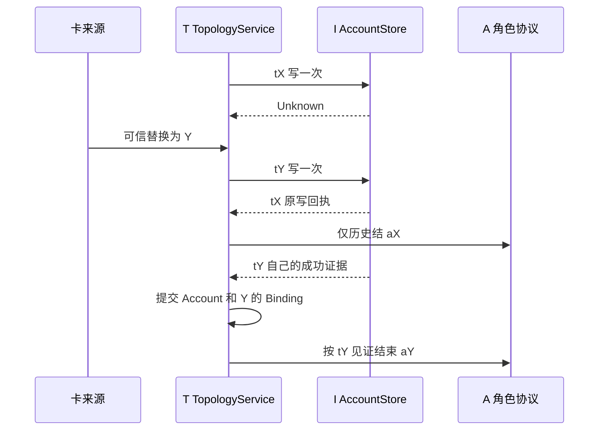
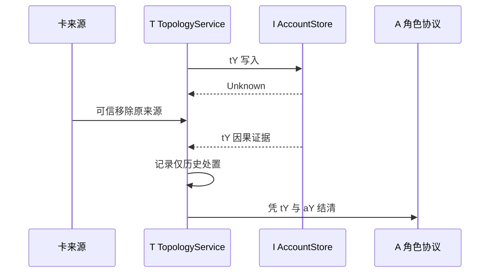
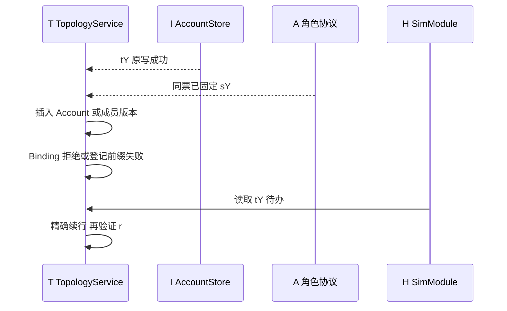
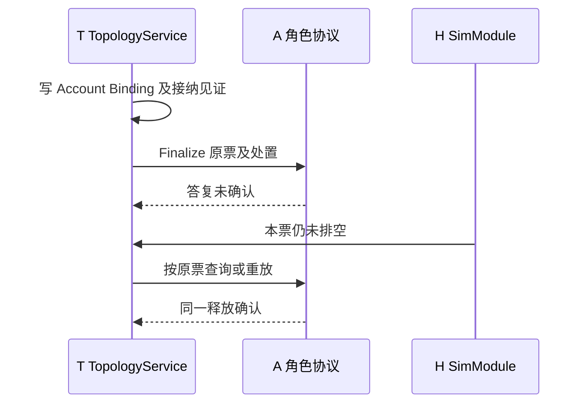
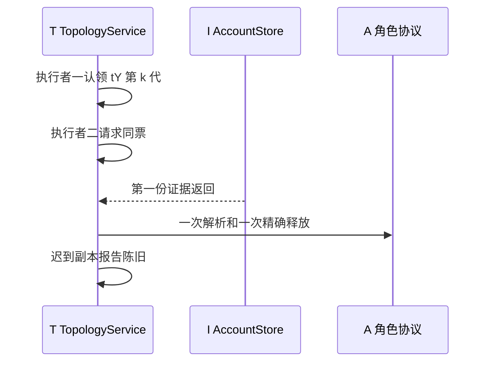
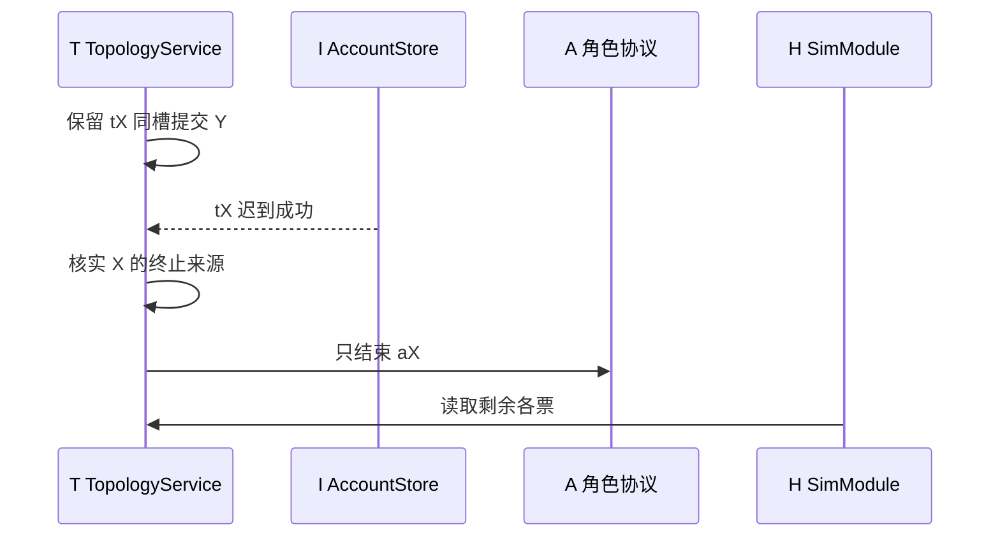
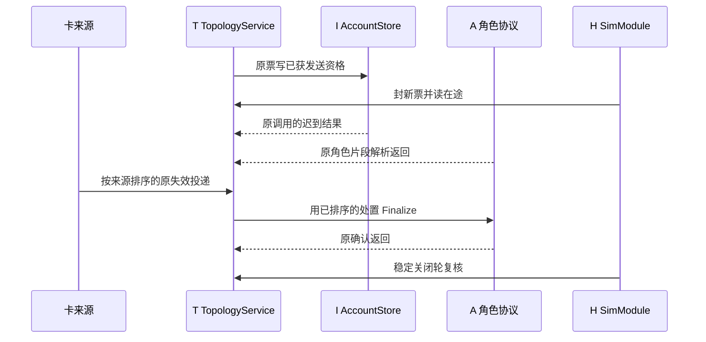

# AF1-Gate-B1 账户发现与 Binding 接纳独立架构审查

## 1. 执行摘要

**推荐结论为 `B1_REVIEW_NEEDS_REVISION`。建议退回 T/A 负责人修订 Part 23，再提交独立复核。**

对 Part 22 的最小输入，Part 23 已排除原来的错误终态：Y 持续有效、原写有充分证据时，T 必须取得 Y 的 Account/Binding 接纳见证，或继续为欠缺的步骤出据。旧票 X 只在可信终止后才可仅结历史，在 A 的释放答复返回前 T 仍负责任。这些条件可以保留。

签收尚缺两条可检验的证明。第一，当前 Account 插入还包含两个视图的成员版本更新。任一步失败都可能留下可读的前缀，Part 23 没有把这些写点、Binding 和见证落实到一种在失败后仍成立的提交协议。第二，原写 Unknown 后，现有读口在“本票写成”和“另一写者留下相同行”两种历史中可以给出完全相同的输出。提案能安全保留 Unknown，但还没有定义 T 可接收的充分证据及其交付入口。另需收紧释放确认回收、装配写点以及 Stop 与已登记调用的排序。七个场景均为静态推演。H3 仍为 `H3_REVIEW_BLOCKED`，AF-1 仍为 `AF1_HARDENING_H1_H2_PARTIAL`。

## 2. 审查基线与证据边界

|证据|实际版本及复核方法|
|---|---|
|本地与远端|根目录 `/mnt/e/github/multisim`，分支 main。HEAD 和只读 ls-remote 查得的 origin/main 均为 `d9c2d23dce7148df1fc474ce598fb1cff55b839d`。开始时工作区、暂存区无已跟踪改动，已有未跟踪 default.profraw、opencode.json。|
|源码审查 SHA|取 `632f6a2a888cfbbc3c9387edc89732364e12a10e` 的 T2 源码为参照，实际读当前检出文件。该提交与 HEAD 的整个 services/multisim Git 树对象同为 `e7986b29585d50da05198e773bf6a2e3eb0f9828`，包含 Target、测试及 Host bridge。另查 HEAD 的 Legacy SimRdbHelper 了解桥下语义。|
|Part 22 与 23|两节均由 `d9c2d23dce7148df1fc474ce598fb1cff55b839d` 首次入库，分别用 git log -S 核验。其父 `7a414c4e3c536ee67361095b5076614fa9444685` 到 HEAD 仅改 AF-1 检查点。Part 22 记录的审查输入是该父提交加本地未提交的 Part 20/21，其输入文档 SHA-256 为 `b2c75d47770434fc83f063fc338353f6c72b66525e1978195449600fcad9d9b7`；Part 23 同样以该父提交为源码环境，加本地已有 Part 22。本轮检查点 Git blob 为 `a07e9708e09b634fd69038d6ccdf5d66ce77a199`。不存在独立的 Part 22 代码提交。|
|历史 T1 Host|输入 `be63ae1249db5927a216602aceb0346db6d53a09`，实现和报告归档 `5796fce68dfcc2ea152106b7ab65c217c63557ad`。报告 §4、§7 记录 Target 14/14、Provider 3/3，覆盖原写、重复观察、失效与读回。|
|历史 T2 Host|输入 `5796fce68dfcc2ea152106b7ab65c217c63557ad`，实现和报告归档 `632f6a2a888cfbbc3c9387edc89732364e12a10e`。报告 §5–7 记录专项 11/11、桥 6/6，聚合架构命令因 canonical digest 为 FAIL。入库 SHA 用于定位该批代码，未将报告所写的输入 SHA 冒充运行后代码的单独构建证明。|
|历史关闭 Host|Host_Lifecycle_L3_Report §5、§5.1 的 L3.1 输入 `da99dd1a4b28f9eb8ac01fe0e55b8f4aac651866`，修复/归档 `befd76d4eba73ade9552248c303e3d6f8427c8ce`。§6.1 起的 L3.2 输入为后者，归档于 `be63ae1249db5927a216602aceb0346db6d53a09`。其 Primary 和 Legacy/Core 关闭证据分别属于各自切片。|
|本轮|运行只读 check_structure.py，返回 PASS（94 文件、166 include、25 targets，仅文本结构）。业务 Host / sanitizer 为 **NOT_RUN**；本次查源码和归档断言，Part 23 的票据、恢复及 M19 新契约尚无对应完整实现。无 PRODUCT / DEVICE 验证。|

文档输入为本地检查点 Part 19 的交接、§20.1、§21.1–21.2、§22.2、§23.1–23.5、§15.3 与取代 §10.1 的 §13.2，以及第 10 节列出的 A/B/C/D。归档原文可核对各批次的覆盖和限制。[AF-1 检查点](../../AF1_Architecture_Design_Convergence_20261123.md) · [T1 Host 报告](../../../services/multisim/test/docs/T1_Account_Discovery_Host_Report_20261123.md) · [T2 Host 报告](../../../services/multisim/test/docs/T2_Account_Recovery_Reload_Host_Report_20261123.md) · [关闭 Host 报告](../../../services/multisim/test/docs/Host_Lifecycle_L3_Report_20261120.md)

## 3. Part 23 的设计及其适用条件

T 在外部写前登记原票。位置索引可以随卡变化，票内的原观察、预期位置版本、账户字段、角色片段和原调用仍可寻址。原效果确认后，A 在原预留上解析实际身份，T 在自己的提交域决定是否发布当前 Account 和 Binding。可信终止、当前接纳、确认未写是三种不同的释放依据。未知、内部接纳失败、释放确认未返均有原票承担。此模型只覆盖原实例留存期间，持久事务日志和跨进程恢复均无设计承诺。

独立判读分三个问题：给齐证据时有无正确后置条件；在具体接口上能否区分两种合法输入；任一子步失败后能否仍从对象状态重建见证。第一个问题在 §22.2 的最小输入上得到肯定答案，后两项决定本次退回范围。

## 4. 源码现状与关键调用链

除特别注明外，下列定位均相对 `telephony_core_service/services/multisim/`。S1–S9 是本报告后文引用的源码位置，D 表示本地设计约束，所有交错的错误结果均为推论。

|索引|SOURCE 写点、读点与真实执行顺序|
|---|---|
|S1 卡源与索引|`card/runtime/card_runtime.cpp:34–54`，CardRuntime 先同步传旧 Session 和递增序号给 T，再撤 R 会话、发布新会话/发现。T 的 `account/discovery/discovery_observation_ledger.{h,cpp}`（h:29–62，cpp:31–105,106–164）以 slot/application 为 accepted_ 键；activeIccids_ 的值也是位置，BeginStore 按 ++nextAdmission_ 签票。序号增量可替换 Entry，同 ICCID、同位置可通过该位置的占用检查。|
|S2 正常写与返回|`account/topology_service.h:49–100`、`.cpp:59–185`。观察 → BeginStore → 锁外 Match → 已匹配订阅的跨槽检查 → 锁外 A.Prepare / StillOwns → T 检查观察/位置版本 → 唯一 WriteDiscoveredAccount。已知成功先 A.Accept，再取 T 锁，有需要先插 Account，再 CompleteStored/AcceptBinding；直接分支忽略 Finalize 的返回。Unknown 在写返回后按位置 insert_or_assign PendingDiscovery。|
|S3 恢复|`account/topology_service.cpp:188–240`。按位置复制 pending，比 epoch/slot/application/generation/ICCID，未比较原 admission 和观察序号。锁外 Match → A.StillOwns/Accept → T 查/插 Account（可能用一行生成两个视图）→ 忽略 ReconcileStored 的结果 → A.Finalize({true,ConfirmedApplied,true}) → 按位置 erase。第三个 true 是 projectionsAcceptedOrReconciled。ReconcileStored 恒不报告 bindingAccepted。|
|S4 账户与绑定|`account/account_registry.h:30–46,66`、`.cpp:47–92,262–329`。AcceptDiscoveredAccount 查身份、复制投影、处理 retired revision，emplace 账户，再写 Current/Historical 的 membershipVersions_ 和时钟；BeginReload/AcceptReload 使用这些水位。`account/binding_index.h:31–49`、`.cpp:30–94` 的 AcceptBinding 检查装配、期望版本、跨槽唯一性、防回绕；新关系升版，同槽同订阅在水位匹配时不升版；RemoveBinding 留空位水位。|
|S5 A 的真实职责|`account/account_role_planning_port.h:37–42`、`role_assignment/assignment_service.cpp:666–685` 在 A 的 primaryCommitLock_ 内调用 `role_assignment/account_role_protocol.h:28–96,100–123`。Prepare 占订阅或槽，AcceptDiscovered 写 resolvedIdentity，未发布角色缓存；Finalize 用原 plan 和 `role_assignment/assignment_requests.h:97–105` 的简单证据判断并删 token。Reload 另有读源及版本。|
|S6 存储边界|`account/account_store.h:32–77,94–95`、`account/account_store_adapter.cpp:38–46` 委托 `test/framework/internal/host/primary/legacy_account_store_provider.cpp:22–37,58–104`。桥只调一次 Update/Insert，随后按 ICCID 读，result > 0 且字段符合才报 Applied，否则 Unknown。Match 只回读账户字段；没有原操作序号、角色列或 isEsim 的核对证明。Legacy `telephony_core_service/services/sim/src/sim_rdb_helper.cpp:350–365,425–462,541–554` 的 InsertData 未填输出 id，按 ICCID 查询遍历行，Update 按 ICCID 谓词。不能据此推定产品端有逐操作回执或写者独占。|
|S7 读者与另一路写入|`account/topology_service.cpp:31–32,46–56,242–271,289–315,317–340`。FindBinding、ReadAccount、ReadPrimaryTarget 及 T 的 reload 接纳受 commitLock_ 保护。AcceptSlotAssembly 直接写 BindingIndex 的装配位。公开 AcceptStoredDiscovery 自签票、先插账户再 CompleteStored，未经过 A 的预留，已定位调用者为 C0/B Host 夹具（如 c0_topology_integration_test.cpp:160），没有据此认定产品旁路已启用。|
|S8 关闭|`infrastructure/assembly/sim_module_factory.cpp:24–39` 注入同一 epoch 并绑定角色/卡出口。`sim_module.h:53` 仅声明模块级 Stop。`infrastructure/assembly/primary_host_lifecycle.cpp:15–74` 先封 A/Scheduler/Radio，再查 Owner callbacks、scheduler.pending/running、DeviceResourcesDrained 和 HasPendingDeviceEffects；无 T 票、A 发现预留或模块级 M19 清单输入。|
|S9 守卫与用例|`test/framework/internal/host/BUILD.gn:68,152` 接入 C0 用例和桥；`test/cases/architecture/check_structure.py:534–548` 校验文本结构；`test/cases/architecture/topology_rules.cpp:153–184` 验旧票不可绑定、重复完成、Unknown 不重写和已知无效果可另尝试。角色前后两种版本交错与恢复断言见 `test/cases/target/primary/c0_topology_integration_test.cpp:302–315,337–372,404–424`。失效例仍期待可读 Current，持续有效例只验 Reconcile 返回 true。桥负例见 `test/cases/internal/shutdown_test.cpp:135,157`；关闭并发及回调见 `test/cases/target/primary/b_async_primary_test.cpp:622–657,680–706,734–751`。|

## 5. 七项核心审查结果

|编号与设计要求|源码事实|静态正向验证|反例、判读与修改要求|
|---|---|---|---|
|B1-01 原票独立生存|S1–S3 现有 T 表按位置覆盖，冲突索引以位置为持有人；同票重试及新票都用实例内计数。S8 接受外传 epoch。|§20.1、§21.1、§23.2 合读已给出 T 内按 (epoch,admission) 保留多票、每次核对有认领代次、终局确认才按票删除。不同已匹配订阅的 X/Y 可同槽各持 A token。|**设计主体成立，需收紧边界。** 同 ICCID 不同槽应在发写前拒绝或延后；同位置再见相同 ICCID 也不可把旧持有人认作新票。H 按 A 文档的 runtimeEpoch 约束隔离重建；T/A 票号、认领代次、token 耗尽须拒绝，活票不可覆盖。明确最初 Prepare 返回丢失或冲突时是未受理还是有待续行项。见 R4、R5。|
|B1-02 原写与行有因果关联|S6 的原同步返回与写调用可配对；过后再次 Match 的载荷没有写来源。S3 却可据匹配行推进。|给 t 一个带原调用归属、实际订阅和完整字段结果的回执，可以推进；明确未写且已返可结无效果，查不到行或只读到同值保持 Unknown。|**证据入口待修订。** 前值已是目标值，t 写失败；或外部作者写成同值。两种读取输出与 t 成功完全相同。Part 23 的否定条件正确，不能由 Match 提供其正向输入。补证据来源/能力及持久 Unknown 分支；不能把 Host 替身直接填入 Applied 当作 provider 验证。见 R2。|
|B1-03 当前 Account 与 Binding 同属 T|S2、S3、S4。在恢复链即使 Account 已插入，仍可不经 AcceptBinding 释放预留删票；CompleteStored 首次处理 Unknown 后再进会命中 duplicate。另一入口见 S7。|§23.2 要求三选一，§22.2 的“空槽仍当前却释放”已被后置条件排除。空槽 r→r+1，仅凭本票见证重放。同来源既存关系保持 r。|**后置条件成立，提交证明不充分。** Account 可只有 Historical，或同订阅的 ICCID 已不同；原 BindingRef 缺来源。逐一检查 Current 读源及身份双向映射。发现冲突保留原票，禁止改用新版或删除他人关系。把 AcceptStoredDiscovery 纳入同一规则或限定其仅作夹具。见 R1、R5。|
|B1-04 失效与来源连续性|S1 的 StillCurrent 精确比序号，AcceptInvalidation 检会话；S7 中会话失效与 RemoveBinding 是不同入口。|§21.2/§23.3 正确区分可信拔出/换卡、无关应用刷新、来源暂停；提交前撤销只结历史，提交后凭见证收尾。旧 X 的 Store 证据不能建立 Y。|**原则成立，交付边界需明确。** 同一真实卡同一 Session 的更新序号使旧等值检查失败；仅凭序号不能判定永久拔卡。关监视或已入队撤销尚未排序时保留待证，需指明晚到资格如何重新确认、关闭输入何时静止。见 R3、R5。|
|B1-05 部分成功可续行|S4 的账户、成员版本表、Binding 是不同状态。S7 普通读者取 T 锁；装配入口无此锁。S2 的正常路径还丢弃 Finalize 返回值。|§23.3 把 A 身份确认放在 T 当前发布前；已取得 Binding 见证后只需补释放，无须跨 Owner 锁。|**必须修订。** 仅预检业务条件不能排除容器复制/分配失败，部分已发布时按“有账户”跳过也不能修复成员水位。须选择带故障保证的本地提交，或明确可恢复的逐步发布。见场景三、R1。|
|B1-06 A 的严格幂等|S5 的未预知订阅 plan 可在同 token 上再次写另一 resolvedIdentity；Finalize 成功后原项消失，重放与错票均可得 false。首次 resolve 前的 roleRevision 检查不同于成功后的 StillOwns。|§23.3 已要求身份一次固定，绑定 t/token/处置的释放确认可重读，T 消费前须保留。历史清理不要求恢复现行角色资格。|**语义可行，恢复通路待定。** 若 reload 在未解析前改变 revision，原 token 仍存在而原 Accept 可一直拒绝；同一 reload 在解析后不会推翻已固定身份。明确等待、只核对原字段或有证据的终止理由；不能把未解析变已解析。补确认丢失后的查询、消费及安全回收约束。见 R4。|
|B1-07 关闭责任逐项可见|S8 的 Drained 只覆盖 Primary 切片。S2 在 Store 阻塞时还未把该调用写入 pendingDiscoveries_。|§23.2 已要求逐 t、逐字段、逐 token 及未返执行体出据，等待 Finalize 答复时 T 有 Release 责任。H 只汇总。|**模块契约需补可观测排序点。** 先登记“即将发”再遇 Stop，必须有确定的发送权归属；已入队的撤销与后来获锁的 T 续行之间也需来源/交付屏障。两个 Owner 先后读空不等于同一关闭轮全图稳定。见 R3。|

## 6. 七个反例的逐步推演

图描述拟议协议的检查截面。表中的 tX/tY 是 T 原票，aX/aY 是 A 原预留；r 为该槽原水位，Y₁ 表示 (sY,slot,r+1)。表内“已写”均指对该票有充分因果证据。Account 列记录 T 接纳的视图，不代表 provider 行。以下均为 DESIGN/SOURCE，未报告运行复现。

### 6.1 X 迟到，Y 始终有效

|时刻|原票状态|当前观察|Store 效果|Account|Binding|A 预留|责任 Owner|
|---|---|---|---|---|---|---|---|
|T0 X 签票|tX 准备|X|未发|空|空 r|准备 aX|T/A|
|T1 发 X|tX 在途|X|X 调用中|空|空 r|aX|T/I、A|
|T2 返回|tX 待证|X|X Unknown|空|空 r|aX|T/A|
|T3 可信替换|tX 留存，tY 准备|Y|X Unknown|空|空 r|aX/aY|卡源、T/A|
|T4 Y 有效且已发写|tX、tY 独立|Y|X/Y 均可未知|空|空 r|aX/aY|T/A|
|T5 X 回执|tX 待历史确认；tY 待证|Y|X 已写；Y 未明|无新增|空 r|aX/aY|T 判 X 处置|
|T6 X 交还|只剩 tY|Y|X 历史已结|无新增|空 r|aY|T/A|
|T7 Y 的证据到达|tY 提交、确认后回收|Y|Y 已写|Current Y|Y₁|aY 释放一次|T 提交、A 确认|

两张票预置不同已匹配订阅。只交付 X 回执时，T7 不能发生；补给 Y 自己的可靠证据后才可建立一次 Y₁。若 X/Y 都是尚无订阅的新卡，A 按槽互斥，不能预设第二次写已经受理。应给拒绝或待重试一个明确归属，写计数与两张已发票的分支分开。S1–S6；R2、R4。

### 6.2 Y 在核对期间失效

|时刻|原票状态|当前观察|Store 效果|Account|Binding|A 预留|责任 Owner|
|---|---|---|---|---|---|---|---|
|T0 发现|tY 签发|Y|未发|无新 Current|空 r|准备|T|
|T1 发写|tY 在途|Y|执行中|同前|空 r|aY|T/A、I|
|T2 原调用交还|tY 待证|Y|Unknown|同前|空 r|aY|T/A|
|T3 可信终止|tY 待原效果|失效|Unknown|无权新增|空 r|aY|卡源、T|
|T4 原写回执|tY 仅历史待确认|失效|已写|不新增 Current|仍空|仅 aY|T/A|
|T5 释放已确认且执行体交还|回收 tY|失效|历史已结|已有各视图按自身读源|仍空|清 aY|T/A|

若 T3 只是暂时失联，T4 只能标“效果已知、资格待证”，T5 不可达。若已有新关系则全程保持该关系的版本；后继 token 不受影响。现行 S3 可在此处补造 Current，S9 的旧断言须保留作兼容差分。R3、R5。

### 6.3 Account 成功，Binding 失败

|时刻|原票状态|当前观察|Store 效果|Account|Binding|A 预留|责任 Owner|
|---|---|---|---|---|---|---|---|
|T0 确认效果|tY 业务待办|Y|已写|无|空 r|aY|T/A|
|T1 解析身份|tY 待 T 提交|Y|已写|无|空 r|aY 固定 sY|T|
|T2 当前代码式前缀|tY 应记前缀|Y|已写|已有 Y；视图水位可能未全|空 r|aY|T|
|T3 Binding 拒绝|必须保留 tY|Y|已写|保留有来源的前缀|空 r|不能释放|T/A|
|T4 两次 Reconcile|一个认领；另一个退出|Y|不得重写|不得重插或覆盖新字段|空 r|仍是 aY|T|
|T5 修复或终止|补齐见证后才待释放|Y 或可信替换|已写|验证身份及两视图水位|原资格仍在才建 Y₁|凭终局释放|T 后 A|

可达的正常失败：空槽目录存在但未装配，BeginStore 只读位置水位；也可在预查之后发生其他槽占用。异常反例是 accounts_.emplace 成功后 membershipVersions_ 分配失败，锁展开后 Current 可读，旧 reload 可能使用未更新的水位。Part 23 已要求准备充分，却没有给出覆盖所有变更的准备单元。对新增提交采取强保证后 T2/T3 应观测不到新 Current；对已有前缀则须验证如何修复。S1、S2、S4、S7；R1。

### 6.4 Binding 成功，A Finalize 答复未知

|时刻|原票状态|当前观察|Store 效果|Account|Binding|A 预留|责任 Owner|
|---|---|---|---|---|---|---|---|
|T0 准备 Account|tY 提交中|Y|已写|合格 Y|空 r|aY 已解析|T|
|T1/T2 T 发布|tY 有见证|Y|已写|Current Y|Y₁|aY|T|
|T3 Finalize 已发|tY 等 aY 回执|Y|已写|Y|Y₁|执行中|T/A|
|T4 答复未知|tY 留存|Y|已写|Y|Y₁|可能仍持有，也可能已释放并留回执|A 出证、T 核对|
|T5 Stop|tY/待确认或在途|Y 或来源暂停|已写|Y|无额外升版|依真实状态出据|H 保图|
|T6 原确认到达且调用退出|仅清 tY|可已换卡|历史处置固定|不再写|仍 Y₁ 或合法后继|仅一次释放|T/A|

原接口同步 bool，T4 是答复未交还/未知的协议注入，不是源码具备 Unknown 返回类型。不得为找回确认重建或删除 Binding。S2、S5、S8；R4。

### 6.5 同票并发 Reconcile

|时刻|原票状态|当前观察|Store 效果|Account|Binding|A 预留|责任 Owner|
|---|---|---|---|---|---|---|---|
|T0 两执行者均看见票|tY 待证|Y|Unknown|无|空 r|aY|T|
|T1 一方认领 k|tY/k 在途|Y|核对中|无|空 r|aY|T|
|T2 第二方请求|返回进行中或只读结果|Y|不产生第二次写|无|空 r|aY|T|
|T3 有效答复|tY/k 验证并提交|Y|已写|一次 Current|一次 Y₁|固定一次|T/A|
|T4 释放确认后晚到副本|票已收回，副本陈旧|Y|同前|不改|不升版|不重复释放|T/A|

S3 只在锁内复制 pending，两人可同时进入 A.Accept，第二个 Finalize 的 false 含义不明；若第一人最后按位置删，还可能删除后来者。提案的单执行者原则可用，代次须在进锁时认领、锁外结果返回后比较，不凭超时抢占已交出的副作用。R4、R5。

### 6.6 Y 已绑定，X 的成功证据随后返回

|时刻|原票状态|当前观察|Store 效果|Account|Binding|A 预留|责任 Owner|
|---|---|---|---|---|---|---|---|
|T0 Y 已取得关系|tX 未决，tY 可待释放|Y|X Unknown；Y 已写|Current Y|Y₁|aX，aY 或其确认|T/A|
|T1 X 回包|按 tX 查原来源|Y|X 已写|不变|Y₁|不动 aY|T|
|T2 有可信替换|tX 仅历史|Y|X 历史已核实|不覆盖两视图|Y₁|Finalize X|T/A|
|T3 X 确认/重复到达|tX 可回收；tY 独立|Y|两笔归因分别确定|不变|Y₁|只释放 aX 一次|T/A|

若只知旧版本不相同而拿不出来源终止证据，T2 留 tX，仍不得改 Y。S1/S3 的按位置 erase 可被锁外慢读放大；目标按票删除能隔离该交错。R3、R5。

### 6.7 Stop 与原票续行

|时刻|原票状态|当前观察|Store 效果|Account|Binding|A 预留|责任 Owner|
|---|---|---|---|---|---|---|---|
|T0 登记后、进 I 前封口|tY 发送权须已确定|Y|未交出或获准在途|无|空 r|aY|T/H|
|T1a 先 Stop 后原 Store 返回|tY 在途→待证|Y/待证|执行中→Unknown|不变|空 r|aY|T/I|
|T1b 先返回后 Stop|tY 已在待证或待接纳|Y|Unknown 或已知|不变|空 r|aY|T/H|
|T2 Closing 中 A.Accept 返回|tY 回 T 排序|失效可能在投递|已写|待验证|空 r|aY 已解析|R·card/T/A|
|T3a 失效先行或监视已撤|历史待释放或待证|可信终止或未知|已写|不新建|空 r|按处置|T|
|T3b 原业务已提交后 Stop|tY 待确认|Y 曾合格|已写|已有 Y|Y₁|仍持或释放中|T/A|
|T4 Finalize 返回|同票确认；等未返交付|可已换卡|已写|不重投|不重建|确认可重取|T/A|
|T5 Stop 后旧证据到达|只送原 epoch/票，已结则陈旧|不授新资格|仅补原存储证据|不凭设备回包写账户|不跨票升版|只动原 token|来源 Owner/T/H|

T1a、T1b、T3a、T3b 是不同顺序。原设备证据只归相应设备责任，不能证明某次 Store 写。重复 Stop 不重发 Store、Accept 或通知。S8 可以报告该 Primary 切片已空，不能外推 B1 已清。R3、R4。

## 7. 对象关系与接口契约

T 组合持有 AccountRegistry、BindingIndex 和当前观察台账，拟在同一 TopologyService 管原票表。票与当前位置是按来源和版本的**引用**，位置替换不结束票。票拥有原计划、原调用分项效果、认领代次和 T 的处置见证。账户关联订阅及 ICCID，Current/Historical 是独立读源；Binding 是带位置水位和来源的当前关系。A 组合持有角色预留，票只引用原 token。A 的 Finalize Receipt 是对特定释放的确认值，T 收到后记入原票；OwnerCloseReceipt 则是各 Owner 在某关闭轮对未完事项的只读投影。H 汇总各投影。O/Device/C 不拥有发现写、票或角色预留，R·card 提供会话来源。S1–S8；D §21.1–21.2、§23.2–23.3。

下表中的“须”是修改要求或目标约束。T 锁与 A 锁分别只保护各自的短提交；所有外部调用、等待和确认传递均在相应锁外。

|接口、调用者 → 提供者|输入身份、前置条件|写入对象及权限|返回、幂等与失败|并发、寿命及调用方后续责任|
|---|---|---|---|---|
|PrepareAccountRoleFragment，T → A（S2/S5）|现收可空已有订阅、槽和单槽角色规则；须关联已签的 t、原计划输入及 epoch，封口前获准|只有 A 可登记 token、原角色版本及槽/身份占用|当前 optional plan，重复会遇占用。须能区分同票重取、异票冲突、确认未领；未知返回不能另发一份|A 域决策，T 在外调用并登记在途；T 收回计划后复核当前资格，未发写但已领 token 走原票无效果清理|
|AcceptDiscoveredRoleProjection，T → A（S5）|t、token、原 plan、经证实的 s；A 检查原资格、原版本或已有解析见证|只许 A 一次固定本票 resolvedIdentity；无当前角色写/通知|同身份返原肯定，异身份拒绝；原 bool 缺票、拒绝原因及已固定值|锁外调用，A 域线性化；T 收回后仍需在自己的写点复核，拒绝时留 t 并区分版本变动前后|
|FinalizeInitialRoleReservation，T → A（S5）|t、token、完整原 plan、调用已返回、已知字段效果和有类型的终局见证|仅 A 改原占用及该释放确认；T 不能代释放|当前 bool+三字段不能区分待证、已释放、异票。须支持同处置返回同一确认，冲突拒绝，未确认可重取；不得由 token 缺席推断成功|A 释放与记确认须具备同一故障保证；T 等答复、记录消费、等交付退出后回收，A 其后方可回收确认|
|CompleteStored，T Service → T ledger（S1/S2）|原票、effects、实际身份、callFinished、BindingIndex 和 allowBinding；当前建关系还需合格来源及 A 解析|现在改 Entry，条件成立时调用 T 的 BindingIndex；提案要求效果先记逐票表|现三布尔表示 bindingAccepted/needsFieldReconciliation/duplicate。Unknown 后重复会短路；不能复用 duplicate 作完整接纳|T 域处理一次返回；Service 必须把已确认写转到同一业务接纳入口，未决或失败留票|
|ReconcileStored，T Service → T ledger（S1/S3）|当前按位置+admission 对照，目标须用独立原票、认领代次及可归因结果|只许记录效果、条件解除本票的 ICCID 占用；无权单独声明业务完成|SOURCE 恒无 bindingAccepted，旧 admission 可回 duplicate；确认成功仅完成效果维度|T 域内比较并记；Service 不能忽略不匹配，不可因新位置不存在而丢掉历史工作|
|ReconcileDiscovery，原回包/受控续行 → T（S3）|从 observation 改为 t；锁内取原 plan/阶段，证据只针对该次写及原目标|T 是原票和 Account/Binding 唯一写者；向 A 请求其自有步骤|返回至少区分未知、内部待办、当时已接纳、仅历史、陈旧及仍欠释放的阶段；不同合法终态不能都作“当前成功”|单一认领，锁外读/调 A，回锁验阶段。证据或可恢复条件到达时 T 续原步骤；Closing 允许原票归账。交付者持同 epoch 生命周期引用至交还|
|BindingIndex::AcceptBinding，T 提交者 → T 索引（S4/S7）|slot、s、预期 r；调用方还须验证原观察、Current、身份、来源及 A 见证|只改该槽关系与水位，跨槽占用先拒绝|当前 bool。空位成功得 r+1，既存同来源得 r；事后仅能凭同票结果见证重放。装配、冲突、耗尽等失败不能覆盖|原写、可信撤销、见证和对业务读者的可见性须有同域顺序；T 返回前留下继续点或终局。装配若可运行期写，须进入该域|
|Stop / Drain / OwnerCloseReceipt，宿主 → H → 各 Owner（S8）|原实例 epoch、已封新准入的关闭轮、各源在途及原票集合|Owner 只出自身事项，H 读清单、保留或销毁图|稳定轮中全体为空或获准逐项移交且执行体已返回才可 Drained；缺来源、Unknown、未确认均可重复读未完成原因|封口与发送权授予排序。保留旧票唯一续行者和晚到证据路由，拒绝新发现写；重复 Stop 只读同轮结果。Primary 切片返回值不得提升为模块结论|

## 8. 必须修改的设计问题

|编号、级别与责任方|具体修订|可检验的验收条件|
|---|---|---|
|R1 · **P0** · T，本地提交与前缀|在 §23.3 选定一种可实现策略。推荐在 T 域内预备包含 Account、两视图成员水位、所需来源及票内见证的候选变更；预检装配、跨槽占用、水位及容量，在发布点只执行已证明不会失败的替换/赋值。另一可行方案是先在 t 记可恢复前缀，再逐步发布；须规定每个读口对半成品的可见性及原身份重验。不得靠两次成功 bool 拼接事务。|对复制字符串、账户节点、Current/Historical 成员节点、Binding 及见证落位分别注入失败或拒绝。持锁读者退出临界区后要么读到全部旧值，要么读到有来源、版本且 t 可恢复的精确前缀；两种路径都不能发布错误 PrimaryTarget。旧 reload 不能删新成员。重复续行只造成一次逻辑绑定。|
|R2 · **P0** · T/I，原写证据入口|明确可输入的原调用确认值、来源能力与字段掩码。例：原调用可验证的延迟完成，携原调用关联和实际提交身份；若采用读回，须证明原写结果、目标唯一性、相应字段及排除中间写者所需的版本/写者约束。两种都无支持时记能力缺失，只保留 Unknown，T 在途/核对收据向上可见。全未写、全生效、已知混合前缀分别处理；混合前缀没有获准处置则留票。|输入等值前态、失败后别人写成同值、相同 ICCID 多个候选身份、角色列证据缺失四种读回均不能结账。另给一份真实可区分的原调用证据，演算 tY 能继续；错票、缺字段即拒绝。Host 可验证证据消费与拒绝，产品能否产生这种证据独立标 OPEN。|
|R3 · **P0** · H/T/卡来源，关闭截面|明确“发送资格已授予”与“准备中未发”的排序点；Stop 在前不再授新写权，Stop 在后可完成已登记的原交出。将已领取但未排完的观察/撤销投递列入关闭轮，给源封口/连续性失证一个 T 可检查的信号；定义各 Owner 收据与在途登记的稳定条件，例如所有新生产者先封、跨域投递先登记、源确认排空后再核对最后一轮。|在登票前后、原写入口前、R 撤销已入队、A Accept/Finalize 返回前后暂停取据。封口前已获权的写恰一次，未获权写数零；有待处理撤销不能用旧快照发布当前关系。有任一未返/未决项 H 必须保图。观察/效果不再可证时能报告未完成。|
|R4 · **P1** · A/T，预留与确认恢复|规定 (epoch,t,token,原 plan) 的身份和决策结果。区分准备已领未返、首次固定身份前的角色版本失配、已固定后的无关 reload、已释放待 T 消费。指定谁发起精确查证、何据可清历史预留、确认何时无在途重放可回收。永久版本失配应有明确处置或有理由的待证结果，不得忙等或凭旧 plan 发新角色写。|两次同票 Prepare/Accept、异身份重复 Accept、异处置 Finalize、实际释放后丢一次答复、回收后迟到，均可给出唯一结果。锁外 A 调用中断仍能按 t 定位；同订阅/同槽的不同票不能领对方 token。首次解析前后分别注入不相关 reload。|
|R5 · **P1** · T/H，来源与入口约束|规定同位/异位同 ICCID 占用按 t 比较释放；epoch、admission、认领代次等耗尽拒绝。明确同一来源序号推进的连续性证据，已阻塞或尚未受理的第二个发现如何获知结果。将 AcceptStoredDiscovery 限定为受控测试建境，或要求带原票走同一 T/A 协议。AcceptSlotAssembly 限定发布前单线程，或由 T 同域排序。|复用 epoch 的负例、同 ICCID 同槽换代和异槽同时申请、可信重插、无证续监、夹具直接注入旧行均不能凭同值恢复资格；非受理票写数为零，不能要求其产生 Binding。列全能发布 Current/Binding 的正常入口与前置证据。|
|R6 · **P2** · Host 验证维护者，可观测性|在获实施授权后沿原用例边界记录 Store 调用数、t、token、认领代次、结果 BindingRef 及每次 M19 清单；保留原断言作兼容差分。|七个场景可由确定性闸点复现，不靠 sleep。报告区分旧例、目标契约、产品证据；测试装配与直接播种夹具分别列出。|

## 9. Part 23 分节修订要求

- **§23.1** 在现有恢复断点下补 S4 的成员版本写点、S6 的桥读回边界和 S7 的第二写入口，标出哪些仅见于 Host。
- **§23.2** 为准备、获得发送权、效果逐字段已知、业务前缀、待确认和已回收分别给出可查询 subject。补上“调用已结束但归因不足”“效果全明但只有部分字段生效”的样例。
- **§23.3** 落实 R1 的故障模型、R2 的证据输入、R3 的关闭排序与 R4 的确认消费。明确 A 成功后、T 真正写点之前的资格检查；锁外返回时用原票和步骤代次定位。图中给出“现有 Match 不能提升证据”及“当前接纳待办仍出据”两条返回。
- **§23.4** 加入账户已插入而成员水位更新失败、旧 reload 与恢复交错、同值不同写者、首次 A 解析前 reload、两人同票和关闭前后发送权这六类负控。X/Y 都未匹配订阅时另验槽预留冲突。
- **§23.5** 将“提供充分证据”分解为接口可验证的具体输入，将“同域完成”分解为可见性和错误恢复断言；把产品因果证据与 Host 逻辑见证分开验收。

## 10. 四篇权威文档影响

|文档|现有约束与同步位置|本次独立判断|
|---|---|---|
|A · SIM_Target_Architecture_Design_v1.2.md|§6.5.2 联合建行、连续位置版本，§14.3 逐项关闭；runtimeEpoch 表规定 H 分配实例令牌。批准后补来源消费、T 可见性及原调用归属。|Owner 边界相容。不得从提案推导出 provider 事务保证；Closing 停自主重试，原票的内部续行必须与新业务发写区分。|
|B · SIM_Multisim_Source_Architecture_Detailed_Design.md|§4.2、§5–7 明确窄端口、提交参与者与读者，§11 的 CloseObligation/OwnerCloseReceipt 列准备、内部接纳、待确认。|现有按位置 pending 无法满足逐票基数；逐项收据的权威原则支持改造，静态结构通过不能替代协议。|
|C · SIM重构代码目录结构设计方案.md|§4.1 Account 放原票和绑定关系，§4.3 Role Assignment 放资格/确认，§5.3 Assembly 汇总关闭。|现有物理分组足够。约束 AcceptStoredDiscovery 及注入寿命即可，不需增加协调器、全局身份或另一份业务状态。|
|D · migration/SIM_Architecture_Refactor_Design.md|§7.4、af1-acceptance 的 SC-01 / G2c、WU-04/07 行补稳定关闭轮、剩余内部步骤和原票收据的负控。|符合逐项签收。没有匹配产品 provider 能力和全部 writer 的证据时，不能移动生产写权。|

权威原文位置：[A 主设计](../../SIM_Target_Architecture_Design_v1.2.md) · [B 源码详细设计](../../SIM_Multisim_Source_Architecture_Detailed_Design.md) · [C 目录设计](../../SIM重构代码目录结构设计方案.md) · [D 迁移设计](../../migration/SIM_Architecture_Refactor_Design.md)。

## 11. Gate 结论

**`B1_REVIEW_NEEDS_REVISION`**。Part 23 在设计上已禁止 §22.2 的提前结票；当前接口和可见状态还不足以证明所有部分成功都满足这条约束。当前源码中能直接走通的错误路径已由 S2/S3 定位，不能把它直接算作拟议协议也允许的终态。R1–R5 可以在现有 Owner 边界内解决，因果证据持续不足时也有明确安全处置。现阶段不建议提交架构负责人签收。

## 12. 重新过 Gate 的条件

1. T/I 列出一对**读回完全相同、原写归属不同**的输入，证明均不会依据读回结清；再列一种可验证的原调用证据及其校验/拒绝接口。原适配器做不到时，明确保留哪个阶段及哪些字段。
2. 在一个持续有效的 Y 上，沿真实入口逐步列出四个可读量：Current 及成员水位、BindingRef、原票见证、A 资格。注入 R1 每个失败点，完整成功只可对应正确的 Y₁ 或原有的同来源绑定；其余均有可继续或有据终止的 t。
3. 移动同一条可信撤销到 T 提交点两侧，分别得到仅历史和先接纳再正常撤销。换成暂停、序号更新或停监时不得自动仅结历史。现有绑定、另一槽占用、同 ICCID 重插和身份冲突均不得被旧票覆盖。
4. 对 tX/tY 交换写返回/核对顺序，叠加同票双认领、A 版本变化及丢失一次释放答复。逐票统计写数、绑定升版、角色发布和实际释放。原 Store 每票最多一次，原资格释放最多一次，发现协议本身不重复发布角色。
5. 在所有“已登记但未交出、已交出未返、效果已知待业务、待 A 确认、源失效仍在投递”截面各取关闭收据。必须能给出挂起、归属和终局的证据，重复 Stop 不会再发外部效果。
6. 用 §6 的七组逐步状态表独立复推，R1–R5 各有确定的接口输入、提交点、拒绝/恢复出口。设计复核与后续 Host、PRODUCT/DEVICE 分栏登记；历史 PASS 不能关闭新增断言。

## 13. AF-2 后续实施影响

依检查点 §13.2，以下仅列后续受影响的工作。T 的工作项从准备起以原票寻址，当前观察另存；A 的端口持有冻结计划、解析身份及可追索的精确释放确认。Account/Binding 的变更必须先兑现 R1，才能把持续有效 Y 写入端到端成功条件。AF2-07(d) 的发现执行域要让可信失效能在慢 I/O 期间排序；AF2-02 的 Host 图要经过真实卡观察和 A 端口，分别验证直接写成功和 Unknown 恢复。AF2-05/06 的 Stop/Drain 验收须能枚举 T/A 原票、在途和拒绝移交后仍保留的责任。数据流测试按 R6 增补；现有 Primary、Legacy 与 provider 桥结果仍按原批次解释。实施、产品接线及正式批准各循原门禁。

