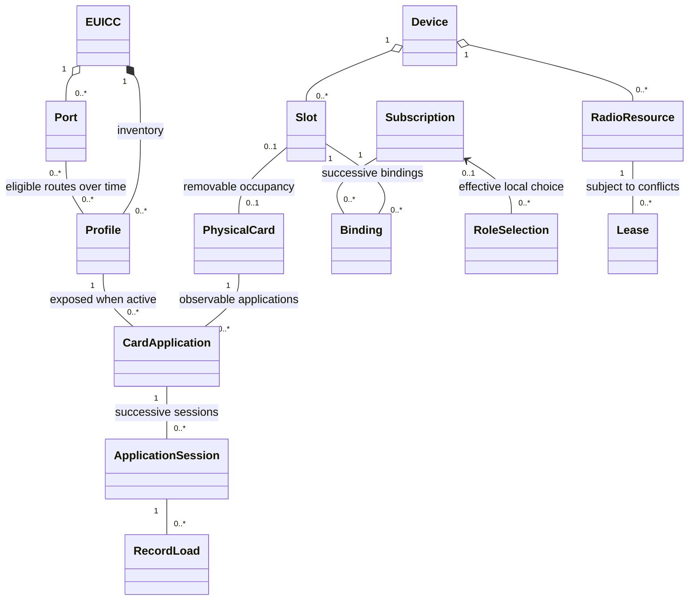
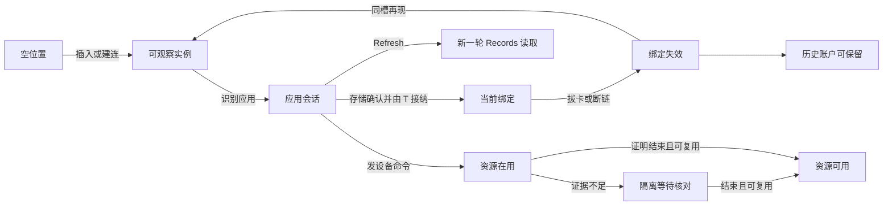
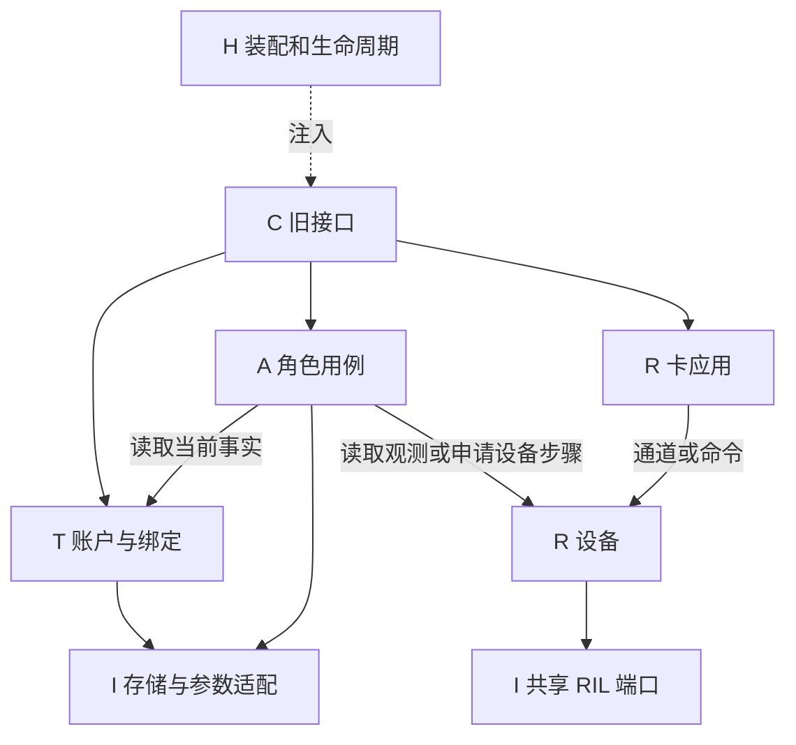
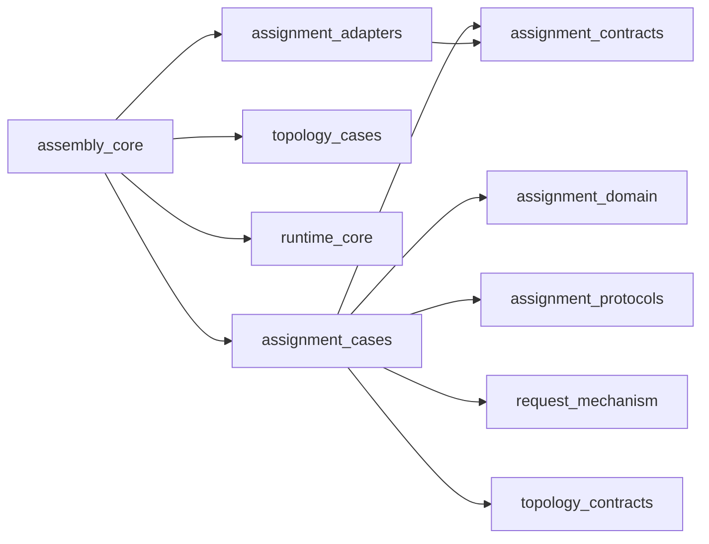
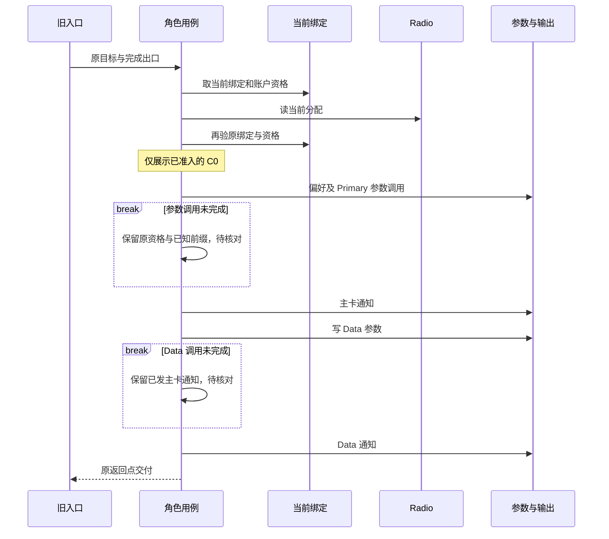
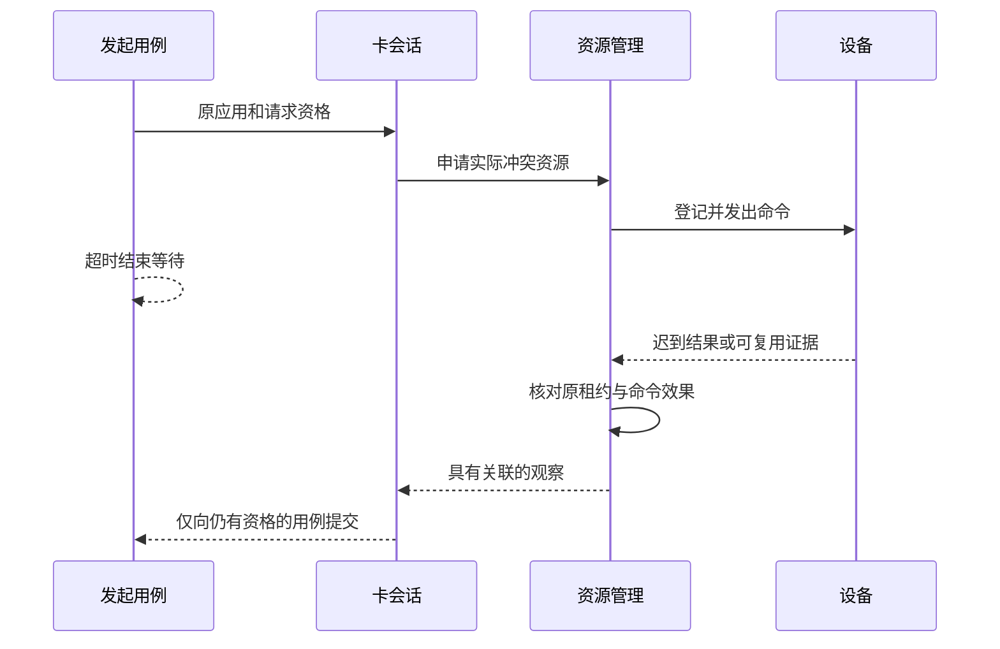

# SIM 多卡管理独立架构审查 · 2026-11-19

本报告记录一次设计取舍，供架构负责人复核。目标协议在[主设计](../../SIM_Target_Architecture_Design_v1.2.md)维护，类和依赖在[源码详细设计](../../SIM_Multisim_Source_Architecture_Detailed_Design.md)维护，执行结果查[唯一状态](../../SIM_Refactor_Execution_State.md#current-status)。以下建议均待批准。

## 结论

从零设计，我仍会让账户与绑定、角色选择、卡应用运行、设备资源分别拥有自己的事实。换卡后账户可以留存，设备命令也可能在调用者退出后继续执行。这两条可观察的生命周期差异，比目录数更能解释这些边界。已有系统最值得保留的是按目标选择入口，以及把业务选择、参数输出和设备证据分开。

我会改变两处实现要求。其一，Primary 的准入范围应覆盖本次操作真正共写的角色和参数。两个独立 Radio 域仍可能写同一套 Primary/Data 输出。其二，同步短路径应使用本地顺序代码，只在跨回调、可重试或需要保留未知效果处登记相应因果信息。保留原完成出口和核对记录。逐调用套一层步骤状态机引入新状态，却没有增加设备证据。

**推荐局部优化，不建议重划五组目录。** 最大风险是把 C0 的 Host 成功路径推广为全系统写入协议。端点资格、外部写者、资源回收和卸载都需要独立证据。两个业务域的方向没有发现根本性错误。下文的 P0 是启用相应写入或设备切片前的条件，其他切片可继续独立推进。

## 证据范围与复核入口

初始 main 为 `19534aaa8`。审查期间原工作区的拓扑集成由其作者独立发布，本报告重读本地与远端共同提交 `0e4004bef8362b0e5721afbeddd663831573a3c2`。下列仓内路径相对部件目录，函数名用于定点复查。未跟踪的用户稿不构成架构授权。

| 证据 | 按实现可以断言的范围 |
| --- | --- |
| [CoreService::Init / OnStop](../../../services/core/src/core_service.cpp)、[SimManager::OnInit / Stop](../../../services/sim/src/sim_manager.cpp)、[根构建](../../../BUILD.gn) | Core 创建共享 TelRilManager，按 Feature 初始化 eSIM，然后创建 SimManager，注入 CoreServiceSim。OnStop 有搜网/RIL DeInit；这个函数没有调用 SimManager::Stop。Legacy Stop 自身有封闭入口、等待 Primary continuation、join、各子对象 Shutdown 和清引用的失败出口。 |
| [生产角色控制器](../../../services/sim/src/multi_sim_controller.cpp)、[Radio 协议](../../../services/sim/src/radio_protocol_controller.cpp)、[eSIM 入口](../../../services/sim/src/esim_manager.cpp)、[vSIM 动态加载](../../../services/telephony_ext_wrapper/src/telephony_ext_wrapper.cpp) | Voice/SMS 有独立 setter；Primary 有分支及通知偏序。Radio 代码中有用 slotCount 减一再减下标取反向映射的分支。SwitchToProfile 同时涉及端口、卡结果及写偏好。扩展库符号查找可以失败。 |
| [T 的读取与接纳](../../../services/multisim/account/topology_service.cpp)、[集成用例](../../../services/multisim/test/cases/target/primary/c0_topology_integration_test.cpp) | ReadPrimaryTarget 经 BindingIndex Find/StillMatches 和 AccountRegistry::Read 使用 current 的 active 和账户 ICCID。观察保留、确认的存储结果与当前绑定有各自准入。Host 输入的 Provider 结果仍受控。 |
| [A 入口](../../../services/multisim/role_assignment/assignment_service.cpp)、[A 聚合](../../../services/multisim/role_assignment/assignment_aggregate.cpp)、[参数适配](../../../services/multisim/role_assignment/assignment_store_adapter.cpp) | C0 在 Radio 观察前后两次取 T 事实，检查原绑定、ICCID、active。AdmitTransition 以 radioDomain 为键。lastPrimary、lastData 和系统参数键跨域共用。偏好、两个 Primary 键、通知、Data 键、通知及完成按代码顺序输出。 |
| [请求容器](../../../services/multisim/infrastructure/request/runtime_operation_store.h)、[会话](../../../services/multisim/card/state/session_registry.cpp)、[Records](../../../services/multisim/card/records/load_session.cpp)、[屏障](../../../services/multisim/device/resource/resource_barrier.cpp) | 逐方法审查了登记、推进、去重、失效、租用与释放。可运行的内存规则只证明这些输入下的判断，真机来源与排空期限仍未知。 |
| [私有装配构造](../../../services/multisim/infrastructure/assembly/sim_module_factory.cpp)、[模块 GN](../../../services/multisim/BUILD.gn)、[双后端说明](../../../services/multisim/test/docs/Backend_Architecture.md) | 25 个 testonly source_set；私有 SimModule 构造展示端口关系，Host 切片显式组装；产品根仍接 Legacy。阶段四 Target 11/11、Legacy 124/124 均按历史报告解释。本轮没有重跑这些用例。阶段五新增真实 T 的代码与用例，不能从用例数量推导执行数。 |
| [历史独立评审](SIM_Target_Architecture_Independent_Review_2026-10-29.md)、[开闭源交叉评审](SIM_Architecture_Cross_Review_OpenClosed_Boundary.md)、[流程说明](../../business/多SIM架构重构_设计说明与业务流程对照.md)、[接口核实](../../business/SIM管理对外接口说明_源码核实版.md)、[功能/WU](../../migration/SIM_Architecture_Refactor_Design.md) | 旧评审用于还原为何取消中央编排、为何保留专用 Hook 和兼容偏序；接口说明、原入口、冻结契约及消费者约束迁移。历史目录设计按其输入基线解读。 |

跨仓对读了 telephony_cellular_data@`29d6fa9c6105c6e39a9a765048868e4631ffbb8f` 的 `services/src/cellular_data_handler.cpp`，消费者读取 Core 的默认数据槽；telephony_ril_adapter@`d039c7ce8518487bfcec54c9777e6172c0c9f684` 的 `services/hril/src/hril_manager.cpp::CreateHRilRequest` 留存 serial、slot、request。前者解释兼容投影必须保留，后者解释协议边界为何仍需要整数。这些树与目标设备镜像的版本匹配未知。

本轮取得三份仓外原稿，以下是可供持有人复核的 SHA-256。vSIM/eSIM 影响报告 v1.2（`e7449f9cc9ac83c40d43b8256185e8081f498b9f789935e25ea690417b8d7aa7`）区分隐藏端点和用户选择，并描述高层任务及级联；通信共享报告 v1.0（`7dbcaa5e2d83c3a52cec34ceaef3774864aee298f8ddda288fd92173e4dbd14d`）区分助理机卡、受益机代理与共享连接；对象关联优化版 v7（`22817a93dacf8596bfce7db0c7bc4b8eaa3f64df0686776076b2408488e2cab2`）提供对象与 Primary 流程对照。匹配的 dmodem、厂商 SO、66250 产品实现、配置和设备轨迹尚无同版证据。远端身份、心跳期限、MEP 并发和跨服务参数写权均待产品负责人确认。

## 从业务对象推导边界

先从“拔卡后什么还存在”“请求返回后谁还能改变设备”“默认角色能否独立改变”推导模型，再映射模块。下表是语义模型；一个对象需要独立 C++ 实例的条件是它有独立身份、生命周期或必须维护的不变量。

| 概念与形态 | 身份、关系和可独立存在性 | 谁创建/结束，谁拥有哪项事实 |
| --- | --- | --- |
| 设备、Radio 资源 | 设备实例可无卡；一个设备可有多个 Radio，多个端点可竞争同一通道。资源键由实际硬件冲突域决定 | 宿主获得外部设备句柄，R 消费观测并控制本地租约；驱动/设备拥有物理执行事实 |
| Slot、Port | Slot 是可为空的接入位置；逻辑槽号是路由值。Port 是 eUICC 内的连接位置，换 Profile 时可留存 | H 提供允许的接线，R 观察上线/失效，T 接纳当前绑定。Port 资格需 eUICC 与连接来源 |
| 物理卡、eUICC | 卡可拔出且无法读取 ICCID；eUICC 可作为嵌入或可移除载体。两者都可承载不同应用 | 物理载体由外界提供，R 维护本地观察的插拔实例，不替外界创建硬件对象 |
| Profile | eUICC 中可管理配置，可库存于未启用态。经一个经证实的 Port 启用后才有当前访问路径 | 库存及下载任务由卡/高层服务负责，R 只接纳本地原语结果；删除、重装的身份延续待签收 |
| 卡应用、安全、Records | 一载体可见多个应用；实例内的应用选择符定位操作。PIN 状态和 EF 数据是应用观察；Records 加载可跨多个成员回调 | R 建立/失效应用会话，按应用和范围更新安全/Records。未知卡可先执行受支持的安全操作 |
| Subscription、Account | 用户可用电信订阅，账户记录保存该订阅的资料及 current/historical 视图；拔卡后历史记录可存在 | T 接纳已有存储分配的 simId、字段版本和位置关系。Account 不额外创造第二个订阅实体 |
| 当前 Binding | 某一时刻订阅使用某个位置的关系，移除后不存在；同卡重插仍是新关系 | T 由确认的发现/存储结果建立，有序撤销或替换，空位置也保留版本 |
| 业务角色、偏好及选择 | Primary、Voice、SMS、Data 是具名角色。偏好是意图，生效选择是当前业务事实，设备分配是观察。不同角色可指向同一订阅 | A 在各角色既有 setter/流程接受选择；Primary 的部分分支联动 Data，Voice/SMS 独立。参数落盘结果由 I 报告 |
| vSIM、远端卡代理 | vSIM 是访问来源的一种。受益机只拥有本机可见代理，会话重连可复用同一槽号。远端实体可独立于本机代理存在 | 外部服务控制来源/远端卡；R 观察实例；T/A 分别接纳本地绑定与角色资格。可见、在线、可用于角色、可管理分开判断 |
| 会话、请求、租约 | 会话是应用访问期间；请求是有完成出口的一次工作；租约是对指定设备资源的使用资格。三者可分别失效 | R 管应用会话和资源，发起用例只拥有自己的请求与等待。未知设备效果可在请求结束后留存 |

图中履历关系允许多个历次实例。当前目标的 BindingIndex 在一位置最多接纳一个当前绑定；Port/Profile 边只描述可能路由，不宣称任一 Profile 可同时在多个 Port 启用。物理卡应用与已启用 Profile 应用是两种来源示例；eUICC 封装与设备整合形式不强制唯一继承树。远端代理不持有远端卡的对象指针。RoleSelection 的 0 表示未选/特殊值需由旧接口投影；跨设备全局身份没有建立。

| 标识 | 保留位置及失效规则 |
| --- | --- |
| slotId、simId | 前者保留在旧 API/路由/空槽操作，后者保留为订阅的不透明值；入口按意图解析，等待后凭原绑定复核，避免层层反查 |
| cardId、ICCID | 先辨清调用端定义的卡标识；不得推导永久全局 cardId。ICCID 用于旧匹配及必要的参数散列，可缺失，不充当会话号；日志和证据使用匿名值 |
| PortId、ProfileId、应用标识 | 局部键必须带 eUICC/来源或应用实例作用域。管理未启用 Profile 按库存键，操作已选应用按当前会话；设备不报告 Port 时保留未知 |
| 设备/代理标识 | 支持区分来源与本次连接即可；优先用既有可验证的连接资格，断链使旧引用失效；不新发跨机订阅 ID |
| requestId、step、attempt | request 关联完成；多个回调阶段才需要 step，真实重发才需要 attempt。相同本地序号经所属 Owner/epoch 区分 |
| generation、epoch | generation 保护同一位置/应用的重用，epoch 保护模块重建；两者都不能证明设备停止或持久事务提交 |

原模型已正确区分三类 Target；建议补上按操作选择身份的条件、当前与历史基数、全局角色冲突范围。保留可复制的值引用和版本。让每层持有强指针会把局部位置复用升级为跨模块生命周期耦合。

## 边界、写入与装配

| 边界 | 隔离的变化、事实及合法入口 | 合作、撤销或合并的后果 |
| --- | --- | --- |
| T 账户与拓扑 | 发现/移除、存储与重载影响绑定和字段。只有 T 的发现/投影/解绑入口接纳，historical 不能授权当前写入 | 提供窄只读事实给 A；若拆开账户与绑定需额外的身份接纳协议。把 Records 放入 T 会把每次 Refresh 传播到账户 |
| A 角色 | 用户与产品选路规则，同一角色/输出集合一位业务写者；在角色 setter 或 Primary 用例接纳 | 读 T 当前事实及 R 实际观测，按旧序请求 I 输出。合入 T 可少一次调用，但绑定变化和全局选路将共享锁/重载规则 |
| O 请求机制 | 关联/等待/一次接纳是可复用规则。记录属于发起用例，业务阶段由该 Owner 推进 | 允许同步用例内顺序执行。有真实多步时共用窄值类型/检查；取消关联会误收迟到，升级为调度中心则会再造业务流程 |
| R 卡 | 卡应用、安全、EF/APDU、Records、Profile 本地原语随应用实例失效，运行入口按原会话接纳 | 向 T 提供观察，通过设备窄口使用资源。与设备合并为一个生命周期会在换卡时误释放仍在发送的命令 |
| R 设备 | Radio/Modem/共享通道跨槽、跨卡和跨请求；本地 ResourceBarrier 凭命令/恢复证据改变租约状态 | 设备上报真实效果。卡与设备同属 R 便于协作，保留两个代码组；独立进程没有证据收益 |
| C | 保留权限、调用预算、参数/错误、完成出口及旧通知次序 | 翻译到具名用例；若持久化偏好将产生另一写者；可以与 I 共处技术目录但禁止互相补业务逻辑 |
| I | 封装参数键、Provider、RIL、厂商 ABI，返回可观察的技术结果 | 与使用方通过窄端口协作；合入聚合会使参数错误与业务选择不可区分。适配器可就近放在使用方目录 |
| H | 配置、对象控制块、共享 RIL、装配与退出顺序，由宿主明确持有 | 不参与每次业务调用。移入通用 Manager 会把对象释放与业务回调绑在一起 |

下图只取当前 GN 的直接依赖子集，箭头指向被依赖 target。运行图中的 T 事实读取由端口注入，编译不要求 A 引用 T 的实现。

| 状态或输出 | 原始事实 / 目标本地唯一写入处 | 不变量与失败后的责任 |
| --- | --- | --- |
| 可发现、绑定、账户资料 | 卡/来源观察 → T 的绑定和账户投影 | 同位置重绑增加版本；存储已写但观察过期要核对，不给新卡补写 |
| 角色/Primary、默认 Data/Voice/SMS | A 的各角色入口；I 执行既有参数/Provider 协议 | 只对实际重叠字段互斥；完成、返回、写成功、广播可见分别记录 |
| 会话与 Records | R 卡侧会话和 load 成员 | 验证原目标、代次、范围，旧成员不能覆盖新快照 |
| Radio/通道、租约 | 设备提供真值；R 持有本地资格 | 超时可结束等待；未知已发送命令继续隔离，释放需真实结束与可复用证据 |
| 请求出口、外部意图 | 发起 Owner 的请求、C 的交付；域外服务拥有域外开关 | 单次完成；晚证据只交核对者。保留部分副作用，不承诺跨 SA 原子事务 |

这是 C0 的偏序图。未知效果分支可发生在任一参数调用处；C0 无设备发令。B/C1 的异步协作另需如下运行协议。

## 十四种业务情景的反证

每行沿着同一事件从左到右阅读。写入者指建议的目标职责，Legacy 与 Target 的实际覆盖以证据栏及执行状态为准。

| 场景及前置 | 对象、关系与调用/回调 | 状态变化、写入位置 | 故障、恢复、现有不足与建议；波及业务 |
| --- | --- | --- | --- |
| 双卡扩到四卡，四端点只共享两个 Radio | H 给出允许连接，T 独立绑定，A 读取实际 Radio 后让 R 在相关域执行 | T 写当前关系，A 写选择，R 写租约 | 生产反向下标算法须按真实接线验证；缺映射时拒绝未知目标，不能默认交换另一卡。加入非对称路由、缺席槽、独立域负例；Data/搜网也要验旧槽投影 |
| pSIM 切到 eSIM，同一公开槽 | R 结束旧应用会话并接纳新来源，经发现→T 建立新绑定→A 按资格复评 | 老引用失效，历史账户保留按旧政策 | 同号槽或相同 ICCID 都不足以续用旧会话；拒绝旧 PIN/EF 回调。身份复用依赖产品规则；影响角色及向上通知 |
| 多 Port、多 Profile，有库存且一项未启用 | 高层任务选 eUICC/库存项，Core R 验证 Port 路由、申请通道，卡响应后 T 才接受发现 | R 记卡结果与端口，T 写实际绑定，A 仅接纳其偏好 | 旧 portIndex 请求缓存不足以证明路由；未知侧效应核对库存与启用状态。禁止把所有库存建成当前账户；影响开关、下载与容量 |
| vSIM 开启，隐藏端点可上线 | 厂商 I 返回来源/状态，R 建访问实例，T 按身份政策接纳，A 单独判断角色资格 | 上线、可见、可用于角色分开，域外保留私有数据与意图 | 动态库缺失或停服撤销本实例，卡侧效果待核对。需核实产品回调/级联次序；影响角色候选及旧枚举 |
| 通信共享，助理机供卡、受益机重连 | 外部连接→本机代理 R→T 本地关系→A 本地选择；远端卡生命周期由助理机控制 | 断链失效代理会话/绑定，重连登记新实例 | 同槽重连不得复用旧请求。缺死亡通知/心跳原始契约时保持未知、禁止推定在线；影响本地账户清单、角色与隐私 |
| 热插拔，原命令在途 | R 观察拔卡，作废应用；T 撤销 binding；A 处理已失资格的选择 | 空槽版本前进，原租约仍由 R 处理 | 同卡再插也产生新绑定。用原引用拒绝迟到资料，保留已发命令效果。真实 T Host 有 ABA 用例；Provider/设备仍待配对；影响 PIN、号码和默认卡 |
| Refresh，EF 查询未返回 | 卡送 Refresh→R 按应用/EF 失效受影响成员→重载→按原成员接纳；T 仅消费确认投影 | LoadSession 负责每成员单次接纳，必要时更替会话 | Legacy SimFile 有定向和全量分支。互斥读某字段不能证明刷新顺序；加“清空、旧读返回、新读返回”交错与未受影响 EF。影响号码/运营商资料 |
| Primary 切换，有有效绑定 | C→A→T 当前读→R 观察→T 再验。C0 输出参数和事件；其他分支可能向 R 发设备命令 | A 写 Primary 与该分支 Data；R 只写设备结果 | 未确认参数效果进入核对。再读仍不是跨系统事务；同一组参数须有单一准入。影响 Default Data、监控、激活等待 |
| Data/Voice/SMS 联动，用户已分别选择 | 各 setter→A 验资格→原存储/通知；只有旧流程规定的节点从 Primary 触发 Data | A 分别记录偏好和生效选择；设备实际承载由 R 观察 | 禁止广播所有角色跟随。按每个 setter 的错误、缺省、顺序和 Data 消费者差分；影响拨号、短信、数据 |
| PIN/PUK，卡锁定且无可用账户 | 旧调用按槽/应用→R 安全原语→设备结果→原完成出口 | R 接纳原应用安全观察；T 可在解锁后独立发现 | 失败次数/错误码与敏感载荷受旧契约约束；换卡后不得将结果施给新卡。当前 VerifyPinRequest 覆盖有限，PUK/PIN2 不能外推；影响安全及厂商记忆 Hook |
| 并发请求，异域端点争相选主 | A 对同组参数有冲突，R 对独立硬件可无冲突；通知重入即可交错 | A 守角色/输出集合，R 守真实资源，两种资格分开 | 域级表可能允许跨域重入；提出原子登记本用例涉及的 A 资格，不持锁跨通知。用异域共享键与同域互斥/异键可并行分别验收；影响吞吐和旧返回 |
| 晚到响应，epoch 或应用已换 | 原序号/step/会话随命令发出，R 先收设备证据，Owner 按原阶段核对 | 旧回调不得更改新绑定、角色或完成出口；R 可更新原租约的证据 | 当前通用容器混用 effect 与已消费；下一设备步骤前应逐步去重与封存。覆盖重复、逆序、重发/旧 attempt；影响所有异步写 |
| Stop/Destroy，等待、订阅、回调同时在途 | 宿主关入口→原对象退订→结束可结束的等待→排空执行/Hook→按控制块释放；共享 RIL 随宿主管理 | 失效 epoch；失败保留对象及代码映射，报告未排空 | SimManager::Stop 有显式 Shutdown，CoreService::OnStop 路径另验；保留 Host 既有修复，产品注入停止时序/订阅归零/卸载后的回调需实证。影响共用 RIL 的搜网/eSIM |
| 部分失败，slot 参数已写、ICCID 或 Data 写未返回 | I 返回可区分的结果→A 保留原阶段和已知前缀→原 Owner 核对原参数 | 已完成参数错误沿用兼容偏序；未完成进入 Reconciling。已发事件无法撤回 | 不重播已知完成的广播，不把读到旧值当作设备回滚。当前组合返回不足以重构每键事实，先加内部证据再批准重试；影响持久数据、事件和外部完成 |

## 风险及可证伪的验收

| 优先级与问题 | 证据和根因 | 影响、建议、方案风险 | 批准或放行条件 |
| --- | --- | --- | --- |
| P0 · 角色资格只按设备域取得 | A 聚合以 radioDomain 建表，lastPrimary/lastData 和参数键全局；若另一域也具备写同组键的资格，在首次通知中重入即可构造顺序交错，无需假定线程实现 | 在 A 短提交域一次取得重叠输出资格，投影/阶段按 token 接纳。避免全设备锁；新拒绝/等待可能改变外部行为。此为可达设计反例，产品发生频率未知 | 先证明该产品两个请求均合法，或在聚合层分别授予两域同组写资格；在参数调用与通知处重入；观测两请求输出前缀、返回点和最终选择。既有合法偏序与旧等待政策需由业务负责人签收 |
| P0 · Stop 与真实设备租约无统一结束证明 | Legacy Stop/OnStop 路径不同，R 的 Complete 检查命令结束与可复用；Host 的受控结果无法证明驱动停机 | 在切设备写权/允许卸载前，把发起者、退订者、排空责任和设备证据逐项配对。仅到期就解锁会串用资源；永久隔离也有可用性成本 | 记录在途/超时/断链、重启前后回调、重复 Stop、各子组件停止失败、共享 RIL 仍被使用的轨迹。无证明域保持不可复用；由产品规定恢复入口 |
| P1 · 多步异步结果和终态未闭合 | RuntimeOperationStore::AcceptResult 以 deviceEffect 判断重复，NotSent 无法标记已消费；AdvanceStep 未清前步 effect。MarkTerminal 未检查原终态；RetireAfterEvidenceRetention 只有声明 | 分开每步消费和累计效果，终态只允许一次完成，核对有独立的后续归宿。同步 C0 保留最小记录。每步无界建表会增加内存 | 多步连续正例、NotSent 重复、旧 attempt、终态重写、超时后晚证据、证据保留后回收及其上界。按相应用例证明后再提取公共实现 |
| P1 · 绑定与逐键效果的观察窗口 | C0 二读能拦截 Radio 观察内的换卡，二读后仍有外部 I/O。WritePrimaryParameters 连写两键，组合返回与实际每键结果含义不同 | 用原 BindingRef 明确资格生效点，失效前未发的可拒绝；失效后已发的核对原对象。保留实际副作用前缀，不做跨 Owner 锁或通用事务日志 | 交错点覆盖二读前后、第一键后、主卡通知后及重插，分别核对账户归属、键、广播和完成次数；改变可见错误需独立批准 |
| P1 · 跨来源身份及能力合同不全 | 开源有 eSIM 本地原语、vSIM 符号和 RIL 请求，跨机来源/失效/身份政策仅有分析稿 | 对实际接入的来源登记可验证代次、访问及角色资格。切勿增加全局卡 ID 或未经产品授权暴露远端卡 | 对应产品提供同版 provider、dmodem/66250/厂商能力、Profile/Port 容量与死亡重连证据；只阻塞依赖这些能力的 WU |
| P2 · 过早推广公共状态机和工厂文案 | C0 先登记再 AdvanceStep，即使不发设备步骤；源码详细设计把私有构造简写成 Factory 构造 | 按用例删去无可观察意义的步骤投影；明确 Host、私有构造、产品装配三种路径。不能删除对调用方可见的查询及故障证据 | 同一冻结轨迹/完成查询和未完成效果可再现；源码导航能直接定位构造者与生产调用者 |
| P2 · 强引用、Observer、跨队列缓存须按对象验 | MultiSimMonitor::Shutdown 处理注销，SimManager::Stop 释放持有关系；SimFile::ProcessIccRefresh 可清理重载，LoadSession 有按成员规则 | 现有修复有 Host 证据。没有当前产品泄漏或数据竞争的实测，不能从 shared_ptr/锁数量断定缺陷。对跨队列写者识别发布点与失效先后 | 指定对象最后持有者、注册/退订对、队列 drain、失效后读返回和单次回调；验收分开记录 Host 与产品结果 |

## 三个可实施的候选

**A · 按事实所有者组织，用例内顺序执行。** T 接纳绑定/账户，A 独占角色输出，R 分卡与设备；C/I 保留适配，H 装配。同步 C0 可保留请求身份与核对而省掉空步骤；发设备才引入会话和租约。资格只在 Owner 短提交域持有，结果用 token 接纳，I/O 在域外。停机先封入口并排空。按原 WU 先在 Host 做差分，再切整组旧写点。

**B · 一个账户与角色服务，加卡设备运行服务。** 所有账户与角色事实放进同一有边界的提交队列，输入为具名命令，Provider 和参数为注入端口。查询读取各自字段版本；卡和 Radio 仍分开管理会话/租约，实际命令在队列外运行。可直接读取绑定并顺序决定角色，无跨业务读口；同时账户重载/发现也与全局选路争用，重入 I/O 后仍需核对原版本。分批迁移须把共享提交队列中的旧字段写者逐一排除，Stop 须封队列并等待运行服务排空。

**C · 按端点运行实例自治，加独立订阅簿与全设备角色仲裁。** 每个端点顺序接纳插拔、卡安全和 Records；订阅簿唯一接纳跨位置身份/历史绑定，角色仲裁者持有全局选择，独立资源池控制共享 Radio。端点报告带实例序号的变化，订阅簿确认后通告仲裁者；不得以事件送达当作事务。适配器按既有 API 同步/异步交付。断链或 Stop 封住端点邮箱，资源池继续核对旧命令。按端点接入易做，但跨端点移动和迟到事件需显式对账，老方法的观察顺序与事件流要逐个比对。其自然目录可为 endpoints、subscriptions、selections、radio、host；拆名和搬目录无助于消除三个所有者间的确认成本。

| 比较维度 | A · 按事实分责 | B · 单业务服务 | C · 端点自治 |
| --- | --- | --- | --- |
| 模型正确性、关系自然性 | 绑定/选择随各自生命周期，端点不冒充账户 | 账户和角色共一服务，实体仍能分开；易把恢复混为一体 | 插拔、远端连接自然；历史订阅与端点间须传显式关系 |
| 内聚、耦合 | A 只读 T 的当次投影，原语就近 | 少一个跨域接口；同服务内共享状态约束更多 | 端点内高内聚，全局选择依赖订阅确认 |
| 状态管理 | 角色冲突与硬件域独立 | 序列化简洁；重载可能阻塞无关角色 | 多邮箱之间需处理版本错序 |
| 异步处理 | 同步短路，真实步骤才关联 | 队列易理解，队列外 I/O 仍须回传 | 普通输入也有消息接纳/交付 |
| 生命周期 | 卡会话和设备资格分开退役 | 停一个业务服务会同时影响两类事实 | 单端点可独立销毁；跨邮箱未决确认难收敛 |
| 四卡/多形态 | 改端点和资源输入；角色约束按需变更 | 同一服务需容纳多形态重载 | 增加端点便宜，跨端点 Profile 转移更贵 |
| 编译依赖 | 既有窄 GN 契约，接口可按使用收敛 | 业务 target 可合一，但重编传播面扩大 | 各端点可隔离编译，消息类型需要版本治理 |
| 内存/运行开销 | 同步栈与少量在途记录；未测时延 | 一个队列，可能有队头阻塞 | 每端点队列、版本与确认记录增加；均无设备基准 |
| 验证难度 | 既有 C0 差分可延展到重入 | 局部顺序易测；需验证全队列阻塞 | 需跨邮箱逆序、丢重复、恢复验证 |
| 迁移风险 | 可按完整字段/WU 切换 | 大服务更易形成临时双写 | 旧事件与新消息并行期间风险最高 |
| 团队维护 | 按变更事实找入口 | 小团队初读最短，多负责人易改同一队列 | 端点团队自治收益依赖真实独立交付需求 |

**典型业务代价。** 固定同一个“当前目标已处 M0，切 Primary 并联动 Data”的成功用例，跨越数按参与的业务/运行模块计，含读取 Radio，不计适配/H；对象按必须区分的业务值或过程实例计，重复读取同一对象只计一次；转换计请求与业务阶段从无到有及之后的前进，排除无状态读；映射计身份/路由/编码种类，排除同类的二次核验。下表是设计走查，非运行采样。

| 指标 | 当前 C0 | A | B | C |
| --- | --- | --- | --- | --- |
| 模块 | 3，T/A/Radio 观察方 | 3 | 2，业务服务/运行服务 | 4，端点/订阅簿/角色/资源池 |
| 对象 | 6，绑定、Radio 观察、请求、角色转换、Primary 投影、Data 投影 | 6 | 5，共用请求与转换上下文，保留两个投影 | 7，在六项外保留端点实例确认 |
| 过程状态转换 | 6，请求创建/推进/终止；角色接纳/参数已写/完成 | 5，省同步空步；保留能恢复部分效果的阶段 | 3，单上下文接纳/部分生效/完成 | 7，按 A 的 5 加端点确认入队/消费 |
| 映射 | 5，槽→目录、槽→当前绑定、槽→Radio 观察、原 ICCID→参数散列、槽→参数文本 | 5，保持原接口与键 | 5，即使内部同域仍需定位 | 6，另需端点实例→被订阅簿接纳的来源 |

B 在这个用例上最短；它不能消除 Provider 写入和角色输出的独立失败，也会将只改 SMS 规则的改动与账户重载置于同一提交域。C 对端点自治更强，但已实证的操作集中在全局选路、共享 Radio 与跨位置历史账户；即使从零开始，也没有证据支持为这些操作支付跨邮箱确认成本。A 的主要收益是按实际失败/回调边界收敛状态；需要新的业务签收和实测才能宣称性能改善。

## 决策记录与落地顺序

| 原设计/实现 | 评审建议及理由 | 签收与迁移影响 |
| --- | --- | --- |
| T/A 各持唯一写权，按三类目标进入 | 保留。空槽、锁卡及历史账户证明这三种目标不可互换 | 沿用现行目录决策；业务契约不变 |
| C0 按 Radio 域登记，协议文字提到全局冲突 | 将共享角色输出资格变为可检查的前置条件，以不同域写同组键为反例 | 技术方案待架构负责人评审；等待、拒绝、超时由产品/契约负责人批准，再切相关 WU |
| 各请求共用步骤容器 | 同步保留必要完成/核对记录，异步逐步消费、终态单次交付 | 待技术批准；先在 SIM-028 验偏序，再引入首个真正多步分支 |
| R 分卡与设备，资源结论与业务完成独立 | 保留并把可复用证据与排空证据列成两个条件 | 设备与宿主负责人提供证据后再接入设备/卸载 |
| 统一端点语义 | 保留共同资格，库存项、连接实例和远端卡保有自己的身份作用域 | MEP、代理、vSIM 开关契约待产品/外仓签收，局部能力单独门禁 |
| 五个代码组和就近端口 | 保留现状。A/B/C 对照未找到为了更换目录而能消除的业务协议 | 无目录变更。目录原稿有摘要校验，历史迁移仍可复核 |
| 把趋势、构造示意及历史验证写在多篇设计里 | 现行主设计只描述技术协议，源码设计标清实际入口，进度只在执行状态 | 本次获授权的是文档修订。上述生产变更均另行授权 |

在既有 SIM-028 的 WU-04（Primary/Data 参数和 last）先验收全局输出重入及逐键中断，再按 WU-07 扩展 B/C1 的多步/重试/设备证据。Voice/SMS 字段接 WU-03，卡缓存失效接 WU-06，eUICC 通道接 WU-08，平台订阅与死亡清理接 WU-09。依赖厂商/设备的终止和可复用证明随首个相应切片签收。可独立推进的工作包括代码导航、同步路径简化走查、界定各查询实际返回的投影。任何更改默认角色联动、远端可见性或失败语义的决定，均需业务签收和版本化差分。

## 第二轮复审 · 对修改后的设计提出反例

| 复核点 | 反例、判定及本轮修订 |
| --- | --- |
| 冲突是否已经在产品发生 | 阶段五夹具中两个槽的 rilInstance 分别为 1 和 0，只有后一项满足该 C0 的 M0 条件。两域各自 AdmitTransition 的事实能证明聚合规则只检查域；现有夹具不能证明两条成功 C0 在同一产品并发发生。收紧了 P0 的表述，要求先证明入口可达；也要审视未来 B/C1 或其他同键写者。 |
| 缩短请求是否牺牲故障可查性 | C0 即使没有 RIL 动作，参数也可能未完成；去掉所有请求记录会丢失责任。只提出省无业务效果的空步骤，保留原请求身份、等待/核对和冻结完成出口；实际降本有待同轨迹验证。同步读无需通用记录即可完成时优先直接返回。 |
| 谁能写、何时接纳 | 阶段五集成同时包含真实 TopologyService、BindingIndex、AccountRegistry、AssignmentService 和 AssignmentStoreAdapter；Radio/参数/存储结果受控。二次取 T 事实与第一次参数写之间仍有窗口；收紧了切片说明。未知效果的 sequenceDiagram 在发生未完成的具体节点退出，保留已发通知。 |
| 运行图是否引入反向依赖 | A 运行时经端口读取 T；编译 target 的 public_deps 逐项与 BUILD.gn 对读，装配只在 H 汇合实现。T 构造后绑定角色规划窄入口，R 的 result sinks 独立绑定；两种运行方向不要求两个实现 target 相互依赖。更新了详细设计的 GN 导航与工厂状态。 |
| 生命周期是否误诊 | IccDiallingNumbersManager 持 weak SimFileManager，注册的 RADIO_SIM_STATE_CHANGE 在 Shutdown 中显式注销；MultiSimMonitor 的 Shutdown 处理 watcher 和订阅。另有 CardFileDetectManager 在 SimManager 创建 MultiSimController 前接收其 weak 引用，持有人后续赋值不会重定向旧 weak 引用。其 SaveCardFileDetectData 在数据库成功后仅在 lock 成功时启动列表重载；具体产品入口及用户可见影响仍需验证。更新主设计中的构造风险，保留原 Host 修复。 |
| 四卡/MEP 与外部兼容 | 多个 Profile 可在库存独立存在，未启用项不能被迫创建订阅。外部 Data 仍消费旧槽，HRIL 仍需 serial/slot。优先保留原参数，在涉及该来源的用例校验 eUICC、端口或连接。没有新增公共 ID、schema 或跨仓写者。 |
| 普通开发者能否找到落点 | 从“换卡使哪个关系失效”能直接走到账户绑定、卡会话或设备租约的源文件。检查五组目录在三种候选下的代价后，保持既有文件原文及迁移摘要，修改目标文档 §3 和源码文档 §5 的开发定位。 |
| 验收范围 | 本轮检查现有架构规则、GN、文档导航、内部链接和图语法。跨域写权政策、产品 Stop 与硬件可复用仍需实测。架构与代码回退、外部契约变更以及设备门禁各自签收。 |

### 本批验证记录

由仓库根目录运行下列检查，文档输入为本次工作树，业务源码输入为 `0e4004bef`。复核只使用此工作区，GN 输出在仓外。

| 检查 | 实际结果 |
| --- | --- |
| `python3 -B telephony_core_service/services/multisim/tools/check_sim_refactor_recovery.py --remote origin --fetch` | CHECKPOINT_VERIFIED；验证了远端与历史检查点可达性。 |
| `python3 -B telephony_core_service/services/multisim/test/scripts/run_architecture.py --with-gn --migration --output /tmp/multisim-chief-review19-architecture` | 89 个 C++ 单元、158 条 include、25 个逻辑 target 的结构检查通过。迁移和目录摘要、声明负控、独立语法、四组纯规则及 GN 骨架对象构建通过。 |
| `python3 -B telephony_core_service/services/multisim/test/cases/internal/infrastructure/test_navigation.py` | 6 项导航检查通过。 |
| Markdown 链接、显式/标题锚点、代码围栏、Mermaid 语法与 GN 图 | 逐个解析跟踪的 Markdown，比较输入提交与交付树。活动文档无新增断链，冻结测试归档仍有原来的 3 处。保留两篇设计原锚点。新增固定提交链接同时核对 Git 对象与目标章节。Mermaid 使用 11.4.1 解析，GN 依赖图逐边比对 public_deps。 |
| `git diff --check` 及暂存区检查 | 检查本批文档差异。目录原稿 SHA-256 与迁移清单均为 `28864a01afe3ccff3a6b08eadbd3188fbe3414bb8d92477900402a30ee124562`。 |

没有执行完整 Legacy/Target/Both 业务回归、产品原生编译、SA/IPC 或真机验收。报告中的场景是设计反例、已有证据或待执行的验收条件，各自按上述来源解释。

[开发入口](../../README.md) · [当前目录职责](../../SIM重构代码目录结构设计方案.md) · [测试入口](../../../services/multisim/test/README.md)
