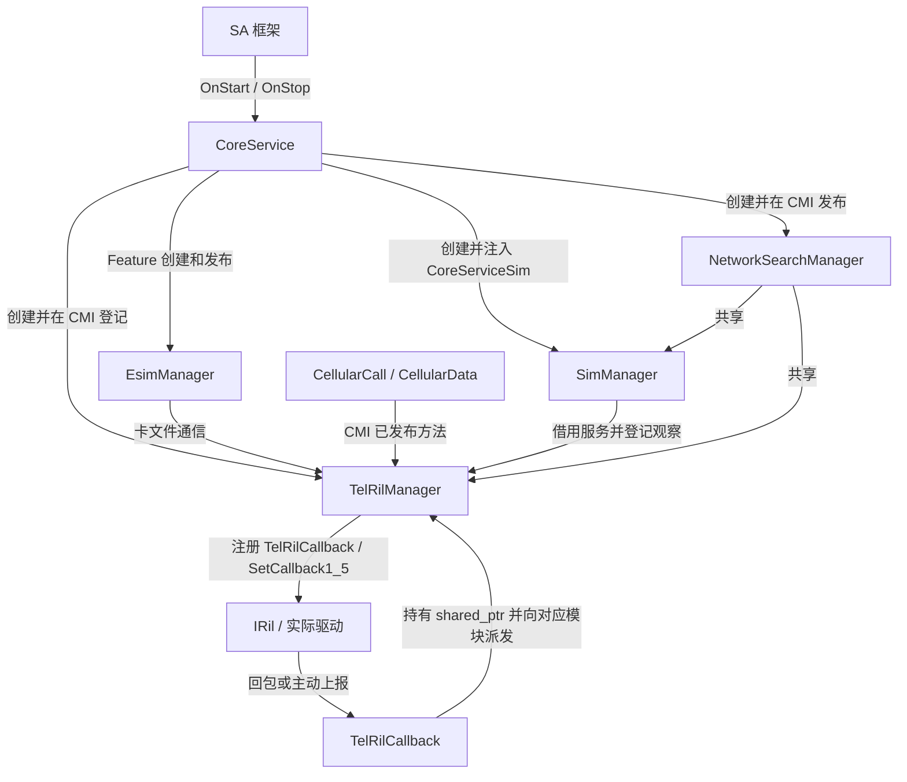
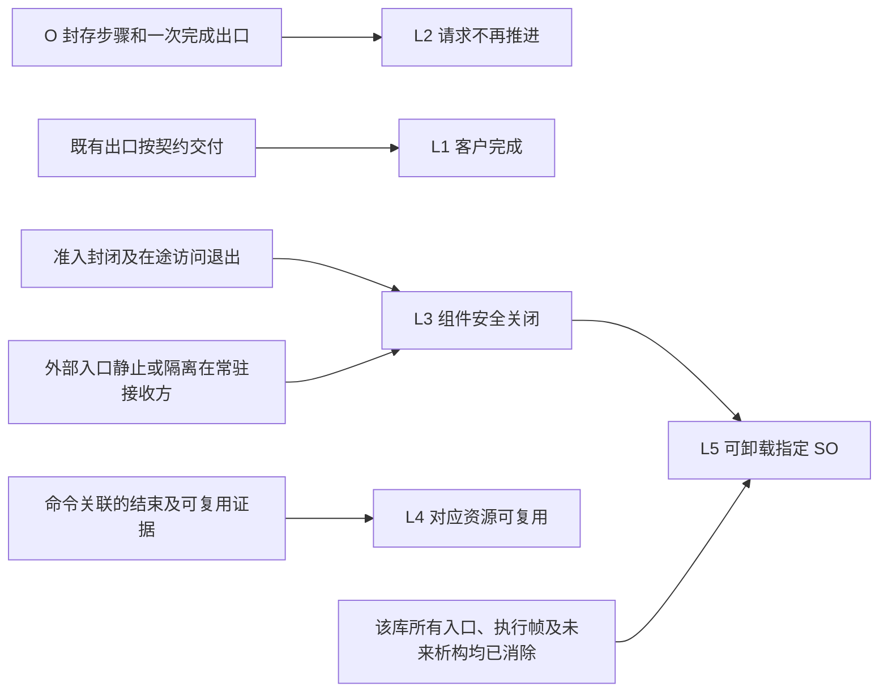

# 宿主关闭、异步排空与 Device/RIL 资源生命周期专项审查

2026-11-20 · 历史评审依据 · 输入 main@82a76db12ea36e372fadc00b5c082878a9730b0e。当前技术决策由[目标架构 §14](../../SIM_Target_Architecture_Design_v1.2.md#143-新增-stopanddrain-协议与机械拆分分开)维护，实施事实查[唯一执行状态](../../SIM_Refactor_Execution_State.md#current-status)。

## 结论与证据口径

**FACT**　在已提交代码里存在两条不同的退出路径。真实宿主关闭 IMS、搜网设备监听、RIL 的 HDF 状态监听和可选扩展。Legacy SIM 自己能够拒绝新业务、等待已接纳的工作、join 并逐对象退订。可见宿主调用链没有把两者接起来。STK 还能向单例 eSIM 控制器提交未登记在 SIM 工作组的 FFRT 任务。当前生产关闭日志不能作为整组已排空的证据。

**INFERENCE / P0**　阻碍生产重建的是三处缺少交接证明的窗口：Core 对已发布入口的撤回与在途调用，生产者完成投递到回调真正返回，设备提交到旧命令不会再作用于资源。源码支持这些窗口存在；本次没有产品 UAF、硬件重叠操作或死锁的运行见证。重复调用一个局部 Stop 无法关闭这三个窗口。

**PROPOSED**　选分阶段关闭。宿主封住新入口，各注册者在保留必要完成通道的条件下排空已有工作，随后宿主仅回收已证明静止的实例。Device 对尚无结束证据的具体资源继续隔离。驻留且仍有接收者的条件下，本地业务对象可以先退出。若证据或接收者缺失，则保留最小仍有依赖的对象图及其代码，报告未完成。产品是否需要单独卸载 SIM SO 为 **OPEN**。

**CONFIRMED**　现有五组职责、已发布完成契约、Core 共享同一 RIL 及按原功能/WU 验收是输入约束。以下接口、等待、释放、强制退出、补偿及卸载策略均为 PROPOSED，不能据此改写调用方得到的结果、通知顺序或时限。

**FACT / HISTORICAL**　首轮设计记录为 eea678d67，请求与角色协议为 dd7ac58f9。此后 d1f0d1fa4 加入 C1 Host 重试，ec6b09c4c 接入 B/C1 的资源屏障，82a76db12 区分运输移交与 Owner 投递。可在仓库根用 `git show 82a76db12:telephony_core_service/<相对路径>` 重读下述符号。开始时本地 main 与远端一致，另有未提交的 Device、架构检查、Target 测试和执行状态修改。其中工作树出现弱 dispatch、待交付结果及投递回执；以下固定基线按较早的已提交实现取证。Legacy 受管关闭实现可追到 609c709a4；历史 Legacy 124/124 等结果按原批次读取。[首轮评审](SIM_Architecture_Independent_Review_20261119.md) · [请求协议](SIM_Role_Concurrency_and_Async_Request_Review_20261119.md) · [Legacy Stop 归档](../../../services/multisim/test/docs/archive/remaining_failures_20261118/phase_b/README.md)

## 谁创建、谁能继续调用、谁可以关闭

**FACT**　下图箭头是运行时创建、发布、注册或调用关系。根 BUILD.gn 编译 Legacy，Target 私有装配和逻辑 GN 在 testonly 下。API 库内的 CMI、静态单例和跨接口控制块的实际驻留位置须由产品 ELF 验证。图中的引用并不授予释放共享服务的权限。[Core](../../../services/core/src/core_service.cpp) · [CMI](../../../frameworks/native/src/core_manager_inner.cpp) · [产品构建](../../../BUILD.gn) · [Target 构建](../../../services/multisim/BUILD.gn)



**FACT**　OnStart 遇 Running 返回；Publish 在 Init 之前，发布失败直接返回。设置 FFRT worker 上限后进入 Init。CommonEventHub 初始化并交给 CMI → 可选扩展初始化 → 建 TelRilManager，OnInit 后交给 CMI → 可选 eSIM 建立/初始化/发布 → SimManager 初始化并给 CoreServiceSim → IMS Init → NetworkSearchManager(ril, sim).OnInit → CMI.OnInit(search, sim, ril) → 各槽 InitAirplaneMode。OnStart 成功时置 Running 并尝试发布 Ready 事件。RIL 与搜网返回值有判断；RIL 自己的 HDF 监听注册失败未向上反映为 OnInit 失败。两个 SIM Manager 的 OnInit 返回值未在此检查。对象已经发布、Ready 通知失败和未发布三种初态需各自清理。

**FACT**　OnStop 写 STATE_NOT_START、registerToService_=false → IMS.UnInit → 搜网.DeInit（逐槽退订设备状态观察）→ RIL.DeInit（仅注销 HDF 服务状态监听，结果未用于宿主判定）→ Feature 下 wrapper.DeInitTelephonyExtWrapper（间接调用厂商函数）。仓内可见实现未调用 SimManager::Stop，也未撤回全部 CMI 引用、等待 Core 通用/PIN handler 或清除全部 RIL outstanding。Core 析构体为空。SimManager 最后一个强持有者释放后才析构，析构有按槽退订及 Records 清理，没有执行 Stop 的封口、join 与收据检查。OnStop 返回只说明这段宿主调用返回。厂商函数内部、SA 同时派发、异常退出时平台回调保证为 OPEN。[搜网](../../../services/network_search/src/network_search_manager.cpp) · [IMS](../../../services/ims_service_interaction/src/ims_core_service_client.cpp) · [扩展](../../../services/telephony_ext_wrapper/src/telephony_ext_wrapper.cpp) · [旧 SIM](../../../services/sim/src/sim_manager.cpp)

| 所有权和失败路径（FACT，收回条件为 PROPOSED） | 实际持有/使用 | 回收责任与限定 |
|---|---|---|
| 宿主和发布面 | SA 注册的 Core 单例、CoreServiceSim、CMI、搜网分别可持 Manager；重建可换入新 shared_ptr | H 在原私有发布点封口，验证已取得旧引用的调用也受门控。最后一次 reset 不由 SIM 决定 |
| 共享 RIL 及 HDI | Core 创建；SIM/eSIM、搜网、CMI 持用。HDI 安装的回调对象持有 manager，服务状态监听也是外部入口 | SIM 配对退订自己的观察并放下自己的引用。只有宿主在其它消费者静止后才退役共享连接；远端回调释放和死亡通知需平台证据 |
| SIM 卡图 | SIM 创建逐槽 Account、短信、STK、ADN、File/Records、State 和 Monitor/Controller；CardFileDetectManager 创建早于实际 Controller | 各创建者登记成功项并反向解除。强观察表与 handler 可能互保；弱反向关联可断对象链，仍需等待已取到强引用的回调 |
| 初始化部分成功 | 搜网失败时 SIM 已发布；半初始化 SimManager 的逐槽对象可能只有一部分；构造失败、事件登记失败各有不同已取得集合 | 以实际取得的句柄/发布记录回退。先封已发布入口，再退订成功子集和释放自有对象。未创建者不等候。构造异常、SA 日程须产品注入确认 |
| 跨库引用／单例 | CMI、共享控制块、具体类型 deleter、静态 TelRilBase 表、EsimController、wrapper 和厂商函数指针 | 控制块延寿只保证对象。最后一个析构、闭包销毁和注册入口都可能执行提供库代码。宿主负责代码驻留；进程退出时仍需下次启动重新检查设备 |

**FACT**　另查本地配套开源树：telephony_cellular_data@29d6fa9c6 的 services/src/state_machine/cellular_data_state_machine.cpp 经 CMI Activate/DeactivatePdpContext；telephony_cellular_call@69e3d1d60 的 services/connection/src/cellular_call_connection_cs.cpp 经 CMI.Dial。同一 Core 的这些入口向共享 TelRilManager 转调。telephony_ril_adapter@d039c7ce8 的 services/vendor/src/at_sim.c 在 ReqSetRadioProtocol 将 UPDATE 转 NOTIFY，ReqSimCloseLogicalChannel 使用 AT+CCHC。开源参考实现能解释相关键，不能签收具体产品 Modem 的最后执行时刻或 Feature 组合。

## 跨栈工作和 Legacy Stop 审计

**FACT**　表内“关”是源码能找到的注销/取消/等待。最后一栏区分测试中的具体断言方向与需补的覆盖。下面的工作由不同调度器持有，无法从某一个队列的长度重建全集。

| 异步源及发起符号 | 生命周期所有者、访问对象与关联 | 运行／关／结束证据 | 测试边界及危险窗口 |
|---|---|---|---|
| CoreService 与 CoreServiceSim 的 AsyncSimGeneralExecute / AsyncSimPinExecute，Core 搜网 PostTask | 宿主持 handler，闭包可能保留接口、参数和回调；一次 IPC 调用 | 分队列排队；OnStop 中未见逐队列封口与确认执行体退出 | Legacy Stop 夹具未经过 SA。已发布队列可晚于 Manager 换代 |
| CoreServiceCommonEventHub 订阅者、OnReceiveEvent、OnSetPrimarySlotStatus 等分发 | Hub 及已复制 cb，跨 Manager/远端监听者 | FFRT 提交后闭包独立存在。注销订阅表影响未来查找，已投递者需回执或常驻隔离 | LIFE-06/07/20；仅测表空会漏掉正在执行者。[Hub](../../../services/core/src/core_service_common_event_hub.cpp) |
| TelLifecycle::Submit，MultiSimController 多处 continuation，MultiSimMonitor，IccDiallingNumbersManager::ProcessAdvanceLoadPbr | 组件工作组；强 owner + 任务执行体；关联原 Primary/ADN 工作 | 发布者及执行体先各取 ticket，再 submit_h 或创建受管 ffrt::thread；工作组持句柄，锁外 wait/join。detached 参数分支也保存线程 | ShutdownExtra.OwnedTaskClosureDestructionIsPartOfStopBarrier。另测启动失败、闭包析构、发布中抢 Stop |
| TelEventQueue::SubmitToFFRT、TelEventHandler 的 InnerEvent，刷新、Records/EF、File/State、SMS/STK | 队列/卡对象、原请求、逐槽观察。弱队列锁定后取得生命周期资格 | 队列 Stop 拒绝自身上下文，撤事件、取消/等已记录句柄。事件已出队与执行结束分开 | DelayedDispatch、C1StopAt 各阶段；需补 Refresh+Stop、设备晚包。[事件队列](../../../utils/common/src/tel_event_queue.cpp) |
| MultiSimMonitor 参数 watcher、RIL/Records/ICCID 观察 | 注册方和外部回调入口。ObserverHandler 表强持 EventHandler；Remove 后旧事件仍可在队列 | RemoveParameterWatcher 成败和在途栅栏分别核对；失败保持 Stopping 可重试；释放表项须避免锁内析构重入 | FailedWatcherRemoval、WatcherInFlight、ObserverReleaseOutsideLock 等已有局部用例。[Monitor](../../../services/sim/src/multi_sim_monitor.cpp) |
| OperatorConfigCache::RetryBatchInsertApnPostTask | 缓存的延时 handler、weak self、helper、任务 ID；闭包内再排队 | Shutdown 调 StopEvents、取消 TASK_ID 并清引用；已取强引用/已开始外部调用仍需归属证明 | LIFE-09；RemoveTask 成功与已运行闭包退出要分别观察。[配置重试](../../../services/sim/src/operator_config_cache.cpp) |
| 电话簿后台 PBR/ADN 预加载、Records 装载和文件控制器配对清理 | ADN manager 和对应卡图；前者受管线程，后者为事件和 RIL 回包，参与对象不同 | JoinOwnedWork + 子对象 Shutdown / Records 注销；任何未返回的外部设备动作另查 Device | 旧 Host 有配对退订、重建。LIFE-16 需单独卡住线程和已取走的 EF 事件。[ADN](../../../services/sim/src/icc_dialling_numbers_manager.cpp) |
| STK 接收验证命令 → EsimController::ProcessCommandMessage → ProcessCommandByCa | 单例成员、cmdData、slot；FFRT lambda 间接引用 this，调用动态 CA 代码 | 此处 ffrt::submit 未保留可等待句柄，caMutex 只串行调用，析构为空。与 SimManager 工作组分离 | 可见任务无局部 join；产品可达性和是否卸载需 Feature。LIFE-08/20。[控制器](../../../services/sim/src/esim_controller.cpp) |
| EsimManager 普通与低优先级 EsimFile，SyncOpen/SyncCloseChannel、Profile/APDU | 同 Manager 下不同 File、CV、currentChannelId_、aidStr_、slot、等待者和设备 | 开关通道、请求回包唤醒或限时返回；SyncCloseChannel 尝试后本地字段可清。Legacy Stop 的子项未含独立 EsimManager | LIFE-15；设备 close、资源范围和优先级域未证实。[EsimFile](../../../services/sim/src/esim_file.cpp) |
| TelRilManager::TaskSchedule、TelRilBase::CreateTelRilRequest / FindTelRilRequest、TelRilCallback、ObserverHandler | RIL 持 serial→TelRilRequest/result event；RIL Callback 强持 manager；主动上报按 session/member 定位 | serial 查找摘表、转发 event；DeInit 仅退状态监听。摘表、投递、Owner 收到、设备结束是不同观察。TelRilHandler 的延时 running lock 事件只管电源锁 | Host Fake 的同步交付不覆盖真实 HDI 队列/失败；需 LIFE-11/13。[RIL](../../../services/tel_ril/src/tel_ril_manager.cpp) · [请求表](../../../services/tel_ril/src/tel_ril_base.cpp) |
| TelRilModem FFRT 异步提交、NetworkSearchManager 的 handler/设备状态观察、IMS 监听 | 这些为 RIL/搜网/IMS 自有工作，不随 SIM 退出，其调用可能与 SIM 共用同一连接 | 搜网 DeInit 和 IMS.UnInit 范围分别核对；SIM 不 join 不相关线程。宿主要证明整连接无使用者才能回收 | LIFE-13；其它消费者可以在 SIM 退出期间完成旧调用 |
| Target AssignmentService::StopAcceptingAndCancelScheduledRetries、请求容器、Owner dispatch、ResourceRadioRuntime | A 负责重试与角色资格，O 封步骤/一次完成；R 持设备 group、token、lease；dispatcher 管已排队函数 | 取消定时回调后还要验证已取出的重试和旧 epoch；OwnerCallbacksDrained 与 DeviceResourcesDrained 分查。固定输入的 platform_ 为借用引用、dispatch_ 为裸借用、sink_ 为弱引用 | 组件 B/C1 已有屏障和分离断言。取出结果至入队、入队到执行完、dispatcher 先销毁均需交付证明。[B/C1 组件夹具](../../../services/multisim/test/cases/target/primary/b_async_primary_test.cpp) |

**FACT**　Legacy Stop 经过 BeginStop（同组上下文拒绝、并发 stopper 有界等候、Stopped 幂等）→ SealWhenIdle（持组锁检查 active==0 和无 pending Primary continuation）→ JoinOwnedWork → Monitor、Controller → 逐槽 Account/SMS/STK/ADN/File/State Shutdown → 都成功才清成员、runner 和本地 RIL 引用，FinishStop(true)。失败的退出守卫 FinishStop(false) 允许再进入清理，已关闭子项由 TelStopOnce 保护。Stopping 时新的注册被挡，已接受业务所需回调及有限嵌套准入直到 sealed。75 秒 deadline 用于争夺关闭者/封口，随后 join、queue.Stop、子项外调没有同一全程 deadline。[生命周期实现](../../../utils/common/include/tel_lifecycle.h) · [关闭用例](../../../services/multisim/test/cases/internal/shutdown_test.cpp) · [runner 用例](../../../services/multisim/test/cases/internal/lifecycle_test.cpp)

**INFERENCE**　只在三处顺序上调换两步就会失去证明。若在成功 Primary 的最后回包前先退掉唯一结果接收者，原等待可能永无可消费结果。若先 reset 卡图，再信任已入队的通知，旧任务可能仍需对象及其代码。若工作回调在同一队列内同步等自己的退出，进入互等。已有同组自等待守卫应保留；跨队列的等待环和仍能投递的外部生产者需由宿主证明。以上是协议反例，未判定线上已发生内存错误。

**FACT / INFERENCE　两处可定位的交接缺口。** 在带 eSIM 的 STK 路径，OnSendRilProactiveCommand 提交 CA 工作，同时安排 CLOSE_CA_ESIM_EVENT。ProcessCommandByCa 持 caMutex_ 调 dlopen/dlsym 并执行厂商函数；处理延时事件的 CloseCaEsim 调 dlclose，没有取得同一把锁，也没有等待已提交工作结束。可确认关闭缺少共同的完成凭据。是否实际卸载最后一个 ELF 引用、厂商函数是否仍在运行属于产品证据缺口。建议句柄归实际调用所有，最后使用者退出后再释放；若厂商接受后还会异步反调，须厂商交还注册或继续驻留。LIFE-20 在该 Feature 上还有独立于未来 SIM 拆库的适用性。[STK 入口及延时事件](../../../services/sim/src/stk_controller.cpp) · [CA 使用及关闭](../../../services/sim/src/esim_controller.cpp)

在 82a76db12 的 ResourceRadioRuntime::AcceptDeviceResult，完成路径在 R 锁内消耗最后一个 group，在锁外调用 PostRadioOwnerTask。期间 OwnerCallbacksDrained 可能已看到空表和空 dispatcher；若 post 拒绝，函数返回 false，该组 normal/late 局部结果也没有留在待交付表。这是固定 Host 源码的交接缺口。该版还在 R 锁内查询借用的 dispatcher；是否重入取决于具体实现。审查时另有未提交的投递收据改动，须按其自己的 SHA 和测试复核。原先的资源结束证明仍应保留。审查既有工作树不会把这些改动发布为本专题成果。

**FACT / OPEN　清单边界。** OperatorConfigCache 延时体在检查 weakThis 及访问 helper 前已取得组 Callback lease；此处应保留该防护。SimFileManager::Shutdown 对 File、Controller 和电话簿 handler 分别 StopEvents，不能只统计一个 File。TelRilModem::RadioStateUpdated 的 FFRT 广播闭包还会读成员 slotId_，由 RIL 侧保证驻留。对 SIM/Core/RIL 这些已追踪源码用 `rg -n 'ffrt::submit|ffrt::thread|std::(thread|async|promise|future)|PostTask|SendEvent|Register.*(Notify|Watcher)|dlclose'` 可复核工作来源；这条路径未发现需要单独关闭的 std::promise/future 执行器。外部 SA 框架、闭源回调及驱动内部工作不在可枚举范围。异常杀进程无法执行普通析构/退订协议；下次启动仍要从设备取证，内存票据不能跨进程继承。[文件关闭](../../../services/sim/src/sim_file_manager.cpp) · [RIL 广播](../../../services/tel_ril/src/tel_ril_modem.cpp)

## 五种结束条件与不变量

**PROPOSED**　一次操作要分别回答“交付给谁、谁还能运行、谁还能改动设备”。图中箭头是证据条件的合取输入。L2 的“封存”可以先于回调执行，L1 按原入口同步返回、异步回调或投递契约观察；仅当方法约定送达时才要求送达回执。



L3 要求所有已接纳请求有按契约处理的归属；未决结果只能移交给能履约且已确认接收的驻留方。若仍依赖本实例，就必须保留它。L4 可以早于用户收到通知，也可远晚于 L3；后者要求 R 对隔离资源和晚包仍有真实所有者。L5 只对特定库成立，任何维持隔离的接收者、闭包或析构代码仍在该库时不能卸载。SIM 单方面不能证明 Modem 静止，也不能证明其他 SO 没有引用。

| 约束（PROPOSED，外部行为沿用已有契约） | 保护对象／最小违规序列 | 守卫和可执行断言 |
|---|---|---|
| INV-01 关闭准入 | H/C 关门→已发布的旧 CMI 句柄仍接受新写 | 同一实例门控旧句柄和新入口；封口后新增 owner admission 数为 0 |
| INV-02 已接纳业务有着落 | B 已发→退唯一回调→释放 completion | 先保留终结通道或让常驻方接管；对每个已接受 ID 核销一次出口，Unknown 保留原外部语义及恢复记录 |
| INV-03 销毁前访问静止 | producer 准备投递→计数暂零→销毁→闭包开始 | 投递前预留，失败退还，执行、闭包析构结束后才交还；销毁标记后访问数为 0 |
| INV-04 共享 RIL 只由宿主退役 | SIM Stop→全局 DeInit→数据在途收不到应答 | 局部只退本组件句柄；另一个消费者在同一 RIL 上的原请求仍恰好完成一次 |
| INV-05 请求结束独立于设备 | O 超时→本地 clear→R 重发同资源 | 保留 lease/fence；旧命令是否结束未知时，同域新命令的 transport submit 数为 0 |
| INV-06 旧结果不可复活 | 卡重建→旧 serial／session 回包→新 Owner 写入 | R 关联原命令，O 保持终态，旧结果仅供原资格对账；新图写计数及第二次完成数均为 0 |
| INV-07 Stop 幂等且可并发 | 两线程各开始退同一 watcher，失败者先标 Stopped | 一实例同时至多一个清理执行者，其他查询同一进度；幂等重复调用不能增加成功退订次数 |
| INV-08 不等自己 | 回调持组资格→Stop join 本队列→永不返回 | 回调只请求关闭；另一执行域观察/等待。等待前释放业务锁；屏障允许原回调继续退出 |
| INV-09 卸载前代码静止 | 对象无强引用→卸载→缓存的 deleter 或已排队函子析构 | 每个注册地址、持有者和代码驻留关系核销；留一个函数地址/闭包就不得批准 dlclose |
| INV-10 Unknown 不释放资格 | 连接断开或重启→新实例误以为可用→旧命令改变后继设备 | 启动 Checking；精确 scope、原命令不会继续、当前状态与可复用分别取证；证据缺一时 Acquire 失败 |

## 选择和实施关闭协议

**PROPOSED**　三种候选均保持现有完成语义，追加的外部行为须签收。

| 维度 | A 宿主逐个同步 Stop | B 封口后由组件排空，宿主收取结果 | C 各对象以 token/lease 自治 |
|---|---|---|---|
| 不变量与所有权 | 宿主能定大顺序，难看见子队列和交付窗口 | H 管发布，创建者管工作，R 管硬件。按依赖证明 INV-01～10 | 逐资源可细化，难证明所有入口和共享提供者都退出 |
| 简洁、迁移和团队成本 | 调用最少，但宿主须了解所有 Feature 内部 | 一个实例状态、沿用局部 RAII，逐入口补登记，适合分 WU | 每个对象重建关闭协议、版本及等待图，交接审计成本高 |
| 死锁、兼容 | 同步顺序可能先断回复路径或自等待，改变旧完成 | 关闭请求不等待，槽/回调锁外等待；保原有合法终结路径 | 减少全局等待，容易互持 token 或等相邻对象析构 |
| 超时、恢复及产品差异 | void/单 bool 易吞部分失败，往往阻塞所有消费者 | 未完成留具体来源和实例；设备按域隔离，独立消费者继续 | 局部可恢复，但连接重建和半发布仍需额外宿主协调 |
| 可测试性与开销 | 易测顺序，难测不可见执行体 | 在投递、执行、退订、回收四处设确定性屏障；无全局热路径锁 | 每次跨域转移均需凭据，覆盖所有交接困难；无性能实测 |

**推荐 B**。H 只协调谁还能投递、谁依赖谁；组件内部用现有组、任务句柄和配对退订。同步无外调的局部对象靠 RAII 足够。只在跨队列或外部生产者的生命周期确实跨越所属对象时使用工作票/交付回执。

1. **Running → Closing**。宿主对该实例的发布门与组件准入建立同一封口点；并发取得旧句柄也须过门。记录成功取得的句柄和原待完成集合。停止注册、业务和自主 Retry；只接受已接纳工作所需的有限终结步骤，不能以“内部调用”放行新业务。两个 Stop 观察同一实例；回调内触发只置关闭意图并唤醒宿主。
2. **Closing 内排空**。先关无关的通知/注册生产者，保留已有请求的结果/设备证据入口。下游先取得接收资格，上游才能放弃最后一个引用。剩余回包能由常驻接收方接管时，先确认交接，再撤旧订阅；不能证明交接时保持原接收方。未知厂商注销只证明移除未来注册时，另等已取入口的执行退出；退订失败保留 cookie、依赖、代码和失败清单。对不能保证撤回的外部注册，需要常驻入口先校验实例，无法提供则禁止销毁。
3. **Closing → Stopped**。最后生产者封住、已登记工作退休、外部入口已静止或隔离、每个已接受出口有可核查归属，才能在锁内标记组件 L3。锁外按实际取得关系反向释放自有对象/借用引用。若仍有 L4 Unknown，具备驻留 Device 接收者才可分别释放 SIM 对象，否则保持 Closing。Stopped 单向，重新初始化建新实例。上层进程/连接退出后新 Device 从 Checking 起步。该状态不触发自动重试、硬复位或 dlclose。
4. **失败处理**。到 deadline 返回仍未完成的原因，继续保有收据并允许从未完成步骤再查。不可撤回的系统调用/无界 join 交由可驻留的执行域完成，观察者可以有界返回；不可把超时包装成强制销毁。回调线程上不调用阻塞等待。若 SA 的 OnStop 必须在时限内结束，需平台批准驻留方案或拒绝卸载；能否保活为 OPEN。

### 私有接口与临界区

**PROPOSED**　下列名字表示在既有 C++ 类上的私有接缝。公开 ISimManager/IEsimManager/IDL 保持原 ABI。已有方法直接复用；不创建新的全局 Manager。

| 归属／接口 | 调用者和结果 | 阻塞、回调与失败语义／必要性 |
|---|---|---|
| H 的私有装配句柄 RequestClose(instance) | Core 在退出、部分 Init 回退、回调触发时使用；返回同一实例的 Closing/Stopped 观察 | 短锁封口，不外调、不等待。拒绝旧实例控制新图，重复调用只唤醒。解决 callback 线程不能 join 自己 |
| SimModule 的私有 StopAcceptingAndDrain 或等价私有 WaitForDrain(deadline) | 宿主非回调线程推进该实例，得到本地静止及未结来源，另读 Device 状态 | 允许锁外退订/等待，兼容同步重入；区分在途、退订失败、自等待、到期。已声明的 DrainResult 一次只能表达一项，不能当析构许可；可内部返回独立证据位/清单 |
| 已有 TelLifecycle::Lease / Submit、队列 Stop、子项 Shutdown | 生产者入队前预留发布和执行资格；使用原注册标识退订，执行者/失败路径 RAII 退还 | 受组锁只做记账，锁外 join/wait/unsubscribe。创建失败与未执行即取消也必须退休。若平台取消不能确认，保持持有。只对该组已全覆盖的入口有效 |
| A.StopAcceptingAndCancelScheduledRetries、O 封存原步骤/一次完成 | H 请求关闭，A 取消自己的 Retry；O 原完成竞争仍用同一领取口 | 取消已取走的 timer 可失败，回调按原 epoch/attempt 再核对；已接纳结果或 Unknown 保留原契约；T 保存历史账户，Card 失效的是 session/装载资格 |
| Device 的 StopAccepting、OwnerCallbacksDrained、DeviceResourcesDrained、ReadResourceState、Recover | H 观察本实例；平台适配器提交真实结束/恢复凭据 | 每次只是局部快照。先关注册源再取证；锁内冻结本地记录，锁外调外部 dispatcher 防同步回入。返回 Checking/InFlight/Quarantined 表示域不可复用；无证据不重置 |
| H 所持共享 ITelRilManager 与借用端口 | SIM 退自己的观察/引用；宿主在 Data、Call、搜网、eSIM 等都完成生命周期交接后方可退役连接 | SIM 无全局关闭接口。provider 返回取消成功的含义由 HDI 签收，不能保证执行静止时继续保留回包接收方 |

下面是既有工作组/装配的实现约束。reserve、retire 是同组门的操作。sleep、轮询活动线程数或持锁调用外部接口均不能满足该约束。

```cpp
// 目标伪代码。参与者共享该实例的门，登记覆盖“预备投递”的空档。
auto ticket = gate.reserveWhileAdmissible(instance, originalStep);
if (!ticket) return existingRejection();
auto body = makeOwnedBody(std::move(ticket), receiver, work);
// body 在 callable 及其捕获对象析构之后归还执行票；发布者另持发布票到句柄登记完。
auto result = queue.tryPost(std::move(body));
finishPublishing(result);  // 明确未接受则本地销毁；移交不明须保留责任

// 宿主执行域，Closing 已生效；既有 deadline 的失败按来源报告。
closeIndependentSources();
keepOrTransferCompletionRouteForAcceptedWork();
auto removal = unsubscribeOwnedSourcesOutsideLocks();
auto local = observeAfterIngressFenced(removal, deadline);
if (!local.safeForDestruction()) return retainInstance(local);
if (device.hasUnresolvedEffects() && !device.hasResidentEvidenceReceiver())
    return retainInstanceForDevice();
return retireLocalOwnersOutsideLocks();  // L4 与 L5 各有独立判据
```

**INFERENCE**　计数的正确区间从“准许发布前”到“被执行的 closure 及其捕获全部释放”。入队失败、调度取消未启动、异常返回、同步回调早于 submit 返回、同一工作被取消两次，各需恰好一次退休。发回调一方的最后一票与下游接收方的第一票必须重叠，否则两边会同时报告空。对无法盘点的入口，零计数没有证明力。等待只依赖更下游已能独立运行的执行体；不在业务锁、RIL map 锁、回调线程或唯一能投递完成的队列中等候。

## 设备结束与代码驻留

**FACT**　沿用 RadioSubmitDisposition 的 ConfirmedNotSent、HandoffAccepted、HandoffUnknown。移交前可确定未发送才允许撤销；发送结果未知可能已执行。B 的 response 需要原 token/serial 及请求资格；C1 CHECK/COMPLETE 按原命令与成员收集，UPDATE 是带 session 的成员 NOTIFY，不能补造 serial ACK。平台外部返回成功或错误还要单独说明旧命令结束、状态和物理资源可复用。Host 能验证消费这些字段的逻辑，不能生成设备事实。[端口](../../../services/multisim/role_assignment/primary/radio_execution_port.h) · [设备执行](../../../services/multisim/device/resource/resource_radio_runtime.cpp) · [资源规则](../../../services/multisim/device/resource/resource_barrier.cpp)

**PROPOSED**　按资源键判定，隔离仅覆盖相交的物理范围；产品不能证明域独立时按已知共享作用域保守隔离。R 的 lease 含原 StepRef、完整资源集、epoch、fence。启动先取得 InitialRecoveryEvidence；原地完成验证 commandEnded、resourceReusable 与相应 effect。Quarantined 恢复还要 oldCommandEnded、currentStateVerified、resourceReusable 及写效果可核对。只读动作即使无需验证业务写，也可能占用通道。超时后申请同资源只能等待上述证据，或有确定的未移交证明；等待、拒绝的外部表现仍按方法签收。

| 资源／掌握证据者 | 可接受的结束事件与范围（产品须证明） | Unknown、Host 能验证的部分 |
|---|---|---|
| CardApplication / EF、普通 APDU；Card 管会话，R 管真实访问 | 原应用、会话及传输命令配对结束，通道状态允许下次访问 | 同槽换卡/同卡重插/Refresh 先失效会话，不能复用原资格；Host 可测旧代拒绝 |
| eUICC 文件、Profile、普通/低优先级通道；EsimFile 与 Device | 原通道 open/transmit/close 的各个命令得到对应凭据；关闭通过且产品保证通道可重用；验证 Port 与其它应用是否共享 | 两个 File 的不同锁、AID 清空、超时或优先级均不赋予抢占权。作用域不明时隔离共享 Port；Profile 的业务效果另核对 |
| 物理 Port / 模组、Radio 域；设备/驱动提供，R 接纳 | 命令作用的完整成员和资源集合均可用。独立域有拓扑和硬件并行证据才并行 | 相同 Modem 或公共链路的跨 Radio 相交键不得分开授予；逻辑 slot 数不推出物理并行度 |
| B / C1 调制解调器动作；Role 和设备各持本域资格 | 响应/NOTIFY 关联原阶段成员，完成设备确认，再由 Owner 决定角色写与对外交付 | 发送后超时仍保留 fence；不得自动重试；晚包只记原动作。Host 能验证伪时序，真实停止条件待设备 |
| RIL 运输／running lock；Core/RIL | 每一个 serial 表项归属核对并退订本组件观察；连接由最后一组相关消费者确认退役 | 摘表、释电源锁、IPC 断连都不能释放物理资源。SIM 退出不阻断其它 Call/Data 结果 |
| 拔卡、设备重启、重连；宿主及 R | 新实例须有不会再应用旧操作的屏障，并重新读设备当前状态与可用域。确认 reset 范围/固件保证后才复用 | 重启后初始 Checking。不能从时间流逝、相同 ICCID、新 serial 或仅收到 READY 推断已结束 |

**FACT / OPEN**　Core 的现有链接形态没有给出产品执行独立 SIM SO 动态卸载的证据。另一方面，扩展 wrapper 和 eSIM CA 有真实 dlopen/dlsym/dlclose 接缝；不能用这两类插件推断整个 SIM 以相同方式卸载。即使 weak_ptr::lock 失败，调用它的 thunk、排队函数的析构、控制块 deleter 仍可能在拟卸载库内运行。强引用边如 RIL callback→manager、observer 表→handler 是源码事实；远端是否永久持有以及能否形成永久强环为 OPEN。

**PROPOSED**　常驻产品先签 L3。若有独立卸载需求，按实际 ELF/NEEDED、导出和加载器句柄列出入口及代码地址；验证 SA/CMI、HDI/观察者/厂商 Hook、FFRT 回调/线程栈/返回地址、队列中未运行或未析构的函数对象、共享对象及最后一个控制块、TLS/静态对象析构的驻留范围。先撤未来入口，再让已进入的帧与析构动作退出；驻留 thunk 独立于拟卸载库且在跳转前核对实例。任一提供者不能确认、回调还可投递、仍有该库的延迟析构或 Device 恢复代码，宿主保留库并报告原因。产品策略未要求动态卸载时，无需为常驻对象普设代码 token。

## 确定性验收设计

**PROPOSED**　以下编号只标识本专题的测试场景，沿用 SIM-028/WU-04/WU-07、原 Scenario/Oracle 和设备门禁。采用真实 Manager/请求/队列类，边界使用可控调度、Recording RIL 或设备日志。每个箭头都是显式放行点，等待以事件回执为准。测试观测析构标记、发布/执行/退订次数、原请求结果、设备提交次数及隔离键。H 表示可做 Host 验证，S 表示还要实际 Core/SA 集成，D 表示必须有产品 RIL/设备证据，U 表示动态卸载产品专验。表中均为测试设计，本轮没有执行这些场景。

| ID · 业务和初态 | 真实参与者与调度顺序 | 违规反例 → 预期断言 | INV／层 |
|---|---|---|---|
| LIFE-01 普通双卡已 Ready | Core 建 RIL 与 Manager→接纳 Primary→完成→宿主关闭 | 仅看状态字即成功 → 局部工作、退订配对和原出口核销，非 SIM 消费者仍可用 | 01/02/04 · H+S |
| LIFE-02 初始化中断 | Core 已发布 SIM/eSIM，控制搜网 OnInit 返回失败→请求清理；另在第一项注册前失败 | 析构未创建项或旧发布仍可进入 → 仅清理成功子集，旧入口拒新，重复回退无新增注销 | 01/03/07 · H+S |
| LIFE-03 已正常关闭 | SimManager Stop 完成→第二次 Stop；另首次 RemoveParameterWatcher 失败再试 | 重复全量退订或跳过失败项 → 成功项不重复，失败项能重试，状态单向 | 07 · H |
| LIFE-04 两个关闭发起者 | 在 Monitor 退订处暂停 Stop A→线程 B 请求 Stop→放行 A | 同一项释放两次 → 清理执行者峰值 1，B 收到同一最终状态或明确未完成 | 07/08 · H+S |
| LIFE-05 IPC 与关闭抢入 | CoreServiceSim 旧句柄在取得后暂停；先封口再放行，交换顺序再测 | 后到业务写入或先到失踪 → 后到新增写数 0，先到按原契约完成一次 | 01/02 · H+S |
| LIFE-06 已投递未执行 | ObserverHandler 已选中 handler，暂停执行→撤 SIM 订阅→放行事件 | 表空即析构 → 旧事件被原门退休/隔离，无新图写入，释放时间晚于最后访问 | 03/06 · H+S |
| LIFE-07 回调正在执行 | watcher 已取得资格暂停→Stop→释放回调 | 先标 Stopped → 回调驻留期间不得销毁，退出后只退休一次 | 03/08 · H |
| LIFE-08 线程尚在发布 | ADN Submit 在预留与登记句柄之间暂停→Stop→分别令发布成功/失败 | 瞬间零票导致遗漏线程 → 成功得到一次 join，失败也归还对应票；无遗留引用 | 03/07 · H |
| LIFE-09 Retry 已取走但未执行 | 暂停 A 的 C1 scheduler 或 APN 延时任务→Close→放行 timer 再次调度 | 取消返回后旧回调新发命令 → 新代业务提交数 0，原终结通道仍可用 | 01/06 · H |
| LIFE-10 B 移交后客户端超时 | R 已记原 token→O 超时→Close→查资源状态 | 超时清 lease → 原出口次数 1，未知的相交资源不能 Acquire | 02/05/10 · H+D |
| LIFE-11 晚到 RIL 结果 | 已记录原 serial/session→旧入口关→投递晚包→再投递一次 | 新 Manager 接受旧完成 → 只在原 R 凭据对账，新图写及重复完成均为 0 | 06/10 · H+S+D |
| LIFE-12 旧设备命令仍可生效 | 确认移交 A→Stop SIM→新图提交同域 B→补设备 A 结束和复用证据 | B 抢跑 → 补齐证据前 B 的外发次数 0；不相交且已确认的域仍可用 | 05/10 · H+D |
| LIFE-13 SIM 与数据/通话共用 RIL | 保留另一消费者的 CMI 请求和 serial→关闭 SIM→回送另一消费者，再送旧 SIM 包 | 局部关闭破坏连接 → 对方收到原响应一次，SIM 不能全局 Clear/DeInit | 04/06 · H+S+D |
| LIFE-14 Refresh 与关闭 | 原 Records/EF 已发→Refresh 失效→Close→原应答与新一代 READY 交错 | 同槽旧回包写入新 Records → 原代回包不修改新 Session/历史账户 | 03/06 · H+D |
| LIFE-15 eSIM 通道占用 | 普通 File 发 APDU→Stop→close 等待超时且本地 channel 归零→低优先级 File 请求同 Port | 普通和低优先级双重占用 → 阻止重用直至原通道结束和可用均确认；检查原 Profile 效果 | 05/10 · H+D |
| LIFE-16 电话簿/Records 未归还 | ADN 线程已启动且 EF 回调已取出→Stop→分两次放行 | 等一项就清 File → 观察到两者退出才释放各自可达对象，捕获析构已返回 | 03/08 · H |
| LIFE-17 回调上触发关闭 | Monitor watcher 在自己的执行体请求 Close→立即返回→宿主线程 await→放行回调 | 自 join → 回调请求可返回，外域最终观察一次关闭；不持 Owner 锁等待 | 07/08 · H+S |
| LIFE-18 超时且无法退订 | 保持 callback active 或令厂商 unregister 返回失败→推进虚拟 deadline→之后确认退出 | 将超时标安全 → 保留实例/代码及未完成项，二次观察后才允许回收 | 03/07/09 · H+S |
| LIFE-19 关闭后重建 | 首代 SIM 已退出但晚包可达→重建同槽同卡实例→送首代结果 | 重用本地序号命中新请求 → 新图无写入，新 Device Checking 只被本代有效证据打开 | 06/10 · H+S+D |
| LIFE-20 动态卸载产品，仍有跨库引用 | 保留厂商回调或最后一个带库内 deleter 的控制块→请求卸载→撤回并排空→再次评估 | weak 失效便卸载 → 收据不全时卸载授权次数 0；全清后以真实 loader 和调用轨迹验证 | 03/09 · H 可测拒绝，U 必验 |

**PROPOSED 负控**　保留相同初态与屏障，逐项在独立规则模型或以后获准的实验构建中变异。① 去掉本组件一次观察注销，LIFE-06/13 检查配对表和旧入口访问；② 去掉旧发布句柄的封口，LIFE-05 发现新增业务写；③ 在客户端超时处标资源可用，LIFE-10/12 发现同域二次外发；④ 发布开始后提前归零工作票，LIFE-08/16 发现销毁先于执行体退休；⑤ SIM Stop 中关闭共享 RIL，LIFE-13 的对方原 serial 无法按契约交付或发生多余 DeInit；⑥ 去掉原实例/步骤关联，LIFE-11/19 发现新图写入或重复完成。退订变异同时检查次数，避免“晚回调被门拦住”掩盖资源泄漏。

**PROPOSED 取证**　Host 在发布前、队列取出、取得 owner 资格、回调结束、注销返回及最后闭包析构处登记事件序号，不采线程总数作断言。两线程用 barrier、虚拟时钟和显式调度选择上述顺序。GTest/GMock 可复用已存在的 shutdown_test、B/C1 组件和 Full Replacement 差分。运行入口见[Host 使用说明](../../../services/multisim/test/docs/Host_Usage.md)及[双后端操作说明](../../../services/multisim/test/docs/Full_Replacement.md)。ASan/TSan/UBSan 用于补充对象、竞争及未定义行为观察，不能代替生产者全集与退出条件的证明。产品记录脱敏的 instance、原 serial/协议 session、phase/member、完整设备域、submit/晚包/实际结束/可用及退出观察点；对正常、失败、超时、重连、重启和回调注销逐一核对。

### 可复算的有限顺序检查

**FACT（协议模型）**　以下 Python 使用单个已接纳的任务和一个已移交的命令。事件次序只约束“取得执行资格→实际入队→返回”与“封口→试销毁”。理想规则和故意削弱的规则共用同一批排列。第二组枚举客户端完成、设备证据到达与申请复用的全部次序。这只检验两个必要条件；没有模拟 FFRT、SA、产品参数或真实硬件。

```python
from itertools import permutations

def premature_destroy(events, count_only_enqueued):
    # A 取得工作资格，P 登记队列，F 执行和捕获析构已退出，S 封口，D 试销毁
    pos = {event: events.index(event) for event in events}
    if not (pos["A"] < pos["P"] < pos["F"] and pos["A"] < pos["S"] < pos["D"]):
        return False
    counted_from = pos["P"] if count_only_enqueued else pos["A"]
    counted = counted_from < pos["D"] < pos["F"]
    return not counted and pos["D"] < pos["F"]

def premature_reuse(events, release_on_client):
    # 已移交设备。C 客户端完成，E 原命令结束且资源可用，N 后继申请
    evidence = events.index("C") if release_on_client else events.index("E")
    return evidence < events.index("N") < events.index("E")

for alphabet, check in [("APFSD", premature_destroy), ("CEN", premature_reuse)]:
    valid = [p for p in permutations(alphabet) if check(p, False)]
    mutant = [p for p in permutations(alphabet) if check(p, True)]
    assert not valid and mutant
    print(len(valid), len(mutant), "".join(mutant[0]))
```

实际输出 `0 1 ASDPF`、`0 1 CNE`。只从入队起计数会错过已经获准的发布者；只看客户端完成会提前放出设备域。其它四类负控保留在 LIFE 用例设计中。

## 实施切片与签收

| 阶段 | 已有依据 | 最小增量、完成条件及签收者（PROPOSED） |
|---|---|---|
| M1 生命周期基线 | 本报告的固定输入、配套三仓、生产与 Host 入口差异 | Core/平台确认实际 Feature 和 SA Start/Stop 并行、实例发布表、动态加载清单以及未覆盖的厂商回调；每一入口找到所有者或明确阻塞项 |
| M2 本组件安全退出 | TelLifecycle、事件队列、既有 ShutdownContract 与 Legacy 差分 | 先用宿主封口和一条真实请求验证半初始化/完成接收，再纳入 Hub、CA、eSIM、Records。LIFE-01～09/14/16～19 对应本地断言与原 Oracle 兼容，由 Host+部件、之后 Core/SA 分别签收 |
| M3 共享 RIL | RIL 请求表、注册回调、Call/Data 的真实 CMI 调用 | 加 SIM 局部退订/晚包接纳和消费者交接证据；LIFE-11/13 在同一 RIL、并发业务及重连时均成立，再由 Core/RIL 负责人确认整连接退役 |
| M4 设备复用 | Target B/C1 Host 屏障和原资格恢复 | 先选一个 B 物理域，再做 C1 完整成员和 eUICC 通道。LIFE-10/12/15/19 要求厂商给出 commandEnded、效果、resourceReusable 或确定 NotSent 的可达来源；未取得时保持该域隔离 |
| M5 独立卸载（条件阶段） | 当前仅有工厂声明、链接关系与实际插件调用证据 | 由产品先确认确有卸载需求。逐 ELF/Feature 核验跨库回调、运行帧与最后析构，LIFE-20 先看到拒绝，再在真实装载器证明可卸载；常驻方案记录适用范围 |
| M6 生产接入 | [测试工程](../../../services/multisim/test/README.md)、历史 Host 关闭及替代测试 | 分别签 Host 规则/组件、原接口差分、真实 CoreService/SA、产品原生链接、真实 RIL/HDI/设备、适用时 SO。时限、取消、强制退出及通知改变由产品/架构按公开方法批准，再讨论写权 |

**OPEN**　产品须提供 SA 的退出预算及保活能力、各 Feature 的注册/注销同步保证、HDI 回包及所有共用物理范围的结束和重置语义、可驻留的晚证据所有者、实际 ELF 与卸载需求。没有这些证据时，不能把借用引用失效、静态架构检查或历史 Host 验收升级为生产关闭承诺。

**本轮实际验证（FACT）。** 从仓根运行恢复检查 `python3 -B telephony_core_service/services/multisim/tools/check_sim_refactor_recovery.py --remote origin --fetch`，得到 CHECKPOINT_VERIFIED。以 `git ls-tree -r -z` 核对固定输入排除 test/tools 的 94 个文件（92 个 C++ 单元），并对读 Core 退出顺序、CA 入口和资源屏障。工作树的 `python3 -B telephony_core_service/services/multisim/test/scripts/run_architecture.py --with-gn --migration --output /tmp/sim-life20-check` 通过结构、迁址、四组纯规则及 testonly GN 构建；该次检查含已有未提交的工程改动。运行 `python3 -B -m unittest discover -s telephony_core_service/services/multisim/test/cases/internal/infrastructure -p test_navigation.py`，6 项通过。另解析本批文档路径、锚点、围栏和 Mermaid 语法，执行上文两组顺序枚举及 `git diff --check`。本次未运行 Legacy/Target 完整回归、消毒器、原生产品构建、SA/IPC、真实 RIL/HDI 或卸载实验。

## 第二轮反向审查

**INFERENCE → PROPOSED 修订**　用以下边界情形重新检查方案 B，收紧其适用条件。

| 反问 | 修订后的约束及残余问题 |
|---|---|
| 1、2、16：是否每个对象都需要关闭框架、计数和三个 Stop 方法？ | 删除逐对象 token；纯局部同步对象只需 RAII。每实例仅 Running/Closing/Stopped。单一私有入口可在非回调线程包办请求与等待，自回调只请求。仅跨调度边界保留发布/执行票 |
| 3、8、9：业务结束、SIM 放下 RIL、RIL 全退役能否共用一个成功位？ | 分开设备证据和宿主借用引用。用同一个 Data/Call 串行号跨 SIM Stop 验证，Core 整连接清理还依赖其他真实使用者 |
| 4、5：先退订与晚退订都有窗口 | 改成按来源分类：封新业务，原回复通道保持，安全移交必须有接收确认；最后再撤回，且等撤回前已取得入口的执行体。做不到则保留实例 |
| 6、7：自等待或互锁是否仍可达？ | 等待只在独立宿主执行域进行，业务锁、R 锁及回调栈上无阻塞 join。dispatcher 可同步回入，因此将外部调用移出 R 锁并在本地保留进行中记录 |
| 10、11：半初始化或超时能否一律反序析构？ | 记录实际发布成功、订阅成功的子集。到期仅返回未完成原因；同步阻塞外调无法提供全程 deadline。未获宿主保活承诺仍是生产门禁 |
| 12：回调能否在关门后继续制造任务？ | 允许已接纳操作有限终结的同时，禁止自主重试和新业务。发布票覆盖子任务登记之前的时间，末个生产者封住才检查稳定的零 |
| 13、14：无可达对象或 Host Fake 清空是否足够？ | 域外 thunk/析构和硬件可能晚于 L3；真实产品需各自证明 L4/L5。Host 可以反驳错误推理，无法代签平台 |
| 15：是否悄然改变客户端完成或通知？ | 删除通用强制取消、自动重试及统一 75 秒 SLA；先用既有契约差分。引入新错误、调整时限、改变送达/取消或借用策略须另签 |

**结论**　可以先实现并验收“禁止新入口、保全已接纳业务、局部排空”这一条小切片。验收时应允许同时报告“本组件已静止、指定设备域仍隔离、代码仍需驻留”。若无法说明晚包究竟落在哪里，则连第一项也不得报告成功。
