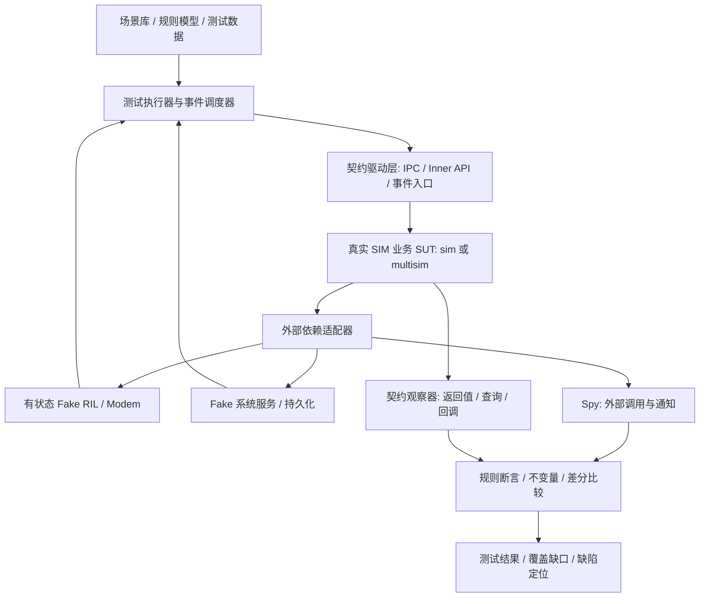

# SIM 卡管理模块重构测试防护网建设设计说明书

> **文档状态**：设计建议稿（Proposed）  
> **版本**：v1.0  
> **日期**：2026-11-02  
> **适用范围**：OpenHarmony `telephony_core_service` 的 SIM 卡管理业务，覆盖现有 `services/sim/` 及目标 `services/multisim/`  
> **定位**：重构前置工程方案、跨团队评审依据、后续自动化实施基线

## 0. 执行摘要与关键决策

**目标**：在 SIM 生产业务迁移前，建立不依赖模块内部实现的自动化测试防护网。以 SIM 管理为**系统测试边界**，以真实 IPC／进程内接口及外部事件为输入，以可控的外部依赖仿真为环境，以返回值、通知、业务状态、不变量和外部副作用为断言，保障既有行为兼容，并验证 3→4 卡扩展及复杂状态管理的目标能力。

本工程最重要的难题不是测试执行框架，而是**在重构人员业务知识不完整的情况下，系统发现业务场景、减少遗漏并确定正确预期**。采用“代码证据驱动的业务场景发现 + 状态／规则模型生成 + 业务专家对争议规则裁决 + 覆盖缺口反查”的方式解决。

| 编号 | 关键决策 | 设计理由 |
|---|---|---|
| D1 | 以 SIM 业务模块为测试边界，不以整个 Telephony SA 为默认被测对象 | 降低环境和定位成本；保留系统级业务链路 |
| D2 | 优先通过既有对外契约驱动、观察，避免调用内部 Manager/Controller | 让用例能够跨 `sim/` 与 `multisim/` 重用 |
| D3 | 使用**有状态 Fake RIL**、依赖适配器、可控异步调度，而非海量固定返回值 Mock | 覆盖插拔、解锁、事件竞争、超时和恢复 |
| D4 | 场景先建模、分级确认，再生成测试；每个场景必须有证据与规则来源 | 控制 AI 推断和错误预期固化风险 |
| D5 | 兼容性回归与目标架构能力验证分开验收 | 旧实现行为未必正确，4 卡可能属于新增能力 |
| D6 | 以接口／事件／状态转换／业务规则的双向覆盖追踪为主，代码覆盖为补充 | 防止“用例很多但关键业务遗漏” |
| D7 | 测试护栏先于生产业务迁移完成最小可用闭环 | 为分阶段重构提供可回归的安全基线 |

**约束声明**：本文是基于既有架构讨论的建设设计，尚未逐项校验用户当前 DEV／TRUNK 私有工作区的真实接口、回调、构建图及产品策略。文中的接口名、状态值、测试数据和目录均为**设计示例**；实际实现必须通过代码取证后确认。硬件支持能力、平台差异和 4 卡场景不得凭假设宣称已实现。

## 1. 背景、目标与非目标

### 1.1 背景

现有 SIM 业务存在以 `slotId` 为核心的关联及状态管理路径；多卡扩展、eSIM Profile／Port、默认卡策略、异步事件和错误恢复存在跨模块联动风险。目标重构从现有 `services/sim/` 迁移到 `services/multisim/`，逐步收敛状态所有权、业务责任和代码依赖。由于生产业务尚未迁移，测试防护网应首先服务**当前实现**，再成为迁移验收依据。

测试建设的现实困难包括：业务知识分散在代码与历史经验中；事件触发入口不止 IPC；真实 Modem 场景不易稳定复现；原有测试可能耦合内部类；旧实现可能包含隐蔽缺陷；多卡、异步、异常组合数量迅速膨胀。

### 1.2 建设目标

1. **兼容性**：对外接口语义、错误码、通知及关键业务副作用不因内部迁移而退化。
2. **状态正确性**：识别并测试 SIM、Card、Profile、Subscription、Port 与默认卡的生命周期和映射关系。
3. **扩展性**：以能力矩阵覆盖已支持的单／双卡场景，按目标规格补充三／四卡和多 Port／Profile 测试。
4. **可控性**：无需真实 Modem 即可重现主要事件、失败、乱序、超时和服务恢复。
5. **可追踪性**：每条 P0 用例从接口、事件、状态规则或缺陷证据追踪到断言及执行结果。
6. **低耦合**：业务测试不依赖新架构 T/A/O/R 的私有类、目录和函数组织。

### 1.3 非目标

- 不试图以本地 Fake 替代真机、射频、Modem、运营商网络及全链路集成测试。
- 不以新增测试为由改变既有对外 IPC／Inner API 契约。
- 不直接以旧代码运行结果作为全部业务规则的正确性证明。
- 不以穷举所有输入组合或达到 100% 代码覆盖作为完成标准。
- 不在第一阶段为所有 STK、Phonebook、Records、eSIM 子能力建设全量仿真。

## 2. 测试边界与总体架构

### 2.1 边界定义

**被测系统（SUT）**：真实 SIM 生产实现及其必要的应用／领域逻辑；初期为现有 `services/sim/`，重构后为 `services/multisim/`。运行方式优先为本地可装载的业务库；若当前尚不能独立装载，可先使用测试宿主与明确的最小必要适配层。

**输入边界**：① SIM 相关 IPC；② 被其他进程内模块使用的正式 Inner API；③ 来自 RIL／系统服务的异步回调与事件；④ 生命周期启动、停止与恢复控制。不能只统计 IPC，否则会遗漏由设备事件驱动的核心业务流程。

**依赖边界**：从 SIM 向 RIL、持久化／偏好配置、系统能力、账户或其他相关模块发出的调用，按真实代码依赖逐项识别，并替换为可控 Fake／Stub／Spy。**不是所有进程内依赖都应打桩**：属于 SIM 核心业务的逻辑应当保持真实执行。

**观察边界**：接口返回值、公开查询结果、回调／通知序列、外部调用记录、关键资源生命周期。内部状态仅在排障与低层单测中使用，不得成为系统级回归的主要断言依据。



### 2.2 分层验证

| 层级 | 核心内容 | 执行场景 | 职责 |
|---|---|---|---|
| L1：本地业务级系统测试 | 真实 SIM 业务 + 仿真外围 + 场景断言 | 开发本地、每次关键提交 | 主体防护网；强调速度与确定性 |
| L2：真实契约验证 | 真实 IPC Stub／Proxy、Inner API 绑定、事件订阅链路 | CI 或集成构建 | 证明测试驱动层未绕过对外兼容性风险 |
| L3：设备／系统集成测试 | SA、RIL Adapter、Modem、真实系统服务 | 夜间、里程碑、版本集成 | 发现 Fake 无法模拟的集成差异 |

L1 不应因直接链接业务库而被错误称作“已验证 IPC 兼容性”；L2 须独立验证接口序列化、权限、异常路径与订阅契约。

## 3. 基于代码事实的业务场景发现机制

### 3.1 五类证据源

| 证据源 | 取证动作 | 主要产物 |
|---|---|---|
| 对外接口及调用方 | 扫描 IPC、Inner API、实际跨部件调用 | 接口清单、调用方、使用场景及错误码 |
| 外部事件／回调 | 追踪 RIL 通知、异步响应、系统监听入口及最终消费者 | 事件词典、事件处理链和触发条件 |
| 状态与控制流 | 找出状态枚举、状态读写点、分支、重试、定时器、资源创建／释放 | 状态图、条件判定表、异常路径 |
| 现有用例与历史缺陷 | 分析 GTest、Fuzz、缺陷单、修复提交及回退 | 回归风险条目、历史遗漏类别 |
| 真实运行轨迹 | 脱敏采集典型业务日志及事件序列，与静态模型比对 | 未建模时序、现场差异与真实频率线索 |

代码仓可能处于不同版本或产品形态：每条证据必须记录**仓、分支、commit、文件／行或符号、平台条件**。DEV 与 TRUNK 来源不得未经验证合并为同一运行事实。

### 3.2 场景发现工作流

1. **建立边界索引**：外部输入、输出契约、向外依赖、调用者和条件编译，统一编号。
2. **抽取业务路径**：从输入与事件出发，追踪到状态变更、通知、持久化、错误与补偿；识别跨域影响。
3. **抽取候选规则**：把分支条件、状态写入、错误处理写成“给定条件—事件—应观察结果”；区分代码事实与意图推测。
4. **合并成场景族**：初始化、识别与解锁、账户可用、默认卡与协同、切换、异常恢复，覆盖 Records／STK 等附属能力。
5. **系统补漏**：对每个状态构建进入／退出路径；对每个外部事件生成正常、失败、重复、延迟、乱序、取消等候选路径；进行多卡交互与组合设计。
6. **规则裁决**：明确的契约可直接固化；有争议或缺少证据的结果进入待确认清单，不能默认为通过规则。
7. **双向覆盖反查**：业务模型→测试，以及代码入口／关键分支／状态写入→测试，形成未覆盖明细。

### 3.3 AI 多 Agent 分工及约束

- **A：契约与调用方 Agent**：提取对外接口、调用方、回调订阅、输入边界。
- **B：状态与生命周期 Agent**：构建状态转换、Card／Profile／Subscription 映射和不变量候选。
- **C：外部依赖与故障 Agent**：识别 RIL 事件、超时、重试、补偿及异常路径。
- **D：历史测试与变更 Agent**：识别既有测试空洞、历史缺陷及高变更代码热点。
- **汇总 Agent**：合并去重、证据核验、冲突清单、测试优先级、覆盖矩阵，不直接将推测写为已确认事实。

Agent 输出必须具备：`场景 ID、触发入口、前置条件、事件、状态／结果、证据位置、预期依据、可信等级、待确认问题、测试映射`。不允许无代码证据地虚构正式接口名、错误码、产品能力与外部规则。场景生成可并行，最终裁决需集中完成以避免模型彼此引用形成虚假的“共识”。

### 3.4 业务专家最小参与方式

不要求专家从空白文档手写几百个用例，而是集中处理如下规则问题：

- 当默认数据卡被移除且其他账户可用时，是否自动切换、清空还是保持待恢复状态？适用产品条件是什么？
- PIN 解锁回调与拔卡事件交错时，哪些结果必须忽略，哪些事件必须发布？
- eSIM Profile 切换失败时，默认卡、账户有效性及持久化状态应如何恢复？

每个问题附**代码证据、候选结果、用户可见影响、推荐规则、风险级别**，由业务 owner 明确结论、条件及生效版本。没有裁决的用例标为 `NEEDS_DECISION`，不得假造预期并作为 CI 通过依据。

## 4. 业务模型、用例生成与遗漏控制

### 4.1 业务概念与维度

必须区别 `Slot`（物理槽位）、`Card`（卡实体）、`Port`（eUICC 端口）、`Profile`（eSIM 配置）、`Subscription`（账户）、`DefaultRole`（默认数据／语音等角色），不得默认一一对应，也不得统一用 `slotId` 代替业务身份。

| 维度 | 候选值／变化 | 约束 |
|---|---|---|
| 卡配置 | 0/1/2/3/4 卡、pSIM/eSIM 混合 | 以产品／Modem 能力标注合法组合 |
| 生命周期 | 启动、初始化、就绪、拔卡、服务重启 | 状态名与转换须从实际代码提取 |
| 认证状态 | 需 PIN、解锁成功／失败、PUK 等 | 尊重重试与锁定规则 |
| 账户／角色 | 激活／停用、默认卡选择、账户失效 | 依据产品策略确认优先级与回退 |
| 外部调用 | 成功、错误、超时、晚到响应 | 对每种外部操作确认有意义的故障模式 |
| 事件时序 | 顺序、并发、重复、乱序、取消 | 受真实执行模型及 happens-before 约束 |
| 资源恢复 | Radio 重置、依赖服务重启、配置恢复 | 需定义稳定点与最终一致性时限 |

### 4.2 场景生成策略

1. **契约等价类与边界值**：合法／非法 ID、无卡、空记录、最小／最大支持卡数、错误码。
2. **状态转换覆盖**：每条合法转换至少 1 条正常路径，每个高风险状态至少检查非法输入和异步打断。
3. **业务判定表**：默认卡选择、账户启停、eSIM 切换等按条件—动作表识别缺失分支。
4. **组合覆盖**：先做业务合法组合和 Pairwise，再对“多卡×并发×异常”等高风险点进行三因素及定向组合；禁止不加约束的全组合爆炸。
5. **事件序列／模型测试**：由状态模型生成可复现的事件序列，记录随机种子并支持失败缩减。
6. **变形关系（Metamorphic）**：例如不相关卡的只读查询不改变任何卡状态；重复状态通知不应造成资源重复创建（具体通知规则需确认）。
7. **历史缺陷回归**：对已修复问题固定复现输入与必需的外部可观察结果。

### 4.3 业务不变量（待以代码和规则确认）

| ID | 不变量候选 | 观察方式 |
|---|---|---|
| INV-01 | 不同卡／账户业务状态不得发生无因串扰 | 操作前后逐账户查询与通知比对 |
| INV-02 | 已移除 Card 的失效会话不得被迟到响应重新激活 | 乱序注入后查询及 Spy 检查 |
| INV-03 | 对外返回的 Card／Profile／Subscription 关联满足有效性约束 | 查询集合的一致性校验 |
| INV-04 | 默认卡引用满足产品策略定义的有效性条件 | 查询、事件及持久化结果联合断言 |
| INV-05 | 操作失败后不会留下不可恢复的中间态 | 故障注入、重试及恢复到稳定点 |
| INV-06 | 重复初始化／重复通知不会重复占用资源或发布违约通知 | Spy、资源计数、事件序列 |

**注意**：INV-04 等涉及策略选择，必须由业务 owner 确认；状态唯一写权等架构内部约束另设静态／单元测试检查，不冒充黑盒业务不变量。

### 4.4 场景证据等级与测试预期来源

| 等级 | 依据 | 处理方式 |
|---|---|---|
| A：明确契约 | 已批准接口／产品规格与代码匹配 | 可直接作为强断言 |
| B：已确认规则 | 业务 owner 批准的状态规则／不变量 | 可作为强断言，登记适用条件 |
| C：历史实现基线 | 旧代码稳定可观察行为但缺少规范 | 作为兼容性差分基线；差异须审查 |
| D：AI／静态推断 | 代码推断、模型建议或未知业务意图 | 仅候选，不得进入强门禁 |

正确性优先级为：**明确产品／接口规范和已裁决规则 > 经审核的不变量 > 经审核的旧实现基线 > 未证实推断**。已知旧缺陷须挂独立修复条目，不能为了新旧一致而保留错误。

## 5. 测试框架详细设计

### 5.1 组件分工

| 组件 | 主要职责 | 必须提供的能力 |
|---|---|---|
| Scenario Runner | 读取场景、准备前置条件、驱动操作 | 标签、能力约束、稳定复现、结果导出 |
| Contract Driver | 使用真实 IPC／Inner API 驱动 SUT | 参数构造、错误检查、订阅管理 |
| Event Injector | 从依赖边界注入外部事件与回调 | 时间顺序、重复、丢失、延迟、取消 |
| Stateful Fake RIL | 仿真卡／Radio／Port／Profile 最小状态 | 请求—响应、主动上报、错误注入、调用记录 |
| Fake Dependencies | 模拟持久化、系统能力及必要旁路依赖 | 可重置、可配置、无跨用例污染 |
| Scheduler / Virtual Clock | 管控定时器、异步任务与超时 | 可确定性推进和失败轨迹重放；无法接入处使用受控等待 |
| Observer & Spy | 采集查询值、通知、外调和资源 | 事件流、调用参数、稳定点判定 |
| Oracle Engine | 断言契约、不变量、差分结果 | 规则版本、允许事件偏序、归一化 |
| Coverage Reporter | 生成接口／状态／场景追踪与缺口报告 | 证据链、未覆盖清单、回归统计 |

### 5.2 Fake RIL 设计重点

**有状态而非固定返回值**：每个模拟卡或 Port 保持可变的可观察配置；每个请求生成可跟踪的响应；支持主动卡状态上报。支持故障模式：正常、拒绝、超时、延迟响应、响应先后交错、Radio 不可用、重启和资源失效。

**真实性约束**：Fake 只仿真代码所依赖的可观测 RIL 契约，不重新实现真实 Modem 的全部行为。Fake 与 SUT 的协议兼容性需由 L2/L3 测试验证。避免用一个 Fake 自动修正 SUT 的非法状态，掩盖业务缺陷。

**确定性**：每个场景隔离进程／实例／持久化状态；注入时间与随机种子可重放；采用逻辑时钟和显式“达到稳定点”判断，不以固定 `sleep` 代替异步契约。无法虚拟化的线程和外部系统交互需标记非确定性风险。

### 5.3 为可测试性需要的最小生产代码改造

- 在真实外部依赖调用边界引入可替换实现（Adapter／Factory／构造注入），禁止在业务核心深处到处加入 `#ifdef TEST`。
- 明确启动、初始化完成、取消和销毁生命周期；保留真实业务路径，不为测试另造业务分支。
- 如果 `libtel_sim_service.z.so` 尚未独立构建，先验证以最小测试宿主装载 SIM 实现的可行性；独立库是推荐前置条件，不要求以拆库为借口暂停所有场景取证。
- 把已有业务异步操作的完成语义、回调订阅及状态可查询能力梳理成契约；仅当现有接口无法观察关键事实时，考虑在测试边界追加**只读观测适配**，且不暴露目标架构私有状态作为公共 API。
- 对目标架构的 T/A 事实写权及 O／R 内部规则，另以依赖约束、静态检查、单测保证；业务回归只关注对外行为。

### 5.4 建议的测试资产目录（示例）

```text
test/sim_guard/
├── README.md                  # 执行与准入说明
├── inventory/                 # 接口、事件、依赖及证据索引
├── model/                     # 状态模型、判定表、不变量
├── scenarios/                 # 场景 YAML/JSON 及产品能力标签
├── runner/                    # 场景解释与流程执行
├── drivers/                   # IPC / Inner API / Event 驱动
├── fakes/                     # RIL、持久化、系统服务替身
├── oracle/                    # 规则断言、偏序比较、差分
├── reports/                   # 执行与覆盖报告（构建产物）
└── integration/               # L2 / L3 适配与测试入口
```

测试资产按“**场景／证据／驱动／仿真／断言**”分层，而非复制生产 `services/multisim/` 目录。是否放入 `test/` 以及 GN target 命名以现有仓库构建规范为准。

## 6. 场景库与用例数据格式

### 6.1 单条场景规范

每个场景至少记录：`id、业务场景族、版本／设备能力、输入入口、初始条件、事件序列、预期观察、规则／证据、等级、负责人与确认状态、关联自动化用例`。输入来源和输出断言必须相互独立，避免通过同一内部状态变量“自证正确”。

下面是**测试描述示例，不是经核实的正式产品规格**：

```yaml
id: SIM-LC-REMOVAL-001
family: lifecycle
priority: P0
capabilities: [psim, two_cards]
oracle_level: B
rule_status: NEEDS_DECISION  # 仅示意；完成裁决前不得作为强门禁
initial:
  cards:
    - {key: A, state: PIN_REQUIRED}
    - {key: B, state: READY}
  default_data: A
actions:
  - {at_ms: 0, kind: call, api: unlock_pin, card: A}
  - {at_ms: 10, kind: ril_event, event: card_removed, card: A}
  - {at_ms: 20, kind: ril_reply, request: unlock_pin, result: success}
assertions:
  - "A must not become READY from the stale reply"
  - "A resources are invalidated"
  - "default_data follows approved product policy"
evidence:
  - "PENDING: repository / commit / symbol / branch"
review:
  owner: "TBD"
  decision: "TBD"
```

`at_ms` 表示测试逻辑时间；实际 API、状态和值必须由接口台账映射。`default_data` 的处理结果未裁决前不可硬编码为“自动选 B”。

### 6.2 首批 P0 场景族

| 场景族 | 首批必须覆盖的代表情形 | 重点关注 |
|---|---|---|
| 初始化与检测 | 无卡、单卡、双卡并行初始化、重复初始化 | 生命周期与卡标识稳定性 |
| 插拔与失效 | 插卡、拔卡、连续插拔、拔卡后迟到回调 | 清理、通知、会话失效 |
| 解锁与卡可用 | PIN/PUK 成功失败、解锁中拔卡、重试边界 | 状态转换与账户可用性 |
| 多卡与默认角色 | 双卡默认数据／语音切换、目标卡失效 | 账户映射、角色策略、持久化 |
| eSIM | Profile 激活／停用／切换失败（以能力支持为前提） | Port／Profile／账户关系 |
| 并发与恢复 | 两卡事件交错、RIL 超时、Radio Reset、服务重启 | 无串扰、最终稳定与异常恢复 |

P1 延伸覆盖 SIM Records、Phonebook、STK、eSIM 细分管理及跨版本差异。三／四卡属于**新增扩展验证**，不能以原双卡实现未通过四卡作为兼容性回归失败；应分别出具“当前不支持”“目标待实现”“目标已通过”的状态。

## 7. 差分回归与正确性判定

同一场景在**旧实现**与**新实现**上执行，采集：调用返回、错误码、关键状态查询、事件通知及关键外调副作用。通过规范化处理时间戳、动态 ID、允许的异步偏序和非契约性日志，再按正式契约比对。

差异分类：

1. **兼容性缺陷**：违反已批准契约或已确认规则，阻断合入。
2. **旧实现已知问题修正**：需提供缺陷／规格依据与新测试，允许经审核变更。
3. **新增目标能力**：如合法三／四卡场景，按目标规格单独验收，不要求旧实现通过。
4. **规则未定差异**：进入业务裁决清单，不能自动标为成功或失败。
5. **环境／Fake 差异**：排查适配器或调度环境，不允许静默忽略。

为避免“旧代码和新代码同样错误”“AI 同时生成错误实现和错误测试”，每个 P0 场景至少具有一个独立于 SUT 内部私有实现的契约断言或已裁决不变量。

## 8. 覆盖度量与质量门禁

### 8.1 覆盖率不是一个数字

| 指标 | 分母 | 分子／判定 | 目的 |
|---|---|---|---|
| 接口契约覆盖 | 已识别的 P0 输入／观察接口 | 有执行用例且含有效断言 | 防止外部接口遗漏 |
| 事件覆盖 | 已识别 P0 外部事件类型 | 正常与关键异常均有场景 | 补齐被动入口 |
| 状态转换覆盖 | 经确认模型中的关键合法／非法转换 | 被执行并校验结果 | 验证生命周期 |
| 规则覆盖 | 已裁决 P0 业务规则 | 至少一条强断言覆盖 | 避免只有执行无判断 |
| 故障覆盖 | 已登记的重要依赖故障模式 | 可注入且可重放 | 验证恢复能力 |
| 双向追踪完整度 | 接口／事件／关键状态写入／缺陷条目 | 均有对应场景或豁免理由 | 发现模型盲区 |
| 稳定性 | 已投入门禁的用例集合 | 多次复跑通过且无不可解释波动 | 防止 CI 噪声 |
| 缺陷发现力 | 选取的关键突变或故障种子 | 能被至少一条断言杀死 | 防止伪覆盖 |

所有分母均需**版本化、含产品适用条件**，并展示未知项、豁免项和待裁决项。不得用“已知模型覆盖 100%”宣称“真实业务零遗漏”。

### 8.2 建议分级门禁（实施目标，非现状结论）

- **G0：场景识别完整性**：P0 对外入口、事件、向外依赖完成取证；关键规则无无主争议；差异和未覆盖项有 owner。
- **G1：重构启动前**：单／双卡 P0 主路径与关键异常能够在**旧实现**上独立、可重复执行；至少覆盖一个真实跨模块流程和一个异步恢复流程。
- **G2：每次迁移合入**：受影响 P0 用例全通过，既有强断言无回归；L2 接口契约检查通过；新增未裁决差异不得隐瞒。
- **G3：里程碑**：扩展到重要异常／并发／三卡场景，并结合设备能力做 L3 回归。
- **G4：目标完成**：满足经批准的多卡能力矩阵和关键状态不变量要求，遗留豁免可追踪、可复审。

建议目标为“已确认的 P0 规则 100% 有执行断言、P0 输入和事件 100% 有覆盖或获批豁免”；不强行制定未经基线测量的代码覆盖百分比。所有发布阻断条件应由业务 owner、测试 owner、架构 owner 联合批准。

## 9. 分阶段落地计划与验收出口

| 阶段 | 核心任务 | 关键交付物 | 阶段出口 |
|---|---|---|---|
| M0：边界取证 | 对齐双工作区接口／事件／依赖清单，复核已有测试 | `interface_inventory`、`event_inventory`、`dependency_inventory` | P0 范围与证据来源明确 |
| M1：场景基线 | 四类 Agent 提取场景，建立状态／规则模型，业务专家裁决 P0 | `scenario_catalog`、`rule_decisions`、`coverage_matrix` | P0 主流程与关键争议规则有 owner |
| M2：可运行最小护栏 | 测试宿主、真实 SIM 业务、Fake RIL、契约驱动、基础断言 | L1 执行器、最小 Fake、首批稳定用例 | 旧实现可重放单／双卡完整流程 |
| M3：异常与差分 | 加入并发、超时、晚到回调、恢复；建立旧新差分；补 L2 | 故障场景库、差分报告、真实契约检查 | 开始作为生产业务迁移门禁 |
| M4：扩展与持续演进 | 三／四卡能力、eSIM、STK 等分批扩展；引入 L3 | 能力矩阵、覆盖报表、CI 看板 | 按目标能力和风险分层验收 |

**依赖关系**：场景取证和最小宿主验证可以并行；M2 必须优先于大规模 SIM 生产业务迁移。独立库构建未完成时，应明确临时宿主及拆库退出条件，避免等待全部架构改造完成才开始测试。

## 10. 责任分工与变更治理

| 角色 | 必须承担的责任 |
|---|---|
| 架构负责人 | 裁定测试系统边界、最小注入点、架构不变量与重构准入门禁 |
| SIM 业务 owner | 审定有争议的业务规则、产品能力约束及历史行为差异 |
| 测试负责人 | 维护场景模型、强断言、故障注入、覆盖报告及复现质量 |
| 重构开发 | 实现可测试依赖边界、修复真实缺陷、保持契约兼容 |
| AI Agent | 自动取证、生成候选场景、提示遗漏；不替代业务裁决 |
| CI／集成负责人 | 运行 L1／L2／L3 门禁，保存轨迹、版本及失败证据 |

强制变更流程：接口或事件新增／删除、状态转换变更、依赖故障策略变化时，必须更新场景索引与规则映射；PR 中提供受影响场景、实际执行报告及新增豁免的原因。对于多卡配置变化，要更新能力矩阵而非盲目拓展所有测试组合。

## 11. 风险与防范

| 风险 | 影响 | 对策 |
|---|---|---|
| AI 基于错误假设生成场景与预期 | 错误测试保护错误行为 | 强制证据链、预期分级、业务裁决 |
| 仅围绕 IPC 建用例 | RIL 主动事件、进程内业务遗漏 | 外部事件和 Inner API 并列作为输入 |
| Mock 过多且没有状态 | 复杂生命周期失真 | 重点建设有状态 Fake、时序控制和不变量 |
| 测试依赖内部类和目录 | 重构时测试大面积重写 | 以契约驱动，单测和业务回归分层 |
| 旧实现行为被视为真理 | 固化历史缺陷 | 正式规范优先、旧基线审查、差异分类 |
| 4 卡不被实际平台支持 | 虚假通过或无意义失败 | 产品能力矩阵、明确 Fake 能力与真机能力区别 |
| 用例通过但并未覆盖关键缺陷 | 假安全感 | 反向追踪、故障注入、变异验证 |
| 非确定性 CI 与用例互相污染 | 无法长期门禁 | 独立 fixture、虚拟时钟、种子回放、资源清理 |

## 12. 首次实施的最小任务包

在不额外制造大量文档的前提下，建议只建立**一套可维护的测试资产仓**，先完成以下工程成果：

1. **三个索引**：接口索引、事件索引、外部依赖索引（每项含实际代码证据）。
2. **一个场景库**：覆盖生命周期、解锁、账户、默认卡、eSIM、并发与恢复，显式标记 `CONFIRMED`、`NEEDS_DECISION`、`NOT_SUPPORTED`。
3. **一个最小运行内核**：测试宿主 + Contract Driver + 有状态 Fake RIL + Observer + Oracle。
4. **一张覆盖矩阵**：业务入口／事件／状态／规则与自动化用例双向关联。
5. **一套门禁报告**：执行结果、轨迹、差分、未覆盖项、未裁决项、产品能力条件与责任人。

首个纵向切片建议选 **“双卡启动 → PIN 解锁 → 状态查询 → 拔卡 → 迟到回调 → 状态／通知断言”**。它能够一次验证接口驱动、Fake RIL、状态变化、外部事件、异步调度和预期裁决是否形成闭环。成功后再扩展，而不是先把所有测试平台能力做完。

## 13. 待代码核实与待决策事项

在方案从 Proposed 升级为 Approved 前，须完成：

- [ ] 确认 DEV／TRUNK 的实际基线 commit、工作区可用性、产品形态与差异。
- [ ] 确认 SIM IPC、进程内正式契约、RIL 依赖入口与真实异步事件全集。
- [ ] 确认现有 `services/sim/` 与 `test/` 的覆盖情况、构建图及独立装载可行性。
- [ ] 识别依赖 `libtel_core_service` 的运行时服务与进程状态，决定 `libtel_sim_service.z.so` 的测试宿主方案。
- [ ] 由业务 owner 审定默认卡自动切换、PIN 失败、eSIM 切换回退等产品规则。
- [ ] 明确 3/4 卡、eSIM 多 Port／Profile 的产品支持能力与目标规格。
- [ ] 确认首批 P0 清单、阶段出口、门禁责任人及豁免审批机制。

## 14. 参考资料

- OpenHarmony `telephony_core_service` 开源仓及 README：<https://github.com/openharmony/telephony_core_service>
- OpenHarmony `testfwk_developer_test` 自测试框架说明：<https://github.com/openharmony/testfwk_developer_test/blob/master/README_zh.md>
- OpenHarmony XTS 测试开发文档：<https://github.com/openharmony/docs/blob/master/en/device-dev/device-test/xts.md>
- 本项目既有分析资产（待工作区核对）：SIM 系统边界与外部契约、功能与契约规格、验收与契约测试规格、现有架构分析、状态管理问题、目标架构设计 v1.2 与接口全景清单。

---

**最终验收原则**：测试防护网的价值不在于生成了多少 GTest，而在于能否在**不依赖重构人员完整业务经验**的前提下，将重要接口、事件、状态、业务规则和历史缺陷转化为**有证据、有预期、有执行、有覆盖检查、有责任人的可持续验证资产**，从而安全支撑 `services/sim/` 到 `services/multisim/` 的长期演进。
