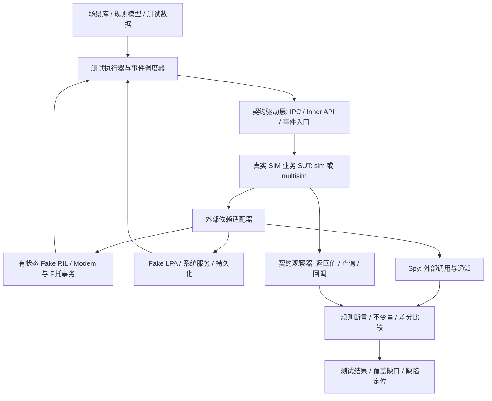

# SIM 卡管理模块重构测试防护网建设设计说明书

> **文档状态**：设计建议稿（Proposed）  
> **版本**：v1.1（融合现有系统测试用例分析）  
> **日期**：2026-11-03  
> **适用范围**：OpenHarmony `telephony_core_service` 的 SIM 卡管理业务，覆盖现有 `services/sim/` 及目标 `services/multisim/`  
> **定位**：重构前置工程方案、跨团队评审依据、测试用例资产转化与 AI Agent 实施基线  
> **输入资产**：v1.0 设计说明书；《nezha 四卡三待特性 — 测试场景覆盖分析与防护网构建指导》（系统测试团队 392 条用例的二次分析报告，2026-11-03）  
> **证据约束**：本次取得的是**用例分析报告**，并非原始 392 条 xlsx 或实际代码；统计与业务规则先作为“报告归纳事实／候选规则”，未经逐用例或代码独立复核不得标记为最终已批准契约。

## 0. 执行摘要与关键决策

**目标**：在 SIM 生产业务迁移前，建立不依赖模块内部实现的自动化测试防护网。以 SIM 管理为**系统测试边界**，以真实 IPC／进程内接口及外部事件为输入，以可控的外部依赖仿真为环境，以返回值、通知、业务状态、不变量和外部副作用为断言，保障既有行为兼容，并验证 3→4 卡扩展及复杂状态管理的目标能力。**对 nezha 产品配置，具体采用“2 个实体卡位 + 2 个 eSIM Profile 位、最多 3 张同时激活”的四卡三待业务模型；其他产品形态通过独立的能力配置切换，严禁将 nezha 规则当成全部 OpenHarmony SIM 的通用规则。**

本工程最重要的难题不是测试执行框架，而是**在重构人员业务知识不完整的情况下，系统发现业务场景、减少遗漏并确定正确预期**。采用“代码证据驱动的业务场景发现 + 状态／规则模型生成 + 业务专家对争议规则裁决 + 覆盖缺口反查”的方式解决。

| 编号 | 关键决策 | 设计理由 |
|---|---|---|
| D1 | 以 SIM 业务模块为测试边界，不以整个 Telephony SA 为默认被测对象 | 降低环境和定位成本；保留系统级业务链路 |
| D2 | 优先通过既有对外契约驱动、观察，避免调用内部 Manager/Controller | 让用例能够跨 `sim/` 与 `multisim/` 重用 |
| D3 | 使用**有状态 Fake RIL**、依赖适配器、可控异步调度，而非海量固定返回值 Mock | 覆盖插拔、解锁、事件竞争、超时和恢复 |
| D4 | 场景先建模、分级确认，再生成测试；每个场景必须有证据与规则来源 | 控制 AI 推断和错误预期固化风险 |
| D5 | 兼容性回归与目标架构能力验证分开验收 | 旧实现行为未必正确，4 卡可能属于新增能力 |
| D6 | 以接口／事件／状态转换／业务规则的双向覆盖追踪为主，代码覆盖为补充 | 防止“用例很多但关键业务遗漏” |
| D7 | 测试护栏先于生产业务迁移完成最小可用闭环 | 为分阶段重构提供可回归的安全基线 |
| D8 | 把系统测试报告转为版本化的**场景模型—规则—测试数据**，而非直接把 392 条 UI 手工步骤逐条翻译成 GTest | 复用现有业务知识并压缩重复测试 |
| D9 | 四卡三待的 **Card/Profile 存在数、激活数、网络注册数**分开建模；UI“置灰/弹窗/信号格”与后端契约分层判定 | 避免把 UI 表象或 4 卡存在误当成 4 卡激活 |
| D10 | 原始统计及未裁决规则须标记证据来源和复核状态，异常/并发用例另行设计 | 防止错误统计、旧缺陷或模型推断污染强断言 |

**约束声明**：本文是基于既有架构讨论的建设设计，尚未逐项校验用户当前 DEV／TRUNK 私有工作区的真实接口、回调、构建图及产品策略。文中的接口名、状态值、测试数据和目录均为**设计示例**；实际实现必须通过代码取证后确认。硬件支持能力、平台差异和 4 卡场景不得凭假设宣称已实现。以下量化信息来自测试团队的**二次分析报告**，尚未独立重新统计原始 xlsx。

### 0.1 本版新增的可执行输入

1. **真实业务规格线索**：nezha 四卡三待的卡/账户/角色状态、卡托共同插拔、eSIM Profile 占位和上限、三选二/三选三及取消回退、重启/OOBE/下载行为。
2. **用例资产结构**：392 条按八个事件族组织，形成了优先级、初始态、转移态、断言视角和原始覆盖空白的直接证据。
3. **实现清单**：StateSnapshot、Fake RIL（双实体槽卡托事务）、Fake LPA、Fake Persistence、Oracle、生成器与覆盖报告的最小接口约定。
4. **可追溯交付**：原始用例族 → 规则 ID → 场景 ID → 测试 target → 执行结果 → 缺口/裁决工单。

### 0.2 本版变更记录

| 版本 | 变化 |
|---|---|
| v1.0 | 通用 SIM 系统测试边界、代码取证、AI 场景发现、Fake、差分与门禁设计 |
| **v1.1** | 融合 392 条 nezha 用例分析：增加产品状态模型、八个事件族、规则表、覆盖迁移矩阵、异常盲区、参数化示例、统计数据质量控制、M0～M4 细化验收 |

## 1. 背景、目标与非目标

### 1.1 背景

现有 SIM 业务存在以 `slotId` 为核心的关联及状态管理路径；多卡扩展、eSIM Profile／Port、默认卡策略、异步事件和错误恢复存在跨模块联动风险。目标重构从现有 `services/sim/` 迁移到 `services/multisim/`，逐步收敛状态所有权、业务责任和代码依赖。由于生产业务尚未迁移，测试防护网应首先服务**当前实现**，再成为迁移验收依据。

测试建设的现实困难包括：业务知识分散在代码与历史经验中；事件触发入口不止 IPC；真实 Modem 场景不易稳定复现；原有测试可能耦合内部类；旧实现可能包含隐蔽缺陷；多卡、异步、异常组合数量迅速膨胀。

### 1.2 建设目标

1. **兼容性**：对外接口语义、错误码、通知及关键业务副作用不因内部迁移而退化。
2. **状态正确性**：识别并测试 SIM、Card、Profile、Subscription、Port 与默认卡的生命周期和映射关系。
3. **扩展性**：以能力矩阵覆盖已支持的单／双卡场景，按目标规格补充三／四卡和多 Port／Profile 测试。
4. **可控性**：无需真实 Modem 即可重现主要事件、失败、乱序、超时和服务恢复。
5. **可追踪性**：每条 P0 用例从接口、事件、状态规则或缺陷证据追踪到断言及执行结果。
6. **低耦合**：业务测试不依赖新架构 T/A/O/R 的私有类、目录和函数组织。

### 1.3 适用范围分层：共性 SIM + nezha 产品规则

- **通用层**：SIM 卡管理对外接口与通知、卡与 Profile/Subscription 映射、状态与依赖异常、迁移前后契约兼容。其范围延续 v1.0。
- **nezha 产品规格层**：报告中的 2 个共卡托实体槽 + 2 个 eSIM Profile 位置、最多 3 张激活、主卡及默认卡策略、OOBE 等。用 `product_profile=nezha_4c3s` 明确启用，仅适用于已确认产品/版本。
- **其他硬件/版本**：单/双卡或不同 Modem 能力由能力矩阵独立定义，不能在不存在“四卡三待”的产品上强制执行 I1/I2 等产品规则。
- **“全模块覆盖”与“nezha 特性覆盖”不是同义词**：现有分析报告仅代表国内非漫游的 nezha 功能测试。PIN/PUK、其他 eSIM 平台行为、STK/Records/Phonebook、Radio 复杂故障仍需独立取证和建模，不能因报告缺失而判定不重要。

### 1.4 现有系统测试资产基线与数据质量

本次作为输入的不是原始 xlsx，而是系统测试团队对 **392 条**手工用例的二次分析，报告提供如下资产分布（均为报告所述统计口径）：

| 维度 | 分布 | 防护网利用方式 |
|---|---|---|
| 用例集 | `nezha基础场景` 348 条 + `nezha OOBE` 44 条 = **392** | 形成 `source_suite` 标签，保留源用例映射 |
| 事件族 | 插拔卡托 78、重启 123、启停 30、添加 eSIM 90、删除 9、重置 16、编辑 2、恢复出厂 44 | 作为场景发现的初始分类及风险权重 |
| 重启细分 | 不换卡 67、换卡 56 | 分开做“持久化恢复”和“身份重新识别”测试 |
| 用例级别 | level0 66、level1 41、level2 284、未标 1 | 映射成建议优先级，不能不经评审直接决定门禁 |
| 自动化标注 | 报告称 214 条可自动化、133 条手动、OOBE 44 条受物理操作影响 | L1 以事件仿真消除部分操作限制；L3 保留真机验证 |
| 核心断言 | 报告列有主卡、号码、状态栏、eSIM 列表、时延等出现次数 | 提炼统一快照和事件断言，不照抄 UI 操作步骤 |
| 覆盖边界 | 国内、非漫游、功能测试；几乎没有失败/超时/并发用例 | 明确增量异常注入和其他业务域的缺口 |

**统计与语义复核事项（不能静默修正）：**

1. 报告写“214/348=54.6%”，但按分子分母计算约 **61.5%**；214+133=347，348 条基础用例中还有 **1 条分类不明**。以原始 xlsx 的字段逐项复核后再发布自动化覆盖率。
2. 报告执行摘要称“212/392 条断言主卡”，规则表又写“主卡断言 202 条”；两者口径不一致，应区分“断言出现次数/用例数/预置条件”，暂不作为 KPI。
3. 报告称快照断言可覆盖“90% 原始断言”，这属于**需要用实际断言映射验证的工作假设**，并非已验证覆盖率。
4. 报告的“前 N 卡→后 M 卡”矩阵含 `4→4`，必须核实 N/M 是**存在/配置的卡数**还是**激活数**。对 nezha，`active_count ≤ 3`，不允许出现 4 张同时 ACTIVE 的合法稳定态。
5. “卡托两槽同帧变化”“重启恢复全部原样”“eSIM 掉网再驻网”“5s/4s”等先按产品测试预期登记，真实 RIL 消息原子性、策略条件和硬件时延均须由代码及 L3 测试确认。

### 1.5 值得保留的业务知识

报告不仅提供用例数量，更提供**业务行为的条件—事件—结果关系**：例如卡托拔出与 eSIM Profile 持续存在、占满三激活名额时进入用户选择、Profile 下载不等于激活、不同默认角色的失效表示、关机换卡与热插拔的不同初始化路径。这里的知识优先转为可检查规则，而不是另建一套与报告脱节的 AI 推测规则。

### 1.6 非目标

- 不试图以本地 Fake 替代真机、射频、Modem、运营商网络及全链路集成测试。
- 不以新增测试为由改变既有对外 IPC／Inner API 契约。
- 不直接以旧代码运行结果作为全部业务规则的正确性证明。
- 不以穷举所有输入组合或达到 100% 代码覆盖作为完成标准。
- 不在第一阶段为所有 STK、Phonebook、Records、eSIM 子能力建设全量仿真。
- 不在 L1 复现 OOBE 折叠/展开的真实 UI、物理卡托电气时序、实际网络注网质量或真机 5s/4s 性能指标；这些应交由 L3 或上层 UI 测试。

## 2. 测试边界与总体架构

### 2.1 边界定义

**被测系统（SUT）**：真实 SIM 生产实现及其必要的应用／领域逻辑；初期为现有 `services/sim/`，重构后为 `services/multisim/`。运行方式优先为本地可装载的业务库；若当前尚不能独立装载，可先使用测试宿主与明确的最小必要适配层。

**输入边界**：① SIM 相关 IPC；② 被其他进程内模块使用的正式 Inner API；③ 来自 RIL／系统服务的异步回调与事件；④ 生命周期启动、停止与恢复控制。不能只统计 IPC，否则会遗漏由设备事件驱动的核心业务流程。

**依赖边界**：从 SIM 向 RIL、持久化／偏好配置、系统能力、账户或其他相关模块发出的调用，按真实代码依赖逐项识别，并替换为可控 Fake／Stub／Spy。**不是所有进程内依赖都应打桩**：属于 SIM 核心业务的逻辑应当保持真实执行。

**观察边界**：接口返回值、公开查询结果、回调／通知序列、外部调用记录、关键资源生命周期。内部状态仅在排障与低层单测中使用，不得成为系统级回归的主要断言依据。



### 2.1.1 从 UI 手工操作到 L1 业务场景的映射

| 系统测试步骤/预期 | L1 驱动/观测 | L2/L3 保留责任 |
|---|---|---|
| 设置界面启停卡、默认卡配置 | 真实业务公开接口（经 Contract Driver） | L2 验证 IPC/权限；UI 联动与文案由 L3/应用测试验证 |
| 手动拔出两个实体卡共用的卡托 | Fake RIL 设备状态原子变更 + 按真实接口契约发送通知 | L3 验证物理托盘和 RIL 报告时序 |
| 下载 eSIM 并选择是否自动激活 | 正式下载/激活入口 + Fake LPA 回调和受控 Profile 数据 | L3 验证真实下载链路、SM-DP+/LPA 联动 |
| 状态栏“显示 K 个信号” | 分开观察 ACTIVE 集合及已注册网络集合 | L3 验证状态栏呈现；不能简单规定“信号数=激活数” |
| 默认数据“置灰”、弹出“停用某卡”对话框 | 后端可用性/决策结果/通知（若存在正式契约） | UI 禁用态、弹窗文字、按钮行为由上层与 L3 验证 |
| 号码与运营商显示一致 | 对外卡/账户/Profile/记录查询结果对照 | L3 验证不同界面渲染和数据刷新 |
| 关机换卡、重启、恢复出厂/OOBE | 启停测试宿主 + 持久化恢复/清除 + Fake RIL 开机重枚举 | L3 验证实际重启和 OOBE 物理/交互流程 |

### 2.2 分层验证

| 层级 | 核心内容 | 执行场景 | 职责 |
|---|---|---|---|
| L1：本地业务级系统测试 | 真实 SIM 业务 + 仿真外围 + 场景断言 | 开发本地、每次关键提交 | 主体防护网；强调速度与确定性 |
| L2：真实契约验证 | 真实 IPC Stub／Proxy、Inner API 绑定、事件订阅链路 | CI 或集成构建 | 证明测试驱动层未绕过对外兼容性风险 |
| L3：设备／系统集成测试 | SA、RIL Adapter、Modem、真实系统服务 | 夜间、里程碑、版本集成 | 发现 Fake 无法模拟的集成差异 |

L1 不应因直接链接业务库而被错误称作“已验证 IPC 兼容性”；L2 须独立验证接口序列化、权限、异常路径与订阅契约。

## 3. 基于代码事实的业务场景发现机制

### 3.1 五类证据源

| 证据源 | 取证动作 | 主要产物 |
|---|---|---|
| 对外接口及调用方 | 扫描 IPC、Inner API、实际跨部件调用 | 接口清单、调用方、使用场景及错误码 |
| 外部事件／回调 | 追踪 RIL 通知、异步响应、系统监听入口及最终消费者 | 事件词典、事件处理链和触发条件 |
| 状态与控制流 | 找出状态枚举、状态读写点、分支、重试、定时器、资源创建／释放 | 状态图、条件判定表、异常路径 |
| 现有用例与历史缺陷 | 分析 GTest、Fuzz、缺陷单、修复提交及回退；导入 nezha 392 条分析报告的业务语义 | 回归风险条目、业务规则候选、场景族/覆盖空白 |
| 真实运行轨迹 | 脱敏采集典型业务日志及事件序列，与静态模型比对 | 未建模时序、现场差异与真实频率线索 |

代码仓可能处于不同版本或产品形态：每条证据必须记录**仓、分支、commit、文件／行或符号、平台条件**。DEV 与 TRUNK 来源不得未经验证合并为同一运行事实。

### 3.2 场景发现工作流

1. **建立边界索引**：外部输入、输出契约、向外依赖、调用者和条件编译，统一编号。
2. **抽取业务路径**：从输入与事件出发，追踪到状态变更、通知、持久化、错误与补偿；识别跨域影响。
3. **抽取候选规则**：把分支条件、状态写入、错误处理写成“给定条件—事件—应观察结果”；区分代码事实与意图推测。
4. **合并成场景族**：初始化、识别与解锁、账户可用、默认卡与协同、切换、异常恢复，覆盖 Records／STK 等附属能力。
5. **系统补漏**：对每个状态构建进入／退出路径；对每个外部事件生成正常、失败、重复、延迟、乱序、取消等候选路径；进行多卡交互与组合设计。
6. **规则裁决**：明确的契约可直接固化；有争议或缺少证据的结果进入待确认清单，不能默认为通过规则。
7. **双向覆盖反查**：业务模型→测试，以及代码入口／关键分支／状态写入→测试，形成未覆盖明细。

### 3.2.1 原始用例→自动场景的语义转化流水线

**禁止直接按手工用例条目数生成同等数量的 GTest**，而应进行如下转换：

```text
系统测试报告（现有 392 条用例语义）
  → [产品/版本/来源标签] + [初始态] + [动作/事件] + [观察点/结果]
  → 归一化场景族（热插拔、重启、启停、下载、删除、重置、编辑、OOBE）
  → 规则候选 I1-I8、R-1…R-9 + 需业务裁决事项
  → 合法状态/转换/等价类/故障扩展
  → 场景数据（可参数化）+ Oracle + 可追踪映射
  → L1 本地执行、L2 契约验证、L3 设备场景回填
```

对每条候选场景记录 `origin=existing_manual|code_discovered|model_generated|defect_replay`，另标 `raw_case_ref`、`source_report_section`、`source_rule_id`。二次报告没提供的原始 xlsx 行号**不得编造**；只关联事件族/报告章节，日后拿到源表再补全细粒度映射。

**新增两项交叉检查：**

- “报告→代码”：检查每条高优先级业务规则在目标代码的入口、状态转移、事件输出和相关服务中是否找得到可观察实现；找不到标 `UNMAPPED`，不能把预期当成已实现事实。
- “代码→报告”：扫描 SIM 其它状态/接口/错误路径，对报告未覆盖的 PIN/PUK、异步回调、持久化故障等生成**新场景**；不能因报告集中于 nezha 特性，就遗漏全模块测试责任。

### 3.3 AI 多 Agent 分工及约束

- **A：契约与调用方 Agent**：提取对外接口、调用方、回调订阅、输入边界。
- **B：状态与生命周期 Agent**：构建状态转换、Card／Profile／Subscription 映射和不变量候选。
- **C：外部依赖与故障 Agent**：识别 RIL 事件、超时、重试、补偿及异常路径。
- **D：系统测试资产与变更 Agent**：读取 nezha 用例分析报告及现有 GTest/缺陷，识别既有覆盖高密度区域、明确盲区与高变更热点；检查来源统计矛盾。
- **汇总 Agent**：合并去重、证据核验、冲突清单、测试优先级、覆盖矩阵，不直接将推测写为已确认事实。

Agent 输出必须具备：`场景 ID、触发入口、前置条件、事件、状态／结果、证据位置、预期依据、可信等级、待确认问题、测试映射`。不允许无代码证据地虚构正式接口名、错误码、产品能力与外部规则。场景生成可并行，最终裁决需集中完成以避免模型彼此引用形成虚假的“共识”。

### 3.4 业务专家最小参与方式

不要求专家从空白文档手写几百个用例，而是集中处理如下规则问题（新增报告证据后按风险排序）：

- 当默认数据卡被移除且其他账户可用时，是否自动切换、清空还是保持待恢复状态？适用产品条件是什么？
- PIN 解锁回调与拔卡事件交错时，哪些结果必须忽略，哪些事件必须发布？
- eSIM Profile 切换失败时，默认卡、账户有效性及持久化状态应如何恢复？

每个问题附**代码证据、候选结果、用户可见影响、推荐规则、风险级别**，由业务 owner 明确结论、条件及生效版本。没有裁决的用例标为 `NEEDS_DECISION`，不得假造预期并作为 CI 通过依据。

## 4. 业务模型、用例生成与遗漏控制

### 4.1 业务概念与维度

必须区别 `Slot`（物理槽位）、`Card`（卡实体）、`Port`（eUICC 端口）、`Profile`（eSIM 配置）、`Subscription`（账户）、`DefaultRole`（默认数据／语音等角色），不得默认一一对应，也不得统一用 `slotId` 代替业务身份。

| 维度 | 候选值／变化 | 约束 |
|---|---|---|
| 卡配置 | 0/1/2/3/4 卡、pSIM/eSIM 混合 | 以产品／Modem 能力标注合法组合 |
| 生命周期 | 启动、初始化、就绪、拔卡、服务重启 | 状态名与转换须从实际代码提取 |
| 认证状态 | 需 PIN、解锁成功／失败、PUK 等 | 尊重重试与锁定规则 |
| 账户／角色 | 激活／停用、默认卡选择、账户失效 | 依据产品策略确认优先级与回退 |
| 外部调用 | 成功、错误、超时、晚到响应 | 对每种外部操作确认有意义的故障模式 |
| 事件时序 | 顺序、并发、重复、乱序、取消 | 受真实执行模型及 happens-before 约束 |
| 资源恢复 | Radio 重置、依赖服务重启、配置恢复 | 需定义稳定点与最终一致性时限 |

### 4.1.1 nezha 四卡三待产品状态模型（本版重要增补）

报告给出的产品模型是 **2 个实体卡槽 SIM1/SIM2 共用一个卡托 + 2 个 eSIM Profile 位置 eSIM1/eSIM2**；实体卡可因物理拔卡变 ABSENT，已下载但未激活的 eSIM Profile 仍占 Profile 位置。存在/配置 4 个卡身份不等于同时激活 4 张卡。

```yaml
product_profile: nezha_4c3s
physical_tray: {slots: [SIM1, SIM2], shared: true}
esim_capacity: 2
max_active: 3
cards:
  SIM1: {presence: ABSENT|PRESENT, activation: INACTIVE|ACTIVE, identity: ICCID?}
  SIM2: {presence: ABSENT|PRESENT, activation: INACTIVE|ACTIVE, identity: ICCID?}
profiles:
  eSIM1: {existence: NONE|DOWNLOADED, activation: INACTIVE|ACTIVE, iccid: string?}
  eSIM2: {existence: NONE|DOWNLOADED, activation: INACTIVE|ACTIVE, iccid: string?}
roles:
  primary_card: SIM1|SIM2|eSIM1|eSIM2|NONE
  default_voice: SIM1|SIM2|eSIM1|eSIM2|NOT_SET
  default_data: SIM1|SIM2|eSIM1|eSIM2|UNAVAILABLE_OR_UNSET # 产品真实字段待映射
network:
  registrations: [] # 单独观测，不能直接等于 active_count
derived:
  present_or_downloaded_count: 0..4
  active_count: 0..3
```

这里的结构用于测试域建模，不要求生产代码引入同名枚举/类。报告的简化组合 `3^4=81`、移除“4 个全 ACTIVE”得到 **80**，只代表**独立槽/位的三态基础组合上界**；再叠加物理卡与账户映射、Radio/Port 资源、角色合法性、产品版本之后，需要进一步做可达性过滤。

**状态口径强制分离：**

- `present_or_downloaded_count`：物理卡存在数 + 已下载 Profile 数，最大 4；原报告“4 卡”通常涉及这一层，需逐场景确认。
- `active_count`：卡/账户处于激活态的数量，nezha 约束最多 3。
- `registered_count`：实际已注册网络的卡数，受 Radio/覆盖/业务条件影响，**不可由 active_count 直接推导为相等**。
- `primary_card`、`default_voice`、`default_data`：三个不同角色，既有用例出现联动，但不得未经规则裁决合并为同一个字段。
- `GREYED_OUT` 是界面展示语义，后端需要找到对应的“默认数据卡引用、账户可用性、禁用原因”等正式字段；找不到则由 L3 UI 校验，而非新增虚构核心状态。

### 4.1.2 运营商等价类及特殊边界

系统测试报告使用移动、联通、电信、广电及 ICCID 前缀作为测试数据字典，并强调**全同、全异、部分同**运营商组合。推荐用 `{ALL_SAME, ALL_DIFFERENT, MIXED}` 生成，而不是把每个运营商标签都组合穷举。ICCID 前缀映射仅作为**现有测试数据约定**，不能被当作覆盖所有运营商/MVNO/真实网络情况的生产规则。

保留以下高价值边界：纯 eSIM 且无实体卡（报告列 17 条）、两实体卡托共同插拔、交换实体卡位置、同运营商换卡/异运营商换卡、已下载未激活 Profile 占位、四身份存在但最多三激活、默认卡指向被移除/停用目标。

### 4.2 场景生成策略

1. **契约等价类与边界值**：合法／非法 ID、无卡、空记录、最小／最大支持卡数、错误码。
2. **状态转换覆盖**：每条合法转换至少 1 条正常路径，每个高风险状态至少检查非法输入和异步打断。
3. **业务判定表**：默认卡选择、账户启停、eSIM 切换等按条件—动作表识别缺失分支。
4. **组合覆盖**：先做业务合法组合和 Pairwise，再对“多卡×并发×异常”等高风险点进行三因素及定向组合；禁止不加约束的全组合爆炸。
5. **事件序列／模型测试**：由状态模型生成可复现的事件序列，记录随机种子并支持失败缩减。
6. **变形关系（Metamorphic）**：例如不相关卡的只读查询不改变任何卡状态；重复状态通知不应造成资源重复创建（具体通知规则需确认）。
7. **历史缺陷回归**：对已修复问题固定复现输入与必需的外部可观察结果。

### 4.2.1 基于 392 条用例的八个场景族及优先级

| 场景族 | 报告用例数 | 核心状态/动作 | 优先转化为 L1 的断言 |
|---|---:|---|---|
| HotPlug 卡托插拔 | 78 | 共同卡托插拔；3→3、3→2、2→3 等；换卡与位置交换 | 两个实体槽状态与身份重新识别；eSIM Profile 不被删除；默认卡迁移 |
| Reboot 重启 | 123（不换卡 67 + 换卡 56） | 关机换卡、普通重启、状态恢复 | 持久化、开机重枚举、身份一致性及恢复结果 |
| Enable/Disable 卡启停 | 30 | 激活/停用；超限的用户选择与取消 | `active_count ≤ 3`、状态回退、通知与角色更新 |
| Add eSIM | 90 | 下载/添加；自动激活或仅下载；Profile 位满 | Profile 存在与激活分离、下载期间旧卡不受影响、满员拒绝 |
| Delete eSIM | 9 | Profile 停用/删除 | 占位释放、活跃状态处理、错误契约 |
| Reset eSIM | 16 | 清空 Profile | 账户及默认角色回退、持久化清理 |
| Edit | 2 | 修改卡昵称 | 更新/重启后的持久化值 |
| Factory Reset / OOBE | 44 | 保留/清除 eSIM、首启引导 | L1 测数据语义；L3 测引导 UI 和物理交互 |

“场景族数量”不是“可生成的测试条数”。报告提出**约 100 个参数化场景**的规模设想，作为首轮预算和去重目标即可，**不得宣称已经证明其对 392 条用例形成语义超集**；必须用下文规则/观测覆盖与源用例映射实际验收。

### 4.2.2 基于事件和状态的三层生成策略

1. **等价类降维**：按 `(存在卡数、激活卡数、eSIM参与数、运营商组合、默认角色)` 选代表状态；只保留业务规则分叉，其他组合登记豁免原因。
2. **迁移与决策覆盖**：覆盖可达的 N→M 转移、同卡/换卡/换位置、下载自动激活/不激活、三选二/三选三的全部合法选择与取消、重启保持、恢复出厂保留/清除。
3. **风险驱动增量**：把“异步/并发/错误/超时/丢失/重复/重放”作用到高风险转移，优先覆盖报告缺失而对重构最敏感的路径。

每个生成组合须通过 `supports(capability)`、`reachable(initial, action)`、`allowed_by_policy(rule_version)` 三个过滤器；**全状态对并非都能通过单次重启换卡达到**。

### 4.3 业务不变量（待以代码和规则确认）

| ID | 不变量候选 | 观察方式 |
|---|---|---|
| INV-01 | 不同卡／账户业务状态不得发生无因串扰 | 操作前后逐账户查询与通知比对 |
| INV-02 | 已移除 Card 的失效会话不得被迟到响应重新激活 | 乱序注入后查询及 Spy 检查 |
| INV-03 | 对外返回的 Card／Profile／Subscription 关联满足有效性约束 | 查询集合的一致性校验 |
| INV-04 | 默认卡引用满足产品策略定义的有效性条件 | 查询、事件及持久化结果联合断言 |
| INV-05 | 操作失败后不会留下不可恢复的中间态 | 故障注入、重试及恢复到稳定点 |
| INV-06 | 重复初始化／重复通知不会重复占用资源或发布违约通知 | Spy、资源计数、事件序列 |

**注意**：INV-04 等涉及策略选择，必须由业务 owner 确认；状态唯一写权等架构内部约束另设静态／单元测试检查，不冒充黑盒业务不变量。

### 4.3.1 nezha 专属规则表：I1-I8（候选规格，不覆盖通用 INV）

报告归纳的八条 I 规则转化为下表。**“强度”是现阶段门禁资格建议，不是对原始测试正确性的保证**。即便某条源用例很多，也需要验证实际可观察接口与适用产品条件。

| 规则 | 报告归纳的行为 | 报告中的证据量 | 建议门禁处理 |
|---|---|---:|---|
| **I1 激活上限** | nezha 同时 ACTIVE 数 ≤3；激活第 4 张需决策，取消无部分提交 | 显式约 28 条 | 上限可作强候选；决策/取消全事务回退边界须确认并测事件副作用 |
| **I2 共卡托与 eSIM** | 拔出实体卡托后两个实体槽为 ABSENT；eSIM Profile 保留；报告预期短暂掉网后恢复 | 78 条 | 实体存在性与 Profile 保留重点断言；RIL 上报原子性和射频掉网时序 L3 复核 |
| **I3 主卡迁移** | 主卡不可用后应有合法归属，某些场景迁往仍可用卡或恢复原位 | 规则表 202 条，摘要另称 212 条 | **NEEDS_DECISION**：具体选择优先级；未确认前仅校验“不引用已失效对象”等必要安全属性 |
| **I4 默认卡失效** | 语音默认卡呈“不设置”；数据默认业务 UI“置灰” | 60 / 49 条 | 区分后端状态与 UI 语义；恢复自动回选策略 **NEEDS_DECISION** |
| **I5 重启与恢复出厂** | 普通重启保持激活/主卡/Profile/昵称；恢复出厂区分保留/清除 eSIM | 67 + 44 条 | 按明确产品/用户设置逐字段断言；重置/持久化范围需核实 |
| **I6 时延** | 开机亮屏后注网 5s 内；卡启停 4s 内（报告预期） | 111 / 30 条 | L1 仅验证因果顺序和虚拟时钟超时逻辑；**物理硬时延交 L3** |
| **I7 展示数据一致** | 号码、运营商、ICCID/昵称在相关查询/界面一致 | 号码正确 267 条 | L1 核对底层查询；多 UI 展现一致性交 L3/UI 测试 |
| **I8 下载隔离** | 正常 eSIM 下载不应影响既有激活卡 | 约 86 条 | L1 基于 Fake LPA + 旧卡状态/事件 Spy 做强候选；实际驻网中断需 L3 验证 |

**断言执行时机**：稳定态必查 I1、有效身份引用、Profile 占位等硬不变量；事件中间态只检查明确要求的安全约束；I2/I5/I7/I8 等在相应事件终态/时点验证；I6 不能用逻辑时钟伪装真机物理性能测量。对 I3/I4 不能采取“不管哪个结果都算通过”的伪通过策略，允许状态集合必须有独立的已确认依据，未确认则记 `BLOCKED_BY_POLICY`。

### 4.3.2 操作语义规则 R-1～R-9

| 规则 | 主要语义 | 归属/状态 |
|---|---|---|
| R-1 | 合法插卡后新卡默认启用；触发超限则进入 I1 决策 | nezha 产品策略，验证默认启用条件 |
| R-2 | 同槽换卡按身份变更重新识别；SIM1/SIM2 交换位置是独立测试族 | 作为确定性 Fake RIL 身份迁移场景 |
| R-3 | eSIM 下载可自动激活或仅下载；未激活 Profile 仍占位 | Fake LPA 必须支持两分支 |
| R-4 | 主卡/默认卡所指对象失效后触发回退；重新启用是否回选原角色不明 | **NEEDS_DECISION** |
| R-5 | eSIM ACTIVE 与实体卡 ACTIVE 都占用 nezha 三待名额 | I1 配套不变量 |
| R-6 | 两个 eSIM Profile 位被占用时新增 Profile 失败，状态不应改变 | 报告提 3 条，错误码/错误提示需代码映射 |
| R-7 | 已激活 Profile 删除通常需先去激活；直接删除的行为及错误契约需核实 | 归纳有 9 条相关用例；代码/产品确认后强断言 |
| R-8 | eSIM 重置清空 Profile，默认角色按 I3/I4 规则处理 | 清空可强候选，默认角色部分待裁决 |
| R-9 | 卡昵称在停启/重启等操作后保持 | 数据持久化用例，核实实际持久化范围 |

规则在代码中必须有版本化配置：`rule_id`、`product_profile`、`applicable_build`、`source_ref`、`approval`、`oracle_scope`、`test_ids`；即使 AI 自动提炼，也不得将推断标记 `APPROVED`。

### 4.3.3 业务专家优先裁决的争议

| 裁决 ID | 核心问题 | 当前证据缺口 | 对测试门禁的影响 |
|---|---|---|---|
| DEC-01 | 主卡失效后迁移优先级：实体卡/eSIM、运营商、历史设置、槽位是否参与排序？ | I3 只有结果态样本，缺全局优先级法则 | 阻断 I3 的唯一终态强断言 |
| DEC-02 | 默认拨号“不设置”及默认数据置灰后，卡恢复是否自动回选？ | I4/R-4 恢复策略不足 | 阻断恢复后的默认角色强断言 |
| DEC-03 | 数据卡置灰后是否可由另一激活卡临时接管？ | UI 表达与业务状态未映射 | 阻断跨角色协同场景结论 |
| DEC-04 | 三选二/三选三取消、超时或关机时，哪些状态/通知/持久化写入必须回滚？ | 原始取消仅 2 条 | 阻断取消回退的完整副作用断言 |
| DEC-05 | eSIM“去激活”“停用”是否同一操作？删除是否允许内部自动停用？ | 用例术语混用 | 阻断删除错误码及流程断言 |
| DEC-06 | 物理共卡托插拔在 RIL 层是一个事务消息还是两个槽位独立回调？ | 报告描述“原子”，缺底层消息契约 | 阻断对回调同步性的过度断言 |
| DEC-07 | 5s/4s 的起止点、产品环境、统计方式是什么？ | UI 文案和设备操作条件不足 | 阻断 L3 性能判定方式 |
| DEC-08 | 恢复出厂保留 eSIM 是否包含 Profile 激活态/昵称/用户偏好？ | I5 为汇总表述，需对照规格/代码 | 阻断细粒度持久化断言 |

### 4.4 场景证据等级与测试预期来源

| 等级 | 依据 | 处理方式 |
|---|---|---|
| A：明确契约 | 已批准接口／产品规格与代码匹配 | 可直接作为强断言 |
| B：已确认规则 | 业务 owner 批准的状态规则／不变量 | 可作为强断言，登记适用条件 |
| C：历史实现基线 | 旧代码稳定可观察行为但缺少规范 | 作为兼容性差分基线；差异须审查 |
| D：AI／静态推断 | 代码推断、模型建议或未知业务意图 | 仅候选，不得进入强门禁 |

正确性优先级为：**明确产品／接口规范和已裁决规则 > 经审核的不变量 > 经审核的旧实现基线 > 未证实推断**。已知旧缺陷须挂独立修复条目，不能为了新旧一致而保留错误。

### 4.5 迁移矩阵：将报告“缺失格”转为可达性审查清单

系统测试报告给出的“重启换卡前后 N→M”矩阵如下。**此矩阵暂按“卡数量标签”忠实转录，不解释为激活数量**；源报告同时写了 active_count≤3，因而 N/M=4 必须在源用例或原始 xlsx 中确认具体口径。

| 初始 N \ 目标 M | 0 | 1 | 2 | 3 | 4 |
|---:|:---:|:---:|:---:|:---:|:---:|
| 0 | · | ✓ | ✓ | △ | △ |
| 1 | △ | · | ✓ | ✓ | △ |
| 2 | △ | △ | · | ✓ | ✓ |
| 3 | △ | ✓ | ✓ | · | △ |
| 4 | △ | △ | ✓ | ✓ | · |

`✓`：报告归纳已有案例；`·`：同态流程另按“不换卡重启”覆盖；`△`：报告称缺失的 **10 个候选格**，**不等于已证实可达且必须在“重启换卡”模式中执行**。

生成器对 △ 依次判断：① N/M 的口径；② 共卡托仅可替换两个实体卡，不能因重启凭空生成/清除已下载 eSIM；③ Profile 是否允许在对应事件族中新增、删除或自动激活；④ active_count≤3；⑤ 产品/Modem 的能力条件。判定结果分别记录 `REACHABLE_MISSING`、`UNREACHABLE_WITH_REASON`、`NEEDS_MODEL_CLARIFICATION`，只对可达缺口生成门禁场景。对于不可由单次“关机换卡”到达，但可经“删除 Profile + 拔卡”达到的目标，可放入**组合生命周期场景族**单独测试。

### 4.6 覆盖策略与规模估算

使用“已见场景保存 + 未见合法分支补齐”的原则：

- **先保住高风险已见行为**：HotPlug 3→3、3→2、2→3；重启 2/3 卡；2p+1e 与 1p+2e；纯 eSIM；同/异运营商；三待上限。
- **再扩大分支**：每个 R/I 规则的正常、拒绝、取消（适用时）、恢复，以及默认角色失效后的稳定态。
- **最后增加故障与交错**：Fake LPA 失败与超时、RIL 重放/乱序/丢失、持久化写失败、下载与卡托插拔并发、用户决策与关机交错。

报告中“约 40～60 个迁移场景 + 约 30 个定向场景，总计约 100 个参数化场景”的规模属于粗估。验收不是用例数缩减率，而是：**源规则与 P0 场景映射完整、可达迁移格覆盖、关键异常被实际触发、断言来源明确、L3 责任不丢失**。

## 5. 测试框架详细设计

### 5.1 组件分工

| 组件 | 主要职责 | 必须提供的能力 |
|---|---|---|
| Scenario Runner | 读取场景、准备前置条件、驱动操作 | 标签、能力约束、稳定复现、结果导出 |
| Contract Driver | 使用真实 IPC／Inner API 驱动 SUT | 参数构造、错误检查、订阅管理 |
| Event Injector | 从依赖边界注入外部事件与回调 | 时间顺序、重复、丢失、延迟、取消 |
| Stateful Fake RIL | 仿真实体卡、Radio 与卡托，必要时暴露 Port 关联 | 双槽事务、换卡身份、请求—响应、主动上报、异常与调用记录 |
| Fake LPA / eSIM | 模拟 Profile 下载、安装、激活选择、占位和失败 | 下载完成/取消/超时/失败、满位、回调可控；确认 eSIM 职责边界 |
| Fake Dependencies | 模拟持久化、系统能力及必要旁路依赖 | 保留/清除 eSIM、持久化失败、服务重启、无跨用例污染 |
| Scheduler / Virtual Clock | 管控定时器、异步任务与超时 | 可确定性推进和失败轨迹重放；无法接入处使用受控等待 |
| Observer & Spy | 采集查询值、通知、外调和资源 | 事件流、调用参数、稳定点判定 |
| Oracle Engine | 断言契约、不变量、差分结果 | 规则版本、允许事件偏序、归一化 |
| Coverage Reporter | 生成接口／状态／场景追踪与缺口报告 | 证据链、未覆盖清单、回归统计 |

### 5.2 Fake RIL 设计重点

**有状态而非固定返回值**：每个模拟卡或 Port 保持可变的可观察配置；每个请求生成可跟踪的响应；支持主动卡状态上报。支持故障模式：正常、拒绝、超时、延迟响应、响应先后交错、Radio 不可用、重启和资源失效。

**nezha 卡托约束**：一次 `eject_tray` 或 `insert_tray` 操作先以**一个设备操作**更新 SIM1/SIM2 的物理存在事实；然后通过实际 RIL Adapter 兼容的回调机制传递。若真机契约使用两个独立回调，不得强行把内部同步“同一帧”写成真实 RIL 接口保证；测试以事务结束后的状态一致性和必要的中间态安全性为准。实体卡托操作不得删除 eSIM Profile；短暂失网/重新注册按硬件事件能力注入并在 L3 校验。

**真实性约束**：Fake 只仿真代码所依赖的可观测 RIL 契约，不重新实现真实 Modem 的全部行为。Fake 与 SUT 的协议兼容性需由 L2/L3 测试验证。避免用一个 Fake 自动修正 SUT 的非法状态，掩盖业务缺陷。

**确定性**：每个场景隔离进程／实例／持久化状态；注入时间与随机种子可重放；采用逻辑时钟和显式“达到稳定点”判断，不以固定 `sleep` 代替异步契约。无法虚拟化的线程和外部系统交互需标记非确定性风险。

### 5.2.1 Fake LPA 与持久化子系统的最小接口

```text
FakeTray.update([SIM1?, SIM2?])      # 测试设备操作，内部将两槽物理状态一起提交
FakeRil.emit_card_state(slot, state) # 与真实依赖边界适配后逐条发送/回放
FakeLpa.download(profile, mode)      # mode: auto_activate | downloaded_only
FakeLpa.complete/fail/timeout(id)    # 不自行修改 SUT 业务角色
FakeStore.snapshot/restore/reset(...)# 仅仿真真实持久化契约，故障可注入
Clock.advance_to_next_event()        # 逻辑事件调度，保留确定性轨迹
```

上述名称都是**建议的测试支撑 API**，不代表生产代码存在这些接口。

- eSIM 在下载中、已下载未激活、激活、删除/重置时必须区分 Profile 是否占位；两位置满时安装第三个需按 R-6 失败，不允许 Fake 静默覆盖旧 Profile。
- 下载与删除的内部状态/存储修改应由真实 SUT 业务执行；Fake LPA 只模拟对端协议、成功/失败通知和真实依赖的资源响应。
- `factory_reset(keep_esim)` 首先需要确定当前真实持久化依赖与清除范围，不能简单对整个 FakeStore 做 `clear()` 后自行补回业务状态。
- 对“下电换卡”和“重启不换卡”应使用两个独立 fixture：前者在关机窗口修改实体卡身份并重新枚举，后者保持设备状态不变，仅重新装载业务与持久化数据。

### 5.2.2 StateSnapshot 与事件轨迹 Oracle

```text
StateSnapshot {
  physical_slots: [{slot, present, iccid?, active?}],
  esim_profiles: [{profile_id, downloaded, active, iccid?, operator?, nickname?}],
  primary_card?, default_voice?, default_data?,
  active_count, network_registrations[],
  observed_msisdn_by_identity{},
  pending_decisions[],
}
ObservationTrace {
  input_calls[], ril_events[], lpa_events[], service_notifications[],
  outbound_side_effects[], persistence_effects[], timestamps[]
}
```

所有字段通过**实际对外查询、外部 Spy 和合法只读观测点**获取；`?` 代表按代码能力可选。禁止直接把 Fake 的“理想状态”作为 SUT 的“实际状态”来比较，否则 Fake 与 SUT 同时错误也能测试通过。

比较器至少支持：`assert_snapshot(expected)`、`assert_invariants(rule_set)`、`assert_event_order(partial_order)`、`assert_no_unexpected_effects()`、`assert_eventually(predicate, deadline)`。其中“网络注册与 active_count 的关系”按资源能力和产品策略判定，不默认相等。

### 5.3 为可测试性需要的最小生产代码改造

- 在真实外部依赖调用边界引入可替换实现（Adapter／Factory／构造注入），禁止在业务核心深处到处加入 `#ifdef TEST`。
- 明确启动、初始化完成、取消和销毁生命周期；保留真实业务路径，不为测试另造业务分支。
- 如果 `libtel_sim_service.z.so` 尚未独立构建，先验证以最小测试宿主装载 SIM 实现的可行性；独立库是推荐前置条件，不要求以拆库为借口暂停所有场景取证。
- 把已有业务异步操作的完成语义、回调订阅及状态可查询能力梳理成契约；仅当现有接口无法观察关键事实时，考虑在测试边界追加**只读观测适配**，且不暴露目标架构私有状态作为公共 API。
- 对目标架构的 T/A 事实写权及 O／R 内部规则，另以依赖约束、静态检查、单测保证；业务回归只关注对外行为。

### 5.4 建议的测试资产目录（示例）

```text
test/sim_guard/
├── README.md                  # 执行与准入说明
├── inventory/                 # 接口、事件、依赖及证据索引
├── model/                     # 通用状态模型、nezha_4c3s能力、判定表、不变量
├── scenarios/                 # 场景 YAML/JSON，nezha hotplug/reboot/esim/oobe 子族
├── runner/                    # 场景解释与流程执行
├── drivers/                   # IPC / Inner API / Event 驱动
├── fakes/                     # RIL、持久化、系统服务替身
├── oracle/                    # Snapshot、I1-I8/R-1...R-9、偏序比较、差分
├── traceability/              # 源用例族/规则/场景/测试实现的双向映射
├── approvals/                 # 待裁决业务规则及签署/适用版本
├── reports/                   # 执行与覆盖报告（构建产物）
└── integration/               # L2 / L3 适配与测试入口
```

测试资产按“**场景／证据／驱动／仿真／断言**”分层，而非复制生产 `services/multisim/` 目录。是否放入 `test/` 以及 GN target 命名以现有仓库构建规范为准。

## 6. 场景库与用例数据格式

### 6.1 单条场景规范

每个场景至少记录：`id、业务场景族、版本／设备能力、输入入口、初始条件、事件序列、预期观察、规则／证据、等级、负责人与确认状态、关联自动化用例`。输入来源和输出断言必须相互独立，避免通过同一内部状态变量“自证正确”。

下面是**测试描述示例，不是经核实的正式产品规格**：

```yaml
id: SIM-LC-REMOVAL-001
family: lifecycle
priority: P0
capabilities: [psim, two_cards]
oracle_level: B
rule_status: NEEDS_DECISION  # 仅示意；完成裁决前不得作为强门禁
initial:
  cards:
    - {key: A, state: PIN_REQUIRED}
    - {key: B, state: READY}
  default_data: A
actions:
  - {at_ms: 0, kind: call, api: unlock_pin, card: A}
  - {at_ms: 10, kind: ril_event, event: card_removed, card: A}
  - {at_ms: 20, kind: ril_reply, request: unlock_pin, result: success}
assertions:
  - "A must not become READY from the stale reply"
  - "A resources are invalidated"
  - "default_data follows approved product policy"
evidence:
  - "PENDING: repository / commit / symbol / branch"
review:
  owner: "TBD"
  decision: "TBD"
```

`at_ms` 表示测试逻辑时间；实际 API、状态和值必须由接口台账映射。`default_data` 的处理结果未裁决前不可硬编码为“自动选 B”。

### 6.1.1 nezha 场景数据示例：拔卡托但 eSIM Profile 保留

以下是**面向场景解释器的伪 YAML**，名称并非真实代码 API；示例预期需在获得批准的产品契约、真实接口映射后才可升级为强门禁。

```yaml
id: NEZHA-HOTPLUG-TRAY-001
origin: existing_manual
source_report: '§3.1 / §4 I2 / §5.1 HotPlug (78条)'
raw_case_ref: null  # 未取得原始 xlsx，不编造行号
product_profile: nezha_4c3s
priority: P0
policy_status: CANDIDATE_REQUIRE_CONFIRMATION
initial:
  tray: {SIM1: {iccid: fixture_A, active: true}, SIM2: {iccid: fixture_B, active: true}}
  profiles: {eSIM1: {iccid: fixture_E, downloaded: true, active: true}, eSIM2: null}
  expected_active_count: 3
steps:
  - {kind: device_event, operation: eject_tray}
  - {kind: wait_until, condition: physical_slots_absent, within_logical_steps: 20}
assert:
  - {kind: slot_absent, slots: [SIM1, SIM2]}
  - {kind: profile_unchanged, id: eSIM1, fields: [downloaded, iccid]}
  - {kind: invariant, rule: I1}
  - {kind: policy_oracle, rule: I3, status: BLOCKED_BY_POLICY}
l3_checks:
  - physical_tray_behavior
  - esim_network_reregistration
```

### 6.1.2 nezha 场景数据示例：激活第 4 个卡身份后取消选择

```yaml
id: NEZHA-ACTIVATE-CANCEL-001
origin: model_generated
source_report: '§4 I1 / §6.3 取消分支稀疏'
product_profile: nezha_4c3s
priority: P0
initial:
  configured_identities: [SIM1, SIM2, eSIM1, eSIM2]
  active_identities: [SIM1, eSIM1, eSIM2]
steps:
  - {kind: contract_call, semantic: enable_card, identity: SIM2}
  - {kind: expect_decision_required, semantic: choose_card_to_deactivate}
  - {kind: decision, action: cancel}
assert:
  - {kind: invariant, rule: I1}
  - {kind: active_set_unchanged, identities: [SIM1, eSIM1, eSIM2]}
  - {kind: no_partial_persisted_change}
  - {kind: decision_rule, id: DEC-04, status: BLOCKED_BY_POLICY}
```

这里将“硬不变量 active_count≤3”与“取消后所有外部副作用完全回滚”的待裁决规则分开；**未完成 DEC-04 时只能执行已确认断言，不可直接宣称整个场景通过**。

### 6.2 P0 场景族：共性能力与 nezha 的组合

| 场景族 | 首批必须覆盖的代表情形 | 重点关注 |
|---|---|---|
| 初始化与检测 | 无卡、单卡、双卡并行初始化、重复初始化 | 生命周期与卡标识稳定性 |
| 插拔与失效 | 插卡、拔卡、连续插拔、拔卡后迟到回调 | 清理、通知、会话失效 |
| 解锁与卡可用 | PIN/PUK 成功失败、解锁中拔卡、重试边界 | 状态转换与账户可用性 |
| 多卡与默认角色 | 双卡默认数据／语音切换、目标卡失效 | 账户映射、角色策略、持久化 |
| eSIM | Profile 激活／停用／切换失败（以能力支持为前提） | Port／Profile／账户关系 |
| 并发与恢复 | 两卡事件交错、RIL 超时、Radio Reset、服务重启 | 无串扰、最终稳定与异常恢复 |

P1 延伸覆盖 SIM Records、Phonebook、STK、eSIM 细分管理及跨版本差异。**注意：分析报告对 PIN/PUK 没有覆盖；这不意味着整个 SIM 测试防护网可以排除 PIN/PUK。共性 SIM 的识别与解锁域应在独立场景族补齐，并标明其预期来自代码/契约而非 nezha 报告。**三／四卡属于**新增扩展验证**，不能以原双卡实现未通过四卡作为兼容性回归失败；应分别出具“当前不支持”“目标待实现”“目标已通过”的状态。

### 6.3 来自系统测试报告的 P0/P1 用例种子清单

| 场景 ID 前缀 | 起始种子/变体 | 规则关联 | 推荐层级 |
|---|---|---|---|
| `NEZHA-TRAY-*` | 3→3 同/异运营商换卡、3→2、2→3、交换 SIM1/SIM2、纯 eSIM | I2、I3、R-2 | L1 + L3 物理验证 |
| `NEZHA-REBOOT-*` | 单/双/三卡不换卡；关机换卡后身份重枚举；昵称/主卡/激活恢复 | I3、I5、R-2、R-9 | L1 + L3 |
| `NEZHA-ACTIVE-*` | 第四身份请求激活，选择任一可停用对象、取消、超时、关机并发 | I1、R-1、R-5、DEC-04 | L1/L2 |
| `NEZHA-ESIM-ADD-*` | 自动激活/仅下载/两 Profile 位满、下载过程不影响旧卡 | I1、I8、R-3、R-6 | L1 + 真机下载链路 |
| `NEZHA-ESIM-DEL-*` | 已激活/未激活 Profile 删除；删除失败；占位回收 | R-7 | L1/L2 |
| `NEZHA-ESIM-RESET-*` | 清空两个 Profile，默认角色回退及重复重置 | I3、I4、R-8 | L1/L2 |
| `NEZHA-OOBE-*` | 恢复出厂保留/清除 eSIM，开机状态重建 | I5 | L1 数据层 + L3 UI |
| `NEZHA-FAULT-*` | LPA 超时、RIL 回调重放/丢失、Store 写失败、异步冲突 | I1/I3/I5/I8 及安全属性 | L1 优先建设 |

### 6.4 异常与并发盲区的专门设计

报告原有 392 条以正常业务/交互路径为主，只有极少数容量拒绝验证，**不能从源资产直接继承完整异常行为**。建议新增以下故障矩阵；其中预期必须独立从产品契约或业务 owner 确认，不能凭“软件应该如此”产生强断言。

| 故障/竞态 | Fake 触发 | 最低安全断言 | 待裁决的业务结果 |
|---|---|---|---|
| LPA 下载失败/超时/被取消 | 下载中注入失败、延迟完成回调 | 不超 2 个已下载 Profile 位、不超三待上限、不会无依据影响既有卡 | 半成品 Profile 是否保留与重试策略 |
| RIL 重复、乱序、丢失、迟到 | 回放同事件、请求关联 ID 乱序/丢失 | 不允许已移除卡被无效旧回调重新激活；避免重资源占用 | 特定错误码、重试/补偿时限 |
| 卡托操作与下载交错 | LPA 下载中拔托，再重新插入 | 维持真实物理存在与已下载 Profile 的独立性 | 默认主卡迁移及通知顺序 |
| 决策弹窗期间关机/超时 | Decision Pending 后注入下电/超时 | 不允许稳定态 4 ACTIVE | 回滚和通知/持久化副作用边界 |
| 持久化写失败/损坏 | FakeStore 返回失败、重启后损坏读取 | 不形成不可恢复或违反硬约束的稳定状态 | 回退、重试或重建策略 |
| 快速启停同一卡 | 连续调用启用/停用，交换回调次序 | 合法最终 active 集合、没有无效身份引用 | 最终按最近指令/请求序列/拒绝策略 |
| 纯 eSIM/无实体卡 | 两实体槽 ABSENT，Profile 存在 | Profile 不因托盘变化丢失 | 默认角色如何恢复与驻网策略 |

报告中的国内非漫游/General 制式边界保留为**当前这批 nezha 用例的适用范围**；飞机模式、漫游、网络制式差异和 PIN/PUK 必须在整个模块覆盖台账中登记独立 owner，不能从本项目范围中无声消失。

### 6.5 场景追踪数据模型

```yaml
scenario_id: NEZHA-ESIM-ADD-FULL-001
origin: existing_manual
source_suites: [nezha_basic]
source_report_sections: ['§4 R-6', '§5.1 Add eSIM']
raw_case_ids: [AddeSIM_030101, AddeSIM_030102, AddeSIM_030103] # 来源报告已给出
product_profile: nezha_4c3s
rule_ids: [R-6, I1]
contract_entrypoints: [] # 待代码取证填充真实符号
observables: [profile_set, active_count, operation_error]
l1_test_target: TBD
l3_owner: TBD
oracle_basis: existing_case_semantics
approval: NEEDS_CODE_MAPPING
```

**验收反查**必须产生两张表：① `source_rule_or_case → one_or_more_scenarios/tests`；② `interface_or_event_or_state_transition → scenario_or_approved_exemption`。显示“来源仅为报告/无原始用例 ID”是合法且透明的状态。

## 7. 差分回归与正确性判定

同一场景在**旧实现**与**新实现**上执行，采集：调用返回、错误码、关键状态查询、事件通知及关键外调副作用。通过规范化处理时间戳、动态 ID、允许的异步偏序和非契约性日志，再按正式契约比对。

差异分类：

1. **兼容性缺陷**：违反已批准契约或已确认规则，阻断合入。
2. **旧实现已知问题修正**：需提供缺陷／规格依据与新测试，允许经审核变更。
3. **新增目标能力**：如合法三／四卡场景，按目标规格单独验收，不要求旧实现通过。
4. **规则未定差异**：进入业务裁决清单，不能自动标为成功或失败。
5. **环境／Fake 差异**：排查适配器或调度环境，不允许静默忽略。

为避免“旧代码和新代码同样错误”“AI 同时生成错误实现和错误测试”，每个 P0 场景至少具有一个独立于 SUT 内部私有实现的契约断言或已裁决不变量。

### 7.1 业务兼容与产品扩展两条基线

- **通用兼容基线**：相同能力、相同接口契约、相同受控输入，在旧 `sim/` 与新 `multisim/` 比对；对已知历史缺陷显式豁免并修正新预期。
- **nezha 规格基线**：仅在目标版本启用“四身份存在、三同时激活”、两实体共卡托及 OOBE 保留策略等产品规则；旧代码无此特性时标记 `NOT_IMPLEMENTED_IN_BASELINE`，不算兼容回归失败。
- **L3 真值校验**：每个核心 Fake 事件族至少有真实环境代表案例校验模型可信度；尤其卡托物理时序、eSIM 下载/网络重注册、OOBE、5s/4s。
- **不以同一团队的 AI 推断互相证明**：测试 Oracle 首选已批准规则、真实接口合同、已有人工测试可验证的具体结果，不以 SUT 内部新状态设计代替独立预期。

## 8. 覆盖度量与质量门禁

### 8.1 覆盖率不是一个数字

| 指标 | 分母 | 分子／判定 | 目的 |
|---|---|---|---|
| 接口契约覆盖 | 已识别的 P0 输入／观察接口 | 有执行用例且含有效断言 | 防止外部接口遗漏 |
| 事件覆盖 | 已识别 P0 外部事件类型 | 正常与关键异常均有场景 | 补齐被动入口 |
| 状态转换覆盖 | 经确认模型中的关键合法／非法转换 | 被执行并校验结果 | 验证生命周期 |
| 规则覆盖 | 已裁决 P0 业务规则 | 至少一条强断言覆盖 | 避免只有执行无判断 |
| 故障覆盖 | 已登记的重要依赖故障模式 | 可注入且可重放 | 验证恢复能力 |
| 双向追踪完整度 | 接口／事件／关键状态写入／缺陷条目 | 均有对应场景或豁免理由 | 发现模型盲区 |
| 稳定性 | 已投入门禁的用例集合 | 多次复跑通过且无不可解释波动 | 防止 CI 噪声 |
| 缺陷发现力 | 选取的关键突变或故障种子 | 能被至少一条断言杀死 | 防止伪覆盖 |
| **原始用例资产映射** | 已取得的八个来源事件族/后续补齐的原始用例 ID | 对应已确认规则/场景，或明确委派 L3 的保留范围 | 防止把源用例无声丢弃 |
| **可达迁移格覆盖** | 通过能力与事件约束判定可达的 N→M 场景 | 有有效输入和状态断言的迁移格 | 防止机械填满不可达的 25 格 |
| **I/R 规则状态** | 本版 I1-I8、R-1～R-9 及通用 INV | `APPROVED/NEEDS_DECISION/UNMAPPED/TESTED` 明细 | 防止待裁决规则假通过 |
| **异常矩阵覆盖** | 经过风险评审纳入 P0 的故障组合 | 有故障触发证据和独立 Oracle | 超越现有正常路径用例的盲区 |

所有分母均需**版本化、含产品适用条件**，并展示未知项、豁免项和待裁决项。不得用“已知模型覆盖 100%”宣称“真实业务零遗漏”。

### 8.2 建议分级门禁（实施目标，非现状结论）

- **G0：场景识别完整性**：P0 对外入口、事件、向外依赖完成取证；关键规则无无主争议；差异和未覆盖项有 owner。
- **G1：重构启动前**：单／双卡 P0 主路径与关键异常能够在**旧实现**上独立、可重复执行；至少覆盖一个真实跨模块流程和一个异步恢复流程。**对 nezha 产品还应跑通 `StateSnapshot + I1 + 卡托 I2 的数据部分 + I5 重启 + I7 数据一致性` 的最小纵向链路，待裁决部分单独显示，不允许虚报已通过。**
- **G2：每次迁移合入**：受影响 P0 用例全通过，既有强断言无回归；L2 接口契约检查通过；新增未裁决差异不得隐瞒。
- **G3：里程碑**：扩展到重要异常／并发／三卡场景，并结合设备能力做 L3 回归。
- **G4：目标完成**：满足经批准的多卡能力矩阵和关键状态不变量要求，遗留豁免可追踪、可复审。

建议目标为“已确认的 P0 规则 100% 有执行断言、P0 输入和事件 100% 有覆盖或获批豁免”；不强行制定未经基线测量的代码覆盖百分比。所有发布阻断条件应由业务 owner、测试 owner、架构 owner 联合批准。

## 9. 分阶段落地计划与验收出口

| 阶段 | 核心任务 | 关键交付物 | 阶段出口 |
|---|---|---|---|
| M0：边界取证 | 对齐双工作区接口／事件／依赖清单，复核已有测试 | `interface_inventory`、`event_inventory`、`dependency_inventory` | P0 范围与证据来源明确 |
| M1：场景基线 | 四类 Agent 对照 nezha 报告/代码提取场景，区分 4 身份与 3 激活；审核 I1-I8、R-1～R-9、10 个候选缺失格；裁决 P0 规则 | `scenario_catalog`、`rule_decisions`、`coverage_matrix`、`raw_case_gap_list` | P0 主要规则明确适用产品、证据来源与 owner，未裁决规则不伪通过 |
| M2：可运行最小护栏 | 测试宿主、真实 SIM 业务、共卡托 Fake RIL、Fake LPA/Store、契约驱动与 StateSnapshot | L1 执行器、Fake、I1/I2/I5/I7 关键断言、首批场景 | 旧实现可重放单／双卡流程；对应 nezha 能力支持时跑通核心四卡三待场景 |
| M3：异常与差分 | 加入 eSIM 失败、RIL 重放/乱序、Store 故障、取消回退、纯 eSIM；建立旧新差分与 L2 真实契约 | 故障矩阵执行报告、差分报告、L2 检查 | 核心异常能够可复现地被触发并验证，迁移代码可接入门禁 |
| M4：扩展与持续演进 | 在能力条件满足后验证所有可达迁移格与四卡三待策略，补 OOBE/硬件时延的 L3 签收；再扩展 PIN/PUK、STK 等 | 产品能力矩阵、原始用例映射、L3 签收、覆盖看板 | 按产品能力、业务规则与风险分层验收；未覆盖项有明确责任与计划 |

**依赖关系**：场景取证和最小宿主验证可以并行；M2 必须优先于大规模 SIM 生产业务迁移。独立库构建未完成时，应明确临时宿主及拆库退出条件，避免等待全部架构改造完成才开始测试。

### 9.1 优先实施的纵向切片（本版调整）

原 v1.0 推荐“双卡启动—PIN 解锁—查询—拔卡—迟到回调”，它仍然是**全 SIM 共性域**的重要切片，但不直接来自本次 nezha 报告。为最大化利用现有测试资产，新增一条 **nezha 专属首批切片**：

```text
配置 2p+1e（三激活）
  → 公开查询形成初始 StateSnapshot
  → 从公共卡托拔出 SIM1/SIM2（Fake RIL）
  → 查询实体槽 ABSENT / eSIM Profile 不变
  → 检查 I1 上限、按已批准部分检查 I2/I3/I4
  → 重新插卡托（可更换 ICCID/运营商）
  → 如需超过三待，测试用户决策/取消
  → 重启业务宿主，检查已批准的 I5 持久化规则
```

这条用例一次覆盖卡托事务、Profile 保留、身份重枚举、三待上限、默认角色、持久化与状态快照，且来自已有系统测试高频事件族。**首批宜并行落地一个 `eSIM 下载 + 已下载未激活占位 + 容量上限失败` 切片**，确保 Fake LPA 和规则 R-3/R-6 可用。

## 10. 责任分工与变更治理

| 角色 | 必须承担的责任 |
|---|---|
| 架构负责人 | 裁定测试系统边界、最小注入点、架构不变量与重构准入门禁 |
| SIM 业务 owner | 审定 I3/I4/R-4 等争议规则、产品能力、持久化/回滚语义及历史行为差异 |
| 系统测试负责人 | 解释报告里的原始用例语义、提供或校核 xlsx 源用例映射、审定 L3 保留测试与 5s/4s 环境条件 |
| 测试框架负责人 | 维护场景模型、StateSnapshot、强断言、Fake 故障注入、覆盖报告和复现质量 |
| 重构开发 | 实现可测试依赖边界、修复真实缺陷、保持契约兼容 |
| AI Agent | 自动取证、生成候选场景、提示遗漏；不替代业务裁决 |
| CI／集成负责人 | 运行 L1／L2／L3 门禁，保存轨迹、版本及失败证据 |

强制变更流程：接口或事件新增／删除、状态转换变更、依赖故障策略变化时，必须更新场景索引与规则映射；PR 中提供受影响场景、实际执行报告及新增豁免的原因。对于多卡配置变化，要更新能力矩阵而非盲目拓展所有测试组合。

## 11. 风险与防范

| 风险 | 影响 | 对策 |
|---|---|---|
| AI 基于错误假设生成场景与预期 | 错误测试保护错误行为 | 强制证据链、预期分级、业务裁决 |
| 仅围绕 IPC 建用例 | RIL 主动事件、进程内业务遗漏 | 外部事件和 Inner API 并列作为输入 |
| Mock 过多且没有状态 | 复杂生命周期失真 | 重点建设有状态 Fake、时序控制和不变量 |
| 测试依赖内部类和目录 | 重构时测试大面积重写 | 以契约驱动，单测和业务回归分层 |
| 旧实现行为被视为真理 | 固化历史缺陷 | 正式规范优先、旧基线审查、差异分类 |
| 4 卡不被实际平台支持或把四卡理解为 4 个 ACTIVE | 虚假通过、无意义失败或绕过三待上限 | `present_or_downloaded_count` 与 `active_count` 分离、产品能力矩阵和真机签收 |
| 用例通过但并未覆盖关键缺陷 | 假安全感 | 反向追踪、故障注入、变异验证 |
| 非确定性 CI 与用例互相污染 | 无法长期门禁 | 独立 fixture、虚拟时钟、种子回放、资源清理 |
| 报告统计与规则术语存在不一致 | 场景量化指标错误，错误 Oracle 被固化 | 原始 xlsx 二次核算，口径/候选规则显式标识 |
| 把 UI 灰态、弹窗和信号数直接等同后端状态 | PC 测试误报/漏报 | L1 检查公开业务契约，L3/UI 检查呈现 |
| 用“25 格全跑”替代业务可达性分析 | 生成不可能的测试并污染覆盖率 | `supports/reachable/policy` 过滤及豁免记录 |
| 将报告没有 PIN/漫游等用例理解为全 SIM 不需要 | 业务盲区扩大 | 按域保留全模块覆盖地图和独立 owner |

## 12. 首次实施的最小任务包

在不额外制造大量文档的前提下，建议只建立**一套可维护的测试资产仓**，先完成以下工程成果：

1. **三个索引**：接口索引、事件索引、外部依赖索引（每项含实际代码证据）。
2. **一个场景库**：覆盖生命周期、解锁、账户、默认卡、eSIM、并发与恢复，显式标记 `CONFIRMED`、`NEEDS_DECISION`、`NOT_SUPPORTED`。
3. **一个最小运行内核**：测试宿主 + Contract Driver + 有状态 Fake RIL + Observer + Oracle。
4. **一张覆盖矩阵**：业务入口／事件／状态／规则与自动化用例双向关联。
5. **一套门禁报告**：执行结果、轨迹、差分、未覆盖项、未裁决项、产品能力条件与责任人。

首批工程不宜只选一种场景：**nezha 业务资产转换主切片**优先采用“2p+1e → 拔卡托 → Profile 保留 → 重新插卡/三待选择 → 重启”以及“下载 eSIM → 占位/自动激活 → 容量满拒绝”；**全 SIM 共性切片**保留“双卡启动 → PIN 解锁 → 拔卡 → 迟到回调”。前两条来自报告的核心业务，后一条补报告未覆盖的识别与解锁域。先完成完整纵向闭环，再考虑大规模参数化扩展。

## 13. 待代码核实与待决策事项

在方案从 Proposed 升级为 Approved 前，须完成：

- [ ] 确认 DEV／TRUNK 的实际基线 commit、工作区可用性、产品形态与差异。
- [ ] 确认 SIM IPC、进程内正式契约、RIL 依赖入口与真实异步事件全集。
- [ ] 确认现有 `services/sim/` 与 `test/` 的覆盖情况、构建图及独立装载可行性。
- [ ] 识别依赖 `libtel_core_service` 的运行时服务与进程状态，决定 `libtel_sim_service.z.so` 的测试宿主方案。
- [ ] 由业务 owner 审定默认卡自动切换、PIN 失败、eSIM 切换回退等产品规则。
- [ ] 对照原始 xlsx 复核 214/348 百分比、分类缺口、主卡断言 202/212 口径及源用例 ID；未拿到源 xlsx 时明确标注 `REPORT_ONLY`。
- [ ] 复核报告的 N→M 是存在/配置卡数还是激活数；判定 10 个缺失格在特定事件族中是否可达。
- [ ] 校验卡托事务与底层 RIL 回调关系、LPA 对 Profile 的下载/激活/删除语义、真实持久化清理范围。
- [ ] 逐项完成 DEC-01～DEC-08 业务裁决（尤其主卡迁移、默认角色回选、取消回滚、硬时延口径）。
- [ ] 明确系统测试团队保留的 L3 签收范围：卡托电气时序、真机注网、OOBE UI、折叠操作及 5s/4s。
- [ ] 明确 3/4 卡、eSIM 多 Port／Profile 的产品支持能力与目标规格。
- [ ] 确认首批 P0 清单、阶段出口、门禁责任人及豁免审批机制。

## 14. 参考资料

- OpenHarmony `telephony_core_service` 开源仓及 README：<https://github.com/openharmony/telephony_core_service>
- OpenHarmony `testfwk_developer_test` 自测试框架说明：<https://github.com/openharmony/testfwk_developer_test/blob/master/README_zh.md>
- OpenHarmony XTS 测试开发文档：<https://github.com/openharmony/docs/blob/master/en/device-dev/device-test/xts.md>
- 本项目既有分析资产（待工作区核对）：SIM 系统边界与外部契约、功能与契约规格、验收与契约测试规格、现有架构分析、状态管理问题、目标架构设计 v1.2 与接口全景清单。
- **新增一手输入（本轮附件）**：《nezha 四卡三待特性 — 测试场景覆盖分析与防护网构建指导》（2026-11-03）；该文件是系统测试团队对原始 392 条用例的**二次提炼**，并非本轮重新读取 392 条 xlsx。

## 附录 A. 测试团队与重构团队的交付接口（最小必要资产）

为避免“分析越多、文档越多、工程仍无法执行”，推荐 v1.1 正文作为唯一工程设计入口；规范和数据分目录维护，不再复制大型说明书。

| 交付项 | 提供方 | 产物及粒度 | 退出条件 |
|---|---|---|---|
| nezha 测试资产基线 | 系统测试团队 | 392 条语义目录、事件族、当前报告、可获取的原始 ID 与优先级 | 统计口径/缺失原始映射被标注或复核 |
| 产品规则裁决 | SIM 产品/业务 owner | I1-I8/R-1～R-9 的条件化规则，DEC-01～08 决策单 | P0 强断言不依赖未批准猜测 |
| 代码映射 | 重构团队 + Agent | 每个事件的真实接口/回调/状态查询/持久化点 | 具备源代码路径、符号、分支/commit 证据 |
| L1 运行框架 | 重构团队/测试框架 owner | Fake RIL/LPA/Store、Snapshot、Runner、Oracle、Trace | nezha 主切片能够确定性重放 |
| L2/L3 验证 | 契约/系统测试团队 | 真 IPC 与端侧签收报告及发现的 Fake 偏差 | 主要设备假设与合同经验证 |
| 持续门禁 | CI/架构 owner | P0 通过率、规则覆盖、未裁决项、设备/版本差异、豁免 | 迁移 PR 有可审计的执行证据 |

## 附录 B. 规则接入与数据质量红线

1. **证据不是批准**：报告中的计数、重复手工断言或 AI 汇总不自动构成业务规则的法律/工程上的批准；采用 `REPORT_DERIVED` 与 `APPROVED_POLICY` 双字段。
2. **模型不是实现**：假想的 `eject_tray()`、`add_esim()` 与后端灰态均需映射真实代码，不得写成虚构生产 API。
3. **成功不是覆盖**：测试执行“通过”还必须给出触发的事件、观测接口、断言 ID、覆盖的状态转换与源规则映射。
4. **异常预期不能脑补**：下载失败后是否保留临时 Profile、取消回滚到什么程度、主卡恢复策略均要经裁决；未确认只能执行独立硬不变量。
5. **L1 不替代 L3**：真实卡托、电气/Modem/RF、状态栏 UI、OOBE 引导、物理时延仍需系统测试签收。
6. **新增变更必须反向影响分析**：任何目标架构改动若影响卡与账户事实所有权、默认卡决策、eSIM Profile 生命周期、依赖调用或事件时序，均需审查其对 I/R 规则与场景族的影响。

### 附录 B.1 可执行验收视图（样例表头）

| 产品/版本 | 规则 | 来源证据 | 场景 | 真实入口 | Oracle 级别 | L1 | L2 | L3 | 待决策/豁免 |
|---|---|---|---|---|---|---|---|---|---|
| nezha/待核验 | I1 | 报告 §4/28 条 | `NEZHA-ACTIVE-*` | 待代码映射 | REPORT_DERIVED → 待批准 | 待实现 | 待实现 | 待签收 | DEC-04 |
| nezha/待核验 | I2 | 报告 §3/78 条 | `NEZHA-TRAY-*` | 待代码映射 | REPORT_DERIVED → 待批准 | 待实现 | 待实现 | 待签收 | DEC-06 |
| nezha/待核验 | I3 | 报告 §4/202 或 212 | `NEZHA-REBOOT-*` | 待代码映射 | NEEDS_DECISION | 仅硬不变量 | 待实现 | 待签收 | DEC-01 |
| 全 SIM/待核验 | 解锁 | 代码/既有契约（非本报告） | `SIM-PIN-*` | 待代码映射 | 待取证 | 待实现 | 待实现 | 按需 | 独立规则 owner |

---

**最终验收原则**：测试防护网的价值不在于生成了多少 GTest，而在于能否在**不依赖重构人员完整业务经验**的前提下，将重要接口、事件、状态、业务规则和历史缺陷转化为**有证据、有预期、有执行、有覆盖检查、有责任人的可持续验证资产**，从而安全支撑 `services/sim/` 到 `services/multisim/` 的长期演进。
