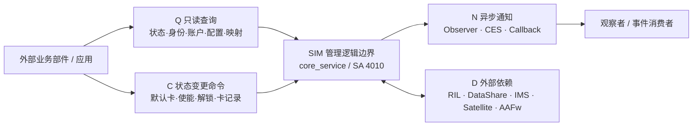
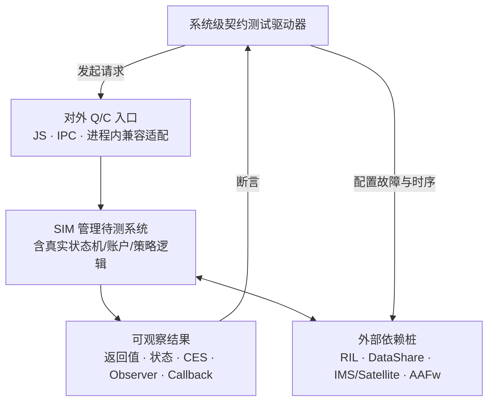

# SIM 卡管理跨部件接口全景与架构决策建议

> **用途**：SIM 卡管理独立库拆分、多 SIM 架构重构、外部契约冻结和系统级测试防护网设计的决策输入。  
> **文档状态**：架构分析稿（可用于方案讨论；标注为“待核实”的内容不得直接作为兼容性裁剪依据）。  
> **整理日期**：2026-11-02。  
> **分析基线**：`hmos_dev_system_general_20260924_0119_huawei_655108e44`；manifest `hmos_dev_20260813`；`base/telephony/core_service` HEAD `738f51f6`。  
> **依据**：《OpenHarmony/HarmonyOS SIM 卡管理跨仓库接口清单报告》（静态代码盘点，包含 `REL-A～E`、`CAP-SIM-001～014` 和业务 `FLOW`）；本文不代表已经再次执行全量代码检索。  
> **适用边界**：以 `core_service` 的 **SIM 逻辑域**为中心，而不是将整个 `CoreServiceClient` / `CoreManagerInner` 的所有方法视为 SIM 方法。

---

## 1. 供架构评审快速阅读的结论

**最重要的判断：SIM 管理的外部契约，不应仅按“IPC / 进程内接口”划分，应优先按业务语义划分为“只读查询（Q）—状态变更命令（C）—异步通知（N）”，并把外部依赖端口（D）单独管理。** IPC、JS API、进程内门面、观察者和事件总线只是上述契约的承载机制。

1. **查询需求广泛**。报告识别的 **17 个生产调用方（报告的仓库/组件分组口径）**中，**10 个在已列举的 A 类主动调用上仅表现为查询**；但这只是“只读候选”而不是全量代码层面的纯只读证明。其中 `rcs_service`、`telephony_cust`、`esim_service` 等尚需补齐完整调用方法和副作用审计。
2. **少量写接口决定架构风险**。`cellular_data`（默认数据卡）、`cellular_call`（SIM 使能、PUK）、`sms_mms`（SIM 短信读写）、`satellite_service` / `d2d_service`（卡使能和多卡拓扑）、`scene_board`（PIN/PUK）均已发现具有副作用的主动调用；`telephony_ext` 在能力分组中涉及使能控制，但 A09 未列明完整写调用锚点，需要进一步核实。
3. **通知是独立契约，不是查询附属物**。SIM 状态、账户、默认卡、运营商配置通过 `state_registry` 观察者、CES、`SimAccountCallback`、Hub、RadioEvent 等多路分发；有些部件在 A 类只查询，但又订阅事件。因此“只查询”**不等于整个部件对 SIM 只有同步查询依赖**。
4. **唯一进程外 IPC 入口与大量进程内直调并存**。以 `core_service` SA 4010 为进程外服务入口；`CoreManagerInner` 依赖多个 SA 共宿主 `telephony` 进程，不能直接当成可跨进程调用的稳定契约。**独立 SO 不等于独立进程**：独立库但仍共宿主时可以保留受控进程内适配；跨进程化时需处理门面和事件总线断裂。
5. **测试边界应按外部可观察契约建立**。以 Q/C 的外部入口作为输入，以返回值、状态变化、通知事件和异步回执作为输出；对 HDI RIL、DataShare、IMS/卫星等下游依赖打桩，且验证同一命令引发的通知一致性。

### 1.1 报告规模数据（不同口径，不得相加）

| 指标 | 原报告数值 | 解释 / 注意事项 |
|---|---:|---|
| SIM 域 IPC 接口码 | **106** | 81 个基础 SIM + 25 个 eSIM；整个 `core_service` 共 146 个 IPC 码，非全部属于 SIM |
| 进程内接口方法 | **130 + 34** | `ISimManager` 130、`IEsimManager` 34；这是声明数，不是跨部件实际调用的独立方法数 |
| 上层语言/门面方法 | **JS 78、NAPI 85、C++ Facade 73** | 暴露层不同，存在映射/重复，不得加总 |
| A 类生产调用方 | **17** | base 6、vendor 9、应用 1、foundation 锁屏体系 1（报告统计分组） |
| CES 业务订阅方 | **5** | 其中 `call_manager` 对 SIM_STATE 的处理仅日志，不是业务消费 |
| 接口关系 | **43 条 REL 记录** | A17、B9、C5、D6、E6；包括类型/事实行，**不是 43 个接口方法** |

> **统计禁忌**：`telephony_ext` 的 516 处、`cellular_data` 的 161 处等 `CoreManagerInner` 调用统计，混有网络、Radio 等**非 SIM 域**方法，不能直接据此得出 SIM 查询类/控制类的百分比。

---

## 2. 先定义边界，再看技术承载方式

### 2.1 当前 SIM 逻辑域

纳入 SIM 域：卡检测与状态、SIM 文件/记录、卡账户与默认卡、多卡拓扑和使能、PIN/PUK/SIM 锁、SIM 鉴权、SIM 短信存储、STK 协调、SIM 侧 eSIM 门面，以及必要的 `tel_ril` SIM 业务与上层绑定。

**不得因“共用客户端/同仓”而纳入 SIM 域**：`GetNetworkState`、`GetCellInfoList`、`GetSignalInfoList`、`GetPsRadioTech`、`GetCsRadioTech`、`GetOperatorName`、`GetIsoCountryCodeForNetwork`、`SetRadioState`、`GetImei` 等，原报告明确将其归于搜网、Radio、Modem 等域。部分边界方法如 `GetPrimarySlotId`、`GetMaxSimCount`、`SetActiveSim` 则需要依据多卡职责纳入 SIM 域审视。**不能根据方法名字母前缀一刀切定域。**

### 2.2 四种逻辑契约

| 类别 | 业务语义 | 典型方向 | 判别标准 | 主要实现机制 |
|---|---|---|---|---|
| **Q：查询契约** | 获取 SIM 事实、状态、能力和映射 | 外部调用方 → SIM | 不改变持久/运行态事实，不触发业务控制；`Get*` 仅是候选特征 | IPC、`CoreManagerInner`、JS/NAPI |
| **C：命令契约** | 发起卡状态、选择策略、卡数据或安全状态的修改 | 外部调用方 → SIM | 具有副作用、权限/幂等/时序要求；包括 `Refresh*` 等触发性动作 | IPC、进程内门面、JS API |
| **N：异步通知契约** | SIM 事实变化、业务过程结果、失效和恢复的传播 | SIM → 订阅者/回调端 | 关注事件类型、负载、订阅/取消、顺序和重复分发 | `state_registry`、CES、回调、Hub、RadioEvent |
| **D：外部依赖端口** | SIM 履行业务需要读取或调用的外部能力 | SIM ↔ RIL / SA / 数据服务 | 属 SIM 的**依赖输入/输出**，不是外部客户调用 SIM 的 API | HDI、DataShare、SA、AbilityMgr |

**“只查询部件”的严格定义**：在**某一明确边界、版本和调用方向**，所有生产主动调用均属于经副作用校验的 Q 类；若还具有事件订阅，应表述为 **“A 类仅查询，另有 N 类订阅”**，而不是“无其他 SIM 依赖”。

### 2.3 总体关系视图



> 这是**业务契约逻辑视图**，不是进程拓扑图。Q/C 在当前实现上可能走不同的 IPC / 进程内 / JS 入口；N 有多条并行分发机制。

---

## 3. 外部消费方全景：谁只读、谁会改状态

下表中的“只读候选”仅表示**原报告 A 类调用清单已列明的方法**均呈现查询特征；`Q + N` 表示在同步查询之外另有观察/事件关系。证据不完整时保持待核实，不将空白视为零调用。

### 3.1 A 类仅表现为查询的 10 个调用方（**候选，非最终鉴定**）

| 外部部件 | A 类调用介质 | 已列举的代表性 SIM 接口 | 其他关系与限制 | 只读确认程度 |
|---|---|---|---|---|
| `call_manager` | IPC 为主 | `HasSimCard`、`GetSimState`、`GetSimLabel`、`GetSimOperatorNumeric`、`GetDefaultVoiceSlotId`、`GetLockState`、`GetActiveSimAccountInfoList` | SIM_STATE CES 订阅处理**仅日志**；同时剔除非 SIM 域方法 | **较强候选**；REL-A01/C01 |
| `state_registry` | IPC | `GetRadioProtocolSlotIdByModemId`、`HasSimCard`、`GetInternalSlotId`、`GetExternalSlotId` | 同时是 **N 分发方/状态接收方**，并非整个组件只读 | **较强候选（仅 A 类）**；A04/B01/C05 |
| `telephony_data` | 客户端调用 | `GetOpkeyVersion`、`GetOpnameVersion`、`IsAllowedInsertApn`、`GetSlotId`、`GetTargetOpkey` | 同时向 SIM 提供 DataShare 读写依赖（D 类） | **较强候选（仅 A 类）**；A05/E04 |
| `ims_service` | `CoreManagerInner` 进程内 | `GetSimState`、`GetOperatorConfigs`、`GetSimIccId`、`GetSimId`、`GetCardType`、`GetPrimarySlotId` | 另注册 SIM/账户观察者及 RadioEvent | **较强候选（仅 A 类）**；A17/B03/D05 |
| `vowifi_service` | 进程内 + 少量 IPC | `GetOperatorConfigs`、`GetSimState`、`GetSIMOperatorNumeric`、`GetPrimarySlotId` | 另有状态观察者和 CES 订阅 | **较强候选（仅 A 类）**；A18/B06/C01/C02 |
| `call_enhanced`（VoIP） | IPC | `GetISOCountryCodeForSim`、`GetPrimarySlotId`、`GetSimState`、`GetMaxSimCount` | 报告其他查询含非 SIM 域 `GetNetworkState`，需剔除 | **较强候选**；A13 |
| `contacts_data` | JS API | SIM 号码信息读取；文档记载 `getCurrentSimNumbers` 使用线索 | 仅少量 ETS 文件级锚点，不能证明全仓各语言零写调用 | **候选，覆盖较窄**；A15 |
| `rcs_service` | IPC | SIM 状态/账户信息查询 | 报告称约 17 处 IPC，但未逐方法列全；另订阅 CES | **待补全方法表**；A11/C01/C03 |
| `telephony_cust` | 进程内 + 2 处 IPC | `GetOperatorConfigs`、`GetSimState`、`GetSimId`、`GetSimIccId` | **2 处 IPC 的具体业务语义需逐调用确认**；另消费运营商事件 | **待核实**；A19/C02 |
| `esim_service` | 进程内为主 + IPC | `GetSimIccId`、`GetSimState`、`HasSimCard`、`GetEuiccInfo`、`GetEuiccChallenge`、`GetAllSimAccountInfoList` | `GetEuiccChallenge` 是否纯读需校验；本部件还与 SIM 经异步回执双向协作 | **待核实副作用和全量调用**；A10/D06 |

**特别提醒**：`GetEuiccChallenge` 等带 `Get` 前缀的方法可能触发临时状态/挑战值生成；“名字像查询”不是纯只读证明。`telephony_cust`、`rcs_service`、`esim_service` **不能直接纳入“保证无状态变更”白名单**。

### 3.2 已确认含命令调用的 6 个调用方

| 外部部件 | Q 类示例 | C 类（非查询）调用 | 接口承载方式 | 重要的架构约束 |
|---|---|---|---|---|
| `cellular_data` | `GetSimId`、`HasSimCard`、`IsSimActive` | `SetDefaultCellularDataSlotId`；`RegisterSimAccountCallback` 属 N 类注册 | 共宿主进程内门面为主 | **默认数据卡事实写权、回调链跨 SA 转发**；A06/D01/D04 |
| `cellular_call` | `GetSimState`、`GetOperatorConfigs` | `SetActiveSim`、`UnlockPuk`、`UnlockPuk2` | 共宿主进程内门面 | **安全状态改变**；A16 |
| `sms_mms` | `HasSimCard`、`GetSimId`、`GetRadioProtocolSlotIdByModemId` | `AddSmsToIcc`、`DelSmsIcc`、`UpdateSmsIcc`、`SetDefaultSmsSlotId` | 共宿主进程内 + 1 处 IPC | **卡内短信记录写入与默认短信卡切换**；A03/D05 |
| `satellite_service` | `GetSimState`、`IsSimActive`、`GetPrimarySlotId` | `SetActiveSim`、`SetActiveSimSatellite`、`SwapM0M2SimCards` | 跨进程 IPC | **多卡拓扑/卫星卡协调**；A07 |
| `d2d_service` | —（现有调用表未发现独立纯查询方法） | `SetActiveSim`、`SetActiveSimSatellite`、`RefreshSimState` | 跨进程 IPC | **触发状态刷新不属于只读**；A12 |
| `scene_board` / `scene_board_ext` | `getSimState`、`getLockState`、`getMaxSimCount` | `unlockPin`、`unlockPuk`、`resetMemory`（具体副作用需审计） | JS API / NAPI | **外部用户解锁入口和权限校验**；A20 |

> `cellular_data` 经 `CoreManagerInner` 调用的 `SetRadioState`、`SetPreferredNetwork` 等虽有副作用，但在本报告源文档的**域边界**下原则上属于 Radio/网络域；它们必须作为跨域依赖记录，**不直接充当 SIM 写接口数量**。

### 3.3 第 17 个：`telephony_ext` 暂不判定“纯查询”

- 现有 `REL-A09` 展开了大量 `Get*`、`HasSimCard` 等查询，并记载 `CoreManagerInner` 516 处和 IPC 9 处（这些数量跨多个领域）。
- `CAP-SIM-005/006` 又将其列入 SIM 使能/默认卡相关能力使用方。因此**存在“能力组指向控制，但逐仓方法证据未完整展开”的缺口**。
- **架构决策前动作**：提取该仓所有指向 SIM 域的真实方法调用，确认 `SetActiveSim`、`SetPrimarySlotId`、默认卡设置以及 `TELEPHONY_EXT_WRAPPER` 钩子是否有跨界事实写入。明确写入者、变化原因与是否经唯一命令入口。

### 3.4 如何理解“10 / 6 / 1”

- **10** = 基于报告 A 类明细列举方法的**查询候选分组**；**不等于 10 个已完成全量审计的只读仓**。
- **6** = 有明确生产调用锚点或接口归属，能确认存在命令/副作用的分组。
- **1** = `telephony_ext` 在查询与控制归属之间需要补齐证据。
- 这个数量只是方便分配架构审查工作量。**不能据此推断查询方法数占比、调用频度占比或实际运行时性能占比**。

---

## 4. 按业务语义整理 SIM 对外接口

### 4.1 Q：只读查询契约

| 查询簇 | 代表接口（示例，不是完整清单） | 主要消费者 | 目标架构要求 |
|---|---|---|---|
| 卡存在/生命周期状态 | `HasSimCard`、`GetSimState`、`IsSimActive` | call_manager、cellular_call、ims、vowifi、cellular_data、rcs | 明确状态定义、何时有效、重启/热插拔后读取语义 |
| 卡身份/账户 | `GetSimId`、`GetSimIccId`、`GetSimAccountInfo`、`GetAllSimAccountInfoList` | cellular_data、ims、esim、satellite 等 | SIM / Profile / Subscription / Slot 语义分离；返回标识稳定性可测试 |
| 多卡映射/默认卡 | `GetMaxSimCount`、`GetPrimarySlotId`、`GetDefaultVoiceSlotId`、`GetDefaultCellularDataSlotId`、`GetRadioProtocolSlotIdByModemId` | call_manager、state_registry、sms_mms、cellular_data 等 | 区分设备能力、当前拓扑、用户默认策略；避免外部依赖分散 slotId 转换 |
| 运营商/能力/配置 | `GetSIMOperatorNumeric`、`GetOperatorConfigs`、`GetOpkeyVersion`、`IsAllowedInsertApn` | ims、vowifi、telephony_cust、telephony_data | 来源与缓存失效条件明确；跨域属性从属需审计 |
| 卡文件/号码/显示 | `QueryIccDiallingNumbers`、`GetSimLabel`、SIM 号码/电话簿读取 | call_manager、contacts_data、sms_mms | 读取副作用、敏感信息权限、卡热插拔时错误码明确 |
| eSIM 信息查询 | `GetEuiccInfo`、`GetEuiccChallenge` 等 | esim_service / JS 绑定 | 区分只读与具有挑战生成/会话状态的操作，不凭名称假定纯度 |

**建议采用查询契约评审表**：每个接口标注 `对象/ID 语义`、`事实所有者`、`副作用`、`一致性/时效`、`异常值与错误码`、`权限`、`版本兼容性`、`消费方`；**不要先因为“查询很多”而引入一个巨型 QueryManager**。

### 4.2 C：状态变更/控制契约

| 命令簇 | 代表命令 | 已知发起方 | 必须定义的行为规则 |
|---|---|---|---|
| 卡使能和多卡拓扑 | `SetActiveSim`、`SetActiveSimSatellite`、`SwapM0M2SimCards`、`SetPrimarySlotId` | cellular_call、satellite、d2d；telephony_ext 待证据补齐 | 原子性、前置条件、失败恢复、跨卡并发/串行化、写权和通知 |
| 默认业务卡 | `SetDefaultCellularDataSlotId`、`SetDefaultSmsSlotId` | cellular_data、sms_mms | 默认位事实写入者、落盘与广播顺序、重复调用幂等性 |
| 安全和解锁 | `UnlockPin`、`UnlockPuk`、`UnlockPuk2` | 锁屏体系、cellular_call | 身份/权限、剩余重试次数、失败状态、无明文日志、状态变化通知 |
| 卡内消息/文件变更 | `AddSmsToIcc`、`DelSmsIcc`、`UpdateSmsIcc` | sms_mms | 写入设备状态、卡移除竞态、读回一致性、错误与回退 |
| 主动刷新 | `RefreshSimState` | d2d | 即便无直接持久化写入，也要以**命令**审视：可引发重新读取和下游通知 |

> eSIM `DownloadProfile`、`SwitchToProfile`、`DeleteProfile` 等在原报告 `REL-D06` 属 **SIM 侧发往 `esim_service` 的外部依赖调用及异步回执链**；不能未经分析就反向列为“其他部件写 SIM”的接口。需要按**请求发起者、处理者、事实写权**建立端到端映射。

### 4.3 N：异步状态/事件契约

| 通道 | 方向与事件 | 已确认参与方 | 重构和测试关注点 | 源证据 |
|---|---|---|---|---|
| **State Registry** | SIM → `state_registry`（`UpdateSimState`、`UpdateIccAccount`、扩展 `UpdateSimActiveState`）→ 观察者 | ims、telephony_ext/msg_center、vsim、vowifi、JS observer | 掩码 `SIM_STATE=0x20`、`ICC_ACCOUNT=0x400`；权限、注册与重注册、状态快照 | B01～B09 |
| **CES** | `SIM_STATE_CHANGED`、`OPERATOR_CONFIG_CHANGED`、四类 `DEFAULT_{VOICE,SMS,DATA,MAIN}_SUBSCRIPTION_CHANGED`、`SET_PRIMARY_SLOT_STATUS` | vowifi、rcs、cellular_call、telephony_cust、call_manager（仅日志） | 发布载荷、状态与事件顺序、重复事件、订阅端幂等 | C01～C05 |
| **STK CES** | `STK_COMMAND`、`STK_SESSION_END`、`STK_CARD_STATE_CHANGED`、`STK_ALPHA_IDENTIFIER` | 已确认发布；工作区内无已确认消费者 | 扩展应用不在工作区，不能因无消费者而删事件 | C04 / UNC-01 |
| **SimAccountCallback** | telephony_ext → cellular_data IPC → 进程内 SIM 注册；SIM → 回调端 | telephony_ext、cellular_data、SIM | 注册与取消、死亡清理、重试、迁移后 IPC 桥接 | D01/D03 |
| **进程内 Hub** | `CoreServiceCommonEventHub` 分发 | cellular_data、telephony_ext、SIM 内部 | 共宿主依赖；不能误当跨进程稳定事件协议 | D04 |
| **RadioEvent** | `tel_ril` 的 `RegisterCoreNotify` 上行扇出 | cellular_data、sms_mms、ims_service | SIM 状态与记录加载的上行驱动；独立进程化时会失效 | D05 |
| **eSIM 异步回执** | SIM 侧发请求 → `esim_service` 执行 → `IEsimServiceCallback` 回执 | core_service / esim_service | 关联 ID、完成/失败、超时、重复回调、会话生命周期 | D06 |

原报告明确存在 **`SIM_STATE_CHANGED` 的双发布源**（core_service 直接发布 + `state_registry` 中继发布）。需检验是语义上需要两条事件流，还是可以在不破坏兼容性的前提下收敛；在裁决前**不得简单删除其中一路**。

### 4.4 D：外部依赖，不应混入“SIM 对外接口数”

| 依赖端口 | 实际用途 | 适合的替身/桩 | 对应 REL |
|---|---|---|---|
| HDI RIL (`ril_adapter_ext`) | SIM 卡状态、APDU、卡复位、Modem/卡交互 | RIL 假实现，支持状态指示、超时、错误码和乱序 | E01 |
| IMS SA、Satellite SA | 业务联动、能力查询、双向回调 | SA 代理/回调假实现 | E02/E03 |
| telephony_data DataShare | `opkey`、`simability`、`pdpprofile` 读写 | 可控内存 DB / DataShare fake；验证回写 | E04 |
| SAMgr、Account/CES 就绪 | 服务初始化、订阅与恢复 | 可编排 SA 加入/退出及服务死亡 | E05 |
| AbilityMgr / BundleMgr | STK 扩展应用发现与拉起 | BundleMgr / AbilityMgr fake；真机验证 STK 端到端 | E06 |

---

## 5. 当前技术边界与“独立库/独立进程”的不同决策

### 5.1 已确认的当前拓扑

- `core_service`（SA 4010）、`cellular_data`（4007）、`cellular_call`（4006）、`sms_mms`（4008）、`ims_service`（4014）、`vowifi_service`（4013）、`telephony_ext` 族以及 `esim_service`（66250）主要共宿主 **`telephony` 进程**。
- `call_manager`（4005）、`state_registry`（4009）在 **`foundation`** 进程；`satellite_service`（4012）、`rcs_service`（4015）、`d2d_service`（66580）、`call_enhanced`（65968）等为独立进程。
- 跨进程 SIM 入口主要经 `CoreServiceClient → core_service proxy/stub → SA 4010`；共宿主调用经 `CoreManagerInner` 直接转发到 `ISimManager`，**并无自动 IPC 回退**。

### 5.2 两种演进情形的影响

| 演进方案 | 对 Q/C 接口 | 对 N 类通知/事件 | 架构结论 |
|---|---|---|---|
| **方案 A：SIM 拆独立共享库，仍共宿主 telephony 进程** | 可保留现有 IPC 的外部语义；进程内方法可以通过受控门面/适配器转接 | Hub/RadioEvent 可能继续使用，但需约束依赖和初始化顺序 | **优先的低风险边界固化步骤**，不是进程级隔离 |
| **方案 B：SIM 后续独立进程运行** | 现有 `CoreManagerInner` 直调无法跨进程直接工作；缺失的客户端方法（如默认数据卡设置）需要补适配/IPC | Hub/RadioEvent、SimAccountCallback 隐式共址通道需要跨进程协议和生命周期治理 | 是**额外的系统重构决策**，不能作为独立库拆分的必然后果 |

**提议的目标边界**：保持 SA 4010 外部调用行为与参数语义兼容；在内部显式建立 **Q 查询端口 / C 命令入口 / N 事件适配出口 / D 依赖适配入口**。内部具体归属由目标架构中事实所有权和业务上下文确定，不应由现有 `CoreManagerInner` 的方法集合反向决定目标模型。

### 5.3 对多 SIM 目标架构的约束

- **事实唯一写权**：卡/账户/默认策略等状态必须有唯一拥有者。其他上下文通过命令请求改变状态，不得依赖同进程共享对象旁路修改。
- **读写分离但不做形式主义 CQRS**：Q/C 首先作为语义边界与测试分类；是否需要单独进程、独立数据模型或总线由成本和时效需求决定。
- **从 slot-centric 迁移为明确标识语义**：每个 Q/C 标注使用 `slotId`、`simId`、`profileId`、`subscriptionId` 或 `modemId` 的场景、转换责任以及 3→4 卡的边界条件。
- **状态变更与通知一致性**：C 类命令的成功/失败和 N 类可观察结果需要对应，不允许同一事实多个不一致的发布源各自定义状态。
- **兼容层有限职责**：保持外部参数/错误码/事件契约，不将旧的全量 `CoreManagerInner` 复制成新的“大而全管理器”。

---

## 6. 系统级测试防护网：按外部契约组织

### 6.1 推荐的测试夹层



**测试边界原则**：输入来自真实外部契约，输出断言覆盖同步响应和异步通知；**仅对被测 SIM 边界之外的服务打桩**。如果测试驱动器与 SIM 不共宿主，必须说明原进程内门面是如何通过测试兼容适配器进入系统，不能假设直接可用。

### 6.2 优先测试场景（建议最小集合）

| 用例族 | 外部输入 / 触发 | 必须观察的结果 | 要模拟的依赖 / 风险 |
|---|---|---|---|
| Q-01 卡状态读取 | `HasSimCard` / `GetSimState` / 卡热插拔 | 与真实状态机快照一致；空卡和移除时返回正确 | RIL 插拔与状态迁移 |
| Q-02 标识与拓扑 | slot/sim/account 映射、`GetPrimarySlotId` | 1/2/3/4 卡及 eSIM 多 Profile 下映射唯一且稳定 | RIL 能力、DataShare 历史数据 |
| C-01 默认数据卡变更 | `cellular_data → SetDefaultCellularDataSlotId` | 写权正确、持久化、DEFAULT_DATA 通知与查询结果一致 | DataShare 写失败、重复命令、服务重启 |
| C-02 卡使能/交换 | `SetActiveSim` / `SwapM0M2SimCards` | 变更成功与失败回退、状态通知和拓扑一致 | RIL 重配失败、并发切换、设备复位 |
| C-03 PIN/PUK 解锁 | JS `unlockPin/unlockPuk` / cellular_call `UnlockPuk` | 权限、错误码、计数、解锁后状态/记录加载 | RIL 卡锁状态、错误密码、卡移除 |
| C-04 SIM 短信存储 | `Add/Del/UpdateSmsIcc` | 读写一致、失败无半成品、热拔卡异常行为 | RIL APDU/短信存储接口 |
| N-01 状态推送 | RIL `ABSENT → READY → LOADED` | `state_registry` 掩码观察、CES 事件及订阅端一致 | 订阅早/晚于事件、重复事件 |
| N-02 账户回调 | 注册/取消 `SimAccountCallback` | 注册成功、单次或约定次数回调、死亡清理与重注册 | cellular_data 桥接、消费者死亡 |
| N-03 运营商配置 | 更新 `OperatorConfigs` | CES + Hub 双通道按契约可见，订阅者幂等 | 事件乱序、重复发布 |
| D-01 eSIM 异步回执 | eSIM 请求成功/失败/超时 | 回执关联与结果状态一致、会话恢复 | `esim_service` 假实现 |
| E-01 服务初始化/恢复 | RIL/DataShare/CES/Account SA 延迟就绪 | 恢复路径可重复、无假 READY、订阅按需重建 | SAMgr/SA 生命周期故障 |

> 与旧文档 `FLOW-01～13` 及 `REL-*` 建立双向追溯；上表是**建议的测试覆盖清单**，不是声称当前已有用例全部通过。

---

## 7. 建议提交架构评审的决策项

| 决策编号 | 建议裁决 | 理由 / 边界 | 前置证据和验收门槛 |
|---|---|---|---|
| **ADR-01** | **采用 Q/C/N/D 四类契约视图作为对外接口主文档**；保留 IPC/进程内/JS 等技术视图作为映射 | 使接口讨论先聚焦“谁读事实、谁有权修改、谁接收通知” | 17 组调用方可映射到方法级 Q/C/N/D，并补齐 `REL` 锚点 |
| **ADR-02** | **先抽离 SIM 独立共享库，暂不将独立进程化捆绑为前提** | 先通过构建/源码边界限制旁路依赖，降低回归范围 | 新旧库链接/初始化/事件互通验证；原 SA 4010 对外语义不变 |
| **ADR-03** | **对 C 类命令明确唯一写权和状态机入口；Q 类只授予读取权限** | 防止 3→4 卡时跨模块“多处直接写同一事实” | 对每条 C 类给出所有者、前置条件、失败恢复、N 类通知映射 |
| **ADR-04** | **锁定 Q/C/N 的兼容性契约，并建设系统级测试防护网** | 以对外可观察行为判定重构正确性，不依赖内部类结构 | 关键 FLOW 有“输入—输出—依赖桩—断言”的运行用例 |
| **ADR-05** | **对共宿主门面与事件总线建立显式适配/迁移清单** | 消除进程共址形成的隐式架构契约 | `CoreManagerInner`、Hub、RadioEvent、SimAccountCallback 已标记归属、跨进程选项和风险 |
| **ADR-06** | **暂不以“10 个纯查询部件”为裁剪任何接口的依据** | 当前只有静态证据汇总，存在未展开调用与副作用疑点 | 完成下一节核验，形成可以被工具复查的只读白名单 |

**优先级建议**：ADR-01 / 03 / 04 作为架构边界与测试设计的核心决策；ADR-02 / 05 明确迁移路径；ADR-06 是阻止误删接口的约束。

---

## 8. 待核实事项与最小代码审计任务

| 优先级 | 待核实点 | 原因 | 应输出的证据/产物 |
|---|---|---|---|
| **P0** | 对 17 个消费方输出**SIM 域方法级调用全表** | 现有 A 类为典型方法与局部计数，无法准确区分真实 Q/C 调用占比 | `consumer_repo / callsite / method / provider / domain / Q-C-N / effect / REL` |
| **P0** | 完整复核 `telephony_ext` 的 SIM 写操作及 vendor wrapper 钩子 | `CAP-SIM-005` 与 A09 明细粒度不同 | 对 `SetActiveSim`、`SetPrimarySlotId` 等实证或证伪；标注唯一写权 |
| **P0** | 核查 `rcs_service` 17 处 IPC、`telephony_cust` 2 处 IPC、`esim_service` 97 处 CMI 与 `GetEuiccChallenge` | 不能依“方法名称”或已列举示例宣称纯读 | Q-only 白名单/例外列表及 `file:line` |
| **P0** | 剔除 `CoreManagerInner` 跨领域方法后再量化读写比例 | 516/161/97 等调用点包含网络、Radio 等域 | SIM 域实际调用次数与独立方法数；不重复计算 |
| **P0** | 确认 `SetDefaultCellularDataSlotId` 的对外兼容适配 | 当前跨进程 `CoreServiceClient` 不存在对应封装 | 原调用链与目标适配链的运行测试，保留错误码及通知顺序 |
| **P1** | SIM_STATE 双发布源及重复消费 | core 与 state_registry 均发布 | 消费者列表、重复时序、兼容性策略 |
| **P1** | STK 真实消费者及 settings 原生入口 | 源工作区缺少 STK 扩展应用，settings 原生代码未覆盖 | 真机/其他仓代码证据；不可轻易裁剪事件或命令 |
| **P1** | DEV/TRUNK 差异与宏条件（eSIM、vsim、slot3） | 原报告以 DEV 断面为主，TRUNK 拆分有在途变化 | 分版本兼容矩阵及编译组合覆盖 |
| **P1** | 独立 SO 链接后进程内生命周期 | 原先在 `core_service::OnStart` 指针注入、共宿主单例 | 初始化拓扑、依赖图、异常/重启恢复测试 |

**方法级审计推荐数据格式**：

```text
consumer_repo, consumer_component, caller_file_line, api_method,
provider_domain, caller_process, mechanism, semantic_class,
read_side_effect, authoritative_writer, event_outcome,
permission, evidence_level, rel_id, version
```

**通过门槛**：所有识别为“纯查询部件”的调用点具备可回溯证据；无法判定纯度的方法统一标记 `UNKNOWN`，不得因其以 `Get` 开头而默认为 `Q`。

---

## 9. 关键结论所对应的原报告证据索引

| 论点 | 原报告定位 / 代码锚点 |
|---|---|
| A 类 17 个外部调用方、接口机制 | 第 1.3.1 节 REL-A01～A20；第 5.3/5.4/5.5 节；第 14.2 节 |
| `cellular_data` 设置默认数据卡 | REL-A06；`cellular_data_service.cpp:460/:471`；`core_manager_inner.cpp:2044/:2116`；FLOW-06 |
| `cellular_call` 解锁 | REL-A16；`supplement_request_cs.cpp:212/:271`；FLOW-04 |
| `sms_mms` 写 ICC 短信 | REL-A03；`sms_misc_manager.cpp:474/:487/:498/:579-594` |
| `satellite` 与 `d2d` 使能/交换 | REL-A07/A12；`base_service_ctrl.cpp`；`device_mgr.cpp:184-232`；FLOW-05 |
| `ims` / `vowifi` 查询与状态订阅 | REL-A17/A18、B03/B06、C01/C02、D05 |
| `rcs` 查询和 CES 消费 | REL-A11、C01/C03；`rcs_sim_manager.cpp`、`rcs_login_manager.cpp` |
| `eSIM` 查询与异步回执 | REL-A10、D06；`esim_auth_procedure.cpp`；`esim_service_callback_handler.cpp` |
| `SimAccountCallback` 跨 SA 注册 | REL-D01/D03；`cellular_data_service.cpp:646-654`；`core_manager_inner.cpp:249-266` |
| 双发布源、STK 未在区确认消费者 | REL-C01/C04/C05；`sim_state_handle.cpp`、`telephony_state_registry_service.cpp:1064/:1073` |
| 独立 SO / 共宿主限制 | 第 2、5.2、8.3、11、15 节；`sa_profile` 与 `core_service.cpp:104-121` |

---

## 10. 最终建议（供评审纪要引用）

> **将 SIM 卡管理外部接口分为“查询、命令、通知”三类业务契约，并将 RIL、DataShare 等外部服务单列为依赖端口；以事实所有权约束写操作，以接口和事件行为建设系统级测试防护网，以受控适配层保持原有 IPC、进程内和 JS 语义兼容。**
>
> 已识别的 17 个调用方中，多数在已列举的主动调用上表现为查询型需求，但目前“10 个只读候选”仍需通过方法级代码审计确认；不能将查询调用的普遍性理解为 SIM 只有查询接口，也不能因现有进程共宿主而忽视命令、回调与事件总线的耦合风险。

**本稿的定位是“架构决策输入”而非取代原始源码证据清单**。后续应维护一张方法级、版本化、可自动复核的契约台账，本文只保留架构所需的业务分类、跨部件映射、风险和裁决。
