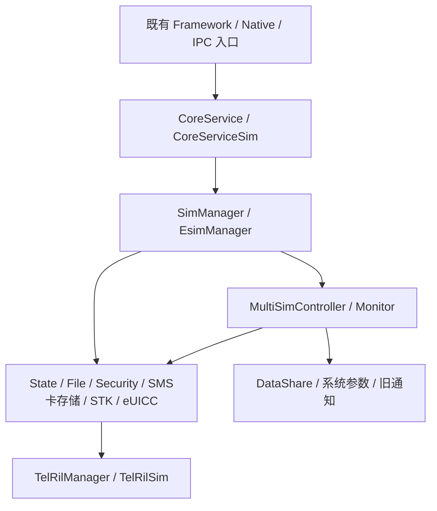
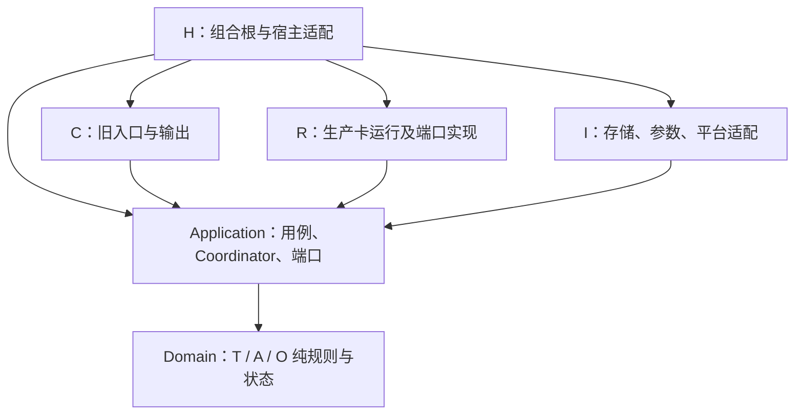
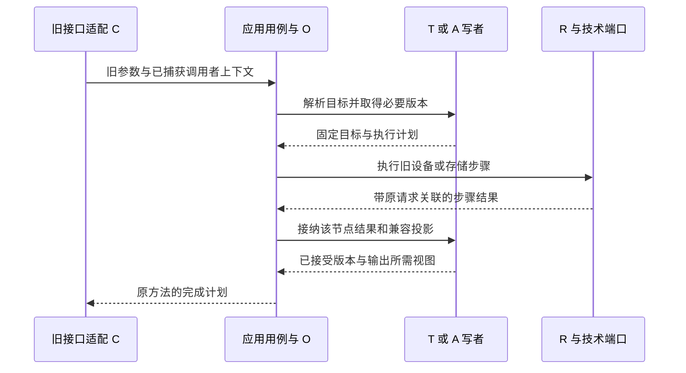
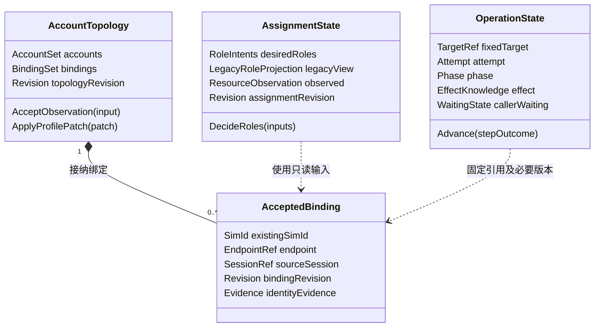

# 多 SIM 架构评估与优化设计

**副标题：原架构、目标 DDD 分层、功能迁移与接口兼容**  
**日期：2026-10-23｜状态：架构评审建议稿，未实施生产重构**  
**代码基线：`zjuluowu/multisim@801877c95ab8d37c60cb60dc210e796be6b96599`**

## 1. 评估结论与阅读方式

原《SIM_Architecture_Layering_and_Migration_Design.md》的总体方向合理：保留外部契约，将账户拓扑、角色与资源决策、操作编排分开，并通过卡运行支撑承接已有协议代码。**建议保留这一方向，修订后作为实施依据；不建议直接按照现有总览图建类、拆库。**

主要问题不在于缺少更多抽象，而在于抽象和现有行为之间还缺少可执行的约束：总览图把生产运行支撑和编排器放进 Domain；原则中的“只读兼容”“提交后可见”容易掩盖旧接口的异步回写和部分失败中间态；按功能逐个迁移会遗漏其他入口对同一字段的写入；结构拆分与新增停止排空机制混在同一门禁中。

仓库中的《SIM_Architecture_Refactor_Design.md》已经包含比被评估文档更完整的写权切换、Refresh 代次、兼容轨迹与分阶段迁移设计。本稿吸收其有效内容，再以当前固定版本源码核对关键分支，形成一份可独立阅读的主设计。**这次输出不新增一套竞争的领域模型，不将旧文档中的提案编号当作已批准需求。**

| 读者/目的 | 建议阅读 |
|---|---|
| 架构师作整体评审 | 第 2～6、8、12～15 章 |
| 开发者理解设计思想 | 第 4、5、7、9、10 章 |
| 开发负责人拆任务 | 第 7、8、13、14 章 |
| 测试与接口维护者制定验收 | 第 9～12、14～16 章 |

本文统一使用三个证据标记：**F** 为本次固定版本源码/配置直接支持的静态事实，**P** 为优化后的目标建议，**Q** 为依赖外仓、产品规则或运行验证的未决事项。源码中的调用先后是静态节点证据，不自动构成跨线程、跨服务的完整运行时序保证。

## 2. 基线、范围与文档取舍

### 2.1 固定分析基线

本次将 `main` 解析为上述完整提交号，并读取该提交的归档，而非把持续变化的 `main` 当作稳定证据。本文附录源码链接均固定到这一提交。被评估文档共 552 行，SHA-256 为 `ef1cbb2b7089aeef7ce92db0d4ad1fe67ec9e18c23d4cba9d094674e43707b42`；现有详细主设计共 1323 行，SHA-256 为 `d0afda0d051da9cd91fd449c48be4e03569c06cd7fe8a473de624ea331a28a89`。

分析范围为仓库内 `telephony_core_service` 的 SIM、eUICC 卡侧能力、Core 入口、RIL 关联、构建与服务配置，以及已有分析设计和 Linux 测试说明。SMS 收发、通话、数据连接、IMS 注册、DataShare 提供方、SA 66250 的服务实现不在本仓完整提供，不能据此证明跨仓事务、任务编排或设备行为。

本轮属于 **SIM 架构设计文档评估**。已结合仓库的边界、约束、条件构建和验证说明核查；交付物为新文档，未改生产代码、GN、公开接口或远端仓库。

### 2.2 既有文档怎样使用

| 文档组 | 本次用途 | 取舍 |
|---|---|---|
| 被评估的分层与迁移设计 | 确认用户要评估的蓝本、总览、旧新映射 | 保留其问题组织方式；重画分层，细化迁移条件 |
| 详细重构主设计 | 62 项功能清单、混合职责拆分、写权、会话、兼容轨迹 | 作为重要设计输入；关键行为重新对照当前源码，不将其 F 标记直接当本次验证 |
| V3 软件架构/类设计 | 识别聚合、单写者和线程设计的来源 | 保留有用机制；不以固定类数、固定事件数要求实现 |
| MultiSIM 01～08、docs/README | 基线、历史取舍和传播口径 | 标识“四 Context”等仍未同步的描述，见第 3 章 |
| 对外接口源码核实说明、Core/Framework 源码 | 入口、错误、权限、回调与双通道 | 以具体方法实现为准，不能用接口名称推定语义 |
| Linux 测试设计、systemtest 说明 | 判断现有验证能证明什么 | 历史结果与本轮静态检查分开；不将基础设施 PASS 当业务迁移 PASS |
| history 中的旧版本、旧汇报材料 | 解释冲突来源 | 作为历史背景，不提供当前行为真值 |

取舍顺序是：**当前匹配产品的契约与源码事实 → 已确认的业务约束 → 经论证的目标设计 → 历史建议。** 文件日期更晚只能帮助定位，不能单独裁决设计正确性。源码已有缺陷也不是永远保留的业务要求；其修正须从结构重构中分离，形成明确的行为差异与验收。

## 3. 对原方案的逐项评估与修订

下表中的“采用”表示本文采用的设计建议，不表示仓库或产品已经正式批准。

| 编号 | 原方案/相关文档的问题 | 评估及依据 | 本稿处理 |
|---|---|---|---|
| D01 | README、统一裁决 DU-01 仍将 Compatibility 计为第四 Context；新主设计采用三业务上下文 | 属于目标术语冲突，不是代码已有四个部署模块。[D03][D04] | 统一为 T/A/O 三业务上下文，R/C/I/H 为支撑、兼容、适配、装配责任。C 仍承担完整契约责任 |
| D02 | 原总览 Domain 框内含 Card Runtime、OperationCoordinator、事件总线等 | 协议运行、线程、I/O 与纯业务规则混在一层。[D01][E01][E04] | Domain 只放规则/状态模型；Coordinator 放 Application；R 单列生产运行支撑；总线放技术适配 |
| D03 | “Compatibility 只读派生”容易被实现为所有旧查询只读一张快照 | `GetShowNumber` 读卡缓存并可能异步回写；`QueryImsSwitch` 有存储读取。[E09][E37] | C 不拥有业务写权；有副作用的查询由应用用例承接，保留读取来源与返回点 |
| D04 | “Commit 前不对外可见”容易被理解为设备、DB、缓存全部成功再可见 | 激活先改缓存后写 DB；主卡有预写；角色广播失败前状态已变。[E06][E07][E08] | Owner 接受每个旧兼容节点；区分兼容投影、设备观察和持久化结果，不制造全局原子事务 |
| D05 | 按模块/用例逐步迁移没有明确所有旧 writer 的收口条件 | 初始化、重载、重试、后台号码同步也写同一账户/角色状态。[D02][E06][E09] | 以状态字段组为写权切换单元，全部旧入口同时转委托，详见第 8 章 |
| D06 | 一个 TopologyRevision 可能被泛化为所有异步结果的有效性条件 | RIL 已有 serial，协议已有 session；局部 Refresh 与换卡不同。[E13][E15][E16] | R 独占运行会话代次；T 独占绑定版本；每次操作校验必要依赖，局部 Refresh 使用 LoadScope 代次 |
| D07 | 运行期 OperationRepository 容易被理解为可恢复事务仓 | 当前无统一持久操作日志；进程重启内存记录丢失 | 采用 RuntimeOperationStore，默认仅内存；重启重查真实设备/存储，不承诺同操作 ID 恢复 |
| D08 | G2 同时要求机械拆库与新增停止/排空闭环 | 当前 OnStop 没有完整 SIM StopAndDrain；一起实施难以判断差分原因。[E03] | 拆为 G2a 旧库内解耦、G2b 机械链接拆分、G2c 生命周期增强；有动态卸载/重建要求时 G2c 前置 |
| D09 | eSIM 远端任务与 Core 本地操作仍可能产生两个主编排器 | 本仓可证 EsimServiceClient 的 66250 契约和 Core 卡侧原语，缺服务实现。[E18]～[E21] | 下载/OSU 沿用既有服务边界，Core 仅管本地步骤；逐任务核实唯一主编排，禁止双重重试/补偿 |
| D10 | 私有 SO、Repository 容易被误认为进程隔离、事务或现成依赖解环 | 当前 Core/SIM/RIL 在同一 SO；CoreManagerInner 在 API 构建；DataShare 更新无版本 CAS。[E01][E02][E05][E17] | 分别画职责、源码依赖、部署图；保留数据通道；实际 GN/符号证明再宣布拆分成立 |
| D11 | “槽基数统一”可能被理解为扩数组即支持四槽/MEP | 初始装配数、协议容量、特殊槽、eSIM 排除槽与产品开关不同。[E04][E18][E25] | SlotInventory 保留配置、实例、公开容量、硬件资源四个维度；新能力进独立产品门禁 |
| D12 | 部分主设计链接的行号已随文档增长漂移，历史测试数字被反复引用 | 当前目标文档仍有指向旧章节行段的引用；Linux 测试说明不代表完整业务通过。[D01][E28] | 本文证据固定提交、路径和行号；继承稳定功能 ID；测试结果标日期/范围/状态 |

**合理且继续保留的设计：** 身份不等同位置、T/A/O 单写者、旧 public API/IPC/SA/schema 保持、卡协议复用、领域不依赖平台、I/O 与回调锁外、已有 66250 服务边界保留。这些原则本身无需推倒重做，需要补充上述可执行限定。

## 4. 重构前的真实架构

### 4.1 运行调用与模块责任（F）

这是关键调用关系摘要，不是全部依赖图；`CoreManagerInner` 还有同进程直接调用和宿主能力反查。eSIM 高层任务另经 `EsimServiceClient → IEsimService/66250`，不能全部塞进图中 Core 卡侧路径。[E03][E04][E05][E21]

| 现有模块 | 实际承担的职责 | 现状问题/重构边界 |
|---|---|---|
| CoreService / CoreServiceSim | SA 生命周期、公开入口、检查、异步调度、结果包装、装配 | 继续作为旧契约出口；不要把其所有代码迁进领域层 |
| SimManager | 各槽对象装配、入口分发、初始化、状态/账户/卡功能门面 | 门面与生产运行职责分离；初始化次序和部分就绪行为须保留 |
| MultiSimController | 账户缓存/DB、身份映射、active、默认角色、主卡、等待、Hook | 核心混合区；要按事实和用例拆分，不按类整体搬到一个新 Manager |
| MultiSimMonitor | 服务就绪/用户变化、重载、观察者、回调登记/死亡清理 | 业务接纳交 T，平台订阅交 I，对外回调交 C；不能整体“事件总线化” |
| StateManager / Handle | 卡状态、锁态、安全命令、等待与回包 | 保留协议路径及现有过滤；由 R 统一运行状态写权 |
| FileManager / File / Controller | 卡型/应用选择、EF/Records 加载、解析、号码、电话簿相关缓存 | 大部分为 R；不因使用 DDD 就改为账户聚合 |
| RadioProtocolController | 协议切换阶段、session、超时、RIL 调用 | A 决定目标，O 编排，R 执行；保留已有 session 校验 |
| EsimManager / EsimFile | 本地 eUICC 查询、通道、APDU、卡侧 Profile 原语 | 与 66250 高层任务分开；普通与低优先级对象共享设备资源 |
| SimAccountManager / OperatorConfig* | 运营商配置、能力与匹配 | 类名含 Account 不代表账户领域，主要归 R/carrier |
| SimRdbHelper / TelephonyDataHelper | 现有 DataShare URI、CRUD、连接及游标 | 改为 I/store 实现，不迁移数据库提供方，不发明直写 RDB |

### 4.2 当前分层与目标分层对比

| 维度 | 当前代码事实 | 优化后的目标 |
|---|---|---|
| 接口层 | Core/Framework/Client 与内部 Manager 交织 | C 保持原接口；应用服务承接意图，内部类型不泄露到外部 |
| 应用层 | 分散于 Core 队列、Manager、Controller、Monitor | 显式用例、步骤/完成计划、跨 Owner 协作；O 不包办所有读操作 |
| 领域层 | 规则与缓存、DB、RIL、参数混写 | T/A/O 中可独立计算的规则与状态迁移；无平台 API |
| 卡运行支撑 | 已有成熟协议/算法及运行对象 | R 保留其生产价值，补写权/会话边界；只迁移确有必要的逻辑 |
| 基础设施 | 各模块直接访问 DataShare、参数、Hook、通知 | I 实现端口；H 实现宿主协作并装配，平台结构不向内传播 |
| 状态 | 多个缓存、角色标志、last 值与设备结果关联隐式 | 每个状态组唯一 writer，兼容投影、设备观察、持久化结果分开 |
| 部署 | `tel_core_service` 编译 Core/SIM/RIL 等源 | 先保持；随后以构建验证引入同宿主私有 SIM SO |

### 4.3 当前部署及条件构建（F）

`BUILD.gn` 中 `tel_core_service` 同时包含 SIM、RIL、Core 源码，当前不存在已经拆出的独立 SIM SO。[E01] SA 4010 配置绑定 `telephony` 进程；仓库的 init 配置还列出同宿主的 4010、66250。[E23][E24] 这只能证明仓库配置，不能据 SA ID 推断独立进程，也不能替代某产品的设备运行检查。

`esim_manager.cpp` 在基础源列表中，`esim_file.cpp`、`esim_controller.cpp` 等受 eSIM 条件控制；不能写成“关闭 eSIM 就完全没有 EsimManager”。EXT/VSIM、卫星、IDL Proxy 等也有独立条件。机械迁移应保留每个条件对应的源文件、依赖和 fallback 实现。[E01][E02][E25]

## 5. 目标 DDD 责任与分层设计（P）

### 5.1 先讲清楚七类责任

| 代号 | 责任 | 维护的真值/决策 | 明确边界 |
|---|---|---|---|
| T | 账户与连接拓扑上下文 | 账户资料、已接受身份/绑定、历史与当前账户、兼容账户投影 | 不拥有原始 EF、设备锁态、角色策略；身份未知也允许有运行会话 |
| A | 角色与资源分配上下文 | Voice/SMS/Data/Primary 意图与旧可见投影、资源分配规则、已接受分配观察 | 角色选择不等于驻网/数据/通话成功；不复制 T 的账户管理 |
| O | 本地业务操作上下文 | 一次有步骤操作的关联、阶段、效果认知、恢复决策规则 | 不接管简单查询、每条 EF 自动流程、STK 或远端完整任务；默认不持久化 |
| R | 生产卡运行支撑 | 卡/应用会话、状态、EF/Records、卡 IO、安全、卡短信/电话簿/STK、eUICC | 复用生产协议；无账户/角色政策的第二 writer；不是整个 Domain |
| C | 兼容入口和输出 | 权限边界、旧 DTO/Parcel、返回与回调、旧通知适配、订阅生命周期 | 不维护第二套账户/角色事实；可以调用有副作用的应用用例 |
| I | 技术适配 | DataShare、参数、RIL 边界转换、服务监视、厂商 Hook、Registry/CES、诊断 | 执行端口，不自行决定账户/角色；不将平台对象作为领域模型 |
| H | Core 宿主装配 | 生产对象工厂、共享宿主能力、依赖注入、启停所有权 | 共享 RIL 继续按原宿主生命周期管理，不由 SIM 私有库随意销毁 |

T/A/O 是逻辑业务边界，不要求各自一个 SO、一个线程或一个数据库。R/C/I/H 是实现责任，也不要求“一字母一个类”。 O 只为存在步骤、效果或恢复不变量的命令建立操作模型；纯转发和单次读取不强制创建 OperationAggregate。某一用例若不需要独立状态，就保持普通应用服务，避免为 DDD 形式增加对象。

### 5.2 领域与应用对象的落位

| 对象/规则 | 所属层 | 说明 |
|---|---|---|
| Account、AcceptedBinding、AccountTopology 规则 | Domain/T | 显式未知/歧义；账户不以 slot 为主键；沿用已有 simId 契约 |
| RolePolicy、AssignmentPlan、AssignmentState | Domain/A | 区分 Voice/SMS 边界值、Primary→Data 联动；输入显式，不反查 singleton |
| OperationState、StepOutcome、EffectKnowledge | Domain/O | 可用纯数据完成状态迁移；不创建线程、定时器或发 RIL |
| TopologyService / AssignmentService | Application | 校验命令、固定目标、计划字段补丁、接纳结果、组织跨 Owner 投影 |
| OperationCoordinator | Application | 维护用例执行与定时器关联，调用 R/I，驱动 O 纯状态模型 |
| SessionRegistry / LoadSession / ResourceBarrier | R 的运行管理 | 使用生产队列、锁和协议对象；并非领域聚合或持久业务仓 |
| LegacyCompletionPlan / LegacyQueryAdapter | C 与 Application 边界 | 原方法怎样返回、回调、发布，由具体契约决定；不得一套统一完成逻辑覆盖所有方法 |
| DomainEventDispatcher | I；由应用发布/消费 | 提供必要的同地址空间内部通知；不承担原同步提交的正确性前提 |

### 5.3 源码依赖图：箭头表示 include/链接依赖

此图规定的是**编译依赖**。R/I 实现应用层定义的窄端口，运行时由应用调用这些实现；不能把运行调用方向照抄成反向 include。端口若只有纯业务数据，可以下沉到内层公共契约；不为统一位置把 HDI/IPC/FFRT 类型放进 Domain。R 内部已有平台依赖可以保留，逐步包住边界，不要求先重写整个 R。

### 5.4 一次本地命令的运行时关系

这不是把所有命令变成同一事务：激活、号码更新、Primary 各有自己的步骤次序；失败后也可能接纳已经发生的部分效果。普通状态查询可直接读取 R/T/A 的已发布视图，不经过 O。

### 5.5 核心模型的关键数据与关系

下图是私有逻辑模型，不是新增公开类、IDL 或持久表。模型的操作由对应应用服务调用；读视图不授予跨上下文写权限。

账户身份未发现时可不存在 AcceptedBinding，R 会话仍可处理 PIN/文件；EndpointRef 也不凭空生成未被协议证明的 Port 映射。`LegacyRoleProjection` 保留旧接口可见点，`observed` 仅记录已接受的设备证据。

| R 的运行模型 | 关键私有数据 | 所有权 |
|---|---|---|
| SessionRegistry | runtimeEpoch、设备/应用键、SessionRef、失效原因 | R 唯一创建/失效；T 引用其观察来源 |
| LoadSession | SessionRef、LoadScope、recordsGeneration、请求集合、逐项结果 | R 的 Records/电话簿加载流程；不是账户聚合 |
| RequestContext | 原请求关联、固定目标、必要版本、操作步骤 token | 发送时创建；沿原 serial/InnerEvent 桥回传 |
| ResourceBarrier | 真实资源键、占用/隔离状态、效果证据、静止证据、核对预算 | R 维护资源准入；O 提供步骤因果，不能以调用者超时清空 |

### 5.6 关键内部接口及语义

以下名称用于说明边界，不是已编译头文件。实施时应按实际旧入口细化参数/结果，不直接照抄成一个万能接口。

| 私有接口/协作 | 请求与结果的关键数据 | 语义 |
|---|---|---|
| TopologyCommands | 固定 TargetRef、限定字段补丁、ExpectedInputs、StepToken → AcceptedStep/原错误所需结果 | 接纳账户/绑定/兼容可见步骤；不覆盖 A 字段 |
| AssignmentCommands | 角色类型、固定目标、T 的必要视图版本、旧分支结果 → 角色计划/投影版本 | 唯一决策和写角色；不以参数写成功证明 Modem 成功 |
| CardExecutionPort | CardApplicationTarget、具体旧卡命令、RequestContext → 关联响应 | R 实现；保留原协议、serial、等待与状态字，不发明新的外部协议 |
| AccountStorePort | 原 simId/ICCID 条件、允许字段补丁 → provider 原结果 | I 实现；不能承诺当前 provider 没有的 CAS/事务 |
| HostPorts | 具体非 SIM 查询/命令与显式上下文 | H 实现，如搜网/IMS 回退/宿主事件协作；不暴露 Core singleton |
| LegacyOutputPort | 原方法完成计划、已接纳视图、原输出字段 | C 实现；设备错误、接收返回与业务回调依方法保留 |

跨 Owner 协作通过命令和只读视图完成，不返回可写容器或 Aggregate 引用。涉及 I/O 的接口明确同步/异步和超时责任；对原同步调用的阻塞点做兼容测试，不能仅因新接口更方便就改成异步。

## 6. 目录、链接单元与依赖约束（P）

| 建议目录/边界 | 内容 | 允许的主要依赖 |
|---|---|---|
| `domain/topology/` | 账户/绑定规则及状态 | C++ 纯数据、内层公共值类型 |
| `domain/assignment/` | 角色规则/分配模型 | 同上；T 通过显式输入视图协作，不访问其可写容器 |
| `domain/operation/` | 操作状态与效果模型 | 同上 |
| `application/topology/`、`assignment/`、`operation/` | 用例、接纳器、Coordinator、迁移委托 | Domain、端口声明 |
| `application/ports/` | 卡执行、资料存取、参数、宿主能力、旧输出的私有接口 | 显式值类型；平台类型留适配边界 |
| `runtime/` | 原 State/File 等按职责归组，Session/Records/eUICC 管理 | 端口契约、现有卡协议/RIL 头；不 include Core 具体实现 |
| `compatibility/` | 旧查询、错误/DTO、直接调用/回调桥接 | 应用接口与必要只读视图 |
| `infrastructure/` | DataShare/参数/Hook/事件/服务适配 | 端口与平台库 |
| Core 宿主内 `assembly/` | 私有工厂调用、HostPorts、生命周期连接 | 公共 Manager 契约、私有装配契约、宿主具体实现 |

目录是建议，不是本次已产生的源码结构。先在原链接单元建立这些依赖，再决定哪些实现进入私有 SIM SO。不要同时改命名、目录、协议、状态归属和构建开关。

**目标链接关系：** Core 宿主依赖私有工厂契约；SIM 实现不反向链接 Core 具体类；非 SIM 能力通过 HostPorts 注入；共享 RIL 保持宿主管理或稳定的单向公共边界。当前 `CoreManagerInner` 实现在 innerkits API 构建中，不能仅凭源码里出现反向调用就声称已经证明了“SIM SO ↔ Core SO 链接环”。本次只确认反查耦合，实际链接环须以生成的 GN/ELF 依赖验证。[E01][E02][E05]

私有工厂返回的 Manager 仍被 `CoreManagerInner`、CoreService 等原有入口使用。公开签名保持；私有 HostPorts 不加入已有公开虚表。禁止直接在 `ISimManager/IEsimManager` 上追加虚析构来方便拆库；当前接口未声明虚析构，应保留具体类型创建的 shared_ptr 控制块，或采用不改变 public ABI 的私有销毁协议。[E26][E27] 具体类型析构、控制块释放和回调代码执行完毕前，所属 SO 必须仍在内存。

## 7. 原功能到目标模块的完整映射

功能 ID 沿用已有详细主设计的 SIM-001～SIM-062，避免再造一套编号。表中模块是责任定位，**不是说一个旧类整体搬到一个上下文**。层简称：D=Domain，App=Application，Run=生产运行，C=兼容，I=技术适配，H=装配。多责任行明确分拆；未启用文件不因本次重构自动启用或删除。

| 功能 ID / 原功能 | 当前模块/关键入口与源码定位 | 目标责任 / 层 | 目标模块 | 迁移约束 |
|---|---|---|---|---|
| SIM-001 启动、装配与额外槽初始化 | SimManager::OnInit/InitBaseManager/InitTelExtraModule；CoreService::Init；[源码](https://github.com/zjuluowu/multisim/blob/801877c95ab8d37c60cb60dc210e796be6b96599/telephony_core_service/services/core/src/core_service.cpp#L92) | H/R / H、App、Run | `H/assembly；R/lifecycle` | 保留装配次序、额外槽与部分就绪行为 |
| SIM-002 停止、反注册、任务排空与销毁 | CoreService::OnStop；SimStateManager 析构；MultiSimController/Monitor 析构；[源码](https://github.com/zjuluowu/multisim/blob/801877c95ab8d37c60cb60dc210e796be6b96599/telephony_core_service/services/core/src/core_service.cpp#L144) | H/R/C / H、Run、C | `R/lifecycle；C/completion` | 原清理先保持；新增排空/停止独立验收 |
| SIM-003 公开入口权限、受限槽与隐私裁剪 | CoreServiceSim；MultiSimsCapabilityMgr；GetSimAccountInfo(denied)；[源码](https://github.com/zjuluowu/multisim/blob/801877c95ab8d37c60cb60dc210e796be6b96599/telephony_core_service/services/core/src/core_service_sim.cpp#L91) | C / C | `C/inbound、query` | 逐方法权限/错误次序；异步前捕获可信身份 |
| SIM-004 槽清单、最大/真实容量、配置合法性 | SimManager::IsValidSlotId/GetMaxSimCount/GetRealSimCount；[源码](https://github.com/zjuluowu/multisim/blob/801877c95ab8d37c60cb60dc210e796be6b96599/telephony_core_service/services/sim/src/sim_manager.cpp#L41) | T/R/C / App、D、Run、C | `T/slot_inventory；R/instances` | 配置、实例、公开容量与资源上限分开 |
| SIM-005 有卡、公开状态、卡类型、Modem 初始化查询 | SimManager::HasSimCard/GetSimState/GetCardType；SimStateHandle；[源码](https://github.com/zjuluowu/multisim/blob/801877c95ab8d37c60cb60dc210e796be6b96599/telephony_core_service/services/sim/src/sim_manager.cpp#L176) | R/C / Run、C | `R/state；C/query` | 保留原状态枚举、无卡分支与缺省输出 |
| SIM-006 卡状态响应、缺卡/Unknown、锁态转换与发布 | SimStateHandle::GetSimCardData/ProcessIccCardState/HandleSimAbsent；[源码](https://github.com/zjuluowu/multisim/blob/801877c95ab8d37c60cb60dc210e796be6b96599/telephony_core_service/services/sim/src/sim_state_handle.cpp#L403) | R→T / Run、App | `R/state；T/observation` | 保留过滤与重连；观察不直接改账户 |
| SIM-007 PIN1/PUK1、改 PIN、设置/查询锁 | SimStateManager/Handle::UnlockPin/UnlockPuk/AlterPin/SetLockState/GetLockState；[源码](https://github.com/zjuluowu/multisim/blob/801877c95ab8d37c60cb60dc210e796be6b96599/telephony_core_service/services/sim/src/sim_state_handle.cpp#L832) | O/R / App、D、Run | `O/card_security；R/security` | PIN1/PUK1/锁保持独立响应；不要求有效 simId |
| SIM-008 PIN2/PUK2、改 PIN2 | SimStateManager/Handle::UnlockPin2/UnlockPuk2/AlterPin2；[源码](https://github.com/zjuluowu/multisim/blob/801877c95ab8d37c60cb60dc210e796be6b96599/telephony_core_service/services/sim/src/sim_state_handle.cpp#L832) | O/R / App、D、Run | `O/card_security；R/security` | PIN2/PUK2 与 PIN1 不共用一次完成 |
| SIM-009 网络个性化锁/解锁 | SimStateManager/Handle::UnlockSimLock；PersoLockInfo；[源码](https://github.com/zjuluowu/multisim/blob/801877c95ab8d37c60cb60dc210e796be6b96599/telephony_core_service/services/sim/src/sim_state_handle.cpp#L832) | O/R / App、D、Run | `O/card_security；R/security` | 保留网络锁类型、原因与错误 |
| SIM-010 SIM/USIM/ISIM 认证 | SimStateManager::SimAuthentication；Handle 选 AID；[源码](https://github.com/zjuluowu/multisim/blob/801877c95ab8d37c60cb60dc210e796be6b96599/telephony_core_service/services/sim/src/sim_state_manager.cpp#L559) | O/R / App、Run | `O/card_io；R/security` | 认证/AID/卡结果保留；敏感数据不持久记录 |
| SIM-011 普通 SIM IO 与状态字 | SimStateManager::GetSimIO；SimStateHandle；TelRilSim；[源码](https://github.com/zjuluowu/multisim/blob/801877c95ab8d37c60cb60dc210e796be6b96599/telephony_core_service/services/sim/src/sim_state_manager.cpp#L605) | O/R / App、Run | `O/card_io；R/io` | 保持 command/path/data/sw1/sw2 与旧超时包装 |
| SIM-012 卡类型/应用选择、GSM/USIM/RUIM/CSIM/ISIM 路径 | SimFileManager::InitSimFile/InitIccFileController/ChangeSimFileByCardType；[源码](https://github.com/zjuluowu/multisim/blob/801877c95ab8d37c60cb60dc210e796be6b96599/telephony_core_service/services/sim/src/sim_file_manager.cpp#L60) | R / Run | `R/application` | 复用 SIM/USIM/RUIM/CSIM/ISIM 选择与执行 |
| SIM-013 EF 请求集合、首次加载、锁定加载与完成 | SimFile/IsimFile/RuimFile；IccFileController；[源码](https://github.com/zjuluowu/multisim/blob/801877c95ab8d37c60cb60dc210e796be6b96599/telephony_core_service/services/sim/src/sim_file.cpp#L374) | R / Run | `R/records` | 保留加载/解析；加入会话关联不伪造全记录成功 |
| SIM-014 字符/号码/PLMN/TLV/ASN.1 解码与校验 | SimFileParse、SimCharDecode、SimNumberDecode、SIMUtils、TagService、ASN.1；[源码](https://github.com/zjuluowu/multisim/blob/801877c95ab8d37c60cb60dc210e796be6b96599/telephony_core_service/services/sim/src/sim_file_parse.cpp#L30) | R / 纯算法、Run | `R/codec；原公共 utils` | 按调用归属整理，不为分层重写编解码 |
| SIM-015 Refresh、同卡重载、清缓存和失效 | SimFile::ProcessIccRefresh；SimFileManager::HandleIccRefresh；IccFile；[源码](https://github.com/zjuluowu/multisim/blob/801877c95ab8d37c60cb60dc210e796be6b96599/telephony_core_service/services/sim/src/sim_file_manager.cpp#L60) | R / Run、App | `R/records/refresh` | 局部 LoadScope 与整体会话失效分开 |
| SIM-016 ICCID/IMSI/GID/本机号码/IST 等读视图 | SimManager→SimFileManager→IccFile/具体 File；[源码](https://github.com/zjuluowu/multisim/blob/801877c95ab8d37c60cb60dc210e796be6b96599/telephony_core_service/services/sim/src/sim_manager.cpp#L176) | R/T/C / Run、App、C | `R/query；T/identity_observation` | T 接受身份观察，不拥有 EF 副本写权 |
| SIM-017 语音信箱配置、标识、号码与未读计数 | IccFile/SimFile、VoiceMailConstants；SimManager 入口；[源码](https://github.com/zjuluowu/multisim/blob/801877c95ab8d37c60cb60dc210e796be6b96599/telephony_core_service/services/sim/src/sim_file_manager.cpp#L60) | R / Run | `R/telephony_records/voicemail` | 保留卡 EF 与运营商配置；业务语音信箱留外部 |
| SIM-018 卡内呼叫转移标志与号码 | SimManager::SetVoiceCallForwarding；IccFile/SimFile/Ruim/Isim；[源码](https://github.com/zjuluowu/multisim/blob/801877c95ab8d37c60cb60dc210e796be6b96599/telephony_core_service/services/sim/src/sim_file_manager.cpp#L60) | R / Run | `R/telephony_records/forwarding` | 保留卡内指示；网络补充业务留原模块 |
| SIM-019 SPN/EONS/国家/运营商名称及显示规则 | IccFile、PlmnFile、MccPool；SimManager::GetSimEons/ObtainSpnCondition；[源码](https://github.com/zjuluowu/multisim/blob/801877c95ab8d37c60cb60dc210e796be6b96599/telephony_core_service/services/sim/src/sim_file_manager.cpp#L60) | R / Run、规则 | `R/operator_identity` | 保留 SPN/EONS 规则；最终驻网显示决策留搜网 |
| SIM-020 发现卡身份、账户建立及初始化后续 | MultiSimController::InitIccId/InsertData/InitData/InitActive；Monitor::InitData；[源码](https://github.com/zjuluowu/multisim/blob/801877c95ab8d37c60cb60dc210e796be6b96599/telephony_core_service/services/sim/src/multi_sim_controller.cpp#L231) | T/A/O/R / App、D、Run | `T/account；A/roles；O/activation` | 身份/建行、初始角色、force 激活后续分别委托 |
| SIM-021 当前/历史账户缓存、列表、缺卡失效 | MultiSimController::GetListFromDataBase/GetAllListFromDataBase/SortCache/ForgetAllData；[源码](https://github.com/zjuluowu/multisim/blob/801877c95ab8d37c60cb60dc210e796be6b96599/telephony_core_service/services/sim/src/multi_sim_controller.cpp#L231) | T / App、D、查询 | `T/account_view` | 当前与历史缓存写入口一起收口；缺卡不擅删历史 |
| SIM-022 simId↔slot 查询与目标解析 | MultiSimController::GetSlotId/GetSimId/GetTargetSimId；[源码](https://github.com/zjuluowu/multisim/blob/801877c95ab8d37c60cb60dc210e796be6b96599/telephony_core_service/services/sim/src/multi_sim_controller.cpp#L888) | T / D、查询 | `T/binding` | 旧 active/先命中语义保留；新写目标固定并处理歧义 |
| SIM-023 显示名称、MSISDN 写卡与号码资料同步 | MultiSimController::SetShowName/SetShowNumber/SetShowNumberToDB/GetShowNumber；SimFile::UpdateMsisdnNumber；[源码](https://github.com/zjuluowu/multisim/blob/801877c95ab8d37c60cb60dc210e796be6b96599/telephony_core_service/services/sim/src/multi_sim_controller.cpp#L1825) | T/O/R / App、D、Run | `T/account_profile；O/number_update；R/records` | 拆名称、号码写卡、查询后台同步三项；见 7.1 |
| SIM-024 卡激活/停用、卫星激活与进度 | MultiSimController::SetActiveSim/SetActiveSimSatellite/SetActiveCommonSim；[源码](https://github.com/zjuluowu/multisim/blob/801877c95ab8d37c60cb60dc210e796be6b96599/telephony_core_service/services/sim/src/multi_sim_controller.cpp#L976) | O/T/R / App、D、Run | `O/activation；T/active_projection` | 普通、force、卫星与部分失败独立规格 |
| SIM-025 默认 Voice 选择、simId 与回退 | MultiSimController::Get/SetDefaultVoiceSlotId/GetDefaultVoiceSimId；[源码](https://github.com/zjuluowu/multisim/blob/801877c95ab8d37c60cb60dc210e796be6b96599/telephony_core_service/services/sim/src/multi_sim_controller.cpp#L1280) | A / App、D | `A/roles/voice` | A 唯一角色规则；T 为只读角色投影 |
| SIM-026 默认 SMS 选择、simId 与回退 | MultiSimController::Get/SetDefaultSmsSlotId/GetDefaultSmsSimId；[源码](https://github.com/zjuluowu/multisim/blob/801877c95ab8d37c60cb60dc210e796be6b96599/telephony_core_service/services/sim/src/multi_sim_controller.cpp#L1339) | A / App、D | `A/roles/sms` | 保留首个 active 回退，不统一成 Voice 语义 |
| SIM-027 默认 Data、参数缓存与广播 | MultiSimController::SetDefaultCellularDataSlotId/SaveDefaultCellularDataSlotIdInfo；[源码](https://github.com/zjuluowu/multisim/blob/801877c95ab8d37c60cb60dc210e796be6b96599/telephony_core_service/services/sim/src/multi_sim_controller.cpp#L1701) | A/I / App、D、I | `A/roles/data；I/parameter` | 保留参数/last/广播，不改成 DB 角色真值 |
| SIM-028 主卡意图、策略、保存/回滚与重试 | MultiSimController::SetPrimarySlotId/SavePrimarySlotIdInfo/CheckIfNeedSwitchMainSlotId；[源码](https://github.com/zjuluowu/multisim/blob/801877c95ab8d37c60cb60dc210e796be6b96599/telephony_core_service/services/sim/src/multi_sim_controller.cpp#L1483) | A/O / D、App | `A/primary；O/primary_switch` | 保留预写/恢复、重试、EXT 及 Primary→Data |
| SIM-029 RadioProtocol/Modem 观察、三阶段切换 | RadioProtocolController::Get/SetRadioProtocol/Process*Communication；[源码](https://github.com/zjuluowu/multisim/blob/801877c95ab8d37c60cb60dc210e796be6b96599/telephony_core_service/services/sim/src/radio_protocol_controller.cpp#L32) | A/O/R / D、App、Run | `A/resources；O/radio_switch；R/radio_executor` | 期望分配与设备观察分开；保留协议 session |
| SIM-030 DSDS、M0/M2 互换、特殊槽路由 | MultiSimController/MultiSimHelper；SimManager::SetDsdsMode/SwapM0M2SimCards；[源码](https://github.com/zjuluowu/multisim/blob/801877c95ab8d37c60cb60dc210e796be6b96599/telephony_core_service/services/sim/src/radio_protocol_controller.cpp#L32) | T/A/O/R / D、App、Run | `T/routing；A/resources；O/remap` | 保留 DSDS/M0M2/特殊槽及产品门禁 |
| SIM-031 SIM 标签、Profile/在位展示资料及映射开始的状态处理 | MultiSimController::SetSimLabelIndex/InsertEsimData/UpdateSimPresent/IsEsim；SimManager/StateManager::NotifySimSlotsMapping；[源码](https://github.com/zjuluowu/multisim/blob/801877c95ab8d37c60cb60dc210e796be6b96599/telephony_core_service/services/sim/src/multi_sim_controller.cpp#L231) | T/O/R/C / App、D、Run、C | `T/profile_view；O/remap；R/state` | 拆展示/在位资料/软件映射；不伪造物理拔卡 |
| SIM-032 卡状态/Records/账户等内部订阅和注销 | SimManager::RegisterCoreNotify；File/Handle/Monitor Observer；[源码](https://github.com/zjuluowu/multisim/blob/801877c95ab8d37c60cb60dc210e796be6b96599/telephony_core_service/services/sim/src/sim_state_handle.cpp#L403) | 各 Owner、I / App、Run、I | `R/observation；I/events` | 旧 RadioEvent 与订阅首帧保留；不全量替换总线 |
| SIM-033 账户回调、token、死亡清理与 Registry 更新 | MultiSimMonitor::Register/UnregisterSimAccountCallback/NotifySimAccountChanged；DeathRecipient；[源码](https://github.com/zjuluowu/multisim/blob/801877c95ab8d37c60cb60dc210e796be6b96599/telephony_core_service/services/sim/src/multi_sim_monitor.cpp#L661) | C / C、生命周期 | `C/output/account_callbacks` | 保持登记、死亡注销、次数；不按快照擅自去重 |
| SIM-034 DataShare/CES/Registry 就绪、服务重连与重查 | MultiSimMonitor::InitListener/SubscribeDataShareReady/OnDataShareReady；SimStateTracker；[源码](https://github.com/zjuluowu/multisim/blob/801877c95ab8d37c60cb60dc210e796be6b96599/telephony_core_service/services/sim/src/multi_sim_monitor.cpp#L281) | I/T/R / I、App、Run | `I/service_watch；T/reconcile` | 服务恢复不等于重新插卡；重查统一入口 |
| SIM-035 用户切换、OpKey/配置重载 | MultiSimMonitor::OnUserSwitched/UpdateAllSimData；Tracker；[源码](https://github.com/zjuluowu/multisim/blob/801877c95ab8d37c60cb60dc210e796be6b96599/telephony_core_service/services/sim/src/multi_sim_monitor.cpp#L583) | T/R/I / App、Run、I | `T/user_scope；R/carrier` | 保留用户范围、配置次序；未装配同步器不激活 |
| SIM-036 SIM 短信存储增删改读 | SimSmsManager/SimSmsController；[源码](https://github.com/zjuluowu/multisim/blob/801877c95ab8d37c60cb60dc210e796be6b96599/telephony_core_service/services/sim/src/sim_sms_controller.cpp#L197) | R / Run | `R/sms_storage` | 保留卡短信 CRUD；完整收发/投递留 sms_mms |
| SIM-037 ADN/FDN 电话簿 CRUD 和安全前提 | IccDiallingNumbersManager/Cache/Handler；[源码](https://github.com/zjuluowu/multisim/blob/801877c95ab8d37c60cb60dc210e796be6b96599/telephony_core_service/services/sim/src/icc_dialling_numbers_manager.cpp#L270) | R / Run | `R/phonebook` | ADN/FDN/PIN2/索引/等待语义保留 |
| SIM-038 USIM PBR/ANR/IAP 多文件电话簿合并 | UsimDiallingNumbersService；[源码](https://github.com/zjuluowu/multisim/blob/801877c95ab8d37c60cb60dc210e796be6b96599/telephony_core_service/services/sim/src/usim_dialling_numbers_service.cpp#L130) | R / Run | `R/phonebook/usim` | PBR/ANR/IAP 辅助请求也受正确加载代次保护 |
| SIM-039 STK Envelope/Terminal Response/Call Setup | StkManager/StkController；[源码](https://github.com/zjuluowu/multisim/blob/801877c95ab8d37c60cb60dc210e796be6b96599/telephony_core_service/services/sim/src/stk_manager.cpp#L63) | R / Run | `R/stk` | 保留命令和 EXT 路径；不用账户事务替代 STK 会话 |
| SIM-040 STK 主动命令、会话结束、卡变化事件 | StkController::ProcessEvent/OnSendRilSessionEnd/OnIccStateChanged；[源码](https://github.com/zjuluowu/multisim/blob/801877c95ab8d37c60cb60dc210e796be6b96599/telephony_core_service/services/sim/src/stk_controller.cpp#L372) | R/C / Run、C | `R/stk；C/output/stk` | 保留主动命令、会话结束及原事件载荷 |
| SIM-041 运营商配置读取/更新/缓存及 IMS 能力输入 | SimAccountManager；OperatorConfigCache；[源码](https://github.com/zjuluowu/multisim/blob/801877c95ab8d37c60cb60dc210e796be6b96599/telephony_core_service/services/sim/src/sim_account_manager.cpp#L42) | R / App、Run | `R/carrier/config` | 按真实职责迁移，不因 AccountManager 名称归入 T |
| SIM-042 OpKey 匹配、规则加载、海外运营商识别 | SimStateTracker、OperatorConfigLoader、OperatorMatchingRule、OperatorFileParser；[源码](https://github.com/zjuluowu/multisim/blob/801877c95ab8d37c60cb60dc210e796be6b96599/telephony_core_service/services/sim/src/operator_config_loader.cpp#L67) | R/I / 规则、Run、I | `R/carrier/matching` | 规则可纯化；文件/provider 访问为适配 |
| SIM-043 运营商权限、卡内规则与证书判断 | IccOperatorPrivilegeController/Rule；[源码](https://github.com/zjuluowu/multisim/blob/801877c95ab8d37c60cb60dc210e796be6b96599/telephony_core_service/services/sim/src/icc_operator_privilege_controller.cpp#L198) | R/C / 规则、Run、C | `R/operator_privilege` | 保留卡规则和调用者权限桥；共用会话资源 |
| SIM-044 APN 配置初始化通知与失败重试 | OperatorConfigCache::notifyInitApnConfigs；PdpProfileRdbHelper；[源码](https://github.com/zjuluowu/multisim/blob/801877c95ab8d37c60cb60dc210e796be6b96599/telephony_core_service/services/sim/src/pdp_profile_rdb_helper.cpp#L42) | R/I / App、I | `R/carrier；I/datashare_apn` | 原 URI/BatchInsert/重试；数据连接与提供方留外部 |
| SIM-045 IMS 开关持久化、芯片能力输入 | MultiSimController::SaveImsSwitch/QueryImsSwitch；SimAccountManager::UpdateImsCapFromChip；[源码](https://github.com/zjuluowu/multisim/blob/801877c95ab8d37c60cb60dc210e796be6b96599/telephony_core_service/services/sim/src/sim_account_manager.cpp#L42) | T/R/I / App、Run、I | `T/ims_preference；R/carrier` | IMS 偏好与芯片能力输入拆开；不搬 IMS 注册 |
| SIM-046 eSIM 下载/OSU 等既有服务任务入口 | NAPI/ANI→EsimServiceClient→IEsimService listener；[源码](https://github.com/zjuluowu/multisim/blob/801877c95ab8d37c60cb60dc210e796be6b96599/telephony_core_service/frameworks/native/src/esim_service_client.cpp#L65) | 原服务边界 / 原接口、I | `Framework/66250；I/esim_service` | 高层下载/OSU 任务不复制到 Core；Q03 |
| SIM-047 eUICC EID/库存/能力/Port/合约查询 | EsimManager→EsimFile；GetEuiccInfo2/GetEsimPortIndex/GetContractInfo；[源码](https://github.com/zjuluowu/multisim/blob/801877c95ab8d37c60cb60dc210e796be6b96599/telephony_core_service/services/sim/src/esim_manager.cpp#L36) | R / Run、查询 | `R/euicc/query` | EID/库存/Port 查询；库存不是可信绑定 |
| SIM-048 eUICC 通道、APDU 分片、关闭和同 AID 复用 | EsimFile::ObtainChannelSuccessExclusive/SendApduData/SyncCloseChannel；[源码](https://github.com/zjuluowu/multisim/blob/801877c95ab8d37c60cb60dc210e796be6b96599/telephony_core_service/services/sim/src/esim_file.cpp#L77) | R / Run | `R/euicc/channel` | 两组对象共享实际设备互斥；通道静止独立证明 |
| SIM-049 eUICC 卡侧认证与下载准备 | EsimManager/EsimFile::AuthenticateServer/PrepareDownload；[源码](https://github.com/zjuluowu/multisim/blob/801877c95ab8d37c60cb60dc210e796be6b96599/telephony_core_service/services/sim/src/esim_file.cpp#L3030) | R/O / Run、App | `R/euicc/provisioning；O/local_step` | 只迁卡侧认证/准备，远端网络流程留原服务 |
| SIM-050 BPP 解码、分片装载与安装结果 | EsimFile::ProcessLoadBoundProfilePackage/RealProcessLoadBoundProfilePackageDone；[源码](https://github.com/zjuluowu/multisim/blob/801877c95ab8d37c60cb60dc210e796be6b96599/telephony_core_service/services/sim/src/esim_file.cpp#L2108) | R / Run | `R/euicc/provisioning` | 保留 BPP 分片/安装结果，传输完成不等于 Profile 可用 |
| SIM-051 卡侧 Profile 禁用/删除/切换/改名 | EsimManager/EsimFile::DisableProfile/DeleteProfile/SwitchToProfile/SetProfileNickname；[源码](https://github.com/zjuluowu/multisim/blob/801877c95ab8d37c60cb60dc210e796be6b96599/telephony_core_service/services/sim/src/esim_file.cpp#L2728) | O/R/T / App、Run、D | `O/profile_step；R/euicc/profile；T/observation` | 外层 int/内层 enum、偏好副作用与事实接纳分开 |
| SIM-052 eUICC 通知清单/读取/取回/移除 | EsimManager 低优先级组→EsimFile::*Notifications；[源码](https://github.com/zjuluowu/multisim/blob/801877c95ab8d37c60cb60dc210e796be6b96599/telephony_core_service/services/sim/src/esim_manager.cpp#L36) | R / Run | `R/euicc/notifications` | 卡通知序号与错误保留，不混作领域/CES 事件 |
| SIM-053 SM-DP/SM-DS 地址、会话取消、卡内 ResetMemory | EsimManager/EsimFile；CancelSession/ResetMemory/SetDefaultSmdpAddress；[源码](https://github.com/zjuluowu/multisim/blob/801877c95ab8d37c60cb60dc210e796be6b96599/telephony_core_service/services/sim/src/esim_manager.cpp#L36) | O/R / App、Run | `O/profile_step；R/euicc/admin` | CancelSession 原语不同于取消等待；不联动 Core 复位 |
| SIM-054 CA 验证、Profile 数量与 Profile 事件 | EsimController；EsimManager::PublishEsimProfileChange；TelProfileUtil；StartOsuResultCallback；[源码](https://github.com/zjuluowu/multisim/blob/801877c95ab8d37c60cb60dc210e796be6b96599/telephony_core_service/services/sim/src/esim_controller.cpp#L68) | R/C / Run、C | `R/euicc/ca；C/output/esim` | 保留 CA/Profile 数量/事件；空 OSU 回调不作完成证据 |
| SIM-055 账户 DataShare CRUD、连接/游标关闭、错误 | SimRdbHelper/TelephonyDataHelper；Insert/Query/Update/Delete；[源码](https://github.com/zjuluowu/multisim/blob/801877c95ab8d37c60cb60dc210e796be6b96599/telephony_core_service/services/sim/src/sim_rdb_helper.cpp#L94) | T/A/I / App、I | `Owner 字段端口；I/store` | 保留 DataShare；不新 schema/直写/虚构事务 |
| SIM-056 卡文件探测结果存取与账户缓存刷新 | CardFileDetectManager::SaveCardFileDetectData/GetAllSimCardInfo；[源码](https://github.com/zjuluowu/multisim/blob/801877c95ab8d37c60cb60dc210e796be6b96599/telephony_core_service/services/sim/src/card_file_detect_manager.cpp#L127) | R/T/I / Run、App、I | `R/card_detect；T/card_metadata` | 探测、资料接纳、存取拆开；weak_ptr 装配风险单测 |
| SIM-057 EXT/VSIM/分布式/卫星策略与执行钩子 | TelephonyExtWrapper；MultiSimHelper；各 Manager Hook；[源码](https://github.com/zjuluowu/multisim/blob/801877c95ab8d37c60cb60dc210e796be6b96599/telephony_core_service/services/sim/src/multi_sim_controller.cpp#L1483) | 所属上下文、I/H / I、H、App | `I/vendor；H 外围模块` | 现有函数指针 ABI 和 fallback 保留；写状态经 Owner |
| SIM-058 serial/事件/同步等待/超时/进度关联 | TelRilBase requestMap；SimStateHandle/Manager；RadioProtocolController；[源码](https://github.com/zjuluowu/multisim/blob/801877c95ab8d37c60cb60dc210e796be6b96599/telephony_core_service/services/sim/src/sim_state_handle.cpp#L832) | O/R / App、Run | `O/request_gate；R/request_bridge` | 复用 serial/session；内部 terminal 不等于公开去重 |
| SIM-059 共宿主 Hub、直接调用及源代码反向依赖 | CoreManagerInner；SIM 对门面反查；CoreServiceCommonEventHub；[源码](https://github.com/zjuluowu/multisim/blob/801877c95ab8d37c60cb60dc210e796be6b96599/telephony_core_service/services/core/src/core_service.cpp#L92) | H/C / H、C、App | `H/HostPorts；C/direct` | public CoreManagerInner 继续委托；私有依赖注入 |
| SIM-060 dump、计时/匹配轨迹、故障事件与统计 | CoreServiceDumpHelper、OperatorConfigHisysevent、CoreServiceHiSysEvent；[源码](https://github.com/zjuluowu/multisim/blob/801877c95ab8d37c60cb60dc210e796be6b96599/telephony_core_service/services/core/src/core_service_dump_helper.cpp#L26) | I/H / I、H | `I/diagnostics；原宿主 dump` | 原 dump/脱敏/统计保留；诊断超时不当业务成功 |
| SIM-061 Core FactoryReset 与网络恢复设置 | CoreService::FactoryReset→NetworkSearchManager::FactoryReset；[源码](https://github.com/zjuluowu/multisim/blob/801877c95ab8d37c60cb60dc210e796be6b96599/telephony_core_service/services/core/src/core_service.cpp#L1017) | 原搜网边界 / 原模块、H | `NetworkSearch 原 FactoryReset` | 不附加 Profile 删除、擦卡或服务 ResetMemory |
| SIM-062 未装配的用户切换缓存同步源文件 | SimCacheSyncManager；未见默认 BUILD/调用入口；[源码](https://github.com/zjuluowu/multisim/blob/801877c95ab8d37c60cb60dc210e796be6b96599/telephony_core_service/services/sim/src/sim_cache_sync_manager.cpp#L45) | 保留未装配源 / 未启用源 | `原文件；未来 T/user_scope 候选` | 默认构建未启用，不当现行能力，不自行删除/启用 |

### 7.1 三组必须进一步拆开的混合功能

| 子功能 | 当前行为 | 目标职责 | 必须保留/专门验收 |
|---|---|---|---|
| SIM-023.a 显示名 | SetShowName：资料 DB→缓存 | T/account_profile，I/store | 不引入卡写入，保留校验与原成功通知 |
| SIM-023.b 号码修改 | SetShowNumber：MSISDN 写卡→账户 DB→缓存 | O/number_update；R/telephony_records；T/account_profile | 卡成功 DB 失败不能撤销为“完全失败无变化”；第 10.2 节 |
| SIM-023.c 号码查询/同步 | GetShowNumber/IMPU 回退，可能异步回写 | T/number_query 调 R/Host，回写 T 固定目标入口 | 保留卡缓存优先及异步返回；旧任务写新卡的风险单列行为修正 |
| SIM-031.a 标签/Profile 展示资料 | SetSimLabelIndex、InsertEsimData 等 | T/account_profile/binding | 标签与库存不是可信 Port 绑定 |
| SIM-031.b 在位展示资料 | UpdateSimPresent/占位账户资料 | T/presence_view | 维持既有占位/空值/筛选；不擅改为 NULL |
| SIM-031.c 软件映射开始 | NotifySimSlotsMapping 先置标志，再人工 ABSENT 处理 | O/remap；T 过程标志；R 软件原因状态输入；C 输出 | 不当作物理拔卡或重映射完成证明；保留重复 ABSENT 分支 |
| SIM-045.a IMS 偏好 | SaveImsSwitch/QueryImsSwitch 按 ICCID 存取 | T/account_profile；I/store | 查询不能擅改为 A 内存快照 |
| SIM-045.b 芯片 IMS 能力 | SimAccountManager 配置输入 | R/carrier；Host 适配 | IMS 注册与通话不迁入 T/A |

### 7.2 防止迁移漏项的反向检查

开发任务同时标注“功能 ID + 写权单元 + 原入口 + 目标模块 + 验收轨迹”。旧方法只有三个去向：由新 Owner 接管、通过旧算法委托新 Owner、明确保留原边界。不能以“新框架暂不支持”为理由丢失电话簿、STK、卫星、EXT、运营商配置或 eSIM fallback。

62 项是功能清单覆盖，不等于本轮对每个方法逐分支跑过测试。关键状态/失败链按附录代码证据核查；外围协议功能采用现有清单、源文件存在性与构建归属核查，实施时仍需对应维护者补充方法级回归。

## 8. 状态唯一写者与切换单元

### 8.1 不把三种事实压成一个布尔值

旧兼容值、设备确认与持久化结果可能不一致，但各有明确来源。建议在内部显式表达：

| 内部状态片段 | 写者 | 示例/读取责任 |
|---|---|---|
| `legacyActiveValue`、账户资料/列表投影 | T | `IsSimActive`、账户 DTO 使用的旧可见值 |
| `persistStatus`、资料补丁结果 | T 或 A 对自身字段 | Pending/Applied/Failed；不凭本地快照宣称 provider 已成功 |
| `legacyPrimarySlot` / `legacyDataSlot` | A | 保留原 last 缓存提前可见性 |
| `desiredAssignment` / `observedAssignment` | A | 期望计划与带设备来源的观察分开 |
| 卡状态/锁因/EF/Records/会话 | R | 不被 T 账户 active 或 A 角色直接覆盖 |
| `EffectKnowledge`、阶段/等待状态 | O；R 提供执行证据 | 调用者已超时与设备是否执行分开 |
| 订阅 token、死亡处理、旧输出计划 | C/I 各自维护 | 不构成账户/角色真值 |

命名是私有目标模型，不新增对外枚举。`LOADED`、有卡、解锁、账户已加载、active、Profile enabled、驻网、数据可用分别是不同事实，不能统一成 `isReady`。简单返回也必须遵守原方法的默认状态和错误。[E11]～[E14]

### 8.2 按写权迁移，而非按界面功能迁移

| 写权单元 | 状态组与需要一起收口的旧入口 | 目标入口/Owner | 完成判据 |
|---|---|---|---|
| WU-01 账户容器/重载 | GetListFromDataBase、GetAllListFromDataBase、SortCache/SortAllCache；Monitor 初始化/Refresh/用户重载；卡探测触发重查 | T::AcceptAccountSnapshot；角色片段由 A 接纳后投影 | 所有重载统一入口；不得整体覆盖其他 Owner 已更新字段 |
| WU-02 active 投影 | InitActive、建行初值、普通/force/卫星激活、UpdataCacheSetActiveState、UpdateDBActiveByIccId、ForgetAllData、重载 | T::ApplyLegacyActiveStep；旧 O/R 暂作委托执行者 | 缓存可见与 DB 结果分别接纳；force 不补上原来没有的 DB/缓存步骤 |
| WU-03 Voice/SMS | 默认设置、建行/UpdateDataByIccId 的初值、default*SimId、数据库重载 | A::ApplyLegacyRoleStep/BuildInitialRoleFields；T 只接收角色投影 | 初始值和重载也不绕过 A；原通知节点前相关投影可读 |
| WU-04 Primary/Data | 初始化、Save/ResumePrimaryCardInfo、SavePrimarySlotIdInfo、SaveDefaultCellularDataSlotIdInfo、广播去重字段及重试 | A；O 提交旧步骤结果；I 参数 | 保存、恢复、去重与 Primary→Data 全部接管，不留旧 last writer |
| WU-05 账户属性 | 名称/号码/异步号码同步/InitShowNumber、标签、eSIM 展示资料、IMS 偏好、探测资料及重载 | T 的属性补丁入口；R 仍写卡记录 | 后台任务固定目标；资料补丁不覆盖角色；查询副作用可追踪 |
| WU-06 卡运行 | Handle 设备输入、软件映射输入、文件完成回写、ClearData、Refresh、状态/loaded/锁因/电话簿 | R::AcceptCardInput/AcceptFileResult | 原始状态和加载代次唯一；局部刷新及重复状态通过定向验收 |
| WU-07 操作/重试 | 等待/超时/进度、旧 Controller 恢复事件、RadioProtocol session 关联 | O 用例；R 传输桥 | 新用例发命令前关闭同用例旧重试发命令分支；无双执行器 |
| WU-08 eUICC | 普通/低优先级 EsimFile、channel、Profile 缓存、关闭/取消/清理 | R/euicc；O 本地步骤 | 两路接入同实际设备资源键；效果和静止证明齐全 |
| WU-09 订阅与恢复 | 回调登记/死亡、平台订阅、账户 loaded、重连重查与计数 | C 输出生命周期；I 平台；T 账户；R 卡运行 | 反注册、队列中回调、服务重连均有维护者；无第二套可写 loaded |

上表沿用主设计已识别的旧路径，并以当前关键分支复核；**切换提交仍必须重新扫描字段赋值、可变引用和间接写入**。外部 provider 直接写者不受本地单写者自动约束，见 Q04。

### 8.3 可执行的切写协议

1. 先将所有旧写入口收口到私有 `LegacyMutationBridge`，内部仍执行旧算法；Bridge 本身不持另一份可写状态。
2. 用入口追踪/字段写扫描确认初始化、后台、失败恢复和产品分支全部到达统一入口。
3. 在明确的构建版本切换点，停止受影响入口的写受理，排空或隔离旧在途任务。无法辨认旧回包的状态组不切写。
4. 导入有版本、来源和旧查询语义的状态；一次切换该状态组的 writer，未迁用例也改为委托新 writer。
5. 恢复受理，删除旧容器/字段直接赋值及重复规则；执行相应失败轨迹差分。

因此 G3 的“先账户、后操作策略”是可行的：先将旧激活/角色算法的写入接到 T/A；稍后替换算法与 O 编排，期间不会出现两个 writer。只读 Shadow 可提前存在，但不写 DB、不发设备命令、不发旧通知，也不运行第二个有副作用的 Coordinator。

## 9. 身份、会话、操作与并发模型

### 9.1 目标类型与身份边界

本轮沿用公开 `slotId/simId/portIndex/profile` 参数和旧 ID 分配。内部不将 slot 当账户身份，也不承诺 simId 跨删除、重装、设备永久稳定。对目标采用互斥的私有类型，而不是一组可任意组合的 optional：

| 内部目标 | 适用操作 | 接纳条件 |
|---|---|---|
| SlotTarget | 查询槽容量/存在性、部分旧槽命令 | 经过该方法原有槽/能力检查；不要求已识别账户 |
| CardApplicationTarget | PIN/PUK、认证、EF/APDU、应用级 Records | 固定槽/设备与应用会话引用；可以尚无有效 simId |
| SubscriptionTarget | 账户资料、默认角色等账户命令 | 固定已有 simId 和已接受绑定；歧义时不能任选一个作为新写目标 |

接口仍接受旧参数，由应用边界解析为对应内部类型。旧查询保留原有筛选/先命中语义；新的写决策遇歧义要核对，若会改变旧错误或后续行为须进入对应 G3 差异裁决。

### 9.2 版本由谁产生，校验哪些版本

| 版本/键 | 唯一产生方 | 失效范围/用途 |
|---|---|---|
| `runtimeEpoch` | R 的本次运行实例 | 重启/运行对象重建后拒绝旧实例回调；内存 ID 不承诺跨进程唯一 |
| `SessionRef`，含设备/应用键与 bindingGeneration | R::SessionRegistry | 换卡、应用更换、映射切换等使受影响会话失效；不是 T 另造一套设备 generation |
| `bindingRevision` / `topologyRevision` | T | 已接受账户/绑定变化；只校验影响当前决策的读集合 |
| `assignmentRevision` | A | 角色/资源计划及观察变化 |
| `LoadScopeId + recordsGeneration` | R 加载管理 | 同卡局部 Refresh 的相关 EF 与依赖闭包；不影响其他有效 scope |
| `operationId + attempt + phase` | O 应用管理 | 本地业务步骤；不替代 RIL serial，不进入现有 IPC/HDI |
| 既有 serial / RadioProtocol sessionId | 原 RIL/协议桥 | 保留原传输关联和 session 校验，不因新模型删除 |

不要以“全局 TopologyRevision 变了”拒绝所有响应。另一个槽改名，不应使本槽合法 PIN 或未受影响 EF 请求失效。会话因本次合法命令而切换时，应用应事先登记有范围、身份、因果与时间限制的 `ExpectedTransition`；只允许该预期变化接续操作，不能因任何“变化”都放行。[E13][E15][E16]

### 9.3 外部回包准入

每次有响应请求在发送时登记原目标、会话、请求上下文和步骤关联。`TelRilBase` 已按 serial 保存/查回原请求事件；优先利用该机制在私有上下文中附带必要关联，不改 HDI/IDL 的 serial 格式。[E15]

回包依次检查：接收方实例仍有效 → 原请求关联存在 → 目标/会话与必要 LoadScope 有效 → 当前操作 attempt/phase 接受此结果 → Owner 接纳。所有字段都应来自发送时上下文或可信观察，**禁止响应到达时补上“当前 generation”冒充原请求代次**。

无请求关联的 unsolicited 事件不能伪造 OperationId。能证明的设备事实作为 Observation 交 R 接纳；无法区分新旧身份的输入应触发受控重查，暂不覆盖已知新事实。保留现有切换期、指定 ICCID、VSIM 等过滤，不能描述成旧实现完全没有门控。[E11][E12]

### 9.4 操作结束与设备效果分开

O 对调用者等待维护 Pending/Completed/TimedOut 等内部状态；对设备效果另维护 `NotSent / Rejected / ConfirmedApplied / ConfirmedNotApplied / Unknown`。这些不是新的公开错误码。

超时只能说明等待预算结束，不能证明卡未写、Profile 未切或协议已停止。资源租约按真实 Modem/eUICC/通道冲突域建立；EsimManager 创建的两组 EsimFile 不能各自宣称设备独占。[E18] O 结束后，必要的精简恢复记录由 R 的 ResourceBarrier 接管，避免为了设备未知效果一直保留调用者回调与整个操作对象。

| 命令类别 | 可用证据 | 不足以解除隔离的证据 |
|---|---|---|
| RadioProtocol 切换 | 匹配 session 的阶段完成/设备协议观察 | Primary 参数已保存、超时回调已返回 |
| 普通激活 | 原 RIL 结果及设备方定义的可达查询 | 卡 READY、账户 active 或有卡本身 |
| MSISDN 修改 | 原写回包、相同会话的号码读取与执行静止证据 | DB 已写、旧调用者已超时 |
| Profile 步骤 | 卡结果、可信 Profile 状态、匹配远端任务/通道完成证据 | 外层 int 返回 success、库存出现 Profile |
| 通道关闭 | 匹配关闭响应/协议保证的 reset 及资源静止证据 | `currentChannelId_=0`、条件变量醒来或循环退出 |

最后一行有直接代码依据：`SyncCloseChannel` 在重试结束后清本地 ID；关闭回调也直接清 ID，不能将这当成硬件静止的充分证明。[E20][E34]

ResourceBarrier 的 Checking/Available/InFlight/Quarantined 是目标机制；新恢复查询、重试预算、解除判据及旧错误映射需逐命令确认。预算耗尽停止主动轮询，保留精简隔离/诊断，只影响相关资源。**该增强可能改变后续请求和自动重试，须单列 G3 行为修正；不得塞入 G2，也不得新增统一公开 Busy/Stale/Unknown 错误。**

### 9.5 锁、队列与副作用

Owner 的串行执行保证同一写权单元有序；不要求全系统一把锁或每账户一个线程。Owner 的状态锁内只保护纯内存校验与短提交；发 RIL、DataShare、参数、IPC、Hook、外部回调均在该锁外。R 内部既有设备串行、条件变量与资源锁按协议管理，不因这条原则删除必要互斥；避免持 Owner 状态锁跨入设备等待，也不在 G2 机械拆分时顺带重写旧锁协议。

锁外 I/O 期间仍需保留逻辑写预留，防止两个本地补丁并发写同一字段后按回包顺序覆盖。完成后依据发送时目标、必要读版本、步骤 token 接纳结果；若已过期，不能把已发生的外部写“忘掉”，应记录效果并核对。局部 version 检查解决本地接纳问题，不能把 DataShare 变成支持 CAS 的存储。

新增并发原语遵循仓库约束使用 ffrt；保留原等待预算、线程检查与重入行为。无需借本轮架构设计全量替换既有混用原语。

## 10. 关键流程重构前后与兼容轨迹

### 10.1 普通激活：不要把 active 设计成单个“最终成功”事实

源码中的普通非 force 路径为 RIL → 第一次缓存/Hook → DB → 后续缓存/Hook/主卡检查；Manager 的成功账户/active 通知在整体成功后。force 与卫星路径不同，不能共用一条简化流程。[E06][E35]

| 分支/节点 | 当前可证行为（F） | 目标承接（P） |
|---|---|---|
| RIL 失败或等待失败 | 返回原 RIL 命令失败；未进入该路径缓存/DB 更新，设备超时效果仍可能未知 | O 输出旧错误；R 保留效果知识，T 不编造新 active |
| 第一次缓存成功，DB 写失败 | 当前/全量 active 缓存已经变；返回 DATABASE_WRITE_FAIL；未到后续主卡检查及 Manager 成功通知 | T 接纳旧缓存可见步骤并记录 persist 失败；不自动回滚成旧值 |
| 第一次缓存内部后段越界 | 当前缓存可能先变，全量缓存未变；返回原越界错误 | 单列异常状态规格，不把“DB 失败”覆盖此分支 |
| 普通完整成功 | 两次缓存/Hook 节点、后续主卡处理及原成功通知 | Hook 调用和公共账户通知分别保留，不按快照去重 |
| force | RIL 后 UpdateSubState 即返回，不执行普通缓存/DB 步骤 | 继续独立分支，不补齐所谓“事务” |
| 卫星路径 | 该实现路径 DB 在缓存前，不能套用普通 RIL 流程 | 保留产品边界与原先后 |

`IsSimActive`/账户列表按旧存在性与缓存规则返回，不能替换成“设备已确认且 DB 成功”。Voice/SMS 查询会使用当前 active 筛选；Data/Primary 的 last 值另有来源。跨 Owner 的必要投影在原输出节点前同步接纳，不依赖异步事件稍后送达。[E07][E08][E36]

### 10.2 号码：同一个旧 Controller 要拆成三种职责

| 场景 | 旧行为 | 新责任链与兼容要求 |
|---|---|---|
| SetShowName | DB 后缓存，不写卡 | C → T → I/store；保留原校验、错误与成功输出 |
| SetShowNumber | 先经 File 写 MSISDN，成功后 SetShowNumberToDB | C → O → R 写卡 → T 资料补丁 → C 原完成；不可省略 R |
| 卡写失败/超时 | 不进入该路径 DB 写，返回原失败 | O 结束等待；超时效果可仍未知，不自动重发卡写 |
| 卡成功、DB 失败 | 卡缓存号码已变，账户资料未更新，返回原 DB 错误 | R/T 各保留自己的事实；不回写旧号码作为自动补偿 |
| 随后 GetShowNumber | 卡 msisdn 缓存优先，其次账户，再 IMS IMPU；不同可异步回写 DB | C → T 查询用例 → R/Host；按原点立即返回，后台委托 T 固定目标入口 |
| 查询触发后台回写 | 不等待写入，也不等价于 SetShowNumber 的 Manager 成功通知 | 不补发一次命令成功通知，不强制查询等待存储 |

以上由号码入口、File 写回包与异步任务直接支持。[E09][E10][E29][E38] 当前后台闭包按 slot 调 `SetShowNumberToDB`，其执行时再解析 simId；若期间换卡，存在目标漂移风险。新方案应固定发起时账户与会话，但这会改变异常时序行为，属于 G3 的定向修正：需增加换卡/迟到测试并记录“旧轨迹、期望修正、外部错误/通知”，不能作为机械拆分的一部分悄然发生。

### 10.3 默认角色与 Primary：保留每种角色自己的含义

| 场景 | 旧行为/读取来源 | 目标设计 |
|---|---|---|
| 默认 Voice | 当前缓存中 Voice 标记且 active；无匹配返回 INVALID | A 规则读取版本化 active 投影；不自动套用 SMS 回退 |
| 默认 SMS | 首选满足标记/active 的记录，否则首个 active | 同一角色模块允许类型差异；不统一边界值 |
| Voice/SMS 设置 | DB → 缓存/defaultSimId → 广播；广播失败可返回错误，前面已生效 | A 接纳阶段结果；不因广播失败自动撤销已写事实 |
| Data 设置/查询 | 参数与 lastCellularDataSlotId 缓存、广播 | 保留参数键和 last 值；不改为读取账户 DB 布尔字段 |
| 一般 Primary 切换 | 先 SavePrimaryCardInfo 改 last/参数，后协议切换；成功再联动 Data | A 的兼容投影与 observedAssignment 分开；O 执行原分支 |
| Primary 协议失败 | 有效旧参数条件下 Resume；原失败/Done/重试行为 | 不把 Done=true 翻译成业务成功；不声称所有失败必能恢复 |
| 已是目标 Modem/不重启/EXT 路径 | 保存时机、联动、去重和返回各有分支 | 分别建完成计划，不能用一般预写流程覆盖 |

直接证据见 [E07][E08][E30]。A 是角色决策与参数投影的唯一 writer；O 不同时持第二份 primary 真值。设主卡不代表驻网、数据连接或通话成功，相关事实仍由原模块维护。

### 10.4 换卡、Refresh 与 LOADED

当前 `SimFile::ProcessIccRefresh` 对部分文件做局部读取，默认分支才清理并重载。`ProcessFileLoaded` 维护计数，完成后依次调用 UpdateLoaded、Records 观察者、Registry LOADED、CES、语音信箱和 Hook 等节点。[E13] `IccFile::NotifyRegistrySimState` 还会回写 StateManager，说明旧状态 writer 不只在 StateHandle。[E14]

目标保持原 EF 集合、解析与完成节点，将在途读取登记到 LoadSession：

1. 换卡/应用替换使旧 SessionRef 整体失效，旧回包不写新会话。
2. 同卡局部 Refresh 只递增受影响 LoadScope 代次及依赖闭包；未受影响请求仍可完成。
3. 计数归零不是所有记录成功；完成结果保留失败/缺失，并按原接口缺省输出。
4. Records、Registry、账户加载各自维持旧触发点，不用一条新 `SubscriptionReady` 事件替换。

`NotifySimSlotsMapping` 是软件原因：先置映射标志，再进入人工 ABSENT 处理；不能因此断言物理卡被拔出或重映射完成。[E31] 同状态分支、既有切换过滤和 ICCID 过滤应共同测试，不单凭某条赋值就认定设备必现身份错误。

### 10.5 eSIM：高层任务和本地原语各只有一个执行方

| 路径 | 目标保留 | 需要核实的边界 |
|---|---|---|
| Framework → EsimServiceClient → 66250 | 原下载/OSU 等服务任务、listener、加载/死亡契约 | 服务实现与重试/恢复不在本仓，逐任务确定唯一主编排（Q03） |
| Core → EsimManager → EsimFile → RIL | 原 EID/通道/APDU/Profile 等本地能力 | Core O 只管一次本地步骤，不复制远端完整下载状态机 |
| SwitchToProfile | 卡结果写 enumResult，外层可能返回 success，且写偏好参数 | C 保留双结果；T 等可信绑定观察，不能把外层 success 当账户/Records 就绪 |
| 普通/低优先级 EsimFile | 原优先级和能力路径 | 共享 eUICC/Modem 冲突域；对象各有 mutex 不等于硬件互斥已满足 |

直接证据见 [E18]～[E21]。即使服务配置共宿主，也继续遵守现有服务契约；不因地址空间可能相同，就通过内部领域总线绕过 66250 的任务接口。

## 11. 持久化、投影与通知

### 11.1 继续使用现有数据通道

| 内容 | 规划/接纳者 | 技术实现与约束 |
|---|---|---|
| 账户身份/资料/active 等字段补丁 | T | I/store 调用既有 DataShare；URI、字段、ID 分配、用户范围、占位含义保持 |
| Voice/SMS 初始与默认角色字段 | A | I/store 调既有默认设置 URI；T 仅接纳 A 角色投影 |
| Primary/Data | A | I/parameter 保留现有键、更新及返回处理 |
| Operation 运行上下文 | O 应用管理 | RuntimeOperationStore 内存实现；不新增表/outbox/持久日志 |
| 卡/Records/eUICC | R | 原运行缓存和必要现有持久配置；不复制成账户仓 |

`SimRdbHelper` 实际经 DataShare，`UpdateDataBySimId` 的谓词只按 SIM_ID，没有版本 CAS；默认角色走专用 provider URI。因此 Repository 只是边界，不提供未被 provider 证明的事务和比较更新能力。[E17][E32]

T/A 不能各持一个整行 AccountRepository 随意全量保存。使用字段范围明确的补丁和共享 I/store 执行适配；建行由 T 组织，A 提供角色字段；重载一次读取后按字段交 Owner 接纳，再形成旧布局投影。本地调度可避免本仓同字段并发，但不保证控制外部写者、跨连接或跨参数/设备的原子性。若产品确需 CAS/跨字段事务，应由匹配 provider 先提供契约，属于 Q04。

无效 ICCID、空值、占位记录在内部可以表达为 Unknown/Placeholder；外部存储仍维持现有表示。本轮不执行 NULL 清洗、schema 迁移或新的稳定 SubscriptionId 分配。

### 11.2 重新解释“提交后发布”

“提交”是 Owner 接受一个有依据的内存状态变化，不是宣称整个用例已原子完成。激活第一次缓存可见、主卡预写、DB 失败均可能是应接纳的旧节点。每个应用步骤产生明确的结果：设备结果、参数/DB 结果、兼容投影版本、应发旧输出。T/A 接纳后可发布内部事件，**对外输出仍遵循该旧方法原来发生的节点**。

对于必须在旧通知时可查询的跨 Owner 数据，应用调用对应接纳入口并取得视图版本后再通知；不可把正确性建立在异步 DomainEventBus 已经送达。内部事件可用于其他解耦协作，不替代关键同步接纳。

### 11.3 三种通知不要混成一个 EventBus

| 通知类型 | 用途 | 保持什么 |
|---|---|---|
| 原 RadioEvent/Observer | 卡运行内部协作、文件/账户等节点 | 编号、注册条件、首帧、重复与注销路径 |
| 内部领域/应用事件 | T/A/O/R 之间的私有观察与后续触发 | 来源版本、幂等接纳、有限载荷；不承诺可靠持久投递 |
| 原 Registry/CES/Hub/账户回调/eSIM listener | 公开与既有内部契约输出 | action、payload、权限、接收/业务双通道、sticky/ordered 的原发布设置、次数与偏序 |

内部 terminal 至多一次，是防止单步骤被错误完成；不等于把所有公开事件“恰好一次”或按最终快照去重。外部中继/消费者的精确回放与顺序需 Q05 的匹配实现与实采，单看发布调用不能证明。

## 12. 对外接口不变化的具体保证

### 12.1 冻结的契约面

本轮不新增/删除公开 API、IPC 方法、transaction code、SA、进程、DataShare schema、系统参数键、厂商 ABI 或运行期实现切换开关。内部重命名不会自动证明 ABI 和行为保持，必须逐层验证：

| 契约维度 | 核查对象 | 验收方法 |
|---|---|---|
| API/IPC | IDL、ICoreService、Stub/Proxy、Native Client、NAPI/CJ/ANI 包装、公开 Manager | 固定输入对比签名/码值/Parcel/输出缺省；覆盖直接调用与 IPC 两路 |
| 权限与 caller | capability、GET/SET 权限、受限槽、账户 denied 裁剪 | 保持每方法检查顺序与错误优先级；异步前捕获可信调用者上下文，不在工作线程重取成服务身份 |
| 返回/完成 | 接收返回、业务回调、int/enumResult、异常/失败包装 | 按方法定义 CompletionPlan；拒绝、弱引用失效、超时、死亡、重入逐项比较 |
| 查询可见性 | 卡缓存、账户缓存、角色 last、DB 查询 | 在原回调/通知节点立刻查询，并比较稳定后查询；不只比最终值 |
| 通知 | Registry/CES/Hub/RadioEvent/账户回调/listener | 比必要偏序、载荷、权限、首次/重复与死亡注销；允许的非确定调度单独描述 |
| 数据兼容 | provider URI、字段/用户分区、占位/空值、ID 分配、参数 | 匹配外仓契约及直接消费者抽样；DTO 相同不等于数据兼容 |
| C++ ABI | 符号、vtable、布局、析构、shared_ptr 控制块、RTTI/异常/CFI/LTO | 同产品全量构建链接、导出符号差分与跨库创建/销毁检查；不随意改公开虚表 |
| 行为边界 | 等待位置/预算、Hook、Primary→Data、FactoryReset | Legacy/Split 方法级轨迹对比；新恢复机制单列差异裁决 |

例如 CoreServiceSim::GetSimState 在排队后立即返回 success，随后 callback 携带业务 ret 和可选状态；改成同步返回业务错误就已破坏契约，哪怕方法签名完全相同。[E33]

### 12.2 构建/部署边界

G2b 的目标是**同 SA、同进程内的链接责任边界**，不产生新的故障隔离。私有 SIM SO 名称、符号与工厂在真实 GN 实施时确定，本文不把候选名字当现有产物。新 SO 延续现有 CFI/cross-DSO、visibility、版本脚本、LTO/RTTI/异常及相关安全编译配置，具体兼容以目标产品构建为准。[E01][E02]

RIL 的全局 serial/requestMap、共享设备以及 NetworkSearch 等协作者不能因拆库被复制初始化。Core 宿主注入的 HostPorts 明确非 SIM 能力，替代运行对象向 CoreManagerInner 具体实现反查；原 public CoreManagerInner 的方法继续委托，调用语义不变。

### 12.3 生命周期与销毁

保留当前宿主启动顺序：CommonEventHub、EXT/RIL、可选 eSIM、SimManager、NetworkSearch，再完成 Inner 装配；不要为整理图形调换生产依赖。[E03] 目标新增的停止协议如下，但它是 G2c/G3 的机制，不冒充当前能力：

1. 关闭新受理，明确每类已有调用的旧完成/拒绝路径。
2. 反注册平台观察者和外部输入；使用 token/weak owner 防止排队回调访问已销毁实例。
3. 排空或隔离本地任务，区分调用者等待结束和设备效果未知；未知设备效果不被“清 map”抹掉。
4. 释放卡通道、helper/resultset、订阅和具体 Manager；共享 RIL 由原宿主管理。
5. 确认无线程、回调、控制块或函数指针仍指向库代码，才允许卸载 SO。

若 G2b 继续采用宿主整个寿命内常驻加载，且不新增停止/重建/卸载路径，则先验证“保持原生命周期”即可，不要求先实现全新 StopAndDrain。若产品要求动态卸载、热重建或实际启停依赖该协议，则 G2c 必须成为该产品 G2b 的前置条件。

## 13. 迁移路线与交付任务

### 13.1 将结构变更和行为修正分开

| 阶段 | 交付物 | 进入/退出门禁 | 当前状态 |
|---|---|---|---|
| G0 设计收敛 | 本文口径、功能/写权映射、证据基线、Q 清单 | 评审明确 Owner 与默认边界；不把提案等同批准 | 本稿已给出建议，待团队评审采纳 |
| G1 Legacy 行为基线 | 生产初始化闭环、关键失败/查询/通知轨迹、产品 Feature 矩阵 | 真实生产对象与请求路径；业务样例可重复；缺外仓分开记录 | 本轮仅静态复核，不具备业务 PASS 结论 |
| G2a 原库内依赖收口 | HostPorts/工厂边界、写入口委托、所有权清单 | 仍用旧 writer/算法/生命周期；构建和已有轨迹无新增差异 | 未实施 |
| G2b 机械链接拆分 | 私有 SIM SO 与单向链接；同宿主/旧接口 | 源/开关/符号清单等价，安全编译保持，旧轨迹回归；不夹带新门控/新策略 | 未实施 |
| G2c 生命周期增强 | 受理关闭、反注册、排空/隔离与销毁协议 | 重入/迟到/销毁/共享资源测试；如行为变化单列裁决；动态卸载产品须前置 | 未实施 |
| G3a T/A 字段写权 | WU-01/02/03/05 统一入口，旧算法委托 | 初始化、重载、旧激活、建行角色、后台同步全部收口；保持兼容投影 | 未实施 |
| G3b R 会话/加载 | WU-06/09、发送时关联、局部 Refresh | 换卡/应用切换/合法新会话/未受影响 scope/重复状态用例；差异记录 | 未实施 |
| G3c A/O 角色与命令 | WU-04/07、普通激活、Primary/Data、号码等逐用例 | 旧重试不再双发；部分失败轨迹等价；新隔离逐命令有证据与错误映射 | 未实施，部分依赖 Q06 |
| G3d eUICC 协作 | WU-08、共享资源管理、Core/66250 本地步骤 | Q03/Q05/Q06 对相关链完成，双结果和资源静止判据有效 | 未实施 |
| G4 产品能力扩展 | 新卡形态/MEP/新身份/新恢复或持久化能力 | 独立产品、协议、数据与兼容方案；真实设备验证 | 不属于当前重构承诺 |

G2a 的桥接只是收口，实际改变 writer 在 G3。G3a 不要求同时重写所有角色/激活算法，但必须让它们的写入都通过唯一入口。各阶段不是统一一张全仓“阻塞表”：某个 eSIM 外仓缺口仅阻塞对应链，不妨碍普通 SIM 的机械拆分。

### 13.2 建议的首批开发任务

| 任务 | 具体产物 | 建议责任/验收重点 |
|---|---|---|
| T01 入口与写点清单 | 按 WU 建当前字段赋值/可变引用/事件入口索引，含条件编译 | SIM 维护者；与第 7 章反向核对，无未归属入口 |
| T02 兼容特征基线 | 激活、号码、Voice/SMS、Primary、Refresh 五类轨迹与观察点 | 业务开发 + 测试；先真实 Legacy，再定义 Split 差分 |
| T03 宿主边界 | CoreManagerInner 反查分类、HostPorts 私有契约、创建/销毁清单 | Core/SIM 维护者；实际依赖与 ABI，避免 public 虚表变化 |
| T04 构建等价 | 每产品源列表、依赖、宏、符号和 CFI/LTO 对照 | 构建维护者；eSIM off fallback、EXT/VSIM/卫星/IDL 模式 |
| T05 账户字段委托 | WU-01/02/03/05 Bridge 与旧算法委托，字段级补丁 | T/A 维护者；先不改协议，收口所有旧 writer |
| T06 R 关联设计 | SessionRef/LoadScope/ExpectedTransition、发送时上下文桥 | 卡协议维护者；复用原 serial/session，先覆盖换卡和局部 Refresh |

任务不以建出多少类为完成标准，而以“旧职责有明确归属、写者唯一、轨迹可验证”为完成标准。

### 13.3 回退与版本选择

Legacy/Split 使用独立构建产物比较，不新增运行期双实现切换开关。每个切片保留前一构建版本作为回退基线；本轮不改 schema，降低版本回退复杂度。回退前仍需处理设备已经发生的副作用和在途命令，不能把回滚代码当作撤销写卡、协议或 Profile 操作。已知持久投影按旧兼容规则重查；不启动两个实现同时发命令来“验证一致性”。

## 14. 验证方案与本次验证边界

### 14.1 实施时必须具备的测试层次

| 层次 | 能证明什么 | 不能替代什么 |
|---|---|---|
| 静态边界/构建 | include/链接方向、源与 Feature 等价、无明显重复 writer、ABI 符号 | 真实设备效果、完整线程时序 |
| Domain 规则测试 | 角色差异、绑定歧义、操作状态迁移、必要版本校验 | 平台实现和旧接口包装 |
| 生产对象组件测试 | 原 State/File/Controller 等与可控技术边界交互 | SA 权限、完整 provider、真实 Modem；不得用重写 SIM 业务替身冒充生产路径 |
| Legacy/Split 契约差分 | 返回、回调、查询节点、存储/参数、旧通知必要偏序 | 未覆盖产品/外仓与设备组合 |
| OpenHarmony 全量/设备集成 | 真正 SA/IPC/caller、provider、RIL、Feature 与设备 | 所有故障分支仍需注入/定向场景 |

### 14.2 最小有效场景集

| 场景 | 关键注入/观察 | 验收条件 |
|---|---|---|
| V01 启动/重连 | DataShare/CES 延迟、部分对象未就绪、账户重载、额外槽 | 原缺省/错误与 loaded/首帧节点；无未装配能力被意外启用 |
| V02 激活 | RIL 错误/超时、DB 失败、缓存索引异常、force、卫星 | 第 10.1 节每分支的返回、缓存、Hook、通知分别匹配 |
| V03 号码 | 卡失败、卡成功 DB 失败、查询异步回写、后台前换卡 | 卡/账户不同步可见性保持；固定目标修正有独立期望 |
| V04 角色/主卡 | Voice/SMS 无匹配、广播失败、预写查询、失败恢复、重试 | 不统一 Voice/SMS 回退；Primary→Data 与各分支保存时机正确 |
| V05 会话/Refresh | 拔插同槽、同状态新身份、局部/全量 Refresh、合法操作致新会话、迟到 | 旧结果不污染新会话；未受影响 scope 仍完成；旧过滤未丢失 |
| V06 PIN/IO | 身份未知、PIN1/2、锁型/剩余次数、串行/并发、迟到 | 不要求先有 simId；原双通道与错误包装保持 |
| V07 eSIM | 普通/低优先级交错、外层成功内层失败、通道关闭超时、服务死亡 | 一个真实资源互斥域；不凭本地清零解除；无第二高层重试器 |
| V08 生命周期/ABI | 同步回调重入、注销后排队、销毁后回包、具体类型销毁、跨 SO CFI | 无 UAF/双完成/悬空库函数，旧 public ABI 可用 |
| V09 Feature | 产品支持组合中的 eSIM on/off、EXT/VSIM、卫星、IDL Proxy 模式 | 每个受支持构建组合源/依赖/符号正确；不要求不存在的任意笛卡尔积 |
| V10 外部契约 | 普通/受限槽、多 caller、denied 裁剪、DataShare 直接消费者 | 参数/错误优先级、权限与旧数据表示保持 |

非确定线程调度以必要偏序和允许轨迹集合验收，不能把某一次抓取的全序写成全部合法行为。新门控与安全修正的差分必须标“等价/有意修正/尚未裁决”，不能把不等价结果直接改测试期望宣称通过。

### 14.3 本轮实际完成与未完成

本轮完成固定提交的文档对照、构建/配置核查、关键函数与失败分支静态追踪、功能映射和目标约束复审，以及本文的结构/引用校验。还比对了原详细主设计 90 条证据记录所列文件的 SHA-256，均与本次快照一致；这证明证据文件未漂移，不代表其全部解释或运行结论自动正确。未运行 hb 构建、OpenHarmony 设备测试、Modem/eUICC 实验或 Legacy/Split 业务差分，也未实现新 Owner/SO。

仓库 Linux systemtest 说明记载的历史结果为：一个生产 `GetMaxSimCount` 能力用例通过、16 项基础设施通过、一个负向控制按预期失败；原五个业务场景仍有初始化/外仓闭环缺口。这不代表此次固定提交重新运行通过，不代表账户、激活、IPC、权限或拆分方案已验收。[E28] 旧文档中的缺失字段数量和旧工作区错误不能原样当作当前提交仍存在的编译错误，必须在匹配依赖后重新确认。

## 15. 未决项、默认选择与阻塞范围

| 编号 | 待补依据/责任角色 | 本轮默认选择 | 只阻塞什么 |
|---|---|---|---|
| Q01 身份生命周期 | 产品/账户/provider：删除重装延续、离线订阅、隐私与 ID 契约 | 沿用旧 simId/占位与历史记录，不承诺永久 ID | 新身份政策，不阻塞机械重构 |
| Q02 产品拓扑 | 产品/Modem/eSIM：每产品槽、Port 作用域、MEP、并发、可信映射 | 保留现有容量与特殊槽限制；内部模型可表达但不启用新能力 | 多 eUICC/MEP/N订阅M资源扩展 |
| Q03 eSIM 唯一主编排 | 66250 服务维护者：匹配 SHA、任务实现、反向卡调用、重试/恢复/listener | 沿用原服务高层任务边界；Core 只做本地步骤 | 相关 eSIM 协作链迁移 |
| Q04 提供方与外部写者 | DataShare 提供方/消费者：匹配 schema/URI/事务/分区/CAS/直接写者 | 原 DataShare/参数与数据表示不变；本地串行不冒充跨仓事务 | 数据演进、严格外部竞争保证及相关字段行为变更 |
| Q05 外部可观察时序 | Registry/CES/回调/eSIM 消费方：重复、回放、偏序、即时查询轨迹 | 保留本仓原发布节点和已证必要顺序；其余采 Legacy | 改变相关通知/可见性时间的切片 |
| Q06 资源恢复/产品策略 | Modem/eSIM/业务方：逐命令效果与静止判据、预算、旧错误、重启准入；Primary/Data未来政策 | 保留旧等待/联动/FactoryReset 范围；新隔离单独验收 | 新恢复准入及相关 G3c/G3d，用例以外继续推进 |

本仓可疑行为，如同状态身份更新、Refresh 代次、卡探测 weak_ptr 装配时点等，列为待复现的工程风险，不自动当作已发生的产品故障。[E11][E13][E33a] 工程可由本仓继续核实的部分由开发闭环；需要业务改变的部分给出具体轨迹和方案后再裁决。不能把所有未决项都上升成整个重构的前置审批。

## 16. 设计决策记录与团队落地规则

| 本稿决策 | 理由 | 被什么证据推翻时需要重开 |
|---|---|---|
| 保留 T/A/O，C 不另立业务聚合 | 变化原因明确，兼容不产生第二真值，降低迁移面 | 发现 C 有独立业务生命周期与规则且不是包装责任 |
| R 保留生产协议，Domain 保持纯规则 | 协议复杂性无法用领域命名消除；复用已有行为便于差分 | 有局部纯规则可抽取时单独抽取，不整体重写 |
| 先写权收口再换算法 | 初始化/后台/重载会绕过单用例迁移，必须一次清掉重复 writer | 扫描发现新写入口，更新 WU 清单及测试 |
| 旧兼容投影与设备/存储事实分开 | 关键分支确实存在部分成功、中间可见和双结果 | 产品明确批准改变该方法可见性，且完成端到端迁移 |
| 结构拆分与生命周期/恢复增强分开 | 便于定位差分，避免把设备语义改变混入链接重组 | 产品动态卸载要求使安全启停成为拆库前提 |
| 不引入新 public API/schema/进程/持久操作日志 | 当前目标是职责重构；外仓与迁移成本尚无依据 | 独立产品需求和匹配方案完成评审 |

团队讨论不必重新分发所有历史材料。以本文为入口，按“一个具体业务场景 → 当前调用与状态 → 谁负责规则/事实/执行/输出 → 旧新映射 → 失败轨迹 → 当前切片门禁”讲解。开发者提交设计或补丁时引用功能 ID/WU/V 场景；新发现先改本文相应条目，再决定是否需要专门附件。旧文档保留为依据索引，并标明哪些口径已被本文建议取代，避免继续并列维护多套总图。

## 附录 A. 固定版本文档依据

| 编号 | 固定版本文件/位置 | 证据范围或用途 |
|---|---|---|
| D01 | [docs/SIM_Architecture_Layering_and_Migration_Design.md](https://github.com/zjuluowu/multisim/blob/801877c95ab8d37c60cb60dc210e796be6b96599/telephony_core_service/docs/SIM_Architecture_Layering_and_Migration_Design.md) | 被评估原文：总览、原则、迁移与门禁 |
| D02 | [docs/SIM_Architecture_Refactor_Design.md](https://github.com/zjuluowu/multisim/blob/801877c95ab8d37c60cb60dc210e796be6b96599/telephony_core_service/docs/SIM_Architecture_Refactor_Design.md) | 详细主设计：功能清单、写权、会话与兼容轨迹；是设计输入，不是运行证明 |
| D03 | [docs/README.md：17～23](https://github.com/zjuluowu/multisim/blob/801877c95ab8d37c60cb60dc210e796be6b96599/telephony_core_service/docs/README.md#L17-L23) | 仍采用四 Context 的入口口径 |
| D04 | [docs/MultiSIM/08_design_unification_decisions.md：13～20](https://github.com/zjuluowu/multisim/blob/801877c95ab8d37c60cb60dc210e796be6b96599/telephony_core_service/docs/MultiSIM/08_design_unification_decisions.md#L13-L20) | DU-01 的四 Context 口径，与较新主设计不一致 |
| D05 | [docs/SIM_Refactored_Software_Architecture_Design_Version3.md](https://github.com/zjuluowu/multisim/blob/801877c95ab8d37c60cb60dc210e796be6b96599/telephony_core_service/docs/SIM_Refactored_Software_Architecture_Design_Version3.md) | 旧 V3 目标软件架构，用于历史设计比较 |
| D06 | [docs/SIM_Layered_Architecture_Class_Design_Version3.md](https://github.com/zjuluowu/multisim/blob/801877c95ab8d37c60cb60dc210e796be6b96599/telephony_core_service/docs/SIM_Layered_Architecture_Class_Design_Version3.md) | 旧 V3 类/分层/单写者设计 |
| D07 | [docs/SIM管理对外接口说明_源码核实版.md](https://github.com/zjuluowu/multisim/blob/801877c95ab8d37c60cb60dc210e796be6b96599/telephony_core_service/docs/SIM%E7%AE%A1%E7%90%86%E5%AF%B9%E5%A4%96%E6%8E%A5%E5%8F%A3%E8%AF%B4%E6%98%8E_%E6%BA%90%E7%A0%81%E6%A0%B8%E5%AE%9E%E7%89%88.md) | 旧入口/卡侧/服务侧双通道说明；以当前源码复核 |
| D08 | [docs/MultiSIM/01_sim_subsystem_baseline.md](https://github.com/zjuluowu/multisim/blob/801877c95ab8d37c60cb60dc210e796be6b96599/telephony_core_service/docs/MultiSIM/01_sim_subsystem_baseline.md) | 子系统基线与边界 |
| D09 | [docs/MultiSIM/02_current_architecture_and_evolution.md](https://github.com/zjuluowu/multisim/blob/801877c95ab8d37c60cb60dc210e796be6b96599/telephony_core_service/docs/MultiSIM/02_current_architecture_and_evolution.md) | 现状/演进背景 |
| D10 | [docs/MultiSIM/03_esim_slot_and_sa_boundary.md](https://github.com/zjuluowu/multisim/blob/801877c95ab8d37c60cb60dc210e796be6b96599/telephony_core_service/docs/MultiSIM/03_esim_slot_and_sa_boundary.md) | eSIM/槽/SA 边界分析 |
| D11 | [docs/MultiSIM/04_ddd_target_architecture.md](https://github.com/zjuluowu/multisim/blob/801877c95ab8d37c60cb60dc210e796be6b96599/telephony_core_service/docs/MultiSIM/04_ddd_target_architecture.md) | 早期 DDD 目标与上下文划分 |
| D12 | [docs/MultiSIM/05_detailed_class_and_data_model.md](https://github.com/zjuluowu/multisim/blob/801877c95ab8d37c60cb60dc210e796be6b96599/telephony_core_service/docs/MultiSIM/05_detailed_class_and_data_model.md) | 早期类/数据模型 |
| D13 | [docs/MultiSIM/07_subscription_refactoring_status.md](https://github.com/zjuluowu/multisim/blob/801877c95ab8d37c60cb60dc210e796be6b96599/telephony_core_service/docs/MultiSIM/07_subscription_refactoring_status.md) | 重构状态背景，不能替代当前代码实现证据 |
| D14 | [docs/knowledge/routing/repo-boundary.md](https://github.com/zjuluowu/multisim/blob/801877c95ab8d37c60cb60dc210e796be6b96599/telephony_core_service/docs/knowledge/routing/repo-boundary.md) | 仓库边界约束 |
| D15 | [docs/knowledge/expert/constraints.md](https://github.com/zjuluowu/multisim/blob/801877c95ab8d37c60cb60dc210e796be6b96599/telephony_core_service/docs/knowledge/expert/constraints.md) | 公开契约、线程/构建等约束 |
| D16 | [docs/knowledge/code_map/conditional-build.md](https://github.com/zjuluowu/multisim/blob/801877c95ab8d37c60cb60dc210e796be6b96599/telephony_core_service/docs/knowledge/code_map/conditional-build.md) | 条件构建知识索引 |
| D17 | [docs/knowledge/verify/build-test.md](https://github.com/zjuluowu/multisim/blob/801877c95ab8d37c60cb60dc210e796be6b96599/telephony_core_service/docs/knowledge/verify/build-test.md) | 完整构建与验证范围说明 |

## 附录 B. 代码与验证依据索引

以下链接均指向本文固定提交，行号随该提交稳定。索引提供的是支持特定主张的静态证据，不把一个函数片段扩大为全系统能力证明。

| 编号 | 固定版本文件/位置 | 证据范围或用途 |
|---|---|---|
| E01 | [BUILD.gn：30～145](https://github.com/zjuluowu/multisim/blob/801877c95ab8d37c60cb60dc210e796be6b96599/telephony_core_service/BUILD.gn#L30-L145) | Core/SIM/RIL 共构建，CFI/cross-DSO/版本脚本，EsimManager 基础源与 eSIM 条件源 |
| E02 | [interfaces/innerkits/BUILD.gn：54～142](https://github.com/zjuluowu/multisim/blob/801877c95ab8d37c60cb60dc210e796be6b96599/telephony_core_service/interfaces/innerkits/BUILD.gn#L54-L142) | API 构建含 CoreManagerInner；IDL Proxy 与安全/链接配置 |
| E03 | [services/core/src/core_service.cpp：92～158](https://github.com/zjuluowu/multisim/blob/801877c95ab8d37c60cb60dc210e796be6b96599/telephony_core_service/services/core/src/core_service.cpp#L92-L158) | 实际装配次序与 OnStop 清理范围；未见完整 SIM StopAndDrain |
| E04 | [services/sim/src/sim_manager.cpp：41～150](https://github.com/zjuluowu/multisim/blob/801877c95ab8d37c60cb60dc210e796be6b96599/telephony_core_service/services/sim/src/sim_manager.cpp#L41-L150) | per-slot 生产对象与 Controller/Monitor 装配；额外槽与卡探测创建顺序 |
| E05 | [frameworks/native/src/core_manager_inner.cpp：40～65](https://github.com/zjuluowu/multisim/blob/801877c95ab8d37c60cb60dc210e796be6b96599/telephony_core_service/frameworks/native/src/core_manager_inner.cpp#L40-L65) | 保存共享 Manager 与宿主对象的 OnInit/Set* 门面 |
| E06 | [services/sim/src/multi_sim_controller.cpp：937～1085](https://github.com/zjuluowu/multisim/blob/801877c95ab8d37c60cb60dc210e796be6b96599/telephony_core_service/services/sim/src/multi_sim_controller.cpp#L937-L1085) | 普通激活缓存先于 DB；force、卫星及 Hook 分支 |
| E07 | [services/sim/src/multi_sim_controller.cpp：1237～1379](https://github.com/zjuluowu/multisim/blob/801877c95ab8d37c60cb60dc210e796be6b96599/telephony_core_service/services/sim/src/multi_sim_controller.cpp#L1237-L1379) | Voice/SMS 查询差异、DB/缓存/广播及发布失败 |
| E08 | [services/sim/src/multi_sim_controller.cpp：1401～1581](https://github.com/zjuluowu/multisim/blob/801877c95ab8d37c60cb60dc210e796be6b96599/telephony_core_service/services/sim/src/multi_sim_controller.cpp#L1401-L1581) | Data/Primary last 读取、Primary 分支、预写/协议/恢复/重试 |
| E09 | [services/sim/src/multi_sim_controller.cpp：1720～1807](https://github.com/zjuluowu/multisim/blob/801877c95ab8d37c60cb60dc210e796be6b96599/telephony_core_service/services/sim/src/multi_sim_controller.cpp#L1720-L1807) | 号码读取顺序、异步回写、先写 MSISDN 后 DB/缓存及执行时 simId 解析 |
| E10 | [services/sim/src/multi_sim_controller.cpp：1825～1855](https://github.com/zjuluowu/multisim/blob/801877c95ab8d37c60cb60dc210e796be6b96599/telephony_core_service/services/sim/src/multi_sim_controller.cpp#L1825-L1855) | 显示名更新为 DB 后缓存，不是号码写卡 |
| E11 | [services/sim/src/sim_state_handle.cpp：403～465](https://github.com/zjuluowu/multisim/blob/801877c95ab8d37c60cb60dc210e796be6b96599/telephony_core_service/services/sim/src/sim_state_handle.cpp#L403-L465) | 状态转换/同状态分支、缺卡清理、观察与发布 |
| E12 | [services/sim/src/sim_state_handle.cpp：634～687](https://github.com/zjuluowu/multisim/blob/801877c95ab8d37c60cb60dc210e796be6b96599/telephony_core_service/services/sim/src/sim_state_handle.cpp#L634-L687) | 切换、指定身份及 VSIM 等现有卡观察过滤 |
| E13 | [services/sim/src/sim_file.cpp：197～265](https://github.com/zjuluowu/multisim/blob/801877c95ab8d37c60cb60dc210e796be6b96599/telephony_core_service/services/sim/src/sim_file.cpp#L197-L265) | 局部/全量 Refresh、计数与 Records/LOADED 发布调用节点 |
| E14 | [services/sim/src/icc_file.cpp：775～838](https://github.com/zjuluowu/multisim/blob/801877c95ab8d37c60cb60dc210e796be6b96599/telephony_core_service/services/sim/src/icc_file.cpp#L775-L838) | 文件完成回写 StateManager；ClearData 清理缓存与计数 |
| E15 | [services/tel_ril/src/tel_ril_base.cpp：23～89](https://github.com/zjuluowu/multisim/blob/801877c95ab8d37c60cb60dc210e796be6b96599/telephony_core_service/services/tel_ril/src/tel_ril_base.cpp#L23-L89) | 按 serial 保存/取回原请求事件与 requestMap 移除 |
| E16 | [services/sim/src/radio_protocol_controller.cpp：163～267](https://github.com/zjuluowu/multisim/blob/801877c95ab8d37c60cb60dc210e796be6b96599/telephony_core_service/services/sim/src/radio_protocol_controller.cpp#L163-L267) | 协议阶段 session 校验与超时逻辑，非无门控实现 |
| E17 | [services/sim/src/sim_rdb_helper.cpp：523～550](https://github.com/zjuluowu/multisim/blob/801877c95ab8d37c60cb60dc210e796be6b96599/telephony_core_service/services/sim/src/sim_rdb_helper.cpp#L523-L550) | DataShare 按 simId/ICCID 更新，无版本 CAS |
| E18 | [services/sim/src/esim_manager.cpp：36～62](https://github.com/zjuluowu/multisim/blob/801877c95ab8d37c60cb60dc210e796be6b96599/telephony_core_service/services/sim/src/esim_manager.cpp#L36-L62) | 能力探测、排除特定槽、普通/低优先级两组 EsimFile |
| E19 | [services/sim/src/esim_manager.cpp：308～327](https://github.com/zjuluowu/multisim/blob/801877c95ab8d37c60cb60dc210e796be6b96599/telephony_core_service/services/sim/src/esim_manager.cpp#L308-L327) | Delete/Switch 外层返回与 enumResult 分离；Switch 偏好参数副作用 |
| E20 | [services/sim/src/esim_file.cpp：426～464](https://github.com/zjuluowu/multisim/blob/801877c95ab8d37c60cb60dc210e796be6b96599/telephony_core_service/services/sim/src/esim_file.cpp#L426-L464) | 关闭请求与回调直接清本地 channel/AID；需另结合 133～153 行等待退出清零 |
| E21 | [frameworks/native/src/esim_service_client.cpp：29～115](https://github.com/zjuluowu/multisim/blob/801877c95ab8d37c60cb60dc210e796be6b96599/telephony_core_service/frameworks/native/src/esim_service_client.cpp#L29-L115) | 66250 代理加载、等待、类型转换与死亡处理 |
| E22 | [services/telephony_ext_wrapper/src/telephony_ext_wrapper.cpp：29～68](https://github.com/zjuluowu/multisim/blob/801877c95ab8d37c60cb60dc210e796be6b96599/telephony_core_service/services/telephony_ext_wrapper/src/telephony_ext_wrapper.cpp#L29-L68) | dlopen/dlsym/dlclose 的同进程厂商扩展边界 |
| E23 | [sa_profile/4010.json：1～12](https://github.com/zjuluowu/multisim/blob/801877c95ab8d37c60cb60dc210e796be6b96599/telephony_core_service/sa_profile/4010.json#L1-L12) | SA4010 库与 telephony 进程配置 |
| E24 | [services/etc/init/telephony_trust.json：1～14](https://github.com/zjuluowu/multisim/blob/801877c95ab8d37c60cb60dc210e796be6b96599/telephony_core_service/services/etc/init/telephony_trust.json#L1-L14) | 仓库配置列出 4010 与 66250 同 telephony 宿主，非设备实测 |
| E25 | [telephony_core_service.gni：14～43](https://github.com/zjuluowu/multisim/blob/801877c95ab8d37c60cb60dc210e796be6b96599/telephony_core_service/telephony_core_service.gni#L14-L43) | eSIM、EXT/VSIM、卫星等产品开关，不代表所有组合均受支持 |
| E26 | [interfaces/innerkits/include/i_sim_manager.h](https://github.com/zjuluowu/multisim/blob/801877c95ab8d37c60cb60dc210e796be6b96599/telephony_core_service/interfaces/innerkits/include/i_sim_manager.h) | 现有 public ISimManager 虚接口；未声明虚析构 |
| E27 | [interfaces/innerkits/include/i_esim_manager.h](https://github.com/zjuluowu/multisim/blob/801877c95ab8d37c60cb60dc210e796be6b96599/telephony_core_service/interfaces/innerkits/include/i_esim_manager.h) | 现有 public IEsimManager 虚接口；未声明虚析构 |
| E28 | [test/systemtest/README.md](https://github.com/zjuluowu/multisim/blob/801877c95ab8d37c60cb60dc210e796be6b96599/telephony_core_service/test/systemtest/README.md) | Linux 范围、历史 capacity/infra/negative 结果及业务闭环限制 |
| E29 | [services/sim/src/sim_file.cpp：688～711](https://github.com/zjuluowu/multisim/blob/801877c95ab8d37c60cb60dc210e796be6b96599/telephony_core_service/services/sim/src/sim_file.cpp#L688-L711) | MSISDN 成功响应后更新卡缓存并唤醒；错误路径不同 |
| E30 | [services/sim/src/multi_sim_controller.cpp：1694～1706](https://github.com/zjuluowu/multisim/blob/801877c95ab8d37c60cb60dc210e796be6b96599/telephony_core_service/services/sim/src/multi_sim_controller.cpp#L1694-L1706) | Primary 保存联动 Data；Data 参数/last/广播路径 |
| E31 | [services/sim/src/sim_manager.cpp：1471～1483](https://github.com/zjuluowu/multisim/blob/801877c95ab8d37c60cb60dc210e796be6b96599/telephony_core_service/services/sim/src/sim_manager.cpp#L1471-L1483) | 软件映射开始先置标志，后调状态输入 |
| E32 | [services/sim/src/sim_rdb_helper.cpp：267～325](https://github.com/zjuluowu/multisim/blob/801877c95ab8d37c60cb60dc210e796be6b96599/telephony_core_service/services/sim/src/sim_rdb_helper.cpp#L267-L325) | 默认角色走既有 SIM_RDB_DEFAULT_SET_URI，不可假设 provider 内事务 |
| E33 | [services/core/src/core_service_sim.cpp：91～117](https://github.com/zjuluowu/multisim/blob/801877c95ab8d37c60cb60dc210e796be6b96599/telephony_core_service/services/core/src/core_service_sim.cpp#L91-L117) | GetSimState 的接收返回与业务 callback 分离 |
| E33a | [services/sim/src/card_file_detect_manager.cpp：127～146](https://github.com/zjuluowu/multisim/blob/801877c95ab8d37c60cb60dc210e796be6b96599/telephony_core_service/services/sim/src/card_file_detect_manager.cpp#L127-L146) | 探测写入后仅在 weak_ptr.lock 成功时触发 Controller 重查；结合 E04 的时点分析 |
| E34 | [services/sim/src/esim_file.cpp：133～153](https://github.com/zjuluowu/multisim/blob/801877c95ab8d37c60cb60dc210e796be6b96599/telephony_core_service/services/sim/src/esim_file.cpp#L133-L153) | SyncCloseChannel 重试预算结束也清本地通道缓存 |
| E35 | [services/sim/src/sim_manager.cpp：318～329](https://github.com/zjuluowu/multisim/blob/801877c95ab8d37c60cb60dc210e796be6b96599/telephony_core_service/services/sim/src/sim_manager.cpp#L318-L329) | Manager 激活成功后的账户/active 通知与委托 |
| E36 | [services/sim/src/multi_sim_controller.cpp：915～926](https://github.com/zjuluowu/multisim/blob/801877c95ab8d37c60cb60dc210e796be6b96599/telephony_core_service/services/sim/src/multi_sim_controller.cpp#L915-L926) | active 查询的存在性/账户缓存来源 |
| E37 | [services/sim/src/multi_sim_controller.cpp：1959～1972](https://github.com/zjuluowu/multisim/blob/801877c95ab8d37c60cb60dc210e796be6b96599/telephony_core_service/services/sim/src/multi_sim_controller.cpp#L1959-L1972) | 按 ICCID 查询存储的 IMS 偏好，不是纯内存角色查询 |
| E38 | [services/sim/src/multi_sim_controller.cpp：1861～1889](https://github.com/zjuluowu/multisim/blob/801877c95ab8d37c60cb60dc210e796be6b96599/telephony_core_service/services/sim/src/multi_sim_controller.cpp#L1861-L1889) | IMS IMPU 号码回退及其异步资料回写 |

## 附录 C. 本稿覆盖与实施前复核

| 检查项 | 本稿结果 | 实施前仍需做 |
|---|---|---|
| 62 项功能归属 | 均列出原模块、目标责任/层和迁移约束；未装配源单列 | 逐方法入口与产品分支复核，不按清单存在性当行为通过 |
| 三组混合职责 | 号码、映射/展示、IMS 偏好/能力已拆分 | 对应回调/后台入口共同收口 |
| 九组写权 | Owner、过渡委托与删除条件明确 | 当次字段赋值/引用扫描及外部写者核实 |
| 关键行为 | 激活、号码、角色、Primary、Refresh、eSIM 双结果有静态轨迹 | 真实 Legacy 采集与 Split 差分 |
| 源码/文档证据 | 固定提交；关键定位可回到源码/配置 | 每次升级基线重跑差异，不复用漂移的 main 行号 |
| 能力与测试声明 | F/P/Q 与历史测试、当前静态分析分开 | 对应产品构建/设备记录及责任人签认 |

**本稿交付的是可评审、可拆任务、可验收的优化设计。生产重构和设备验证的完成状态仍由后续代码、构建与运行证据决定。**

<!-- 固定版本证据引用定义 -->
[D01]: https://github.com/zjuluowu/multisim/blob/801877c95ab8d37c60cb60dc210e796be6b96599/telephony_core_service/docs/SIM_Architecture_Layering_and_Migration_Design.md
[D02]: https://github.com/zjuluowu/multisim/blob/801877c95ab8d37c60cb60dc210e796be6b96599/telephony_core_service/docs/SIM_Architecture_Refactor_Design.md
[D03]: https://github.com/zjuluowu/multisim/blob/801877c95ab8d37c60cb60dc210e796be6b96599/telephony_core_service/docs/README.md#L17-L23
[D04]: https://github.com/zjuluowu/multisim/blob/801877c95ab8d37c60cb60dc210e796be6b96599/telephony_core_service/docs/MultiSIM/08_design_unification_decisions.md#L13-L20
[D05]: https://github.com/zjuluowu/multisim/blob/801877c95ab8d37c60cb60dc210e796be6b96599/telephony_core_service/docs/SIM_Refactored_Software_Architecture_Design_Version3.md
[D06]: https://github.com/zjuluowu/multisim/blob/801877c95ab8d37c60cb60dc210e796be6b96599/telephony_core_service/docs/SIM_Layered_Architecture_Class_Design_Version3.md
[D07]: https://github.com/zjuluowu/multisim/blob/801877c95ab8d37c60cb60dc210e796be6b96599/telephony_core_service/docs/SIM%E7%AE%A1%E7%90%86%E5%AF%B9%E5%A4%96%E6%8E%A5%E5%8F%A3%E8%AF%B4%E6%98%8E_%E6%BA%90%E7%A0%81%E6%A0%B8%E5%AE%9E%E7%89%88.md
[D08]: https://github.com/zjuluowu/multisim/blob/801877c95ab8d37c60cb60dc210e796be6b96599/telephony_core_service/docs/MultiSIM/01_sim_subsystem_baseline.md
[D09]: https://github.com/zjuluowu/multisim/blob/801877c95ab8d37c60cb60dc210e796be6b96599/telephony_core_service/docs/MultiSIM/02_current_architecture_and_evolution.md
[D10]: https://github.com/zjuluowu/multisim/blob/801877c95ab8d37c60cb60dc210e796be6b96599/telephony_core_service/docs/MultiSIM/03_esim_slot_and_sa_boundary.md
[D11]: https://github.com/zjuluowu/multisim/blob/801877c95ab8d37c60cb60dc210e796be6b96599/telephony_core_service/docs/MultiSIM/04_ddd_target_architecture.md
[D12]: https://github.com/zjuluowu/multisim/blob/801877c95ab8d37c60cb60dc210e796be6b96599/telephony_core_service/docs/MultiSIM/05_detailed_class_and_data_model.md
[D13]: https://github.com/zjuluowu/multisim/blob/801877c95ab8d37c60cb60dc210e796be6b96599/telephony_core_service/docs/MultiSIM/07_subscription_refactoring_status.md
[D14]: https://github.com/zjuluowu/multisim/blob/801877c95ab8d37c60cb60dc210e796be6b96599/telephony_core_service/docs/knowledge/routing/repo-boundary.md
[D15]: https://github.com/zjuluowu/multisim/blob/801877c95ab8d37c60cb60dc210e796be6b96599/telephony_core_service/docs/knowledge/expert/constraints.md
[D16]: https://github.com/zjuluowu/multisim/blob/801877c95ab8d37c60cb60dc210e796be6b96599/telephony_core_service/docs/knowledge/code_map/conditional-build.md
[D17]: https://github.com/zjuluowu/multisim/blob/801877c95ab8d37c60cb60dc210e796be6b96599/telephony_core_service/docs/knowledge/verify/build-test.md
[E01]: https://github.com/zjuluowu/multisim/blob/801877c95ab8d37c60cb60dc210e796be6b96599/telephony_core_service/BUILD.gn#L30-L145
[E02]: https://github.com/zjuluowu/multisim/blob/801877c95ab8d37c60cb60dc210e796be6b96599/telephony_core_service/interfaces/innerkits/BUILD.gn#L54-L142
[E03]: https://github.com/zjuluowu/multisim/blob/801877c95ab8d37c60cb60dc210e796be6b96599/telephony_core_service/services/core/src/core_service.cpp#L92-L158
[E04]: https://github.com/zjuluowu/multisim/blob/801877c95ab8d37c60cb60dc210e796be6b96599/telephony_core_service/services/sim/src/sim_manager.cpp#L41-L150
[E05]: https://github.com/zjuluowu/multisim/blob/801877c95ab8d37c60cb60dc210e796be6b96599/telephony_core_service/frameworks/native/src/core_manager_inner.cpp#L40-L65
[E06]: https://github.com/zjuluowu/multisim/blob/801877c95ab8d37c60cb60dc210e796be6b96599/telephony_core_service/services/sim/src/multi_sim_controller.cpp#L937-L1085
[E07]: https://github.com/zjuluowu/multisim/blob/801877c95ab8d37c60cb60dc210e796be6b96599/telephony_core_service/services/sim/src/multi_sim_controller.cpp#L1237-L1379
[E08]: https://github.com/zjuluowu/multisim/blob/801877c95ab8d37c60cb60dc210e796be6b96599/telephony_core_service/services/sim/src/multi_sim_controller.cpp#L1401-L1581
[E09]: https://github.com/zjuluowu/multisim/blob/801877c95ab8d37c60cb60dc210e796be6b96599/telephony_core_service/services/sim/src/multi_sim_controller.cpp#L1720-L1807
[E10]: https://github.com/zjuluowu/multisim/blob/801877c95ab8d37c60cb60dc210e796be6b96599/telephony_core_service/services/sim/src/multi_sim_controller.cpp#L1825-L1855
[E11]: https://github.com/zjuluowu/multisim/blob/801877c95ab8d37c60cb60dc210e796be6b96599/telephony_core_service/services/sim/src/sim_state_handle.cpp#L403-L465
[E12]: https://github.com/zjuluowu/multisim/blob/801877c95ab8d37c60cb60dc210e796be6b96599/telephony_core_service/services/sim/src/sim_state_handle.cpp#L634-L687
[E13]: https://github.com/zjuluowu/multisim/blob/801877c95ab8d37c60cb60dc210e796be6b96599/telephony_core_service/services/sim/src/sim_file.cpp#L197-L265
[E14]: https://github.com/zjuluowu/multisim/blob/801877c95ab8d37c60cb60dc210e796be6b96599/telephony_core_service/services/sim/src/icc_file.cpp#L775-L838
[E15]: https://github.com/zjuluowu/multisim/blob/801877c95ab8d37c60cb60dc210e796be6b96599/telephony_core_service/services/tel_ril/src/tel_ril_base.cpp#L23-L89
[E16]: https://github.com/zjuluowu/multisim/blob/801877c95ab8d37c60cb60dc210e796be6b96599/telephony_core_service/services/sim/src/radio_protocol_controller.cpp#L163-L267
[E17]: https://github.com/zjuluowu/multisim/blob/801877c95ab8d37c60cb60dc210e796be6b96599/telephony_core_service/services/sim/src/sim_rdb_helper.cpp#L523-L550
[E18]: https://github.com/zjuluowu/multisim/blob/801877c95ab8d37c60cb60dc210e796be6b96599/telephony_core_service/services/sim/src/esim_manager.cpp#L36-L62
[E19]: https://github.com/zjuluowu/multisim/blob/801877c95ab8d37c60cb60dc210e796be6b96599/telephony_core_service/services/sim/src/esim_manager.cpp#L308-L327
[E20]: https://github.com/zjuluowu/multisim/blob/801877c95ab8d37c60cb60dc210e796be6b96599/telephony_core_service/services/sim/src/esim_file.cpp#L426-L464
[E21]: https://github.com/zjuluowu/multisim/blob/801877c95ab8d37c60cb60dc210e796be6b96599/telephony_core_service/frameworks/native/src/esim_service_client.cpp#L29-L115
[E22]: https://github.com/zjuluowu/multisim/blob/801877c95ab8d37c60cb60dc210e796be6b96599/telephony_core_service/services/telephony_ext_wrapper/src/telephony_ext_wrapper.cpp#L29-L68
[E23]: https://github.com/zjuluowu/multisim/blob/801877c95ab8d37c60cb60dc210e796be6b96599/telephony_core_service/sa_profile/4010.json#L1-L12
[E24]: https://github.com/zjuluowu/multisim/blob/801877c95ab8d37c60cb60dc210e796be6b96599/telephony_core_service/services/etc/init/telephony_trust.json#L1-L14
[E25]: https://github.com/zjuluowu/multisim/blob/801877c95ab8d37c60cb60dc210e796be6b96599/telephony_core_service/telephony_core_service.gni#L14-L43
[E26]: https://github.com/zjuluowu/multisim/blob/801877c95ab8d37c60cb60dc210e796be6b96599/telephony_core_service/interfaces/innerkits/include/i_sim_manager.h
[E27]: https://github.com/zjuluowu/multisim/blob/801877c95ab8d37c60cb60dc210e796be6b96599/telephony_core_service/interfaces/innerkits/include/i_esim_manager.h
[E28]: https://github.com/zjuluowu/multisim/blob/801877c95ab8d37c60cb60dc210e796be6b96599/telephony_core_service/test/systemtest/README.md
[E29]: https://github.com/zjuluowu/multisim/blob/801877c95ab8d37c60cb60dc210e796be6b96599/telephony_core_service/services/sim/src/sim_file.cpp#L688-L711
[E30]: https://github.com/zjuluowu/multisim/blob/801877c95ab8d37c60cb60dc210e796be6b96599/telephony_core_service/services/sim/src/multi_sim_controller.cpp#L1694-L1706
[E31]: https://github.com/zjuluowu/multisim/blob/801877c95ab8d37c60cb60dc210e796be6b96599/telephony_core_service/services/sim/src/sim_manager.cpp#L1471-L1483
[E32]: https://github.com/zjuluowu/multisim/blob/801877c95ab8d37c60cb60dc210e796be6b96599/telephony_core_service/services/sim/src/sim_rdb_helper.cpp#L267-L325
[E33]: https://github.com/zjuluowu/multisim/blob/801877c95ab8d37c60cb60dc210e796be6b96599/telephony_core_service/services/core/src/core_service_sim.cpp#L91-L117
[E33a]: https://github.com/zjuluowu/multisim/blob/801877c95ab8d37c60cb60dc210e796be6b96599/telephony_core_service/services/sim/src/card_file_detect_manager.cpp#L127-L146
[E34]: https://github.com/zjuluowu/multisim/blob/801877c95ab8d37c60cb60dc210e796be6b96599/telephony_core_service/services/sim/src/esim_file.cpp#L133-L153
[E35]: https://github.com/zjuluowu/multisim/blob/801877c95ab8d37c60cb60dc210e796be6b96599/telephony_core_service/services/sim/src/sim_manager.cpp#L318-L329
[E36]: https://github.com/zjuluowu/multisim/blob/801877c95ab8d37c60cb60dc210e796be6b96599/telephony_core_service/services/sim/src/multi_sim_controller.cpp#L915-L926
[E37]: https://github.com/zjuluowu/multisim/blob/801877c95ab8d37c60cb60dc210e796be6b96599/telephony_core_service/services/sim/src/multi_sim_controller.cpp#L1959-L1972
[E38]: https://github.com/zjuluowu/multisim/blob/801877c95ab8d37c60cb60dc210e796be6b96599/telephony_core_service/services/sim/src/multi_sim_controller.cpp#L1861-L1889
