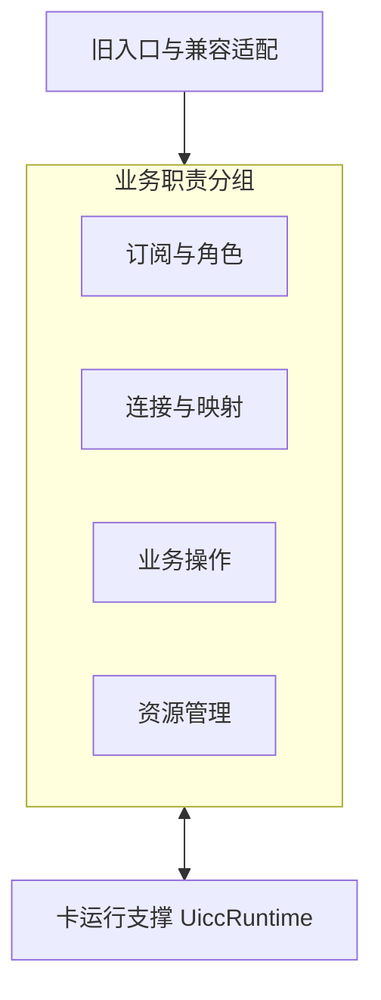
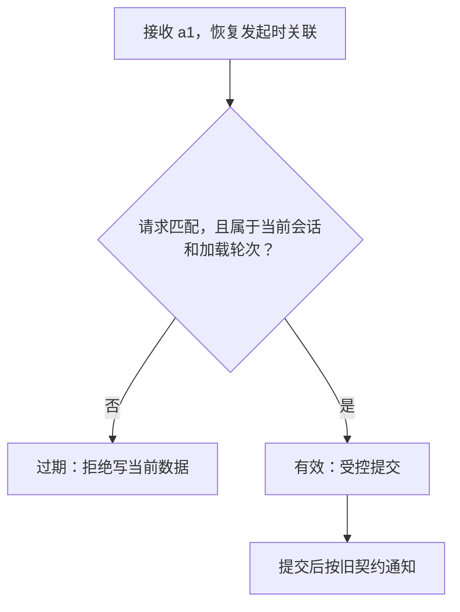

# 多 SIM 架构重构：开发讨论版

本文与《多SIM架构重构_开发讨论版_8页.pptx》逐页对应，包含页面要点、完整演讲词和演讲备注。职责图和处理流程使用 Mermaid，表格与文字保留对应业务含义。

适用范围：Core 内 SIM / eSIM 运行管理。目标设计需结合实际代码、产品能力和既有外部契约验证。

## 目录

1. [第 1 页：多 SIM 重构：规则与状态的责任划分](#page-1)
2. [第 2 页：同槽换卡：A 的旧响应晚于 B 到达](#page-2)
3. [第 3 页：当前结构：关联线索分散在多个处理入口](#page-3)
4. [第 4 页：五条设计规则及其代码落点](#page-4)
5. [第 5 页：目标职责：每项事实都有明确维护者](#page-5)
6. [第 6 页：同一场景的处理对比：写入前统一准入](#page-6)
7. [第 7 页：外部接口：兼容适配与行为验证](#page-7)
8. [第 8 页：本次讨论要确定的规则与首个验证切片](#page-8)

---

## 第 1 页：多 SIM 重构：规则与状态的责任划分

建议讲解时间：约 3 分钟。

### 本页目标

理解重构要解决的业务变化，以及判断设计是否有效的标准。

### 页面要点与图表

讨论目标：明确为何重构、职责怎样划分，以及如何保护既有业务。

| 现有设计需要面对的变化 | 涉及的问题 |
| --- | --- |
| 增加订阅或运行端口 | 身份、连接、默认角色与资源需要协调，同一规则容易在多个入口重复解释。 |
| 换卡、刷新与设备重启 | 同一位置的对象和加载轮次会改变，旧响应需要明确的失效与准入规则。 |

目标行为：

- 扩展组合复用既有规则，修改主要留在所属职责与设备适配内。
- 状态变化能够解释和验证，旧结果不串写，未知设备效果可核实。

共同约束：既有能力和外部接口承诺继续保持。

范围：Core 内 SIM / eSIM 运行管理，沿用原进程、SA 和外围协作契约。

### 演讲词

今天我们讨论多 SIM 重构，希望先形成一个共同判断：以后增加订阅、增加运行端口，或者处理换卡和设备重启时，每一条业务规则应当由谁负责，变化应当落到哪些代码里。大家熟悉业务，这次最需要大家帮助确认的是规则有没有遗漏，以及当前代码已经做了哪些保护。

先看左边第一类变化。增加一个端口，往往同时涉及“这是哪个订阅”“现在连接到哪里”“是否符合默认数据或语音角色的条件”“设备能否提供资源”。这些问题之间有联系，但变化原因并不完全相同。如果每个调用入口都根据 slot 自己推断一遍，新增能力时就需要逐个寻找和修改这些判断。设计希望把规则放到明确的维护位置，让其他模块通过接口使用它。

再看第二类变化。同一个位置上，刚才可能是卡 A，现在已经是卡 B。位置没有改变，旧请求还可能在返回途中。即使没有换卡，同一张卡也可能启动新一轮文件加载。我们需要在代码中明确表达：这个响应属于谁，属于哪一次运行，以及它现在还有没有资格改变系统状态。

右边是我们希望得到的结果。业务规则有明确归属后，新增设备能力主要修改相应的能力适配和映射逻辑，其他职责尽量复用已有规则。处理状态变化时，也能解释清楚为什么接收一个结果、为什么拒绝另一个结果，以及设备执行情况不确定时由谁继续核实。

这里还要区分三个业务量：系统管理了多少订阅，设备启用了哪些凭据，以及当前能够同时提供多少通信能力。管理更多订阅，并不自动增加 Modem 的并发能力。重构需要把这些约束表达清楚，实际能力仍以产品和设备条件为准。

这次改造的共同约束是保持现有能力和外部接口承诺，范围集中在 Core 内的 SIM 与 eSIM 运行管理，沿用现有进程、SA 和外围协作关系。评价方案时，我们就问两个问题：业务变化是否有明确的修改归属，原有业务行为是否有可执行的验证依据。下面用一个大家容易判断的换卡场景，把这些问题具体展开。

### 演讲备注

1. 讲解顺序：指左上“增加订阅或运行端口”，让开发先联想到近期新增能力的改动，再指左下“换卡、刷新与设备重启”，最后落到右侧目标。

2. 术语解释：订阅表示业务上管理的通信身份及相关选择。端口表示设备模型中的运行或连接位置。默认角色表示用户或系统选择的默认数据、语音等用途，具体角色和资格规则以产品定义为准。

3. 原理补充：变化隔离的意思是把经常一起变化的知识集中维护，把变化原因不同的知识通过明确接口连接。检验方法是追踪新增能力时哪些判断需要修改，而不是统计拆出了多少个类。

4. 现场问题：最近一次增加卡形态或端口时，哪条规则在多个模块重复修改？请开发给出一个真实例子，用它校准后续职责划分。

5. 讲解边界：本页描述目标与设计动机，不承诺固定卡数、并发能力或具体工作量收益。既有 eSIM 服务的主流程职责仍需按真实调用链确认。

### 原设计依据与适用范围

多SIM架构重构_问题分析与软件设计_V24.pptx，P4–8、P13、P19、P26–28、P44。目标规则与示意流程仍须结合目标代码、产品能力和既有契约验证。

---

## 第 2 页：同槽换卡：A 的旧响应晚于 B 到达

建议讲解时间：约 3～4 分钟。

### 本页目标

区分原请求关联、当前运行会话和本次加载轮次，理解旧响应为什么不能写入新对象。

### 页面要点与图表

讨论场景：位置复用后，仍在途的文件读取响应应该怎样处理。

| 时刻 | 事件 | 请求与会话 |
| --- | --- | --- |
| T0 | 卡 A 在 slot 0 开始加载 | 会话 A，加载第 7 轮，发出文件请求 a1。 |
| T1 | 同槽换成卡 B，位置仍为 slot 0 | 会话 B 开始自己的加载，A 的请求仍可能在途。 |
| T2 | A 的 a1 迟到 | 响应能关联到原请求，但当前运行对象已是 B，是否允许写当前数据？ |

**位置没有变化，当前运行会话已经变化。**

| 保护对象 | 必须满足的结果 |
| --- | --- |
| 缓存 | A 的数据不写入 B 的缓存。 |
| 完成 | A 的响应不完成 B 的加载。 |
| 通知 | B 的状态依据 B 的有效数据判定。 |

共同确认：当前哪些入口承担关联、失效和写入前检查？

### 演讲词

请从左到右看这个时间顺序。T0 时，卡 A 在 slot 0 开始加载文件。为了说明问题，我们给这段运行过程起名“会话 A”，把当前文件读取过程叫作“第 7 轮加载”。A 发出请求 a1，随后等待设备返回。这里的名字和数字只是示意。

到了 T1，用户在同一个位置换成卡 B。系统已经开始维护 B 的运行状态，B 也可能发出了自己的文件请求。不过，A 之前发出去的请求未必已经消失，它的响应仍可能在设备或消息队列中传递。

到了 T2，A 的响应终于返回。已有 serial 关联可能让我们准确找到原来的请求 a1，这一步是有价值的，应当保留。接下来还需要回答一个不同的问题：a1 的结果是否仍然属于当前允许更新的运行对象？如果代码只根据 slot 0 找当前对象，就有可能找到 B。于是，“找到了原请求”和“可以写当前缓存”之间出现了一个需要明确保护的边界。

为理解这条边界，我们把三个概念分开。请求关联回答“这是谁发起的哪次请求”。运行会话回答“请求属于哪个运行实例，那个实例现在是否仍有效”。加载轮次回答“它属于这个实例的哪一轮文件加载”。同一会话里可以发生多轮加载，所以只检查会话还不足以排除上一轮文件结果。

对应到本例，a1 始终属于会话 A 的第 7 轮。当前已经是会话 B，所以 a1 不能获得 B 的写入资格。对于同一卡的文件重载，卡的运行身份可以保持，但新一轮加载也不能混入上一轮结果。这里最重要的是在发起请求时记下原始关联，收包时不能用当前会话替换它。

再看下方的三个业务结果。第一，A 的数据不能写到 B 的缓存。第二，A 的返回不能减少 B 的待完成项，不能让 B 提前宣告加载完成。第三，B 的状态和通知只能根据属于 B 的有效数据以及原有业务条件来决定。这三点就是这个场景下必须一直成立的业务约束。

请大家结合真实代码指出：目前哪里登记请求，哪里使旧会话失效，哪里在写缓存之前检查关联。我们先确认现有机制覆盖了哪些交错，再决定需要补哪个入口。这个例子用于推演和验证，是否存在实际缺口，要由代码路径和可复现的事件顺序来确认。

### 演讲备注

1. 指图与停顿：讲完 T2 后先停一下，问“响应能找到 a1，是否已经足以写 slot 0 的当前缓存？”再解释三个作用域。

2. 原理补充：运行会话可以理解为某个端点上连续有效的一段运行实例。会话标记用于区分先后出现的实例。加载轮次用于区分同一会话内先后发生的文件加载。具体标记类型、存储方式和递增范围留到代码设计时确定。

3. 容易误解的地方：slotId 的含义取决于具体接口，本例仅表示两个时刻旧入口都使用 slot 0，不能据此把所有 slotId 都解释为永久物理卡槽。serial 也应在原协议规定的作用域内解释，不能假定全系统唯一。

4. 问题回应：“当前已经有 serial，是否重复设计？”可以先核查 serial 是否连同原会话、原加载轮次一起保留下来，以及检查和写入是否处于同一保护范围。若已有等效保护，就复用并明确它的责任。

5. 讲解边界：本页讨论文件读取响应。控制命令的迟到结果还可能反映真实设备变化，第 6 页会解释为什么不能一律丢弃。

### 原设计依据与适用范围

多SIM架构重构_问题分析与软件设计_V24.pptx，P9、P12、P43、P76–80。目标规则与示意流程仍须结合目标代码、产品能力和既有契约验证。

---

## 第 3 页：当前结构：关联线索分散在多个处理入口

建议讲解时间：约 3 分钟。

### 本页目标

把业务风险定位到现有实现中的责任边界，说明改动传播的原因。

### 页面要点与图表

以下按职责归纳现状，已有保护保留，具体缺口需在目标代码中核对。

| 现有结构与线索 | 需要开发核对的问题 | 形成的设计要求 |
| --- | --- | --- |
| slot 级对象与缓存 Manager vectors、账户索引 | 位置复用后，谁确认业务对象已替换？ 多个对象的创建和清理是否一致？ | 身份与位置分别表达 会话失效有统一维护责任 |
| 回调与文件加载 serial、计数和缓存 | 请求匹配后，还会检查会话和轮次吗？ 检查是否发生在写缓存之前？ | 发起时记录关联 写入前统一准入和去重 |
| 状态、账户与通知 多入口消费 READY / LOADED | 谁定义文件完成、账户资格和业务可用？ 同一条件是否需要多处解释？ | 各事实有明确维护者 对外状态按契约派生 |

扩展时，新增 Port 需要明确映射与资格规则的修改归属。

### 演讲词

上一页说明了我们希望保护的业务结果。这一页把问题落回现有代码，按表格从左到右看：左边是当前可以寻找的实现线索，中间是需要开发核对的问题，右边是由这些问题引出的设计要求。

第一行是 slot 级对象、缓存和账户索引。使用数组或 vector 管理对象本身很常见，我们要核查的是这些对象是否都把同一个 slot 理解成同一个生命周期。当位置复用时，卡对象、文件缓存和账户信息可能分别在不同入口创建、清理或重建。如果没有明确的失效规则，就很难判断多个对象是否仍然属于同一个运行实例。因此，身份、当前位置和会话有效性需要分别表达，并有明确的维护责任。

第二行是回调与文件加载。这里已经存在 serial、加载计数和缓存等机制。需要沿着真实调用链继续追问：响应匹配到原请求之后，代码用什么定位目标缓存？会不会转而访问当前 slot 对象？会话与轮次检查发生在写入之前，还是写入以后？同一个返回重复到达时，会不会重复减少待完成数？这些问题决定了结果准入、更新与去重应该放在哪里。

第三行是状态、账户与通知。卡应用报告 READY、文件读取完成、账户具备某项资格，以及网络业务实际可用，各自依赖的条件可能不同。如果多个入口都自行解释同一个枚举，就容易把不同含义混在一起。目标设计会让各类事实有自己的维护者，再依据既有契约生成外部状态，保留调用方已经依赖的含义。

这些问题也能解释多卡扩展为什么会产生联动修改。举例说，新增 Port 后，如果每个账户、角色和资源调用方都需要自己重新推导 slot 与订阅的关系，那么同一映射知识就散在很多地方。一旦把映射事实集中维护，并通过接口公开，调用方可以主要关注自己负责的资格、选择或资源规则。

所以，请大家按这三行把真实入口标出来：谁创建和结束运行实例，谁接受文件结果，谁产生对外状态。我们会保留现有有效保护，补齐缺少的责任与接口。下一页给出五条设计规则，用来约束这些改动，而不是只凭类名或目录决定架构。

### 演讲备注

1. 讲解方法：每行先说现象，再问代码位置，最后解释设计要求。若开发指出已有过滤，继续追问它覆盖的对象、失效事件和写入范围，记录证据后再判断是否需要改动。

2. 术语解释：权威事实是某个职责负责接受并维护的业务状态。派生状态是依据这些事实和规则计算的结果。例如文件完成事实可以参与生成旧 LOADED，但两者是否等价必须以旧接口语义为准。

3. 原理补充：一次业务变更迫使很多互不相邻的入口修改同一判断，说明这项知识的维护位置可能分散。设计要减少这种重复解释，同时保留正常的模块协作。

4. 现场问题：请找出一个 READY 或 LOADED 的生产者和两个消费者，各自依赖的条件是否完全一致？如果不一致，应把各自真实含义写清楚。

5. 讲解边界：Manager vectors、slot 缓存和计数器属于核查线索，不单独构成缺陷证据。需要结合目标版本、线程执行顺序以及已有清理和过滤机制判断。

### 原设计依据与适用范围

多SIM架构重构_问题分析与软件设计_V24.pptx，P8–13、P26、P47–49。目标规则与示意流程仍须结合目标代码、产品能力和既有契约验证。

---

## 第 4 页：五条设计规则及其代码落点

建议讲解时间：约 4～5 分钟。

### 本页目标

理解五条设计规则分别保护什么，以及它们如何转成代码约束。

### 页面要点与图表

先说明业务含义，再确定模块、类型和接口。

| 设计规则 | 业务含义 | 实现中应看到什么 |
| --- | --- | --- |
| 身份与位置分开 | 订阅是谁，与当前连在哪里分别判断 | 订阅标识、来源与当前 Binding 按身份策略决定延续或重建 |
| 状态与有效期分开 | 卡就绪、文件完成、业务可用各有条件 | 请求、会话、加载轮次的关联 旧响应写入前统一校验 |
| 每项事实有明确维护者 | 协作方通过公开契约获取或请求变化 | 受控提交入口和只读快照 减少重复规则与旁路写入 |
| 完整用例承担恢复责任 | 主动切换需要说明成功、未知与恢复 | 唯一主编排及明确子步骤 超时后核实真实设备效果 |
| 旧接口承诺独立保持 | 内部细化后，调用方继续按原约定使用 | 兼容适配和消费者契约测试 错误、通知与完成语义明确 |

**每个新增模块都要解释：集中维护哪项知识，减少调用方的哪类判断。**

### 演讲词

这五条规则用来回答“为什么这样拆模块”和“写代码时应该守住什么”。每一条都需要能落到数据、接口或检查点上。

第一条，身份与位置分开。业务上管理的是某个订阅，设备上描述的是它当前连接的端点与端口。位置变化后，哪些业务信息延续、哪些运行信息重建，需要由身份和生命周期策略决定。代码中可以用订阅标识表达业务身份，用 Binding 表达当前连接关系。这样，调用方需要知道“谁”时，就不必借位置猜身份。没有当前连接的受管理订阅，也仍可能需要保留自己的管理信息。

第二条，状态与有效期分开。一个响应的内容可能报告“卡已就绪”，但它属于已失效会话时，就不能据此更新当前卡。反过来，一个属于当前会话的有效响应，也可能报告失败或未就绪。内容是什么状态、内容现在能否用于当前对象，是两项分别判断的条件。文件加载还需要自己的轮次，旧轮次的成功结果同样不能直接计入新轮次。

第三条，每项事实有明确维护者。这里的维护者负责定义更新条件、接受合法输入并保护自己的状态。其他模块可以请求修改或读取公开快照，不直接改它的内部字段。例如，文件加载结果由运行支撑维护，订阅角色规则由订阅职责维护，流程编排只通过接口协调它们。这样修改规则时能够找到明确落点，也能减少不同入口的旁路写入。

第四条，完整用例承担恢复责任。主动切换或激活可能涉及多个步骤，某个底层函数成功，只说明它负责的局部步骤完成。主流程需要知道整个用户请求到了哪里，成功条件是否满足，失败后如何继续。尤其是设备命令超时，设备可能已经执行，只是响应没回来。这时要保留“结果待核实”的内部语义，由负责该用例的主流程查询设备事实，再决定继续、补偿还是结束。真正的主编排者需要唯一，既有 eSIM 服务负责主流程时，本地承接约定的子步骤。

第五条，旧接口承诺独立保持。内部模型可以更细，但调用方仍应得到原来约定的参数含义、结果、通知和完成条件。兼容适配负责转换，消费者契约测试负责检查。遇到原契约表达不了的新能力，需要单独设计接口演进，不能悄悄改变旧参数的含义。

把这五条放在一起，就是先明确业务知识，再确定谁负责维护，最后用接口和测试保护边界。以后每提出一个新模块，我们都要解释：它集中维护哪项知识，哪些调用方因此可以少做重复判断。这个问题答清楚后，再决定需要怎样的类、接口和目录。

### 演讲备注

1. 重点解释：状态描述“是什么”，有效期描述“这份信息适用于哪段运行”。可用一个反例检查理解：A 的成功结果已经过期，B 的失败结果仍可能是当前有效事实。

2. 术语解释：Binding 是当前连接关系。快照是供外部读取的状态视图，使用时仍需考虑版本和时效。受控提交表示更新经过所属职责规定的校验，不能由任意调用方直接改内部数据。

3. DDD 对照：统一语言帮助团队准确使用“订阅、端点、会话、轮次”等词。限界上下文明确一组业务知识的含义和维护边界。聚合用于组织必须一起保护的局部状态与规则，是否需要取决于实际一致性要求。无需把每个模块都套成同一种类结构。

4. 问题回应：“明确维护者会不会产生新的大总控类？”维护责任按事实划分，各职责各管自己的状态，业务操作只维护用例进度并通过接口协作。检查是否存在跨职责直接写字段，比检查类名更有意义。

5. 讲解边界：订阅身份策略不能直接等同于某个硬件字段永久唯一。结果待核实属于内部建模示例，对外表达仍受旧契约约束。

### 原设计依据与适用范围

多SIM架构重构_问题分析与软件设计_V24.pptx，P14、P18–19、P21–23、P30–36、P39–40、P64。目标规则与示意流程仍须结合目标代码、产品能力和既有契约验证。

---

## 第 5 页：目标职责：每项事实都有明确维护者

建议讲解时间：约 5～6 分钟。

### 本页目标

看懂目标职责图，分清功能模块、实现分层和 SO 部署边界。

### 页面要点与图表

图中表示职责分组，各模块通过公开契约协作。

箭头概括入口调用与运行支撑协作，不表示固定调用链、源代码依赖方向或全局事务。

| 职责 | 维护内容 |
| --- | --- |
| 旧入口与兼容适配 | 保持原有参数、权限、结果、状态和通知语义。 |
| 订阅与角色 | 身份与来源、用户偏好、有效角色。 |
| 连接与映射 | 端点、当前 Binding、逻辑路由与版本。 |
| 业务操作 | 按用例推进步骤，核实结果并组织恢复。 |
| 资源管理 | 按能力仲裁、预留和分配，保护活动业务。 |
| 卡运行支撑 UiccRuntime | 卡应用、安全、Records、会话与加载轮次。 |

技术适配连接 RIL、存储与既有 eSIM 服务。SIM 短信、电话簿、STK 和运营商配置继续由相应支撑模块承接。

职责模块内部按需分层，SIM SO 容纳这些职责并沿用原进程与 SA。

### 演讲词

这张图先按“每项事实由谁维护”来读。最上面的旧入口与兼容适配，负责接住现有调用方，把原来的参数和权限语义带进内部，再把内部结果按原约定转换出去。它保护外部使用方式，具体业务规则仍交给相应职责。

中间左上是订阅与角色。它维护业务身份、来源，以及用户偏好和当前有效选择。比如用户希望某个订阅承担默认数据角色，和这个订阅在当前条件下能否实际承担该角色，需要分别表达。它可以依赖其他职责提供的资格和能力事实，但不自己维护端口连接或卡文件缓存。

右上是连接与映射。它回答当前有哪些端点、订阅连接在哪里，以及逻辑路由是什么。Binding 可以理解为明确记录的当前连接关系。这里维护的是已经核实的连接事实，所以发出一条切换命令，并不直接等于连接已经切换成功。连接变化怎样影响运行会话，需要通过约定的接口或事件传递给运行支撑。

左下是业务操作。它负责一个完整用例的进度，例如激活或切换要经过哪些步骤，哪个结果可以证明完成，遇到超时由谁核实，发生失败如何恢复。它维护自己的流程状态，通过公开接口请求其他职责工作，不直接改所有模块的数据。

右下是资源管理。它维护设备能力约束、资源预留和分配规则。多个端点在软件上可以分别表示，但它们可能共享同一个 Modem 或其他受限资源，所以不能仅凭“端点不同”就认定能够并行。资源职责需要说明哪些请求能同时推进，哪些需要等待，以及怎样保护已经开展的业务。

下方的 UiccRuntime 是卡运行支撑，维护卡应用、安全状态、Records 文件数据，以及会话和加载轮次。我们前面讲的“旧文件响应能否写入当前数据”，主要应在这个职责内保护。它提供有效运行事实，其他职责按自己的业务规则消费这些事实。

举一个受设备能力支持的切换用例说明协作。业务操作先读取订阅资格、当前映射和资源情况，请求必要的资源预留，再通过技术接口推进设备动作。设备执行结果需要核实，连接与映射职责接受已确认的连接变化，运行支撑按约定建立或更新相应会话。订阅与角色职责再依据已确认事实计算有效选择，最后由兼容边界返回或通知。实际步骤和成功条件要按具体用例确定，这里只说明维护责任如何衔接。若执行中超时，就进入核实和恢复流程，不能仅凭发出了命令就宣布成功。

最后区分三种架构视角。功能模块回答“谁负责哪项业务知识”，图里的几组职责属于这一视角。实现分层回答“规则、用例协调和技术细节如何组织”，例如应用层推进用例，领域规则处理资格和约束，技术适配层连接 RIL 与存储。SO 边界回答“代码编译到哪个动态库、如何链接和装载”。多个职责可以放在同一个 SIM SO 中，沿用原进程与 SA。

因此，图中的模块并不要求变成多个新服务，也不要求每次查询都经过全部职责。简单查询可以读取约定的公开视图。我们要建立的是清楚的维护边界和必要的调用契约，同时保留 SIM 短信、电话簿、STK、运营商配置等原有支撑能力。

### 演讲备注

1. 指图顺序：从最上面的兼容入口开始，按“订阅与角色、连接与映射、业务操作、资源管理”依次讲四块，最后落到 UiccRuntime。讲切换例子时再沿涉及的职责指图，避免一次讲完所有英文名。

2. 原设计命名对照：订阅与角色对应 Subscription Management，连接与映射对应 Hardware Topology，业务操作对应 Subscription Operation，资源管理对应 Radio Resource。SO 是动态共享库，SA 是原有服务边界，RIL 是对接无线设备能力的技术接口层。

3. 分层原理：稳定的业务规则通过抽象接口使用外部能力，具体的 RIL、存储等适配实现这些接口。运行时调用方向与源代码依赖方向需要分别设计。图中箭头仅概括协作，不能据此推导 include 方向或固定流水线。

4. 一致性提醒：各职责只保护自己的更新边界。跨职责读取的版本可用于发现依据已变化，但版本检查本身不会形成全局事务。资源预留、共享设备域调度、结果核实和失败恢复仍然需要明确设计。

5. 问题回应：“既然业务操作会调用各模块，它是不是新的上帝类？”看它是否只维护用例步骤，是否把映射、角色、资源和文件规则留在各自职责。如果它直接修改其他模块字段，或者复制这些规则，就偏离了这里的设计。

6. 讨论问题：新增一个 Port 后，哪些改动应留在能力适配和映射中？哪些资格规则确实需要调整？请开发按真实业务举例，不预先承诺只修改一个模块。

7. 讲解边界：eSIM 实际主编排者须核对既有服务调用链。由既有 eSIM 服务主导的用例，本地业务操作只承担已约定的子步骤，避免重复编排。

### 原设计依据与适用范围

多SIM架构重构_问题分析与软件设计_V24.pptx，P20–28、P37–38、P58、P64、P67–71。目标规则与示意流程仍须结合目标代码、产品能力和既有契约验证。

---

## 第 6 页：同一场景的处理对比：写入前统一准入

建议讲解时间：约 4～5 分钟。

### 本页目标

解释写入前统一准入如何实施，以及为什么校验和更新必须处于同一保护范围。

### 页面要点与图表

保留原请求关联，在进入当前缓存与完成集合之前检查业务有效性。

现状需要核查的风险路径：a1 匹配了原请求，已有 serial 关联继续保留。如果再按 slot 找当前对象，此时定位到的可能已是 B。若缺少会话与轮次校验，写缓存和完成集合就存在串写窗口。

目标是在卡运行模块集中校验与提交：

| 环节 | 处理要求 |
| --- | --- |
| 恢复关联 | 保留原请求、原会话、原加载轮次。 |
| 过期结果 | 不修改 B 的缓存，不推进 B 的完成集合。 |
| 有效结果 | 在同一执行域内校验并更新，提交后按旧契约通知。 |

换卡先关闭旧会话的写入资格；仅文件重载时，更新加载轮次。

### 演讲词

现在回到同槽换卡，看看前面的职责划分怎样变成一个可以落地的改造。先看左边，它描述的是需要核查的一条风险路径：响应通过 serial 找到原请求 a1，随后却通过 slot 定位当前对象。此时当前对象可能已经是 B。如果写缓存和推进完成集合之前没有进一步检查，就可能把 A 的结果计入 B。真实代码是否经过这条路径，需要由开发确认。

右边给出目标处理方式。第一步，在发起文件请求时，保存它原来属于哪个端点会话、哪一轮加载，以及对应的待完成项。响应到达时，恢复这份原始记录。这样我们检查的是请求发出时的身份，避免给旧请求贴上当前会话的新标签。

第二步，在改变当前数据之前做准入检查。除了原有请求匹配，还要确认原会话仍然是允许接收该结果的会话，原加载轮次仍然有效。如果已经换卡或进入新一轮文件加载，就不能写当前缓存，也不能推进当前轮次的完成集合。旧请求本身需要结束登记、释放关联资源，但这些清理不能影响 B 的当前进度。

第三步，有效结果也要检查是否已经处理过，以及文件内容是否满足本项加载的要求。比如同一结果重复回来，不能再次减少待完成项。只靠计数归零可能掩盖重复返回或必要数据缺失，因此完成条件应来自明确的必要数据和降级规则。具体采用集合、状态记录还是其他结构，可以结合现有实现决定。

这里还有一个容易漏掉的细节：校验与更新必须处于同一受控执行域。如果回调检查完“当前还是会话 A”之后，另一个线程立刻把会话换成 B，而前一个回调继续写数据，那么检查虽然存在，保护仍然失效。我们需要让失效操作、准入检查和提交按一致的规则排序。可以利用已有事件线程、锁或其他同步机制，具体选择取决于线程模型。关键是不能让会话替换插入校验与提交之间。

完成提交以后，再按旧契约安排回调与通知。外部需要观察哪些状态、查询何时能看到提交结果，应由兼容规则约束。实现时还要考虑通知重入，避免外部回调在内部状态只更新一半时进入系统。

底部强调失效范围。换卡会结束旧运行会话的写入资格。仅发生文件重载时，可以保持运行会话，只更新加载轮次。对于卡复位、应用替换或更大的设备重置，要根据实际影响判断会话是否也必须重建，不能一律当作文件重载。

最后，这一页针对文件结果。对于已经发出的激活或切换命令，即使本地请求过期，硬件仍可能执行成功。旧标记能阻止错误更新，却不能撤销硬件效果。这类迟到结果应由相应操作流程保留为核实线索，必要时重新查询设备状态，再决定如何恢复。

### 演讲备注

1. 讲解重点：围绕右侧四个动作展开，分别是“恢复原关联、写入前准入、有效结果去重提交、提交后按约定通知”。不要只念“增加会话号”而跳过保护范围。

2. 原理补充：检查时成立、真正使用时已不成立，属于检查与使用之间的竞争窗口。这里需要保护的是完整的状态更新边界，单独增加一次 if 判断不一定足够。

3. 执行域解释：一组有关联的状态变化遵守相同的串行或同步规则。它可以是已有事件队列，也可以是锁保护的更新范围，不等于给整个 SIM 子系统加一把全局大锁。

4. 具体检查点：请求登记保留原身份；失效先撤销旧会话的写入资格；重复结果不能二次推进完成；过期结果清理自身资源；正常结果按原顺序和条件对外可见。

5. 问题回应：“有共享指针或 weak_ptr，还需要会话吗？”对象存活只证明内存访问可能安全，仍需判断它是否代表当前有效的运行实例。反过来，会话标记也不能代替对象销毁与回调注销协议。

6. 现场问题：换卡处理、响应处理和通知分别在哪个线程？失效与写缓存是否经过同一调度或同步机制？请把这个答案落实到具体函数和队列。

### 原设计依据与适用范围

多SIM架构重构_问题分析与软件设计_V24.pptx，P12、P30、P43、P76–82。目标规则与示意流程仍须结合目标代码、产品能力和既有契约验证。

---

## 第 7 页：外部接口：兼容适配与行为验证

建议讲解时间：约 4 分钟。

### 本页目标

理解接口兼容的范围，掌握兼容适配和行为验证各自承担的责任。

### 页面要点与图表

旧契约覆盖签名、数据含义、权限、完成条件和通知时序。

原有调用方通过旧接口与兼容适配，使用新内部模型与用例，并按原契约接收返回与通知。

| 保护什么 | 怎样检查 |
| --- | --- |
| 入口与结果 | 核对 SA / IPC、方法、参数、权限、错误码及 slot / simId 语义 |
| 异步完成与通知 | 同场景比较回调次数、顺序、允许时限，以及查询可见性 |
| 数据与设备副作用 | 单独测试 DataShare 直接消费者。设备命令只由活动路径发送 |
| 启动、停止与跨 SO 边界 | 检查对象身份、在途回调、销毁、ABI，以及存储兼容和回退条件 |

以冻结契约和独立预期判定，结合新旧实现差分。已知缺陷与批准修复单列。

### 演讲词

这一页回答大家最关心的问题：内部模型变了，怎样保证外部调用方继续正常使用。请先看上面的三块。原有调用方仍使用原入口，兼容适配负责保留已有参数、权限和结果含义，内部则按新的职责模型处理。转换发生在边界，但用例本身仍必须满足原来承诺的完成条件。

例如，内部把“卡应用就绪”“文件数据完整”“某项业务具备资格”分开维护，这是为了明确含义。对外的旧状态枚举仍按原契约派生，不能把内部新增状态直接塞给原调用方。同样，旧接口何时返回成功，是已经接收请求还是已经完成某项设备动作，也必须先查清，内部拆成多个步骤以后仍要兑现这个承诺。

表格第一行检查入口与结果。包括 SA 与 IPC 入口、方法、参数、权限、错误码，以及 slot、simId 在各接口中的具体含义。签名相同但参数解释改变，调用方仍可能出问题，所以需要把这些含义一起作为基线。

第二行检查异步行为。一个请求应回调几次，哪些通知必须先后出现，允许等待多久，以及调用方收到完成信号后再查询，应看到什么状态。这些都是接口实际使用的一部分。我们比较的是约定的因果关系和允许时限，具体时间值必须来自既有契约或确认后的要求。

第三行提醒我们，有些消费者会直接读取 DataShare 数据，可能不经过上面的 API 适配。因此还要单独核对数据入口、字段、权限和读取语义。设备命令也要受到保护。做新旧逻辑对照时，可以在只读或纯计算范围运行影子逻辑，真实设备动作只能由选定的活动路径发送，避免测试过程中重复激活或切换。

第四行检查启动、停止以及跨 SO 的边界。拆成独立库以后，对象是否仍是预期的同一个实例，停止时是否还有回调访问已销毁对象，二进制调用约定是否兼容，以及持久化数据能否被回退版本理解，都需要核对。单独编译成功不能覆盖这些运行时条件。

验证方法有两部分。先整理消费者真正依赖的契约，并为关键场景写独立预期，再在相同输入和设备条件下比较新旧实现。差分能帮助发现偏差，独立预期能避免把旧实现的已知问题当成正确标准。确认要修复的缺陷应单列，说明允许改变什么，并获得相应确认。

因此，接口兼容需要有适配位置，也需要有可执行证据。最后一页会把这些要求收敛到首个改造范围，让我们能从一个具体场景开始验证设计。

### 演讲备注

1. 讲解例子：若某旧接口约定“完成回调后能查询到新状态”，就要检查提交、回调和查询之间的可见性。这个例子用于说明契约类型，不能假定所有旧接口都具备同样承诺。

2. 术语解释：消费者契约测试从调用方可观察的输入与结果检查约定。差分是在可比条件下比较新旧实现。独立预期来自业务规范、确认后的规则和场景要求，不依赖某一实现自行证明自己正确。

3. DataShare 与 ABI：DataShare 是直接数据访问通道，需要验证数据契约。ABI 是二进制层面的调用与对象约定，跨动态库使用时要结合实际导出接口、编译配置和对象生命周期检查。

4. 问题回应：“内部 PendingReconcile 怎么返回？”它表示设备效果待核实，怎样转换为旧返回、等待或通知，要按该接口原有语义设计。兼容层不能自行把待核实包装成成功。

5. 现场问题：除了 API 调用者，谁直接订阅状态或读取数据？哪些消费者依赖回调后的查询结果？这些对象应进入验收清单。

6. 讲解边界：本页说明验证方法，不表示这些用例已经执行通过。旧接口不能表达的新增多端口能力，应另行演进契约。

### 原设计依据与适用范围

多SIM架构重构_问题分析与软件设计_V24.pptx，P4、P31、P37–43、P55、P71–75。目标规则与示意流程仍须结合目标代码、产品能力和既有契约验证。

---

## 第 8 页：本次讨论要确定的规则与首个验证切片

建议讲解时间：约 3～4 分钟，随后讨论。

### 本页目标

把讨论结论转成明确规则、代码落点和可判定的验收场景。

### 页面要点与图表

结合真实代码和设备约束，把建议落实为明确接口与验收场景。

| 需要确定的事项 | 建议起点 | 请开发核对的依据 |
| --- | --- | --- |
| 会话与失效范围 | 换卡使旧会话失效 仅文件重载则更新加载轮次 | 换卡、Reset、Port 变化的实际影响 共享设备是否同时影响多个端点 |
| 文件完成与旧状态 | 必要数据决定内部加载完成 旧 LOADED 按原约定派生 | 必要文件、可选失败与降级规则 状态查询及通知次数、顺序 |
| 首个改造切片 | 统一 Records 结果准入 在原写入点前保护会话与轮次 | 请求登记、缓存和完成集合的入口 线程模型、现有过滤与可注入事件 |

首个切片的验收场景：

1. 同槽换卡后旧响应迟到。
2. 同一卡重载时响应交叉。
3. 重复响应只计一次。
4. 正常加载保持原契约。

讨论结论回写主设计：采用规则、代码入口、验证用例和责任人。

### 演讲词

前面已经把业务问题、设计规则和目标职责串起来了。这一页希望大家一起确定三个会直接影响第一次改造的事项。

第一是会话失效范围。换卡使旧会话失效，单纯文件重载更新加载轮次，这是建议起点。实际还要核对 Reset、应用变化、端口映射变化分别影响什么。如果多个端点共享设备，一次重置可能影响多个运行实例，失效范围必须跟实际设备影响一致。我们要形成一张明确规则：什么事件发生，哪些数据与会话失效，哪些业务身份继续保留。

第二是文件完成与旧状态。请业务开发明确哪些数据是必要条件，哪些文件失败允许降级，以及旧 LOADED、状态查询和通知具体承诺什么。这样内部加载完成就有可判断的标准，兼容边界也知道何时能够输出旧状态。

第三是首个改造范围。建议先选择 Records 文件结果准入，找到请求登记、缓存写入和推进完成集合的真实入口，把会话与加载轮次保护放到提交边界。这一范围能同时检验生命周期、写入责任和外部行为，对应的异常交错也比较容易明确描述。是否具备合适的事件注入点，需要开发先核实。

下方四个验收场景要写成明确输入与预期。第一，同槽换卡后送达 A 的旧响应，确认 B 的缓存、完成集合和通知都不受它影响。第二，同一卡启动新一轮文件加载后交错送达两轮结果，确认新轮次只接收自己的有效结果。第三，重复送达同一结果，确认完成项只更新一次，不多发完成通知。第四，执行正常加载以及契约规定的失败或降级分支，确认外部返回、状态和时序仍满足原约定。

实施时先固定这些预期并核对已有保护，再做最小改造，最后用相同事件顺序复验。遇到规则尚未明确的地方，要记录谁负责确认、需要哪段代码或设备证据，以及得到什么结果才算闭环。这样下一次讨论就能围绕证据推进。

会议结束后，我们把采用的规则、代码入口、测试预期和责任人写回同一份主设计。首个范围验证通过，说明这组生命周期与提交规则得到了检验。后续还要用主动切换、资源竞争和 eSIM 协作等场景验证其他职责。今天的目标是让大家能沿着一个真实场景说清楚：规则归谁、状态怎么变、结果怎么验证，并据此开始第一步实施。

### 演讲备注

1. 主持节奏：先逐行确认表格中的规则和待核实依据，再讨论四个验收场景。最后确定一个具体改造入口及负责确认的人。时间不足时，优先收敛会话失效范围和首个入口。

2. 术语解释：改造切片指范围有限、从输入到业务结果都能完整验证的一段改动。这里选文件结果准入，是为了验证核心生命周期规则，完整多 SIM 架构还需要其他用例覆盖。

3. 验收记录示例：输入为“会话 A 发出文件请求，随后换成 B，再送达 A 的响应”。预期为“B 缓存不变、B 完成项不变、不产生由 A 结果触发的 B 完成通知”，同时确认旧请求自身清理不泄漏资源。记录真实执行入口和观测方式。

4. 问题回应：“为什么不一次把所有模块目录都拆完？”当前先通过一个完整业务路径检查规则是否成立。验证结论再用于指导职责迁移，可以尽早发现设计与真实线程、设备行为之间的差异。

5. 后续衔接：eSIM 主编排归属、共享资源争用、设备未知效果恢复，以及 SO 生命周期检查，需要进入相应后续场景。将条件和责任回写主设计，避免形成互相不一致的平行结论。

### 原设计依据与适用范围

多SIM架构重构_问题分析与软件设计_V24.pptx，P12、P43–45、P73–82。目标规则与示意流程仍须结合目标代码、产品能力和既有契约验证。
