# 多SIM架构重构：设计说明与业务流程对照

更新日期：2026-10-29  
对应材料：`多SIM架构重构_开发讨论版_分层与功能迁移补充.pptx`，开发视图补充后的21页正文与演讲备注  
适用范围：Core 内 SIM / eSIM 运行管理及其既有外围协作

本文将演示材料整理为可独立阅读的设计说明，按问题、架构、概念、功能迁移、开发视图、业务流程和实施约束组织。四条业务流程分别说明重构前的真实模块协作，以及目标架构中相应职责的承接关系。

**设计状态：目标方案，尚需按切片实现和验证。** 现状说明沿用 PPTX 引用的代码基线 `6017003eff50c1bc8c5dfa72336a4bfe42e948b0`；本文不代表对仓库最新分支进行了新一轮扫描。源码事实、风险推导与目标要求分别表述，不将风险候选写成已复现故障。

本文是同一方案的文字阅读版本。后续架构决策仍应回写目标主文档及既有功能、写权清单，避免形成相互竞争的设计版本。

## 阅读目录

- [1. 设计目标与适用范围](#1-设计目标与适用范围)
- [2. 重构前的架构与主要问题](#2-重构前的架构与主要问题)
- [3. 目标责任分层与DDD元素](#3-目标责任分层与ddd元素)
- [4. 核心概念及其关联](#4-核心概念及其关联)
- [5. 原功能到目标模块的迁移对照](#5-原功能到目标模块的迁移对照)
- [6. 开发视图：源码组织与构建边界](#6-开发视图源码组织与构建边界)
- [7. 业务流程一：设置显示号码](#7-业务流程一设置显示号码)
- [8. 业务流程二：普通SIM激活](#8-业务流程二普通sim激活)
- [9. 业务流程三：主卡切换与Data联动](#9-业务流程三主卡切换与data联动)
- [10. 业务流程四：Records加载与换卡](#10-业务流程四records加载与换卡)
- [11. 状态、并发与结果准入](#11-状态并发与结果准入)
- [12. 对外接口与部署边界](#12-对外接口与部署边界)
- [13. 迁移阶段与验证要求](#13-迁移阶段与验证要求)
- [14. 开发讨论与任务交接](#14-开发讨论与任务交接)
- [15. 材料对应关系与证据索引](#15-材料对应关系与证据索引)

图示采用 Mermaid。支持 Mermaid 的 Markdown 阅读器可直接渲染；图前后的说明和对照表也完整表达设计含义，不依赖 PPTX 的点击操作或外部图片。

业务时序图展开各节声明的代表路径，省略透传函数。异常、卡型和产品分支由对应说明与表格限定，具体执行仍需对照完整契约。

## 1. 设计目标与适用范围

### 1.1 重构要解决的变化压力

多 SIM 演进同时涉及账户数量、软件槽位、eSIM Profile、连接 Port 和共享无线资源。它们并非同一个容量指标。增加数组长度或取消一个固定上限，不能证明设备已经支持相应的同时使能、协议切换和资源组合。

现有代码围绕 slot 组织多组对象和缓存。新增一种业务组合时，如果不同入口都重新判断账户身份、当前位置、角色资格和设备状态，同一条规则就需要多处修改，回归范围也随之扩大。

另一类复杂性来自时间：同一个 slot 可以先后承载不同卡应用，同一张卡也可能经历 Refresh、重建或设备重启。请求发出与结果返回之间，原目标的有效性可能改变。

目标是让开发能够明确回答：

1. 当前业务操作针对谁，由谁维护其身份和资料？
2. 它现在连接到哪个卡应用、Port 和软件路由？
3. 默认角色和资源分配由谁裁决？
4. 谁组织设备动作、等待、重试和恢复？
5. 一份异步结果是否仍有资格改变当前状态？
6. 哪些既有返回、查询、通知和部分失败行为必须保持？

### 1.2 目标与约束

| 设计目标 | 应形成的变化 | 检查方式 |
| --- | --- | --- |
| 降低规则重复解释 | 同一规则和事实有明确维护者 | 检查资格判断、字段写点和旁路是否收口 |
| 控制变更传播 | 新组合主要影响相关规则、绑定或设备适配 | 对比具体需求涉及的模块及修改理由 |
| 解释异步状态 | 原请求、原会话、加载范围和操作步骤可追溯 | 覆盖换卡、Refresh、错误、重复与迟到输入 |
| 保持既有业务 | 兼容签名、权限、错误、读源、完成和通知 | 契约测试、独立预期及新旧差分 |
| 支持渐进迁移 | 按功能和写权单元交接 | 同一时刻仅有一套活动的副作用执行路径 |

本轮沿用既有 `simId` 规则、进程与 SA 身份、服务协议和外围业务边界。更大容量、MEP、新的身份保留政策及其他产品能力，按需求与设备证据另外确认。

### 1.3 两类变更分别验收

**结构迁移**整理端口、装配、依赖和职责，保留原目标解析时点、查询来源、错误与中间可见节点。

**行为增强**包括固定发起关联、拒绝陈旧回写、成功和错误统一准入、资源冲突治理等。它们可能有意改变旧结果，因此需要说明变化条件、外部影响和验证预期，不能混入一次机械搬迁。

文中的目标流程同时展示完整设计方向。实施时按照第13章拆分结构工作与行为增强工作。

## 2. 重构前的架构与主要问题

### 2.1 现有模块协作

以下是按源码职责归纳的主要运行关系，不是完整调用栈，也不表示现有代码已经形成严格的 Application / Domain 分层。

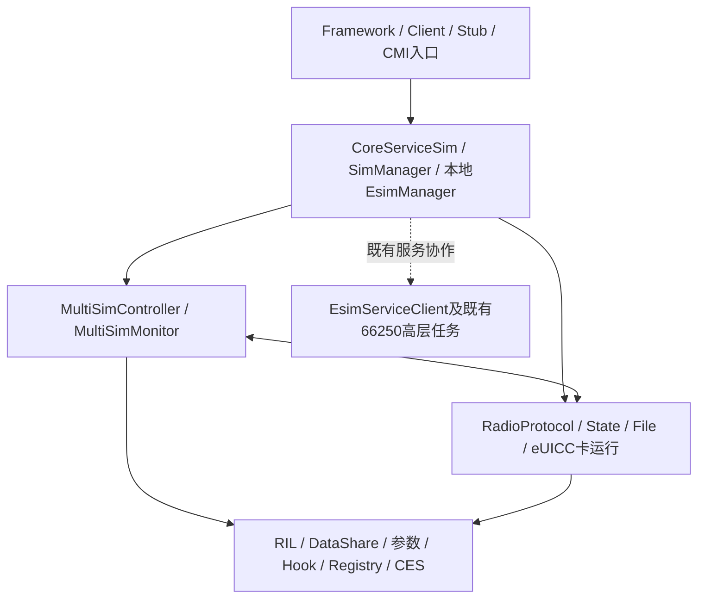

| 现有区域 | 主要职责 | 当前设计需要核对的边界 |
| --- | --- | --- |
| CoreServiceSim、CMI 等入口 | 参数、权限、受理、返回与回调 | IPC 与共宿主直接委托的检查和上下文是否分别保持 |
| SimManager、本地 EsimManager | 门面、按槽对象装配、运行对象定位 | 初始化、额外槽、条件编译及对象销毁是否一致 |
| MultiSimController | 账户、默认角色、激活、切换、缓存、存储和输出 | 同一方法中的规则、步骤与外部效果如何拆开 |
| MultiSimMonitor | 平台和卡侧监听、重载、恢复、重试与通知 | 哪些是技术接入，哪些是业务接纳，哪些是兼容输出 |
| State / File / RadioProtocol 等 | 原始卡状态、安全、EF、Records、APDU、协议切换 | 原请求关联是否覆盖成功、错误、重复与迟到分支 |
| 平台与外围服务 | RIL、DataShare、参数、Hook、Registry、CES 等 | 原协议、ABI、重入能力、输出节点及失败语义 |

### 2.2 主要问题是知识和更新协议分散

一个 Controller 方法可能同时判断目标资格、等待设备、改缓存、写数据库、更新参数和发送通知。File 完成会改变加载和卡状态，Monitor 又可能重新加载账户数据。因此，某项事实的完整更新协议往往跨越多个入口。

这会产生三个需要治理的问题：

- **位置与身份混用。** 当前位置被复用后，调用者需要重新判断它代表哪一个账户和卡应用。
- **关联与有效性检查分散。** 找到原请求之后，还要确认原会话、步骤和文件范围是否有效。
- **写权与完成条件不清。** 初始化、设备观察、重载、异步回写和重试可能共同修改同一份状态。

现有实现已经有 RIL serial、请求表、部分协议 session 和状态过滤。重构应复用这些机制，并追踪它们能否覆盖最终业务写点。不能为了说明重构价值，把现状描述为完全没有请求关联或会话保护。

### 2.3 同槽换卡说明了什么

| 时点 | 业务事实 | 对结果处理的要求 |
| --- | --- | --- |
| T0 | slot 0 上是卡 A，A 发起文件读取 a1 | 保存 a1 发起时的会话与加载关联 |
| T1 | A 被移除，slot 0 上换成卡 B | 撤销相关旧会话的当前状态写权，建立 B 的运行状态 |
| T2 | a1 迟到，底层仍能匹配原请求 | 不能仅按 slot 0 找到 B 后写入，也不能完成 B 的加载 |

请求匹配回答“回应哪次请求”，会话与加载资格回答“允许改变哪份状态”。对象的内存仍存活，也不代表它仍是当前业务对象。

这是一项设计保护场景。当前代码是否存在具体串写缺口，需要可达路径和受控交错测试证明。

## 3. 目标责任分层与DDD元素

### 3.1 业务责任与代码分层分别表达

T、A、O 描述业务知识和事实归属；Application、Domain 描述代码职责。一个 T 责任同时可以包含应用服务和纯模型。C、R、I、H 则提供兼容、生产运行、技术适配和装配支撑。

| 标识 | 责任范围 | 典型落点 | 必须守住的边界 |
| --- | --- | --- | --- |
| T：账户拓扑 | 账户身份、资料、已接受的绑定及相关兼容投影 | TopologyService、TopologyAggregate | 接纳可信观察；不复制 EF 解析和原始卡状态机 |
| A：角色与资源 | Voice / SMS / Data / Primary，偏好、有效选择和资源计划 | AssignmentService、AssignmentAggregate、AssignmentPolicy | 区分意图、参数投影与设备观察 |
| O：本地操作 | 本地多步骤用例、等待、尝试、效果认知与终态 | OperationCoordinator、OperationContext | 请求其他 Owner 接纳事实；不直接修改其字段 |
| R：卡运行 | 状态、安全、EF、Records、电话簿、卡短信、STK、carrier、eUICC | 复用原生产实现，逐步增加会话、加载与资源准入 | 保留卡型、协议、解析和专用错误；保持真实设备约束 |
| C：兼容边界 | 旧入口、模型转换、原结果和完成出口 | LegacyFacade、原入口及回调桥 | 保持方法、参数、权限、错误、读源和时序 |
| I：技术适配 | DataShare、参数、RIL、Hook 和输出等具体协议 | AccountStore / AssignmentStore 的实现及其他 Adapter | 依照所属 Owner 的字段与执行计划访问原提供方 |
| H：宿主装配 | 工厂、私有 Ports 注入、共享对象与生命周期 | 宿主组合、匹配销毁、回调排空 | 不作为额外业务流转层，不产生第二套运行对象 |

字母数量不决定 SO、进程或 SA 数量。简单查询可以沿正式查询路径执行，简单 EF 加载也不必创建长操作。

### 3.2 目标分层关系

图中的箭头表示主要运行协作。**Application 分别使用 Domain、R 和 I；Domain 没有通向设备或数据库的调用链。**

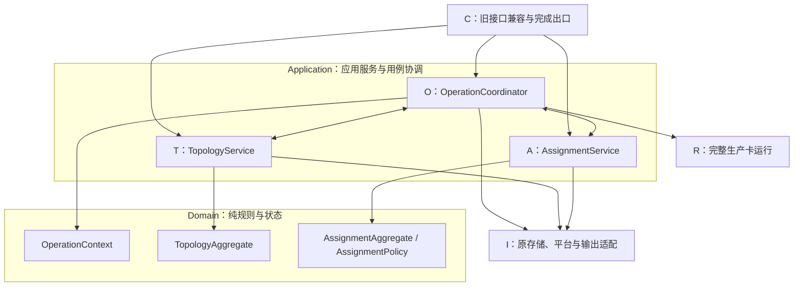

H 在装配时创建并连接真实实现。R 的卡侧事件入口、观察接纳和正式查询可以独立工作，图中的 C / O 不构成所有内部流程的必经路径。

### 3.3 重构前后的分层对照

| 旧实现中交织的职责 | 目标层或模块 | 迁移后的判断标准 |
| --- | --- | --- |
| 入口检查、受理返回、业务回调 | C | 外部调用方继续按原契约使用 |
| 激活、切换、等待、重试、恢复 | Application，主要由 O 组织 | 一个业务步骤只有一个实际执行方，同一层级只有一个重试负责人 |
| 账户、身份、绑定规则与状态 | T 的应用服务和 Domain 模型 | 合法变化经 T 入口接纳，其他模块不持可写引用 |
| 默认角色、偏好、资源约束 | A 的应用服务和 Domain 模型 | 选择、参数与设备事实分别表达 |
| 操作步骤和效果规则 | O 的纯状态模型 | 与线程、回调、I/O、运行容器分离 |
| State / File / EF / APDU 等生产逻辑 | R | 原协议继续复用，结果归属和资源保护逐步收口 |
| DB、参数、Hook、平台输出 | I，由应用经端口调用 | 原协议、所属字段、失败和输出节点明确 |
| 对象创建、共享 RIL、生命周期 | H | 真实对象身份、销毁和在途回调关系可验证 |

### 3.4 DDD元素的具体落点

| DDD元素 | 在本方案中的位置 | 技术含义及约束 |
| --- | --- | --- |
| 限界上下文与统一语言 | T、A、O 的业务责任范围 | 对账户、角色、操作等词语及合法变化建立一致解释 |
| 应用服务 | TopologyService、AssignmentService | 准备事实、调用纯规则、使用端口、接纳结果 |
| 用例协调器 | OperationCoordinator | 组织本地多步骤执行、等待、恢复与完成 |
| 聚合 | TopologyAggregate、AssignmentAggregate；O 按需建模 | 保护相应局部状态和不变量，不自动形成全设备事务或大锁 |
| 实体 | 以既有 simId 识别的账户等 | 属性可以变化，身份语义沿用原规则 |
| 值对象 | 内部 SimId / SlotId、会话和版本相关纯值 | 表达不同含义，减少误传；不新增公开 ID |
| 领域服务或策略 | AssignmentPolicy 等纯规则 | 按输入给出裁决或计划，不等待 RIL、不写 DB |
| O 的纯状态 | OperationContext | 表达步骤、效果认知和终态；不持平台句柄和真实 callback |
| 仓储抽象或存储端口 | Application 声明 AccountStore / AssignmentStore 等 | 当前方案保留原提供方和字段协议，因此采用应用层出站端口 |
| 仓储或适配实现 | I | 实现原 DataShare / 参数访问，不提供任意整行覆盖和全局事务 |
| 领域事件 | Owner 接纳后的内部事实表达 | 与原始 RIL 回包、CES 和跨服务消息分别定义 |
| 防腐适配 | C | 将旧契约与内部模型连接，同时保持旧可观察行为 |
| 工程工厂 | H | 创建真实运行对象并注入端口；不同于纯模型的业务构造规则 |

“纯模型”可以改变自己管理的内存状态或返回变化计划，重点是隔离具体平台副作用。是否写入、何时可见、怎样通知，仍由相应应用入口及写入协议组织。

本方案不要求为每个名词新增一个类。每项抽象都应解释：消除什么歧义、隔离什么变化、保护什么规则，以及接管哪个旧写点。

### 3.5 运行调用、源码依赖与注入

运行时，应用通过端口调用 R / I 的实现对象。源码中，应用只依赖自身需要的端口契约，具体实现引用并实现这些契约。H 创建具体对象并注入，C++ 虚接口或明确回调契约均可按现有工程约束选用，不要求引入注入框架。

平台头文件和 DataShare / RIL 的具体类型留在实现一侧。端口还应说明错误、同步或异步、所有权和完成点，不能仅把底层全部方法复制成另一份接口，也不能用一个 `success` 丢掉部分失败信息。

## 4. 核心概念及其关联

### 4.1 概念定义与维护责任

| 概念 | 回答的问题 | 维护责任 | 使用约束 |
| --- | --- | --- | --- |
| Subscription / 账户 | 业务上管理谁？ | T | 沿用既有 simId；不等同 slot、Profile 库存或永久公共身份 |
| Binding / 当前连接绑定 | 账户当前关联到哪个已核实连接？ | T | 包含相关卡应用、Profile、Port、路由及绑定版本，接纳可信运行观察 |
| Assignment / 角色分配 | Voice、SMS、Data、Primary 选谁、怎样分配？ | A | 偏好、有效选择、计划和设备观察分开 |
| Operation / 本地操作 | 一次多步骤用例进行到哪里，哪些效果已发生？ | O | 管理步骤、尝试、等待与终态，不直接修改 T / A / R 字段 |
| eUICC / 物理接入 Endpoint | 实际访问哪个安全元件和共享设备？ | R / H | 资源隔离按真实设备域，不按软件对象数量推断 |
| Profile / eSIM配置 | eUICC 保存的哪份卡侧配置？ | R | 存在、启用、成为当前账户、Radio 可用分别判断 |
| Port / 连接端口 | 当前通过哪个设备连接端口访问？ | R | 映射和并发能力依据设备与产品配置 |
| Logical Slot / 逻辑槽 | 旧 API 和软件路由如何定位运行对象？ | C / R 及相关配置入口 | 可以复用；不作为订阅的永久主键 |
| SessionRef / 卡应用会话 | 属于哪一次运行实例和卡应用？ | R | 与 runtime epoch 等运行信息协作，不能在回包时补贴当前值 |
| LoadScope / LoadToken | 属于哪些文件依赖范围、哪轮加载成员？ | R | 局部 Refresh 仅更新受影响范围，保留无关请求资格 |
| RequestContext / 请求上下文 | 原请求针对谁，属于哪个步骤和会话？ | Application / R | 发起时保存并复用原 serial、InnerEvent 或 callback 等关联 |
| AccountStore / 账户存储端口 | 如何按所属字段访问原存储？ | T 应用声明需要，I 实现 | 不代表新表、直写数据库或卡与 DB 的事务 |

### 4.2 业务身份与运行关联

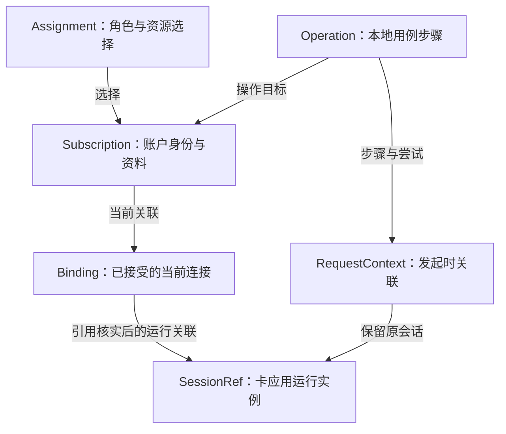

Subscription 说明业务对象，Binding 说明当前连接，SessionRef 与 RequestContext 说明一份结果属于哪次运行和请求。它们解决不同问题，不应合并成一个槽号或一个全局版本。

### 4.3 eSIM配置、Port与路由

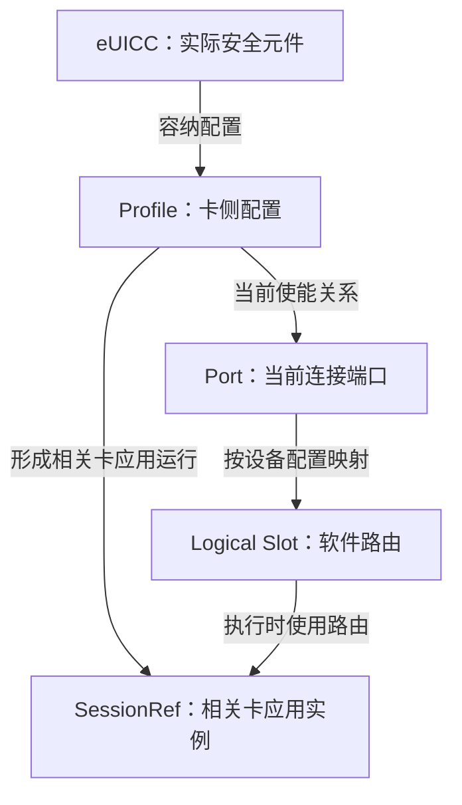

这张图不规定固定 slot，也不规定 Profile、Port 或 Modem 的产品数量和固定一对一关系。实际映射、多应用和并发约束按设备与产品能力确认。

### 4.4 slotId应在哪里被解释

目标是集中解释业务身份与连接关系，减少各业务流程重复进行 `slotId ↔ 账户 / Profile / Port` 转换。

T 接纳账户与当前绑定，执行边界使用这份绑定定位 R 的运行对象。C 继续接收旧 slot 参数，R 继续使用 slot 或其他实际路由访问设备，因此 slot 信息不会从软件中消失。

不同请求还需要区分目标类别：

- 已存在账户的资料或角色请求，可以使用账户目标和已核实绑定。
- PIN、部分 EF、状态与卡侧请求，在账户尚未建立时仍可能合法，应使用卡应用或槽位目标。
- 物理资源操作使用真实 Modem、eUICC、通道等设备约束。

结构迁移先保持原目标解析点。若将目标从“队列执行时解释 slot”前移到“IPC 接收时固定”，排队期间换卡的行为可能改变，必须单独决策与验证。

### 4.5 结果关联所需信息

一次请求按实际需要保存以下信息，而非要求每个方法都填满同一张大表：

| 信息 | 用途 |
| --- | --- |
| 目标类别及发起时已知身份 | 防止把卡应用请求错误限定为必须先有账户 |
| 相关 Binding 键和版本 | 复核依赖的连接关系是否仍有效 |
| 原 SessionRef / runtime epoch | 识别卡应用实例与运行重建 |
| operation / step / attempt | 区分本地用例、步骤和重试轮次 |
| LoadScope / LoadToken / 成员资格 | 保护相关文件范围与加载完成集合 |
| 原 RIL serial / callback / InnerEvent | 复用现有传输和事件关联 |
| 相关资源执行资格 | 防止本地等待结束后错误释放真实冲突资源 |

上述关联在内部使用，不自动新增公开 API、外部 ID、持久任务日志或跨重启重放能力。

## 5. 原功能到目标模块的迁移对照

### 5.1 Controller、门面与Monitor

| 原模块 | 原功能或写入点 | 目标承接 | 迁移时必须一并处理 |
| --- | --- | --- | --- |
| MultiSimController | 账户、身份发现、ICCID、simId / slot 查找、当前及历史缓存 | T 应用服务及纯模型，I 使用原 DataShare | 初始化、建账、重载、排序、探测刷新及全部相关赋值 |
| MultiSimController | 默认 Voice / SMS / Data、Primary及联动 | A；需要设备步骤时由 O 协调 | 各角色原规则、回退、参数、广播及部分失败 |
| MultiSimController | 普通激活、协议切换、Modem互换 | O 组织，A 给相关资源计划，R 执行，T / A 接纳事实 | 旧激活、force、特殊槽、等待、重试和未知设备效果 |
| MultiSimController | 号码写卡后更新账户 | O 组织，R 写卡，T 接纳账户，I 存储，C 完成 | 卡缓存、DB后缓存检查、异步查询回写及通知条件 |
| SimManager | 旧门面、容量检查、按槽装配和运行对象定位 | C、H / Application、槽配置入口及 R 分别承接 | 真实对象身份、额外槽初始化、条件装配和销毁 |
| MultiSimMonitor | 平台、Radio、File监听及恢复事件 | I 接入，Application做观察准入，T执行相关核对，C保持输出 | 反注册、初始化重试、用户切换、服务就绪及原可见时点 |

### 5.2 卡运行、平台与外围能力

| 原模块或能力 | 目标承接 | 必须保留的含义 |
| --- | --- | --- |
| SimStateManager / Handle / IccState | R 卡状态、安全和认证；C输出旧状态投影 | 原过滤、人工状态原因、PIN专用响应与独立就绪条件 |
| SimFileManager / IccFile / 各卡型File | R 的 application、records、codec 等生产能力 | EF算法、卡型、原serial、合法Refresh及完成时点 |
| 卡短信、电话簿、STK、carrier配置 | R 对应卡侧子模块 | PIN2、多文件依赖、主动命令及专用事件；外围业务不搬入 |
| Core EsimManager / EsimFile / Controller | R 本地eUICC / APDU；O 管必要本地步骤 | 条件编译、普通/低优先级对象、Port / slot和原返回语义 |
| TelRilManager / TelRilSim | 宿主共享RIL与执行适配；结果按对应Owner准入 | 原构建与共享所有权、requestMap、serial及信令边界 |
| SimRdbHelper / 参数访问 | I；应用经正式存储端口调用 | 原提供方、字段契约、缺省与中间可见性 |
| TelephonyExtWrapper / 厂商Hook | I及宿主插件边界 | 原ABI、调用节点、资源和失败核对 |
| Registry / CES / 账户回调 | I执行技术输出，C保持旧契约 | 原内容、次数、顺序、失败返回和消费者查询可见性 |
| 66250下载 / OSU等高层任务 | 继续沿既有服务契约 | Core只承担被委托的本地步骤，不复制完整远端任务 |

### 5.3 按功能和字段迁移

同一个旧类可以拆到多个目标模块。迁移完成的标准是相关事实的写入责任已经交接，而不是类已经移动或名称已经替换。

旧账户行可能同时包含 T 的账户资料和 A 的角色字段。I 只能执行所属 Owner 的字段计划。初始化和全量重载也要分别接纳这些片段，避免旧整行覆盖另一 Owner 刚接受的新值。

功能清单回答“能力迁到哪里”；既有 WU-01～09 写权清单回答“哪些实际写点需要一起交接”。本文不重新定义这些编号。

## 6. 开发视图：源码组织与构建边界

### 6.1 视图范围与设计状态

开发视图描述源码模块、内部层次、头文件依赖及构建单元。它将前述责任边界落实到开发人员可以定位、修改和检查的代码区域。

**本章是目标开发组织建议。** T / A / O / R / C / I / H 的责任沿用目标主设计；目录、头文件及GN target名称用于说明落地方式，尚未表示这些目录、接口或独立SIM SO已经在生产仓完成实现。本次补充没有改变代码基线和既有外部契约。

建议形成五个主要责任目录：`topology/`、`assignment/`、`operation/`、`runtime/`、`integration/`，另按实际需要建立最小纯类型叶子。H的宿主部分保留在Core，SIM内部装配放在私有工厂中。

这些目录是源码工作单元，不据其数量计算限界上下文、聚合、SO或进程数量。T / A / O内部的应用服务和纯状态分别落在Application与Domain；R保留完整生产运行能力，integration承接兼容和技术实现。

### 6.2 目标目录与主要元素

以下路径以`telephony_core_service/`为根。已有生产源按切片过渡，目录设计不要求一次性移动全部文件。

| 目标目录 | 架构定位 | 主要内部元素与责任 |
| --- | --- | --- |
| `services/sim/topology/` | 账户与绑定模块T | `api/`正式命令、查询和快照；`application/`的TopologyService；`domain/`的账户、绑定和TopologyAggregate；`ports/`的账户存储及必要运行观察契约 |
| `services/sim/assignment/` | 角色与资源模块A | `api/`角色命令、查询和计划；`application/`的AssignmentService；`domain/`的AssignmentAggregate与AssignmentPolicy；`ports/`的角色存储、参数及相关执行契约 |
| `services/sim/operation/` | 本地操作模块O | `api/`本地用例入口；`application/`的OperationCoordinator、运行容器、等待与恢复执行；`domain/`的纯OperationContext及按需操作模型；`ports/`所需执行和结果契约 |
| `services/sim/runtime/` | 生产卡运行子系统R | 按卡状态、安全、卡应用、Records、codec、电话簿、卡短信、STK、carrier、eUICC、会话与资源保护组织现有生产代码 |
| `services/sim/integration/` | 兼容与技术集成区域 | `compatibility/`承接C的适配；`adapters/`承接I的DataShare、参数、Hook及输出实现；`composition/`实现SIM侧私有组合工厂 |
| `services/sim/types/` | 按需纯类型叶子 | 多方确需共享的纯标识和值类型；不承载业务服务、可写缓存、平台句柄或万能请求对象 |
| `services/core/`相关装配代码 | 宿主责任H | Core侧HostPorts实现、共享RIL所有权、SIM创建与匹配销毁、启停和回调生命周期 |
| 既有`interfaces/`及`frameworks/` | 既有调用契约和消费入口 | 保持公开接口、调用方式与ABI，不新增API库到SIM具体符号的依赖 |

CoreServiceSim等原服务入口可以保留原位置，并通过私有委托连接SIM内的兼容实现。逻辑上的C责任不要求全部搬到同一文件，更不能因搬迁而改变权限上下文、检查顺序或完成节点。

### 6.3 模块内部的分层

| 目录 | 允许承接的内容 | 边界要求 |
| --- | --- | --- |
| `api/` | 跨模块正式入口声明、命令、结果、只读视图 | 不暴露聚合可写引用、私有容器或平台实现细节；此处API是模块私有契约，不新增公共InnerKit |
| `application/` | 用例执行、调用端口、结果接纳、提交和恢复组织 | 维护所属事实的接纳协议，不复制其他Owner的规则或直接修改其他Owner状态 |
| `domain/` | 纯实体、值对象、聚合、策略与状态转换 | 不依赖DB、RIL、IPC、FFRT、真实callback或宿主具体实现 |
| `ports/` | 本模块实际需要的查询、执行、存储和输出契约 | 只隔离真实变化；说明错误、所有权、同步/异步、部分效果和完成点 |
| 私有实现区域 | 运行容器、内部辅助实现和执行设施 | 不作为其他模块直接include的接口 |

例如，OperationContext只表达纯步骤与效果规则。真实callback、等待设施、CompletionPlan及RuntimeOperationStore属于Application或兼容支撑；协议关联表与设备资源句柄属于R / I。

R可以包含成熟卡侧状态机与生产业务判断，不按业务模块的目录模板强制纯化。其既有平台依赖按切片整理，原算法、事件与卡型条件继续得到保护。

### 6.4 主要源码编译依赖

**箭头从使用方指向被依赖声明或构造实现，表示源码依赖，不表示业务调用顺序。** api和ports按各Owner分别声明，图中合并展示并不要求建立一个全局接口头文件。

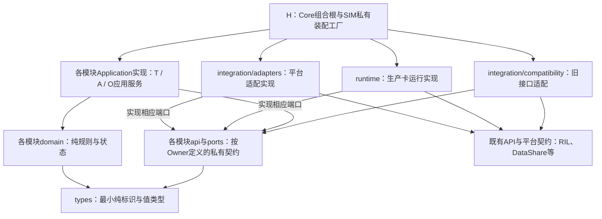

Application运行时通过注入对象调用R / I，编译时只需要相应端口契约。H在组合时认识真实实现，并负责匹配的构造与销毁。Core侧组合根与SIM侧私有工厂分别实现各自装配部分，跨SO只连接明确的私有创建、委托和销毁契约。

图中展示主要目标依赖。现有R的生产调用与平台契约逐项收口，不据此声称现有全仓已无循环依赖。

### 6.5 头文件和跨模块规则

1. 跨模块使用正式`api/`或必要`ports/`声明，不引用对方Application私有头、源文件、内部容器或聚合可写对象。
2. O通过T / A的正式应用入口获取事实和请求变化，不直接修改其字段。简单查询及R内部加载不强制经过O。
3. 新用例通过端口使用相应能力，逐步消减对SimRdbHelper、具体File对象和Core全局实现的直接依赖。
4. Domain既不直接include平台头，也不通过公共头传递引入平台类型、I/O、线程或回调设施。
5. 不把跨模块命令和快照全部集中到common。各Owner定义自己的契约，纯类型叶子只保存必要共享值。
6. 字段级写入计划、旧可见节点、错误与完成条件属于契约。技术隔离不能压缩掉部分失败信息。
7. 新接口不因位于api目录就成为公共ABI。既有DTO、IDL、接口虚表、schema和消费者入口保持原约束。

### 6.6 构建单元建议

可先用GN的`source_set`或`group`表达边界。下表是命名示例，实际数量按真实依赖收敛，不要求每个组件形成一个SO。

| 构建单元示例 | 内容 | 依赖约束 |
| --- | --- | --- |
| `sim_value_types` | 必要的共享纯标识和值类型 | 作为技术叶子，保持平台无关 |
| `sim_topology_domain`、`sim_assignment_domain`、`sim_operation_model` | 各责任的纯模型 | 仅依赖所需纯值与规则，不引入平台或应用执行设施 |
| 各Owner的私有contracts单元 | 正式api、ports及其最小值契约 | 不依赖对应Application实现或R / I具体实现 |
| `sim_topology_app`、`sim_assignment_app`、`sim_operation_app` | 应用服务、用例和受控接纳 | 依赖本模块模型、契约及必要协作方的正式契约 |
| 卡运行、平台适配、兼容及SIM装配单元 | R / I / C的实现及SIM侧工厂 | 实现相应私有端口；平台依赖限制在真实需要的实现侧 |
| 候选`tel_sim_service`共享库 | 聚合SIM内实际实现 | 沿用原API / utils及批准的平台依赖，不反链Core具体实现 |

构建规则应能检查Domain是否经传递依赖引入平台库、应用单元是否直接依赖R / I具体实现，以及产品Feature组合是否有效。编译通过不替代业务、ABI和生命周期验收。

### 6.7 最终链接与宿主边界

| 使用方 | 目标链接依赖及约束 |
| --- | --- |
| Core SO | 依赖SIM私有SO及既有API / utils，持有共享RIL与宿主资源 |
| SIM私有SO | 依赖既有API / utils和批准的平台依赖；经HostPorts使用宿主能力，不反链Core具体符号 |
| 既有API SO | 保持消费侧接口；不新增到SIM具体实现的符号依赖 |

`libtel_sim_service.z.so`仍是候选名称。GN target、导出符号、安装、CFI / PAC / LTO、Feature及真实链接关系在机械拆分阶段验证，沿用原进程与SA身份。

SIM只释放自己的注册与引用，不停止其他业务仍在使用的共享RIL。跨SO创建的对象使用具体类型共享控制块或匹配deleter销毁，不通过修改公开接口虚表解决销毁问题；callback、observer、任务和deleter所在SO活到最后使用结束，未排空不得卸载。

### 6.8 旧代码的迁入位置

| 原职责 | 目标源码落点 | 本批必须一起处理的路径 |
| --- | --- | --- |
| Controller账户、缓存、身份与绑定 | topology及相应存储Adapter | 初始化、建账、重载、探测、用户切换和异步回写 |
| Controller默认角色与资源规则 | assignment | 各角色差异、参数投影、广播、原联动及部分失败 |
| 激活、主卡、号码等步骤与重试 | operation | 唯一业务编排者；关闭同层级重复发令和重试 |
| State / File / RadioProtocol / 本地eUICC | runtime | 保留生产链，逐步接管会话、加载和真实资源保护 |
| Monitor监听、恢复和输出 | integration及相应Owner入口 | 监听接入、事实接纳与旧完成出口分别交接 |
| SimManager门面和装配 | 原入口、compatibility及H | 对象身份、额外槽、条件装配、匹配销毁和在途回调 |
| DB、参数、Hook、Registry、CES | integration/adapters | 按Owner计划执行并保持原协议、失败和输出节点 |

同一个旧类可以分别进入多个目标位置。文件移动、依赖治理、写权迁移和行为增强分别验收，不能用目录已建立替代责任已交接。

### 6.9 开发视图的检查方式

开发任务应能够列出目标目录、正式契约、所有旧写点、保留行为和本批退出证据。修改默认Data策略时检查规则是否集中在A；调整Port映射时检查T / R及必要A约束是否足够；修改存储实现时检查纯账户规则和卡协议是否被无故牵动。

用真实切片验证这些预期。未迁移代码先通过受控委托连接，保持一套活动的设备、DB、参数和Hook执行路径，并按第13章的阶段门禁逐批关闭旁路。

## 7. 业务流程一：设置显示号码

### 7.1 范围与业务语义

本流程对应普通 `SetShowNumber` 路径。它包含卡侧 MSISDN 写入与账户资料更新。入口受理返回、卡侧效果、存储结果和最终业务回调发生在不同节点。

本用例不修改默认角色，因此 A 不需要参与角色裁决。

### 7.2 重构前的模块流转

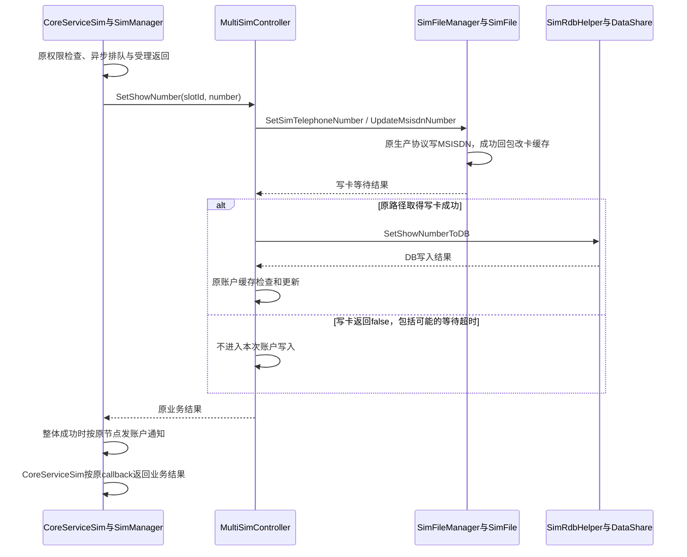

`ProcessSetMsisdnDone` 成功时更新卡侧号码缓存并唤醒等待者。`SetShowNumberToDB` 先访问数据库，随后检查并更新账户缓存；数据库成功后仍可能在后续缓存检查中失败。

### 7.3 目标架构的职责流转

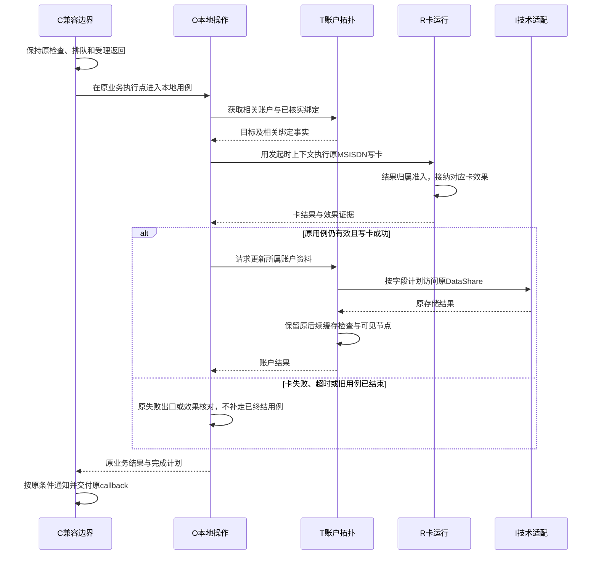

图中的会话与请求准入属于目标增强，实施时须与保持旧解析点的结构迁移分批验收。

### 7.4 同一步骤的迁移对照

| 阶段 | 重构前 | 目标职责及相关概念 |
| --- | --- | --- |
| 入口 | CoreServiceSim检查、排队；SimManager委托 | C保持调用者上下文、旧slot参数和两个完成时点 |
| 目标 | Controller按slot定位File，账户更新时取curSimId | T提供Subscription / Binding；O在约定发起点记录已知目标 |
| 关联 | 原事件、等待和RIL关联分布在生产路径中 | O保存step / attempt，R保存原Session与传输关联 |
| 写卡 | File / 电话簿 / EF生产逻辑 | R继续执行；Domain不包含卡协议调用 |
| 接纳卡结果 | File成功回包更新卡缓存与waitResult | R在同一受控域先准入再更新，O接收本步骤效果 |
| 更新账户 | SetShowNumberToDB更新DB和缓存 | T组织所属资料接纳，I使用原DataShare协议 |
| 业务完成 | SimManager成功时通知，CoreServiceSim回调 | C保护原出口，O不复活已终结用例 |

### 7.5 异常与兼容要求

| 情形 | 必须保持或明确设计的处理 |
| --- | --- |
| 卡写返回false | 本次流程不继续写账户；false包含等待超时，不能一律判定“卡未写入” |
| 卡成功、DB失败 | 保留已发生的卡效果和卡缓存，返回原失败，不自动写回旧号码 |
| DB成功、后续缓存检查失败 | 保留已经发生的存储和缓存片段，不能包装成整体未发生 |
| 用例已结束后收到归属可信的卡成功 | 用于原关联观察或核对，不补走旧账户步骤，不补发旧成功回调 |
| 换卡后旧结果到达 | 不写新卡缓存或新账户；仍按读写性质处理旧请求的清理与效果证据 |
| 后续独立GetShowNumber触发回写 | 按旧读取来源处理，属于新用例，不视为复活旧设置请求 |

`GetShowNumber` 还可能优先读取卡缓存，再使用账户资料，必要时从 IMPU 回退，并异步安排账户回写。不能将其静默替换成纯账户快照查询。

## 8. 业务流程二：普通SIM激活

### 8.1 范围

本节限定普通实体卡、非 force 的 `SetActiveCommonSim` 路径。force、卫星及扩展分支有不同语义，分别保留和验证。

### 8.2 重构前的模块流转

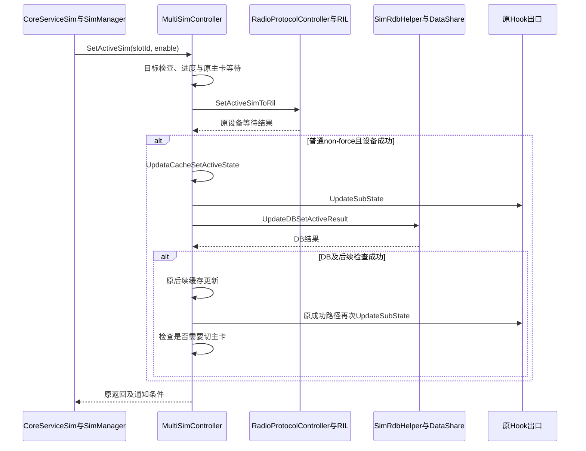

### 8.3 目标架构的职责流转

图中展开应用内部协作，外层 C 的原检查、返回和通知契约保持不变。

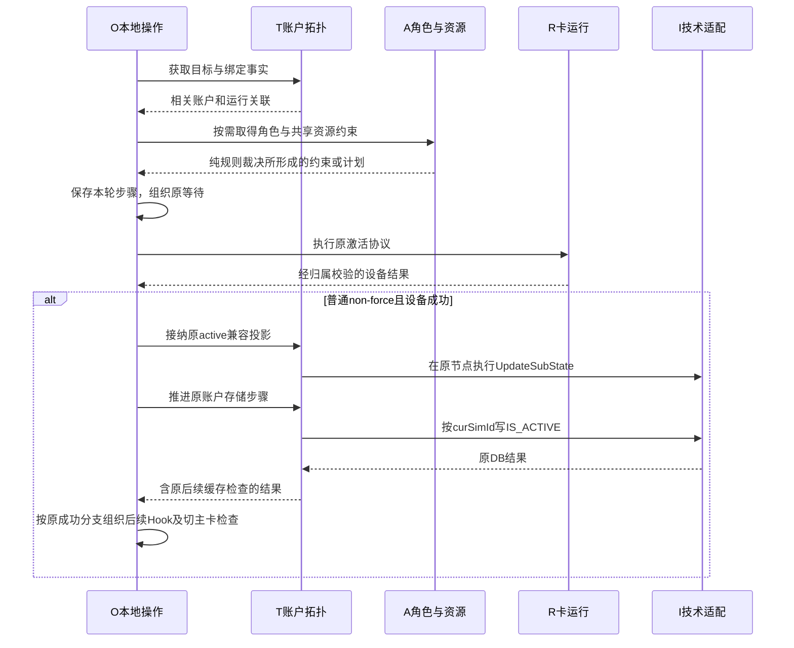

### 8.4 职责迁移与部分失败

| 阶段 | 原模块职责 | 目标承接 |
| --- | --- | --- |
| 入口 | CoreServiceSim / SimManager检查并委托 | C保持原slotId、enable、检查优先级和错误 |
| 目标、等待 | Controller找目标、维护进度、等待主卡切换 | T提供绑定事实，A给相关资源约束，O组织等待与步骤 |
| 设备 | RadioProtocolController / RIL执行激活 | R复用协议及现有serial，O保留本轮step / attempt |
| 设备后投影 | UpdataCacheSetActiveState / UpdateSubState | T接纳兼容投影，I在原位置执行Hook |
| 存储及完成 | UpdateDBSetActiveResult、后续缓存和Hook、切主卡检查 | T / I处理各自结果，O组织原分支，C保持原出口 |

必须保留以下旧行为：

- 设备成功之后，缓存与 Hook 可以先于 DB 变化。
- `UpdataCacheSetActiveState` 内先写当前缓存，再校验全量缓存索引；返回错误也可能已经产生部分缓存变化。
- DB失败不回滚已经变化的设备、缓存和Hook效果。
- 后续成功路径可能再次执行 `UpdateSubState`，不得全局去重。
- force路径在设备返回后调用 `UpdateSubState` 并返回，不执行本节相同的账户缓存和DB步骤。

T 接管兼容投影时，需要保留这些旧分步可见节点。若准备修正其中某个不合理行为，另列行为变更和独立预期，不能借纯模型的提取将它静默改成全原子提交。

## 9. 业务流程三：主卡切换与Data联动

### 9.1 范围与三个状态维度

本节展示普通需要 `SetRadioProtocol` 的主卡切换。特殊槽、免重启切换及目标已位于主 Modem 等分支分别保留。

需要分别记录：

| 状态维度 | 含义 |
| --- | --- |
| 意图 | 用户或系统希望哪个账户、连接承担Primary等角色 |
| 参数投影 | 原系统参数和last值已经记录了什么 |
| 设备观察 | Radio协议实际返回了什么，设备效果是否已确认 |

保存主卡参数不证明设备切换完成。协议切换完成也不证明驻网和数据连接已经可用。

### 9.2 重构前的模块流转

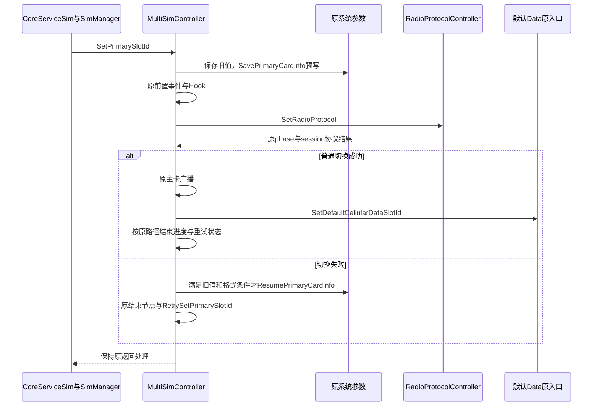

### 9.3 目标架构的职责流转

C 保持外层入口与旧分支，图中展开 T / A / O / R / I 的内部协作。

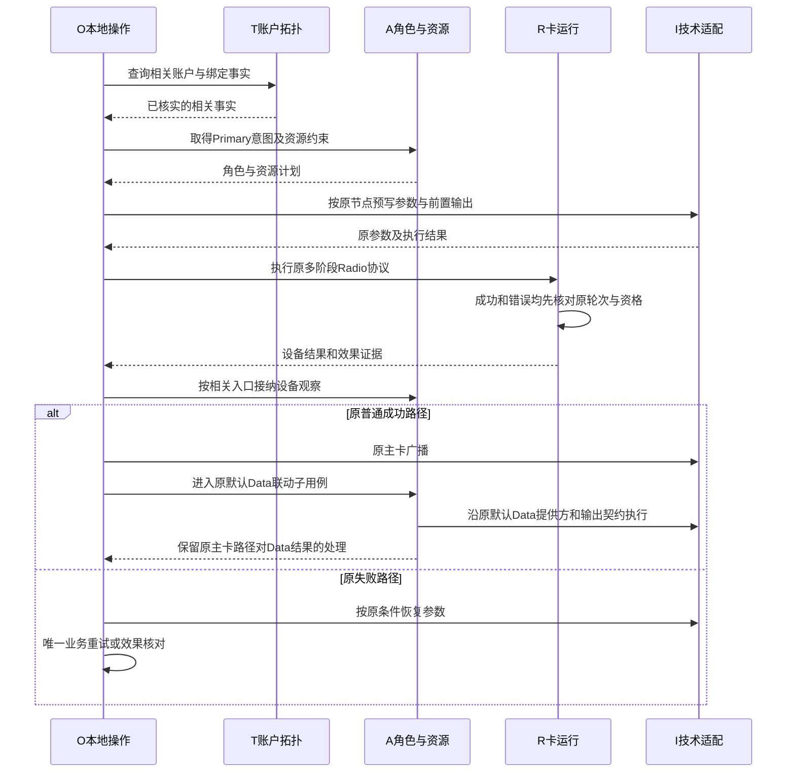

A 的纯策略只形成约束或计划。参数访问、协议执行、等待和重试分别由应用层及 R / I 完成。

### 9.4 职责迁移与异常

| 阶段 | 重构前 | 目标承接 |
| --- | --- | --- |
| 入口与分支 | CoreServiceSim / Manager / Controller | C保持原参数、特殊槽、免重启和原返回 |
| 资格、参数预写 | Controller检查并SavePrimaryCardInfo | T提供事实，A提供规则，O组织先参数后设备，I执行 |
| 协议切换 | RadioProtocolController多阶段、phase / session | R保留原生产机制；O保存用例步骤与唯一重试 |
| 接纳结果 | Controller接收协议结果并维护进度 | R先做本轮准入，A分别接纳意图、参数投影和设备观察 |
| 成功联动 | 广播后SetDefaultCellularDataSlotId | 保留Primary到Data原联动，不新增两者的原子成功承诺 |
| 失败恢复 | 条件恢复参数，然后原重试 | O统一重试，I保留条件恢复，R核对实际设备效果 |

`ResumePrimaryCardInfo` 需要旧主卡参数非空且格式有效。参数恢复不证明设备已经回滚，恢复分支也不能假定在所有旧值组合下都完整执行。

PPT引用的静态调查中，`ProcessResponseInfoOfEvent` 对错误 `RadioResponseInfo` 先设置 `communicationFailed_`，另一类 `RadioProtocol` 载荷分支则检查 `sessionId`。旧轮错误影响新轮状态属于风险推导候选，需要受控交错验证。目标要求成功和错误都在修改本轮标志、计数之前完成归属与成员资格检查。

## 10. 业务流程四：Records加载与换卡

### 10.1 范围与责任特点

READY / Refresh 主要驱动生产文件加载。卡型、EF解析、文件内容、加载成员和完成判定继续归 R。T 只在需要时接纳相关身份和绑定观察。

简单文件加载通常不需要 O 长操作，也不需要 A 的角色裁决。C 保持原查询和通知出口，不必成为内部卡事件的入口。

### 10.2 重构前的模块流转

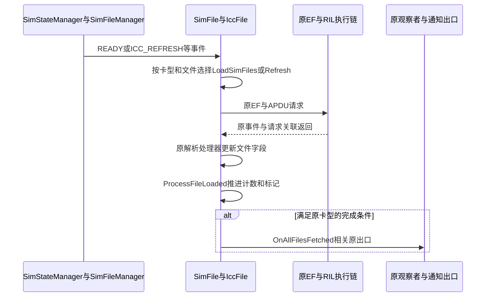

现有过滤和请求关联继续保留。调查重点是它们是否覆盖最终字段和完成集合的写点，而非假定旧实现没有任何保护。

### 10.3 目标架构的职责流转

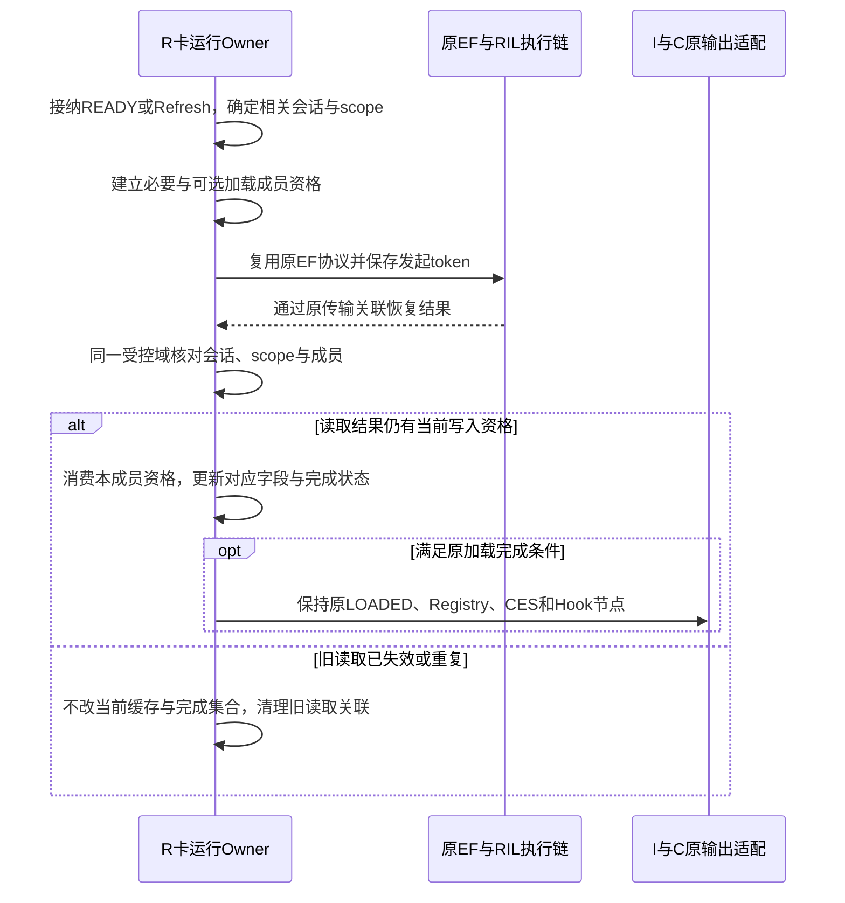

图中的失效分支限定读取结果。已经发出的写卡命令仍要保留原关联并核对设备效果，不能按陈旧读取直接处理。

相关身份和绑定观察通过 T 的正式应用入口接纳，接入时点沿用相应原路径。上图聚焦 R 的加载主线，未将 T 放在所有文件处理与通知之前，也不把 LOADED 作为建立账户的唯一时机。

### 10.4 同一步骤的迁移对照

| 阶段 | 重构前 | 目标承接 |
| --- | --- | --- |
| 事件入口 | State / FileManager消费READY、Refresh | R继续接收生产事件，不模拟一次公开C请求 |
| 范围选择 | 卡型、LoadSimFiles、ProcessIccRefresh及文件依赖 | R形成相关Session、LoadScope及成员集合；T仅接纳相关绑定事实 |
| 文件执行 | IccFileController、EF、APDU、RIL | R复用生产执行和原serial关联 |
| 接纳结果 | ProcessEvent调用解析，随后推进加载 | R同域先校验再修改字段、成员和完成状态 |
| 完成与输出 | OnAllFilesFetched及原观察者、Registry、CES、Hook | 保留逐卡型必需/可选条件及原输出；T与文件完成分开 |

### 10.5 换卡、Refresh与加载成员

| 场景 | 目标处理 |
| --- | --- |
| 同槽卡A换成B，A读取迟到 | 撤销相关旧会话的当前写权；A结果不写B字段、不完成B成员 |
| 同卡局部Refresh | 更新受影响EF及PBR / ANR / IAP等实际依赖闭包；无关scope继续有效 |
| 全量Refresh或相关运行重建 | 按实际影响范围重建加载资格，不能用一个全设备版本盲目拒绝所有卡 |
| 重复回包 | 本成员完成资格只消费一次，避免重复计数；原允许的外部通知次数独立保持 |
| 必需文件未完成或失败 | 依据原卡型规则判断，不把计数归零当作成功 |
| 已发写卡期间发生失效 | 撤销写入新视图的资格，但保留设备效果核对和资源责任 |

`OnAllFilesFetched` 还涉及映射期检查、UpdateLoaded、RECORDS_LOADED、Registry、公共事件和扩展Hook。重构不能只保留一个“加载完成”通知而遗漏这些原节点。

## 11. 状态、并发与结果准入

### 11.1 每项事实只有明确的维护责任

| 事实 | 维护者 | 其他模块的协作方式 |
| --- | --- | --- |
| 账户身份、资料、已接受绑定 | T | 查询正式快照或请求T应用入口接纳 |
| 角色偏好、选择、参数投影及相关观察 | A | 提供规则输入或请求A的相应应用入口 |
| 本地操作步骤、尝试与终态 | O | 回传本步骤结果或效果证据 |
| 原始卡状态、文件内容、加载与卡应用会话 | R | 使用正式生产入口、只读观察及结果接纳协议 |
| 具体外部读写与发布 | I受托执行 | 使用所属Owner的字段计划和原外部契约 |
| 工厂、共享对象与销毁 | H | 明确所有权、反注册、在途计数与排空 |

“唯一维护者”是对规则和写入协议的要求，不意味着所有能力塞进一个大类、一把全设备锁或一个全局事务。

### 11.2 分开观察完成的不同维度

| 维度 | 应回答的问题 |
| --- | --- |
| 请求受理 | 是否通过原入口检查并按原语义接收？ |
| 设备效果 | 已确认发生、已确认未发生，还是仍然未知？ |
| 旧查询可见性 | 此刻卡缓存、账户缓存、DB、参数分别应返回什么？ |
| 存储结果 | 哪个字段或提供方已经成功，哪里失败？ |
| 用例终态 | 流程是否还允许继续，是否已经结束？ |
| 结果交付 | 调用者等待、callback、广播或其他通知是否已经完成？ |

等待结束与设备动作结束分别记录。调用者超时不能自动释放效果未知的设备资源，也不能让已终结用例再次成功。

卡存在、锁状态、Records完成、账户可见、Profile启用、角色有效、Radio和网络可用也分别判断，不能用一个 `READY` 或 `LOADED` 覆盖所有条件。

### 11.3 发起时保存关联，最终写入前准入

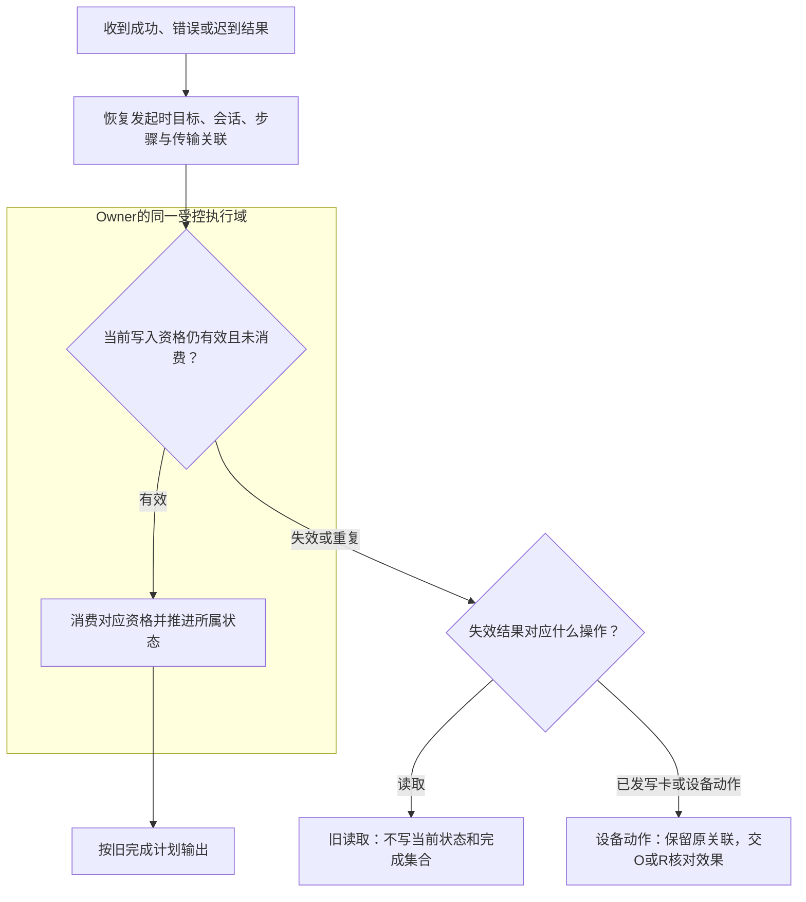

准入至少核对本次实际依赖的目标、Session、scope / attempt、成员资格和终态。成功与错误都先检查再改状态。看到一个协议分支检查了session，不能推出全部错误路径也已受保护。

复用 RIL requestMap 和 serial 查表。底层取回删除请求后，后续事件投递仍可能失败，因此“已找到serial”不能替代业务接纳证明。各交付分支需要保留到原发起上下文的可追溯路径。

### 11.4 锁外I/O与逻辑执行资格

短锁或对应执行域保护状态检查、资格消费和状态推进。设备、DataShare、参数、IPC、Hook及外部callback放在锁外执行，返回后回到同域复核。

锁外执行仍要保护真正的外部写入顺序。例如 W1 与 W2 都改同一账户字段，若同时发出，再仅丢弃迟到 W1 的内存结果，数据库仍可能被 W1 覆盖。需要由对应写入协议管理整个冲突范围的执行资格。

还应检查两类等待闭环：

- provider同步反查Core，Core查询又同步访问同一不可重入provider；
- 受限队列中的执行器同步等回调，而回调也需要该执行器才能运行。

不能为规避闭环而静默更换查询读源、统一返回缓存或新增全局错误码。并发设施按仓库要求采用相应FFRT原语，但原语名称不会自动保证业务顺序与公平。

### 11.5 真实资源与生命周期

A负责策略，O负责用例，R按真实 Modem / eUICC / 通道共享域保护执行。两个按同一slot创建的不同 EsimFile 对象，可能共用同一个实际eUICC，不能各自独占同一设备。

设备型Get也可能开通道、发APDU、等待并关闭，需要按真实副作用判断冲突。缓存命中沿原查询路径返回；缓存未命中不能随意用旧值替代原设备读取。

销毁和卸载需要共同考虑反注册、weak owner、epoch、在途计数和排空。weak_ptr能够锁定只说明对象仍活着，不能证明其业务会话有效。反注册也不能证明已入队回调全部消失。

本轮O操作记录默认为运行期内存，不自动提供持久恢复日志。重启时核对真实设备和既有存储，不能凭内存表为空认定硬件空闲。

## 12. 对外接口与部署边界

### 12.1 兼容范围

“接口不变”覆盖所有可观察契约，不限于函数签名。

| 需要保持的内容 | 具体检查 |
| --- | --- |
| 服务与调用入口 | SA身份、IPC、Native、CMI及相关内部委托路径 |
| 参数与身份 | 方法、类型、结构、slot / simId含义及原解析时点 |
| 权限和错误 | 调用者上下文、检查优先级、错误码及错误对应的已发生效果 |
| 受理与业务完成 | 同步返回、异步排队、等待和callback分别保持 |
| 查询来源 | 卡缓存、账户、DataShare、IMPU等原读取与回写规则 |
| 中间可见性 | 卡、缓存、DB、参数在哪一步已改变 |
| 通知与交付 | 内容、次数、顺序、允许时限及通知失败后的原返回 |
| 存储消费者 | DataShare直接调用者、字段、缺省、重载及兼容 |
| 设备动作 | 同一时刻只有一套活动路径发送命令、写参数和调用Hook |
| 生命周期与ABI | 启停、对象身份、在途回调、跨SO调用、插件ABI和回退 |

默认角色设置存在“提供方和缓存已改变，但广播失败返回错误”的部分失败可能。A保留已接纳角色事实，C保留原错误，不能统一包装成失败即回滚。

兼容适配先将旧请求连接到内部应用入口，再将内部事实转换回旧查询和完成形式。内部事件不自动替代原通知，也不授权全局去重、持久交付或跨进程事件总线。

### 12.2 同进程SIM共享库

PPT记录的当前事实是 SIM / Core / RIL 主要实现仍同编入原 Core SO，独立生产 SIM SO 尚未形成。目标私有 SIM SO 沿用 telephony / SA 4010 宿主，提供链接和装载边界。

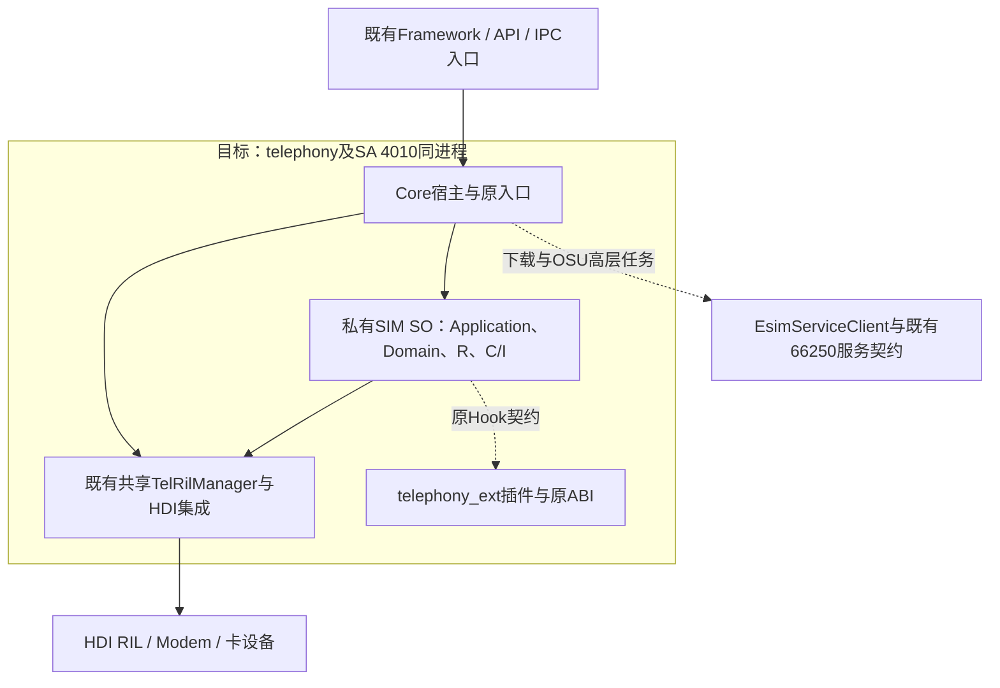

运行调用跨越私有SO时要明确构造、销毁、对象所有权与回调寿命。共享RIL不因拆库而复制，消费侧CMI门面保持；内部宿主依赖按需经私有HostPorts注入。

同进程内部事件分发仅适用于同一地址空间。若未来改为跨进程，需要重新设计序列化、服务身份、生命周期和失败语义，不能复用同进程指针协议。

### 12.3 Core本地eSIM与66250高层任务

| 边界 | 保留的责任 |
| --- | --- |
| Core本地eUICC / APDU | R执行卡侧原语，O组织必要本地步骤与关联 |
| EsimServiceClient及既有66250契约 | 沿既有服务协作完成下载、OSU等高层任务 |
| 远端完整实现与进程部署 | 以产品和外仓证据确认，不由本仓类名推断 |

不能将全部eSIM操作都转给高层服务，也不能在Core复制远端完整主流程。一个层级只有一个主编排，不等于所有层级都由同一个组件负责。

## 13. 迁移阶段与验证要求

### 13.1 分阶段实施

| 阶段 | 交付内容 | 退出条件 |
| --- | --- | --- |
| G1：行为基线 | 确定功能切片、真实入口、生产初始化闭包与原输出 | 正常、失败、负向观察和关键查询可运行；独立预期明确 |
| G2a：依赖与所有权 | 在原SO内整理HostPorts、工厂和注入 | 旧writer、线程、目标解析点与生命周期先保持 |
| G2b / G2c：工程边界 | 按需机械拆SO，关闭协议改动单独处理 | ABI、链接、匹配销毁和排空分别验证；不能排空时不卸载 |
| G3a～d：写权与行为 | 分批接管账户资料、会话加载、角色操作和eSIM相关写权 | 对照既有WU清单收口初始化、重载、旧激活、失败恢复与异步回写等全部入口 |
| 每批清理和验收 | 删除旁路，复查依赖、功能与契约覆盖 | 对应产品、设备、外仓证据和回退条件具备 |

职责治理可以先在原SO内推进。是否先拆库取决于本批生产闭包和验证条件，不能把拆SO视为领域建模成立的前提。编译成功与AI检视也不能代替真实初始化、设备和时序测试。

### 13.2 一个写权单元的迁移步骤

1. 选定字段、步骤或加载范围，列出真实入口与全部旧写点。
2. 记录原读源、错误、部分效果、查询可见节点和输出。
3. 明确目标Owner、应用接纳入口、R / I端口和执行域。
4. 将旧调用者改成受控委托，保留必要过渡桥。
5. 验证正常、失败、重入、交错和初始化重载路径。
6. 关闭旧独立writer、重复发令与同层级重复重试。
7. 删除旁路，复查依赖、产品配置、生命周期与回退。

过渡桥不应继续持有独立规则和可写状态。新旧设备命令、DB、参数和Hook不能在生产中同时执行以做影子对比。影子比较仅使用确认无副作用的输入和纯规则；名称带Get不代表无副作用。

### 13.3 四条业务的最低验证集合

下表是设计验收要求，**不是本次文档整理已执行的代码测试结果**。

| 业务 | 必测场景 | 关键观察 |
| --- | --- | --- |
| 号码设置 | 正常、卡失败、写卡超时、卡成功DB失败、DB后缓存失败 | 卡与账户分别可见，原错误和通知条件保持 |
| 号码迟到与查询 | 旧设置终结后成功、排队期间换卡、独立查询回写 | 原设置不复活；新查询保留旧读源且有自身发起关联 |
| 普通激活 | 设备失败、当前缓存已改后索引失败、DB失败、完整成功 | 保留缓存 / Hook先于DB及原后续Hook节点 |
| 激活分支 | force、卫星、扩展及切主卡联动 | 不将普通non-force路径的证明套用到全部分支 |
| Primary | 参数预写、旧参数空或非法、协议失败、重试、成功后Data | 意图、参数、设备观察分开；恢复参数不冒充硬件回滚 |
| Radio结果 | 旧轮错误、阶段或槽成员重复、错误与成功不同载荷 | 先准入再改变本轮标志和计数，一次资格只消费一次 |
| Records | 同槽换卡旧读取、重复、必需文件失败、不同卡型完成 | 不串写缓存和完成集合，逐卡型保留原LOADED路径 |
| Refresh | 局部依赖闭包、无关scope继续、Refresh期间在途写 | 不全局失效合法工作，已发写卡仍核对效果 |
| 共性 | RIL取回后投递失败、provider重入、排空失败、Feature组合 | 关联不丢失、无等待闭环、无未确认卸载，原边界保持 |

测试以冻结契约和独立预期为依据，结合新旧实现差分。差分能发现行为变化，但两个实现相同也可能共享同一缺陷。已知问题及批准的修复分别记录，不能让旧实现成为唯一正确性标准。

### 13.4 首批候选切片

Records准入与号码更新都可作为讨论候选：

- Records检验会话、局部Refresh、重复结果与完成资格。
- 号码更新检验卡与账户的分步效果、查询回写和异步完成。

实际顺序根据生产初始化闭包、正式外部边界、可执行测试和设备证据选定。依赖缺口只阻塞受影响切片，不应笼统扩大为全部职责治理无法开始。

## 14. 开发讨论与任务交接

### 14.1 围绕一条熟悉业务确认设计

| 讨论问题 | 需要留下的具体结果 |
| --- | --- |
| 今天怎样完成？ | 真实入口、生产调用、目标解析点、字段写点及原输出 |
| 目标由谁接管？ | T / A / O / R Owner、所属应用入口、I执行协议和C完成出口 |
| 哪些行为保持？ | 返回、callback、错误优先级、读源、中间可见性及部分失败 |
| 哪些行为有意增强？ | 旧风险证据、新准入或资源规则、允许变化及独立验收 |
| 如何交接写权？ | 初始化、重载、重试、异步回写及所有旧调用者的委托方案 |
| 什么证据允许切换？ | 正式生产测试切片、设备/外仓缺口、责任角色、退出与回退条件 |

讨论时先让开发沿第7～10章指出自己熟悉的业务分支，再确认同一事实的Owner及写入协议。DDD术语用于解释责任，不替代对真实函数、字段和异常轨迹的分析。

### 14.2 可复用的任务记录

| 字段 | 应填写的内容 |
| --- | --- |
| 功能与写权单元 | 沿用既有SIM功能ID和WU编号 |
| 旧路径与证据 | 入口、函数、字段写点、原目标解析点及固定代码基线 |
| 目标Owner | 负责事实、流程、协议、存储和输出的具体模块 |
| 兼容约束 | 原返回、读源、完成、通知与部分效果 |
| 行为增强 | 明确改变什么，在哪个切片实现和验证 |
| 过渡委托 | 旧调用者怎样进入新Owner，何时撤销旧writer |
| 验证与缺口 | 可执行用例、独立预期、设备/产品/外仓证据 |
| 责任及退出 | 责任角色、完成证据、在途效果处理和回退条件 |

会议结果回写同一目标主文档及现有清单。本文承担方案阅读和业务对照用途，不另建一套实施状态台账。

## 15. 材料对应关系与证据索引

### 15.1 与PPTX正文的对应

PPTX有21页正文，另有点击演示使用的隐藏状态页。新增开发视图位于正文第12～13页。下表采用页脚正文编号，不采用隐藏页展开后的物理页号。

| PPTX正文 | 内容 | 本文位置 |
| --- | --- | --- |
| 1 | 变化压力与设计目标 | 第1章 |
| 2～4 | 同槽换卡、关联分散、现有模块 | 第2章 |
| 5～8 | 设计规则、责任分层、架构对比、DDD元素 | 第1、3、5章 |
| 9及其隐藏状态 | 概念关系与号码设置步骤 | 第4、7、11章 |
| 10及其隐藏状态 | 四条业务的前后同步对照 | 第7～10章 |
| 11 | 运行调用、源码依赖及锁外I/O | 第3.5、11章 |
| 12～13 | 开发视图：源码模块、内部组织、编译与链接 | 第6章 |
| 14～16 | 功能迁移及号码实例 | 第5、7、8章 |
| 17 | 私有SIM SO、eSIM服务与厂商边界 | 第12章 |
| 18 | 结果最终准入与受控提交 | 第10、11章 |
| 19 | 接口兼容与行为验证 | 第12、13章 |
| 20～21 | 迁移计划与开发讨论 | 第13、14章 |

### 15.2 设计与源码依据

设计依据为PPTX正文及备注引用的 `SIM_Target_Architecture_Design_v1.2` 2026-10-26修订内容，涵盖分层、兼容轨迹、会话与加载、最终准入及分阶段迁移。当前材料中的 `TopologyService`、`OperationCoordinator`、`SessionRegistry`、`LoadSession` 等属于目标职责或候选组件，不表示仓库已经实现。

以下代码链接沿用PPTX备注的固定基线，供开发沿真实分支继续核对：

| 主题 | 固定基线源码入口 |
| --- | --- |
| 号码入口检查、排队与callback | [CoreServiceSim::SetShowNumber](https://github.com/zjuluowu/multisim/blob/6017003eff50c1bc8c5dfa72336a4bfe42e948b0/telephony_core_service/services/core/src/core_service_sim.cpp#L502) |
| 号码账户通知条件 | [SimManager::SetShowNumber](https://github.com/zjuluowu/multisim/blob/6017003eff50c1bc8c5dfa72336a4bfe42e948b0/telephony_core_service/services/sim/src/sim_manager.cpp#L432) |
| 号码写卡后更新DB及缓存 | [MultiSimController::SetShowNumber及后续方法](https://github.com/zjuluowu/multisim/blob/6017003eff50c1bc8c5dfa72336a4bfe42e948b0/telephony_core_service/services/sim/src/multi_sim_controller.cpp#L1757) |
| MSISDN等待与卡缓存接纳 | [SimFile::UpdateMsisdnNumber](https://github.com/zjuluowu/multisim/blob/6017003eff50c1bc8c5dfa72336a4bfe42e948b0/telephony_core_service/services/sim/src/sim_file.cpp#L150)、[ProcessSetMsisdnDone](https://github.com/zjuluowu/multisim/blob/6017003eff50c1bc8c5dfa72336a4bfe42e948b0/telephony_core_service/services/sim/src/sim_file.cpp#L688) |
| 普通激活的缓存、Hook和DB顺序 | [MultiSimController::UpdataCacheSetActiveState及后续普通路径](https://github.com/zjuluowu/multisim/blob/6017003eff50c1bc8c5dfa72336a4bfe42e948b0/telephony_core_service/services/sim/src/multi_sim_controller.cpp#L956) |
| Primary切换与Data联动 | [MultiSimController::SetPrimarySlotId](https://github.com/zjuluowu/multisim/blob/6017003eff50c1bc8c5dfa72336a4bfe42e948b0/telephony_core_service/services/sim/src/multi_sim_controller.cpp#L1483) |
| 主卡参数预写与条件恢复 | [SavePrimaryCardInfo及ResumePrimaryCardInfo](https://github.com/zjuluowu/multisim/blob/6017003eff50c1bc8c5dfa72336a4bfe42e948b0/telephony_core_service/services/sim/src/multi_sim_controller.cpp#L1546) |
| Radio错误与session分支 | [RadioProtocolController::ProcessResponseInfoOfEvent](https://github.com/zjuluowu/multisim/blob/6017003eff50c1bc8c5dfa72336a4bfe42e948b0/telephony_core_service/services/sim/src/radio_protocol_controller.cpp#L403) |
| Refresh与加载完成 | [SimFile::ProcessIccRefresh及ProcessFileLoaded](https://github.com/zjuluowu/multisim/blob/6017003eff50c1bc8c5dfa72336a4bfe42e948b0/telephony_core_service/services/sim/src/sim_file.cpp#L197) |
| LOADED及原输出节点 | [SimFile::OnAllFilesFetched](https://github.com/zjuluowu/multisim/blob/6017003eff50c1bc8c5dfa72336a4bfe42e948b0/telephony_core_service/services/sim/src/sim_file.cpp#L244) |
| Refresh事件入口 | [SimFileManager::HandleIccRefresh](https://github.com/zjuluowu/multisim/blob/6017003eff50c1bc8c5dfa72336a4bfe42e948b0/telephony_core_service/services/sim/src/sim_file_manager.cpp#L808) |

### 15.3 术语速查

| 术语 | 本文含义 |
| --- | --- |
| DDD | 领域驱动设计，先明确业务语言、责任边界和规则，再安排代码结构 |
| Owner | 有权验证并接纳某项事实变化的维护者 |
| Application | 组织用例、执行端口、接纳结果、安排完成与恢复的应用层 |
| Domain | 平台无关的业务规则、状态和相应不变量 |
| Port / Adapter | 应用需要的能力契约 / 把该契约映射到原技术协议的实现 |
| EF | 卡文件系统中的基本文件，读写与解析具有卡型和安全条件 |
| Records | 从卡文件等来源加载和解析的运行资料 |
| APDU | 与卡应用交互的命令与响应单位 |
| RIL | 软件访问无线芯片能力的适配层 |
| IPC / SA / SO | 进程间通信 / 系统服务身份 / 共享库，分别属于通信、服务和链接边界 |
| MSISDN / IMPU | 本文号码流程中的卡侧号码记录 / 既有IMS身份相关回退来源 |
| Hook / CES | 厂商扩展调用节点 / 公共事件等既有输出机制 |
| PBR / ANR / IAP | USIM电话簿中描述关联文件、附加号码和索引的相关文件，说明局部Refresh需要考虑依赖闭包 |
| 准入 | 在最终状态写点检查结果的归属、作用域、步骤、成员和终态资格 |
| 部分效果 | 一个用例失败前，设备、缓存、DB、参数或通知中的部分动作已经发生 |
