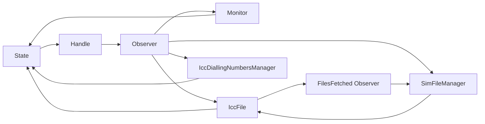
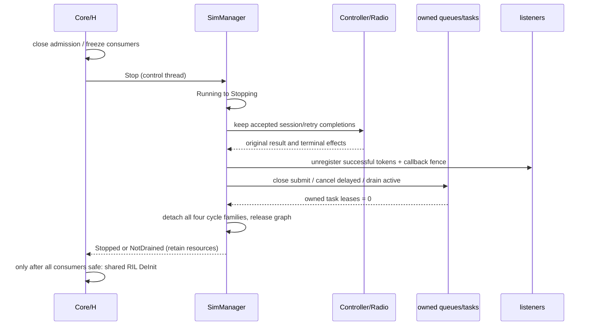

# SIM-028 生产停止方案审查（e21f1ef3）

结论：**四文件配对补丁仅是准备性修复，不批准作为完整Shutdown补丁。** 本轮仅在仓外源码副本应用并验证它，主工作区生产代码不变。原7条RealSimPrimary、8条生命周期和60条Host分别计数；新增的配对审查和A～H契约单列，不缩减失败统计。运行结果、命令、XML及输入摘要查本轮独立审查JSON。

## 1. 配对补丁逐项结论

| 问题 | 审查结论 |
| --- | --- |
| 三类既知强环是否全部解除 | 否。补丁没有调用UnRegisterSimNotify、IccFile::UnInit、Records→File反注册，也没有停止/排空入口 |
| 是否覆盖三槽 | 新ICCID分支本身无槽数限制；Account观察表按事件/handler聚合，不是每槽独立表。补丁未遍历三个已装配对象，不能据此说三槽关闭 |
| 注册注销是否完整 | 否。新增发现Phonebook状态订阅、File的两个RIL订阅、Monitor参数Watcher等退出缺口，见§2及subscription_review.json |
| SIM_ICCID_LOADED | 补进SimStateHandle注销switch，匹配同一Observer和handler，保留其他case与业务事件 |
| ACCOUNT_LOADED | 新增Manager→Monitor→Observer::Remove，移除同一handler。当前表未按slot隔离，不能擅自引入新的分槽语义；原Register在检查slot前登记的问题另列，不顺手修改 |
| 重复注销 | Observer::Remove在自身锁内对缺失项无操作，nullptr直接返回；配对操作可重复。不等于Stop整体幂等或无竞争 |
| 初始化未完成 | 新Monitor指针判空；ICCID沿用Observer判空。仅验证这些局部null路径，原Manager的空vector/部分装配仍须由Stop快照和空值检查处理 |
| 延迟/在途工作 | 完全未处理。Unregister不能撤回已入队回调，也不能停止尚未执行的raw-this任务 |
| 业务行为 | Running时SetPrimarySlotId、参数/RIL/session/返回不变。只有请求显式注销时的订阅释放行为修正；未知slot/重复callback行为按原契约解释 |
| 析构依赖 | 补丁提供可用注销入口，但没有在有效共享所有权时调用完整退出，原析构依赖仍在 |

## 2. 所有权与注销清单

[subscription_review.json](subscription_review.json)登记16组订阅，每组含固定源码摘要、注册/注销位置、持有者、订阅者、引用类型、退出阶段及验证方式。它是当前源码审查清单，不声称覆盖未启用的全部厂商/卫星/eSIM feature。

除了既知A/B/C，还从原地址图和当前声明确认第四类独立强环，每槽一条：

Phonebook的注册位于 `icc_dialling_numbers_manager.cpp::Init`，经FileManager转发到State；`icc_dialling_numbers_manager.h::simStateManager_`为shared_ptr，析构为空且没有UnRegister调用。本轮先重新分析历史地址图，再对当前C1执行新的只读LLDB追踪，两份均得到三条Phonebook闭环；各自输入摘要和运行来源分别保存，不将历史图重算冒充新执行。仅解除原9条A/B/C仍不能证明State可释放。

另须退出的边界：

- FileManager::Init的VOICE_TECH_CHANGED、ICC_REFRESH；后者与STK共用同一RIL事件，Host必须记录多订阅者，不能只用一个弱指针覆盖。新弱引用ledger按slot/event/所有权控制块配对，不增加生产对象强引用。
- Phonebook的Cache及UsimService拥有自己的事件队列，不能只清Phonebook根。
- Tracker四组文件观察、OperatorConfigCache的State观察及APN延迟PostTask：配对存在但当前放在Account析构，须移到有效所有权的显式停止中。IccFile的RegisterParamsListener/UnRegisterParamsListener在此版本都是空函数，不能虚构它们已提供Watcher安全保证。
- Monitor的两个参数key以raw this作context；UnregisterRebootDetectCallback存在但无调用点。单个Watch成功/另一个失败也须逐项记账并撤销成功项；RemoveParameterWatcher是否等待在途callback，当前fork未提供契约证明。
- CES/SA订阅内部回调weak owner不保证回调尚未lock；UnSubscribeListeners只移除外部登记，不是排空屏障。
- RadioProtocolController按实际slotCount_注销RADIO_SIM_RADIO_PROTOCOL_NOTIFY；不能把两个设备协议参与成员和三个SIM对象槽混为一数。

## 3. 正式停止协议

对象状态为 `Running → Stopping → Stopped`。Stop成功只表示本SIM对象图已排空/释放；不表示Modem被取消或共享RIL可DeInit。

控制契约提议为 `bool SimManager::Stop()`、只读`IsStopping()/IsStopped()`；具体deadline参数/宿主预算需在生产授权时确定。bool false必须表示NotDrained、调用上下文不合法或外部屏障失败，保留Stopping及所有可能仍被访问的资源，不能返回成功后继续清理。契约测试缺该API时显式FAIL/BLOCKED，不提供测试Fake Stop。新接口保持非虚内部生命周期接口，不修改ISimManager公共虚表。

1. **关闭外部准入**：H撤销/冻结新业务入口、初始化、扩展槽及新订阅；现有调用获得的lease继续有效。Core/CMI/本地消费者也必须覆盖。Manager公共读方法在清vector前同样要排空；只保护SetPrimarySlotId不够。嵌套调用使用同一请求lease，不能把已接纳调用中的内部查询误拒为新请求。
2. **关闭新后台启动**：注册/重试/加载生产者关闭新任务准入。给Manager的OnInit任务、RefreshCache分离线程、Monitor::CheckOpcNeedUpdata和Controller所有detach/TelFFRTUtils任务建立对象私有任务组，入队/启动前登记，结束及创建失败都精确退账。不能用ffrt::wait（仅当前调用线程）代替整个对象图排空。
3. **保留在途业务完成通路**：B专用命令与C1 CHECK/UPDATE/COMPLETE的原应答、错误、原超时仍可交付。不能先取消45秒B超时或Radio应答监听再等调用结束。C1原始返回之后的五次重试仍属于已接纳业务；Stop不能借关闭新后台任务之名丢弃它们。业务lease须覆盖重试序列终点，不能只看一次函数返回或瞬时isSetPrimarySlotIdInProgress_。
4. **关闭非业务监听**：暂停Monitor重新登记，按成功登记token注销CES/SA、Watcher，屏障等待已进入callback的lease释放。Watcher若无安全注销/排空协议，返回NotDrained，不能假定Remove函数返回即安全释放raw context。
5. **排空对象队列**：业务终点后关闭TelEventHandler新Send/Submit，取消可取消的匹配SIM/加载延迟工作，等待已经执行的回调结束。队列状态、generation及活动计数必须由同一同步域保护；FFRT cancel/wait在域锁外执行。已经取出的回调在执行前再次准入；重入Stop应拒绝/转交控制线程，不自join。
6. **解除全部订阅**：保留各shared owner，用Monitor.UnRegisterSimNotify断A；对所有缓存Records去重UnInit断B，取消Records→File断C；Phonebook注销状态断D；File注销State两项和RIL两项；Tracker/Cache/STK/Radio逐项反注册。期间不能允许新的注册回填列表。Observer::RemoveAll当前在锁内clear shared_ptr；正式实现应先在锁内swap出待释放容器，再在锁外释放，避免最后一个外部订阅者析构反向注销/等待导致死锁。
7. **按所有权释放**：清Account/SMS/STK、Phonebook/Cache/Usim、File/Controller/Records、Monitor/Controller/Radio、State/Handle及其他缓存。依赖交叉处只在排空后释放，最后清SIM持有的RIL引用，转换Stopped并唤醒其他Stop调用者。重复Stop共享同一完成结果，不再次shared_from_this注销。
8. **宿主完成退出**：在其他消费者DeInit完成后，Core才能停止共享RIL/EXT；SIM不停止它。停止失败时Core不能继续DeInit RIL或卸载模块。新实例用新generation，旧回调不能在新图中获得lease。

`RemoveAllEvents()`不关闭准入，也不停止已弹出的任务；`ClearCurrentTask(true)`和队列析构不是公开的完整停止协议。不得从析构反调shared_from_this，亦不得在Manager/Observer/Queue锁内等待反向访问该锁的任务。

## 4. 最小生产修改集合（尚未应用）

这是一组不能省略的职责/文件集合，**不是承诺四文件补丁就能覆盖的产品最小行数**。完整native变体仍可能扩展。没有授权时只交付建议与隔离验证。

| 文件组（services/sim/下均需h/cpp，另说明者除外） | 必要变化 |
| --- | --- |
| 新增私有sim_lifecycle.h（如复用无法满足才新增） | 对象私有任务组/lease及状态契约；不建立全局生命周期总线，先登记再启动、异常及取消都退账 |
| sim_manager | 生命周期状态、入站/后台lease、三槽快照、Stop编排；覆盖OnInit/InitTelExtraModule/Register和全部访问成员的公开入口 |
| multi_sim_monitor | 禁止重注册；显式CES/SA/Watcher退出、事件/通用任务排空、Account反注册、SimNotify断环 |
| sim_state_manager、sim_state_handle | 正常共享所有权内UnInit；ICCID配对、Observer清理、延迟匹配任务排空；析构只作无shared_from_this兜底 |
| sim_file_manager、icc_file | 所有cached Records/Controller去重；文件、State、RIL登记解除；队列排空后清缓存，不只清当前simFile_ |
| multi_sim_controller、radio_protocol_controller | 新请求准入、分离线程/重试序列登记、关联应答继续可达、会话终点后取消非业务定时器/注销RIL |
| icc_dialling_numbers_manager、icc_dialling_numbers_cache | Phonebook缺失的State反注册、Cache/Usim队列停止、当前同步查询/等待者完成后释放 |
| sim_account_manager、operator_config_cache | 将Tracker四组及Cache配对移至显式Stop；APN回调gate/禁止重投；不改正常加载结果 |
| sim_sms_manager、stk_manager | 停止/排空私有Controller；STK在有效共享所有权内使用现有UnRegisterEvents；不依赖析构触发 |
| utils/common的tel_event_handler、tel_event_queue（h/cpp） | 可复用CloseAdmission/Drain；同步活动计数、取消、取出后再准入、禁止self wait；不改Running队列优先级/顺序 |
| services/tel_ril/src/observer_handler.cpp | Stop清Observer时使用锁内摘除、锁外销毁，避免未知订阅者的析构在Observer锁内执行；保持原公开接口 |
| services/core的core_service.h/cpp | 私有生命周期hook、H准入/消费者次序，Stop失败不继续RIL DeInit |

Core的`simManager_`实际是shared_ptr<ISimManager>。**不能直接写simManager_->Stop()，也不能依赖dynamic_cast（LTO/平台配置不保证RTTI）或扩公共虚表。** 推荐在原Init构造位置用局部shared_ptr<SimManager>创建原对象，再赋给原接口成员；私有stop hook仅捕获该对象的weak_ptr，保持同一控制块、原CMI/Esim/搜网装配顺序及单例。Core/H准入是否可复用既有统一门控，须核查所有本地和IPC消费者后确定；不能假装OnStop设置state_就已阻止在途调用。

直接可实施的准备性差异仍为[pairing_fixes.proposed.patch](pairing_fixes.proposed.patch)，本轮完成隔离编译/执行验证。**完整Stop补丁尚不能给出“可安全直接合入”的批准**：native Watcher屏障、后台任务归属、全入口准入及Core消费者退出仍缺实现/产品证据。上述文件职责、16组反注册和A～H门禁取代旧README的几行伪Stop草图；不再通过叠加析构清理冒充正式修复。

## 5. GTest门禁与独立结果

`shutdown_contract_test.cpp`在原目标增加下列场景，业务/资源/异步分别记录。没有真实生产Stop API时，八条均FAIL并标BLOCKED，不skip、不用Mock返回成功。未来接口签名变更须同步契约探测，**当前未实例化的Stop分支是NOT_RUN，不能称为编译/运行验证过的生产停止实现**。

| 场景 | 测试及关键断言 |
| --- | --- |
| A 正常主卡后停止 | ANormalPrimaryThenStop：真实Core→Manager→Controller专用B成功；Stop后RIL仅外部根、配对完整、无owned queue |
| B 三槽 | BThreeSlotsThenStop：physical capacity=2且RIL实际登记槽集合{0,1,2}；逐owner弱引用失效 |
| C 部分失败 | CPartialInitializationThenStop：真实null-RIL部分初始化，保持原OnInit返回语义；空/已创建节点均可停止 |
| D 重复 | DRepeatedStop：两并发Stop及一次重复Stop同一成功结果，无重注册 |
| E 在途成功 | EInFlightSuccessCompletesBeforeRelease：请求已捕获，Stop进入Stopping而未返回；原owner成功应答后原返回SUCCESS再完成释放 |
| F 在途异常 | FErrorReplyDuringStoppingKeepsOriginalResult：原RIL错误仍返回既有错误码，不提前提交状态 |
| G 迟到定时调度 | GDelayedDispatchAfterStop：仅捕获真实SimStateHandle待调度FFRT closure；停止后尝试晚调度，参数不再写、队列不复活；不是等待180秒墙钟、不是设备集成 |
| H 重建 | HDestroyAndCreateNewGraph：旧实例Stop且所有外部根撤销后weak失效，重置场景观测代次再创建新实例；不承诺Stopped实例可再次OnInit |

四条PairingReview直接执行当前真实State/File公开API，覆盖三槽、部分工厂失败/重复注销、销毁重建、无关runtime worker存在。它们与原8条生命周期分开统计。新QueueBaseline检查新增队列/未完成任务和异常计数；不要求共享线程池总线程数归零。原隔离进程的旧清理断言保留，防止弱化历史失败。

Stop成功的验证在释放测试RIL及Manager根之前执行：全部RIL ledger inactive、owner weak expired、RIL use_count仅测试根1、无本图queue/任务、account观察者只剩测试根。Ledger以slot/event/weak控制块比较，允许相同RIL事件的File与STK同时登记。内部Observer的源码配对和完整地址弱引用仍须在完整候选Stop运行时复核，不能用外部RIL ledger替代全部内部对象证明。

## 6. 生产风险及明确未验证项

- 保留Running时所有权限、错误顺序、slotId/userSet、参数提交/恢复、通知偏序、B命令和C1协议/session/重试。C1 UPDATE/COMPLETE异常、超时和厂商A分支仍需补差分，不能由现有7例推定。
- 拆除循环不会自动消除raw-this UAF；native FFRT取消/等待、参数Watcher、CES/SA注销的在途保证需匹配OHOS源码与产品运行验证。当前Host Watch/Subscribe返回不可用，不能证明注册成功分支。
- Host RIL路由/ledger使用weak引用；真实TelRil ObserverHandler强持订阅者。逐项inactive证明调用了反注册，但不能代替外部强持有和已出队应答的native行为验证；完整候选Stop批准前需补强持有边界模式或匹配OHOS RIL运行证据。
- 共享RIL还有搜网/eSIM消费者；Core停止顺序必须单独验收。IPC/SA/Binder、TelRil/HDI实链仍BLOCKED。
- Host Runner的thread_local标记只适用于它的独占std::thread；不得直接当作native FFRT/fiber的逻辑任务身份。生产self-wait检测按任务lease而非OS线程数判定。
- 线程计数是Host队列替身实现细节；应验证对象组未完成工作归零及所有权释放，不能推断真实FFRT池是否退出。
- 停止超时保留资源并报告NotDrained，不能AllowLeak、吞返回、私有清环或销毁仍被回调访问的对象。重复停止期间的租约/代次分配必须通过并发验证后才可批准。
