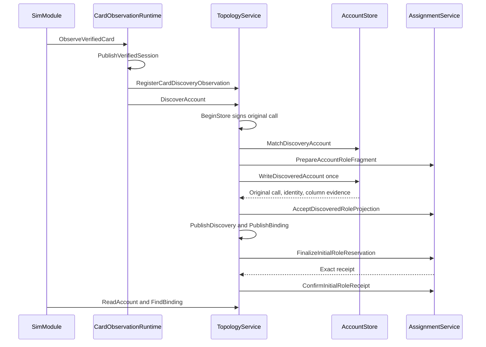
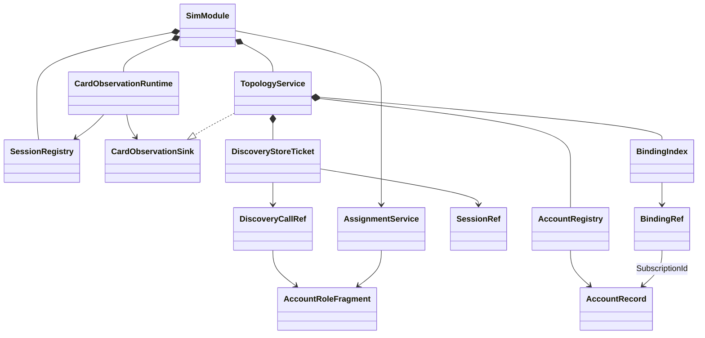

# Windows VS Code + WSL SIM Host

## Testing 面板、源码定位和断点

1. 在 VS Code 用 **WSL: Reopen Folder in WSL** 打开仓库根目录。在 WSL 扩展端安装 TestMate C++、CodeLLDB 和 clangd。
2. 首次准备固定依赖，执行 **Tasks: Run Task → Prepare Testing Panel**。该任务对 Legacy 和 Target 做完整依赖校验，并检查各可执行程序的 XML 源码位置。初始化参数见 [测试入口](../README.md)。
3. 打开测试 CPP，选中 Testing 面板中的用例。点击 **Run**，或设置源码断点后点击 **Debug Test**。即使同一文件显示在多个程序下，用例也使用所在行的可执行程序及后端。

日常 Target 开发优先把输出放在 WSL ext4，使用 `--debug-build`；它独立编译
`-O0`、无 LTO 的产物，修改生产 CPP 后只重建该 Target ELF。正式回归和验收继续
使用默认 Verify 配置，不能用 Developer 产物代替。热运行预热后约 2.2 秒，
普通生产 CPP 修改的构建受 `/mnt/e` 读源速度影响；详细分解见
[专项报告收尾章节](SIM_Host_Development_Efficiency_Optimization_Report.md#收尾异步屏障与-developer-构建)。

TestMate 在 Run 和 Debug 前执行该程序的任务。任务退出非零时操作中止，构建日志位于任务输出所指向的报告目录。每例使用单独进程及 `%p` profile。Legacy 的真实 Primary 和 Bootstrap 日常使用双槽、single-active 模型。需要双激活 C0 时选择 **SIM Legacy C0 (dual active)** 启动配置。调试启动默认使用本机 DWARF，关闭 LLDB 外部符号查询以避开网络等待。Target 常规 Debug 使用 DWARF，遇到优化后不可见的变量或内联函数时选择 **SIM Target (step-through)**，使用独立的 `.host-out/debug/build` 目录。

首次枚举及 ELF 变更后，TestMate 用 GoogleTest XML 获取源码位置。已验证的 ELF 未更新时，TestMate 按 ELF 修改时间与发现配置复用 XML。新增、删除或改名 TEST 后先运行对应的 **Build Legacy Host** 或 **Build Target Host** 任务。Testing 面板仍显示旧条目时点刷新。新建普通 `cases/*.cpp` 自动更新源码清单；新增显式链接切片的 CPP 须加入对应 GN 源表。XML 检查记录在 Prepare 报告的 `editor/locations.json`。

## 随当前 CPP 文件筛选用例

测试树按“可执行程序 → 测试源码文件 → 用例”分组。先完成 Prepare Testing Panel 并刷新，再打开某个测试 CPP，在左侧 Testing 面板的筛选输入框输入 `@doc`，或点击该输入框右侧的漏斗并勾选“Show in Active File Only（仅显示当前文件）”。启用后，切换到另一个测试 CPP，面板会自动显示新文件中的用例，无需重新构建或逐次输入文件名；面板须保持打开。

例如打开 cases/developer_copy_test.cpp 时显示 SimTest.DualSimPinUnlockAfterWrongPin；切换到 cases/pin_failure_isolation_test.cpp 时显示 SimTest.WrongUsimPinDoesNotBlockSimPeer。用例继续支持源码跳转和 Debug Test。

`@doc` 是 VS Code 内置的测试视图筛选状态，不是 settings.json 配置项，仓库配置不能默认替用户打开该开关。需要在实际使用的 VS Code 窗口启用；若重开窗口后筛选清空，再输入 `@doc` 即可。删除 `@doc` 或取消勾选可恢复全部测试。打开不包含已发现用例的生产 CPP/头文件时列表为空是当前文件筛选的预期行为。若测试 CPP 也为空，先移除其他名称/状态筛选，再确认打开的是同一个 WSL 仓库、已构建发现用例，并刷新测试列表。

依据：[VS Code 测试筛选](https://code.visualstudio.com/docs/debugtest/testing)、[TestMate 分组配置](https://github.com/matepek/vscode-catch2-test-adapter/blob/master/documents/configuration/test.advancedExecutables.md#testgrouping)。本批仅核对配置和真实枚举映射，未声称已经在GUI中打开此筛选。

C0 主卡单例的旧实现析构/ICCID注销问题已修复，资源清理断言保持；修复前后、反向验证及当前其他失败见[本批证据](archive/c0_lifetime_fix_20261117/README.md)。查询切片只构造未初始化Manager，其Host链接边界被调用即报错，不能用这些切片证明完整对象图清理。

## 回归、差分与准入

| VS Code 任务 | 执行范围 |
| --- | --- |
| Run Legacy Regression | Legacy 全部业务目标，常规初始化模型 |
| Run Target Regression | Target Host 全部业务用例 |
| Run Both Backends | 输入冻结 Scenario ID，两边按原映射运行并与 Oracle 比对；ID 无实现时报告 BLOCKED |
| Verify / CI (Legacy admission) | Legacy 业务覆盖清单、完整依赖校验、架构与技术检查、真实执行审计、Mutation、Profile Safety 及 CI 准入 |
| Verify Target Host | Target 全量、完整依赖校验、架构与技术检查及 Target 真实执行审计 |

报告默认在 `.host-out/results`。完整架构检查要求仓外执行，入口会按需准备临时目录并将结果保存在本次报告的 `architecture/`。历史失败签名固定，五个已解决条目必须通过。CLI 的 `run --backend both` 默认执行全部已支持的冻结差分场景，`--filter <Scenario ID>` 选择其中一个。Windows 自动化的前台焦点检查阻止了 GUI 采样。已通过 CLI 核对默认构建目录的八个程序和源码位置。当前性能及完整验证见 [专项报告](SIM_Host_Development_Efficiency_Optimization_Report.md)。

`Run Selected Test` 只要求用例名，在命令行可用 `--backend` 与 `--target` 明确选择。批处理 `Debug Selected Test (LLDB evidence)` 还需要函数断点符号，会在命中后记录调用栈并继续运行。交互单步使用 Testing 面板的 **Debug Test**。CLI 默认每次执行增量检查；`--no-incremental-build` 显式选择已有 ELF。完整门禁始终验证内容和构建。

Windows 前台焦点仍由用户确认时，手工验收清单固定为：Legacy 与 Target Run/
Debug 是否命中各自目标；Target 源码修改后是否执行最新 ELF；源码跳转文件/行号；
`SimModule::SetPrimarySlotId` 断点；进入 `AssignmentService` 与
`AssignmentStoreAdapter`；观察 `SessionRef`、`BindingRef`、`AccountRecord` 和
`AssignmentAggregate`；新增或改名用例后的刷新。焦点拒绝时不要重复抢占，记录
“GUI 未验收”而非把 CLI/LLDB 结果冒充 GUI PASS。

<a id="af2-m1-debug"></a>

## AF-2 M1 从真实对象图单步

从仓库根执行，首次构建按[测试入口](../README.md)指定固定依赖。M1 用例与既有 C0/B/C1 用例一起链接在 `sim_test_target_host`。

```sh
TEST=telephony_core_service/services/multisim/test
python3 -B "$TEST/scripts/test.py" run --backend target \
  --filter AF2Module.FactoryPublishesRealTopologyAndRunsC0 --out /tmp/af2-m1/host
lldb /tmp/af2-m1/host/build/sim_test_target_host
```

在 LLDB 中用 `settings set target.disable-aslr false` 及 `settings set target.env-vars LLVM_PROFILE_FILE=/tmp/af2-m1/lldb-%p.profraw`，设断点后执行 `run --gtest_filter=AF2Module.FactoryPublishesRealTopologyAndRunsC0`。在 VS Code Remote-WSL Testing 中可选中同一单例运行 Debug，再按下表设置源码断点。

| 文件与断点 | 现场观察 |
| --- | --- |
| `infrastructure/assembly/sim_module_factory.cpp` 的 `CreateCoreSimModule`、`SimModule::SeedAccount` | 工厂签发 `epoch_`、接纳只读 `catalog_`，构造唯一的 `resources_`、`sessions_`、`topology_` 和共享的 `assignment_`。看 `confirmed.application`、`generation`、两条账户证明和 `radio_` 借用的同一屏障。 |
| `account/topology_service.cpp` 的 `AcceptStoredDiscovery` | 核对 `observation.session.epoch` 与 H、`account.subscription`、原 Store 证明和实际 Binding。M1 的输入是启动时已确认的卡及账户。 |
| `role_assignment/assignment_service.cpp` 的 `StartPrimarySwitch` 与 `role_assignment/assignment_store_adapter.cpp` 的 `WriteC0Parameter` | `command.expectedBinding` 固定原订阅、槽和版本，`request` 带实例 epoch。观察 C0 的 `c0Receipt_`、参数调用、Primary/Data 投影及原完成。平台观察来自 R，设备提交次数为零。 |
| `SimModule::StopAcceptingAndDrain` 与 `SimModuleDeleter::operator()` | 查看 `primaryCallActive_`、A 业务收据和 `lifecycle_`。宿主在返回未排空时保留操作入口供核对／重读，Drain 成功后释放最后一个句柄。普通单例走匹配 deleter。 |

M1 的共享资源只登记 `primary-shared`。宿主提供的该键初始证据必须匹配本次 epoch。持有同一物理域的另一个执行实例、未排空的旧命令和真实硬件复用仍按产品门禁取证。工厂在 M1 只开放观察及 C0，B/C1 的旧组件夹具继续单独回归。Store 效果未确认时，原请求和写权留在 A，图保留，后继写拒绝，M3 已接入原操作证据核对，见本页 M3。

M2 的实时卡观察、账户绑定和可运行单例见下节。

<a id="af2-m2-debug"></a>

## AF-2 M2 从实时卡观察单步

从仓库根执行。首次构建按[测试入口](../README.md)设置固定依赖。用例位于 `test/cases/target/primary/c0_topology_integration_test.cpp`，其 fixture 接入可控制原操作证据的 Host Store 端口，其他对象由正式工厂创建。

```sh
TEST=telephony_core_service/services/multisim/test
python3 -B "$TEST/scripts/test.py" run --backend target \
  --filter AF2Discovery.LiveCardDiscoveryCreatesAccountAndBinding --out /tmp/af2-m2/host
lldb /tmp/af2-m2/host/build/sim_test_target_host
```

在 LLDB 中设 `settings set target.disable-aslr false` 及 `settings set target.env-vars LLVM_PROFILE_FILE=/tmp/af2-m2/discovery-%p.profraw`，再运行 `run --gtest_filter=AF2Discovery.LiveCardDiscoveryCreatesAccountAndBinding`。VS Code 可用现有 Target Host 配置与同一过滤名。优化构建如果内联了 R 或 Registry 的函数，选择 **SIM Target (step-through)**。





| 源码断点 | 查看数据 |
| --- | --- |
| `infrastructure/assembly/sim_module_factory.cpp` 的 `CreateCoreSimModule` | 空 `accounts`、只读目录与本次 epoch，H 持卡观察、T 和 A。 |
| `card/runtime/card_observation_runtime.cpp` 的 `ObserveVerifiedCard` 及 `card/state/session_registry.cpp` 的 `PublishVerifiedSession` | slot 1、USIM、来源代次 1，R 发布 Session 后签观察序号。可信撤销经同一短域到 T，Store I/O 在 R 短域外。 |
| `account/topology_service.cpp` 的 `DiscoverAccount`、`account/discovery/discovery_observation_ledger.cpp` 的 `BeginStore` | 原 `admission`、epoch、ICCID 和预期绑定水位，初次 live 观察没有现存 Binding。 |
| `ControlledDiscoveryStore::MatchDiscoveryAccount`、`AssignmentService::PrepareAccountRoleFragment`、`ControlledDiscoveryStore::WriteDiscoveredAccount` | Match 为确定没有行，A 按原 call 保留 token，I 的原计划和列证据对应同一次写。 |
| `AccountRegistry::PublishDiscovery`、`BindingIndex::PublishBinding` | T 在同一提交域做准备和发布。新订阅为 Store 返回的 41，Current/Historical 各有投影，绑定版本从 0 到 1。 |
| `AssignmentService::FinalizeInitialRoleReservation`、`SimModule::FindBinding`、`SimModule::ReadAccount` | A 精确核对 call、token、结果身份和当前／历史处置，T 收回确认后未决项为零。外部读口可得到账户 41 和 slot 1 的绑定。 |

Unknown 同票从 `SimModule::ReconcileDiscovery(call)` 续行。只认可实际 Store 原调用证据，按列累计，同值普通查询不会提升归因。可信换卡撤掉原关系，原票仍可凭后继证明只结历史。用 `ReadDiscoveryReceipt` 观察原阶段、列和 token。`ReadConfirmedDiscoveryRoles` 读取确认过的存储角色结果。Stop 之后这些续行保留，新的发现写入封口。未接入的真实产品 Provider 仍需证明原操作及实际列。

M2 的 `AF2Discovery.LiveBindingsFeedExistingC0AndStaleTargetCannotAdvance` 继续验证内部命令使用的真实 Binding。兼容入口由框架取得原 Binding，业务开发直接使用下一节的入口。

<a id="af2-m3-debug"></a>

## AF-2 M3 从兼容主卡入口单步

在 WSL 中选择 `AF2Primary.LiveDualSimSetPrimaryThroughLegacyEntry` 调试。该用例先发现两张实体卡，再调用 `SimModule::SetPrimarySlotId(1, caller)`。沿 `LegacySimFacade::SetPrimarySlotId`、`AssignmentService::RunTrackedC0`、`AssignmentStoreAdapter::WriteC0Parameter`、`LegacyCompletion::CompleteLegacyInt` 观察兼容检查、目标资格、原步、逐键写入和同步取值。查看 `ReadAssignment()` 的 Primary/Data 投影及 `StopAcceptingAndDrain()`。前后端断点、参数及账户数据流、可复用的 Data/Voice/SMS 接线与 LLDB 实测见[M3 主卡调试对照](M3_Primary_Debug.md)。

独立默认数据卡的单例、写权和 LLDB 断点见 [M4 开发与调试](M4_Default_Data_Debug.md)。
