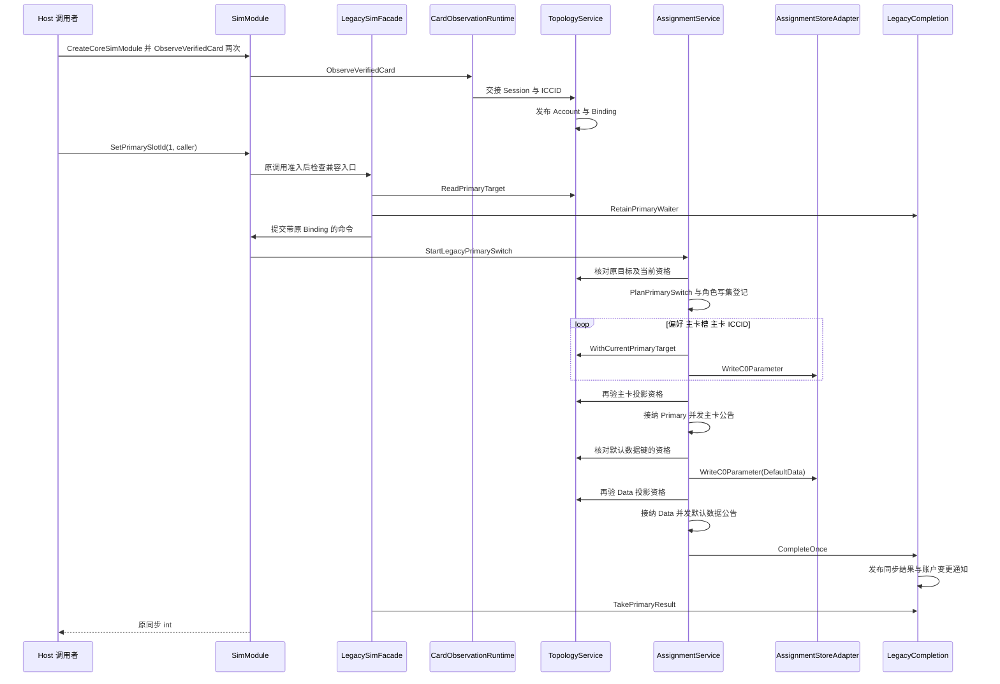

# AF-2 M3 双卡主卡业务调试

同一场景选择已经位于 M0 的实体槽 1。Legacy 使用冻结的双激活、初始主卡为槽 0 夹具。Target 从空模块实时发现两张卡，系统参数起始值为槽 0，随后经正式兼容入口设置槽 1。两边均校验相同的 ICCID 摘要及主卡、默认数据参数，零 Radio 提交。

## 运行与断点

从仓库根执行。首次构建先按[测试入口](../README.md)准备固定依赖。

```sh
TEST=telephony_core_service/services/multisim/test
python3 -B "$TEST/scripts/test.py" run --backend target \
  --filter AF2Primary.LiveDualSimSetPrimaryThroughLegacyEntry --out /tmp/m3-host
python3 -B "$TEST/scripts/test.py" run --backend both --init-model dual-active-primary0 \
  --filter SIM028-LEGACY-C0-DUAL-PRIMARY0 --out /tmp/m3-host
```

两边使用独立可执行文件。冻结的 Both 映射仍运行既有组件用例 `TargetPrimary.C0AssignmentServiceAlreadyPrimary`。正式装配的入口、实时双卡、参数、通知及原同步结果由 `AF2Primary.LiveDualSimSetPrimaryThroughLegacyEntry` 直接验证。VS Code Remote-WSL 的 Testing 面板按 ELF 区分用例。对正式 Target 用例点击 **Debug Test**，前置任务只更新 Target。要观察冻结双激活 Legacy 初态，运行配置 **SIM Legacy C0 (dual active)**。普通 Legacy Testing 面板使用 single-active 初态。

以下表格适用于上述 CLI 输出路径。

| | Legacy | Target |
| --- | --- | --- |
| ELF | `/tmp/m3-host/build/sim_primary_slot_real_test` | `/tmp/m3-host/build/sim_test_target_host` |
| 初态环境 | `SIM_HOST_BOOT_SLOT_COUNT=2 SIM028_INIT_MODEL=dual-active-primary0` | 工厂从空账户启动 |
| `run --gtest_filter=…` | `RealSimPrimary.C0CoreToRealManagerAndController` | `AF2Primary.LiveDualSimSetPrimaryThroughLegacyEntry` |
| 最早的业务断点 | `CoreServiceSim::SetPrimarySlotId` | `SimModule::SetPrimarySlotId` |

在 LLDB 中先设置 `settings set target.disable-aslr false`。Legacy 设置 `settings set target.env-vars SIM_HOST_BOOT_SLOT_COUNT=2 SIM028_INIT_MODEL=dual-active-primary0 LLVM_PROFILE_FILE=/tmp/m3-legacy-%p.profraw`，Target 只需设置 profile 路径。函数断点用 `breakpoint set -n <完整函数名>`。Legacy 命名空间为 `OHOS::Telephony`，Target 函数在其 `MultiSim` 子命名空间。设置首个断点后运行精确过滤，在断点上用 `bt`、`frame variable slotId` 或 `frame variable slot`，用 `thread step-over` 进入下一源码语句。读优化构建中被内联的 Target 函数时，选择 **SIM Target (step-through)**，或向 `test.py debug` 加上 `--debug-build`。该配置使用独立的 `<out>/debug/build` 并保留 DWARF。

## Legacy 调用及数据

```text
RealSimPrimary.C0CoreToRealManagerAndController
→ SimTest::SelectPrimary → Legacy Host 的 Core 调用包装
→ CoreServiceSim::SetPrimarySlotId
  → SimManager::HasSimCard → SimStateManager::HasSimCard
  → SimManager::IsSimActive → MultiSimController::IsSimActive
  → SetParameter(userPreferPrimarySlot, true)
  → SimManager::SetPrimarySlotId → MultiSimController::SetPrimarySlotId
    → GetRadioProtocolModemId(slot) == MODEM_ID_0
    → SavePrimarySlotIdInfo
      → SavePrimaryCardInfo → 主卡槽参数及 SimFileManager ICCID 摘要
      → SendMainCardBroadCast → 缓存 simId 与 slot → 主卡通知
      → SetDefaultCellularDataSlotId → SaveDefaultCellularDataSlotIdInfo
        → 默认数据参数及 SendDefaultCellularDataBroadCast
    → 返回成功
  → MultiSimMonitor::NotifySimAccountChanged → 原同步返回
```

| 源码断点 | 观察 |
| --- | --- |
| [CoreServiceSim::SetPrimarySlotId](../../../core/src/core_service_sim.cpp#L516) | `slotId=1`。看业务 admission、系统应用、权限、容量、`hasSim` 和激活检查。 |
| [SimManager::HasSimCard](../../../sim/src/sim_manager.cpp#L186)、[SimManager::IsSimActive](../../../sim/src/sim_manager.cpp#L355) | 存在性来自 `simStateManager_[slotId]`。激活查询转到 Controller 及其 `localCacheInfo_`。PIN 锁定与账户是否激活分别表达。 |
| [SimManager::SetPrimarySlotId](../../../sim/src/sim_manager.cpp#L469)、[MultiSimController::SetPrimarySlotId](../../../sim/src/multi_sim_controller.cpp#L1494) | 看 `isUserSet=true`、M0 路由及 C0 调用。 |
| [SavePrimaryCardInfo](../../../sim/src/multi_sim_controller.cpp#L1558)、[SendMainCardBroadCast](../../../sim/src/multi_sim_controller.cpp#L1665) | 控制器先更新 `lastPrimarySlotId_`，再写槽参数。原始 ICCID 来自 `simFileManager_[slotId]`。主卡公告的身份取 `localCacheInfo_[slotId].simId`，按槽与身份的组合去重。单独在 [GetSimId](../../../sim/src/multi_sim_controller.cpp#L915) 和 [GetSimAccountInfo](../../../sim/src/multi_sim_controller.cpp#L1220) 观察同一缓存的查询关系。这两项是定位账户使用的辅助断点。 |
| [SaveDefaultCellularDataSlotIdInfo](../../../sim/src/multi_sim_controller.cpp#L1712)、[NotifySimAccountChanged](../../../sim/src/multi_sim_monitor.cpp#L801) | 看 `lastCellularDataSlotId_`、默认数据公告和返回前的监视器通知。Legacy 调试 ELF 对部分取值路径做了内联，实际停靠点以原始记录为准。 |

## Target 调用及数据



逐键和公告实际交错顺序为偏好、主卡槽、主卡 ICCID、主卡投影和公告、默认数据槽、Data 投影和公告、账户变更、同步返回。

| 源码断点 | 建议观察 |
| --- | --- |
| [CreateCoreSimModule](../../infrastructure/assembly/sim_module_factory.cpp#L262)、[ObserveVerifiedCard](../../card/runtime/card_observation_runtime.cpp#L13) | H 创建实例 epoch、只读目录、R/T/A 及完成适配器。R 签发当前物理应用的 `SessionRef`。 |
| [PublishDiscovery](../../account/account_registry.cpp#L95)、[PublishBinding](../../account/binding_index.cpp#L78) | T 持有两者。Store 分配订阅 40/41。第二张绑定含槽 1、订阅 41、版本 1。通过 `binding`、`account` 和 R 会话观察。 |
| [SimModule::SetPrimarySlotId](../../infrastructure/assembly/sim_module_factory.cpp#L123)、[LegacySimFacade::SetPrimarySlotId](../../infrastructure/compatibility/api/legacy_primary_entry.cpp#L9) | `slot`、原调用方、H 的 `primaryCallActive_`、R 卡存在性、C 保留的同步 `waiter`。API 调用方只传入槽和原来调用身份。 |
| [ReadPrimaryTarget](../../account/topology_service.cpp#L47)、[StartPrimarySwitch](../../role_assignment/assignment_service.cpp#L147)、[PlanPrimarySwitch](../../role_assignment/primary/primary_switch_plan.cpp#L21) | 看 `command.expectedBinding`、`refreshedFacts`、`observed.currentModemId` 和 `plan.mode`。T 组合 `BindingIndex::Find` 与 `AccountRegistry::Read` 后提供窄事实。A 依据 R 观察选择 `AlreadyPrimary` 并接纳角色写集。 |
| [RunTrackedC0](../../role_assignment/assignment_service.cpp#L371)、[WithCurrentPrimaryTarget](../../account/topology_service.cpp#L60)、[WriteC0Parameter](../../role_assignment/assignment_store_adapter.cpp#L98) | 看 `receipt.binding`、`facts`、`original.operation`。LLDB 记录同一 Assignment 请求在 `RuntimeOperationStore` 上使用步骤 2、3、4、5，分别对应四个原键。目标资格和登记在锁内，平台调用在锁外。 |
| [AcceptPrimaryParameterProjection](../../role_assignment/assignment_aggregate.cpp#L113)、[AcceptDataParameterProjection](../../role_assignment/assignment_aggregate.cpp#L127) | 两个 `last` 投影均从未接纳本轮值变成槽 1。公告携带槽 1 和订阅 41。原 ICCID 为 `8900000000000000001`，两边写入相同的 `AB2FA72F…D26558F2` 摘要（完整键值由测试断言）。 |
| [CompleteLegacyInt](../../infrastructure/compatibility/events/legacy_completion.cpp#L44)、[TakePrimaryResult](../../infrastructure/compatibility/events/legacy_completion.cpp#L33) | `legacyResult=0`。原 waiter 先登记，完成先于同步取值。A 领取完成，C 消费并删除同一 cell。 |
| [StopAcceptingAndDrain](../../infrastructure/assembly/sim_module_factory.cpp#L162)、[SimModuleDeleter](../../infrastructure/assembly/sim_module_factory.cpp#L257) | H 封新请求。确认在途帧及待证效果结束后，释放最后一个句柄，LLDB 命中配对删除器。 |

双激活 Legacy 日志记录了 `simId=1` 的主卡和默认数据通知。Target 用两个独立于槽值的账户身份 40/41 验证同一关系，公告中的订阅来自有效 Binding。Legacy 的位置索引同时连接卡状态、文件和账户数组。Target 的 `SlotId` 表达位置，`SessionRef` 表达当前卡应用代次，`SubscriptionId` 表达持久账户，`BindingRef` 将当前位置和账户以版本关联。A 的 Primary/Data 投影以及写入资格归 `AssignmentAggregate` 管理。测试观察初始 Host 参数为槽 0，C0 结束后的两个槽参数和角色投影均为槽 1，账户身份仍为 41。

## 原效果核对和后续角色

在 `AF2Primary.InterruptedIccidWriteRetainsPrefixAndOnlyAcceptsOriginalEvidenceAfterStop` 中断于 `ReconcileC0Parameter`。看 `receipt.writes` 的偏好及主卡槽已生效、ICCID 未决、Data 未发送。精确原调用证据用 `C0ParameterOperation` 关联 epoch、Owner、请求、步、尝试和参数键。Host 的参数端口提供该证据，普通读值相等时仍保留未决项。原同步返回已经定案。核对只归还原责任，角色投影、出站通知和写入次数可在测试末尾核对。

后续开发按两个实施批次接线，产品准入按原门禁验收。

- **M4 独立 Data**。扩展 A 的 `SetDefaultRole` 和 `AssignmentAggregate`，复用 T 的合格目标查询、原目标重验、锁内登记及锁外参数/通知。Data 与 Primary 的 Data 键及公告写集相交。保留独立 Data 可以指向另一有效槽的行为，使用该业务自己的返回、通知及账户投影契约。
- **M5 Voice/SMS**。在 A 的角色入口接原命令与相应 T 资格，按各自独立写集使用 `AssignmentStore` 与出站端口。保留每个角色原有的无默认值、停用及错误语义，具体场景基于对应 Legacy 对照用例取证。
- Host 业务用例通过 `CreateCoreSimModule` 和实时发现构造账户，在参数、权限、Radio 观察和通知端口注入替身。按实际角色增加冲突、无绑定、未决效果、完成重复和关闭测试。归属仍由 T 持有账户及绑定、A 持有角色及写资格、R 持有卡会话、H 持有准入和寿命。
- AF2-03 多成员设备提交、Reload 因果覆盖、真实参数/Provider 供证、生产装配及切换继续按既有门禁。M3 验收覆盖宿主 C0。

[LLDB 原始记录和测试结果](evidence/af2_m3_20261124/README.md)
