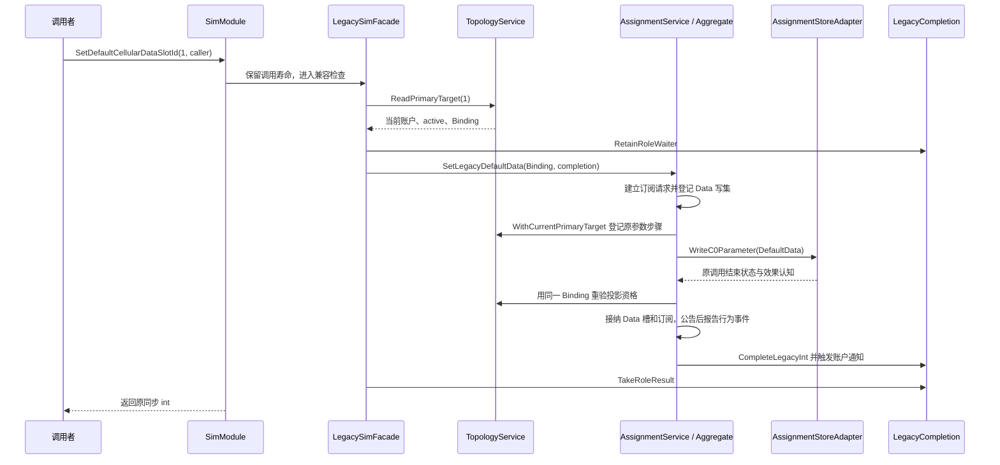
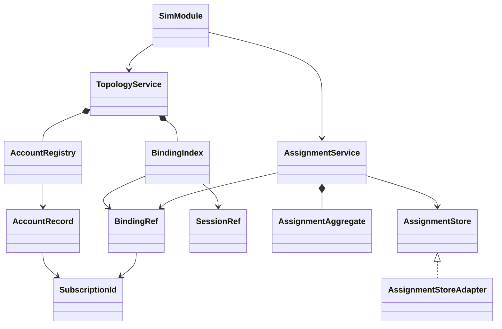

# AF-2 M4 独立默认数据卡开发与调试

## Legacy 业务契约

取证基线为本仓 `bced9e9f3df22bcf54f5d017dea04d34cdec8543` 和 OpenHarmony Cellular Data
`29d6fa9c6105c6e39a9a765048868e4631ffbb8f`。公开路径从 `@ohos.telephony.data` 的 N-API
进入 `CellularDataClient`，经过 Cellular Data SA 的 IDL 方法，再由 `CellularDataService`
调用本进程的 `CoreManagerInner`。本仓的 Core Service SIM IPC 不提供这三个 Data 方法。
[外部 N-API](https://github.com/openharmony/telephony_cellular_data/blob/29d6fa9c6105c6e39a9a765048868e4631ffbb8f/frameworks/js/napi/src/napi_cellular_data.cpp#L773) ·
[CellularDataClient](https://github.com/openharmony/telephony_cellular_data/blob/29d6fa9c6105c6e39a9a765048868e4631ffbb8f/frameworks/native/cellular_data_client.cpp#L146) ·
[Cellular Data IDL](https://github.com/openharmony/telephony_cellular_data/blob/29d6fa9c6105c6e39a9a765048868e4631ffbb8f/frameworks/native/ICellularDataManager.idl#L28) ·
[CellularDataService](https://github.com/openharmony/telephony_cellular_data/blob/29d6fa9c6105c6e39a9a765048868e4631ffbb8f/services/src/cellular_data_service.cpp#L479) ·
[CoreManagerInner](../../../../frameworks/native/src/core_manager_inner.cpp#L2035)

| 输入及前提 | 实际效果、通知及原返回 | Target Host 对应行为 |
| --- | --- | --- |
| N-API 无效槽 | 参数校验先于 Client IPC，返回槽值错误。多卡产品对特殊槽还有能力检查。 | N-API 继续由外部宿主实现。 |
| Cellular Data SA 收到 setter | 依次检查系统应用、`SET_TELEPHONY_STATE`、`HasSimCard`、`IsSimActive`。分别返回 `ILLEGAL_USE_OF_SYSTEM_API`、`PERMISSION_ERR`、`NO_SIM_CARD`、`SLOTID_INVALID`。失败时不调用 CMI。 | 兼容入口重用宿主身份端口，在 R 查询可验证的存在性，由 T 查询当前激活账户和 Binding。 |
| CMI 或 Manager 直接调用 | CMI 空 Manager 或 Manager Stop 后返回 `LOCAL_PTR_NULL`。Manager 只检查 `0 <= slot < slotCount_`，越界返回 `SLOTID_INVALID`。有效槽即使无卡、停用或无有效账户也能推进参数和槽缓存。公告只有缓存向量为空或下标超界时跳过，缓存中无有效身份也可能公告。 | Host 接入覆盖具有有效 Binding 的选卡。直接 CMI 弱准入与已签收目标资格约束冲突，禁止无有效关系的请求登记新效果。 |
| 合格目标、参数调用已返回 | Controller 写 `persist.telephony.MainCellularDataSlotId`，设 `lastCellularDataSlotId_`，从 `localCacheInfo_[slot].simId` 取身份并更新 `defaultCellularSimId_`。公告携 `simId`、原 action、code 1 和 `defaultCellularDataSimIdChanged`，无 `slotId`，发布非 ordered。随后写 `SET_DEFAULT_CELLULAR_DATA` 行为事件的 `SLOT_ID`，Manager 再调账户 Callback 和 State Registry，返回 SUCCESS。参数返回值和 CES 发布布尔值均被忽略。 | StoreAdapter 使用原键。A 在原调用返回且资格仍成立时接纳槽和账户，按公告、行为事件、账户通知、同步返回的顺序输出。参数效果独立记账，已结束但效果未知时继续占有写权。 |
| 重复选择相同槽，或选择其他有效槽 | 同槽无去重，再调用参数、Data 公告、行为事件和 Manager 通知。只更新 Data，Primary、主卡 ICCID、用户主卡偏好不变。 | 每个被接纳的调用具有独立原票。 |
| 读取 | Manager 单槽版的槽查询固定 0，多槽读 Controller 缓存，启动期由参数加载并缺省到 0。SimId 查询以当前缓存槽重新调用 `GetSimId`，槽为负时返回 NO_SIM_CARD，身份不大于 0 时返回 FAIL，失败不改输出参数。Cellular Data SA 的槽 getter 将槽放进 out 参数并返回 SUCCESS。 | 测试观察 A 的兼容槽投影及 A 接纳的 Data 订阅。产品读取入口、启动加载和换绑后的原查询行为另行接管。 |
| 底层调用未返回、换卡或并发写 | 已观察到 Legacy 对同步返回的处理。源码没有按请求核对迟到参数效果的能力。Primary 的 C0、Radio 成功分支、自动主卡校正与 `SavePrimarySlotId` 都可能重写 Data。 | 使用 A 的实际共享写集、T 的同域目标重验和逐键原操作证据。后续核对只结原责任。 |

本仓源码定位见 [Manager setter](../../../sim/src/sim_manager.cpp#L451)、[Manager getters](../../../sim/src/sim_manager.cpp#L589)、
[槽范围](../../../sim/src/sim_manager.cpp#L1374)、[Controller setter](../../../sim/src/multi_sim_controller.cpp#L1417)、
[保存、启动读取及公告](../../../sim/src/multi_sim_controller.cpp#L1683)、[CES 载荷](../../../sim/src/multi_sim_controller.cpp#L1934)、
[账户通知](../../../sim/src/multi_sim_monitor.cpp#L801) 和 [诊断](../../../core/src/core_service_hisysevent.cpp#L89)。

公开客户端还有按进程缓存的槽和 simId。Proxy setter 成功后写客户端槽缓存并回读 simId，
身份查询成功才更新缓存。客户端 getter 可命中缓存。账户回调清除两个值并经 Proxy 重读，
SA 死亡时也清缓存。Manager 槽参数、Controller 内存值及客户端缓存的写者与更新时点各自可查。
Host 的差分跨到 CMI 及正式 Target 兼容入口，客户端 IPC 缓存及回调运行仍需产品取证。
[客户端更新、查询及死亡处理](https://github.com/openharmony/telephony_cellular_data/blob/29d6fa9c6105c6e39a9a765048868e4631ffbb8f/frameworks/native/cellular_data_client.cpp#L86) ·
[数据账户回调](https://github.com/openharmony/telephony_cellular_data/blob/29d6fa9c6105c6e39a9a765048868e4631ffbb8f/frameworks/native/data_sim_account_callback.cpp#L21)

独立调用之外，`CheckIfNeedSwitchMainSlotId` 可在卡和账户变化后保存或调度主卡，随后联动 Data。
`CellularDataService` 在规则检查后、CMI 调用前另有可选厂商 CHR 入口，其调用者信息与编译配置留在外部 SA。
通话数据状态机也可直接选择临时 Data 并恢复主卡。实际产品消费者版本、CHR 插件、CES/Registry 送达、
同一进程实例、平台参数原操作证明及设备数据连接行为仍需产品证据。
[自动校正](../../../sim/src/multi_sim_controller.cpp#L1120) ·
[厂商 CHR](https://github.com/openharmony/telephony_cellular_data/blob/29d6fa9c6105c6e39a9a765048868e4631ffbb8f/services/src/cellular_data_service.cpp#L999) ·
[通话数据写者](https://github.com/openharmony/telephony_cellular_data/blob/29d6fa9c6105c6e39a9a765048868e4631ffbb8f/services/src/state_machine/incall_data_state_machine.cpp#L260)

## 跟一笔 Data 请求

双卡业务用例用 R 实时发现两张 USIM，由 Account Store 分配订阅 40、41。T
用 `SessionRef` 管理当次发现，在 `AccountRegistry` 发布账户，在 `BindingIndex`
发布位置到订阅的带版本关系。用例先经 Primary 入口选择槽 0，随后选择槽 1 做 Data。
Legacy 用相同槽下标访问卡、缓存和账户。Target 仅在兼容入口解析槽，A 按原订阅和
Binding 处理请求，适配器最后把兼容槽编码成参数值。





Primary 的写集含用户偏好、主卡参数和公告、Data 参数和公告。独立 Data 只取得后两项。
成功的写集登记决定当前写者。冲突请求返回 `TELEPHONY_ERR_FAIL`，既不会写键，也不会
隐式排队。完成后的另一请求可以重新竞争，成功的后写者按原业务顺序更新 Data。
A 提交锁覆盖聚合和登记，登记实际键的步骤与 T 的原资格重验在同一 T 域完成。
参数、出站公告和完成通知都在提交锁外执行。

如果换卡先于登记，原请求无键可写。写入步骤已登记时，原效果可先于换卡开始，
而换卡先于投影会阻止接纳过期关系。Select 返回后仍有未知效果时，共享写集继续保留。
调用已返回而效果未知的情况下，有效 Binding 仍按 Legacy 语义接纳一次并返回成功。
调用未结束或投影资格失效时，Host 原调用一次返回失败。Stop 封口后，精确原请求、步骤、
尝试及键的证据仍可结清。普通同值读取、重复或不匹配证据不释放原责任。
核对不重写参数，不补发通知，也不改变已返回的结果。

## 构建、运行及断点

从仓库根出发，使用仓内依赖准备和统一入口。

```sh
TEST=telephony_core_service/services/multisim/test
CASE=AF2Data.LiveDualSimSetDefaultDataThroughLegacyEntry
python3 -B "$TEST/scripts/test.py" list --backend target --filter "$CASE"
python3 -B "$TEST/scripts/test.py" run --backend target --filter "$CASE"
python3 -B "$TEST/scripts/test.py" debug --backend target --debug-build --filter "$CASE" \
  --breakpoint OHOS::Telephony::MultiSim::SimModule::SetDefaultCellularDataSlotId
python3 -B "$TEST/scripts/test.py" run --backend both --init-model dual-active-primary0 \
  --filter SIM027-LEGACY-DATA-INDEPENDENT-DUAL-PRIMARY0
```

| 断点 | 调试时观察 |
| --- | --- |
| [SimModule::SetDefaultCellularDataSlotId](../../infrastructure/assembly/sim_module_factory.cpp) | 调用参数 `slot=1`，调用者 token 7，H 的调用租约。 |
| [LegacySimFacade::SetDefaultCellularDataSlotId](../../infrastructure/compatibility/api/legacy_primary_entry.cpp) | `SlotId` 的兼容位置，系统身份与权限检查，T 返回的原 Binding。 |
| [TopologyService::ReadPrimaryTarget](../../account/topology_service.cpp) | `BindingIndex::Find`、`AccountRegistry::Read` 和账户的 current/active。 |
| [SetLegacyDefaultData、SetDefaultRole、WriteTrackedParameter](../../role_assignment/assignment_service.cpp) | 原 Binding 为槽 1、订阅 41、版本 1。Data 请求的原目标为订阅 41。写调用使用 `DefaultData` 步骤。 |
| [AssignmentAggregate::AdmitRoleWriteSet](../../role_assignment/assignment_aggregate.cpp) | Data 的写成员掩码为 24。 |
| [AssignmentStoreAdapter::WriteC0Parameter](../../role_assignment/assignment_store_adapter.cpp) | `DefaultData` 路由使用原键和值 `1`。 |
| [AssignmentAggregate::AcceptDataParameterProjection](../../role_assignment/assignment_aggregate.cpp) | `lastPrimary_` 保持槽 0，`lastData_` 从槽 0 改为 1，Data 订阅从 40 改为 41。 |
| [LegacyCompletion::CompleteLegacyInt、TakeRoleResult](../../infrastructure/compatibility/events/legacy_completion.cpp) | 原 waiter 2 的返回值为 0，账户通知在同步结果被取走前送出。 |
| [SimModule::StopAcceptingAndDrain、SimModuleDeleter](../../infrastructure/assembly/sim_module_factory.cpp) | 观察在途数、清空关闭保活句柄和对象释放。 |

M5 可复用 T 的资格查询与 A 的请求、写集和完成机制。Voice/SMS 原 Provider 字段、
无默认值、去重和错误返回仍须分别以生产契约取证。

## 扩展性

与输入 main 相比，Target 生产源码新增 0 个文件，修改 15 个文件，新增 239 行、删除 79 行。
Host 新增 8 个 Target 业务用例和 1 个 Legacy 特征用例，并补充 2 个架构及 Oracle 负控。
外部 InnerKit、Core/SA/IPC 接口无改动。模块入口新增独立选择、原 Data 参数回执读取和核对。
内部变化限于角色请求、Data 槽与订阅投影、行为事件输出和共用同步 waiter。

账户和卡的写者边界沿用现有 R/T 图。A 在同一 AssignmentAggregate 用一个槽与订阅组合
保存已接纳的 Data 投影。独立选择和 Primary 联动都提交该组合。DB 建档与 Reload 的
角色列有各自的取证与接纳节点，独立 Data 业务没有这些列的写入。共用的 Store、
RuntimeOperationStore、角色写权和 H 的原调用保活负责执行与清理。既有依赖方向和逻辑
GN target 保持，未新增跨域依赖或依赖环。

M3 C0 仍经过原偏好、Primary 两键、主卡公告以及联动 Data 的逐键顺序，M4 复用其中的
Data 参数和投影接纳。双向竞争用例从正式入口证明同一共享资源只能由先取得写集的请求推进。
M5 Voice/SMS 可以按各自实际写成员扩展同一请求和完成机制，再补对应的 Legacy 契约及差分。
