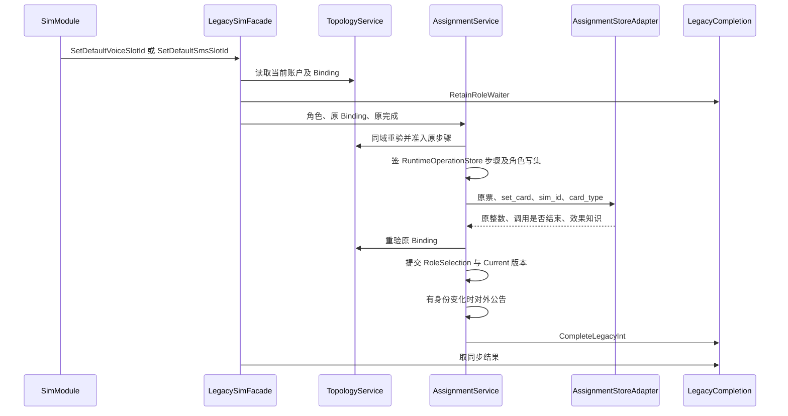

# AF-2 M5 默认 Voice / SMS 开发与调试

## Legacy 契约

Voice 的公开路径从 Core Client/Proxy 进入 Core SIM。Core 依次通过业务准入、
系统应用、`SET_TELEPHONY_STATE`、Manager 存在性和适用槽能力检查。SMS 的公开
权限检查位于 SMS SA。调用经过 SMS Interface/Misc Manager 后，由本仓
`CoreManagerInner` 委托给 `SimManager`，该内部路径沿用 Manager 的槽范围校验。
[M5 Legacy Core Voice](../../../core/src/core_service_sim.cpp#L452) ·
[固定版本 SMS SA](https://github.com/openharmony/telephony_sms_mms/blob/2336a3c3ba9a5cc53e95535cf25a6cfe15c74de7/services/sms/sms_service.cpp#L671) ·
[SMS Misc](https://github.com/openharmony/telephony_sms_mms/blob/2336a3c3ba9a5cc53e95535cf25a6cfe15c74de7/services/sms/sms_misc_manager.cpp#L569) ·
[CMI 和 Manager](../../../sim/src/sim_manager.cpp#L415)

| 条件 | Legacy Voice | Legacy SMS |
| --- | --- | --- |
| 设有效槽 | Controller 先确认卡存在、已激活，再用当时缓存的 simId 写 Voice。 | 同样的资格和身份查询，写 SMS。 |
| 范围外、无卡、停用 | 分别返回 `SLOTID_INVALID`、`NO_SIM_CARD` 和 `CORE_SERVICE_SIM_CARD_IS_NOT_ACTIVE`。 | 相同。 |
| 设置默认与清除 | `set_card` 命令提交 `sim_id` 和 `card_type=1`，清除使用槽 -1、存储载荷 simId 0。 | 同一 URI，`card_type=2`；清除载荷相同。 |
| Provider 返回 | Controller 只将 -1 映射为 `DATABASE_WRITE_FAIL`。成功分支清、置当前缓存中该角色所有槽的标记。 | 相同，写各自列。 |
| 重复、公告和账户通知 | 同身份仍提交 Provider 并更新当前缓存，跳过 CES；Manager 成功仍通知账户。不同身份先记去重身份再公告。CES 失败返回 `PUBLISH_BROADCAST_FAIL`，此前角色仍保留，Manager 不发账户通知。 | 相同顺序。两个 CES 的 action 和 eventData 分别对应 Voice/SMS，code 1、非 ordered、载荷 `simId`。 |
| 清除后查询 | 无活跃的 Voice 标记时返回 -1。 | 无活跃的 SMS 标记时回退到首个激活槽。 |
| 单卡配置与读源 | Manager 槽 getter 可固定回 0，SimId getter 按 Controller 得到的槽找身份，无有效值返回成功并给 -1。 | 同类分层，Controller 保留 SMS 回退。 |

[Controller setters 和 getters](../../../sim/src/multi_sim_controller.cpp#L1248) ·
[原 Provider 命令](../../../sim/src/sim_rdb_helper.cpp#L290) ·
[账户通知](../../../sim/src/multi_sim_monitor.cpp#L801)

固定 Provider 源码先清同类列，再置目标行。Voice 列是 `is_voice_card`，SMS 列是
`is_message_card`。命令共用表及事务入口，字段互异。目标置位失败后仍会走 commit
并返回其结果，因此整数结果没有逐效果归因。Host 端口显式报告同票的未写、完整、
部分或未知，真实产品事务隔离与逐效果供证仍属于产品门禁。旧 Primary/Data setter
写系统参数，默认 Voice/SMS setter 不共写这些键。发现期联合建行可能写两种角色列。
[Provider 事务](https://github.com/openharmony/telephony_telephony_data/blob/74b8597ecbeea4dd39eacb4a9e7fa22f8a9389b4/sim/src/rdb_sim_helper.cpp#L88)

两个 Legacy 特征用例实际运行 Voice Core 入口和 SMS CMI 入口，经过 Manager、
Controller、SimRdbHelper。记录原 URI、命令值、公告、账户通知与返回。
[Legacy 原始证据](evidence/af2_m5_20261125/README.md)

## 在同一模块选择四种角色

`AF2VoiceSms.LiveDualSimSelectsFourRolesThroughLegacyEntries` 从空的
`CreateCoreSimModule` 开始。实时卡发现建立槽 0→订阅 40 和槽 1→订阅 41。
用例先将 Primary 设为槽 0、独立 Data 设为槽 1，再选 Voice=41、SMS=40。
`ReadAssignment` 提供四种角色以及 Voice/SMS 选择偏好。Provider 用账户身份做更新，
兼容槽只在入口解析。清除使用空订阅；适配器在写命令的边界编码 simId 0。



Host Provider 能证明按角色隔离事务时，Voice、SMS 各持自己的一组全局角色列及公告
写权。未声明事务隔离时，两类请求共同取得这两项写权。实际写权取得是冲突决策点，
冲突返回原失败映射。这两组写权与 Primary/Data 的参数、投影及公告独立。发现期的
联合角色列预留和 Provider setter 互斥，只有不写角色列的发现计划可以越过该检查。
Provider 调用、公告和账户通知均在 A 的提交锁之外。

完整效果与当前 Binding 均确认时，A 按原 Provider 整数约定接纳角色。已经确认未写、
只有部分写入和效果未知分别保存在原结果中。部分或未知效果不能推进成功投影，
即使旧 Provider 整数表示成功。已完成且已知的部分效果可结清，未知效果继续保留原写权。
普通读取和等值不能作为核对凭据。原 Binding 在途失效时，已发生的 Provider 效果
按原票处理，当前投影等待后续合法请求。同步结果或通知交付后，晚证据只结原责任。
Stop 封新业务，仍能识别执行中的请求和各角色待核对原票。

录入已确认角色时，A 同域更新选择、已有 Current 角色列及版本，
Historical 沿用既有读源。预先取得旧版本的 Reload 结果会被拒绝，模块没有新增 Reload
入口。SMS 的有效账户可按当前 T 投影回退到最小活跃槽，显式选择仍为空。
产品单卡 slot getter、特殊槽能力、启动加载及外部 IPC 客户端仍按各自装配门禁取证。

## 运行与断点

从仓库根运行。Developer 用于断点，Verify 用于验收。

```sh
TEST=telephony_core_service/services/multisim/test
CASE=AF2VoiceSms.LiveDualSimSelectsFourRolesThroughLegacyEntries
python3 -B "$TEST/scripts/test.py" run --backend target --filter "$CASE"
python3 -B "$TEST/scripts/test.py" debug --backend target --debug-build --filter "$CASE" \
  --breakpoint OHOS::Telephony::MultiSim::SimModule::SetDefaultVoiceSlotId
python3 -B "$TEST/scripts/test.py" run --backend both --init-model dual-active-primary0 \
  --filter SIM025-LEGACY-DEFAULT-VOICE-DUAL
python3 -B "$TEST/scripts/test.py" run --backend both --init-model dual-active-primary0 \
  --filter SIM026-LEGACY-DEFAULT-SMS-DUAL
```

| 断点 | 观察 |
| --- | --- |
| [SimModule::SetDefaultVoiceSlotId、SetDefaultSmsSlotId](../../infrastructure/assembly/sim_module_factory.cpp) | Voice 槽 1、SMS 槽 0，原 caller token 7。H 继续持有同一个模块。 |
| [LegacySimFacade::SetDefaultCallMessageRole](../../infrastructure/compatibility/api/legacy_primary_entry.cpp)、[TopologyService::ReadPrimaryTarget](../../account/topology_service.cpp) | Voice 的原 `binding` 是订阅 41、槽 1、版本 1，`account.current.active` 为真。 |
| [AssignmentService::SetDefaultRole](../../role_assignment/assignment_service.cpp)、[AssignmentAggregate::AdmitRoleWriteSet](../../role_assignment/assignment_aggregate.cpp) | 看 `command`、`binding`、`ownerToken=3` 和 `members=32`。 |
| [AssignmentStoreAdapter::WriteDefaultRole](../../role_assignment/assignment_store_adapter.cpp) | Voice 的原请求 3，step 1，attempt 0，`sim_id=41`、`card_type=1`。SMS 切换到独立请求及订阅 40。 |
| [AcceptRoleSelection](../../role_assignment/assignment_aggregate.cpp)、[NoteLocalRoleMutation](../../role_assignment/account_role_protocol.h) | 角色选择在 A 内接纳，观察预期聚合版本及 Current、Historical 版本。 |
| [LegacyCompletion::CompleteLegacyInt](../../infrastructure/compatibility/events/legacy_completion.cpp) | 正常 Voice 的 waiter 3，`legacyResult=0`，后续原账户通知。 |
| [StopAcceptingAndDrain、SimModuleDeleter](../../infrastructure/assembly/sim_module_factory.cpp) | 观察在途调用计数、正常排空和配对析构。 |

## 扩展性与后续 Account 接线

| 目标源码 | M4 | M5 |
| --- | ---: | ---: |
| 新增文件 | 0 | 0 |
| 修改文件 | 15 | 16 |
| 新增行 | 239 | 347 |
| 删除行 | 79 | 9 |

M5 源码集中在 Infrastructure 的 H/C 和 Role Assignment。T 的现有资格端口、R 的
实时卡观察、O 的 RuntimeOperationStore、原完成单元和 H 的保活继续复用。两个
setter 共用一条 A 业务执行路线，角色命令值、写权及有效角色回退分别表达。
Provider 原效果回执是执行期事实，RoleSelection 是 A 的选择，Current/Historical
仍由既有 AccountRoleProtocol 管理。实际增加的主要成本是辨认 Provider 的清除、
置位、事务返回与公告失败偏序。公共身份、请求框架和逻辑 GN 依赖图维持原边界。
本轮增加 8 个 Target 用例和 2 个 Legacy 用例。

Account 增量可沿现有 T 的账户读写入口接入，先核对真实字段、读源与通知节点，再用
原 Binding 和字段版本登记原操作。涉及角色的建行继续向 A 取得该角色写资格，
技术 Store 按 Owner 提供的列写入并返回同票证据。这样可以直接复用 M2 的发现证据、
H 的保活及 M5 的并发验证方法。
