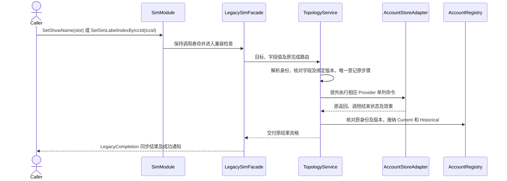
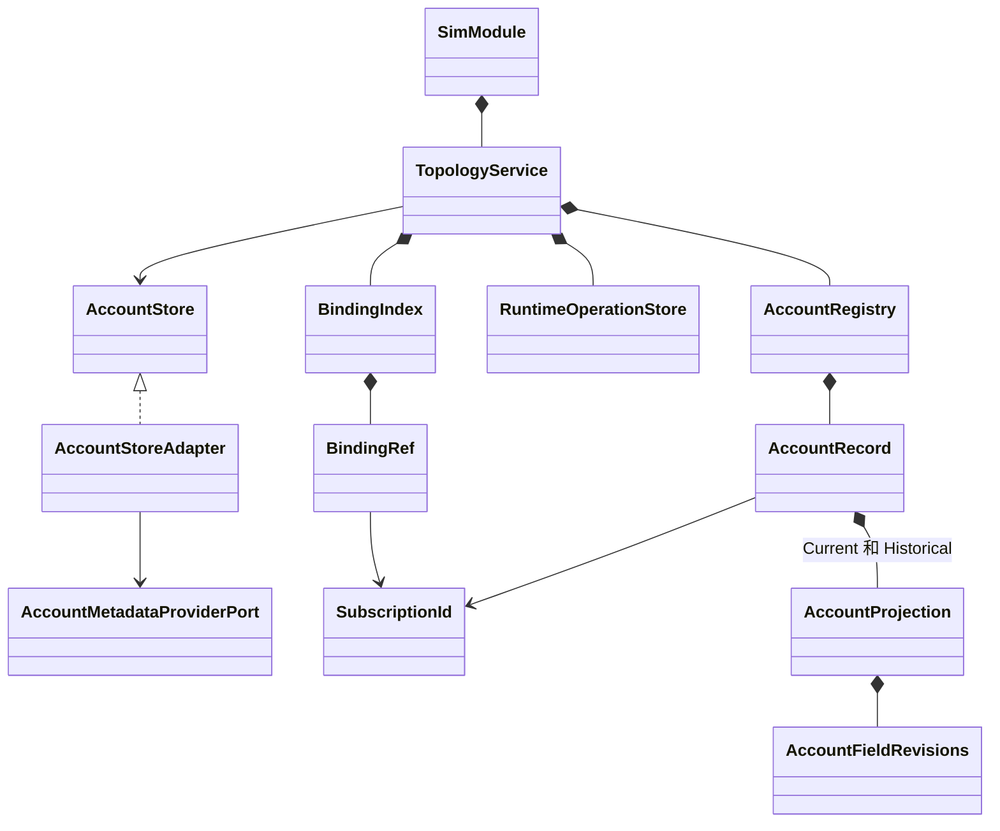

# AF-2 M6 账户资料开发与调试

## Legacy 业务契约

| 入口 | 资格及账户定位 | Provider 写入 | 缓存、通知及原结果 |
|---|---|---|---|
| `CoreServiceSim::SetShowName` → `SimManager::SetShowName` → `MultiSimController::SetShowName` | 先检查系统应用，再检查 SET 权限、管理器与回调、槽支持。按当前槽取已存在卡的持久 `simId`，无需激活 | 普通 SIM Provider，`sim_id = simId`，单列 `show_name` | Provider 返回 −1 时为数据库写失败。其余返回进入缓存更新。先 Current，再按旧数组位置更新 Historical，历史位置缺失返回数组越界。仅整体成功时通知一次。空值和重复值都会写入 |
| `CoreServiceSim::GetShowName` → `SimManager::GetShowName` → `MultiSimController::GetShowName` | 系统应用、GET 权限、管理器与回调、槽支持。读当前槽账户 | 无 | 查询返回 Current 名称，空名称也是有效结果 |
| `CoreManagerInner::SetSimLabelIndex(iccid)` → `SimManager::SetSimLabelIndexByIccId` → `MultiSimController::SetSimLabelIndexByIccId` | 内部 CMI 路径，ICCID 非空、标签 1–10。可针对已知历史账户，不要求当前绑定 | 同一 Provider，`icc_id = iccid`，单列 `sim_label_index` | Provider 返回 0 后更新所有匹配历史和当前条目，整体成功时通知一次。重复值仍写入和通知。旧实现可能在历史缓存非空但没有匹配条目时报告无变更成功 |
| `SimManager::SetSimLabelIndex(simId)` | 同一标签范围，但仅接纳历史缓存中匹配的 eSIM | 委托 ICCID 写入 | 物理卡在这条路径不产生写入 |
| `MultiSimController::GetSimAccountInfo` | 当前槽账户 | 无 | 账户资料含原始标签索引。物理槽 `GetSimLabel` 另按设备配置生成展示标签 |

实际 URI 为 `datashare:///com.ohos.simability/sim/sim_info`。Legacy 实测包括直接账户查询、重复值、空名称、非法标签、物理卡拒绝 eSIM setter、Provider 拒绝及通知次数。[原始证据](evidence/af2_m6_20261125/README.md)

源码可从 [CoreServiceSim](../../../../services/core/src/core_service_sim.cpp)、[SimManager](../../../../services/sim/src/sim_manager.cpp)、[MultiSimController](../../../../services/sim/src/multi_sim_controller.cpp) 和 [CoreManagerInner](../../../../services/core/src/core_manager_inner.cpp) 按上表符号定位。外部 Provider 的固定源码通过显式更新桶传递列和值。[SimAbility::Update](https://github.com/openharmony/telephony_telephony_data/blob/74b8597ecbeea4dd39eacb4a9e7fa22f8a9389b4/sim/src/sim_ability.cpp#L180)

## Target Host 入口与数据流

- 显示名称调用 `SimModule::SetShowName(slot, name, caller)`，查询调用 `GetShowName(slot, out, caller)`。C 先核对系统应用及 SET 或 GET 权限。T 从当前位置的 `BindingRef` 取得持久 `SubscriptionId`，同一提交域中检查绑定并登记写入。
- 标签使用可信的 Host CMI 等价入口 `SimModule::SetSimLabelIndexByIccId(iccid, label)`，支持已知历史账户。使用 `ReadAccount(subscription, view).legacyLabel` 读取原始标签。未发现过的 ICCID 返回参数错误，避免沿用 Legacy 无匹配条目时的无变更成功。公开 eSIM setter 和物理槽展示标签走各自的产品契约。
- 两个 setter 都保留 Legacy 同值写入和成功通知。名称按 Legacy 判断原码是否为 −1，标签判断是否为 0。T 同时要求原调用已结束、实际字段效果已确认，才允许接纳。只有更改过的字段推进对应版本，Current、Historical 各保留自己的版本。





### 字段冲突、换卡及关闭

T 在短锁内按账户和字段保留实际写入。Host Port 确认单列隔离时，同一账户的名称与标签可并行。缺少字段隔离时，对同一账户保守互斥。不同账户仍可独立执行。发现流程可能写标签，涉及相同 ICCID 时按同一提交域检查。若发现因该冲突被拒绝，需在责任结清后由后续可信观察建立绑定。整个流程只写指定列，和 Host 的 Primary/Data 参数、Voice/SMS 角色列并行。Provider 调用、完成及通知在 T 锁外。已准备的旧读镜像不能覆盖版本已变化的名称和标签。

换卡时，已经发出的名称命令仍针对原持久账户。旧 `BindingRef` 失效后禁止接纳和发成功通知，后继账户不会收到原字段。标签入口按 ICCID，已知历史账户无须 Binding。确定拒绝释放字段，Unknown 或原调用尚未结束时保留字段及模块寿命。由于同步兼容调用已返回错误，迟到证据只结清原责任，不补发投影或通知。普通同值读没有原操作身份。Stop 封闭新工作，直到原调用退栈及未决证据结清，才可报告 `Drained`。真实产品 Provider 的归因、编码装配、事务边界及 Core/SA/IPC 继续按原门禁验收。

## Developer 单例与实际 LLDB

从仓库根运行。开发 ELF 存放于所选输出目录的 `debug/build` 下。Verify 使用单独输出目录，并省略 `--debug-build`。

```bash
TEST=telephony_core_service/services/multisim/test
python3 -B "$TEST/scripts/test.py" run --backend target --debug-build \
  --out /tmp/multisim-m6-dev --output /tmp/multisim-m6-dev-results \
  --filter AF2AccountMetadata.LiveDualSimMetadataAndFourRoles

lldb /tmp/multisim-m6-dev/debug/build/sim_test_target_host
```

在 LLDB 中用 `breakpoint set -n <完全限定函数名>`，也可按表中源码位置下断点。输入 `run --gtest_filter=AF2AccountMetadata.LiveDualSimMetadataAndFourRoles`，用 `thread step-over` 前后比较字段。

| 断点 | 实际观察 |
|---|---|
| [SimModule::SetShowName](../../infrastructure/assembly/sim_module_factory.cpp#L99) → [LegacySimFacade::SetShowName](../../infrastructure/compatibility/api/legacy_account_entry.cpp#L52) | 调用者 7、兼容槽 0，显示名称为 `个人` |
| [TopologyService::UpdateMetadata](../../account/topology_metadata.cpp#L64) | 槽 0 的 `BindingRef` 指向订阅 40，原记录同时具有 Current 与 Historical。首次名称写入前两份字段版本均为 0 |
| [原步骤及锁外写入](../../account/topology_metadata.cpp#L101) → [AccountStoreAdapter](../../account/account_store_adapter.cpp#L36) | `RequestOwner::AccountMetadata`，步骤 1，原主键 40，通过普通 SIM URI 的 `sim_id` 只写 `show_name` |
| [AccountRegistry::AcceptDisplayName](../../account/account_registry.cpp#L218) | 单步后 Current 的 `name` 版本 0→1，其余仍为 0 |
| [LegacyCompletion::CompleteLegacyInt](../../infrastructure/compatibility/events/legacy_completion.cpp#L42) | 原整数 0，观察者计数 0→1 |
| [AccountStoreAdapter::WriteLabel](../../account/account_store_adapter.cpp#L44) → [AccountRegistry::AcceptLabel](../../account/account_registry.cpp#L240) | 同一账户使用 ICCID 写标签 3，Current 的 `label` 版本 0→1，`name` 仍为 1 |
| [TopologyService::ReadAccountAtSlot](../../account/topology_metadata.cpp#L21) | 槽 0 通过同一账户投影读取名称 |
| [Stop](../../infrastructure/assembly/sim_module_factory.cpp#L249) → [析构入口](../../infrastructure/assembly/sim_module_factory.cpp#L355) | 在途数为 0，实际进入 `delete module`，用例退出 0 |

用例同时确认槽 1 的持久 ID 41、名称 `Work`、标签 4。随后为槽 0 设置 Primary 与 SMS，为槽 1 设置 Data 与 Voice。四角色设置后，两个账户的资料和字段版本均保持，账户通知总计 8 次。VS Code GUI 为人工未验收。

## 修改局部性与后续资料接线

| 目标源码，含模块 GN | M4 | M5 | M6 |
|---|---:|---:|---:|
| 新增文件 | 0 | 0 | 2 |
| 修改文件 | 15 | 16 | 13 |
| 新增行 | 239 | 347 | 459 |
| 删除行 | 79 | 9 | 17 |

`account/` 内新增 1 个实现文件并修改 7 个已有文件。目录外新增 C 的入口实现，并修改 6 个已有文件，用于 H 接线、兼容端口、原请求 Owner 选择及 GN 源表。沿用现有 25 个逻辑 GN 目标，没有新增跨域依赖边或循环。R 与 A 的业务实现无改动。唯一账户状态仍由 AccountRegistry 保存。待结清字段只保存原操作及效果，写入没有第二个可用入口。名称与标签共用一次字段登记、原证据核对、字段接纳和完成机制，各自保有目标定位、参数类型、原谓词和原返回判断。

实现成本主要在分辨两个标签入口、历史资格及 Provider 的不同成功码。仅有字段和权限契约时，从 `topology_metadata.cpp` 追到 Registry 和 Store Adapter 即可定位。后续 IMS Preference 应先确认原 Slot/ICCID 来源、Provider 字段以及外部设备行为。若是资料字段，可在 T 加入相应字段版本、在 I 加单字段适配，并从 H/C 接线。设备行为随其后续切片验证。

实测结果及原始日志见 [M6 验证证据](evidence/af2_m6_20261125/README.md)。
