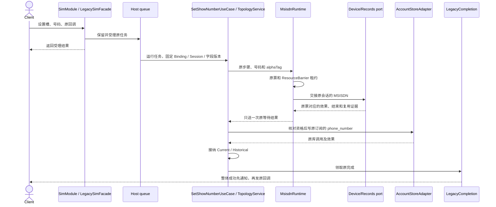
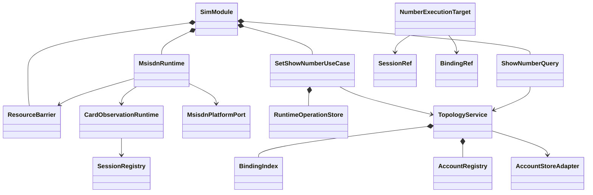

# AF-2 M7B SIM 号码开发与调试

## Legacy 契约

| 原入口或步骤 | 实际行为 |
|---|---|
| `CoreServiceSim::{Set,Get}ShowNumber` | 依次检查系统应用、SET/GET 权限、Manager 与原回调、槽能力，再受理任务。入口成功表示受理。任务按槽调用 Manager，设置回调传一个整数，查询回调仅在成功时附带 UTF‑16 号码。 |
| `MultiSimController::SetShowNumber` | Manager 检查槽和 Controller。Controller 检查卡存在及 FileManager。alphaTag 读取原卡记录。通过 SimFileManager 写原 MSISDN，false 转为原 `TELEPHONY_ERR_FAIL`，不进入 Provider。 |
| `SimFile::UpdateMsisdnNumber` | 写 MSISDN 的第 1 条记录，SimFile 选择 EXT5，由卡型对应的 FileController 路由。DiallingNumbersHandler 取记录长度，再编码并写记录。原等待为 1 秒，失败响应唤醒但不将成功标志置真。成功结果根据共享暂存值更新卡视图。GSM 和 USIM 共享 SimFile、使用不同 FileController。RUIM 与 ISIM 的 File 类未覆盖该写方法，继承返回 false。 |
| `SetShowNumberToDB` | 卡成功后才重新从槽解析 `simId`，在普通 SIM URI 上以 `sim_id` 匹配，写 `phone_number`。Provider 原 −1 映射数据库写失败。接纳 Current 后更新 Historical，历史位置失败可留下部分结果。只有整体成功才通知账户观察者，然后交付原回调。 |
| `GetShowNumber`、`GetSimTelephoneNumber` | 卡 MSISDN 缓存 → 账户展示号码 → IMS IMPU。卡值或 IMPU 非空且不同于账户时，向后台队列提交独立写库。Legacy 闭包只捕获槽与号码，在写库时解析账户。IMPU 客户端存在时，内部调用状态不直接成为兼容返回，空号码仍可成功。 |

[Core 入口](../../../../services/core/src/core_service_sim.cpp#L564) ·
[Manager](../../../../services/sim/src/sim_manager.cpp#L487) ·
[Controller](../../../../services/sim/src/multi_sim_controller.cpp#L1731) ·
[FileManager](../../../../services/sim/src/sim_file_manager.cpp#L357) ·
[SimFile 原写及等待](../../../../services/sim/src/sim_file.cpp#L150)

## Target Host 对象与流程

`SimModule` 装配相同的 M2 实时卡观察、T 的 `AccountRegistry` 和 `BindingIndex`。
C 保留原回调，H 跟踪已接纳队列任务与结果入口的调用寿命。T 在执行点获取
`NumberExecutionTarget`，保存持久 ID、Binding、原 Session 和两份号码字段版本。
R 的 `MsisdnRuntime` 以原 `StepRef`、Session 和资源 fence 登记一次实际交接。
原票由装配端发给设备适配，业务调用者只传槽、号码和原回调。资源键和原卡型协议由已装配
的设备/Records 边界提供。Host 可替换这个边界，R 的原票、屏障和收据仍执行真实代码。





已确认的卡效果与数据库效果独立，数据库失败保持原卡结果。同步早到的证据等待
`SubmitNumberWrite` 返回，再由 R 依序接纳。未知、通道未结束或复用证据不足会保留物理
责任。精确晚证据只结清原责任，可以更新仍有效的原卡记录。已结束的旧请求不会再经过
账户写入或成功回调。T 借用 M6 的字段准入及原效果核对，卡写后的存储作为关联子步骤，
查询回写作为独立请求。普通同值读没有因果证据。Stop 拒绝新工作，已排队、在途卡效果和
Provider 未决分别由原生命周期账目保活。

## 兼容及产品待决

G3b 的任务执行点固定以及查询独立回写的目标固定有意提前于 Legacy 写库时的槽解析。
Host 实际替换卡后，旧请求不写后继账户，旧库或卡证据只结原票。Legacy 的源码可证重新
解析，当前未在真实 Legacy 落库路径复现这一换卡交错。产品裁决继续待定。设备桥须
实证负责每种卡型的 EF 协议、原 Session 路由、原 1 秒等待计时、真实结束和复用证据，
并在实际 Records 写点防止跨会话接纳。Host 已执行该窄端口及核心 R，产品装配和实际
RIL/HDI 验收继续按原门禁。Provider 原证据和产品切换也保留原门禁。

[M6 未知 ICCID 标签和 M7A 空 Binding IMS](M7A_Ims_Preference_Debug.md#独立兼容差异)
继续作为独立待决项。本切片无产品启用授权。

## Developer 用例与实际断点

```bash
TEST=telephony_core_service/services/multisim/test
python3 -B "$TEST/scripts/test.py" run --backend target --debug-build \
  --out /tmp/multisim-m7b-dev --output /tmp/multisim-m7b-dev-results \
  --filter AF2ShowNumber.LiveCardNumberWriteUpdatesAccountAndCompletes
lldb /tmp/multisim-m7b-dev/debug/build/sim_test_target_host
```

输入 `run --gtest_filter=AF2ShowNumber.LiveCardNumberWriteUpdatesAccountAndCompletes`。
按下列位置断点，用 `thread step-over` 观察原数据。用例以实时观察发现两卡后从正式入口送入
`123+456`，Device 只提供关联的原外部证据。

| 位置 | 实际观察 |
|---|---|
| [入口与受理](../../infrastructure/assembly/sim_module_factory.cpp#L128) → [执行点](../../account/number/set_show_number_use_case.cpp#L26) | 槽 1、原回调 31，执行点才定位账户 |
| [绑定与原票](../../account/topology_metadata.cpp#L89) → [原 Step](../../account/number/set_show_number_use_case.cpp#L45) | 持久订阅 41、会话代次 1、原 T 步骤 1，Current/Historical 号码版本均为 0 |
| [R 交接](../../card/runtime/msisdn_runtime.cpp#L50) → [原证据](../../card/runtime/msisdn_runtime.cpp#L72) | fence 1，原会话与请求步骤对应 |
| [T 接纳](../../account/number/set_show_number_use_case.cpp#L51) → [Provider](../../account/account_store_adapter.cpp#L33) | 原卡效果 ConfirmedApplied，写入持久订阅 41 的 `phone_number` |
| [字段接纳](../../account/account_registry.cpp#L162) → [完成](../../infrastructure/compatibility/events/legacy_completion.cpp#L66) | 原字段版本为 0，真实 Current/Historical 接纳成功，原返回 0 |
| [Stop](../../infrastructure/assembly/sim_module_factory.cpp#L352) → [销毁](../../infrastructure/assembly/sim_module_factory.cpp#L459) | 在途数 0，实际进入 `delete`，进程退出 0 |

VS Code GUI 为人工未验收。[验证和原始 LLDB 日志](evidence/af2_m7b_20261125/README.md)

## 修改范围及后续接线

目标源码新增 2 个 R 文件，修改 25 个既有文件，含模块 GN，增加 651 行、删除 85 行。
变化集中在 T 号码执行与资料写点、R 的窄执行组件、H/C 的异步入口。A 无业务改动。
仍使用一套 T 账户投影、R 会话、H 屏障、字段原操作和生命周期。没有新增 Owner 或角色
缓存，也没有增加逻辑 GN 依赖边。真实缺口位于外部设备桥的会话与结束取证，以及在产品
Records 写点执行原会话准入。后续接入原生 EF 时，应将这条窄执行链作为 CardRuntime 的
号码切片接线，保持原生 Provider、RIL 和 Core 的生产切换门禁。
