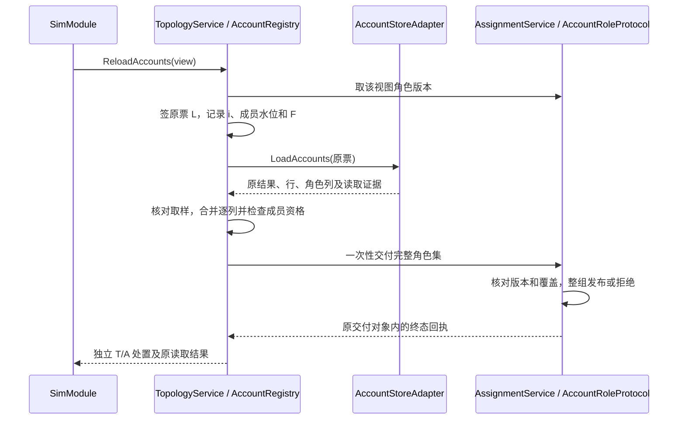

# AF-2 M8 账户加载和 Reload 调试

## 从空模块恢复账户

通过 `CreateCoreSimModule` 创建空模块后，分别调用
`SimModule::ReloadAccounts(AccountReadView::Current)` 和
`SimModule::ReloadAccounts(AccountReadView::Historical)`。
`ReadAccount(id, view)` 和 `ReadStoredAccountRoles(id, view)` 读取各自 Owner 已接纳的投影。
业务可独立重试失败的视图，每次重试签新票。

Legacy 的 Current 来自 `QueryAllValidData`，使用 `slot_index > -1`。Historical 来自
`QueryAllData`，使用全量谓词。控制器仅在查询成功时替换旧视图，两个失败重试预算独立。
`ReloadResult` 分开返回旧整数、旧布尔契约、T 处置和 A 回执。Host Store 以
`complete` 表明同次查询完整结束。空的完整谓词结果与失败、截断的结果意义不同。
[Legacy 查询](../../../sim/src/sim_rdb_helper.cpp#L465) · [Legacy 控制器](../../../sim/src/multi_sim_controller.cpp#L742)

加载的 Provider 位置字段仅进入账户投影。只有实时卡观察发起 Session 和 Binding。
Provider 中的主卡和数据列进入 A 的 Current/Historical 角色投影。参数事实仍由原
Primary/Data 业务维护。CD-01～03 的标签、IMS Preference 和号码入口照常独立回归。
[已批准行为](../../../../docs/AF2_Compatibility_Decisions_Approved_20261126.md)

## 原读取和两个提交点



`AccountReloadTicket` 固定实例与视图下的 attempt、成员水位、账户身份和字段版本。
T 用成员事件和连续存在段判断删除及 ABA，使用退休版本防止新投影复用旧字段资格。
正在执行或等待归因的写阻挡涉及的字段。确认写和已接纳读取的下界随对应事实保留。
认证读取位置由配置的 Store 提供，数值仅在相同世系和声明范围内比较。
注册了写入保护但缺少位置时，该键不能靠普通读图像替换。无关列仍可独立推进。
同一已接纳读位置回传不同字段值时保留原值。`ReloadResult.accounts.rows` 以账户标识
返回成员处置和掩码，分别表示已接纳、列无效、原写未决、覆盖不足及本地资格变化。

T 检查账户和角色行的身份集合一一对应。A 准备完整角色候选，用自身版本及来源
下界复核，在本域领取一次性交付资格。更晚的同视图票、发现提交或 Stop 可以
先撤回。回执保存在原交付对象中，重取该状态无需再次盖章。H 的原调用保活跨越
Store 退出和同步的 T/A 交付。静态保护下界与 tombstone 不影响最终排空。

## 组合用例和断点

```bash
T=telephony_core_service/services/multisim/test
python3 -B "$T/scripts/test.py" run --backend target --out /tmp/af2-m8-developer \
  --filter AF2Reload.LiveAccountsAndRolesSurviveStaleReload
```

现有 Developer 和 Verify 配置按 [Host 使用说明](Host_Usage.md) 分开使用。样例使用
SIM ID 40、41，槽 0、1。持久账户初始名为 `Stored A`，设置入口确认 `New A` 后，
滞后图像只允许无冲突号码变为 `200`。后继图像可将名称更新为 `Later A`，
并刷新已证角色列。再读较旧图像时，较新的已确认值保持。Primary/Data 的参数和
实时 Binding 版本保持原样。

| 断点 | 观察 |
| --- | --- |
| [`SimModule::ReloadAccounts`](../../infrastructure/assembly/sim_module_factory.cpp#L104) | `view`、H 准入和模块保活 |
| [`TopologyService::PrepareAccountReload`](../../account/topology_service.cpp#L467) | 独立视图、票号、成员水位及 A 版本 |
| [`AccountStoreAdapter::LoadAccounts`](../../account/account_store_adapter.cpp#L68) | 实际 Store 调用的 `request` |
| [`TopologyService::AcceptAccountReload`](../../account/topology_service.cpp#L496) | 原视图、行及 `loaded.image` |
| [`AccountRegistry::AcceptReload`](../../account/account_registry.cpp#L416) 和 [`AcceptReloadProjection`](../../account/account_registry.cpp#L297) | `ticket.attempt`、`membershipWatermark`、账户 40、`allowedFields` |
| [`AssignmentService::AcceptReloadedRoleProjectionSet`](../../role_assignment/assignment_service.cpp#L1167) | `delivery.attempt`、原视图和原覆盖位置 |
| [`SimModule::StopAcceptingAndDrain`](../../infrastructure/assembly/sim_module_factory.cpp#L365) 与 `sim_module_factory.cpp` 中的删除行 | 调用计数、对象销毁及进程退出 |

本批修改 17 个既存目标 C++ 源码／表头和 1 个 GN 文件，新增目标源码 0 个。
相对输入增加 625 行、删除 130 行（含 GN）。变更涉及 account、role_assignment 和
infrastructure。新增 GN 边是 `topology_types` 引用 `sim_values`，架构检查验证无环。
保护前驱接在 M2 发现、M5 角色持久写和 M6～M7B 共用的字段接纳及原效果核对处。

新增代码继续复用 T 的 AccountRegistry/BindingIndex，A 的 AccountRoleProtocol 与
AssignmentService，以及 H 的 ModuleCall。两阶段候选是提交前临时值。永久新增状态
只记录字段／成员保护和原角色交付所需元数据。没有引入新 Owner 或修改 Legacy 装配。
下一业务切片应在原业务事实接纳点维护实际影响范围，并保持储存动作和绑定身份分开。

产品 Provider 的因果覆盖、归因、调用者适配、Core/SA/IPC、原生设备、卸载和写权仍由
各自门禁验收。VS Code GUI 保持人工未验收。
