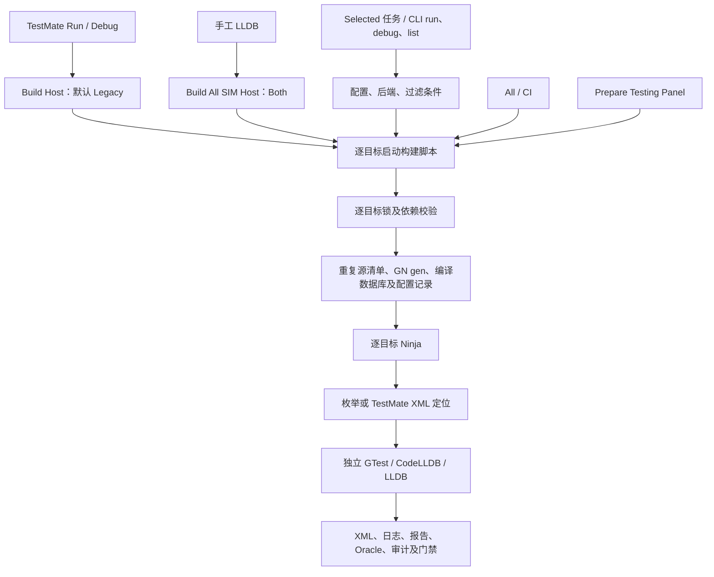
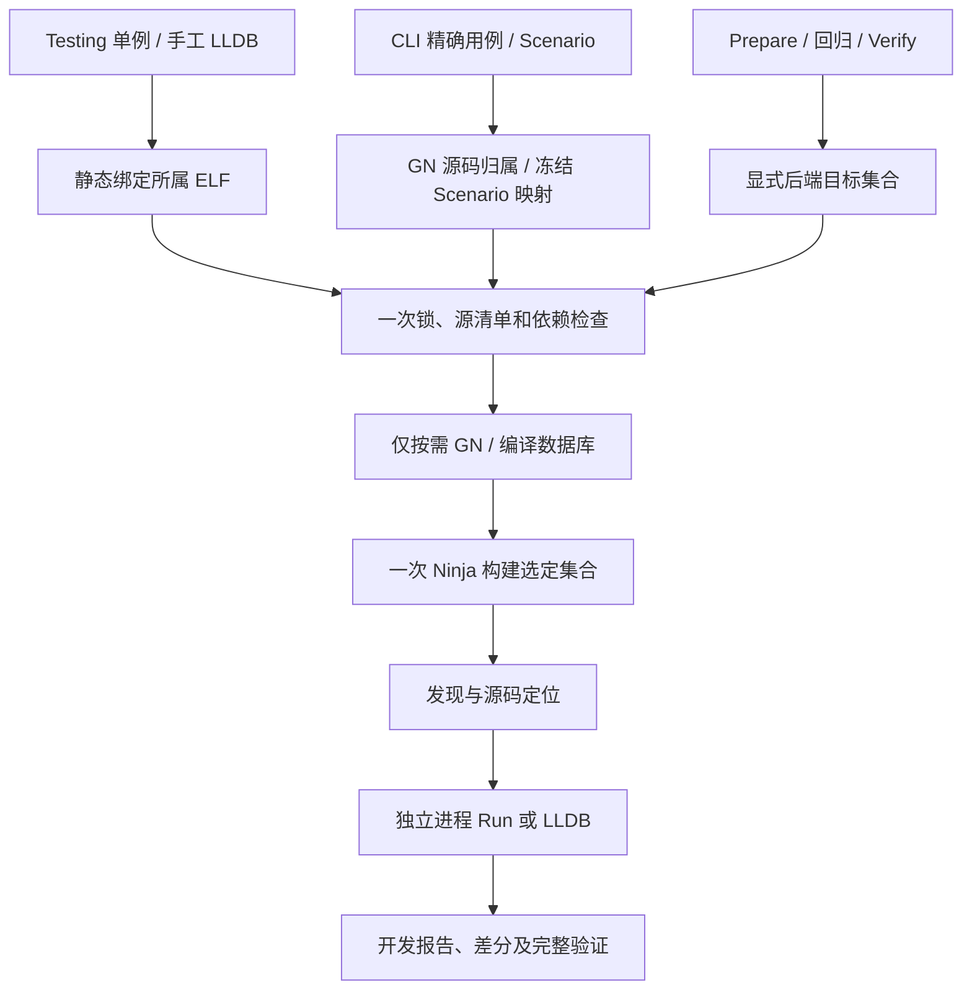

# SIM Host 开发效率专项报告

## 基线与耗时定位

输入为本地与远端 main 的 `a3f94033cb66202f22ae2393b9611b58de51e1f1`，含 M3 实现 `e86d2fcf8`。工作区有两个用户未跟踪文件 `default.profraw`、`opencode.json`。AF-2 M3 验收证据单独保留在原目录。

仓库及默认构建输出位于 WSL 的 Windows E 盘 `9p/DrvFS`。验证也使用 WSL ext4 输出。CPU 亲和范围为 8 个逻辑 CPU，内存 7.7 GiB，常规 Ninja 并发为 3，可用 `--jobs` 调整。测试时 clangd 后台负载、Windows 主机磁盘吞吐及历史 GUI 秒表没有同时采样。

一轮常规 Legacy CLI 检查耗时 379.017 秒。七个目标分别执行 GN/Ninja，真实 Primary 切片的 Ninja 单次耗时 343.25 秒，包含 3 个 CPP 编译和 1 次链接。剩余时间包含其他切片、枚举、依赖准备和完整证据哈希。旧任务会重复执行这些阶段，即使源清单和编译数据库内容相同。379 秒样本与此前用户报告的 9 分钟来自不同的运行记录。此前 GUI 各阶段的精确耗时仍无原始记录。

真实 C0 日志记录初始化接纳时 3 个 `SimStateHandle` 的约 180 秒事件和 1 个 `RadioProtocolController` 的约 10 秒事件。常规通过样本在清理入口的通用队列及账户观察队列均为 pending=0、running=0。单激活 10 次均通过。双激活 10 次有 9 次通过，另一次在同时运行多个构建和验证期间出现意外 Radio 发令、请求未结及 3 秒清理屏障失败；进程在 81.618 秒退出，其中清理入口前已用 78.489 秒，3 个 180 秒事件仍未到期。保留该失败并单独跟踪。完整清理和退出计时见[原始证据目录](evidence/sim_host_efficiency_20261124/)。

## 执行路径

### 优化前

旧 TestMate Run 和 Debug 均先执行各配置的 `runTask.before`。两组配置绑定默认 Legacy 构建，Target 可以读到旧 ELF。旧 CLI 在已存在 ELF 时仍受 `build_if_missing=true` 控制，每个候选先构建，再决定过滤器是否匹配。匹配后执行子进程再次枚举。Prepare 最后额外运行 Editor XML 检查。手工 LLDB 从启动配置选择 ELF，同时构建八个目标。旧 `Run All Tests` 默认 Legacy，发布政策与历史覆盖清单也以 Legacy 为准。

### 优化后

| 入口 | 后端和目标 | 发现、运行与报告 |
| --- | --- | --- |
| Testing Run / Debug | 每个 ELF 对应一个静态目标任务 | TestMate XML 枚举、单例精确过滤、独立 profile。Debug 由 CodeLLDB 启动 |
| Run Selected Test / CLI run | 显式目标或从普通 GoogleTest 声明与 GN 归属推导 | CLI 枚举一次后直接把清单交给进程 runner，保存 XML 和日志 |
| Debug Selected Test / CLI debug | 与 Run 共用选择 | LLDB 批处理验证断点、记录调用栈和首停耗时 |
| 手工 CodeLLDB | Legacy 双激活 C0，或独立 Target step-through 目标 | 精确过滤器和运行模型随启动配置传入 |
| Prepare Testing Panel | 一次构建所选后端，VS Code 使用 Both | 每个程序执行框架识别及带文件、行号的 XML 枚举 |
| Both | 由当前能力矩阵映射，两套实现分别运行 | 在冻结双激活前提下验证共有业务事实及 Oracle，未支持场景传播状态 |
| Verify / CI | Legacy 原准入入口，Target 独立验证 | 内容哈希、业务回归、实际链接与执行审计，以及适用的完整质量门禁 |

## 实现决策

- `build_replacement.py` 在一次交易中处理同配置目标。依赖签名使用全量内容校验后的文件身份、依赖根、锁内容和构建参数。快速构建发现身份变化后重新读内容校验。Prepare、标准 Verify/CI、独立脚本默认和双后端运行执行内容校验。丢失缓存可重建。
- `update_case_sources.py` 每个普通 CPP 只分类一次，内容变化才原子发布源清单。当前 GN 参数和 GN 生成项的依赖保持一致时，Ninja 直接使用已有图。统一入口只启动一次 Ninja，并记录 CXX、链接及生成计数。
- `test.py` 优先接受已知 ELF/target。精确名称用当前 GN 对象与测试声明缩小范围，最终由 GoogleTest 验证。参数化用例保留真实实例名。不能从声明推导时回到选定后端的构建与枚举。发现同一后端内同名选择，或自动路由跨后端同名，要求明确目标。
- `run_gtest.py`、`debug.py`、`check_editor.py` 复用发现结果和 Host 进程环境。确切单例的开发报告省去全仓源码内容哈希，`--full-evidence` 可启用完整证据。普通 GTest 日志和 XML 始终保留。CLI 构建和执行间复核 ELF 身份，运行中的 ELF 使用共享锁。链接成功后原子发布，Mutation 使用独立输出。
- VS Code 配置保留每例独立进程、串行限制和 `@doc`。TestMate 4.27.1 安装代码确认任务非零会中止 Run/Debug，GoogleTest XML 缓存依发现配置及 ELF mtime 判定。当前使用静态任务名。Target step-through 的 `-O0`、DWARF、no-LTO 输出独立于正常验收构建。
- Legacy 默认 single-active，冻结双激活场景显式选择 dual-active-primary0，Target 使用自有装配。冻结 C0 仍映射到 `TargetPrimary.C0AssignmentServiceAlreadyPrimary`；正式 M3 单例独立覆盖 `SimModule`。

[TestMate per-executable 前置任务](https://github.com/matepek/vscode-catch2-test-adapter/blob/master/documents/configuration/test.advancedExecutables.md) · [TestMate 缓存与调试配置](https://marketplace.visualstudio.com/items?itemName=matepek.vscode-catch2-test-adapter)

## 调试启动

同一 Target ELF 打开外部符号查询时曾测到 85.375 秒至正式主卡入口。关闭外部查找后，直接 LLDB 取样 0.52 秒命中，保留本机 DWARF。新版批处理 Target 10 次首停约 0.71–1.05 秒。TestMate 和手工 CodeLLDB 启动配置应用同一 LLDB 设置。Legacy 双激活断点及 Target 无优化单步均保存源码帧和原业务退出结果。[LLDB 原始取样](evidence/sim_host_efficiency_20261124/debug-timings.json)

## 验证状态

Legacy C0 与 Target 正式 M3 的首轮 CLI 定点运行已通过，均只构建所属目标，各枚举一次。完整统计及门禁结果随本专项验证更新。

## 最短 VS Code 操作

在 Remote-WSL 打开仓库，首次运行 **Prepare Testing Panel**。打开测试 CPP，在 Testing 面板选所属 ELF 的用例，点击 **Run** 或设断点后点击 **Debug Test**。检查新增用例时，构建所属后端后刷新列表，使用 `@doc` 检查文件定位。两个 C0 模型及精确断点见[主卡调试](M3_Primary_Debug.md)。完整任务范围见[Host 使用说明](Host_Usage.md)。

GUI 交互在本环境未实测。CLI、真实 ELF 构建、源码位置、LLDB 和源日志分别记录。Host 证据对应 AF-2 M3 Host 实现，产品构建、SA/IPC、设备和生产迁移沿用原验收边界。
