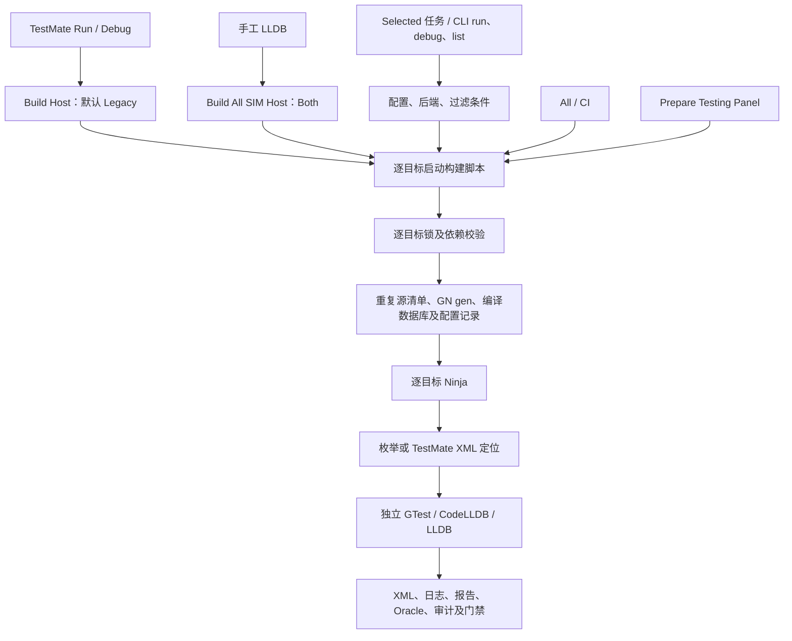
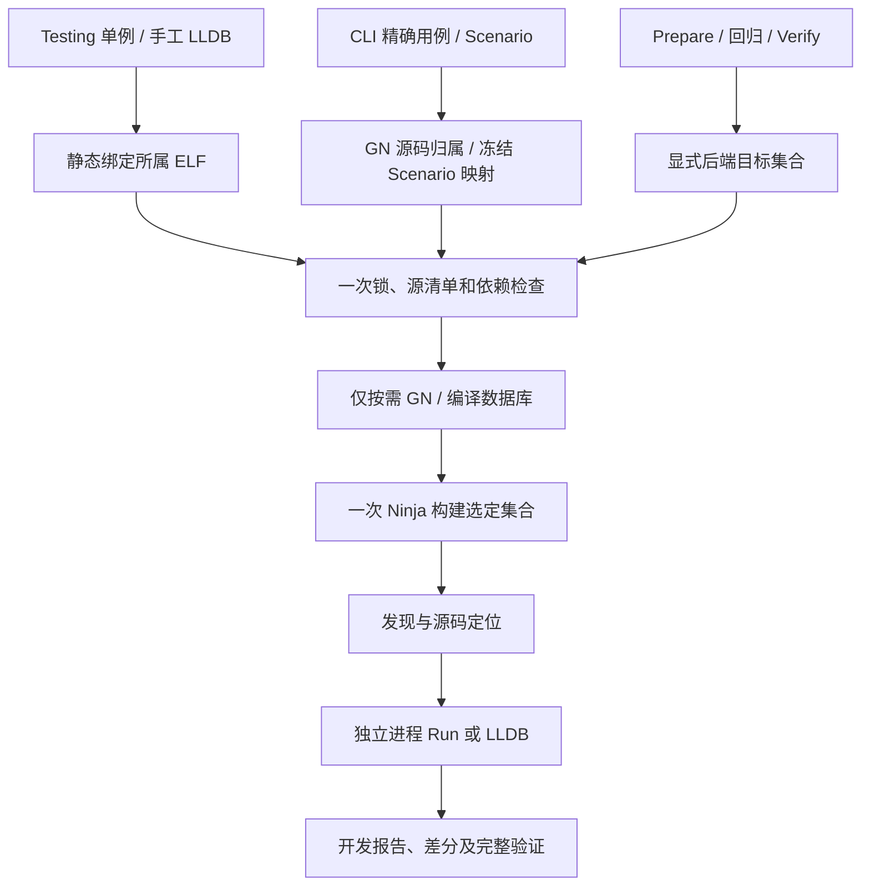

# SIM Host 开发效率专项报告

## 基线与耗时定位

输入为本地与远端 main 的 `a3f94033cb66202f22ae2393b9611b58de51e1f1`，含 M3 实现 `e86d2fcf8`。工作区有两个用户未跟踪文件 `default.profraw`、`opencode.json`。AF-2 M3 验收证据单独保留在原目录。

仓库及默认构建输出位于 WSL 的 Windows E 盘 `9p/DrvFS`。验证也使用 WSL ext4 输出。CPU 亲和范围为 8 个逻辑 CPU，内存 7.7 GiB，常规 Ninja 并发为 3，可用 `--jobs` 调整。测试时 clangd 后台负载、Windows 主机磁盘吞吐及历史 GUI 秒表没有同时采样。

一轮常规 Legacy CLI 检查耗时 379.017 秒。七个目标分别执行 GN/Ninja，真实 Primary 切片的 Ninja 单次耗时 343.25 秒，包含 3 个 CPP 编译和 1 次链接。剩余时间包含其他切片、枚举、依赖准备和完整证据哈希。旧任务会重复执行这些阶段，即使源清单和编译数据库内容相同。379 秒样本与此前用户报告的 9 分钟来自不同的运行记录。此前 GUI 各阶段的精确耗时仍无原始记录。

真实 C0 日志记录初始化接纳时 3 个 `SimStateHandle` 的约 180 秒事件和 1 个 `RadioProtocolController` 的约 10 秒事件。常规通过样本在清理入口的通用队列及账户观察队列均为 pending=0、running=0。单激活 10 次均通过。双激活 10 次有 9 次通过，另一次在同时运行多个构建和验证期间出现意外 Radio 发令、请求未结及 3 秒清理屏障失败；进程在 81.618 秒退出，其中清理入口前已用 78.489 秒，3 个 180 秒事件仍未到期。保留该失败并单独跟踪。完整清理和退出计时见[原始证据目录](evidence/sim_host_efficiency_20261124/)。

## 执行路径

### 优化前

旧 TestMate Run 和 Debug 均先执行各配置的 `runTask.before`。两组配置绑定默认 Legacy 构建，Target 可以读到旧 ELF。旧 CLI 在已存在 ELF 时仍受 `build_if_missing=true` 控制，每个候选先构建，再决定过滤器是否匹配。匹配后执行子进程再次枚举。Prepare 最后额外运行 Editor XML 检查。手工 LLDB 从启动配置选择 ELF，同时构建八个目标。旧 `Run All Tests` 默认 Legacy，发布政策与历史覆盖清单也以 Legacy 为准。

### 优化后

| 入口 | 后端和目标 | 发现、运行与报告 |
| --- | --- | --- |
| Testing Run / Debug | 每个 ELF 对应一个静态目标任务 | TestMate XML 枚举、单例精确过滤、独立 profile。Debug 由 CodeLLDB 启动 |
| Run Selected Test / CLI run | 显式目标或从普通 GoogleTest 声明与 GN 归属推导 | CLI 枚举一次后直接把清单交给进程 runner，保存 XML 和日志 |
| Debug Selected Test / CLI debug | 与 Run 共用选择 | LLDB 批处理验证断点、记录调用栈和首停耗时 |
| 手工 CodeLLDB | Legacy 双激活 C0，或独立 Target step-through 目标 | 精确过滤器和运行模型随启动配置传入 |
| Prepare Testing Panel | 一次构建所选后端，VS Code 使用 Both | 每个程序执行框架识别及带文件、行号的 XML 枚举 |
| Both | 由当前能力矩阵映射，两套实现分别运行 | 在冻结双激活前提下验证共有业务事实及 Oracle，未支持场景传播状态 |
| Verify / CI | Legacy 原准入入口，Target 独立验证 | 内容哈希、业务回归、实际链接与执行审计，以及适用的完整质量门禁 |

## 实现决策

- `build_replacement.py` 在一次交易中处理同配置目标。依赖签名使用全量内容校验后的文件身份、依赖根、锁内容和构建参数。快速构建发现身份变化后重新读内容校验。Prepare、标准 Verify/CI、独立脚本默认和双后端运行执行内容校验。丢失缓存可重建。
- `update_case_sources.py` 每个普通 CPP 只分类一次，内容变化才原子发布源清单。当前 GN 参数和 GN 生成项的依赖保持一致时，Ninja 直接使用已有图。统一入口只启动一次 Ninja，并记录 CXX、链接及生成计数。
- `test.py` 优先接受已知 ELF/target。精确名称用当前 GN 对象与测试声明缩小范围，最终由 GoogleTest 验证。参数化用例保留真实实例名。不能从声明推导时回到选定后端的构建与枚举。发现同一后端内同名选择，或自动路由跨后端同名，要求明确目标。
- `run_gtest.py`、`debug.py`、`check_editor.py` 复用发现结果和 Host 进程环境。确切单例的开发报告省去全仓源码内容哈希，`--full-evidence` 可启用完整证据。普通 GTest 日志和 XML 始终保留。CLI 构建和执行间复核 ELF 身份，运行中的 ELF 使用共享锁。链接成功后原子发布，Mutation 使用独立输出。
- VS Code 配置保留每例独立进程、串行限制和 `@doc`。TestMate 4.27.1 安装代码确认任务非零会中止 Run/Debug，GoogleTest XML 缓存依发现配置及 ELF mtime 判定。当前使用静态任务名。Target step-through 的 `-O0`、DWARF、no-LTO 输出独立于正常验收构建。
- Legacy 默认 single-active，冻结双激活场景显式选择 dual-active-primary0，Target 使用自有装配。冻结 C0 仍映射到 `TargetPrimary.C0AssignmentServiceAlreadyPrimary`；正式 M3 单例独立覆盖 `SimModule`。

[TestMate per-executable 前置任务](https://github.com/matepek/vscode-catch2-test-adapter/blob/master/documents/configuration/test.advancedExecutables.md) · [TestMate 缓存与调试配置](https://marketplace.visualstudio.com/items?itemName=matepek.vscode-catch2-test-adapter)

## 调试启动

同一 Target ELF 打开外部符号查询时曾测到 85.375 秒至正式主卡入口。关闭外部查找后，直接 LLDB 取样 0.52 秒命中，保留本机 DWARF。新版批处理 Target 首停 10 次，最小 0.709 秒、中位数 0.909 秒、P90 1.022 秒、最大 1.048 秒。TestMate 和手工 CodeLLDB 启动配置应用同一 LLDB 设置。Legacy 双激活断点及 Target 无优化单步均保存源码帧和原业务退出结果。[LLDB 原始取样](evidence/sim_host_efficiency_20261124/debug-timings.json)

## 性能对比

以下为同一 WSL 机器、对应同一用例与初始化模型的连续取样，单位为秒。Legacy ext4 前值以原 `a3f94033c` 脚本在同一个已预热的输出上重放，后值沿用该输出。Target 两次都使用同一 ext4 输出。每行 10 次，P90 取排序后的第 9 个样本。收集期间有其它验证任务，锁及实际编译次数用于识别异常值。原始 `before/legacy` 和 `before-ext4/legacy` 的部分轮次跨越了脚本切换，仅用于保留过程及首次定位。下表的 Legacy 前值使用独立的冻结脚本重放。 [逐次原始数据](evidence/sim_host_efficiency_20261124/bench-samples.json)

| 场景 | 最小 | 中位数 | P90 | 最大 | 目标/GN/Ninja/枚举 |
| --- | ---: | ---: | ---: | ---: | --- |
| Legacy ext4，旧 CLI | 32.090 | 39.596 | 43.182 | 43.974 | 7 / 7 / 7 / 8 |
| Legacy ext4，新 CLI | 2.353 | 4.149 | 4.264 | 4.273 | 1 / 0 / 1 / 1 |
| Legacy 默认 DrvFS，新 CLI | 3.874 | 5.248 | 11.109 | 15.426 | 1 / 0 / 1 / 1 |
| Target ext4，旧 CLI | 16.781 | 23.848 | 25.824 | 26.665 | 1 / 1 / 1 / 2 |
| Target ext4，新 CLI | 2.340 | 3.225 | 3.510 | 30.885 | 1 / 0 / 1 / 1 |
| Legacy ext4，旧脚本时期 ELF 直接运行 | 0.019 | 0.021 | 0.022 | 0.022 | 0 / 0 / 0 / 0 |
| Legacy ext4，新 ELF 直接运行 | 0.020 | 0.022 | 0.022 | 0.023 | 0 / 0 / 0 / 0 |
| Legacy 默认 DrvFS，新 ELF 直接运行 | 0.022 | 0.116 | 0.124 | 0.126 | 0 / 0 / 0 / 0 |
| Target ext4，旧 ELF 直接运行 | 0.004 | 0.005 | 0.005 | 0.005 | 0 / 0 / 0 / 0 |
| Target ext4，新 ELF 直接运行 | 0.003 | 0.003 | 0.004 | 0.004 | 0 / 0 / 0 / 0 |
| TestMate 旧 Legacy 前置任务，CLI 等价调用 | 11.146 | 15.762 | 16.647 | 18.915 | 7 / 7 / 7 / 0 |
| TestMate 新 Legacy 前置任务，CLI 等价调用 | 2.166 | 2.361 | 3.426 | 4.227 | 1 / 0 / 1 / 0 |

热运行 CLI 的 CXX 和链接次数均为 0。Legacy ext4 CLI 中位数约下降 90%，Target 约下降 86%。Target 新 CLI 最大值包含 25.27 秒构建锁等待，Legacy DrvFS 前两轮也各有超过 4 秒的等待。表中直接运行包含进程启动、测试、清理、profile 写入及退出。当前样本的 CLI 中位数仍超过 2 秒。前置任务的 CLI 等价调用只计构建，VS Code GUI 3 秒目标未测。

旧路径的 379.017 秒含三次 CXX、一次真实切片链接及其它目标准备，与热运行分开。新 Target 无优化调试目录的[首次构建](evidence/sim_host_efficiency_20261124/target-step-through-first-build.json)含 28 次 CXX 和 1 次链接，Ninja 用时 164.979 秒，整次持锁 167.390 秒。后续单目标构建复用该目录。普通源文件改动的实际 CXX 与链接耗时见下表，完整 LTO 下的单 CPP 场景仍有超过 10 秒的样本。

本机 `/mnt/c`、`/mnt/d` 也是 9p 挂载，源码实测位置为 `/mnt/e`。`/tmp` 是 ext4。默认构建目录内有 clangd 磁盘索引，热构建复用编译数据库。曾采样到 I/O PSI 的 full avg10=0.31，未作 GUI/clangd 活动的同步归因。依赖负控中 GoogleTest 内容校验约 0.06 秒，热身份检查约 0.003 秒。平台声明、OpenSSL、Native Runtime 及锁、源码清单和各子进程分别计时，原始数值随构建记录保存。完整证据生成在 Legacy Primary 全量试验中实测耗时 21.31 秒，Target 全量 21.97 秒。一个 Legacy 开发单例的对应阶段实测约 0.053 秒。 [依赖检查原始数据](evidence/sim_host_efficiency_20261124/dependency-controls.json)

## 增量与负控

| 改动或故障 | 当前实际结果 |
| --- | --- |
| 源码无变化 | PASS，退出 0，2.16 秒，GN 0 次，CXX 0 次，链接 0 次。 |
| Target 测试 CPP 改动 | PASS，退出 0，78.17 秒，GN 0 次，CXX 1 次，链接 1 次。 |
| Target 生产 CPP 改动 | PASS，退出 0，46.91 秒，GN 0 次，CXX 1 次，链接 1 次。 |
| Legacy Controller CPP 改动 | 同输出的 TestMate 前置任务等价调用先取得构建锁，1 次 CXX、1 次链接，234.92 秒。CLI 等锁 231.74 秒，随后使用更新的 ELF 运行 C0 并通过。恢复原 CPP 后再次实际编译及链接，Ninja 227.14 秒。 |
| Target 装配公共头改动 | PASS，退出 0，56.88 秒，GN 0 次，CXX 2 次，链接 1 次。 |
| GNI 改动 | PASS，退出 0，1.91 秒，GN 1 次，CXX 0 次，链接 0 次。 |
| Target CPP 编译负控 | FAIL，退出 1，7.10 秒，GN 0 次，CXX 1 次，链接 0 次。 |
| 恢复正确源码 | PASS，退出 0，52.08 秒，GN 0 次，CXX 1 次，链接 1 次。 |
| 新增普通 CPP 及用例 | PASS，退出 0，65.76 秒，GN 1 次，CXX 1 次，链接 1 次。 |
| 删除普通 CPP 后查询原用例 | UNSUPPORTED，退出 2，58.63 秒，GN 1 次，CXX 0 次，链接 1 次。 |
| 同一输出先 Legacy | PASS，退出 0，2.76 秒，GN 0 次，CXX 0 次，链接 0 次。 |
| 同一输出再 Target | PASS，退出 0，53.53 秒，GN 0 次，CXX 3 次，链接 1 次。 |
| Target 查询仅 Legacy 的用例 | BLOCKED，退出 2，1.54 秒，GN 0 次，CXX 0 次，链接 0 次。 |
| 两个同配置构建之一 | PASS，退出 0，1.37 秒，GN 1 次，CXX 0 次，链接 0 次，构建锁等待 0.000 秒。 |
| 两个同配置构建之二 | PASS，退出 0，2.17 秒，GN 0 次，CXX 0 次，链接 0 次，构建锁等待 0.840 秒。 |
| 已准备输出缺失 ELF | PASS，退出 0，12.75 秒，GN 1 次，CXX 3 次，链接 1 次。 |

各 CPP 和头文件的验证改动均为短期标记，已逐字恢复。固定依赖缓存损坏后重新验证。复制的 GoogleTest 头内容改变且保留原 mtime 时，快速构建仍检出并在 Ninja 前失败。编译负控保留失败进程状态及用例列表，已构建产物未被拿来执行。已对 Target 的临时 TEST_F 实际运行、改名并重建，XML 只给出该轮有效名称和行号。移除后按原名搜索退出 2。发现验证保留真实参数化实例名及源码行。 [增量和负控命令与结果](evidence/sim_host_efficiency_20261124/incremental-controls.json)

## 完整质量门禁

| 验证 | 本轮结果 |
| --- | --- |
| Legacy Host 全量及 CI 准入 | 140/140，历史覆盖清单、已解决缺陷策略、能力负控、4 组真实执行审计通过 |
| Target Host 全量 | 124/124，M1 6/6、M2 9/9、M3 7/7，3 组真实执行审计通过 |
| 六个冻结 Scenario 差分 | 两边 12/12，Legacy/Target/Oracle 差异 0 |
| M1/M2/M3 的 ASan / TSan | 各 22/22 |
| 完整性、架构与 GN/Ninja | 历史资产、源码规则、迁移检查、17 个结构检查、5 个声明编译负控、四组规则、97 个语法单元和 GN 对象构建通过 |
| Mutation | READY 与 PUK 两个变异均检出，恢复试验通过，隔离目录中正常 ELF 的 SHA 恢复 |
| Profile Safety | 通过，既有 `default.profraw` 原字节保持 |
| 八个业务 ELF 的测试发现 | 264 个有效文件与行号，Legacy 140、Target 124，覆盖参数化用例 |
| LLDB 业务验证 | Legacy 双激活进入真实 Core/Controller。Target 进入正式主卡、实时卡观察、原证据与 Stop 场景 |
| GUI | 窗口可访问，Windows 前台焦点检查失败，Run、Debug 和刷新未实测 |

正式 Target 主卡单步命中 `SimModule::SetPrimarySlotId`、`AssignmentService::RunTrackedC0`、`AssignmentStoreAdapter::WriteC0Parameter` 和 `LegacyCompletion::CompleteLegacyInt`，保留同一请求逐键凭证、槽号和同步返回。原业务测试继续断言四个参数、Primary/Data 投影、通知和零 Radio 发令。未决效果与 Stop 场景通过原测试断言。双激活直接运行的单次失败保存为独立风险，正式冻结差分及双激活 LLDB 均有各自的 PASS 报告。 [完整门禁原始结果](evidence/sim_host_efficiency_20261124/quality-gates.json) · [Target 主卡单步](evidence/sim_host_efficiency_20261124/target-local-step.log)

## 最短 VS Code 操作

1. 在 Remote-WSL 打开仓库。新输出首次运行 **Prepare Testing Panel**，当前机器的默认输出已准备完成。在 Testing 面板可用 `@doc` 筛选当前文件。
2. 打开 [Legacy 主卡用例](../cases/primary_test.cpp#L4)，在 `sim_primary_slot_real_test` 下运行 `RealSimPrimary.C0CoreToRealManagerAndController`。在 `CoreServiceSim::SetPrimarySlotId` 设断点后点击 **Debug Test**。
3. 打开 [正式 Target 主卡用例](../cases/target/primary/c0_topology_integration_test.cpp#L1342)，在 `sim_test_target_host` 下运行 `AF2Primary.LiveDualSimSetPrimaryThroughLegacyEntry`。在 `SimModule::SetPrimarySlotId` 设断点后点击 **Debug Test**。新增或改名用例后，构建所属后端并刷新 Testing。

冻结双激活模型及逐步观察点见[主卡调试](M3_Primary_Debug.md)。完整任务范围见[Host 使用说明](Host_Usage.md)。

默认 `.host-out` 的 Prepare 已实际通过。构建一次 Ninja，核对 264 个源码位置。Windows 互操作可用，自动化能定位 Remote WSL 项目窗口。前台焦点检查失败，因此未发送按键，也未采集 GUI Run、Debug 或刷新结果。CLI、源码定位和 LLDB 有独立证据。 [默认 Prepare](evidence/sim_host_efficiency_20261124/default-editor-prepare.json) · [GUI 探测](evidence/sim_host_efficiency_20261124/vscode-gui-probe.log)

Host 证据对应 AF-2 M3 Host 实现，产品构建、SA/IPC、设备和生产迁移沿用原验收边界。
