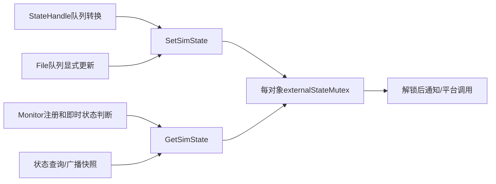
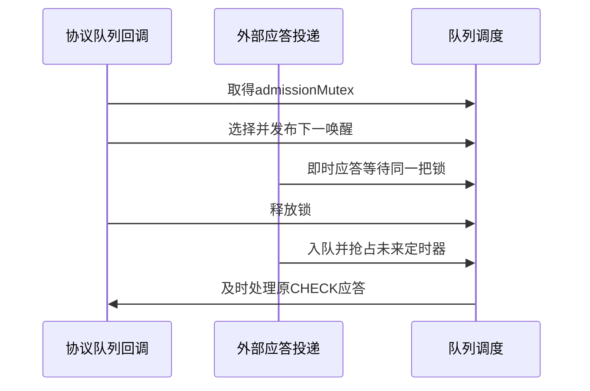

# SIM-028 externalState、队列交接与C1协议同步修复

基线HEAD为`77e3dc4e27dfe33ac728f225843b86b038914f6c`。生产修改只在隔离副本实施。本目录保存本轮增量，不替换历史Stop补丁及历史失败。最终数量、逐例结果、命令和摘要见validation.json及证据归档；以实际退出码为准。

## 最终实测

| 项目 | 最终v4结果 |
| --- | --- |
| 原96条 | 91 PASS / 原5个FAIL，名称/完整断言签名一致 |
| 加5条新回归 | 101条：96 PASS / 同5个FAIL |
| RealSimPrimary / 生命周期 / Pairing / Stop / 新增安全 | 7/7、8/8、4/4、8/8、9/9 |
| ASan / TSan | 各41/41，包含原36及5条新回归 |
| 压力 | 330/330；6组各50次，3个停止阶段各10次，4进程并发 |
| CI策略 / 快照完整性负控 | 13/13；另2/2完整性拒绝验证 |
| 故意fatal ASSERT后的ASan清理 | 原GTest FAIL/exit1保留；对象/严格RIL PASS，无ASan报错，负控验收PASS |
| Host CI / OHOS原生 / 生产发布 | PASS（exit0） / BLOCKED / BLOCKED |

详见[validation.json](validation.json)、[最终普通JUnit](junit-regular.xml)、[ASan](junit-address.xml)、[TSan](junit-thread.xml)、[压力JUnit](junit-pressure.xml)。逐例原始XML/日志在final-ci.zip与pressure.zip；所有历史失败/探索命令及旧两线程栈在diagnostics.zip，中间CI按v1/v2/v3独立归档。source-audit.json列出当前锁点，updated-candidate-files.json列出37生产/18测试、并集51份候选。ASan历史失败和后来通过不能互相覆盖。

## 最小候选与适用边界

在此前`primary_slot/lifecycle/admission/production-minimal.patch`和`test-guard.patch`基础上，按顺序应用本目录的`production-increment-v4.patch`、`test-increment-v4.patch`。前者只改5份既有生产候选文件，后者为独立Host观察/测试增量。`increment-manifest-v4.json`列出旧基线补丁SHA及每份源码的前后SHA。无主工作区生产修改、Git提交或推送。

| 生产文件 | 缺陷与修复 | 正常业务及停止影响 |
| --- | --- | --- |
| services/sim/include/sim_state_handle.h | 增加对象级FFRT状态快照锁，构造时明确UNKNOWN初值 | 内部布局改变，产品须整体重编；不改变公开接口 |
| services/sim/src/sim_state_handle.cpp | 所有状态投影访问经Get/SetSimState；IccState全值复制及全部状态读取也使用同一对象锁 | 锁只包住标量读/写，通知/RIL/平台调用在锁外；不新增队列跳转、状态值或重试策略 |
| utils/common/src/tel_event_queue.cpp | 回调尾部下一次调度也取得既有admissionMutex | 外部入队与下一唤醒快照/发布原子交接；ProcessEvent已结束才加锁，Stop释放该锁后等待任务 |
| services/sim/src/multi_sim_controller.cpp | 为Data通知补既有缓存锁，Main/Data通知使用局部simId快照 | 锁外发布；不改变默认角色/目标槽算法 |
| services/sim/src/radio_protocol_controller.cpp | 协议事件和调用线程统一使用既有radioProtocolMutex；移除3个私有辅助函数的嵌套锁 | 谓词、session、计数器、结果及清理同步；Active-SIM事件仍走原独立ctx/cv，不改45/60秒或5次重试 |

旧生产候选总文件数仍为37，本轮没有扩展生产文件集合。更新后的路径集合和Host诊断交叉项由候选清单记录。`production-increment.patch`是未包含协议修复的中间三文件版本，仅供失败追溯，不是最终推荐补丁；v2加入协议锁后普通CI通过，但压力暴露IccState竞争，亦仅作历史输入。

## 已确认的问题

### 1. externalState_跨队列竞争

历史报告中字段地址为`0x7258000003f0`，位于make_shared<SimStateHandle>分配块`0x725800000300`（672字节）。这是该报告的实例标识；不能把分配块起点冒充对象get()地址。报告在初始化期间中断，不能推算构造完成、Stopped或泄漏。完整分配、线程创建和双侧访问栈保存在证据中。

写方T1经StateHandle队列：GetSimCardData→ProcessIccCardState→SimStateEscape，写方虽持simStateInitMutex，读方没有使用该锁。读方T40经Monitor队列：ProcessEvent→RegisterSimNotify→SimStateManager::RegisterCoreNotify→SimStateHandle::RegisterCoreNotify→IsIccReady/IsIccLocked。不同队列各自串行不建立跨队列happens-before；观察者容器锁也不保护状态字段。修复前100次、4进程并发重复中有3次exit87，其余通过不能否认竞争。

外部File/Records可经IccFile::SetSimState→StateManager→Handle setter更新投影，因此不能假定只有一个写队列。选择局部锁而非volatile或机械atomic。GetSimState、SetSimState是仅存的运行期字段访问点，构造初值在发布前完成；其他路径只调用访问器。



该锁保护公开状态投影，不承诺把CardType、LockReason、ICC记录变成一个新的跨字段快照API。原转换中next-state/reason计算与原通知顺序保留；没有读取旧状态后再写回的加减/CAS操作。`simStateInitMutex → externalStateMutex`单向嵌套，访问器不反向获取初始化锁，也不调用外部代码。Stop不写该字段；既有Root屏障负责结束回调后释放对象，局部锁不替代生命周期所有权。

### 2. 队列交接导致C1应答被推迟

这是在externalState锁已经存在的二进制中独立复现的，不是把两项缺陷混为一谈：

1. 回调尾部SubmitInner选择只剩的45秒定时器。
2. 外部RIL应答在选择与提交之间入队；此时curHandleTime仍是旧任务时间，Submit不重新唤醒。
3. 尾部按旧快照发布45秒任务，即时CHECK应答滞留。
4. 原12秒/24请求断言失败；45秒后才继续，可能先后出现超时及旧session拒绝。

公共队列负控和真实CoreServiceSim→SimManager→MultiSimController→RadioProtocolController的第3会话负控均复现。真实负控同时保留业务FAIL、严格RIL PASS、生命周期PASS。相同交错在加既有入队锁后通过，`producer_inserted_during_handoff`从true变为false，原24请求/6次会话断言保持。



测试观察钩子只存在于独立Host补丁，以条件变量控制间隙；200毫秒用于观察投递是否被事务锁阻塞，不改变生产超时。正常未启用钩子时先走atomic false快路径，不取得全局观察者锁，避免用诊断设施额外串行化队列。无sleep、更改5次预算或直接调用私有业务函数。

### 3. 新超时场景暴露协议完成谓词竞争

真实45秒C1超时测试进一步捕获：RadioProtocolController::ProcessCommunicationResponse写isCommunicating_，调用线程SetRadioProtocol在radioProtocolMutex下读取，回调原来没有同锁。这也使完成通知与后续清理缺少共同临界区。

最终修复仅在协议事件分派取得该锁，覆盖GET/CHECK/UPDATE/NOTIFY/COMPLETE/TIMEOUT，并移除ExecuteUpdateCommunication、ExecuteCompleteCommunication、UpdateRadioProtocol内部的重复锁。这些私有函数只由已持锁的SetRadioProtocol或协议分派调用。调用线程CV等待释放锁，醒来后必须在整段协议回调/清理完成后才能继续。Stop不持此锁等待队列，Active-SIM不被纳入新临界区。

发送RIL命令的临界区沿用既有私有辅助函数/SetRadioProtocol的锁范围。TelRilManager::TaskSchedule实际上直接调用TelRilSim，不能因名称而当成异步调度器；真实应答通过事件队列交付。新增锁内没有用户Observer或Watcher回调。替换RIL实现若同步重入协议查询，将违反这一现有交付前提，须在产品/厂商边界回归，Host不证明任意替身均不可重入。

### 4. 压力暴露IccState快照竞争

v2全套CI通过后，280次TSan重复有5次exit87：RefreshCache后台线程→QueryIccDiallingNumbers→HasSimCard读取iccState_.simStatus_，同时StateHandle队列的ProcessIccCardState执行IccState整值复制。与externalState_竞争是不同地址/字段，不能用首次41/41通过否认。失败、二进制SHA及双线程栈单独归档。

v3在同一既有对象快照锁下复制整个IccState，并保护HasSimCard及卡状态处理路径的全部读取。HasSimCard先复制一次simStatus再解锁，IsEsim调用在锁外；不只给写方加锁，也不把复合IccState改成若干atomic。生产文件集合仍为4份，不重新设计Stop框架。v2的普通CI通过和压力失败分别保留，v3结论以重新构建、全套CI和同口径280次压力为准。

### 5. Data/Primary通知的缓存快照

v3复验的ShutdownContract.ANormalPrimaryThenStop捕获Monitor的GetListFromDataBase在mutex_下clear/替换localCacheInfo_，而主卡切换调用链SendDefaultCellularDataBroadCast未持该锁就读取vector。该路径直接属于SetPrimarySlotId后的Data通知。

v4在既有mutex_下完成空/边界检查、选择simId及更新defaultCellularSimId_，拷贝局部值后解锁发布；主卡通知也使用锁内拷贝的simId，避免解锁后再次读取共享成员。没有锁内外部通知，不改变目标槽/默认角色算法。生产增量增至5份，仍均在原37份候选之内，未重写Stop框架。

## 新测试与ASan复核

新增ConcurrencyRegression场景：公共队列交接、跨队列状态getter/setter、原C1第3会话交接、排队重试期间Stop、真实45秒超时后5次重试。使用真实生产方法，外部RIL/Provider仍为既有明确契约的Host边界。

正常失败重试仍要求24次协议命令、6个会话、失败恢复原参数、12条开始/完成状态通知及无成功MAIN/DATA广播。45秒超时新场景按现有源码验证首会话2条CHECK，之后5次失败CHECK/COMPLETE共22请求、6个会话，并保留超时递增session形成的缺号。首超时路径清空向量后没有可发送的COMPLETE是已有行为，本轮不改写，也不能据此宣称设备协议已经终止。

Host严格Mock位于ITelRilManager边界，尚未进入TelRilSim/HDI创建serial，因此serial明确为NOT_CREATED，不能伪造为sessionId。用例进程/名称、slot、真实协议session/phase及应答所有者建立当前因果关联；真实serial/HDI关联仍需原生层验证。

历史ASan失败因ASSERT返回后先销毁phases，再由场景Stop执行迟到回调。此前测试补丁把记录构造置于场景之前，本轮保留。受控C1业务失败在ASan下仍exit1，但资源和严格RIL为PASS且没有ASan报错；另有`SIM_HOST_INJECT_C1_ASSERT=1`专门触发首次失败后的fatal return，保留原始FAIL XML并单独验收清理，不能计入正常CI通过数。正常CI清除该注入环境变量。

## 重现命令与CI边界

依赖路径由本机实际配置给定，无安装或全局升级。全新输出运行：

```bash
python3 -B telephony_core_service/services/multisim/test/systemtest/tools/ci_sim028.py \
  --out /path/outside/repository/sim028-ci --profile all --jobs 1 \
  --gtest-root "$SIM028_GTEST_ROOT" --openssl-root "$SIM028_OPENSSL_ROOT" \
  --runtime-root "$SIM028_RUNTIME_ROOT" \
  --candidate-increment telephony_core_service/services/multisim/test/systemtest/configs/sim028_concurrency_fix_20261112/production-increment-v4.patch \
  --candidate-increment telephony_core_service/services/multisim/test/systemtest/configs/sim028_concurrency_fix_20261112/test-increment-v4.patch
```

可选`--parallel-profiles`在资源足够时并行。若显式升级已有候选，附加`--advance-candidate`：输出锁内核实旧隔离源码全部SHA未变，在独立新克隆重建新候选后逐文件同步，仅保留未变化源码mtime以复用Ninja；旧isolation/CI档案另存，源码被意外修改则拒绝升级。此操作不更新主生产树，不调整失败容许集。

CI原5条缺陷保留原始FAIL及精确签名；新增用例自动发现执行，crash、空XML、sanitizer报错及构建超时均拒绝准入。三文件中间版本的一轮并发构建曾触发900秒构建看门狗，两档失败如实归档；不是业务断言PASS，也不改写为环境PASS。后续复验降低构建并发并复用经完整核验的增量输出，测试等待期限保持不变。

## 生产准入剩余条件

五文件增量的Host结果、补丁局部审查、原生集成及生产发布分开判定。Core::OnStop接入同一Manager控制块、停止失败保留根、共享RIL其他消费者协调、原生SA/CES注销屏障/失败、Watcher并发和FFRT任务完成语义仍按前轮R01～R10阻塞。没有原生SA/IPC/HDI运行，不能宣称生产发布准入。

本轮一个真实45秒超时后保留原5次重试，不覆盖六轮全部无应答、完整75秒预算失败重试、APN成功配置重试、缓存卡类型矩阵或SO卸载。内部布局与锁前提须匹配OHOS树整体重编并做厂商回归。正常状态查询被局部锁保护不意味着整个旧SIM组件所有共享字段均已消除竞争。

一次未加单用例filter的整包运行被既有入口保护以exit2拒绝，没有XML；原始记录保留，随后改用原框架要求的逐例独立进程，不放宽该保护，也不计作41条业务用例失败或通过。


压力复验入口（必须先完成同一候选的完整CI）：

```bash
python3 -B telephony_core_service/services/multisim/test/systemtest/configs/sim028_concurrency_fix_20261112/verify_pressure.py \
  --ci-out "$SIM028_CI_OUT" --out /path/outside/repository/sim028-pressure \
  --rounds 50 --phase-rounds 10 --parallel 4
```

原5组各50次及3阶段各10次仍保留，另对Data通知/正常Stop场景重复50次，共330次。入口验证候选9份最终源码、完整TSan41条、CI根结果及二进制SHA；旧版本latest或正在升级的输出不能作为准入依据。每次独立进程、原始XML/exit和新回归判定均保留。
