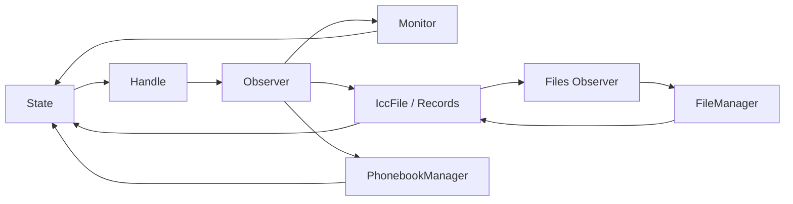

# SIM-028 隔离 Stop/Shutdown 实现与验证

本轮实际基线为 `77e3dc4e27dfe33ac728f225843b86b038914f6c`（main、origin/main一致），不是任务输入中的历史 e21f1ef3。生产修复仅应用于隔离副本；主工作区生产文件、98份原有修改均保留，未提交、推送或合并。原始1861份输入逐文件SHA核对未变化，交付后唯一执行状态只追加本轮检查点。

**结论：M1通过，M2在已执行Host边界内通过；M3及原生生产发布仍BLOCKED。** 当前main没有应用本补丁，直接运行main中的旧测试不会自动得到本轮修复。生产补丁可进入原生集成评审，不能直接据此发布或宣称SO可安全卸载。

## 实际结果

| 范围 | PASS | FAIL | 说明 |
| --- | ---: | ---: | --- |
| 原Host 60 | 55 | 5 | 五条独立缺陷全部保留 |
| 原14入口 | 14 | 0 | 包含在原Host中；ISimManager仍StrictMock |
| RealSimPrimary | 7 | 0 | 真实Manager、Controller；原C1业务/RIL/清理均通过 |
| 生命周期 | 8 | 0 | 原断言保留 |
| PairingReview | 4 | 0 | 三槽及共享运行时基线 |
| Stop A～H | 8 | 0 | 现在真实链接运行，非声明探针 |
| 新增安全验证 | 9 | 0 | C1三个停止阶段、Watcher、锁外析构、闭包屏障 |
| 原87条口径 | 82 | 5 | 不减少旧口径 |
| 扩展96条 | 91 | 5 | 完整命令真实退出码 **1** |
| ASan / TSan | 各36 | 各0 | 同一候选源码、独立构建，强RIL订阅模型，无告警抑制 |
| 强RIL所有权 | 216 | 0 | 36条一次 + 18个关键场景各10次 |
| TSan并发重复 | 57 | 0 | 19个关键场景各3次，包含B成功、C1及停止场景 |

最终真实测试二进制SHA256：`88066bb3c257c14db08f86bfe78532926904f57ea85abe452e732d135b07f6a9`。Clang/LLDB 18.1.3、GN 1000 (03d10f1)、Ninja 1.11.1、Python 3.12.3、C++17，Ubuntu 24.04.4 / WSL2 x86_64，链接libstdc++与libcrypto.so.3；详细路径、内核及版本在[toolchain.json](toolchain.json)。未安装包或修改系统配置。

[validation.json](validation.json)为分层结论；[test-cases.json](test-cases.json)列出96条逐例结果和原始属性。原87条的五个失败仍是 DEFECT_001～005，包括Refresh返回契约冲突，详见原始XML；没有跳过或改断言。

## 交付补丁及职责

- [production-stop.patch](production-stop.patch)：37份生产候选文件；仅供隔离应用。
- [host-tests.patch](host-tests.patch)：12份Host测试/构建/边界文件，复用现有GN/GTest工程。
- [changed-files.json](changed-files.json)：全部49份文件、原始/规范化SHA及新增标志。
- [compiled-sources.json](compiled-sources.json)：真实目标Ninja编译闭包，包含51个 services/sim 源文件。编译进目标不等于每个函数执行过。

| 文件组 | 责任 |
| --- | --- |
| SimManager | 显式Stop、并发幂等状态、入口准入、协调释放；析构不承担破环，不在析构调用自身shared_from_this |
| tel_lifecycle | 按FFRT逻辑任务ID传播对象私有任务组；在途计数、发布屏障、完整调度句柄等待、线程join；无在途的外部准入处回收已完成句柄 |
| TelEventQueue / Handler | 关闭准入、取消自有延迟任务、锁外等待队列完成；不停止FFRT全局池 |
| Monitor / State / File / Phonebook / Account / SMS / STK / Cache | 各自注销订阅与清理子对象；覆盖全部逻辑槽和去重后的缓存Records |
| ObserverHandler | 容器锁内移除、锁外释放订阅者；真实重入析构测试通过 |
| Monitor / SimFile Watcher | 不复用的opaque token、弱对象、回调屏障、注册成功记录、注销失败保留上下文并返回Stop失败、重试 |
| MultiSimController | 修复应答标志与条件等待使用不同锁的竞态；缓存读取使用已有锁，已持锁调用方使用内部函数避免递归加锁；业务判断保留 |
| Host边界与诊断 | RIL可选强订阅所有权、真实C回调登记、FFRT完整完成语义、只读弱对象采样；不产生SIM业务结果 |

生产公开ISimManager/IDL未新增Stop；类内部布局及IccFile虚方法有变化，原生必须整体重编，不能替换单个旧ABI对象。

## 引用与退出证据



对应R1～R4，三槽12条代表闭环；不是按worker数或RIL use_count推算泄漏。[objects.json](objects.json)保存实测对象地址、RIL登记槽/事件、26个内部对象的弱引用释放证据。检查发生在Manager外部根仍保留时。外部AccountObserver先证明只剩调用方1个引用，再由调用方停止自己的队列；真实CMI仍保留共享RIL，因此先验证RIL=2，再显式撤销测试Core消费者验证RIL=1。SIM Stop本身不DeInit共享RIL。

[subscriptions.json](subscriptions.json)复核历史16组源码配对，并新增实际发现的三槽SimFile卫星Watcher组。17组均有源码配对位置，但CES/SA真实成功注册与退出未执行，不能把静态配对当运行PASS。当前Host成功注册5个参数回调（Monitor 2 + SimFile 3），验证部分注册失败、注销失败重试、在途回调、停止后及对象销毁后的迟到回调。

退出顺序：

1. Running→Stopping，拒绝新业务/注册；已接纳B/C1仍沿原完成、错误、超时和重试出口执行。
2. 等待已接纳任务及主卡重试终点；原45秒B超时实际执行。等待失败返回false、保留Stopping及根所有权，不伪造Stopped。
3. 封闭回调，等待已发布任务的闭包销毁与线程完成，期间不持生命周期锁。
4. Monitor队列/订阅/Watcher→Controller与Radio→Account/Tracker/Cache→SMS/STK/Phonebook→File/Records/文件控制器→State/Handle。
5. 清空SIM根持有关系、释放SIM自己的RIL引用，最后标记Stopped；重复Stop不重新清理。

正常路径没有固定sleep清理、AllowLeak、私有访问宏、强制内存清空、线程强杀或忽略链接/退出码。默认75秒是失败预算，不能代替无限重试链的完整原生验收。

## 单条真实业务因果链

[c1.xml](c1.xml)中业务、StrictMock RIL、object_lifetime均PASS；清理后worker=0、RIL引用=1、账户观察者过期。[c1.log](c1.log)含输入、会话/槽/阶段、参数与通知；[lldb-c1.log](lldb-c1.log)在最终二进制真实命中：

`CoreServiceSim::SetPrimarySlotId → SimManager::SetPrimarySlotId → MultiSimController::SetPrimarySlotId → RadioProtocolController::SetRadioProtocol`

单场景执行两个成员的CHECK/UPDATE/COMPLETE，错误session的CHECK应答被真实代码拒绝，再完成参数/通知及同步返回，最后Stop释放。额外三场景分别在各阶段开始Stop，继续交付已接纳应答且拒绝新请求。[c1-functions.json](c1-functions.json)及压缩原始profile为补充证据，不能仅凭函数命中推定因果链。

C1原实现在握手前暂存主卡参数，失败恢复；新增测试遵守该语义，检查成功MAIN通知在COMPLETE后发生，没有把“禁止暂存”强加给生产实现。B使用专用SetPrimarySlot；C0不发不必要的设备命令；A依赖缺失厂商实现，BLOCKED。

## WSL复现与调试

依赖沿用当前工程固定版本，不自动下载或安装。GTest提交b514bdc；OpenSSL头及securec/cJSON/string_ex按已有dependency_lock与prepare_runtime校验。路径指定你实际准备的依赖，准备方式见原[主卡说明](../../primary_slot/README.md)。

```bash
KIT=telephony_core_service/services/multisim/test/systemtest/configs/sim028_stop_implementation_20261112
python3 -B "$KIT/reproduce.py" \
  --destination /tmp/sim028-stop-review-20261112 \
  --gtest-root "$SIM_GTEST_ROOT" \
  --openssl-root "$SIM_SSL_ROOT" \
  --runtime-root "$SIM_NATIVE_ROOT" \
  --filter 'RealSimPrimary.C1ThreePhasesWithStaleCheckResponseRejected'
```

脚本要求全新仓外目录，先校验原输入，再local clone并显式覆盖当前真实跟踪/未跟踪资产，校验SHA，**仅在隔离副本**规范化补丁文件换行并应用两份补丁。已实际验证准备/完整补丁应用及候选摘要、GN配置；prepare-only不计测试执行。交付测试使用规范化摘要一致的实际隔离源码。

后续在新副本运行现有入口：

```bash
cd /tmp/sim028-stop-review-20261112/repo
./telephony_core_service/services/multisim/test/systemtest/tools/run_host_tests.sh selected \
  --target sim_primary_slot_real_test \
  --filter 'RealSimPrimary.*:RunnerLifetime.*:RealCardLifetime.*:PairingReview.*:ShutdownContract.*:ShutdownExtra.*'
# 全96条，退出1：保留的五条真实FAIL。
./telephony_core_service/services/multisim/test/systemtest/tools/run_host_tests.sh all --with-real-primary
SIM_HOST_BOOT_SLOT_COUNT=2 lldb -- .host-out/build/sim_primary_slot_real_test \
  --gtest_filter=RealSimPrimary.C1ThreePhasesWithStaleCheckResponseRejected
```

直接启动二进制必须设置SIM_HOST_BOOT_SLOT_COUNT=2，保持“两个物理槽、三个逻辑对象”的既有配置；已有host.py自动设置。早期直接启动遗漏此项导致的失败已保存在iterations.zip，未计为有效三槽结果。

`verify_runtime.py --binary <Linux测试二进制> --output <新目录> --strong-ril --critical-only --rounds 3`可复现强RIL及逐例独立进程重复验证，保留XML和非零退出。通过原host.py的`--sanitizer address/thread`独立配置构建，勿把不同构建输出混用。Native工具库本身不全带sanitizer，TSan结论限本轮Host代码和调度边界。

Remote-WSL打开隔离repo后，现有clangd读取真实`.host-out/build/compile_commands.json`；Tasks沿用保存的依赖配置。现有专用F5配置为C0，可在隔离副本把filter改为上述C1。GUI测试发现、F5/单步仍MANUAL；CLI LLDB已实际通过。部分变量受O1/LTO影响不可见，不宣称GUI全部验收。

## 原生阻塞及评审结论

- **BLOCKED：** 完整CoreService/Stub、Binder/SA/CES、HDI和NetworkSearch/SMS消费者退出。Host只有真实CoreServiceSim方法与CMI，SA身份token/外部RIL为Host边界，不是原生IPC。
- **BLOCKED：** 当前产品Core尚未调用新Stop；需用同一控制块真实Manager由控制线程协调，Stop失败不得释放根、DeInit共享RIL或卸载SO。原生SA/CES/死亡回调的弱锁先于准入及注销失败路径仍需屏障审查和实测；当前补丁不作为这些平台安全性的完成证明。
- **NOT_RUN：** 成功运营商配置/APN-ready路径中的RemoveTask、完整C1无应答长重试/Stop预算失败后重试、缓存GSM/USIM/CDMA类型切换矩阵。相关清理代码已编译，未冒充运行通过。
- FFRT逻辑任务组及join/submit_h以真实FFRT头作C++17、fno-exceptions语法检查通过（源码commit 1d559e70），仅证明声明/API可编译，不证明匹配产品ABI或原生FFRT运行安全。隐式上下文传播、持续繁忙时句柄峰值及跨组件装配需原生负载验证。

匹配OHOS源码树必须具备telephony_data、FFRT、IPC/SAMgr、EventHandler、CES及RIL/HDI，应用候选并补齐Core协调后构建`hb build -T //base/telephony/core_service:tel_core_service`，再运行原生消费者及回调竞争测试。WSL中的Host通过不能替代该步骤。SO卸载必须额外证明平台不再调用回调代码入口。

原始/配对基线、当前完整XML与日志、强所有权/并发重复、sanitizer、编译命令及中间真实失败分别保存在zip归档；[SHA256SUMS](SHA256SUMS)覆盖交付文件。历史20261111 JSON与旧证据未覆盖。
