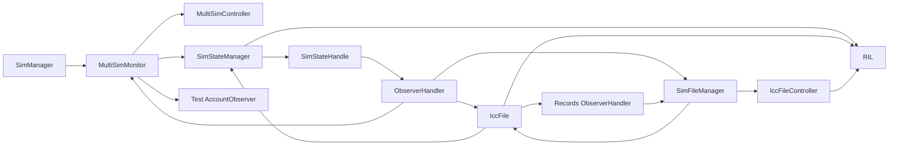

# SIM-028 生命周期诊断与修复边界

本目录复用 `sim_primary_slot_real_test`，没有替代生产 SimManager。原 C1 的业务、严格 RIL 期望和清理断言均保留。当前六个在卡场景仍因生产订阅对象图未释放而失败；不得将 Host Runner 修复解释为完整生命周期修复。

仓库根执行（先按上一层 README 配置依赖）：

```sh
./telephony_core_service/services/multisim/test/systemtest/tools/build_host.sh --target sim_primary_slot_real_test
./telephony_core_service/services/multisim/test/systemtest/tools/run_host_tests.sh selected \
  --target sim_primary_slot_real_test --filter 'RealSimPrimary.C1ThreePhasesWithStaleCheckResponseRejected'
python3 -B telephony_core_service/services/multisim/test/systemtest/primary_slot/lifecycle/run_diagnostics.py \
  --output /tmp/sim028-lifetime-trace
./telephony_core_service/services/multisim/test/systemtest/tools/run_host_tests.sh selected \
  --target sim_primary_slot_real_test --filter 'RunnerLifetime.*:RealCardLifetime.*'
./telephony_core_service/services/multisim/test/systemtest/tools/run_host_tests.sh all --with-real-primary
```

诊断命令不自动构建；退出码区分0=测试通过、1=测试失败、2=诊断阻塞。LLDB自身退出0不代替被调试程序结果。`trace_graph.py`仅通过命名DWARF字段/断点读取对象、控制块和观察者列表；不在目标内求值，不增加目标shared_ptr引用，不写内存，不按偏移读取或强制清理私有字段。基类子对象地址另表保存，避免将 `IccFile` 的 `EventHandler*` 错算成另一对象。引用图是停止点快照，构造/析构断点的解析数量也保存；未解析/内联的析构不能仅凭断点零次认定泄漏。

## 根因与源码依据

以下箭头均是实际成员或Observer容器的强所有权。每槽独立存在，Monitor跨槽共享；具体地址及控制块见本轮独立证据中的 `trace/graph.json`。



| 引用边/退出动作 | 生产源码位置（相对telephony_core_service） |
| --- | --- |
| Manager→Monitor/Controller/State/File | `services/sim/include/sim_manager.h` 成员；`sim_manager.cpp::OnInit/InitMultiSimObject/InitSingleSimObject`；析构函数为空 |
| Monitor→State、Controller；File只是weak | `services/sim/include/multi_sim_monitor.h:154`～156，构造函数复制所有权 |
| State→Handle；Handle→Observer | `sim_state_manager.cpp::Init`；`sim_state_handle.cpp::Init`；Handle反向State/RIL是weak，不能误画为强环 |
| Observer→订阅者 | `services/tel_ril/include/observer_handler.h::observerHandlerMap_`，`observer_handler.cpp::RegObserver/Remove`：map/list存shared_ptr |
| State的Observer→Monitor | `multi_sim_monitor.cpp::RegisterSimNotify(slot)` 注册STATE_CHANGE/LOCKED/READY；File ICCID观察者另强持Monitor |
| File→Records；Records→State | `sim_file_manager.h::simFile_/iccFileCache_`；`icc_file.h::stateManager_`；`icc_file.cpp::Init` 注册READY/LOCKED/SIMLOCK，形成独立环 |
| Records→Observer→File | `sim_file_manager.cpp::InitSimFile` 注册自身RADIO_SIM_RECORDS_LOADED，形成File/Records独立环 |
| State→Observer→File | `sim_file_manager.cpp::Init` 注册CARD_TYPE_CHANGE及SIM_ICCID_LOADED；反注册后者在 `sim_state_handle.cpp::UnRegisterCoreNotify` 缺失 |
| Monitor→测试AccountObserver | `SimManager::RegisterCoreNotify` 转发ACCOUNT_LOADED，Monitor强存；Manager的UnRegister缺此分支，Monitor也无对应公开注销方法 |
| RIL残留 | `SimStateManager::telRilManager_`、`IccFile::telRilManager_`、`IccFileController::telRilManager_` 每槽各一个；同一RIL控制块，不能算成十个对象 |
| 状态退出未到达 | `SimStateManager::~SimStateManager` 才调用Handle::UnInit；State已在环内，析构触发不了注销 |
| Monitor析构职责不足 | `~MultiSimMonitor` 仅UnSubscribeListeners（CES/SA），不调用UnRegisterSimNotify；自身强订阅归零前析构不可达 |
| 队列退出 | `utils/common/src/tel_event_queue.cpp::~TelEventQueue`取消/等待；`RemoveAllEvents`只清事件列表，不是禁止新提交或在途排空屏障 |

28个Host worker是本测试FFRT替身为每个queue创建一个线程的实现结果：每槽8个残留queue（StateHandle/FileManager/FileController/DiallingHandler/SimFile/PhonebookManager/Cache/UsimService），加Controller、RadioProtocolController、Monitor、测试AccountObserver各1。真实OHOS FFRT线程池的线程数不能据此推断。停止点队列记录区分pending、running、cancelled；三个StateHandle遗留约180秒的匹配SIM定时器，其他残留queue可为空且仍有worker。无需等待定时器才能证明强环存在。

RIL最终10 = 测试根1 + 三槽 ×（StateManager1 + IccFile1 + FileController1）。Manager析构前为23，析构及Account/SMS/STK等所有者释放后下降；控制块和地址证据用于验证此分解。AccountObserver是测试额外引入的残留对象，原因是调用真实生产注销接口没有对称实现；其余主环即使移除该观察者仍存在。

## 已实施的Host修复及测试范围

外部 `AppExecFwk::EventHandler` Runner改为显式Running→Stopping→Stopped；准入/创建/移动队列同步，停止期间拒绝Post/Start，退出锁后取消待执行工作并正常join在途任务，关闭后不能被迟到Post自动重建。自己的callback线程同步Stop返回false，交由控制线程停止，避免自join。测试RIL弱订阅表现在按owner注销，不再留下已注销的弱登记；它从未强持SIM对象。

五个 `RunnerLifetime` 测试验证正常完成/重复Stop、取消延迟工作并释放capture、在途Stop与回调重投拒绝、并发Stop、自join拒绝。这些只验收Host平台边界。三个 `RealCardLifetime` 直接构造真实State/File对象：缺RIL初始化失败可释放；有效State单独初始化后可注销/释放；State+File仅经现有公开注销仍不能释放，保留失败断言和RIL泄漏检查，不把预期泄漏写成绿色characterization。`OwnedCardGraph`仅负责测试自己构造的对象，未访问或清理SimManager私有对象。

完整SimManager的在途Stop、重复Stop、迟到回调安全仍BLOCKED：生产对象没有Stop契约，不能拿Runner测试替代这些验收。

## 未应用的最小生产修改建议

[注销配对补丁](pairing_fixes.proposed.patch)给出两个已证实缺口的具体差异（4个生产文件），**仅供审查，未应用、未编译验证**：补SIM_ICCID_LOADED注销，补Manager→Monitor的ACCOUNT_LOADED注销。它们是资源生命周期配对修复，不更改主卡分支、持久化、返回码或RIL协议；但**单独应用仍不足以修复完整图**。

完整最小闭包还必须新增显式停止协议，不能把全部动作塞入空析构函数。建议新私有生命周期接口在调用者仍持共享所有权时执行：

```cpp
// 方案草图，非已实现/可直接编译的生产代码。
SimManager::Stop(deadline) {
    // Running -> Stopping；并发重复调用等待同一停止结果。
    // 禁止新请求/新订阅/重试启动，跟踪RefreshCache等后台任务。
    // 已接纳B/C1请求仍允许关联应答与原有定时器完成，不改同步返回语义。
    if (!WaitExistingRequestsAndCallbacks(deadline)) return NotDrained;
    monitor->StopSubscriptionsAndDrain(deadline); // CES/SA + UnRegisterSimNotify + account observers
    for (auto &file : files) file->StopSubscriptionsAndDrain(deadline);
    for (auto &state : states) state->StopSubscriptionsAndDrain(deadline);
    // 同步停止其他Account/SMS/STK/Phonebook的已登记工作；缓存全部类型去重。
    // 成功排空后按依赖释放成员，最后释放本模块的RIL引用；Stopped。
}
```

具体修改面及必要顺序：

1. Manager新增Stop状态/在途计数和对称装配清理；RefreshCache分离线程纳入任务登记，拒绝停止期间的重新装配。重复Stop返回同一终态；停止超时保留对象，不宣称排空/卸载成功。
2. Monitor在ProcessEvent和订阅注册路径检查代次/状态；排空后在有效共享所有权内执行现有UnRegisterSimNotify、UnSubscribeListeners及自身观察者清理。析构只作停止完成校验与无须shared_from_this的兜底。
3. FileManager对所有缓存IccFile（USIM/GSM可能同对象，须去重）调用UnInit，注销自身STATE两项、RIL两项、各IccFile的RECORDS_LOADED；取消/排空File/Controller/Handler事件后释放缓存。不能只清当前simFile_。
4. State/Handle先关新注册与无关延迟工作，再UnInit注销RIL、清内部Observer，排空事件；析构不再次依赖shared_from_this。需要新增真实TelEventHandler/Queue准入与排空屏障，RemoveAllEvents不够。禁止持Manager/Observer锁等待worker，避免回调反取同锁；worker发起停止应移交控制线程。
5. CoreService::OnStop在共享RIL DeInit之前协调SIM停止、CMI/CoreSim脱附及其他消费者。SIM仅释放借用的RIL引用，不停止宿主共享RIL。旧epoch回调必须被门控，重新Init不能让旧回调作用于新图。

以上属于资源生命周期修复，但停止中请求的准入错误、超时停止策略及Core驻留服务的重启次序需另行批准和产品验证。当前常驻进程并不自动释放这些环；新增清理不应改变Running时业务，仍可能暴露过去被进程退出掩盖的注销竞态。需匹配OHOS FFRT、CES/SA、RIL/HDI运行时验证，不用Host队列join证明设备已结束。本轮遵守生产只读边界，因此原C1生命周期验收继续FAIL。
