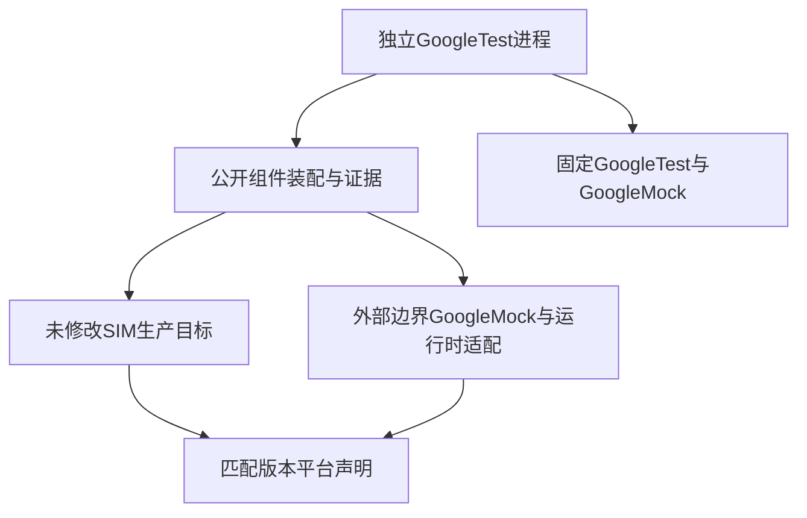

# 独立 Linux 组件工程与生产目标

更新：2026-10-15。用户已批准仅在systemtest内建立host适配；无需重新申请同一方案。与现行目标架构的关系见[设计对齐](design_alignment.md)。本文件描述当前设施及剩余缺口，不将目标设计写成实现。

## 工具链与隔离

| 项目 | 原OHOS构建 | 当前Linux工程 |
|---|---|---|
| GN根 | 完整源码树的build/ohos.gni、test.gni，本仓缺失 | 本目录.gn、gn/BUILDCONFIG.gn及Linux工具链 |
| 构建执行 | OHOS模板生成Ninja | 独立GN生成Ninja，不改用其他构建系统 |
| 测试模板 | ohos_unittest，含设备安装/报告属性 | 自有executable，明确不是ohos_unittest |
| 编译标准 | 本仓未明确完整OHOS默认标准 | 已运行配置C++17、Clang18.1.3、GNU gold、full LTO |
| GoogleTest/Mock | OHOS外部目标 | 固定1.15.2源码，来源、许可和离线准备见dependencies.md |
| 组织 | 既有test聚合及辅助实现 | 自己的测试、桩和产品目标，不引用旧Mock/Fixture |
| 结果 | OHOS模块安装/报告 | GoogleTest XML、脱敏JSON，准备失败单独BLOCKED |

GCC13.3编译探针与虚表链接结果不代表该配置已运行。当前采用Clang去除未用虚函数的容量切片，不能据此声称全部SimManager方法可用。工具链及平台声明分开追踪，固定GoogleTest不能解决OHOS头文件或运行时语义缺失。

## 实际生产参与范围

- `sim_production_host`：引用未修改的sim_manager.cpp、telephony_ext_wrapper.cpp，容量读取进入真实SimManager。详细源清单和裁剪限制见[依赖](dependencies.md)、[运行记录](run_record.md)。源码被列入目标不等于每个方法已执行。
- `event_transport_production_host`及配套INFRA目标：验证事件/FFRT/引用生命周期的适配基础，不计为SIM业务场景覆盖。
- 初始化闭包目标：历史探针45个生产对象编译，后续受14个SimData协议字段缺口阻塞，链接尚未到达。构造/编译探针不是初始化成功或无卡运行证据，详见[初始化闭包](initialization_closure.md)。

当前测试调用经核实的ISimManager组件边界；装配器可以创建具体对象和外部依赖，断言不读取实现私有状态。未来SO工厂须保留消费侧契约并使用具体类型deleter/工厂销毁；现有接口无虚析构，禁止接口裸指针delete。当前尚未建立新SO工厂。

## 外部适配与禁止替代的业务

平台声明优先采用匹配真实头文件，缺失项登记来源、支持范围和偏差。Parcel兼容不是Binder；受控参数/存储不是设备持久化；事件/FFRT模拟不证明系统投递、所有并发交错或真实调度时序。现有适配的生命周期及实线程范围见各INFRA用例；不声称已具有完整虚拟时钟。

GoogleMock只构造正式外部输入/响应并捕获必要请求，不能替代SimManager、卡状态机、文件解析或账户逻辑。未支持API必须显式失败/BLOCKED，不能任意成功。无卡应由正式RIL状态响应建立，不能以未初始化状态、零槽参数或mock账户列表冒充。

V3四Context/三聚合/分类目标尚未落地。测试不绑定目标类名、SO归属、内部容器或数据库表。CoreManagerInner的消费侧兼容与内部Host Ports是生产重构目标，不要求容量组件测试绕经Core，也不授权用桩替换SIM内部控制器。新增业务切片必须扩充真实生产闭包与正式外部边界。

## 覆盖与边界

层级为B：Linux受控组件集成。服务入口场景继续BLOCKED；保留真实capability检查，不绕过、不据拒绝判断生产缺陷。

未覆盖：Core Service SA注册/发现、实际Client/Proxy/Stub IPC、未经过的服务检查、真实权限与capability、真实Modem/平台/设备行为。组件PASS不能证明这些部分。新增文件和实现仍限定systemtest；若需外部生产接口或构建改动，先提出独立最小方案。

构建、运行命令与输出位置见[README](../README.md)和历史[运行记录](run_record.md)。本次仅刷新文档，未重新编译、运行或改写历史结果。
